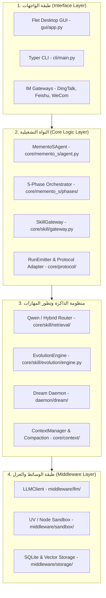
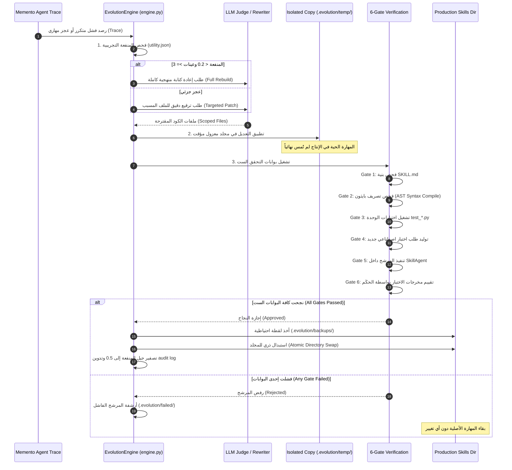

# دراسة معمارية عميقة: مشروع Memento-Skills
## (Deep Architectural Teardown — Memento-Skills Runtime & Evolution)

**تاريخ التوثيق:** 2026-11-03  
**المشروع المرجعي:** Memento-Skills (Memento-S / Qwen Agent Research)  
**المسار المحلي المفحوص:** `D:\AI-Employee-Platform-Research\memento-skills`  
**المستودع الأصلي (Remote):** `https://github.com/Memento-Teams/Memento-Skills.git`  
**الـ Commit الأساسي المحقق:** `ee9b9a45efd093d669c06fe318b4b1dceb246d19` (14 أغسطس 2026)  
**الرخصة القانونية الحقيقية:** **Apache License 2.0** (تم التحقق من ملف `LICENSE` والترويسات؛ تصحيحاً للادعاء السابق بأنه MIT).  
**الهدف الاستراتيجي:** تفكيك المعمارية البرمجية لـ Memento-Skills لاستخراج الأنماط الحاكمة لاكتساب المهارات التخصصية، عزل التنفيذ، وتقييم وتطوير الموظف الرقمي دون تكرار أخطاء المحرك القديم.

---

## 1. هوية المشروع ومصادره (Identity & Provenance)

### 1.1 نشأة المشروع ومستودعه
- تم تطوير Memento-Skills كبيئة تشغيل (Agent Runtime) متقدمة تطبق الورقة البحثية الخاصة بفريق Qwen / Alibaba حول دورة حياة القراءة والكتابة للمهارات (Read & Write Skill Evolution).
- إجمالي حجم المشروع في الالتزام `ee9b9a4`: **641 ملفاً** بأكثر من **125,975 سطراً برمجياً**.
- الرابط المرجعي: `https://github.com/Memento-Teams/Memento-Skills.git`.

### 1.2 الرخصة القانونية والقيود
- **نوع الرخصة:** `Apache License 2.0` (ملف `LICENSE`).
- **شروط الاستخدام التجاري:** تسمح بالاستخدام التجاري الحر والتعديل والدمج وإعادة التوزيع دون حظر خدمات الـ SaaS (بخلاف رخصتي Dify و n8n).
- **الاعتماديات البرمجية الأساسية:**
  - `litellm`: واجهة موحدة لمزودات النماذج مع آليات circuit breaker و retries.
  - `pydantic v2`: عقود البيانات والتحقق من صحة المخططات.
  - `uv`: عزل بيئات تشغيل البايثون وتثبيت اعتماديات المهارات اللحظية.
  - `transformers` (اختياري عبر `.[qwen-router]`): لتشغيل نماذج Qwen3-Embedding محلياً.
  - `flet`: واجهة سطح المكتب (GUI) للتشغيل الشخصي.

---

## 2. المعمارية الداخلية والحدود الهيكلية (Internal Architecture & Boundaries)

### 2.1 نقاط الدخول وتدفق التحكم (Control & Data Flow)
- على عكس المحرك المتراص في منصتنا (`conversational_agent_engine.py` ذي الـ 5,290 سطراً)، صُمم كلاس `MementoSAgent` في [`core/memento_s/agent.py`](file:///D:/AI-Employee-Platform-Research/memento-skills/core/memento_s/agent.py) كطبقة تنسيق رشيقة جداً (**603 أسطر فقط**).
- يفصل المحرك فوراً بين مسارين رئيسيين بالسطور 8–11:
  1. **المسار المباشر (DIRECT / INTERRUPT):** إجابة مباشرة خفيفة بدون أدوات ولا خطط، للرسائل البسيطة والتحيات.
  2. **المسار الاستقلالي (AGENTIC):** يمر بدورة كاملة: `Intent -> Plan -> Execute -> Reflect -> Finalize`.

---

## 3. دورة حياة الوكيل ومراحل المعالجة (Agent Lifecycle)

تتفكك معالجة المهمة المعقدة إلى 5 مراحل منفصلة ومحققة برمجياً في مجلد [`core/memento_s/phases/`](file:///D:/AI-Employee-Platform-Research/memento-skills/core/memento_s/phases/):

### 3.1 مرحلة التعرف على النية (Intent Recognition - `phases/intent.py`)
- تصنيف نية المستخدم دون استدعاء أدوات ثقيلة: هل الطلب محادثة استفسارية عامة، أم يتطلب تنفيذ مهام متعددة الخطوات؟
- عزل هذه المرحلة يمنع الخلل الذي تعاني منه منصتنا الحالية حيث يتم إرباك النموذج بتعليمات حظر الأدوات وإجباره على البحث عن أسئلة في رسائل التحية.

### 3.2 مرحلة توجيه واسترجاع المهارات (Skill Routing - `core/skill/retrieval/`)
- استدعاء `SkillGateway.route(goal)` قبل وضع أي خطة.
- يدعم المحرك 3 أوضاع استرجاع محققة في [`docs/QWEN_ROUTER_AND_SKILL_EVOLUTION.md`](file:///D:/AI-Employee-Platform-Research/memento-skills/docs/QWEN_ROUTER_AND_SKILL_EVOLUTION.md):
  1. `keyword`: استرجاع محلي خفيف بالكلمات المفتاحية.
  2. `qwen`: استرجاع دلالي متجهي بنموذج Qwen3-Embedding.
  3. `hybrid`: دمج نتائج الكلمات المفتاحية مع التضمين الدلالي عبر خوارزمية **Reciprocal Rank Fusion (RRF)**.

### 3.3 مرحلة التخطيط المعتمد (Planning Phase - `phases/planning.py`)
- بناء خطة عمل مقسمة لخطوات واضحة بناءً على المهارات المسترجعة فقط (`SkillBrief`).
- منع الهلوسة في التخطيط عبر التحقق من صحة الخطة (`validate_plan`) ومطابقتها للأدوات المتوفرة فعلياً.

### 3.4 حلقة التنفيذ واعتراض التكرار (Execution & Loop Detection)
- تُنفذ الخطوات عبر `core/skill/execution/agent.py`.
- **ميزة حيوية:** يراقب كلاس `LoopDetector` ([`core/skill/execution/loop_detector.py`](file:///D:/AI-Employee-Platform-Research/memento-skills/core/skill/execution/loop_detector.py)) بصمات استدعاء الأدوات السابقة ومدخلاتها، ويوقف التنفيذ فوراً إذا وقع الوكيل في حلقة مفرغة من استدعاء نفس الأداة الفاشلة.
- **حارس الهلوسة (`HallucinationGuard`):** في [`core/memento_s/skill_dispatch/hallucination_guard.py`](file:///D:/AI-Employee-Platform-Research/memento-skills/core/memento_s/skill_dispatch/hallucination_guard.py)، يتم اعتراض أي محاولة من النموذج لاستدعاء مهارة غير مسجلة أو تمرير معاملات وهمية قبل وصولها للأداة.

### 3.5 مرحلة التأمل وإنهاء المهمة (Reflection & Finalize)
- تقييم ما إذا كان الناتج يلبي رغبة المستخدم.
- إذا فشلت المهارة أو توقفت المهمة، لا يُرسل اعتذار نصي فوري للمستخدم، بل يمر أثر التنفيذ (Trace) إلى **محرك تطور المهارات المعاملاتي (Transactional Skill Evolution Engine)**.

---

## 4. المحور الأثمن: دورة حياة المهارات والمعاملات الآمنة (Transactional Skill Evolution)

يمثل كلاس `EvolutionEngine` في [`core/skill/evolution/engine.py`](file:///D:/AI-Employee-Platform-Research/memento-skills/core/skill/evolution/engine.py) (788 سطراً) **النموذج العالمي الأمثل** الذي تحتاجه منصتنا لاستبدال الآلات الحاسبة الثابتة بحسابات وأدوات ذكية تتطور وتختبر ذاتياً:

### 4.1 بوابات التحقق التلقائية الست (The 6-Gate Verification Pipeline):
1. **Gate 1 (بنية الوثيقة):** قراءة ملف `SKILL.md` والتأكد من مطابقة معايير الحقول والمدخلات والمخرجات.
2. **Gate 2 (سلامة الكود):** فحص تركيب بايثون النحوي (`compile(src, ...)` و AST) لمنع أي Syntax Errors.
3. **Gate 3 (اختبارات الوحدة المحلية):** تشغيل كافة اختبارات `test_*.py` المرفقة بالمهارة والتأكد من نجاحها.
4. **Gate 4 (توليد السيناريو الاصطناعي):** توليد سياق ومهمة اختبار اصطناعية تحاكي الفشل الذي حدث في الـ Trace الأصلي.
5. **Gate 5 (التنفيذ الفعلي):** تشغيل كود المهارة الجديد عبر `SkillAgent` داخل بيئة معزولة وقياس المخرجات الفعلية.
6. **Gate 6 (تحكيم النتيجة):** فحص النتيجة النهائية بواسطة نموذج حكَم والتأكد من تلبيتها للمعايير قبل أي اعتماد.

---

## 5. منظومة الذاكرة وتطور الشخصية (Memory & Soul Evolution)

يمتلك المشروع هيكلية ذاكرة متقدمة تتجاوز مجرد تخزين سجلات المحادثة:

1. **الذاكرة التشغيلية وضغط السياق (`core/context/compaction.py`):**
   - استبدال التقطيع القسري بخط أنابيب متقدم متعدد الاستراتيجيات في [`infra/compact/pipeline.py`](file:///D:/AI-Employee-Platform-Research/memento-skills/infra/compact/pipeline.py):
     - `zero_llm`: ضغط سريع بدون نموذج لحذف التكرارات والتفريغ الهيكلي.
     - `llm_single`: تلخيص دلالي للمحادثة مع الحفاظ على الأهداف الثابتة.
     - `llm_emergency`: ضغط طارئ عند اقتراب النافذة من النفاد.
2. **الذاكرة العرضية وخادم الأحلام (Offline Dream Daemon - `daemon/dream/`):**
   - يعمل كخدمة خلفية (`daemon/dream/loop.py`) عندما يكون الوكيل خاملاً.
   - يقوم المجمع (`daemon/dream/consolidator.py`) بقراءة سجلات الحوارات اليومية ودمجها وتجريدها إلى حقائق دائمة وخبرات مستفادة تثري ذاكرة الوكيل.
3. **تطور روح الوكيل وشخصيته (Soul & User Profiling):**
   - يدير `SoulManager` في [`core/agent_profile/soul_manager.py`](file:///D:/AI-Employee-Platform-Research/memento-skills/core/agent_profile/soul_manager.py) هوية الموظف وقواعد سلوكه.
   - يقوم `soul_evolver.py` بتحديث شخصية الوكيل استناداً إلى أسلوب تعامله مع المستخدم مع الاحتفاظ بنسخ احتياطية لكل جيل.

---

## 6. الأمان والاستقلالية وعزل التنفيذ (Security & Sandboxing)

1. **العزل عبر `uv` و Node Sandbox:**
   - تستخدم حزمة [`middleware/sandbox/uv.py`](file:///D:/AI-Employee-Platform-Research/memento-skills/middleware/sandbox/uv.py) مدير الحزم فائق السرعة `uv` لإنشاء بيئة بايثون معزولة افتراضية لحظية لكل مهارة وتثبيت اعتمادياتها المعزولة، مما يحمي بيئة الخادم الأساسية من تضارب الحزم.
2. **حواجز المسارات وأمان الأدوات (`shared/tools/path_boundary.py`):**
   - منع هجمات Path Traversal والتحقق من أن أي أداة تقرأ أو تكتب ملفات محصورة بدقة داخل مجلد العمل المخصص لها.
3. **نقطة القصور الجوهرية (Single-Tenant Limitation):**
   - **التقييم النقدي:** صُمم Memento-Skills أساساً كـ **وكيل شخصي أحادي المستخدم (Single-Tenant Desktop/Personal Agent)**؛ لذا تخلو قاعدة بياناته ومساراته من مفهوم `tenant_id` أو الفصل متعدد المستأجرين.

---

## 7. مصفوفة الملاءمة والمقايضات لمنصة AI-Employee-Platform

| المكون في Memento-Skills | هل يصلح لمنصتنا؟ | الحكم المعماري وتفاصيل التكييف |
| :--- | :---: | :--- |
| **خط أنابيب تطور المهارات المعاملاتي (EvolutionEngine)** | **نعم (100%)** | **جوهرة معمارية:** سنتبنى نمط البوابات الست، واختبار المرشح في بيئة معزولة، والـ Atomic Swap بدلاً من قوالب الآلات الحاسبة الثابتة. |
| **تقييم المنفعة التجريبية (`utility.json`)** | **نعم** | تسجيل نسبة نجاح الأدوات المعتمدة؛ إذا هبطت كفاءة الأداة عن حد معين تُحال للمراجعة أو الترقيع التلقائي. |
| **حارس اعتراض الهلوسة (`HallucinationGuard`)** | **نعم** | اعتراض محاولات استدعاء الأدوات غير المسجلة قبل إرباك محرك التنفيذ. |
| **كاشف الحلقات التكرارية (`LoopDetector`)** | **نعم** | منع الوكيل من تكرار استدعاء الأداة الفاشلة لنفس الهدف. |
| **ضغط السياق متعدد الاستراتيجيات (`Compaction Pipeline`)** | **نعم** | استبدال بتر الـ 350 حرفاً الحالي بالضغط الدلالي الخالي من التقطيع التعسفي. |
| **خادم الأحلام الخلفي (Dream Daemon)** | **نعم (يُكيف للأب الروحي)** | دمج فكرة توطيد الذاكرة غير المتزامن كأحد مهام المشرف المركزي (The Godfather) خارج مسار المحادثة. |
| **بنية قاعدة البيانات (SQLite Storage)** | **لا** | غير صالحة؛ منصتنا مؤسسية متعددة المستأجرين وتعتمد على PostgreSQL 17 مع RLS و ACID متكامل. |
| **نموذج عزل المستأجرين (Multi-Tenancy)** | **لا (غير موجود)** | يجب إعادة بناء كافة هذه الأنماط مع إدماج `tenant_id` إجبارياً في عقود المهارات ونقاط الحفظ. |
| **واجهة Flet Desktop** | **لا** | منصتنا سحابية تدير لوحات تحكم React عبر الويب وقنوات Omni-Channel. |

---

## 8. الأسئلة المعمارية المفتوحة والخطوة التالية

1. **السؤال المفتوح:** في Memento-Skills، يتم تحديث كود المهارة على مستوى نظام الملفات مباشرة (`.evolution/`); كيف ننفذ ذلك بأمان في بيئة سحابية Dockerized متعددة المستأجرين؟
   - *الجواب المقترح:* تخزين كود المهارات وإصداراتها في قاعدة البيانات PostgreSQL لكل مستأجر (`agent_skills` table)، وتشغيل كود المهارة داخل بيئة تنفيذ معزولة (Sandboxed Subprocess أو Worker معزول).
2. **الخطوة التالية المباشرة:** الانتقال إلى تفكيك الأداة المرجعية الثانية: **LangGraph** لتحليل محرك Pregel Loop ونقاط الحفظ `PostgresSaver`.
