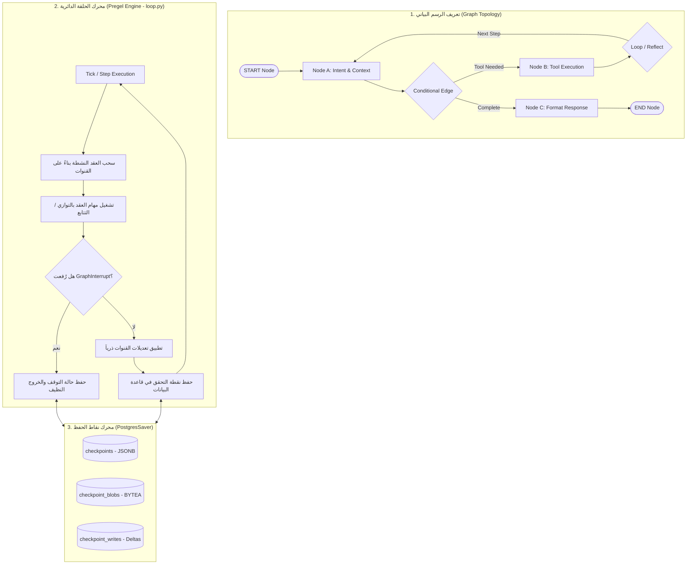

# دراسة معمارية عميقة: مشروع LangGraph
## (Deep Architectural Teardown — LangGraph Pregel Engine & Checkpointing)

**تاريخ التوثيق:** 2026-11-03  
**المشروع المرجعي:** LangGraph (LangChain AI)  
**المسار المحلي المفحوص:** `D:\AI-Employee-Platform-Research\langgraph`  
**المستودع الأصلي (Remote):** `https://github.com/langchain-ai/langgraph.git`  
**الـ Commit الأساسي المحقق:** `4c52e129eb1ab69a3da58b799f67929f77d81149` (Release v1.2.17 - 23 أكتوبر 2026)  
**الرخصة القانونية الحقيقية:** **MIT License** (تم التحقق من ملف `LICENSE`؛ مسموح تجارياً وسحابياً بالكامل).  
**الهدف الاستراتيجي:** تفكيك معمارية محرك الرسم البياني الحالاتي (Pregel Loop)، تخزين نقاط الحفظ في PostgreSQL (`PostgresSaver`)، وآليات الإيقاف والاستئناف البشري (`interrupt` / `Command`) لبناء نواة محرك الموظف الرقمي الجديد.

---

## 1. هوية المشروع ومصادره (Identity & Provenance)

### 1.1 نشأة المشروع ومستودعه
- طورته شركة LangChain كإطار عمل متخصص في بناء وكلاء الذكاء الاصطناعي متعددي الخطوات ذوي الحالات المستدامة (Stateful Multi-Agent Systems).
- حجم المشروع في الالتزام المحقق `4c52e12`: **698 ملفاً** بأكثر من **250,421 سطراً برمجياً**.
- الرابط المرجعي: `https://github.com/langchain-ai/langgraph.git`.

### 1.2 الرخصة والاعتماديات
- **نوع الرخصة:** `MIT License` (مفتوحة المصدر بالكامل، لا تفرض أي قيود تجارية أو قيود SaaS).
- **الاعتماديات الأساسية:**
  - `psycopg` (v3) و `psycopg-pool`: لاتصال PostgreSQL عالي الأداء مع اتصالات متزامنة وغير متزامنة.
  - `pydantic v2`: تعريف مخططات الحالات والمخرجات المهيكلة.
  - `typing_extensions`: لدعم `TypedDict`، `Annotated`، و `Generic`.

---

## 2. المعمارية الداخلية وتدفق دورة Pregel (Pregel Execution Engine)



### 2.1 بنية المحرك (Pregel Execution Loop)
- يقع قلب التنفيذ في [`libs/langgraph/langgraph/pregel/loop.py`](file:///D:/AI-Employee-Platform-Research/langgraph/libs/langgraph/langgraph/pregel/loop.py).
- يدير المحرك الحالات وفق نموذج **Pregel** (معالجة متزامنة متدرجة بالحواف والحالات الموجهة):
  - كل خطوة (Tick) تقرأ من قنوات البيانات (Channels).
  - تُنفذ دوال العقد (Node Functions) كدوال نقية نسبياً تستقبل الحالة وترجع تحديثات جزئية.
  - لا توجد حلقات لانهائية غير منضبطة؛ حيث يفرض المحرك قيد `recursion_limit` (الافتراضي 25 خطوة) لمنع الاستنزاف المالي والتشغيلي.

---

## 3. دورة حياة الوكيل ونقاط الاستئناف (Checkpointing & Persistence)

يمثل كلاس `BasePostgresSaver` في [`libs/checkpoint-postgres/langgraph/checkpoint/postgres/base.py`](file:///D:/AI-Employee-Platform-Research/langgraph/libs/checkpoint-postgres/langgraph/checkpoint/postgres/base.py) (879 سطراً) النموذج المرجعي الأكثر متانة عالمياً لحفظ واستئناف حالات الوكيل:

### 3.1 مخطط جداول PostgreSQL الفعلي (The DDL Schema):
تُنشئ الترحيلات في السطور 46–80 ثلاثة جداول أساسية:
```sql
-- 1. جدول نقاط الحفظ الرئيسي
CREATE TABLE IF NOT EXISTS checkpoints (
    thread_id TEXT NOT NULL,
    checkpoint_ns TEXT NOT NULL DEFAULT '',
    checkpoint_id TEXT NOT NULL,
    parent_checkpoint_id TEXT,
    type TEXT,
    checkpoint JSONB NOT NULL,
    metadata JSONB NOT NULL DEFAULT '{}',
    PRIMARY KEY (thread_id, checkpoint_ns, checkpoint_id)
);

-- 2. جدول الفروقات والتعديلات المرحلية
CREATE TABLE IF NOT EXISTS checkpoint_writes (
    thread_id TEXT NOT NULL,
    checkpoint_ns TEXT NOT NULL DEFAULT '',
    checkpoint_id TEXT NOT NULL,
    task_id TEXT NOT NULL,
    idx INTEGER NOT NULL,
    channel TEXT NOT NULL,
    type TEXT,
    blob BYTEA NOT NULL,
    PRIMARY KEY (thread_id, checkpoint_ns, checkpoint_id, task_id, idx)
);

-- 3. جدول الكتل البيانية للبيانات الثقيلة
CREATE TABLE IF NOT EXISTS checkpoint_blobs (
    thread_id TEXT NOT NULL,
    checkpoint_ns TEXT NOT NULL DEFAULT '',
    channel TEXT NOT NULL,
    version TEXT NOT NULL,
    type TEXT NOT NULL,
    blob BYTEA,
    PRIMARY KEY (thread_id, checkpoint_ns, channel, version)
);
```

### 3.2 مزايا معمارية التخزين المقسم (Partitioned Storage):
1. **عدم نسخ الحالة كاملة في كل خطوة:** جدول `checkpoint_writes` يسجل فقط القنوات التي تغيرت (Deltas) في هذه الخطوة، مما يوفر 90% من استهلاك قاعدة البيانات أثناء المهام الطويلة.
2. **شجرة الإصدارات والسفر عبر الزمن (Time-Travel & Branching):** وجود `parent_checkpoint_id` يسمح للمشرف أو المستخدم باستعراض أي نقطة زمنية سابقة في المحادثة والتفرع منها مجدداً دون إتلاف السجل الأصلي.
3. **الاستئناف بعد الانهيار (Crash-Resume):** إذا انهارت الحاوية أو انقطع الاتصال في الخطوة 4 من مهمة مكونة من 10 خطوات، يقرأ المحرك آخر `checkpoint_id` مكتمل في `thread_id` ويستأنف فوراً من الخطوة 5 دون تكرار العمليات السابقة.

---

## 4. الإيقاف التفاعلي والموافقة البشرية (`interrupt` & `Command`)

كشف فحص كود [`libs/langgraph/langgraph/types.py`](file:///D:/AI-Employee-Platform-Research/langgraph/libs/langgraph/langgraph/types.py) (السطور 894–935) عن آلية عبقرية تنهي تماماً فوضى آلة الحالة القديمة في منصتنا (`ConversationFSMService`):

### 4.1 دالة `interrupt(value, ...)` (السطر 902)
- تسمح لأي عقدة في أي مسار تشغيلي بطلب تدخل بشري برفع استثناء معالج `GraphInterrupt`:
  ```python
  def execute_bank_transfer(state: AgentState):
      # طلب موافقة على عملية مالية حساسة
      user_approval = interrupt({
          "action": "transfer_funds",
          "amount": state["amount"],
          "recipient": state["iban"]
      })
      if user_approval["confirmed"]:
          # استكمال التحويل
  ```
- **ما يحدث داخلياً:** يقوم المحرك باعتراض الاستثناء، تجميد حالة الرسم البياني، حفظ نقطة التوقف في PostgreSQL، وإرسال الـ payload للعميل أو المالك.

### 4.2 كلاس `Command(resume=...)` (السطر 915)
- عندما يرد المالك بالموافقة أو الرفض عبر تيليجرام، يتم إيقاظ المحرك واستئناف التنفيذ بتمرير الرد:
  ```python
  graph.invoke(Command(resume={"confirmed": True}), config={"configurable": {"thread_id": "thread-123"}})
  ```
- **النتيجة المعمارية:** لا نحتاج إلى برمجة شاشات وحالات تعليق مخصصة لكل سيناريو؛ الرسم البياني نفسه هو من يدير الإيقاف والاستئناف أوتوماتيكياً.

---

## 5. مصفوفة الملاءمة والمقايضات لمنصة AI-Employee-Platform

| المكون في LangGraph | هل يصلح لمنصتنا؟ | الحكم المعماري وتفاصيل التكييف |
| :--- | :---: | :--- |
| **محرك الرسم البياني الموجه (StateGraph & Pregel Loop)** | **نعم (100%)** | **العمود الفقري:** هو البديل المثالي لمحرك المحادثة الحالي ذي الـ 5,290 سطراً؛ يحول معالجة الموظف إلى عقد وحواف نظيفة. |
| **مخطط نقاط الحفظ (`PostgresSaver DDL`)** | **نعم (مع تكييف)** | سنعتمد نفس بنية الجداول الثلاثة، ولكن مع **إضافة `tenant_id` إجبارياً كقيد أساسي مركب** لضمان العزل التام للمستأجرين. |
| **آلية التدخل البشري (`interrupt` / `Command`)** | **نعم (100%)** | تلغي هشاشة `ConversationFSMService` وتربط موافقات المالك بنقاط الحفظ مباشرة. |
| **تعدد المستأجرين الأصيل (Multi-Tenancy)** | **لا (غير موجود)** | الجداول في LangGraph تفترض `thread_id` فقط؛ يجب بناؤها محلياً مع دعم الـ Multi-Tenancy الكامل. |
| **تطوير واكتساب المهارات ذاتياً (Self-Upskilling)** | **لا (غير موجود)** | LangGraph مجرد محرك تنفيذ ثابت؛ لا يمتلك آليات لتقييم المهارات واكتسابها (وهنا تتكامل ميزة Memento-Skills). |
| **استيراد مكتبة LangChain كاعتمادية خارجية ضخمة** | **لا** | سنبني **محرك StateGraph محلي نقي (In-house Engine)** يستلهم هذه الأنماط دون جر مئات الاعتماديات غير الضرورية. |

---

## 6. الخلاصة المعمارية

- **ما نأخذه من LangGraph:**
  1. نمط حلقة Pregel Loop بالعقد والحواف الشرطية وسقف التكرار.
  2. بنية جداول نقاط الحفظ المتينة في PostgreSQL مع الفروقات (Writes & Deltas).
  3. بروتوكول `interrupt()` و `Command(resume=...)` لإدارة الموافقات البشرية الحساسة.
- **الخطوة التالية المباشرة:** الانتقال إلى تفكيك الأداة المرجعية الثالثة: **Microsoft Agent Framework** (AutoGen) لدراسة ضغط السياق الدلالي وتنسيق فرق العمل متعددة الوكلاء.
