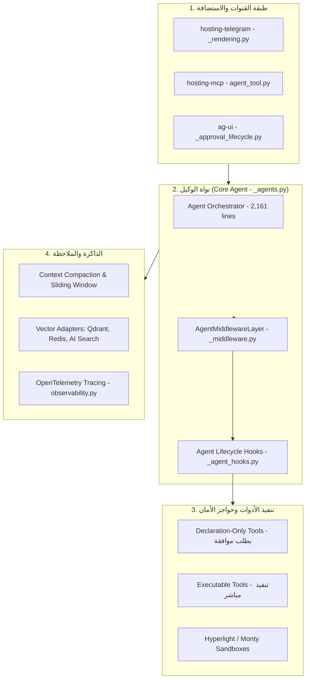

# دراسة معمارية عميقة: مشروع Microsoft Agent Framework
## (Deep Architectural Teardown — Microsoft Unified Agent Framework)

**تاريخ التوثيق:** 2026-11-03  
**المشروع المرجعي:** Microsoft Agent Framework (دمج AutoGen مع Semantic Kernel)  
**المسار المحلي المفحوص:** `D:\AI-Employee-Platform-Research\microsoft-agent-framework`  
**المستودع الأصلي (Remote):** `https://github.com/microsoft/agent-framework.git`  
**الـ Commit الأساسي المحقق:** `67ba500ec1fd312606a5d585a42335cd8631e851` (24 أكتوبر 2026)  
**الرخصة القانونية الحقيقية:** **MIT License** (مفتوحة المصدر بالكامل، مسموح تجارياً وسحابياً).  
**الهدف الاستراتيجي:** تفكيك معمارية منصة مايكروسوفت الموحدة للوكلاء، واستلهام طبقة الوسائط (Agent Middleware Layer)، إدارة موافقات الأدوات المصرح بها (Declaration-Only Tools & Approval Lifecycle)، وموصل التيليجرام الأصيل (`hosting-telegram`).

---

## 1. هوية المشروع ومصادره (Identity & Provenance)

### 1.1 نشأة المشروع ومستودعه
- أطلقت مايكروسوفت هذا المستودع كإطار عمل مؤسسي موحد للأجيال القادمة، يجمع بين قوة أوركسترا الوكلاء المتعددين من AutoGen وبين متانة تكاملات النماذج والأدوات المؤسسية من Semantic Kernel.
- حجم المشروع في الالتزام المحقق `67ba500`: **5,561 ملفاً** بأكثر من **1,238,964 سطراً برمجياً**.
- الرابط المرجعي: `https://github.com/microsoft/agent-framework.git`.

### 1.2 الرخصة والاعتماديات
- **نوع الرخصة:** `MIT License` (ملف `LICENSE`).
- **الاعتماديات البرمجية الأساسية:**
  - `pydantic v2`: تعريف مخططات الحالات والمخرجات والأدوات.
  - `opentelemetry`: مراقبة وتتبع مسار الوكلاء والأدوات عبر معايير OTel المفتوحة.
  - حزم استضافة متخصصة: `hosting-telegram`, `hosting-mcp`, `ag-ui`.

---

## 2. المعمارية الداخلية وطبقة الوسائط (Agent Middleware Architecture)



### 2.1 طبقة الوسائط المتقدمة (`AgentMiddlewareLayer`)
- يقع قلب التنفيذ في كلاس `Agent` في [`python/packages/core/agent_framework/_agents.py`](file:///D:/AI-Employee-Platform-Research/microsoft-agent-framework/python/packages/core/agent_framework/_agents.py) (2,161 سطراً).
- يقدم الإطار نمط وسائط (Middleware Pipeline) محكم يعمل على مستويين:
  1. **مستوى تشغيل الوكيل (Agent Run Level):** اعتراض المدخلات قبل التوليد وفحص السياسات الأمنية.
  2. **مستوى حلقة استدعاء الأدوات (Tool Loop Level):**
     - `before_tool_execution`: التحقق من المعاملات والصلاحيات.
     - `after_tool_execution`: تكرار الفحص، تشغيل نموذج حكَم (Judge Middleware)، أو تنقيح الناتج قبل إرجاعه للنموذج.

---

## 3. آلية الأدوات المصرح بها فقط ودورة حياة الموافقات (Declaration-Only Tools & Approvals)

يقدم إطار مايكروسوفت حلاً هندسياً فائق النقاء لمشكلة حظر الأدوات الحالية في منصتنا:

### 3.1 أدوات التصريح فقط (`Declaration-Only Tools`)
- بدلاً من منع النموذج من رؤية الأدوات المالية أو الإدارية في الـ System Prompt (كما تفعل منصتنا بالسطر 5165)، يُعرّض الإطار الأداة للنموذج بـ Schema كاملة، ولكن مع وسمها كـ `declaration_only = True`.
- عندما يقرر النموذج استدعاء هذه الأداة، **لا يقوم المحرك بتنفيذها مباشرة**، بل يولد كائن طلب موافقة (`ApprovalRequest`) يوقف التنفيذ ويسلمه للعميل أو المشرف.

### 3.2 خادم دورة حياة الموافقات (`ApprovalLifecycle` في `_approval_lifecycle.py`)
- تم فحص كود [`python/packages/ag-ui/agent_framework_ag_ui/_approval_lifecycle.py`](file:///D:/AI-Employee-Platform-Research/microsoft-agent-framework/python/packages/ag-ui/agent_framework_ag_ui/_approval_lifecycle.py).
- يدير دورة حياة الموافقة بالكامل على مستوى الخادم:
  - ربط طلب الموافقة بـ `thread_id` و `batch_id`.
  - معالجة التنافسية الذرية عبر أقفال الخيوط (`RLock`).
  - إدارة انتهاء المهلة الزمنية (Timeouts) تلقائياً لمنع تعليق الحالات للأبد.

---

## 4. موصل التيليجرام الأصيل والتجزئة النظيفة (`hosting-telegram`)

يمثل مجلد [`python/packages/hosting-telegram/`](file:///D:/AI-Employee-Platform-Research/microsoft-agent-framework/python/packages/hosting-telegram/) نموذجاً مثالياً لكيفية بناء موصل تيليجرام معزول هندسياً:

### 4.1 الفصل التام بين الرندرة واستدعاء الشبكة (`_rendering.py`):
- يحدد السطر 24 الحد الأقصى الرسمي لتيليجرام: `TELEGRAM_MAX_TEXT_LENGTH = 4096`.
- دوال الرندرة (`render_agent_response`) لا تنفذ أي طلب شبكي (`make no network calls`)؛ بل تقوم باستلام ناتج الوكيل وتقسيمه بذكاء إلى قائمة عمليات تيليجرام مهيكلة (`TelegramOperation`):
  ```python
  class TelegramOperation(TypedDict):
      method: Literal["sendMessage", "sendPhoto", "editMessageText"]
      payload: dict[str, Any]
  ```
- هذا الفصل المعماري يمنع تلوث كود محرك الوكيل بتفاصيل الشبكة وأخطاء الـ HTTP الخاصة بالموصلات.

---

## 5. مصفوفة الملاءمة والمقايضات لمنصة AI-Employee-Platform

| المكون في Microsoft Agent Framework | هل يصلح لمنصتنا؟ | الحكم المعماري وتفاصيل التكييف |
| :--- | :---: | :--- |
| **نمط وسائط دورة حياة الوكيل (AgentMiddlewareLayer)** | **نعم (100%)** | سنتبناه لفصل المنطق التفتيشي وحكام الأمان عن كود الوكيل الأساسي. |
| **أدوات التصريح فقط (Declaration-Only Tools)** | **نعم (100%)** | البديل المعماري الشرعي لحظر الأدوات الحالي؛ يسمح للوكيل بالتخطيط للأداة مع إيقاف التنفيذ لطلب موافقة المالك. |
| **رندرة عمليات التيليجرام (`hosting-telegram`)** | **نعم** | تجزئة الرسائل حتى 4096 حرفاً وفصل الرندرة عن عامل الـ Outbox. |
| **المراقبة المؤسسية الموحدة (OpenTelemetry)** | **نعم** | دمج مسارات OTel لتغذية خدمة المشرف المركزي (The Godfather) ببيانات التتبع اللحظية. |
| **بيئات العزل الافتراضية (Hyperlight Micro-VMs)** | **نعم (مستقبلاً)** | عزل تشغيل أكواد بايثون الحسابية داخل micro-VMs سريعة وخفيفة. |
| **حزم تكاملات Azure السحابية الاحتكارية (Azure AI Search / Cosmos)** | **لا** | منصتنا مستقلة سحابياً (Cloud-Agnostic) وتعتمد على PostgreSQL 17 و Redis محليين مفتوحي المصدر. |
| **تعدد المستأجرين (Multi-Tenancy)** | **لا (غير مدمج)** | الإطار يركز على تكاملات المستخدم المؤسسي الفردي؛ سنبني طبقة `tenant_id` الخاصة بنا فوقه. |

---

## 6. الخلاصة المعمارية

- **ما نأخذه من Microsoft Agent Framework:**
  1. نمط `Declaration-Only Tools` لحل مشكلة استدعاء الأدوات الحساسة دون كسر منطق النموذج.
  2. طبقة الوسائط `AgentMiddlewareLayer` لربط حواجز الأمان وفحص المخرجات.
  3. هندسة موصل التيليجرام النظيفة عبر تجزئة الـ 4096 حرفاً وعزل كائنات `TelegramOperation`.
- **الخطوة التالية المباشرة:** الانتقال إلى تفكيك الأداة المرجعية الرابعة: **Dify** لدراسة محرك الوكيل وتحرير جلسات قاعدة البيانات وتصميم الـ RAG.
