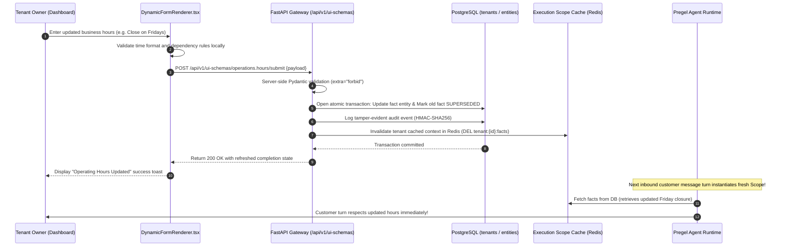

# Administrator and Tenant Configuration Architecture — Ownership & User Input Model

**Document ID:** `ADMIN_AND_TENANT_CONFIGURATION`  
**Governing Standard:** Full-Platform Target Vision (`docs/PROJECT_VISION.md` Section 9, 10, 14)  
**Target Repository:** `QQYC9/ai-employee-platform`  
**Status:** **AUTHORITATIVE ARCHITECTURAL SPECIFICATION**  
**Date:** 2026-11-04  
**Master Architect:** AI-Employee-Platform Core Architecture Group  

---

## 1. Executive Summary & Separation of Authority

A multi-tenant autonomous system must maintain strict, unambiguous boundaries between:
1. **Platform Administrator Authority (Platform Superadmin):** Manages multi-tenant infrastructure, global AI provider keys, system rate limits, billing quotas, and security boundaries. Governed exclusively via `apps/admin-dashboard`.
2. **Tenant Business Owner Authority (Subscriber):** Configures company business facts, operating hours, branch locations, digital employee assignments, channel integrations, and approves Level 2 operational requests. Governed exclusively via `apps/tenant-dashboard`.
3. **The Godfather Authority (Platform Founder):** Central cognitive overseer connected exclusively via private Telegram to the platform founder.

Cross-boundary privilege escalation is strictly prevented by cryptographic checks and database query filters.

---

## 2. Complete User-Dependent Requirements & Ownership Matrix

| Requirement / Configuration Asset | Why It Is Required | Who Provides It | Dashboard Owner | Who Can View | Who Can Modify | Validation Mechanism | Storage & Security | How Completion Is Displayed |
| :--- | :--- | :--- | :---: | :---: | :---: | :--- | :--- | :--- |
| **Global AI Model Credentials** (Gemini, OpenRouter, Groq) | Enables LLM inference across all tenants. | Platform Admin | **Admin Dashboard** (`/integrations`) | Superadmin | Superadmin | API Ping Test with test token | Encrypted at rest via AES-256-GCM; masked in UI | "Connected & Healthy" badge with latency ms |
| **Tenant Provisioning & Quota Allocation** | Sets subscription plan, monthly token ceiling, and rate limits. | Platform Admin | **Admin Dashboard** (`/tenants`) | Superadmin | Superadmin | Positive integer limits; plan enum validation | `tenants` relational table with plan constraints | Active status indicator; usage progress bar |
| **Tenant Business Profile** (Legal name, commercial reg, currency) | Informs digital employees of business identity. | Tenant Owner | **Tenant Dashboard** (`/settings`) | Tenant Owner, Admin | Tenant Owner | Required string; ISO 4217 currency code | `tenant_settings` table (scoped to `tenant_id`) | Profile completeness percentage card |
| **Operating Hours & Branch Schedules** | Determines whether agents answer inquiries or schedule appointments. | Tenant Owner | **Tenant Dashboard** (`/settings`) | Tenant Owner, Customer Agents | Tenant Owner | Multi-dimensional time schema (days, open, close) | `fact_entities` with dimensional metadata | Weekly schedule calendar preview |
| **WhatsApp Cloud API Credentials** (Phone ID, Token) | Connects tenant customer messaging to WhatsApp. | Tenant Owner | **Tenant Dashboard** (`/channels`) | Tenant Owner | Tenant Owner | Meta Graph API handshake verification | `tenant_integrations` (AES-256-GCM encrypted) | Green webhook verification checkmark |
| **Telegram Bot Credentials** (Bot Token, Username) | Connects tenant customer messaging to Telegram. | Tenant Owner | **Tenant Dashboard** (`/channels`) | Tenant Owner | Tenant Owner | Telegram `getMe` handshake call | `tenant_integrations` (AES-256-GCM encrypted) | Active bot username card with webhook URL |
| **Digital Employee Provisioning & Autonomy Tier** | Defines agent role, assigned tools, and whether actions need approval. | Tenant Owner | **Tenant Dashboard** (`/agents`) | Tenant Owner | Tenant Owner | Pydantic schema; Autonomy enum (`1, 2, 3`) | `agents` table with role definitions | Active employee card with autonomy badge |
| **Human-in-the-Loop Approvals** (Orders, Discounts, Campaigns) | Mandatory confirmation for Level 2 actions before external execution. | Tenant Owner | **Tenant Dashboard** (`/tasks`, `/approvals`) | Tenant Owner | Tenant Owner | RFC 8785 Canonical HMAC digest verification | `approval_requests` with status FSM | Urgent pending action banner with Accept/Reject |
| **Dynamic Product & Price Catalog** | Enables Sales Specialists to quote prices and draft invoices. | Tenant Owner | **Tenant Dashboard** (`/modules/catalog`) | Tenant Owner | Tenant Owner | `DECIMAL(18, 4)` currency validation | `business_entities` (typed SQL + GIN JSONB) | Product count, inventory status list |
| **Platform Telemetry & Error Forensics** | Monitors system health, error traces, and dead-letter queues. | System Telemetry | **Admin Dashboard** (`/monitoring`) | Superadmin | System Only | Automated OpenTelemetry / log ingestion | PostgreSQL `message_agent_thoughts` & Redis | Real-time throughput graph & error table |

---

## 3. Administrator Dashboard Architecture (`apps/admin-dashboard`)

### 3.1 Route Manifest & Access Controls
- `/login`: Administrator authentication (MFA-ready).
- `/`: Platform KPI overview (Active Tenants, Global Token Consumption, Inbound Message Volume).
- `/tenants`: Tenant provisioning lifecycle (Create Tenant, Deactivate, Set Quotas, Assign Dedicated Channels).
- `/agents-tasks`: Cross-tenant execution supervisor; view active Pregel supersteps, zombie workers, and failure dead-letter queues.
- `/monitoring`: System-level error traces, AI provider latency metrics, and audit log hash chain verification.
- `/integrations`: Global AI provider credential manager (Gemini API keys, OpenRouter keys, system SMTP credentials).
- `/settings`: Global platform security policies, rate-limiting presets, and founder Telegram notification configuration.

### 3.2 Security Guard & Tenant Isolation
- Admin dashboard routes are protected by `AdminProtectedRoute.tsx` requiring `role == "SUPERADMIN"`.
- Requests pass through `get_current_superadmin` dependency in FastAPI (`apps/agent/api/v1/admin.py`).
- Platform admins can inspect tenant metadata for billing and support, but cannot decrypt tenant private credentials without audited elevation logging.

---

## 4. Tenant Dashboard Architecture (`apps/tenant-dashboard`)

### 4.1 Route Manifest & Access Controls
- `/login`: Tenant business user authentication.
- `/`: Business Overview (Active Digital Employees, Daily Conversations, Pending Approvals, Token Budget Status).
- `/agents`: Digital Employee Management (Create from Spec, Set Autonomy Level, Configure Tools, View Capabilities Disclosure).
- `/tasks`: Execution Tasks and Approval Queue (Inspect ongoing workflows, Approve/Reject Level 2 tool execution requests).
- `/channels`: Omni-channel Connectors (Configure WhatsApp Cloud API, Telegram Bot, Custom Inbound Webhooks).
- `/campaigns`: Outbound Marketing Campaigns (Audience filtering, message template builder, dispatch status).
- `/usage`: Real-time AI token usage analytics, budget consumption charts, and threshold alerts.
- `/settings`: Company Business Brain (Business identity, operating hours, branch locations, return/refund policies).
- `/dynamic/:interface_key`: **Dynamic Schema-Driven Route** rendering any generated capability interface using `DynamicFormRenderer.tsx`.

### 4.2 Tenant Isolation Guarantees
- Every query dispatched from `apps/tenant-dashboard` includes `Authorization: Bearer <tenant_jwt>`.
- The backend dependency `get_tenant_context` extracts `tenant_id` from the cryptographically signed JWT.
- Attempting to access another tenant's URL parameter (e.g. `/api/v1/agents/{foreign_agent_id}`) triggers an automatic SQL filter `WHERE tenant_id = :my_tenant_id`, returning `404 Not Found` and recording an authorization anomaly to The Godfather.

---

## 5. Lifecycle of a Configuration Update or Revocation

1. **Immediate Scope Invalidation:** Submitting a configuration change immediately flushes the tenant's cached context in Redis.
2. **Fact Supersession:** Previous business facts are never erased without trace; they transition to `status = 'SUPERSEDED'`, pointing to `superseded_by_fact_id` with audit attribution.
3. **Revocation Behavior:** If a tenant revokes a channel token or deletes an agent, the backend sets status to `REVOKED`. The Pregel StateGraph runtime immediately rejects further executions for that entity with `403 Forbidden`.
