# AI-Employee-Platform — 15 Master Architectural System Maps

**Document ID:** `ARCHITECTURE_VISUAL_MAPS`  
**Governing Standard:** Section 11 (Required Architecture Maps Protocol)  
**System Designation:** AI Employee Platform (Enterprise Digital Employee Operating System)  
**Target Repository:** `QQYC9/ai-employee-platform`  
**Status:** **ACTIVE & AUDITED**  
**Date:** 2026-11-04  
**Master Architect:** AI-Employee-Platform Core Architecture Group  

---

## 1. Whole-Platform Subsystem Map

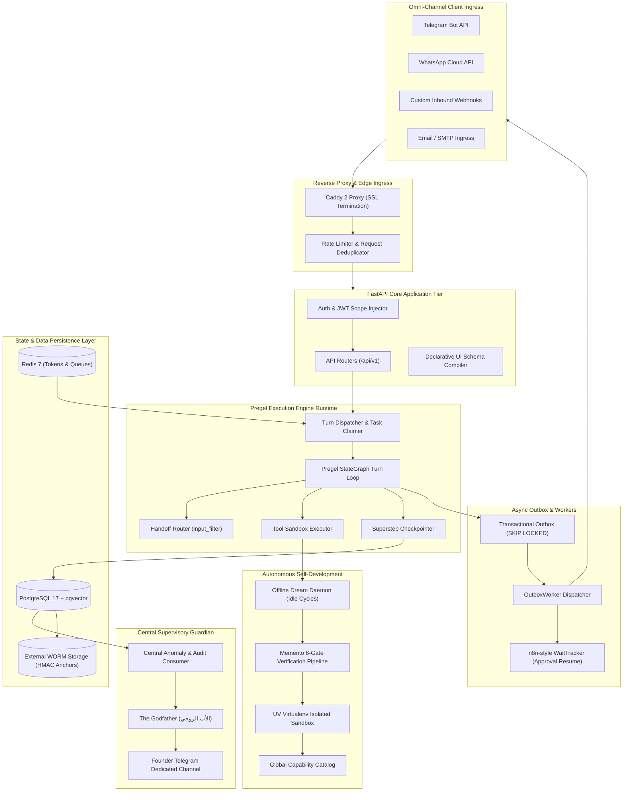

---

## 2. Agent Generation Lifecycle

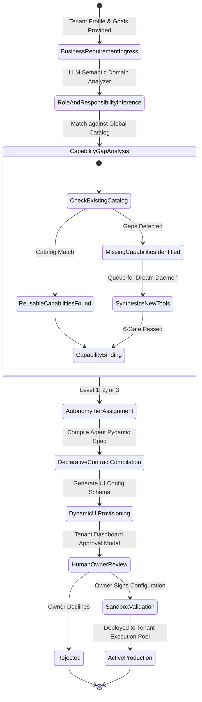

---

## 3. Capability Discovery and Generation Lifecycle

```mermaid
flowchart LR
    A["Agent Operational Failure / Gap"] --> B["Capability Need Detected"]
    B --> C{"Exists in Global Catalog?"}
    C -- "Yes" --> D["Bind Tool & Apply Tenant Permissions"]
    C -- "No" --> E["Queue for Offline Dream Daemon"]
    E --> F["Generate Python Pydantic Tool Contract"]
    F --> G["Gate 1: AST Structural Validator"]
    G --> H["Gate 2: Pydantic Extra=Forbid Schema"]
    H --> I["Gate 3: Security & Ban Scanner"]
    I --> J["Gate 4: UV Isolated Pytest Execution"]
    J --> K["Gate 5: Mock LLM Integration Run"]
    K --> L["Gate 6: Smoke Profiler & Latency Check"]
    L --> M{"All 6 Gates Passed?"}
    M -- "Yes" --> N["Register in Catalog & Await Owner Activation"]
    M -- "No" --> O["Quarantine, Record Failure & Alert Godfather"]
```

---

## 4. Self-Development and Approval Lifecycle

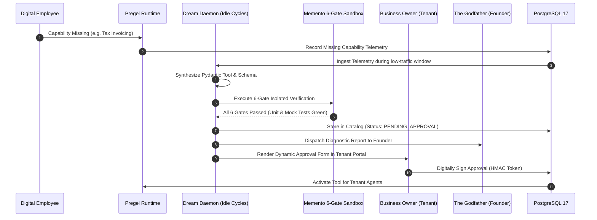

---

## 5. Godfather Observation and Escalation Architecture

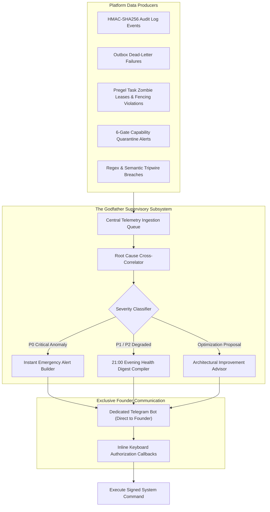

---

## 6. End-to-End Incoming Message Execution Path

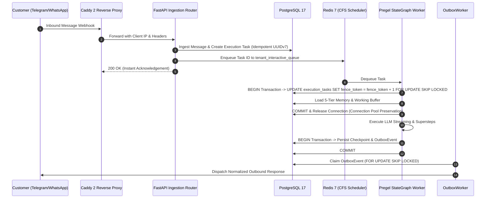

---

## 7. Tool Execution and Permission Path

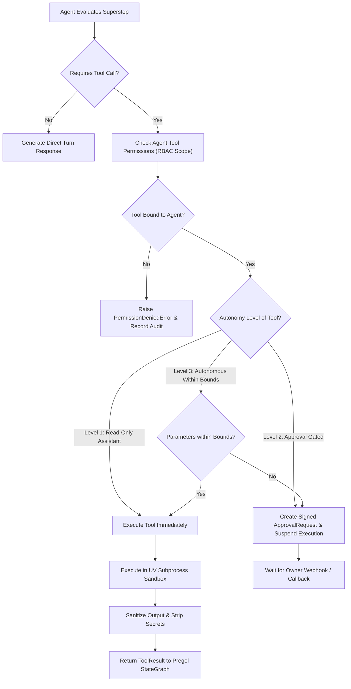

---

## 8. Human Approval and Wait/Resume Path

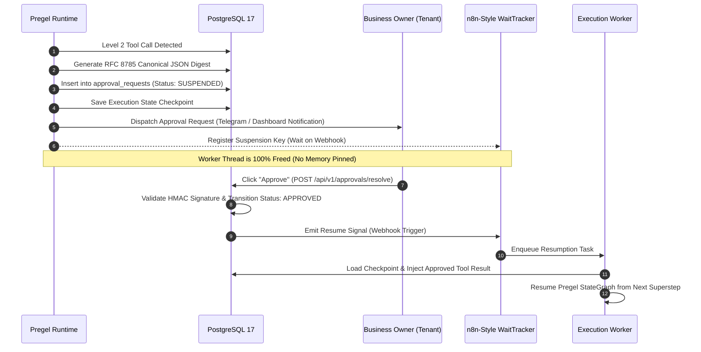

---

## 9. Tenant Configuration and Dynamic UI Path

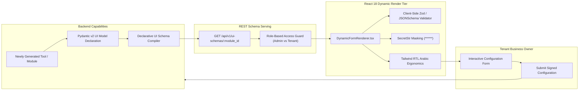

---

## 10. Knowledge and Memory Lifecycle

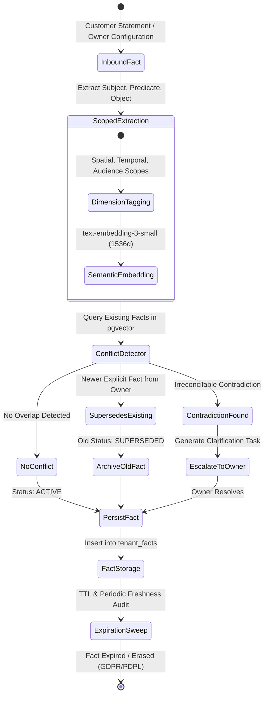

---

## 11. Database and Domain Ownership Map

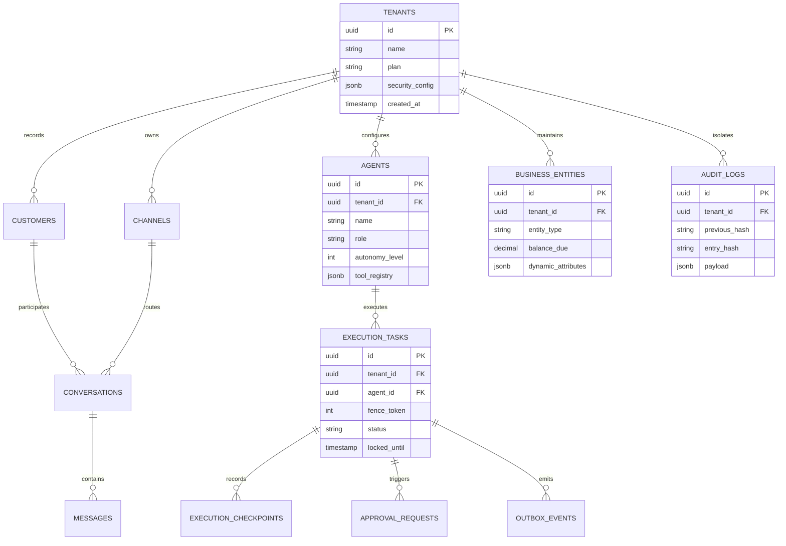

---

## 12. Cross-Agent Handoff and Workflow Map

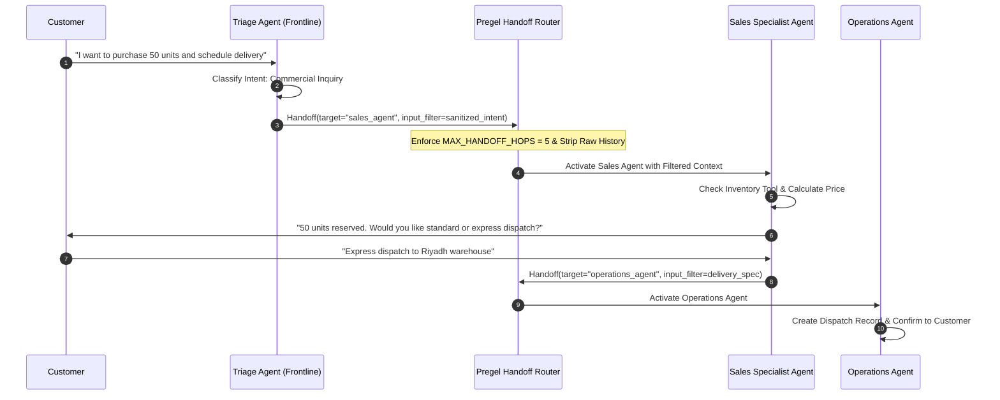

---

## 13. Deployment and Operational Topology

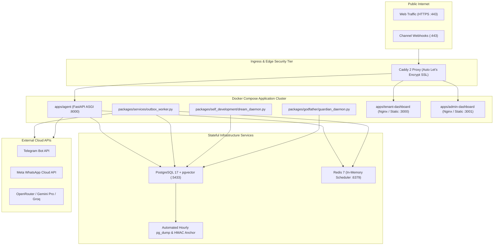

---

## 14. Failure and Recovery Paths

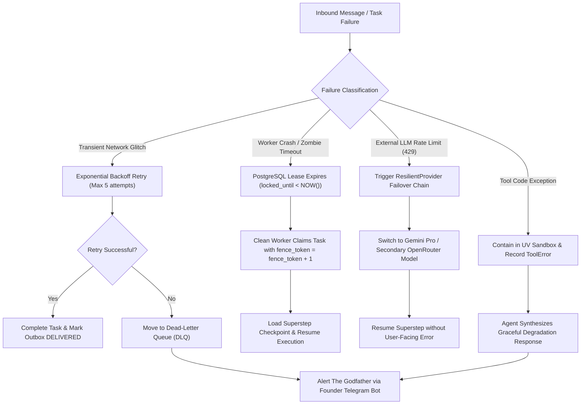

---

## 15. Major Subsystem Dependencies

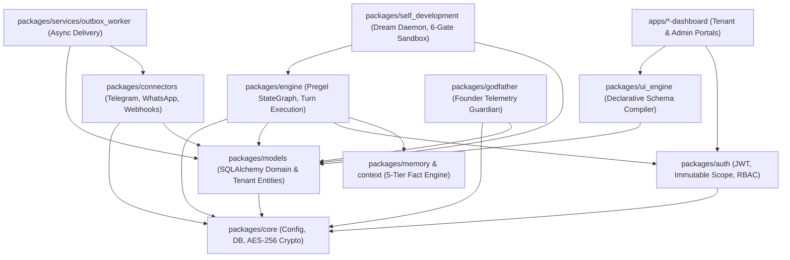
