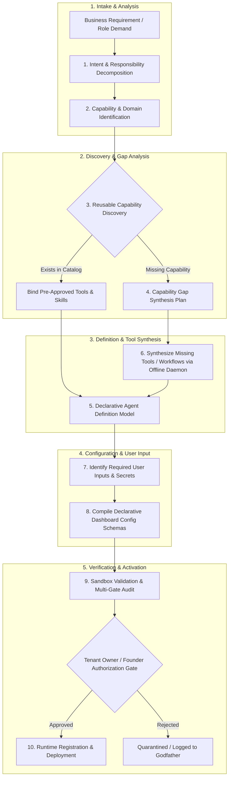
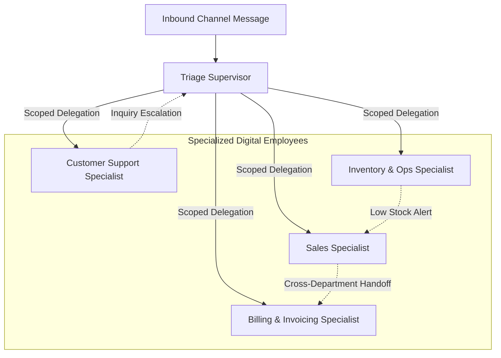

# Autonomous Agent Generation Architecture — Specification & Lifecycle

**Document ID:** `AUTONOMOUS_AGENT_GENERATION`  
**Governing Standard:** Full-Platform Target Vision (`docs/PROJECT_VISION.md` Sections 2, 3, 4, 19)  
**Target Repository:** `QQYC9/ai-employee-platform`  
**Status:** **AUTHORITATIVE ARCHITECTURAL SPECIFICATION**  
**Date:** 2026-11-04  
**Master Architect:** AI-Employee-Platform Core Architecture Group  

---

## 1. Vision & Architectural Philosophy

In traditional conversational platforms, an "AI agent" is nothing more than a static system prompt, a name, and a set of hardcoded API tools bound to a chat UI. As defined in `docs/PROJECT_VISION.md` Section 2:
> *The Digital Employee is not a chat prompt; it is an autonomous operational entity possessing an explicit business role, defined mission boundaries, specialized professional skills, private data access, strict operational tools, configured autonomy tiers, and long-lived memory.*

The AI Employee Platform does not rely on rigid, predefined agent templates. Instead, it features an **Autonomous Agent Generation Engine** capable of dynamically designing, synthesizing, validating, configuring, and deploying new specialized digital employees tailored to any tenant's evolving operational needs.

---

## 2. The 10-Stage Agent Provisioning Lifecycle



### Stage 1: Requirement Comprehension & Decomposition
- The platform accepts a high-level operational role request (e.g., *"Create an inventory management agent for our Riyadh warehouse who reconciles daily stock sheets and alerts the manager on low inventory"*).
- The engine decomposes the request into:
  - **Primary Mission & Responsibilities:** Inventory monitoring, stock count reconciliation, supplier purchase order drafting.
  - **Operational Entities:** Products, stock levels, warehouse locations, suppliers.
  - **Boundaries & Exclusions:** What the agent must NOT do (e.g., cannot execute purchase orders exceeding 5,000 SAR without human approval).

### Stage 2: Capability & Resource Identification
- Maps responsibilities to concrete capability contracts:
  - Data Sources: PostgreSQL inventory tables, incoming CSV stock sheets.
  - Operational Tools: `search_inventory`, `calculate_reorder_point`, `draft_purchase_order`.
  - Autonomy Tier: Level 2 (`semi` - Approval Gated) for order dispatch; Level 3 (`full`) for stock reading and report generation.

### Stage 3: Reusable Capability Discovery
- Queries the Platform Capability Registry using semantic embeddings and structural tags:
  - Checks if pre-existing tools or skills match the requirements (e.g. standard ERP connectors, notification tools).
  - Binds verified existing tools directly, avoiding duplicate code generation.

### Stage 4: Capability Gap Identification
- If a required capability is missing (e.g. custom parsing logic for a unique local supplier sheet):
  - Emits a formal **Capability Gap Specification**.
  - Routes the gap to the **Autonomous Capability Generation Subsystem** (detailed in `AUTONOMOUS_CAPABILITY_GENERATION.md`) for offline synthesis.

### Stage 5: Declarative Agent Definition Generation
- Generates the complete, immutable declarative agent definition using Pydantic v2 schemas:
```python
class DigitalEmployeeDefinition(BaseModel):
    model_config = ConfigDict(extra="forbid", frozen=True)
    
    employee_id: UUID
    tenant_id: UUID
    role_title: str
    department: str
    mission_statement: str
    permitted_roles: list[str]  # e.g., ["inventory_manager", "warehouse_specialist"]
    autonomy_level: AutonomyTier  # LEVEL_1_ASSISTANT, LEVEL_2_APPROVAL_GATED, LEVEL_3_AUTONOMOUS
    assigned_tools: list[str]  # Tool identifiers bound to this employee
    memory_scope: MemoryScopeConfig  # Tenant-wide vs employee-private memory access
    handoff_targets: list[str]  # Which other specialist employees this agent may delegate to
    guardrail_policy_id: str
    version: str = "1.0.0"
    status: AgentStatus = AgentStatus.DRAFT
```

### Stage 6: Tool & Workflow Provisioning
- Assembles all approved tools and execution paths.
- Sets per-tool execution timeouts (`config.TOOL_DEFAULT_TIMEOUT = 10s`) and payload limits (max 64 KB).

### Stage 7: Identification of Required User Inputs & Secrets
- Identifies external credentials and business parameters that cannot be inferred automatically (e.g., supplier API key, warehouse physical operating hours, manager Telegram chat ID).

### Stage 8: Declarative Dashboard Interface Compilation
- Automatically generates declarative UI schema definitions for the Tenant Dashboard (and Admin Dashboard if system-wide):
  - Form fields, input types, secret masking (`SecretStr`), validation rules, and help text.
  - Eliminates the need for frontend developers to write new React pages for new agent configurations.

### Stage 9: Sandbox Validation & Multi-Gate Testing
- The generated agent undergoes automated validation in an isolated runtime sandbox:
  - Validates AST syntax of any synthesized helper functions.
  - Tests tool execution contracts against mock tenant data.
  - Runs 5 simulated conversational turns evaluating prompt adherence, boundary compliance, and refusal of unauthorized commands.

### Stage 10: Authorization, Integration & Activation
- Before an agent is activated in production:
  - In accordance with `PROJECT_VISION.md` Section 3, the platform displays a clear **Capabilities & Boundaries Disclosure**:
    - Exactly what the agent can and cannot do.
    - Which data sources and tools are permitted.
    - Its autonomy tier and associated risks.
    - Any missing configuration inputs requiring user action.
  - The tenant owner provides explicit activation sign-off via the dashboard or Telegram.
  - Upon activation, the agent is registered in the Pregel StateGraph runtime and bound to designated omni-channel connectors.

---

## 3. Specialist Employee Profiles & Handoff Network

To prevent monolithic prompts that cause context degradation, digital employees operate as specialized functional entities:



### 3.1 Standard Specialist Profiles
1. **Triage Supervisor:**
   - Ingests untrusted external inputs.
   - Evaluates intent against `INTENT_SAFE_ROLES`.
   - Delegates strictly to permitted specialists with clean, filtered context.
2. **Sales Specialist:**
   - Possesses product catalogs, pricing lists, discounting rules, and lead capture tools.
   - Autonomy: Level 1 for general inquiries, Level 2 for discounts exceeding 10%.
3. **Customer Support Specialist:**
   - Possesses RAG semantic knowledge bases, FAQ documentation, and ticket escalation tools.
   - Autonomy: Level 3 for FAQ answers, Level 2 for refund or complaint escalations.
4. **Operations / Inventory Specialist:**
   - Possesses warehouse databases, order tracking, and supplier integration tools.
   - Autonomy: Level 2 for reorders, Level 3 for inventory queries.

---

## 4. Inter-Agent Delegation & Context Sanitization

Inter-agent collaboration follows the **OpenAI Agents SDK Handoff Pattern** with strict context sanitization:

```python
@dataclass(frozen=True)
class HandoffContext:
    originating_employee_id: str
    target_employee_id: str
    session_id: str
    tenant_id: str
    task_summary: str
    sanitized_variables: dict[str, Any]

def sanitize_handoff_context(context: HandoffContext) -> HandoffContext:
    """
    input_filter pattern: Strips internal reasoning traces, scratchpad thoughts,
    and diagnostic tool payloads, preserving only verified factual summaries
    and essential operational variables.
    """
    ...
```

### Delegation Cycle & Ping-Pong Prevention
- **Configurable Delegation Hop Cap (`config.MAX_HANDOFF_HOPS = 5`):** Restricts the maximum number of consecutive agent transfers per user turn.
- **In-Memory Delegation Trace:** The engine records `delegation_history: list[str]`. If a directed cycle ($A \to B \to A$) is detected without intervening user input, the engine halts delegation and forces escalation to the Triage Supervisor or human owner.

---

## 5. Lifecycle Versioning & Decommissioning

1. **Semantic Versioning:** Every agent definition carries an explicit version string (`major.minor.patch`). Minor updates (prompt tweaks, non-breaking tool additions) increment minor versions; structural changes (tool removals, permission changes) increment major versions.
2. **Graceful Turn Drain:** When an agent is updated or deactivated, ongoing conversational turns complete execution on the previous version checkpoint. New turns immediately instantiate the updated definition.
3. **Deprecation & Archival:** Deactivated agents retain full forensic audit history in PostgreSQL; their execution tokens and channel bindings are instantly revoked.
