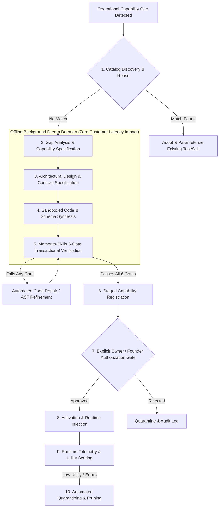

# Autonomous Capability Generation Architecture — Self-Extension Engine & Sandboxing

**Document ID:** `AUTONOMOUS_CAPABILITY_GENERATION`  
**Governing Standard:** Full-Platform Target Vision (`docs/PROJECT_VISION.md` Sections 4, 5, 8, 9, 15)  
**Target Repository:** `QQYC9/ai-employee-platform`  
**Status:** **AUTHORITATIVE ARCHITECTURAL SPECIFICATION**  
**Date:** 2026-11-04  
**Master Architect:** AI-Employee-Platform Core Architecture Group  

---

## 1. Vision & Strategic Problem Statement

In conventional systems, when an agent encounters a missing business capability, missing database, or unintegrated external API, it either:
1. Hallucinates a fictional response, pretending to have executed the action.
2. Emits a passive failure: *"I cannot do this because the feature is not implemented."*

As mandated in `docs/PROJECT_VISION.md` Sections 4 & 5:
> *Hallucinated capability is strictly forbidden. Passive refusal is also forbidden.*
> *When an agent encounters a capability gap, the system treats it as an operational and engineering problem to be discovered and solved: analyzing the gap, designing the required tools, workflows, or data models, synthesizing them under strict sandboxed validation, and generating the necessary dashboard interfaces for human oversight.*
>
> *If a tenant requires a complete sales management module from scratch (products, pricing, invoices, returns, customer accounting), the platform is architected to provision and run that dynamic module reliably.*

---

## 2. The Complete Capability Generation Lifecycle

The platform governs self-extension through a 10-stage verified lifecycle:



### Stage 1: Capability Discovery & Reuse
- Before synthesizing any new capability, the engine computes embeddings and semantic tags over the **Global Capability Registry**.
- If a verified tool or skill exists with $\ge 85\%$ functional overlap, the engine adapts and parameterizes the existing asset, strictly preventing duplicate code bloat.

### Stage 2: Gap Analysis & Specification
- If no matching capability exists, the agent generates a structured **Capability Specification**:
  - Purpose & Business Goal.
  - Required Input Schema (strict types, required vs optional, sensitive fields).
  - Expected Output Schema.
  - External Dependencies (e.g. third-party REST API, database entity).
  - Required Autonomy Level and Security Permissions.

### Stage 3: Architectural Design & Contract Specification
- The background compiler designs:
  - Pydantic v2 validation models (`extra="forbid"`).
  - Execution timeout bounds (`config.TOOL_DEFAULT_TIMEOUT`).
  - Required environment secrets (e.g. `SecretStr` for API keys).
  - Associated declarative UI schema for user configuration.

### Stage 4: Sandboxed Code & Schema Synthesis
- The code generator writes the Python implementation or workflow DAG definition.
- **Strict Prohibition:** Dynamic capabilities are synthesized strictly as pure functional Python units or declarative workflow JSON; they are **never** permitted to modify core platform framework files.

### Stage 5: The 6-Gate Transactional Verification Pipeline
Adopted directly from Memento-Skills' verified evolution architecture (`core/skill/evolution/engine.py`), the synthesized capability must pass six mandatory verification gates in an isolated **UV virtual environment**:

```
+---------------------------------------------------------------------------------------+
|                 MEMENTO-SKILLS 6-GATE TRANSACTIONAL VERIFICATION PIPELINE             |
+---------------------------------------------------------------------------------------+
|  Gate 1: Syntax & AST Analysis                                                        |
|  - Validates Python 3.14 syntax and compiles AST without parsing errors.             |
|                                                                                       |
|  Gate 2: Contract Schema Validation                                                   |
|  - Validates input and output contracts against strict Pydantic v2 schemas.           |
|                                                                                       |
|  Gate 3: Security & AST Import Scanning                                               |
|  - Scans AST for forbidden imports (os, sys, subprocess, socket, eval, exec, __import__)|
|  - Blocks filesystem tampering, dynamic reflection, and unauthorized network calls.  |
|                                                                                       |
|  Gate 4: Isolated UV Unit Execution                                                   |
|  - Executes unit test suite in an ephemeral UV virtual environment with zero external |
|    write permissions.                                                                |
|                                                                                       |
|  Gate 5: Mocked Integration Verification                                              |
|  - Executes against mocked tenant data structures, asserting contract compliance.      |
|                                                                                       |
|  Gate 6: Smoke Latency & Resource Profiling                                           |
|  - Measures CPU usage, memory allocation (cap: 128 MB), and execution latency (< 2s). |
+---------------------------------------------------------------------------------------+
```

### Stage 6: Staged Registration
- Capabilities passing all 6 gates are inserted into `capability_registry` with status `STAGED_PENDING_APPROVAL`.

### Stage 7: Explicit Human Authorization Gate
- In accordance with `PROJECT_VISION.md` Section 9 & 14, **autonomous capabilities are never deployed to production automatically**.
- A structured proposal is submitted:
  - Platform-wide capabilities require Founder approval via Telegram.
  - Tenant-specific business capabilities require Tenant Business Owner approval via the Tenant Dashboard.

### Stage 8: Activation & Runtime Injection
- Once authorized, the tool is loaded dynamically into the tenant's execution scope and registered with the Pregel StateGraph tool router.

### Stage 9: Runtime Telemetry & Utility Scoring
- Every execution records:
  - Invocation count, latency, error count, and business task success rate.
  - **Empirical Utility Score:** Calculated over execution history.

### Stage 10: Automated Deprecation & Pruning
- **`[HYPOTHESIS]` `config.SKILL_UTILITY_THRESHOLD = 0.2`** over **`config.SKILL_MIN_EVAL_RUNS = 20`**:
- Capabilities that fail frequently or remain unused are flagged, deactivated, and quarantined for developer review.

---

## 3. Dynamic Business Modules: Relational vs JSONB Partitioning

When an agent identifies that a tenant lacks complete business data structures (e.g. Sales Specialist needs a Product & Invoice system per `PROJECT_VISION.md` Section 5):

### 3.1 Strict Prohibition of Runtime DDL
- Autonomous agents are **strictly forbidden from generating or executing runtime DDL** (`CREATE TABLE`, `ALTER TABLE`, `DROP TABLE`). Runtime DDL causes table locks, schema migration drift, and catastrophic tenant cross-contamination.

### 3.2 The Hybrid Relational/JSONB Storage Architecture
Dynamic business modules utilize a pre-provisioned, highly optimized relational foundation with typed core columns and GIN-indexed flexible attribute documents:

```sql
CREATE TABLE business_entities (
    id UUID PRIMARY KEY DEFAULT gen_random_uuid(),
    tenant_id UUID NOT NULL REFERENCES tenants(id) ON DELETE CASCADE,
    entity_type VARCHAR(64) NOT NULL, -- e.g., 'product', 'invoice', 'customer_lead'
    entity_code VARCHAR(64) NULL,     -- SKU, Invoice Number
    name VARCHAR(255) NOT NULL,
    
    -- Mandatory native typed SQL columns for financial integrity:
    monetary_amount DECIMAL(18, 4) NULL, -- Exact financial decimal; NEVER floating-point!
    currency_code VARCHAR(3) NULL DEFAULT 'SAR',
    quantity DECIMAL(14, 4) NULL,
    status VARCHAR(32) NOT NULL DEFAULT 'ACTIVE',
    
    -- Flexible dynamic attributes validated via Pydantic schemas:
    dynamic_attributes JSONB NOT NULL DEFAULT '{}'::jsonb,
    
    created_at TIMESTAMPTZ NOT NULL DEFAULT CURRENT_TIMESTAMP,
    updated_at TIMESTAMPTZ NOT NULL DEFAULT CURRENT_TIMESTAMP,
    
    CONSTRAINT uq_tenant_entity_code UNIQUE (tenant_id, entity_type, entity_code)
);

-- Fast GIN index for JSON attribute lookups:
CREATE INDEX idx_business_entities_attributes ON business_entities USING GIN (dynamic_attributes);
CREATE INDEX idx_business_entities_tenant_type ON business_entities (tenant_id, entity_type);
```

### 3.3 Relational Migration Promotion Gate
When a dynamic entity type expands beyond simple attribute storage:
- **Threshold 1:** Entity record count exceeds 10,000 tuples per tenant.
- **Threshold 2:** Entity requires relational integrity constraints (foreign key cascades, double-entry financial accounting ledger).
- **Action:** The Godfather flags the module in the evening digest. A formal Alembic migration script is synthesized and staged for platform administrator review to promote the JSONB entity into a dedicated typed relational table.

---

## 4. Operational Boundaries: Offline Dream Daemon

```
Active Customer Message Turn (< 3000ms SLA):
[ Inbound Message ] ──> [ Pregel Engine ] ──> [ Pre-Approved Tools ] ──> [ Outbox Dispatch ]
       │
(Gap Detected)
       │
       v (Asynchronous Event)
[ Offline Dream Daemon Queue ] (Runs during idle worker cycles; 10s - 60s execution)
       ├── Gap Specification
       ├── UV Sandbox Synthesis & 6-Gate Testing
       └── Submit Proposal to Founder/Owner for Sign-Off
```

- **Inviolable Architectural Rule:** Dynamic capability synthesis, compilation, and testing **never run inside an active customer conversational turn**. Customer turns execute strictly against pre-approved, pre-compiled tools to guarantee SLA performance.
