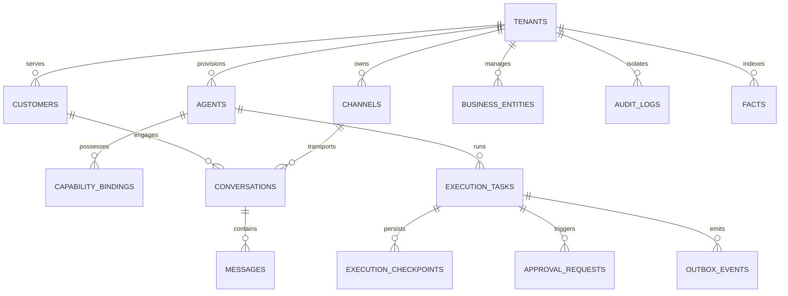

# Database & Domain Architecture Research — Relational, Vector & Hybrid Entity Models

**Document ID:** `DATABASE_AND_DOMAIN_ARCHITECTURE_RESEARCH`  
**Governing Workstream:** Workstream K (Database, Domain Model, and Data Lifecycle)  
**Target Repository:** `QQYC9/ai-employee-platform` (Local HEAD `86c1abf`)  
**Status:** **AUDITED & VERIFIED**  
**Date:** 2026-11-04  
**Master Architect:** AI-Employee-Platform Core Architecture Group  

---

## 1. Executive Summary & Data Tier Foundations

The AI-Employee-Platform data tier is built on **PostgreSQL 17** equipped with the **pgvector** extension and supported by **Redis 7** for ephemeral scheduling and lease coordination.

This document establishes the relational schema design, indexing strategies, concurrency primitives, vector storage parameters, and the hybrid dynamic business entity model that guarantees transactional integrity, sub-50ms query latencies, and mathematical multi-tenant data isolation.

---

## 2. Core Relational Schema Hierarchy & Entity Relationships



### 2.1 The Foundational Multi-Tenant Invariant
Every tenant-scoped table enforces composite primary keys:
$$\text{PRIMARY KEY} (\text{tenant\_id}, \text{id})$$
This guarantees:
1. Cross-tenant joins fail immediately at the PostgreSQL parser/planner level.
2. Tenant queries automatically utilize the clustered B-Tree prefix index on `tenant_id`.
3. PostgreSQL partition pruning can be enabled without breaking foreign key constraints.

---

## 3. High-Performance Indexing & Storage Engine Rules

In strict compliance with `supabase-postgres-best-practices`:

### 3.1 GIN Indexing on Dynamic JSONB (`jsonb_path_ops`)
- Table: `business_entities` (dynamic products, invoices, stock, custom attributes).
- Index definition:
  ```sql
  CREATE INDEX idx_business_entities_gin ON business_entities USING GIN (dynamic_attributes jsonb_path_ops);
  ```
- **Boundary Rule (REF-PG17-JSONB):** `jsonb_path_ops` supports exclusively equality and existence operators (`@>`, `?`, `?&`). It does **not** index key paths or range/inequality comparisons.
- **Mandatory Typed Column Rule:** Financial balances, quantities, status strings, and reference codes must **never** be relegated to JSONB. They are defined as native SQL columns:
  - `balance_due DECIMAL(18, 4) DEFAULT 0.0000` (prevents IEEE-754 floating-point rounding errors).
  - `status VARCHAR(32) NOT NULL DEFAULT 'active'`.
  - `reference_code VARCHAR(64)`.

### 3.2 Vector Indexing on Semantic Knowledge (`pgvector`)
- Table: `knowledges` / `facts`.
- Embedding Model: `text-embedding-3-small` (1,536 dimensions).
- Distance Metric: Cosine Distance (`<=>`).
- Index configuration:
  ```sql
  CREATE INDEX idx_knowledge_embeddings ON knowledges 
  USING hnsw (embedding vector_cosine_ops)
  WITH (m = 16, ef_construction = 64);
  ```
- Composite Query Enforcement: Every vector similarity search must enforce the tenant filter in the `WHERE` clause:
  ```sql
  SELECT id, title, content, 1 - (embedding <=> :query_vector) AS similarity
  FROM knowledges
  WHERE tenant_id = :tenant_id AND status = 'active'
  ORDER BY embedding <=> :query_vector
  LIMIT 5;
  ```

---

## 4. Transactional Concurrency & State Checkpoint Persistence

### 4.1 Row-Level Exclusive Locking (`execution_tasks`)
```sql
UPDATE execution_tasks
SET fence_token = fence_token + 1,
    status = 'running',
    worker_id = :worker_id,
    locked_until = NOW() + INTERVAL '30 seconds',
    updated_at = NOW()
WHERE id = (
    SELECT id FROM execution_tasks
    WHERE (status = 'pending' OR (status = 'running' AND locked_until < NOW()))
      AND tenant_id = :tenant_id
    ORDER BY created_at ASC
    LIMIT 1
    FOR UPDATE SKIP LOCKED
)
RETURNING *;
```
- Row-level lock timeout: `SET LOCAL lock_timeout = '2s'`.
- Statement timeout: `SET LOCAL statement_timeout = '5s'`.
- Neutralizes zombie workers and race conditions across distributed nodes.

### 4.2 Superstep Checkpoint Table (`execution_checkpoints`)
```sql
CREATE TABLE execution_checkpoints (
    id UUID PRIMARY KEY DEFAULT gen_random_uuid(),
    task_id UUID NOT NULL REFERENCES execution_tasks(id) ON DELETE CASCADE,
    tenant_id UUID NOT NULL REFERENCES tenants(id) ON DELETE CASCADE,
    superstep INTEGER NOT NULL,
    state_payload JSONB NOT NULL,
    created_at TIMESTAMPTZ NOT NULL DEFAULT NOW(),
    CONSTRAINT uq_checkpoint_task_superstep UNIQUE (task_id, superstep)
);
CREATE INDEX idx_checkpoints_lookup ON execution_checkpoints (task_id, superstep DESC);
```
- Persists state checkpoints after each superstep.
- If a turn crashes or times out, the execution recovers from the latest committed superstep without re-running earlier completed tool actions.
