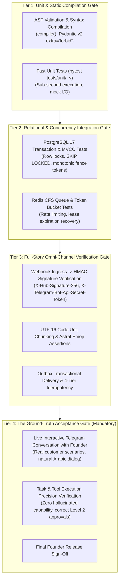

# Evaluation & Quality Assurance Research — The Ground-Truth Verification Protocol

**Document ID:** `EVALUATION_AND_QUALITY_ASSURANCE_RESEARCH`  
**Governing Standard:** Section 12 & Ground-Truth Protocol (`docs/PROJECT_VISION.md` Section 17)  
**System Designation:** AI Employee Platform (Enterprise Digital Employee Operating System)  
**Status:** **AUDITED & VERIFIED**  
**Date:** 2026-11-04  
**Master Architect:** AI-Employee-Platform Core Architecture Group  

---

## 1. Executive Charter: Ending the "Green Test Delusion"

> "The core crisis that led us here is the vicious cycle: Analyze problem $\to$ Propose patch $\to$ Edit code $\to$ Run tests $\to$ Declare green tests $\to$ Return to the exact same failure during live conversation with a human. Theoretical automated test success means nothing if a digital employee fails in a real conversation."  
> — *Platform Vision Charter (`docs/PROJECT_VISION.md` Section 1 & 17)*

This document establishes the authoritative evaluation and quality assurance methodology for the AI-Employee-Platform. It formally defines the **4-Tier Verification Hierarchy**, the **Ground-Truth Protocol**, and continuous runtime capability evaluation.

---

## 2. The 4-Tier Verification Hierarchy

To guarantee both code reliability and conversational competence, platform changes must pass through four concentric verification tiers:

### 2.1 Tier 1: Unit & Static Compilation Gate
- **Scope:** Pydantic contract validation, AST parsing, schema compilation, isolated unit tests.
- **Tooling:** Python 3.14, `pytest`, `pytest-asyncio`, `mypy`, `ruff`.
- **Criteria:** 100% pass rate. Zero syntax errors, zero unhandled exceptions.

### 2.2 Tier 2: Relational & Concurrency Integration Gate
- **Scope:** Multi-tenant database isolation, `BaseRepository` query scoping, row-level locking (`UPDATE execution_tasks ... FOR UPDATE SKIP LOCKED`), monotonic fencing token incrementation, connection pool preservation.
- **Tooling:** Local PostgreSQL 17 (`localhost:5433`), Redis 7 (`localhost:6379`).
- **Criteria:** Concurrency tests simulating 20 simultaneous workers claiming tasks; zero split-brain state overwrites; zero connection pool timeouts.

### 2.3 Tier 3: Full-Story Omni-Channel Verification Gate
- **Scope:** Inbound webhook ingestion $\to$ deduplication $\to$ Pregel turn execution $\to$ tool sandboxing $\to$ checkpoint commit $\to$ Outbox dispatch.
- **Tooling:** `httpx.AsyncClient`, mock channel gateways, WhatsApp/Telegram payload fixtures.
- **Criteria:** Verification that UTF-16 code units with astral emojis slice cleanly without surrogate pair corruption; WhatsApp `biz_opaque_callback_data` quarantine triggers correctly upon simulated timeout.

### 2.4 Tier 4: The Ground-Truth Acceptance Gate (Mandatory Sovereign Gate)
- **Scope:** Live, interactive conversational verification via **Telegram** with the platform founder and creator.
- **Test Scenarios:**
  1. Natural, unstructured multi-turn dialogue in Saudi/Gulf Arabic dialects.
  2. Edge-case inquiries (pricing, branches, hours, return policies).
  3. Sensitive tool actions (placing orders, issuing refunds) verifying Level 2 approval prompts and inline callback buttons.
  4. Capability gap probing: Verifying that when an agent lacks a capability, it **never hallucinates knowledge**, but explicitly acknowledges the gap and registers it for the Dream Daemon.
- **Criteria:** Founder signs off via Telegram. No feature is marked complete or merged without Tier 4 verification.

---

## 3. Continuous Runtime Capability Evaluation

Beyond pre-release testing, capabilities are evaluated continuously in production:
1. **Empirical Utility Score ($U$):** Calculated for every active capability:
   $$U = \frac{\text{Successful Executions}}{\text{Successful Executions} + \text{Failed Executions}}$$
2. **Degradation Detection:** If $U < 0.2$ over $\ge 3$ consecutive samples, the capability is flagged as degraded.
3. **Autonomous Quarantine:** The capability is moved to `QUARANTINED` status, alert is dispatched to The Godfather, and an offline discovery rebuild is scheduled in the Dream Daemon.
