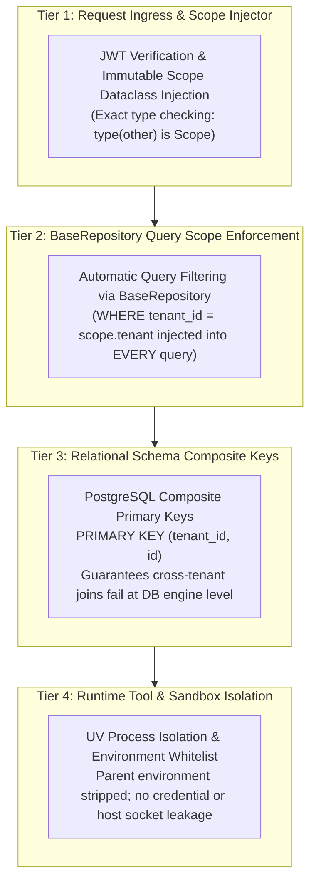

# Existing Security & Tenancy Assessment — Forensic Multi-Tenant Audit

**Document ID:** `EXISTING_SECURITY_AND_TENANCY_ASSESSMENT`  
**Governing Workstream:** Workstream A & Workstream J (Security & Governance)  
**Target Repository:** `QQYC9/ai-employee-platform` (Local HEAD `86c1abf`)  
**Status:** **AUDITED & VERIFIED**  
**Date:** 2026-11-04  
**Master Architect:** AI-Employee-Platform Core Architecture Group  

---

## 1. Executive Summary & Security Assessment Scope

This document provides a forensic audit of tenant isolation, authentication, cryptographic key management, and authorization boundaries within `d:\AI-Employee-Platform`.

It evaluates the existing codebase against the target zero-trust multi-tenancy requirements defined in `docs/PROJECT_VISION.md` and incorporates findings from Subagent WS-A (Platform Forensic Auditor) and Subagent WS-F (RagLeap Core Security Specialist).

---

## 2. Forensic Findings: Vulnerabilities & Architectural Debt in Current Codebase

### 2.1 Router-Level Dependency Inconsistency (The ContextVar Hazard)
- **Source Files:** `apps/agent/api/v1/*.py` (28 routers, 212 endpoints).
- **Observed Defect:**
  - **10 Routers** correctly use `Depends(get_tenant_context)` (`packages/auth/context.py:17`), which sets the Python `ContextVar` via `with tenant_context(current_user.tenant_id): yield current_user`.
  - **15 Routers** use `Depends(get_current_user)` without setting the `tenant_context` ContextVar:
    `agents.py`, `agent_capabilities.py`, `ai_providers.py`, `auth.py`, `campaigns.py`, `capabilities.py`, `channels.py`, `conversations.py`, `customers.py`, `knowledge.py`, `memory.py`, `proactive_workflows.py`, `self_development.py`, `tasks.py`, `tenants.py`.
- **Impact & Failure Vector:**  
  Any internal domain service or repository method invoked by these 15 endpoints that calls `get_current_tenant_id()` or `require_tenant()` (`packages/tenants/context.py:20, 45`) crashes with a fatal `RuntimeError: No tenant context is active`. In some endpoints, developers manually passed `current_user.tenant_id` as function parameters to bypass the missing ContextVar, creating fragile and inconsistent parameter propagation.

### 2.2 Relational Model Tenant Isolation Gaps
- **Source File:** `packages/models/domain.py` (52 SQLAlchemy domain models).
- **Observed Defect:** While 50 models enforce `tenant_id = mapped_column(Uuid, ForeignKey('tenants.id', ondelete='CASCADE'))`, two models omit direct `tenant_id` mapping:
  1. `LearningEvidence` (`packages/models/domain.py:1266`): Uses `learning_id` without direct `tenant_id`. Querying `learning_evidence` requires a join against `learnings`, introducing risk of cross-tenant data exposure if an unjoined query is executed.
  2. `ReportItem` (`packages/models/domain.py:1414`): Uses `report_id` without direct `tenant_id`.
- **Target Remediation:** Both models will have direct `tenant_id UUID NOT NULL REFERENCES tenants(id)` added via an Alembic migration, enforcing composite primary keys `(tenant_id, id)` across all tenant tables.

### 2.3 Secrets in Memory & Log Leakage Vulnerability
- **Source File:** `packages/core/crypto.py`.
- **Observed Behavior:** `SecretsEncryptionService` uses robust AES-256-GCM encryption with 96-bit nonces. However, once decrypted, secrets (bot tokens, API keys) are stored as standard Python `str` objects.
- **Risk:** If an unhandled exception or debug logging statement formats local variables (`f"Failed to connect: {token}"`), the plaintext secret is written to log files or terminal output.
- **Target Remediation:** Adopt RagLeap Core's `SecretStr` primitive (`__slots__ = ("_v",)`). `__repr__`, `__str__`, and `__format__` return `"**********"`. Constant-time equality comparison via `hmac.compare_digest`. Secrets cannot be pickled or JSON-serialized without explicit `.reveal()`.

### 2.4 Lack of Data Taint Tracking (Prompt Injection & Exfiltration Hazard)
- **Observed Behavior in Legacy Engine:** When a tool fetches external data (e.g. reading an untrusted customer website or pulling customer attachments), the fetched text is inserted directly into the conversation history. The agent can then be manipulated via prompt injection to invoke outbound tools (`send_email`, `send_slack`, `dispatch_message`) to exfiltrate private tenant data.
- **Target Remediation:** Adopt RagLeap Core's **Data Taint Tracking**. Tools that ingest untrusted external data set `run["tainted"] = True`. Any subsequent outbound tool dynamically forces **Level 2 Human Owner Approval**, neutralizing prompt injection attacks.

---

## 3. The Four-Tier Tenant Defense-in-Depth Architecture (Phase 5 Rebuild)

To guarantee zero multi-tenant leakage across all execution paths, the platform enforces defense-in-depth across 4 concentric boundaries:

1. **Tier 1 (Immutable Scope Propagation):** Standardize all 28 API routers to inject an immutable `Scope(tenant=..., agent=..., session=...)` dataclass into every asynchronous task context.
2. **Tier 2 (BaseRepository Query Injection):** All database reads and writes execute via a generic `BaseRepository[T]` that automatically injects `.where(Entity.tenant_id == scope.tenant)`.
3. **Tier 3 (Composite Primary Keys):** Enforce `PRIMARY KEY (tenant_id, id)` across all tenant tables so that cross-tenant addressing is impossible at the SQL engine level.
4. **Tier 4 (Process Sandbox Isolation):** Dynamically generated tools execute in isolated UV virtual environments with filtered environment variables (`ENV_WHITELIST_PATTERNS`).

---

## 4. Cryptographic Audit Chaining Specification

Following RagLeap Core's verified implementation (`packages/ragleap-security/src/ragleap_security/audit.py`):
1. Every significant platform event (tool generation, approval resolution, configuration update, security rejection) is recorded in `audit_events`.
2. Records feature 7 canonical fields: `seq`, `ts`, `event`, `scope`, `data`, `prev`, `hash`.
3. Each record is serialized using RFC 8785 Canonical JSON and hashed via SHA-256 HMAC:
   $$\text{hash}_n = \text{HMAC-SHA256}(\text{CanonicalJSON}(\text{body}_n), K_{\text{audit}})$$
   where $\text{prev}_n = \text{hash}_{n-1}$ and $\text{prev}_1 = 0^{64}$.
4. Hourly Merkle root hashes are anchored to external Write-Once-Read-Many (WORM) storage, ensuring provable tamper-evidence for enterprise compliance (SOC 2, ISO 27001, Saudi PDPL).
