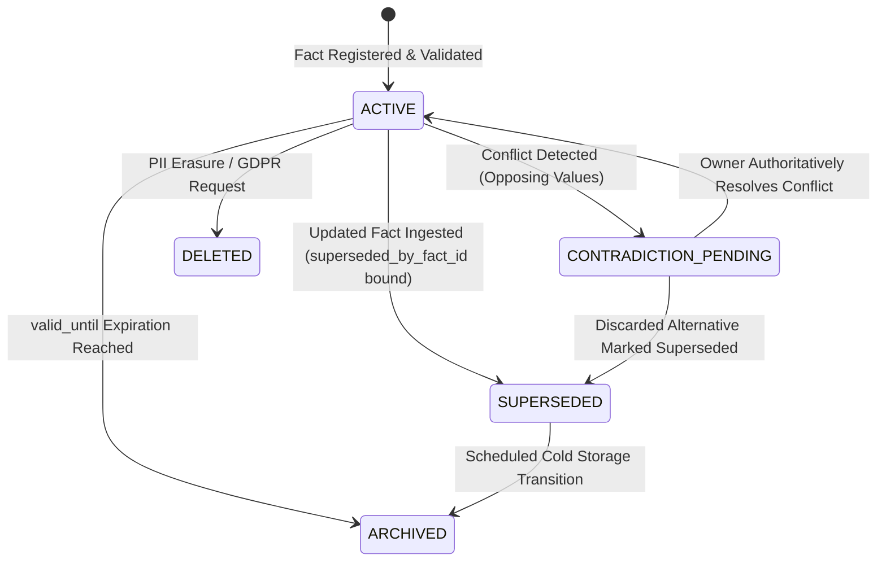

# Knowledge and Memory Architecture — 5-Tier Memory & Privacy Lifecycle

**Document ID:** `KNOWLEDGE_AND_MEMORY_ARCHITECTURE`  
**Governing Standard:** Full-Platform Target Vision (`docs/PROJECT_VISION.md` Sections 6, 7, 8, 9)  
**Target Repository:** `QQYC9/ai-employee-platform`  
**Status:** **AUTHORITATIVE ARCHITECTURAL SPECIFICATION**  
**Date:** 2026-11-04  
**Master Architect:** AI-Employee-Platform Core Architecture Group  

---

## 1. Architectural Philosophy: The Five Memory Tiers

In conventional chatbots, "memory" is naively implemented as a conversation history window or a flat vector search index. When conversations close, context vanishes; when facts change, old knowledge remains to corrupt future answers.

As mandated in `docs/PROJECT_VISION.md` Section 6, the target platform establishes an enterprise **Multi-Tier Memory Architecture** that persists verified business knowledge across years while guaranteeing privacy compliance and dynamic supersession:

```
+─────────────────────────────────────────────────────────────────────────────────────────+
|                         THE 5-TIER ENTERPRISE MEMORY ARCHITECTURE                       |
+─────────────────────────────────────────────────────────────────────────────────────────+
|  Tier 1: Working Context Buffer (Short-Term Turn Context)                               |
|  - Sliding in-memory message window for active conversational turn.                     |
|  - Ingests sanitized handoff summaries; strips intermediate scratchpad thoughts.       |
|                                                                                         |
|  Tier 2: Task & Operation Memory (Execution Progress)                                   |
|  - Stateful graph progress stored in PostgreSQL execution_checkpoints.                 |
|  - Tracks task stage, open approval IDs, pending tool outputs, and fencing tokens.       |
|                                                                                         |
|  Tier 3: Persistent Fact Memory (Long-Lived Verified Business Knowledge)                 |
|  - Multi-dimensionally scoped business facts (operating hours, prices, return policies).|
|  - Survives sessions indefinitely; governed by explicit supersession & contradiction FSM.|
|                                                                                         |
|  Tier 4: Semantic Knowledge Memory (Enterprise Document RAG)                            |
|  - Multi-tenant vector embeddings stored via PostgreSQL pgvector.                       |
|  - Hybrid search combining HNSW cosine vector similarity with PostgreSQL BM25 text rank.|
|                                                                                         |
|  Tier 5: Procedural Skill Memory (Learned Operational Playbooks)                         |
|  - Learned multi-step workflows and procedures validated via empirical utility scores.  |
|  - Consolidated offline by the Dream Daemon.                                            |
+─────────────────────────────────────────────────────────────────────────────────────────+
```

---

## 2. Multi-Dimensional Scoped Fact Model

To eliminate the regex-based "whack-a-mole" failures of the legacy engine, facts are stored with rich multidimensional metadata rather than flat strings:

```sql
CREATE TABLE fact_entities (
    id UUID PRIMARY KEY DEFAULT gen_random_uuid(),
    tenant_id UUID NOT NULL REFERENCES tenants(id) ON DELETE CASCADE,
    domain VARCHAR(64) NOT NULL,        -- e.g., 'operations', 'sales', 'policies'
    topic VARCHAR(128) NOT NULL,        -- e.g., 'working_hours', 'return_window', 'price'
    
    -- Multi-dimensional Scoping Dimensions:
    branch_id VARCHAR(64) NULL,         -- Spatial scope: specific branch or NULL (all branches)
    temporal_scope VARCHAR(64) NULL,    -- 'REGULAR', 'RAMADAN', 'HOLIDAY', 'WEEKEND', 'FRIDAY'
    target_audience VARCHAR(32) NOT NULL DEFAULT 'PUBLIC', -- 'PUBLIC', 'INTERNAL_ONLY'
    
    canonical_value TEXT NOT NULL,
    structured_payload JSONB NOT NULL DEFAULT '{}'::jsonb,
    
    -- Lifecycle, Provenance & Supersession:
    status VARCHAR(32) NOT NULL DEFAULT 'ACTIVE', -- ACTIVE, SUPERSEDED, CONTRADICTION_PENDING, ARCHIVED, DELETED
    confidence_score DECIMAL(3, 2) NOT NULL DEFAULT 1.00,
    source_attribution VARCHAR(255) NOT NULL,    -- 'OWNER_DASHBOARD', 'INTERVIEW', 'INQUIRY_ANSWER'
    valid_from TIMESTAMPTZ NOT NULL DEFAULT CURRENT_TIMESTAMP,
    valid_until TIMESTAMPTZ NULL,                -- Expiration timestamp (NULL = indefinite)
    superseded_by_fact_id UUID NULL REFERENCES fact_entities(id),
    is_pii BOOLEAN NOT NULL DEFAULT FALSE,
    
    created_at TIMESTAMPTZ NOT NULL DEFAULT CURRENT_TIMESTAMP,
    updated_at TIMESTAMPTZ NOT NULL DEFAULT CURRENT_TIMESTAMP
);

CREATE INDEX idx_facts_lookup ON fact_entities (tenant_id, domain, topic, status);
CREATE INDEX idx_facts_scope ON fact_entities (tenant_id, branch_id, temporal_scope);
```

---

## 3. Fact Lifecycle, Supersession & Contradiction Resolution



### 3.1 Handling Supersession vs Contradiction
1. **Explicit Supersession:** When an owner updates business operating hours via the dashboard (e.g. changes opening from 09:00 to 10:00), the old fact transitions to `status = 'SUPERSEDED'`, pointing to the new fact's UUID. It is immediately excluded from conversational retrieval queries.
2. **Contradiction Escalation:** If an agent extracts a potential fact from dialogue that directly contradicts an existing `ACTIVE` fact, it is **strictly forbidden from guessing or arbitrarily picking one**.
   - The status is marked `CONTRADICTION_PENDING`.
   - The turn suspends automatic inference on that topic and stages a clarification request for the business owner via the dashboard or Telegram.

---

## 4. De-mythologizing "Permanent" Memory: Data Privacy & Erasure Realities

> **Architectural Clarification:** "Persistent" memory means persistent across sessions (long-lived); it **DOES NOT** mean immutable, un-deletable, or permanent!

The platform enforces strict privacy and data protection lifecycles (aligned with GDPR, CCPA, and enterprise agreements):
1. **PII Classification:** Any fact containing personally identifiable customer information (names, personal phone numbers, home addresses, customer delivery notes) is flagged `is_pii = True`.
2. **Statutory Erasure / Right-to-be-Forgotten:**
   - Upon receiving an erasure request, PII records are securely erased or cryptographically shredded (`status = 'DELETED'`).
   - The semantic vector embeddings associated with the erased PII are purged from PostgreSQL pgvector immediately.
3. **Strict Separation of Regulatory Audit Logs from Memory:**
   - **Inviolable Boundary:** The tamper-evident audit log (`audit_events`) is an immutable legal compliance record governed by independent regulatory retention schedules (e.g. 1 to 7 years).
   - Conversational memory deletion requests **CANNOT alter or truncate regulatory audit logs**.
