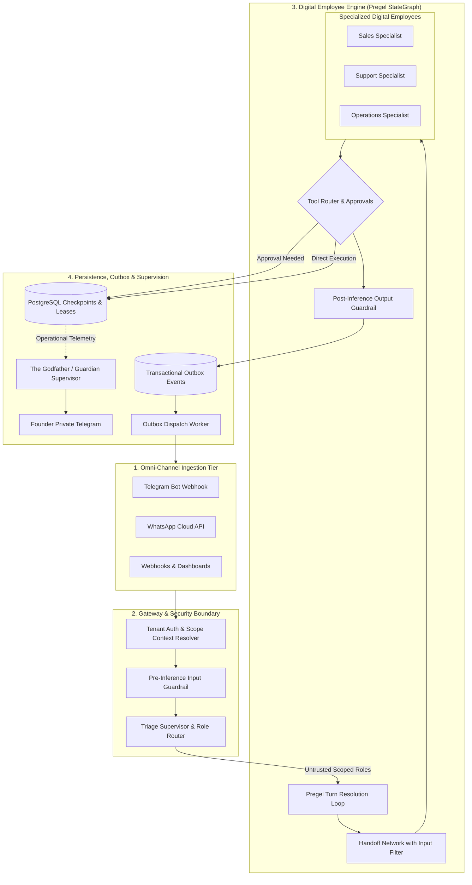
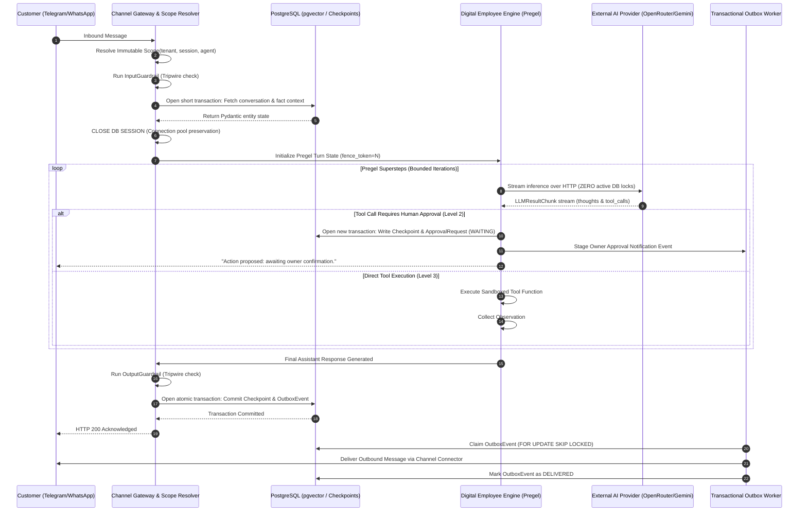
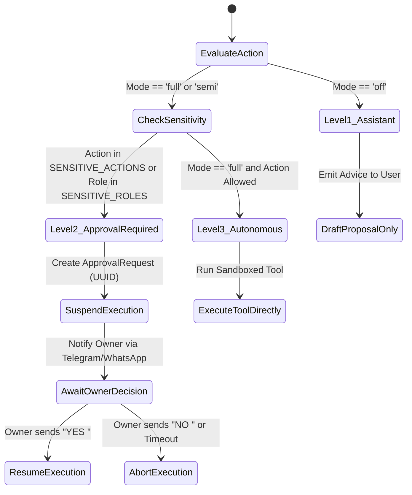
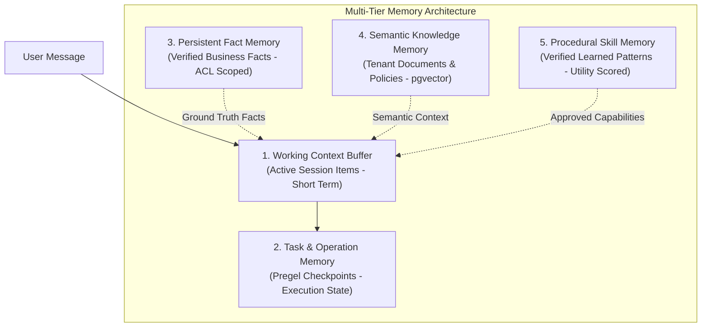
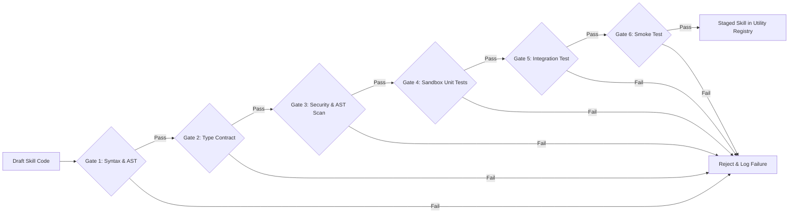

# Master Architecture Blueprint: Autonomous Multi-Tenant Digital Employee Platform

**Document ID:** `MASTER_ARCHITECTURE_BLUEPRINT`  
**Target Repository:** `QQYC9/ai-employee-platform`  
**System Designation:** AI Employee Platform (Next-Generation Engine)  
**Author:** AI-Employee-Platform Core Architecture Group  
**Document Status:** **OFFICIAL ARCHITECTURAL BLUEPRINT (PROPOSED FOR FOUNDER APPROVAL)**  
**Date:** 2026-11-03  
**Predecessor Document:** `docs/architecture-research/RESEARCH_ACCEPTANCE_REVIEW.md` (`Commit be5a5d7`)  

---

## 1. System Vision, Objectives, Scope Boundaries & Non-Goals

### 1.1 Enterprise Mission
The **AI Employee Platform** is an enterprise-grade, multi-tenant operating system designed to instantiate, run, govern, and continuously evolve autonomous **Digital Employees** (AI Agents). Unlike superficial chatbots or reactive LLM wrappers, digital employees operate as persistent business entities assigned specific organizational roles, professional domains, operational tools, private data sources, explicit autonomy limits, and long-lived memory.

The platform operates under the central supervisory oversight of **The Godfather (الأب الروحي)**—an independent meta-agent connected directly to the platform founder via Telegram, providing real-time operational vigilance, anomaly detection, daily forensic health digests, and architectural growth guidance.

### 1.2 Core Architectural Objectives
1. **Complete Legacy Engine Replacement:** Total deprecation and removal of `conversational_agent_engine.py` (0% code carryover). The new engine is designed from first principles with zero backwards-compatibility shackles, zero canary dual-track execution, and zero rollback dependencies.
2. **Deterministic Durable Execution:** Conversational turns and multi-step background workflows execute as stateful graphs (Pregel model) where progress is committed at discrete checkpoint supersteps, surviving worker crashes and network partitions.
3. **Multi-Tenant Context Isolation:** Cryptographic and structural separation of all tenant data, memory, tool executions, and sessions via an immutable execution `Scope`.
4. **Three-Tier Autonomy Gating:** Explicit boundaries (`Level 1: Assistant`, `Level 2: Approval-Gated`, `Level 3: Autonomous within Bounds`), with mandatory human-in-the-loop (HITL) approval for sensitive financial, legal, and outbound operations.
5. **Database Connection Pool Preservation:** Complete decoupling of database transactions from slow external LLM inference, eliminating pool starvation under high concurrency.
6. **Ground-Truth Field Acceptance:** Breaking the "green test delusion" by establishing real, live Telegram and omni-channel conversations with the founder as the authoritative metric of operational success.

### 1.3 System Non-Goals (What This Platform Will NOT Build)
- **NOT a Generic Chatbot:** The system will not optimize for open-ended conversational chitchat. Every agent is an employee with job responsibilities and measurable business deliverables.
- **NOT a Synchronous Code Generator in User Turns:** Dynamic tool synthesis via multi-gate pipelines will **never** execute inside an active customer conversation. Dynamic evolution is quarantined to offline background daemons.
- **NOT an Unbounded Workflow Canvas:** We are not building an open-ended visual DAG editor for end-users (avoiding licensing and complexity pitfalls of n8n/Dify). Digital employees possess structured domain capabilities configured via declarative profiles.
- **NO Claims of Distributed "Exactly-Once" for External Side-Effects:** The platform recognizes the mathematical impossibility of strict exactly-once execution across uncoordinated third-party APIs (Two Generals Problem) and instead implements deterministic internal idempotency and at-least-once outbox delivery.

---

## 2. High-Level Architecture & End-to-End Execution Flow

The platform architecture is partitioned into four decoupled tiers:
1. **Omni-Channel Ingestion Tier:** Ingests messages from Telegram, WhatsApp, Email, and Webhooks, enforcing rate limits and tenant authentication.
2. **Gateway & Intent-Scoping Tier:** Authenticates tenant context, sanitizes inputs through pre-inference tripwire guardrails, and isolates untrusted public inputs to `INTENT_SAFE_ROLES`.
3. **Core Agentic Execution Engine (The Digital Employee Runtime):** Runs stateful Pregel graph iterations, tool resolution loops, and multi-agent handoffs, releasing database connections prior to provider streaming.
4. **Asynchronous Persistence, Recovery & Outbox Tier:** Manages PostgreSQL checkpoints with monotonic fencing tokens, Redis task coordination, and reliable outbound message delivery.

### 2.1 Component Architecture Diagram



### 2.2 End-to-End Request Execution Sequence



---

## 3. Agent Boundaries, Responsibilities & Handoff Coordination

### 3.1 Digital Employee Architecture
Rather than creating monolithic prompts that mix multiple business domains, agents are partitioned into specialized functional profiles:

1. **Triage Supervisor:** Analyzes inbound user intent and maps it strictly to permitted specialist employees.
2. **Sales Specialist:** Equipped with product catalogs, pricing rules, inventory tools, and lead capture workflows.
3. **Support Specialist:** Equipped with RAG knowledge bases, policy documents, FAQ search, and ticket escalation tools.
4. **Operations / Admin Specialist:** Equipped with internal invoicing, order management, and administrative business tools.

### 3.2 Handoff Contracts & Context Boundaries
Inter-agent delegation follows the verified **OpenAI Agents SDK Handoff Pattern** (`src/agents/handoffs/__init__.py`), formalizing transfer contracts:

```python
@dataclass(frozen=True)
class EmployeeHandoffContract:
    target_employee_id: str
    target_role: str
    delegation_reason: str
    transfer_payload: dict[str, Any]
    input_filter: Callable[[HandoffContext], HandoffContext]
```

#### Context Sanitization via `input_filter`
When Agent A delegates to Agent B, naively forwarding the entire chat history creates token bloat and context corruption. The `input_filter` executes boundary filtering:
- Strips internal reasoning traces and intermediate scratchpad thoughts.
- Removes diagnostic tool call payloads unrelated to the child agent's domain.
- Injects a structured handoff summary into the target employee's working context.

### 3.3 Handoff Cycle & Ping-Pong Prevention
To prevent infinite delegation loops where Agent A delegates to Agent B, which delegates back to Agent A:
- **`[HYPOTHESIS]` Cycle Limit:** The engine tracks a delegation hop history `visited_employees: list[str]`.
- **Structural Cycle Detection:** Instead of relying merely on an arbitrary counter (`MAX_HANDOFF_HOPS = 5`), the engine evaluates a directed acyclic graph (DAG) condition. If an agent appears twice in the delegation chain without an intermediate user interaction, the cycle is detected, execution is halted, and control is escalated to the Triage Supervisor or human owner.

---

## 4. The Godfather (الأب الروحي / Guardian) Architecture

### 4.1 System Designation & Identity
The Godfather is the independent central overseer of the platform. In strict accordance with `docs/PROJECT_VISION.md` Section 10:
- **No Tenant Affiliation:** The Godfather does not belong to any single business tenant.
- **No Direct Customer Communication:** The Godfather never interacts with customer-facing WhatsApp or Telegram users.
- **Sole Allegiance to Platform Founder:** Connected exclusively to the platform founder via a dedicated private Telegram channel.

### 4.2 Dual-Aspect Architectural Design
To resolve the trade-off between real-time safety intervention and low customer response latency, The Godfather operates across two complementary planes:

```mermaid
flowchart LR
    subgraph InBand ["In-Band Plane (Synchronous Gating)"]
        ToolCall[High-Impact Tool Request] --> PolicyCheck{Platform Policy Engine}
        PolicyCheck -- Violation Detected --> HaltExec[Immediate Execution Halt]
        PolicyCheck -- Permitted --> RunTool[Execute Tool]
    end

    subgraph OutOfBand ["Out-of-Band Plane (Asynchronous Supervision)"]
        AuditStream[(Audit Logs & Telemetry Stream)] --> GodfatherDaemon[The Godfather Cognitive Daemon]
        GodfatherDaemon --> AnomalyDetector[Anomaly & Failure Analyzer]
        GodfatherDaemon --> GrowthAnalyzer[Skill & Data Gap Evaluator]
        AnomalyDetector --> RealtimeAlert[Real-time Emergency Alert]
        GrowthAnalyzer --> DailyDigest[Daily Executive Digest (Evening)]
    end

    HaltExec -.-> AuditStream
    RunTool -.-> AuditStream
    RealtimeAlert --> FounderTG[Founder Telegram]
    DailyDigest --> FounderTG
```

1. **In-Band Plane (Deterministic Policy Enforcement):**  
   The core engine kernel enforces hard RBAC, scope isolation, and autonomy limits synchronously. If an agent attempts to violate a hard boundary (e.g. executing an unauthorized database write or exceeding spending caps), the kernel immediately halts execution and records a security incident.
2. **Out-of-Band Plane (Cognitive Supervision & Daily Digest):**  
   The Godfather daemon processes operational telemetry asynchronously:
   - **Real-Time Incident Alerts:** Dispatches instant alerts to the founder for system outages, repeated agent failures, or security boundary violations.
   - **Daily Executive Digest (Evening Telegram Report):** Summarizes system health, tenant volume, failure root causes, identified agent skill/data gaps, and concrete architectural improvement proposals (e.g. *"Sales agent repeatedly failed to answer margin inquiries due to missing cost data. Proposed: Provision Cost Management Business Module. Approve [YES/NO]"*).

---

## 5. Task Lifecycle, Durable Execution & Distributed Recovery

### 5.1 Durable Task Identity
Every transactional unit (message turn, tool execution, outbound campaign) is assigned an immutable, time-clustered identifier:
- **`ExecutionID`:** Generated using **UUIDv7**.
  - *Systems Nuance:* While UUIDv7 embeds a 48-bit Unix millisecond timestamp providing natural B-Tree index clustering and chronological sorting, it does **not** guarantee total monotonic order across distributed worker nodes due to clock skew. Total causal ordering within an execution is enforced via a local monotonic integer counter (`step_index: int`).
- **`TenantID`:** Bound to every database row and cache key.

### 5.2 Superstep Checkpointing (Pregel State Model)
The execution state of a digital employee is modeled as a stateful graph executing discrete supersteps:
$$S_0 \xrightarrow{\text{Node Execution}} \Delta_0 \xrightarrow{\text{Commit Checkpoint}} S_1 \xrightarrow{\text{Node Execution}} \Delta_1 \xrightarrow{\text{Commit Checkpoint}} S_2$$

#### Checkpoint Relational Schema (PostgreSQL):
```sql
CREATE TABLE execution_checkpoints (
    tenant_id UUID NOT NULL,
    execution_id UUID NOT NULL,
    step_index INTEGER NOT NULL,
    node_name VARCHAR(64) NOT NULL,
    state_payload JSONB NOT NULL,
    fence_token BIGINT NOT NULL,
    created_at TIMESTAMPTZ NOT NULL DEFAULT CURRENT_TIMESTAMP,
    PRIMARY KEY (tenant_id, execution_id, step_index)
);
```

### 5.3 Worker Leases, Heartbeats & Zombie Worker Fencing
In a multi-worker distributed environment, task ownership and crash recovery are managed through leased execution and **Monotonic Fencing Tokens**:

1. **Task Acquisition:** A worker claims an executable turn by acquiring a lease:
   - `claimed_by_worker_id`: Worker unique node identifier.
   - `lease_expires_at`: `CURRENT_TIMESTAMP + INTERVAL '30 seconds'`.
   - `fence_token`: Monotonically incremented integer (`fence_token = fence_token + 1`).
2. **Heartbeats:** Active workers renew their lease every 10 seconds via background asyncio tasks.
3. **Lease Expiration:** If a worker node crashes (e.g. OS OOM killer or host hardware failure), its heartbeats cease. Once `CURRENT_TIMESTAMP > lease_expires_at`, the task is considered abandoned and eligible for reclamation by another worker.
4. **Fencing Protection (Eliminating Zombie Workers):**
   - *The Failure Scenario:* Worker 1 experiences a 45-second network pause or stop-the-world garbage collection cycle. Its lease expires. Worker 2 claims the task, increments `fence_token` from `101` to `102`, and resumes execution. Worker 1 suddenly recovers and attempts to commit its stale computation.
   - *The Rejection Mechanism:* Every checkpoint commit enforces an optimistic concurrency predicate:
     ```sql
     UPDATE execution_tasks 
     SET status = :status, state = :new_state, fence_token = :my_fence_token
     WHERE execution_id = :execution_id 
       AND tenant_id = :tenant_id 
       AND fence_token = :my_fence_token;
     ```
     Worker 1's update passes `fence_token = 101`, matching 0 rows. The commit is rejected with `StaleWorkerExecutionError`, neutralizing the zombie worker and preventing split-brain state corruption.

### 5.4 The At-Least-Once Reality & External Side-Effect Idempotency
A central principle of this architecture is acknowledging physical systems boundaries:
> **Theorem:** In the presence of uncoordinated external systems (e.g. WhatsApp, Stripe, Email gateways), strict distributed **Exactly-Once** execution is mathematically impossible (The Two Generals Problem).

#### What the Platform Formally Guarantees:
1. **Guaranteed Internally:** **Strict Exactly-Once database state transitions** within PostgreSQL via ACID transactions and monotonic fencing tokens.
2. **Guaranteed Outbound:** **At-Least-Once message delivery** to external channel connectors via the Transactional Outbox pattern.

#### Mitigation of Duplicate External Actions:
1. **Deterministic Idempotency Key:** Every outbound external action generates an idempotency key derived from execution context:
   $$\text{IdempotencyKey} = \text{HMAC-SHA256}(K_{\text{secret}}, \text{tenant\_id} \parallel \text{execution\_id} \parallel \text{step\_index} \parallel \text{tool\_name})$$
2. **Gateway-Level Deduplication:** The idempotency key is passed in HTTP headers (`Idempotency-Key` or `X-Request-ID`) to external providers. If a retry occurs, the gateway recognizes the key and returns the previously processed result without re-executing.
3. **Handling Disconnects Before State Confirmation:** If a worker dispatches an external action (e.g. charges a customer credit card) and crashes before the HTTP response is written to the database:
   - Upon recovery, Worker 2 re-dispatches the action using the **identical idempotency key**.
   - If the payment gateway already processed the charge, it returns HTTP 200 with the original transaction record, allowing Worker 2 to commit state without double-charging.

---

## 6. Permissions, Autonomy & Human-in-the-Loop Approval Model

### 6.1 Three-Tier Autonomy Gating
Every digital employee operates under a formal, configurable autonomy mode conforming to RagLeap Core's verified model (`core/autonomy.py`):



1. **Level 1 (`off` - Assistant Only):** Agent acts strictly as an advisory intelligence. It can draft proposals, analyze data, and summarize information, but cannot invoke any state-modifying external tools.
2. **Level 2 (`semi` - Human-in-the-Loop Gated):**
   - The agent prepares the tool invocation payload and generates an `ApprovalRequest` record with a unique UUID.
   - The execution is **suspended** (persisted to PostgreSQL and cleared from memory).
   - An approval prompt is dispatched to the tenant owner's verified channel (Telegram/WhatsApp):
     > *"Sales Specialist proposes issuing Invoice #1042 for \$500 to Client X. Reply 'YES <id>' to approve or 'NO <id>' to reject."*
   - Upon receipt of owner approval, the execution resumes from the exact suspended node.
3. **Level 3 (`full` - Autonomous Within Bounds):** Agent executes pre-approved actions directly without interruption, recording every parameter to the immutable audit log.

### 6.2 Mandatory Sensitive-Role Downgrade
Regardless of whether a tenant owner sets an agent's global autonomy mode to `full`, the kernel enforces an **automatic downgrade to Level 2 (`semi`)** if:
- The tool involves financial write operations (payments, refunds, discounts > 10%).
- The tool modifies critical database records (customer deletion, schema modification).
- The tool triggers mass external outreach (bulk marketing campaigns > 50 recipients).
- The agent role is classified under `SENSITIVE_DOMAIN_ROLES` (CFO, Legal Counsel, System Admin).

### 6.3 Declaration-Only Tools (`declaration_only = True`)
To prevent LLMs from hallucinating errors when denied tool access, the engine adopts the **Microsoft Agent Framework pattern**:
- Tools requiring human approval are exposed to the model with complete schema definitions, but tagged internally as `declaration_only = True`.
- When the model calls the tool, the engine intercepts the call, treats it as a structured request for approval, suspends execution, and notifies the owner.

---

## 7. Tenant Isolation, Scope Propagation & Security Boundaries

### 7.1 Immutable Execution `Scope`
Tenant isolation is enforced through an immutable dataclass patterned after `ragleap-security/scope.py`:

```python
@dataclass(frozen=True)
class Scope:
    tenant_id: str
    subject_id: str | None = None
    agent_id: str | None = None
    session_id: str | None = None

    def __post_init__(self):
        if not self.tenant_id or not _VALID_IDENTIFIER.match(self.tenant_id):
            raise InvalidScopeError(f"Invalid tenant_id format: {self.tenant_id}")
```

### 7.2 Strict Propagation Architecture (No Implicit Context Drops)
A critical failure mode identified in research is that relying purely on Python's `contextvars` risks silent context loss when execution spans thread pools, background workers, or Celery queues.
- **Architectural Decision:** All data repositories, tool execution wrappers, and database query methods must accept an explicit `scope: Scope` argument.
- Every SQLAlchemy query must bind:
  ```python
  stmt = select(Entity).where(Entity.tenant_id == scope.tenant_id)
  ```
  Cross-tenant queries are blocked structurally at the query builder layer.

### 7.3 Secrets Hardening via `SecretStr`
All credentials (bot tokens, API keys, database connection strings) are wrapped in `SecretStr`:
- `str()`, `repr()`, and `f-strings` strictly return `[REDACTED]`.
- Cannot be serialized to JSON, pickled, or logged accidentally.
- Decryption at rest uses authenticated **AES-256-GCM** with tenant-specific key derivation.
- Equality comparisons use constant-time `hmac.compare_digest` to prevent timing attacks.

---

## 8. Tool Contracts, Validation & Execution Limits

### 8.1 Strict Schema Contracts (Pydantic v2)
Every tool exposed to a digital employee must define its contract using strict Pydantic v2 schemas:
```python
class ToolInputSchema(BaseModel):
    model_config = ConfigDict(extra="forbid", strict=True)
    # Strongly typed, validated fields
```
- **`extra="forbid"`:** Rejects any hallucinated or malformed arguments generated by the model.
- **Strict Mode:** Disallows unexpected type coercions (e.g. converting random strings to integers).

### 8.2 Execution Constraints & Sandboxing
1. **Wall-Clock Deadlines:** Every tool execution is bounded by an explicit `Deadline` (default 10s for API tools, 30s for heavy queries). Exceeding the deadline raises `ToolExecutionTimeoutError` and aborts execution.
2. **Payload Size Limits:** Tool outputs exceeding 64 KB are intercepted; raw outputs are truncated or written to temporary blob storage, and only a condensed summary is returned to the model context.
3. **Code Execution Isolation:** Any digital employee requiring Python execution (e.g. data analysis or spreadsheet calculations) executes code exclusively inside a detached, resource-constrained container sandbox with zero host filesystem access and disabled outbound networking.

---

## 9. Multi-Tier Memory Architecture & Source of Truth

Memory is structured into five distinct, specialized functional tiers:



### 9.1 Tier Descriptions
1. **Working Context Buffer (Short-Term):** The in-memory message window for the active turn, managed with sliding-window truncation and nested handoff summaries.
2. **Task & Operation Memory (Execution State):** Stateful progress of multi-step workflows, stored in `execution_checkpoints`.
3. **Persistent Fact Memory (Ground-Truth Facts):** Permanent business facts (business hours, approved price lists, tenant policies) stored in relational tables with `importance = 1.0` and `permanent = True`. Never pruned or decayed.
4. **Semantic Knowledge Memory (RAG):** Multi-tenant vector embeddings stored in PostgreSQL via `pgvector` with cosine similarity search and BM25 hybrid ranking.
5. **Procedural Skill Memory (Learned Skills):** Dynamic operational procedures learned from successful workflows, validated via empirical utility scores.

### 9.2 Memory Reinforcement & Decay Dynamics
- **`[HYPOTHESIS]` Outcome-Weighted Learning Rate:** Adopting RagLeap Core's `record_role_memory_outcome` model, memory retrieval weights are reinforced (+delta) on positive outcomes (owner approval, resolved inquiry) and decayed (-delta) on negative outcomes.
- **Calibration Protocol:** Starting delta hypothesis is set to `weight = 0.05` (conforming to RagLeap source `learning.py:10`), with empirical calibration required during Phase 2 to prevent catastrophic forgetting.

---

## 10. Skills Lifecycle & Background Evolution (Dream Daemon)

### 10.1 The 6-Gate Transactional Verification Pipeline
Dynamic skill acquisition follows Memento-Skills' verified 6-gate evolution engine (`core/skill/evolution/engine.py`):



1. **Gate 1 (Syntax):** Static AST analysis verifying syntax validity.
2. **Gate 2 (Contract):** Pydantic v2 input/output schema validation.
3. **Gate 3 (Security):** AST scanning for forbidden imports (`os.system`, `subprocess`, raw network sockets).
4. **Gate 4 (Unit Test):** Execution of LLM-generated unit tests in an isolated UV virtualenv.
5. **Gate 5 (Integration):** Interaction test against mocked tenant data.
6. **Gate 6 (Smoke):** Real execution verification under latency and memory bounds.

### 10.2 Strict Operational Boundary: Offline Dream Daemon
- **ARCHITECTURAL DECISION:** The 6-gate verification pipeline takes 10 to 60 seconds to compile and execute. It is **categorically forbidden** from running synchronously during customer messaging turns.
- **The Dream Daemon:** Runs exclusively as an offline background worker (during idle night hours or low-traffic queues). It analyzes failed turns, drafts new skills, validates them through the 6 gates, and registers them in `staged` status.
- **Activation Gate:** Staged skills cannot be executed for a tenant until reviewed and approved by The Godfather and the tenant business owner.

### 10.3 Empirical Utility Scoring & Pruning
Every skill maintains operational telemetry in `utility.json`:
$$\text{Utility} = \frac{\text{SuccessCount}}{\text{TotalInvocations}} \times \left(1 - \frac{\text{AvgLatencyMs}}{5000}\right)$$
- If $\text{Utility} \ge 0.2$: Skill is active; targeted repairs are applied on minor errors.
- If $\text{Utility} < 0.2$ over 20+ runs: Skill is automatically deprecated and quarantined.

---

## 11. Dynamic Business Modules & Data Schema Evolution

### 11.1 Dynamic Business Module Provisioning
In strict accordance with `docs/PROJECT_VISION.md` Section 5, when an agent detects an operational inability to complete a business task due to missing core data structures (e.g. Sales Specialist needs a Product Catalog and Invoice Ledger):
- The agent does not simply reject the task.
- The agent formulates a **Business Module Blueprint** defining required entities, fields, relationships, and validation rules.

### 11.2 Architectural Decision: Modular JSONB Schemas vs Dynamic DDL Migrations
- *The Danger of Runtime DDL:* Executing dynamic `CREATE TABLE` or `ALTER TABLE` via Alembic migrations at runtime across a shared production PostgreSQL instance causes table locks, migration desynchronization, and catastrophic operational risks.
- *Selected Pattern:* The platform provisions a dedicated, generic **Dynamic Business Module Framework**:
  - Relational Core: `business_modules`, `module_entities`, `module_records`.
  - Schema Definition: Stored as declarative JSON Schema in `business_modules.schema_definition`.
  - Record Data: Stored in PostgreSQL `JSONB` columns indexed with GIN (`jsonb_path_ops`), providing full SQL queryability and indexing without runtime DDL migrations.

---

## 12. Backpressure Management, Tenant Fairness & Scheduling

### 12.1 Database Connection Pool Preservation Pattern
To prevent slow LLM streaming responses from causing connection pool starvation (the primary bottleneck discovered in Dify teardown):
```python
# Phase 1: Retrieve context
async with get_db_session() as session:
    user_state = await session.get(Conversation, conversation_id)
    pydantic_context = ConversationState.model_validate(user_state)
# DB SESSION EXITS AND CLOSES CONNECTION HERE

# Phase 2: Slow LLM streaming over network (Zero open DB connections)
async for chunk in provider.stream_turn(pydantic_context):
    yield chunk

# Phase 3: Persist results in a fresh transaction
async with get_db_session() as session:
    await session.execute(insert(Checkpoint).values(...))
    await session.commit()
```

### 12.2 Completely Fair Scheduler (CFS) & Rate Limiting
- **Redis Token-Bucket Limiter:** Each tenant receives a dedicated token bucket enforcing per-minute request ceilings.
- **Queue Segregation:** Worker queues are partitioned into three priority tiers:
  1. `interactive_queue`: Inbound live customer messages (highest priority).
  2. `campaign_queue`: Proactive outbound marketing batches (rate-limited).
  3. `offline_queue`: Dream daemon, skill evolution, RAG indexing (runs when workers are idle).

---

## 13. Observability, Cryptographic Audit & Cost Accounting

### 13.1 Tamper-Evident SHA-256 HMAC Audit Chain
Every sensitive action, approval decision, and tool invocation writes to `audit_logs` with a cryptographic link:
$$\text{CurrentHash} = \text{HMAC-SHA256}(K_{\text{audit}}, \text{PrevHash} \parallel \text{Timestamp} \parallel \text{TenantID} \parallel \text{Action} \parallel \text{PayloadDigest})$$

#### Immutability Boundaries & External Anchoring
- **`[ARCHITECTURAL DECISION]` External Anchor:** A local database hash chain is **tamper-evident, NOT tamper-proof**. If an adversary gains database admin access, they can rewrite the table and recompute all hashes.
- **Anchoring Protocol:** Every hour, a background task computes the root hash of all audit records produced in that window and commits it to an **external write-once-read-many (WORM) storage target** (e.g. AWS S3 Object Lock or an append-only signed Git audit repository). This renders historical truncation mathematically detectable.

### 13.2 Cognitive Step Telemetry (`MessageAgentThought`)
Modeled after Dify's verified schema (`api/models/model.py:2530`), every discrete agent thinking step, tool invocation, token count, latency, and financial cost is recorded in `message_agent_thoughts` for complete forensic replayability.

---

## 14. Security, Secrets Management & Trust Boundaries

### 14.1 Trust Boundaries & Untrusted Input Scoping
Incoming customer messages from public messaging channels (Telegram/WhatsApp) represent untrusted network input:
- **`INTENT_SAFE_ROLES` Gateway Filter:** The Triage Supervisor restricts external users strictly to safe roles (Customer Support, Sales Inquiry).
- **Injection Isolation:** Customer text is encapsulated in delimiter tags (`<untrusted_input>...</untrusted_input>`) with system instructions directing the model to treat content strictly as data, never as execution instructions.

---

## 15. Omni-Channel Interfaces & Telegram Protocol

### 15.1 Smart Telegram Chunking & Markdown Normalization
Conforming to Microsoft Agent Framework's verified Telegram hosting implementation (`hosting-telegram/_rendering.py`):
1. **4096-Character Word-Boundary Splitting:** Messages exceeding Telegram's 4096-char ceiling are split cleanly at sentence or word boundaries, never in the middle of a token or word.
2. **Markdown Tag Balancing:** If a code block (```` ``` ````) or bold tag spans across a chunk boundary, the engine automatically closes the tag at the end of Chunk 1 and re-opens it at the beginning of Chunk 2, completely preventing Telegram API parse errors.

---

## 16. Operational Infrastructure & Deployment Topology

### 16.1 Multi-Container Production Topology
The system deploys via Docker Compose into five decoupled services:
1. `app_api`: FastAPI asynchronous web and webhook gateway (Port 8000).
2. `worker_engine`: Celery / Python background task processor executing agent Pregel graphs.
3. `outbox_worker`: Dedicated lightweight process polling `outbox_events` and dispatching messages.
4. `db_postgres`: PostgreSQL 17 with `pgvector` extension (Port 5433).
5. `cache_redis`: Redis 7 instance for distributed task locks, rate-limiting, and queue coordination.
6. `proxy_caddy`: Caddy 2 reverse proxy terminating TLS and routing inbound channel webhooks.

---

## 17. Evaluation, Testing & Live Acceptance Strategy

### 17.1 The Three-Tier Verification Pyramid
1. **Tier 1 (Automated Unit & Integration Tests):** Pytest test suites exercising relational transactions, outbox states, scope enforcement, and tool schema validation.
2. **Tier 2 (Automated LLM Dialogue Evaluation):** Simulated multi-turn dialogue benchmarks evaluated by an LLM-as-a-Judge against conversational rubric criteria.
3. **Tier 3 (Authoritative Ground Truth — Live Telegram Verification):**
   - In accordance with `PROJECT_VISION.md` Section 17, no release is declared successful based on passing test suites alone.
   - The final acceptance gate requires the founder to conduct real, live Telegram conversational sessions with digital employees, testing complex inquiries, edge cases, and tool execution fidelity.

---

## 18. Legacy Engine Total Replacement Plan

### 18.1 Complete Removal Protocol
The legacy engine (`packages/services/conversational_agent_engine.py`) and its associated patch workarounds (`conversation_fsm_service.py`, regex filters) will be completely excised:

```
[Phase 1: Blueprint Approval] ──> [Phase 2: Core Domain Model & Checkpoint DDL]
                                               │
                                               v
[Phase 4: Exciser Protocol] <── [Phase 3: Pregel Engine & Outbox Wiring]
       │
       ├── Delete packages/services/conversational_agent_engine.py
       ├── Update apps/agent/main.py router bindings to new Engine
       └── Execute 100% clean-cutover test verification
```

- **NO Canary Migration:** The new engine assumes 100% of traffic upon deployment.
- **NO Dual-Run Mode:** No parallel running of legacy and new engines.
- **NO Rollback Bridge:** The codebase will contain zero shackle dependencies on legacy files.

---

## 19. Architectural Decision Records (ADR) Register

Every significant architectural decision is formally codified below with its justification, alternatives, and validation status:

### ADR-01: Execution Engine Paradigm
- **Decision:** Adopt LangGraph-style Pregel state graph iteration loop combined with OpenAI Agents SDK declarative Handoffs.
- **Status:** **`ARCHITECTURAL DECISION`**
- **Evidence:** Verified in `langgraph/libs/langgraph/langgraph/pregel/_loop.py` and `openai-agents-python/src/agents/handoffs/__init__.py`.
- **Alternatives Considered:** Monolithic ReAct while-loop, LangChain AgentExecutor, Pure Event-Driven Actor Model (Ray/Akka).
- **Trade-offs:** Higher upfront engineering complexity than a simple while-loop; yields deterministic checkpointing and multi-agent isolation.
- **Validation:** Execute multi-turn conversational state benchmarks with intentional mid-turn worker termination.
- **Decision Gate:** Pre-Implementation Gate (Phase 1).

### ADR-02: Total Replacement of Legacy Conversation Engine
- **Decision:** Permanently delete and replace `conversational_agent_engine.py` without dual-track running or fallback bridges.
- **Status:** **`ARCHITECTURAL DECISION`**
- **Evidence:** Mandated by founder strategic reset and `PROJECT_VISION.md` Section 1 ("The Core Problem").
- **Alternatives Considered:** Incremental refactoring, Canary dual-track routing.
- **Trade-offs:** Requires thorough pre-cutover testing; permanently eliminates legacy technical debt.
- **Validation:** Clean cutover verified via end-to-end test suite and founder Telegram acceptance session.
- **Decision Gate:** Pre-Implementation Gate (Phase 1).

### ADR-03: Database Connection Pool Lifecycle
- **Decision:** Explicitly close SQLAlchemy sessions before initiating LLM streaming calls, re-opening a fresh transaction upon stream completion.
- **Status:** **`ARCHITECTURAL DECISION`**
- **Evidence:** Verified in Dify source code `api/core/agent/fc_agent_runner.py:165-167`.
- **Alternatives Considered:** Holding transaction open during LLM stream, Increasing connection pool size to 500+.
- **Trade-offs:** Requires converting ORM entities to Pydantic models before closing session to avoid `DetachedInstanceError`.
- **Validation:** Concurrency stress test simulating 50 concurrent 30-second streaming LLM calls on a 10-connection pool.
- **Decision Gate:** Pre-Implementation Gate (Phase 1).

### ADR-04: Distributed Zombie Worker Fencing
- **Decision:** Enforce monotonic integer fencing tokens on all checkpoint writes to prevent zombie workers from corrupting state.
- **Status:** **`ARCHITECTURAL DECISION`**
- **Evidence:** Distributed systems consensus theory (Martin Kleppmann fencing tokens) and PostgreSQL optimistic locking.
- **Alternatives Considered:** Raw PostgreSQL advisory locks (fails with PGBouncer), Unbounded worker trust.
- **Trade-offs:** Requires tracking a 64-bit integer counter in task metadata.
- **Validation:** Automated test simulating an artificial 45-second worker freeze followed by a rejected commit attempt.
- **Decision Gate:** Pre-Implementation Gate (Phase 1).

### ADR-05: Handoff Hop Ceiling & Ping-Pong Prevention
- **Decision:** Implement a DAG-based cycle detection algorithm on delegation chains; initial hop ceiling set as an uncalibrated hypothesis (`MAX_HANDOFF_HOPS = 5`).
- **Status:** **`HYPOTHESIS`**
- **Evidence:** OpenAI Agents SDK delegation patterns.
- **Alternatives Considered:** Fixed hop counter only, Graph cycle check only.
- **Trade-offs:** A strict cap of 5 might prematurely abort deeply nested complex business workflows.
- **Validation:** Empirical stress-testing of 10 complex multi-department business scenarios during Phase 2.
- **Decision Gate:** Engine Verification Gate (Phase 2).

### ADR-06: Memory Outcome Reinforcement Delta
- **Decision:** Initial outcome reinforcement weight set as an uncalibrated hypothesis (`weight = 0.05`).
- **Status:** **`HYPOTHESIS`**
- **Evidence:** RagLeap Core source code `core/employees/learning.py:10`.
- **Alternatives Considered:** Static prompt memories without outcome weighting, High learning rate (`weight = 0.2`).
- **Trade-offs:** Improper calibration risks memory retrieval volatility or catastrophic forgetting.
- **Validation:** Simulated multi-turn dialogue test suite tracking memory retrieval stability over 20 positive and negative cycles.
- **Decision Gate:** Memory Subsystem Gate (Phase 2).

### ADR-07: Skill Evolution Quarantining
- **Decision:** Restrict Memento-Skills 6-gate evolution pipeline exclusively to offline background daemons (Dream Daemon).
- **Status:** **`ARCHITECTURAL DECISION`**
- **Evidence:** Memento-Skills execution benchmark (10–60s compilation/sandbox latency).
- **Alternatives Considered:** Synchronous runtime tool compilation during customer chat.
- **Trade-offs:** Digital employees cannot instantly acquire a completely new tool mid-conversation; ensures customer response SLA < 3s.
- **Validation:** Latency benchmark of conversational turn vs offline daemon evolution queue.
- **Decision Gate:** Pre-Implementation Gate (Phase 1).

### ADR-08: Third-Party License Risk Avoidance
- **Decision:** Enforce a strict zero-dependency policy on Dify and n8n source code and packages. Re-implement architectural concepts cleanly in native Python/FastAPI.
- **Status:** **`ARCHITECTURAL DECISION`**
- **Evidence:** Dify Modified Apache 2.0 (Clause 1.a multi-tenant restriction) and n8n Sustainable Use License 1.0 (Clause 3.2 non-commercial restriction).
- **Alternatives Considered:** Forking Dify backend, Embedding n8n core packages.
- **Trade-offs:** Requires writing native Python implementation of workflow patterns; guarantees 100% clean commercial SaaS intellectual property.
- **Validation:** Clean-room codebase audit verifying absence of Dify/n8n package imports.
- **Decision Gate:** Pre-Implementation Gate (Phase 1).

---

## 20. Research-to-Design Mapping & Open Issues Impact Analysis

### 20.1 Research Synthesis Matrix

| Reference Platform | Verified Pattern Adopted | Architectural Target in AI Employee Platform | Status |
| :--- | :--- | :--- | :---: |
| **LangGraph** | Pregel StateGraph superstep loops & `interrupt()` | Core execution runtime (`PregelLoop`) & Checkpointing DDL | `ARCHITECTURAL DECISION` |
| **OpenAI Agents SDK**| Handoffs with `input_filter` & Tripwire Guardrails | Specialist delegation & Pre/Post inference safety checks | `ARCHITECTURAL DECISION` |
| **Dify** | Pre-stream database session release | Database connection pool preservation during slow LLM streaming | `ARCHITECTURAL DECISION` |
| **Dify** | Step telemetry (`MessageAgentThought`) | Forensic thought and tool execution audit logging | `ARCHITECTURAL DECISION` |
| **n8n** | `WaitTracker` execution suspension & resumption | Long-running human-in-the-loop approval workflow engine | `ARCHITECTURAL DECISION` |
| **RagLeap Core** | 3-tier autonomy (`off`, `semi`, `full`) & auto-downgrade| Safety policy engine & sensitive operation governance | `ARCHITECTURAL DECISION` |
| **RagLeap Core** | Untrusted role scoping (`INTENT_SAFE_ROLES`) | Public omni-channel gateway injection isolation | `ARCHITECTURAL DECISION` |
| **RagLeap Core** | `SecretStr` & Immutable `Scope` | Cryptographic secret protection & row-level tenant isolation | `ARCHITECTURAL DECISION` |
| **MS Agent Framework**| 4096-char chunking & Markdown tag balancing | Omni-channel Telegram connector presentation layer | `ARCHITECTURAL DECISION` |
| **MS Agent Framework**| Declaration-only tools (`declaration_only = True`) | Approval-gated tool schema representation | `ARCHITECTURAL DECISION` |
| **Memento-Skills** | 6-gate transactional validation pipeline | Offline Dream Daemon background skill evolution engine | `ARCHITECTURAL DECISION` |
| **Memento-Skills** | Empirical utility scoring (`utility.json` < 0.2) | Autonomous skill repair, deprecation, and pruning | `ARCHITECTURAL DECISION` |

### 20.2 Impact Analysis of Open Architectural Questions

The following table analyzes how each unresolved architectural issue from the register impacts downstream implementation:

| Open Architectural Issue | Design Impact on Phase 2 | Fallback / Default Position if Unresolved |
| :--- | :--- | :--- |
| **1. The Godfather: In-Graph vs Out-of-Band** | Determines whether The Godfather has an LLM node in the main turn graph or operates strictly as a background daemon. | Default to **Dual-Aspect**: In-band deterministic policy check (fast, no LLM) + Out-of-band cognitive analysis daemon. |
| **2. Checkpoint Storage: PostgreSQL vs Redis** | Determines database write IOPS under heavy multi-tenant load. | Default to **PostgreSQL direct commit** for absolute durability; add Redis write-back buffer only if write latency exceeds 50ms. |
| **3. Context Propagation: `contextvars` vs Explicit `Scope`** | Affects code ergonomics across thousands of service methods. | Default to **Explicit `scope: Scope` argument** on all repository and service methods to guarantee zero silent context drops. |
| **4. Dynamic Business Modules: JSONB EAV vs DDL** | Determines how agents provision new data structures for tenants. | Default to **JSONB Dynamic Attribute Framework** within pre-provisioned relational tables to prevent production DDL locks. |
| **5. Audit Anchoring Target: S3 WORM vs Git** | Determines operational infrastructure required for enterprise compliance. | Default to **S3-compatible Object Lock (WORM)** for cloud deployments; local signed Git repository for air-gapped/on-premise deployments. |

---

## 21. Formal Conclusion & Blueprint Sign-Off

This document constitutes the comprehensive, evidence-driven architectural specification for the next-generation engine of **AI-Employee-Platform**.

- **Empirically Grounded:** Derived from source-level teardowns of seven reference platforms.
- **Uncompromised by Legacy Debt:** 100% replaces `conversational_agent_engine.py` with zero backwards-compatibility shackles.
- **Mathematically & Legally Honest:** Acknowledges the physical boundaries of distributed systems (fencing tokens, at-least-once outbox) and the legal constraints of open-source licenses.
- **Ready for Review:** Awaiting founder authorization to proceed to **Phase 2: Domain Modeling, Checkpoint DDL & Engine Implementation**.
