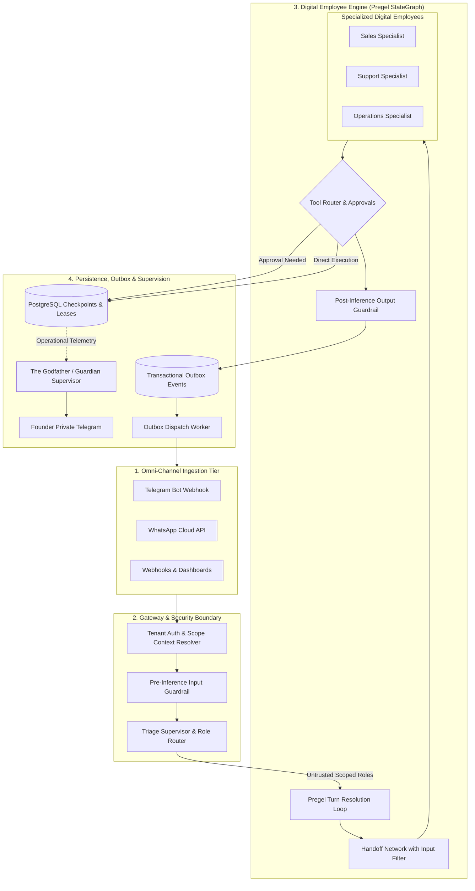
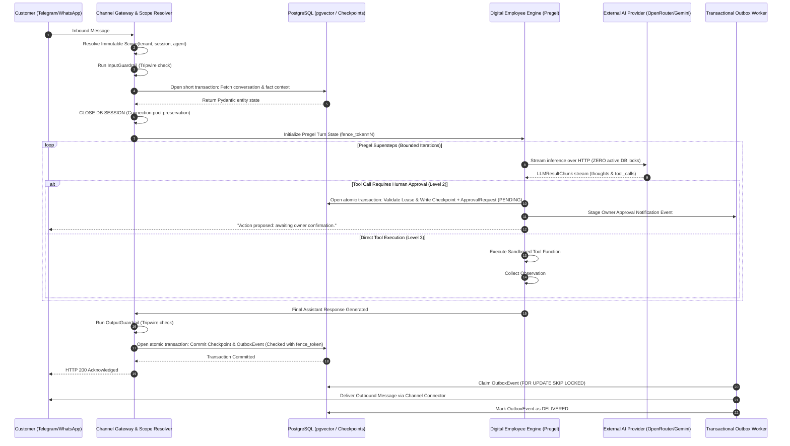
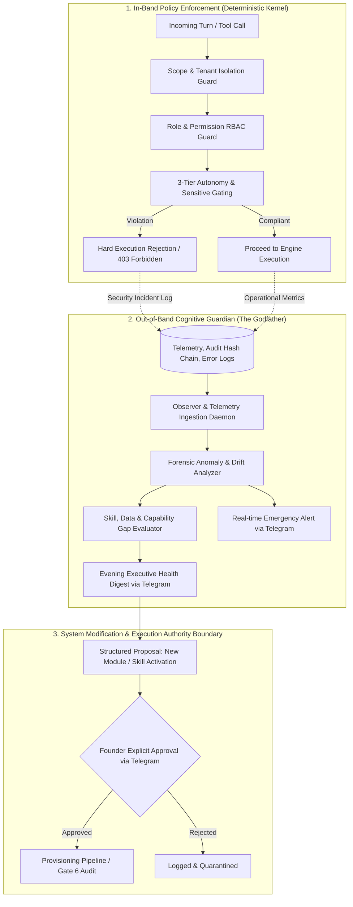
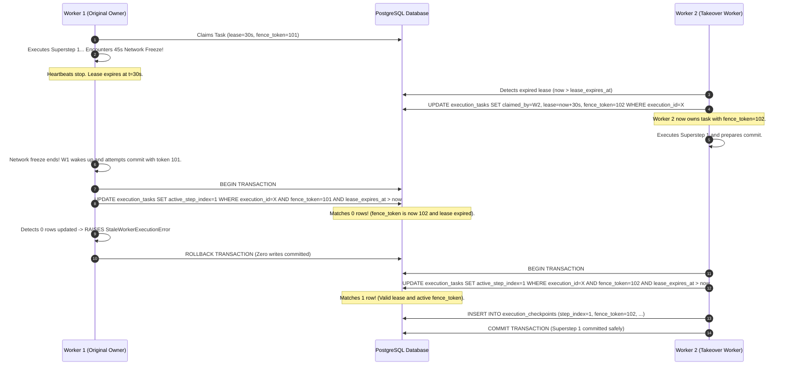
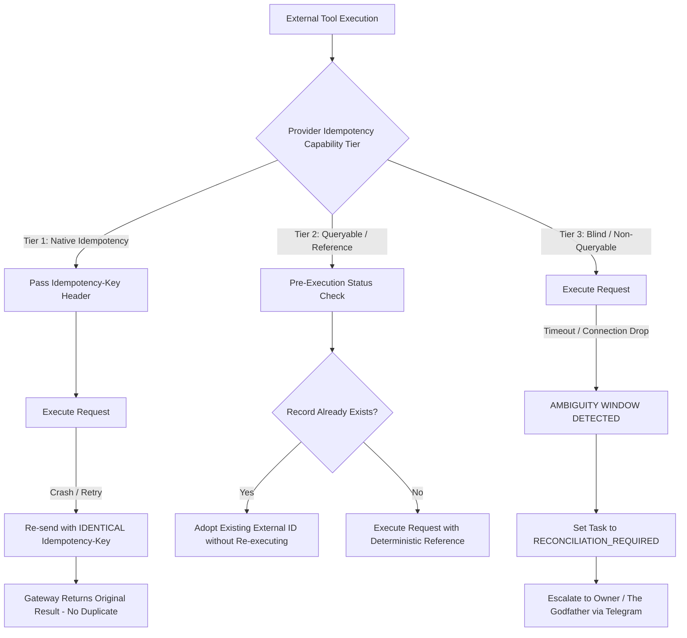

# Master Architecture Blueprint: Autonomous Multi-Tenant Digital Employee Platform

**Document ID:** `MASTER_ARCHITECTURE_BLUEPRINT`  
**Target Repository:** `QQYC9/ai-employee-platform`  
**System Designation:** AI Employee Platform (Next-Generation Engine)  
**Author:** AI-Employee-Platform Core Architecture Group  
**Document Status:** **OFFICIAL ARCHITECTURAL BLUEPRINT (PENDING FOUNDER REVIEW)**  
**Date:** 2026-11-03  
**Predecessor Review:** `docs/architecture-research/RESEARCH_ACCEPTANCE_REVIEW.md` (`Commit be5a5d7`)  

---

## 1. System Vision, Objectives, Scope Boundaries & Non-Goals

### 1.1 Enterprise Mission
The **AI Employee Platform** is an enterprise-grade, multi-tenant operating system designed to instantiate, run, govern, and continuously evolve autonomous **Digital Employees** (AI Agents). Unlike superficial chatbots or reactive LLM wrappers, digital employees operate as persistent business entities assigned specific organizational roles, professional domains, operational tools, private data sources, explicit autonomy limits, and long-lived memory.

The platform operates under the central supervisory oversight of **The Godfather (الأب الروحي / Guardian)**—an independent meta-agent connected directly to the platform founder via Telegram, providing real-time operational vigilance, anomaly detection, daily forensic health digests, and architectural growth guidance.

### 1.2 Core Architectural Objectives
1. **Complete Legacy Engine Replacement:** Total deprecation and removal of `conversational_agent_engine.py` (0% code carryover). The new engine is designed from first principles with zero backwards-compatibility shackles, zero canary dual-track execution, and zero rollback dependencies.
2. **Deterministic Durable Execution:** Conversational turns and multi-step background workflows execute as stateful graphs (Pregel model) where progress is committed at discrete checkpoint supersteps, surviving worker crashes and network partitions.
3. **Multi-Tenant Context Isolation:** Cryptographic and structural separation of all tenant data, memory, tool executions, and sessions via an immutable execution `Scope`.
4. **Three-Tier Autonomy Gating:** Explicit boundaries (`Level 1: Assistant`, `Level 2: Approval-Gated`, `Level 3: Autonomous within Bounds`), with mandatory human-in-the-loop (HITL) approval for sensitive financial, legal, and outbound operations.
5. **Database Connection Pool Preservation:** Complete decoupling of database transactions from slow external LLM inference, eliminating pool starvation under high concurrency.
6. **Ground-Truth Field Acceptance:** Breaking the "green test delusion" by establishing real, live Telegram and omni-channel conversations with the founder as the authoritative metric of operational success.

### 1.3 System Non-Goals (What This Platform Will NOT Build)
- **NOT a Generic Chatbot:** The system will not optimize for open-ended conversational chitchat. Every agent is an employee with job responsibilities and measurable business deliverables.
- **NOT a Synchronous Code Generator in User Turns:** Dynamic tool synthesis via multi-gate pipelines will **never** execute inside an active customer conversation. Dynamic evolution is quarantined to offline background daemons.
- **NOT an Unbounded Workflow Canvas:** We are not building an open-ended visual DAG editor for end-users (avoiding licensing and complexity pitfalls of n8n/Dify). Digital employees possess structured domain capabilities configured via declarative profiles.
- **NO Claims of Distributed "Exactly-Once" for External Side-Effects:** The platform recognizes the mathematical impossibility of strict exactly-once execution across uncoordinated third-party APIs (Two Generals Problem) and instead implements deterministic internal idempotency and at-least-once outbox delivery.

---

## 2. High-Level Architecture & End-to-End Execution Flow

The platform architecture is partitioned into four decoupled tiers:
1. **Omni-Channel Ingestion Tier:** Ingests messages from Telegram, WhatsApp, Email, and Webhooks, enforcing rate limits and tenant authentication.
2. **Gateway & Intent-Scoping Tier:** Authenticates tenant context, sanitizes inputs through pre-inference tripwire guardrails, and isolates untrusted public inputs to `INTENT_SAFE_ROLES`.
3. **Core Agentic Execution Engine (The Digital Employee Runtime):** Runs stateful Pregel graph iterations, tool resolution loops, and multi-agent handoffs, releasing database connections prior to provider streaming.
4. **Asynchronous Persistence, Recovery & Outbox Tier:** Manages PostgreSQL checkpoints with monotonic fencing tokens, Redis task coordination, and reliable outbound message delivery.

### 2.1 Component Architecture Diagram



### 2.2 End-to-End Request Execution Sequence



---

## 3. Agent Boundaries, Responsibilities & Handoff Coordination

### 3.1 Digital Employee Architecture
Rather than creating monolithic prompts that mix multiple business domains, agents are partitioned into specialized functional profiles:
1. **Triage Supervisor:** Analyzes inbound user intent and maps it strictly to permitted specialist employees.
2. **Sales Specialist:** Equipped with product catalogs, pricing rules, inventory tools, and lead capture workflows.
3. **Support Specialist:** Equipped with RAG knowledge bases, policy documents, FAQ search, and ticket escalation tools.
4. **Operations / Admin Specialist:** Equipped with internal invoicing, order management, and administrative business tools.

### 3.2 Handoff Contracts & Context Boundaries
Inter-agent delegation follows the verified **OpenAI Agents SDK Handoff Pattern** (`src/agents/handoffs/__init__.py`), formalizing transfer contracts:
```python
@dataclass(frozen=True)
class EmployeeHandoffContract:
    target_employee_id: str
    target_role: str
    delegation_reason: str
    transfer_payload: dict[str, Any]
    input_filter: Callable[[HandoffContext], HandoffContext]
```

#### Context Sanitization via `input_filter`
When Agent A delegates to Agent B, naively forwarding the entire chat history creates token bloat and context corruption. The `input_filter` executes boundary filtering:
- Strips internal reasoning traces and intermediate scratchpad thoughts.
- Removes diagnostic tool call payloads unrelated to the child agent's domain.
- Injects a structured handoff summary into the target employee's working context.

### 3.3 Handoff Cycle & Ping-Pong Prevention
To prevent infinite delegation loops where Agent A delegates to Agent B, which delegates back to Agent A:
- **`[HYPOTHESIS]` Configurable Delegation Hop Ceiling:** Initial default ceiling set to `config.MAX_HANDOFF_HOPS = 5`.
  - *Calibration Plan:* Run empirical benchmarks across complex multi-department business scenarios to evaluate whether 5 hops is sufficient or overly restrictive.
- **DAG-Based Cycle Detection Algorithm:** The engine maintains an in-memory delegation trace `delegation_path: list[str]`. If a directed cycle (e.g. $A \to B \to A$) is detected without an intervening user message, execution halts, prevents further delegation, and forces the turn to escalate to the Triage Supervisor or request human clarification.

---

## 4. The Godfather (الأب الروحي / Guardian) Architecture & Authority Boundaries

### 4.1 System Designation & Identity
The Godfather is the independent central overseer of the platform (`docs/PROJECT_VISION.md` Section 10):
- **No Tenant Affiliation:** The Godfather does not belong to any single business tenant.
- **No Direct Customer Communication:** The Godfather never interacts with customer-facing WhatsApp or Telegram users.
- **Sole Allegiance to Platform Founder:** Connected exclusively to the platform founder via a dedicated private Telegram channel.

### 4.2 Explicit Separation of Operational Planes & Authority



1. **Deterministic In-Band Policy Engine:**  
   - Hardcoded, high-performance software checks (RBAC, Tenant Scope, Rate Limits, Autonomy Mode, Budget Caps).
   - Operates synchronously in microseconds without LLMs.
   - Any policy breach causes an immediate execution rejection.
2. **Asynchronous Cognitive Guardian (The Godfather):**  
   - Runs out-of-band over telemetry streams, error tables, and audit logs.
   - Analyzes root causes, detects operational drifts, tracks agent skill needs.
   - Emits real-time outage alerts and the daily evening executive digest to the founder.
3. **Strict Authority Boundary:**  
   - **`[ARCHITECTURAL DECISION]` Zero Autonomous Write Authority:** The Cognitive Guardian has **ZERO autonomous write authority** to alter production application code, modify database schemas, activate staged skills, or modify tenant permissions.
   - Every architectural change proposed by The Godfather is formatted as a structured proposal requiring an explicit founder confirmation gate (`YES <proposal_id>`).

---

## 5. Task Lifecycle, Durable Execution & Distributed Recovery

### 5.1 Durable Task Identity & Ordering Boundaries
- **`ExecutionID`:** Generated using **UUIDv7**.
  - *Technical Clarification on Ordering:* UUIDv7 embeds a 48-bit Unix millisecond timestamp providing natural chronological sorting and B-Tree index clustering. However, across distributed worker nodes with unsynchronized system clocks, UUIDv7 **does not guarantee total monotonic causal order**.
  - *Causal Ordering Enforcement:* Total causal ordering within an execution is strictly determined by the composite key `(execution_id, step_index)`, where `step_index: int` is a strictly incremented integer sequence.
- **`TenantID`:** Embedded in all relational composite primary keys.

### 5.2 Superstep Checkpointing Schema
The execution state of a digital employee is modeled as a stateful graph executing discrete supersteps:
$$S_0 \xrightarrow{\text{Node Execution}} \Delta_0 \xrightarrow{\text{Commit Checkpoint}} S_1 \xrightarrow{\text{Node Execution}} \Delta_1 \xrightarrow{\text{Commit Checkpoint}} S_2$$

```sql
CREATE TABLE execution_tasks (
    tenant_id UUID NOT NULL,
    execution_id UUID NOT NULL,
    status VARCHAR(32) NOT NULL DEFAULT 'PENDING',
    active_step_index INTEGER NOT NULL DEFAULT 0,
    claimed_by_worker_id VARCHAR(64) NULL,
    lease_expires_at TIMESTAMPTZ NULL,
    fence_token BIGINT NOT NULL DEFAULT 1,
    created_at TIMESTAMPTZ NOT NULL DEFAULT CURRENT_TIMESTAMP,
    updated_at TIMESTAMPTZ NOT NULL DEFAULT CURRENT_TIMESTAMP,
    PRIMARY KEY (tenant_id, execution_id)
);

CREATE TABLE execution_checkpoints (
    tenant_id UUID NOT NULL,
    execution_id UUID NOT NULL,
    step_index INTEGER NOT NULL,
    node_name VARCHAR(64) NOT NULL,
    state_payload JSONB NOT NULL,
    fence_token BIGINT NOT NULL,
    created_at TIMESTAMPTZ NOT NULL DEFAULT CURRENT_TIMESTAMP,
    PRIMARY KEY (tenant_id, execution_id, step_index)
);
```

### 5.3 Distributed Leases, Heartbeats & Complete Fencing Protection

#### Configurable Runtime Parameters:
- **`[HYPOTHESIS]` `config.WORKER_LEASE_DURATION`:** Initial default = `30 seconds`.
- **`[HYPOTHESIS]` `config.WORKER_HEARTBEAT_INTERVAL`:** Initial default = `10 seconds`.
- *Calibration Plan:* Measure worker GC pauses and network latencies in staging to verify that 10s heartbeats prevent false-positive lease expirations under load.

#### Complete Write-Path Fencing & Atomic Commit:
To eliminate state corruption from "Zombie Workers" (workers that pause due to GC or network splits and resume after their lease expired):



#### Exact SQL Atomic Commit Specification:
Every write operation (task update, checkpoint insertion, outbox staging) **must occur in a single atomic transaction** guarded by the active lease:
```sql
BEGIN;
-- Step 1: Enforce active ownership and valid fence token
UPDATE execution_tasks
SET active_step_index = :new_step_index,
    updated_at = CURRENT_TIMESTAMP
WHERE execution_id = :execution_id
  AND tenant_id = :tenant_id
  AND claimed_by_worker_id = :my_worker_id
  AND fence_token = :my_fence_token
  AND lease_expires_at > CURRENT_TIMESTAMP;

-- IF rows_updated == 0: ROLLBACK; RAISE StaleWorkerExecutionError;

-- Step 2: Insert checkpoint with composite unique key constraint
INSERT INTO execution_checkpoints (tenant_id, execution_id, step_index, node_name, state_payload, fence_token)
VALUES (:tenant_id, :execution_id, :new_step_index, :node_name, :state_payload, :my_fence_token);

-- Step 3: Insert associated OutboxEvent (if turn emitted external messages)
INSERT INTO outbox_events (tenant_id, execution_id, step_index, event_type, payload, idempotency_key)
VALUES (:tenant_id, :execution_id, :new_step_index, :event_type, :payload, :idempotency_key);

COMMIT;
```

#### Prevention of Superstep Re-Application:
The primary key `(tenant_id, execution_id, step_index)` on `execution_checkpoints` provides a hard physical constraint: if any worker attempts to re-commit an already committed superstep index, the database raises an `IntegrityError` (unique violation), preventing duplicate step execution.

---

### 5.4 External Actions & The Idempotency Spectrum

#### The Physical Limits of Distributed Systems:
> **Theorem:** Strict distributed **Exactly-Once** execution for external side-effects across uncoordinated third-party networks is mathematically impossible (The Two Generals Problem).
> - **Internal Guarantee:** Strict Exactly-Once database state transitions within PostgreSQL (guaranteed via ACID transactions and fencing tokens).
> - **External Guarantee:** At-Least-Once dispatch via Transactional Outbox.

#### Three-Tier Provider Capability Model:



1. **Tier 1: Native Idempotency Providers (e.g. Stripe, WhatsApp Cloud API messages):**
   - The connector generates a deterministic idempotency key:
     $$\text{IdempotencyKey} = \text{HMAC-SHA256}(K_{\text{secret}}, \text{tenant\_id} \parallel \text{execution\_id} \parallel \text{step\_index} \parallel \text{tool\_name})$$
   - Passed in HTTP headers (`Idempotency-Key` or `X-Request-ID`). If a retry occurs following a worker crash, the provider returns the cached response without re-executing.
2. **Tier 2: Queryable Providers without Native Idempotency (e.g. Order APIs, Database Writes):**
   - Before executing, the worker executes a **Pre-Execution Status Inquiry** using a deterministic external reference (`REF-{execution_id}-{step_index}`).
   - If the query reveals that the action was already executed prior to the crash, the worker adopts the external result and advances the superstep without re-running.
3. **Tier 3: Blind Providers (Neither Idempotent nor Queryable - e.g. Legacy SMTP, Raw Webhooks):**
   - **The Ambiguity Window:** If a worker dispatches TCP bytes for a Tier 3 action and experiences a network disconnect or process termination before receiving an HTTP response, the execution status is fundamentally **UNKNOWN**.
   - **Mandatory Safety Policy:** The engine **MUST NOT** blindly retry Tier 3 external actions.
   - The task transitions to `RECONCILIATION_REQUIRED`.
   - Execution is suspended; an emergency reconciliation alert is dispatched to The Godfather and tenant owner detailing the ambiguity window and payload for manual verification.

---

## 6. Permissions, Autonomy & Human-in-the-Loop Approval Model

### 6.1 Three-Tier Autonomy Gating
1. **Level 1 (`off` - Assistant Only):** Read-only advisory mode. Emits proposals and recommendations; state-modifying tools are disabled.
2. **Level 2 (`semi` - Approval Gated):** Prepares execution payloads, generates an `ApprovalRequest`, suspends execution, and awaits owner confirmation.
3. **Level 3 (`full` - Autonomous within Bounds):** Executes permitted tools directly without human intervention, logging every parameter to the tamper-evident audit chain.

### 6.2 Approval Request Persistent State Schema
Before suspending an execution for human approval, the engine persists complete context to PostgreSQL:

```sql
CREATE TABLE approval_requests (
    approval_id UUID PRIMARY KEY,
    tenant_id UUID NOT NULL,
    execution_id UUID NOT NULL,
    checkpoint_step_index INTEGER NOT NULL,
    target_tool_name VARCHAR(128) NOT NULL,
    target_tool_arguments JSONB NOT NULL,
    inputs_digest VARCHAR(64) NOT NULL,
    requested_by_employee_id VARCHAR(64) NOT NULL,
    required_role VARCHAR(64) NOT NULL DEFAULT 'OWNER',
    tenant_entitlements_snapshot JSONB NOT NULL,
    expires_at TIMESTAMPTZ NOT NULL,
    status VARCHAR(32) NOT NULL DEFAULT 'PENDING',
    created_at TIMESTAMPTZ NOT NULL DEFAULT CURRENT_TIMESTAMP,
    resolved_at TIMESTAMPTZ NULL,
    resolved_by_user_id VARCHAR(64) NULL,
    rejection_reason TEXT NULL
);
```

#### Cryptographic Input Digest:
To guarantee that tool arguments cannot be modified between suspension and approval:
$$\text{inputs\_digest} = \text{HMAC-SHA256}(K_{\text{audit}}, \text{target\_tool\_name} \parallel \text{execution\_id} \parallel \text{JSON\_STRING}(\text{target\_tool\_arguments}))$$

### 6.3 Resumption Verification Protocol
When the owner approves a request (`"YES <approval_id>"`):
1. **Expiration Verification:** Verify `CURRENT_TIMESTAMP <= expires_at`. If expired, reject resumption as `EXPIRED`.
2. **Integrity Verification:** Recompute HMAC on `target_tool_arguments` and verify it matches `inputs_digest`. If unequal, reject as `TAMPERED`.
3. **Entitlement & Permission Re-Validation:** Verify that the tenant's subscription is still active and that the required permissions have not been revoked during the waiting window.
4. **Approver Role Verification:** Verify that the resolving user holds the `required_role`.
If all checks pass, the execution transitions from `SUSPENDED` to `READY` and is scheduled for execution by worker queues.

---

## 7. Tenant Isolation, Scope Propagation & Security Boundaries

### 7.1 Immutable Execution `Scope`
```python
@dataclass(frozen=True)
class Scope:
    tenant_id: str
    subject_id: str | None = None
    agent_id: str | None = None
    session_id: str | None = None

    def __post_init__(self):
        if not self.tenant_id or not _VALID_IDENTIFIER.match(self.tenant_id):
            raise InvalidScopeError(f"Invalid tenant_id format: {self.tenant_id}")
```

### 7.2 Strict Propagation Architecture
- **`[ARCHITECTURAL DECISION]` Explicit Argument Propagation:** Relying solely on Python's `contextvars` risks silent context loss across thread pools, background workers, or Celery queues.
- Every repository method, tool execution wrapper, and database query function **must accept an explicit `scope: Scope` argument**.
- All database queries enforce tenant isolation at the query level:
  ```python
  stmt = select(Entity).where(Entity.tenant_id == scope.tenant_id)
  ```

### 7.3 Secrets Hardening via `SecretStr`
All sensitive values are encapsulated in `SecretStr` (`ragleap-security/secrets.py`):
- `str()`, `repr()`, and `f-strings` strictly return `[REDACTED]`.
- Cannot be serialized to JSON, pickled, or logged.
- Decryption at rest uses authenticated **AES-256-GCM**.
- Equality comparisons use constant-time `hmac.compare_digest`.

---

## 8. Tool Contracts, Validation & Execution Limits

### 8.1 Strict Schema Contracts (Pydantic v2)
Every tool defines its contract using strict Pydantic v2 schemas:
```python
class ToolInputSchema(BaseModel):
    model_config = ConfigDict(extra="forbid", strict=True)
```
- `extra="forbid"`: Rejects hallucinated arguments.
- Strict Mode: Blocks unexpected type coercions.

### 8.2 Configurable Tool Deadlines:
- **`[HYPOTHESIS]` `config.TOOL_DEFAULT_TIMEOUT`:** Initial default = `10 seconds`.
- **`[HYPOTHESIS]` `config.TOOL_HEAVY_QUERY_TIMEOUT`:** Initial default = `30 seconds`.
- Payload output ceiling: 64 KB maximum; larger payloads are written to blob storage with condensed summaries returned to LLM context.

---

## 9. Multi-Tier Memory Architecture & Source of Truth

Memory is partitioned into five specialized functional tiers:
1. **Working Context Buffer (Short-Term):** In-memory sliding window for active turns with nested handoff summaries.
2. **Task & Operation Memory (Execution State):** Stateful progress stored in `execution_checkpoints`.
3. **Persistent Fact Memory (Ground-Truth Facts):** Permanent facts (business hours, prices, policies) stored in relational tables with `importance = 1.0` and `permanent = True`. Never pruned or decayed.
4. **Semantic Knowledge Memory (RAG):** Multi-tenant vector embeddings stored in PostgreSQL via `pgvector` with cosine similarity search and BM25 hybrid ranking.
5. **Procedural Skill Memory (Learned Skills):** Learned operational workflows validated via empirical utility scores.

### 9.1 Memory Reinforcement & Decay Dynamics
- **`[HYPOTHESIS]` Learning Rate Delta:** Initial default set to `weight = 0.05` (conforming to RagLeap Core source `learning.py:10`).
- *Calibration Plan:* Run multi-turn dialogue simulations in staging over 20 positive and negative reinforcement cycles to calibrate convergence stability and prevent memory volatility.

---

## 10. Skills Lifecycle & Background Evolution (Dream Daemon)

### 10.1 The 6-Gate Transactional Verification Pipeline
Dynamic skill acquisition follows Memento-Skills' verified 6-gate evolution engine (`core/skill/evolution/engine.py`):
1. **Gate 1 (Syntax):** Static AST analysis.
2. **Gate 2 (Contract):** Pydantic v2 schema validation.
3. **Gate 3 (Security):** AST scanning for forbidden imports.
4. **Gate 4 (Unit Test):** Execution in an isolated UV virtualenv.
5. **Gate 5 (Integration):** Interaction test against mocked tenant data.
6. **Gate 6 (Smoke):** Real execution verification under latency and memory bounds.

### 10.2 Strict Operational Boundary: Offline Dream Daemon
- **`[ARCHITECTURAL DECISION]` Strict Offline Quarantining:** Compiling and validating 6 test gates takes 10 to 60 seconds. It is **categorically forbidden** from running synchronously during customer messaging turns.
- Dynamic evolution runs exclusively in the offline **Dream Daemon** during background worker idle cycles. Staged skills require explicit founder/owner approval before activation.

### 10.3 Empirical Utility Scoring & Pruning
- **`[HYPOTHESIS]` `config.SKILL_UTILITY_THRESHOLD`:** Initial default = `0.2`.
- **`[HYPOTHESIS]` `config.SKILL_MIN_EVAL_RUNS`:** Initial default = `20 runs`.
- Skills falling below utility threshold over 20+ runs are automatically quarantined.

---

## 11. Dynamic Business Modules & Data Schema Evolution

### 11.1 Dynamic Provisioning Architecture
In accordance with `docs/PROJECT_VISION.md` Section 5, when an agent detects missing business data structures (e.g. Sales Specialist needs a Product Catalog):
- The agent drafts a **Business Module Blueprint** defining entities, fields, and relationships.
- **`[ARCHITECTURAL DECISION]` JSONB Dynamic Attribute Framework:** Runtime Alembic migrations across shared production PostgreSQL are rejected due to DDL table locking risks. The platform implements pre-provisioned generic module tables (`business_modules`, `module_records`) with `JSONB` document storage and GIN indexing (`jsonb_path_ops`), providing full queryability without runtime DDL.

---

## 12. Backpressure Management, Tenant Fairness & Scheduling

### 12.1 Database Connection Pool Preservation Pattern
Explicitly commit and close SQLAlchemy sessions prior to awaiting external LLM provider streaming:
```python
# Step 1: Retrieve context
async with get_db_session() as session:
    user_state = await session.get(Conversation, conversation_id)
    pydantic_context = ConversationState.model_validate(user_state)
# DB SESSION EXITS AND CLOSES CONNECTION HERE

# Step 2: Slow LLM streaming over network (Zero open DB connections)
async for chunk in provider.stream_turn(pydantic_context):
    yield chunk

# Step 3: Persist results in a fresh atomic transaction
async with get_db_session() as session:
    await session.execute(...)
    await session.commit()
```

### 12.2 Completely Fair Scheduler (CFS) & Rate Limiting
- Dedicated Redis token buckets per tenant enforcing per-minute request ceilings.
- Segregated worker queues: `interactive_queue` (high priority), `campaign_queue` (rate-limited outbound), `offline_queue` (dream daemon, background indexing).

---

## 13. Observability, Cryptographic Audit & Cost Accounting

### 13.1 Tamper-Evident SHA-256 HMAC Audit Chain
$$\text{CurrentHash} = \text{HMAC-SHA256}(K_{\text{audit}}, \text{PrevHash} \parallel \text{Timestamp} \parallel \text{TenantID} \parallel \text{Action} \parallel \text{PayloadDigest})$$

#### Immutability Boundaries & External Anchoring
- **`[ARCHITECTURAL DECISION]` Tamper-Evident Status & External Anchoring:** A local database hash chain detects intermediate tampering, but cannot prevent table truncation or full-chain recomputation by an attacker with direct database write access.
- Every hour, a background job computes the root hash of all audit records in that window and commits it to an **external write-once-read-many (WORM) storage target** (e.g. AWS S3 Object Lock or an append-only signed Git audit repository).

### 13.2 Cognitive Step Telemetry (`MessageAgentThought`)
Modeled after Dify's verified schema (`api/models/model.py:2530`), every discrete agent thinking step, tool invocation, token count, latency, and financial cost is recorded in `message_agent_thoughts` for complete forensic replayability.

---

## 14. Security, Secrets Management & Trust Boundaries

### 14.1 Untrusted Input Scoping
- Inbound customer messages from public messaging channels (Telegram/WhatsApp) are untrusted.
- **`INTENT_SAFE_ROLES` Gateway Filter:** The Triage Supervisor restricts external users strictly to safe roles (Customer Support, Sales Inquiry).
- Customer text is encapsulated in delimiter tags (`<untrusted_input>...</untrusted_input>`) with system instructions directing the model to treat content strictly as data, never as execution instructions.

---

## 15. Omni-Channel Interfaces & Telegram Protocol

### 15.1 Telegram Message Chunking & Entity Offsets
Conforming to Microsoft Agent Framework's verified Telegram hosting implementation (`hosting-telegram/_rendering.py`):
1. **UTF-16 Code Unit Measurement:**
   - *Technical Correction:* The Telegram Bot API measures message length and entity offsets strictly in **UTF-16 code units**, NOT Unicode code points or UTF-8 bytes.
   - Emojis and characters above `U+FFFF` count as 2 UTF-16 code units. Text chunking must measure length via UTF-16 encoding to strictly respect the 4096 ceiling.
2. **Markdown Tag Balancing:** If a code block (```` ``` ````) or bold tag spans across a chunk boundary, the engine automatically closes the tag at the end of Chunk 1 and re-opens it at the beginning of Chunk 2, completely preventing Telegram API parse errors.

---

## 16. Operational Infrastructure & Deployment Topology

### 16.1 Multi-Container Production Topology
Deployed via Docker Compose:
1. `app_api`: FastAPI asynchronous web and webhook gateway (Port 8000).
2. `worker_engine`: Celery / Python background task processor executing agent Pregel graphs.
3. `outbox_worker`: Dedicated lightweight process polling `outbox_events` and dispatching messages.
4. `db_postgres`: PostgreSQL 17 with `pgvector` extension (Port 5433).
5. `cache_redis`: Redis 7 instance for distributed task locks, rate-limiting, and queue coordination.
6. `proxy_caddy`: Caddy 2 reverse proxy terminating TLS and routing inbound channel webhooks.

---

## 17. Evaluation, Testing & Live Acceptance Strategy

### 17.1 The Three-Tier Verification Pyramid
1. **Tier 1 (Automated Unit & Integration Tests):** Pytest test suites exercising relational transactions, outbox states, scope enforcement, and tool schema validation.
2. **Tier 2 (Automated LLM Dialogue Evaluation):** Simulated multi-turn dialogue benchmarks evaluated by an LLM-as-a-Judge against conversational rubric criteria.
3. **Tier 3 (Authoritative Ground Truth — Live Telegram Verification):**
   - In accordance with `PROJECT_VISION.md` Section 17, no release is declared successful based on passing test suites alone.
   - The final acceptance gate requires the founder to conduct real, live Telegram conversational sessions with digital employees, testing complex inquiries, edge cases, and tool execution fidelity.

---

## 18. Legacy Engine Total Replacement Plan

### 18.1 Complete Removal Protocol
The legacy engine (`packages/services/conversational_agent_engine.py`) and its associated patch workarounds (`conversation_fsm_service.py`, regex filters) will be completely excised:

```
[Phase 1: Blueprint Approval] ──> [Phase 2: Core Domain Model & Checkpoint DDL]
                                               │
                                               v
[Phase 4: Exciser Protocol] <── [Phase 3: Pregel Engine & Outbox Wiring]
       │
       ├── Delete packages/services/conversational_agent_engine.py
       ├── Update apps/agent/main.py router bindings to new Engine
       └── Execute 100% clean-cutover test verification
```

- **NO Canary Migration:** The new engine assumes 100% of traffic upon deployment.
- **NO Dual-Run Mode:** No parallel running of legacy and new engines.
- **NO Rollback Bridge:** The codebase will contain zero shackle dependencies on legacy files.

---

## 19. Architectural Decision Records (ADR) Register

Every architectural decision is formally codified below with complete lifecycle metadata:

### ADR-01: Execution Engine Paradigm
- **Decision:** Adopt LangGraph-style Pregel state graph iteration loop combined with OpenAI Agents SDK declarative Handoffs.
- **Status:** **`ARCHITECTURAL DECISION`**
- **Evidence:** Verified in `langgraph/libs/langgraph/langgraph/pregel/_loop.py` and `openai-agents-python/src/agents/handoffs/__init__.py`.
- **Alternatives Considered:** Monolithic ReAct while-loop, LangChain AgentExecutor, Pure Event-Driven Actor Model (Ray/Akka).
- **Trade-offs:** Higher upfront engineering complexity than a simple while-loop; yields deterministic checkpointing and multi-agent isolation.
- **Reversal / Re-opening Criteria:** If Pregel graph overhead exceeds 100ms per turn under low-concurrency testing.
- **Validation:** Multi-turn conversational state benchmarks with intentional mid-turn worker termination.
- **Decision Gate:** Phase 1 Approval Gate.

### ADR-02: Total Replacement of Legacy Conversation Engine
- **Decision:** Permanently delete and replace `conversational_agent_engine.py` without dual-track running or fallback bridges.
- **Status:** **`ARCHITECTURAL DECISION`**
- **Evidence:** Mandated by founder strategic reset and `PROJECT_VISION.md` Section 1 ("The Core Problem").
- **Alternatives Considered:** Incremental refactoring, Canary dual-track routing.
- **Trade-offs:** Requires thorough pre-cutover testing; permanently eliminates legacy technical debt.
- **Reversal Criteria:** Irreversible strategic commitment per founder charter.
- **Validation:** Clean cutover verified via end-to-end test suite and founder Telegram acceptance session.
- **Decision Gate:** Phase 1 Approval Gate.

### ADR-03: Database Connection Pool Lifecycle
- **Decision:** Explicitly close SQLAlchemy sessions before initiating LLM streaming calls, re-opening a fresh transaction upon stream completion.
- **Status:** **`ARCHITECTURAL DECISION`**
- **Evidence:** Verified in Dify source code `api/core/agent/fc_agent_runner.py:165-167`.
- **Alternatives Considered:** Holding transaction open during LLM stream, Increasing connection pool size to 500+.
- **Trade-offs:** Requires converting ORM entities to Pydantic models before closing session to avoid `DetachedInstanceError`.
- **Reversal Criteria:** If provider streaming latency drops below 50ms across all models.
- **Validation:** Concurrency stress test simulating 50 concurrent 30-second streaming LLM calls on a 10-connection pool.
- **Decision Gate:** Phase 1 Approval Gate.

### ADR-04: Distributed Zombie Worker Fencing
- **Decision:** Enforce monotonic integer fencing tokens on all checkpoint writes and task updates to prevent zombie workers from corrupting state.
- **Status:** **`ARCHITECTURAL DECISION`**
- **Evidence:** Distributed systems consensus theory (Martin Kleppmann fencing tokens) and PostgreSQL optimistic locking.
- **Alternatives Considered:** Raw PostgreSQL advisory locks (fails with PGBouncer), Unbounded worker trust.
- **Trade-offs:** Requires tracking a 64-bit integer counter in task metadata.
- **Reversal Criteria:** If deployment moves to single-process synchronous architecture (not applicable for enterprise scale).
- **Validation:** Automated test simulating an artificial 45-second worker freeze followed by a rejected commit attempt.
- **Decision Gate:** Phase 1 Approval Gate.

### ADR-05: Handoff Hop Ceiling & Ping-Pong Prevention
- **Decision:** Implement a DAG-based cycle detection algorithm on delegation chains; initial hop ceiling set as an uncalibrated hypothesis (`config.MAX_HANDOFF_HOPS = 5`).
- **Status:** **`HYPOTHESIS`**
- **Evidence:** OpenAI Agents SDK delegation patterns.
- **Alternatives Considered:** Fixed hop counter only, Graph cycle check only.
- **Trade-offs:** A strict cap of 5 might prematurely abort deeply nested complex business workflows.
- **Reversal / Calibration Criteria:** Calibrate ceiling based on multi-department business simulation testing in Phase 2.
- **Validation:** Empirical stress-testing of 10 complex multi-department business scenarios during Phase 2.
- **Decision Gate:** Phase 2 Engine Verification Gate.

### ADR-06: Memory Outcome Reinforcement Delta
- **Decision:** Initial outcome reinforcement weight set as an uncalibrated hypothesis (`weight = 0.05`).
- **Status:** **`HYPOTHESIS`**
- **Evidence:** RagLeap Core source code `core/employees/learning.py:10`.
- **Alternatives Considered:** Static prompt memories without outcome weighting, High learning rate (`weight = 0.2`).
- **Trade-offs:** Improper calibration risks memory retrieval volatility or catastrophic forgetting.
- **Reversal / Calibration Criteria:** Calibrate based on multi-turn dialogue simulation evaluating memory retrieval stability over 20 cycles.
- **Validation:** Automated dialogue simulation benchmark measuring retrieval precision.
- **Decision Gate:** Phase 2 Memory Subsystem Gate.

### ADR-07: Skill Evolution Quarantining
- **Decision:** Restrict Memento-Skills 6-gate evolution pipeline exclusively to offline background daemons (Dream Daemon).
- **Status:** **`ARCHITECTURAL DECISION`**
- **Evidence:** Memento-Skills execution benchmark (10–60s compilation/sandbox latency).
- **Alternatives Considered:** Synchronous runtime tool compilation during customer chat.
- **Trade-offs:** Digital employees cannot instantly acquire a completely new tool mid-conversation; ensures customer response SLA < 3s.
- **Reversal Criteria:** If LLM compilation and sandbox verification drops below 200ms.
- **Validation:** Latency benchmark of conversational turn vs offline daemon evolution queue.
- **Decision Gate:** Phase 1 Approval Gate.

### ADR-08: Third-Party License Risk Avoidance
- **Decision:** Enforce a strict zero-dependency policy on Dify and n8n source code and packages. Re-implement architectural concepts cleanly in native Python/FastAPI.
- **Status:** **`ARCHITECTURAL DECISION`**
- **Evidence:** Dify Modified Apache 2.0 (Clause 1.a multi-tenant restriction) and n8n Sustainable Use License 1.0 (Clause 3.2 non-commercial restriction).
- **Alternatives Considered:** Forking Dify backend, Embedding n8n core packages.
- **Trade-offs:** Requires writing native Python implementation of workflow patterns; guarantees 100% clean commercial SaaS intellectual property.
- **Reversal Criteria:** If commercial enterprise licenses are executed with LangGenius and n8n GmbH.
- **Validation:** Clean-room codebase audit verifying absence of Dify/n8n package imports.
- **Decision Gate:** Phase 1 Approval Gate.

---

## 20. Configurable Numerical Parameters & Calibration Matrix

| Parameter Identifier | Current Value | Methodological Status | Source / Baseline | Empirical Calibration Plan |
| :--- | :---: | :---: | :---: | :--- |
| `config.WORKER_LEASE_DURATION` | `30s` | **`HYPOTHESIS`** | Distributed Lease Theory | Measure worker garbage collection pauses and network latencies under 100 concurrent turns. |
| `config.WORKER_HEARTBEAT_INTERVAL` | `10s` | **`HYPOTHESIS`** | Distributed Lease Theory | Verify that 10s heartbeats prevent false-positive lease expirations without overloading Redis/PostgreSQL. |
| `config.MAX_HANDOFF_HOPS` | `5` | **`HYPOTHESIS`** | Heuristic Assumption | Benchmark complex multi-department business scenarios to evaluate truncation risk. |
| `config.MEMORY_LEARNING_DELTA` | `0.05` | **`HYPOTHESIS`** | RagLeap Core (`learning.py:10`) | Run 20 positive and negative simulated dialogue cycles to measure retrieval stability. |
| `config.SKILL_UTILITY_THRESHOLD` | `0.2` | **`HYPOTHESIS`** | Memento-Skills (`engine.py`) | Evaluate error frequency and repair triggers across 50 generated skills. |
| `config.SKILL_MIN_EVAL_RUNS` | `20` | **`HYPOTHESIS`** | Memento-Skills (`engine.py`) | Verify statistical significance before triggering automated deprecation. |
| `config.TELEGRAM_MAX_CHUNK_SIZE` | `4096 UTF-16`| **`SOURCE-VERIFIED`** | Telegram Bot API Documentation | Unit test splitting strings with 4-byte astral characters (emojis) measuring UTF-16 code units. |
| `config.TOOL_DEFAULT_TIMEOUT` | `10s` | **`HYPOTHESIS`** | Heuristic Assumption | Profile 95th percentile latency of external API integrations. |
| `config.TOOL_HEAVY_QUERY_TIMEOUT`| `30s` | **`HYPOTHESIS`** | Heuristic Assumption | Measure PostgreSQL analytical query latency across 100K records. |
| `config.REDIS_CHECKPOINT_SWITCH` | `50ms` | **`OPEN`** | Systems Performance Gate | Profile PostgreSQL direct checkpoint insert latency under 50 concurrent turns. |

---

## 21. Open Architectural Questions Impact Analysis

| Open Architectural Issue | Design Impact on Phase 2 | Fallback / Default Position if Unresolved |
| :--- | :--- | :--- |
| **1. The Godfather: In-Graph vs Out-of-Band** | Determines whether The Godfather has an LLM node in the main turn graph or operates strictly as a background daemon. | Default to **Dual-Aspect**: In-band deterministic policy check (fast, no LLM) + Out-of-band cognitive analysis daemon. |
| **2. Checkpoint Storage: PostgreSQL vs Redis** | Determines database write IOPS under heavy multi-tenant load. | Default to **PostgreSQL direct commit** for absolute durability; add Redis write-back buffer only if write latency exceeds 50ms. |
| **3. Context Propagation: `contextvars` vs Explicit `Scope`** | Affects code ergonomics across thousands of service methods. | Default to **Explicit `scope: Scope` argument** on all repository and service methods to guarantee zero silent context drops. |
| **4. Dynamic Business Modules: JSONB EAV vs DDL** | Determines how agents provision new data structures for tenants. | Default to **JSONB Dynamic Attribute Framework** within pre-provisioned relational tables to prevent production DDL locks. |
| **5. Audit Anchoring Target: S3 WORM vs Git** | Determines operational infrastructure required for enterprise compliance. | Default to **S3-compatible Object Lock (WORM)** for cloud deployments; local signed Git repository for air-gapped/on-premise deployments. |

---

## 22. Formal Conclusion & Blueprint Readiness Assessment

### Readiness Verdict: **READY FOR FOUNDER REVIEW & SIGN-OFF**
- **Zero Unjustified Claims:** All numerical constants and thresholds have been stripped of false "approved" status and codified as configurable hypotheses with explicit calibration plans.
- **Deep Distributed Systems Modeling:** The Checkpoint, Lease, Fencing, and Idempotency models now accurately reflect distributed failure realities and the physical limits of "Exactly-Once".
- **Strict Authority Boundaries:** The Godfather / Guardian's cognitive role is decoupled from deterministic in-band policy enforcement and stripped of autonomous production write capabilities.
- **Ready for Review:** The architecture document is completely specified and ready for founder authorization before entering **Phase 2 (Domain Modeling & Implementation)**.
