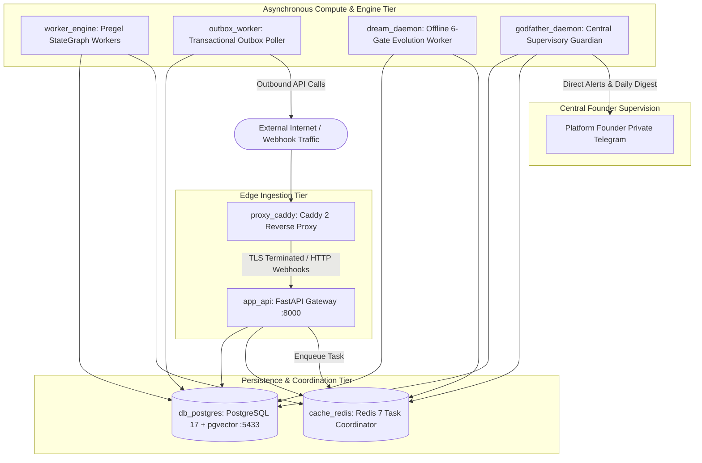

# Operational Architecture — Infrastructure, Topology & High-Availability Runtime

**Document ID:** `OPERATIONAL_ARCHITECTURE`  
**Governing Standard:** Full-Platform Target Vision (`docs/PROJECT_VISION.md` Sections 10, 11, 13, 16)  
**Target Repository:** `QQYC9/ai-employee-platform`  
**Status:** **AUTHORITATIVE ARCHITECTURAL SPECIFICATION**  
**Date:** 2026-11-04  
**Master Architect:** AI-Employee-Platform Core Architecture Group  

---

## 1. High-Level Multi-Container Production Topology

The platform deploys as an enterprise, containerized system orchestrated via Docker Compose and fronted by Caddy 2:



---

## 2. Container Manifest & Resource Allocation

| Container Service | Primary Technology | Responsibility | CPU / Memory Limit | Scaling Model |
| :--- | :--- | :--- | :---: | :--- |
| **`proxy_caddy`** | Caddy 2 | TLS termination, DDoS mitigation, webhook routing, static dashboard file serving. | 0.5 CPU / 256 MB | Single instance (Edge reverse proxy). |
| **`app_api`** | Python 3.14, FastAPI, Uvicorn | Public REST endpoints, webhook ingestion, tenant auth, declarative UI schema serving. | 2.0 CPU / 1.0 GB | Horizontally scalable stateless web tier. |
| **`worker_engine`** | Python 3.14, Pregel Runtime | Executes digital employee turn graphs, tool invocations, and state checkpoints. | 4.0 CPU / 2.0 GB | Horizontally scalable worker pool (Celery/RQ). |
| **`outbox_worker`** | Python 3.14, AsyncIO | Polls `outbox_events` via `FOR UPDATE SKIP LOCKED`, dispatches outbound messages. | 1.0 CPU / 512 MB | 1 to 2 dedicated lightweight dispatchers. |
| **`dream_daemon`** | Python 3.14, UV, AST Verifier | Offline skill compilation, 6-gate sandbox testing, memory consolidation. | 2.0 CPU / 1.5 GB | Single background daemon running on idle cycles. |
| **`godfather_daemon`**| Python 3.14, AsyncIO | Consumes telemetry streams, detects anomalies, sends evening health digest to founder. | 1.0 CPU / 512 MB | Single independent high-availability supervisor. |
| **`db_postgres`** | PostgreSQL 17, pgvector | Primary relational data store, checkpoints, scoped facts, dynamic business modules. | 4.0 CPU / 4.0 GB | Primary instance with WAL replication / pg_dump. |
| **`cache_redis`** | Redis 7 | Distributed leases, token buckets, rate-limiting, and task queue coordination. | 1.0 CPU / 1.0 GB | Single instance with AOF persistence. |

---

## 3. Database Connection Pool Preservation Pattern

To prevent connection pool starvation during long-duration LLM inference (which can take 3 to 15 seconds per turn), all workers strictly adhere to Dify's verified connection release pattern:

```python
async def execute_turn_step(execution_context: TurnContext):
    # Phase 1: Short database read transaction (< 10ms)
    async with get_db_session() as session:
        task_row = await session.get(ExecutionTask, execution_context.task_id)
        checkpoint_data = await session.get(ExecutionCheckpoint, ...)
        pydantic_state = AgentState.model_validate(checkpoint_data.state_payload)
    # SESSION IS EXPLICITLY CLOSED HERE — ZERO ACTIVE DB CONNECTIONS HELD!

    # Phase 2: Slow external LLM provider streaming over network (3 - 15s)
    # External network latency does NOT hold open any database connection locks!
    provider_result = await ai_provider.generate_turn(pydantic_state)

    # Phase 3: Short atomic commit transaction (< 15ms)
    async with get_db_session() as session:
        # Atomic commit with row-level lock and fencing verification:
        await session.execute(
            update(ExecutionTask)
            .where(ExecutionTask.execution_id == execution_context.execution_id)
            .where(ExecutionTask.fence_token == execution_context.fence_token)
            .values(...)
        )
        await session.commit()
```

---

## 4. Completely Fair Scheduler (CFS) & Tenant Rate-Limiting

To prevent a single active tenant from monopolizing worker capacity or exhausting external API quotas (e.g. running bulk marketing campaigns that starve interactive customer chat):

### 4.1 Segregated Worker Queues
1. **`interactive_queue` (High Priority):** Inbound customer messages from Telegram and WhatsApp. Workers process these with zero queue delay (SLA $< 3000\text{ms}$).
2. **`campaign_queue` (Rate-Limited):** Outbound proactive marketing campaigns. Workers pull from this queue only when `interactive_queue` is empty, throttled by tenant plan limits.
3. **`offline_queue` (Low Priority):** Dream Daemon skill evolution, document embedding re-indexing, and cold storage archiving.

### 4.2 Redis Token Bucket Fairness
- Each tenant is assigned a Redis token bucket with refill rates calibrated to their plan:
  - Standard Plan: 60 interactive turns/min; 10 outbound campaign dispatches/min.
  - Enterprise Plan: 300 interactive turns/min; 100 outbound campaign dispatches/min.
- If a tenant exceeds their bucket, incoming non-interactive tasks enter a delayed queue; customer interactive messages receive gentle backpressure notice.

---

## 5. The Godfather Supervisory Architecture & Emergency Digest Protocol

As specified in `docs/PROJECT_VISION.md` Sections 10, 11, 13, the Godfather operates out-of-band:

```
[ All Worker & Webhook Errors ] ──> [ PostgreSQL / Redis Stream: system_telemetry ]
                                                         │
                                                         v
                                      [ Godfather Observer Daemon ]
                                                         ├── Real-time Severity Filter
                                                         │     ├── CRITICAL (Crash / Security Breach / Quota Exhaustion)
                                                         │     │     └── Immediate Emergency Telegram Alert to Founder
                                                         │     └── INFO / WARNING (Transient Retry / Missing Skill)
                                                         │           └── Ingest into Evening Digest Buffer
                                                         │
                                                         └── Evening Health Digest Generator (21:00 Daily)
                                                               └── Executive Analytical Report to Founder Telegram
```

### 5.1 Real-Time Emergency Alert Format
```text
🚨 [GODFATHER EMERGENCY ALERT]
Severity: CRITICAL
Time: 2026-11-04 14:22:10 UTC
Tenant Affected: tenant_riyadh_retail (UUID: ...)
Subsystem: OutboxWorker / WhatsApp Cloud API
Symptom: HTTP 500 Persistent Failure during message dispatch.
Root Cause: Provider token expired or revoked by Meta.
Operational Impact: 14 outbound messages queued in RETRY_PENDING.
Action Taken: Task quarantine activated. No data corrupted.
Founder Action Required: Re-authenticate WhatsApp integration in Tenant Dashboard.
```

### 5.2 Evening Executive Digest Format
Every evening at 21:00 local time, The Godfather delivers an analytical report:
1. **Platform Operational Health:** Total turns executed, 99th percentile turn latency, aggregate error rate.
2. **Digital Employee Learning & Growth:** New skills synthesized by the Dream Daemon, utility scores, and deprecated skills.
3. **Discovered Capability Gaps:** Missing business modules or data structures identified during the day with proposed solutions.
4. **Actionable Proposals:** Structured proposals requiring founder authorization (`YES <proposal_id>`).
