# Platform Self-Development Research — 8-Tier Risk Model & Safe Evolution

**Document ID:** `PLATFORM_SELF_DEVELOPMENT_RESEARCH`  
**Governing Workstream:** Workstream H (Autonomous Capability and Platform Self-Development)  
**Governing Vision:** `docs/PROJECT_VISION.md` Sections 4, 8, 9, 21, 22  
**System Designation:** AI Employee Platform (Enterprise Digital Employee Operating System)  
**Status:** **AUDITED & VERIFIED**  
**Date:** 2026-11-04  
**Master Architect:** AI-Employee-Platform Core Architecture Group  

---

## 1. Executive Charter & Evolution Principles

A digital employee platform cannot remain static; it must learn, adapt to new business domains, and synthesize missing tools when gaps are detected. However, unconstrained self-modification in production is catastrophic.

In accordance with Section 5 (Workstream H) of the Master Directive, self-development is governed by a strict **8-Tier Risk Taxonomy**. Evolutionary synthesis is restricted to the offline **Dream Daemon** executing in isolated virtual environments, verified through Memento-Skills' **6-Gate Verification Pipeline**, and gated by human owner sign-off.

---

## 2. The 8-Tier Risk Taxonomy for Platform Evolution

| Risk Level | Operation Category | Operational Scope | Permitted Automation Level | Verification & Sandboxing Gates | Authorization Boundary | Reversal & Rollback Method |
| :---: | :--- | :--- | :---: | :--- | :---: | :--- |
| **Tier 1** | **Prompt & Context Optimization** | Agent system prompts, few-shot examples, tone profiles. | **Autonomous** | Semantic similarity check, token budget validation. | Automated | Git-style prompt version revert |
| **Tier 2** | **Operational Outcome Learning** | Business facts extraction, customer preferences, FAQs. | **Autonomous** | Dimensional fact validation, conflict detection, pgvector similarity. | Automated (Conflict escalates) | Supersession mark (`SUPERSEDED`) |
| **Tier 3** | **New Skill Synthesis** | Procedural playbooks, operational guidelines (`SKILL.md`). | **Autonomous (Offline)** | Memento Gate 1 (AST) & Gate 4 (Schema / Identity). | Automated | Skill soft-delete |
| **Tier 4** | **New Tool Synthesis** | Python executable functions, API adapters, data calculators. | **Offline Dream Daemon** | Memento 6-Gate Pipeline in isolated UV virtualenv. | **Tenant Owner Signature** | Tool unbind / Quarantine |
| **Tier 5** | **Workflow Synthesis** | Multistep execution graphs, approval-gated sequences. | **Offline Dream Daemon** | DAG acyclicity check, `MAX_SUPERSTEPS=10` bound, schema compile. | **Tenant Owner Signature** | Workflow archiving |
| **Tier 6** | **Application Code Mutation** | FastAPI routers, ORM models, core runtime code. | **STRICTLY PROHIBITED** | Not applicable; automated application mutation is banned. | **Founder & CI/CD Only** | Git revert / Container rollback |
| **Tier 7** | **Database Schema Alteration (DDL)**| `CREATE TABLE`, `ALTER TABLE`, dropping columns. | **STRICTLY PROHIBITED** | Runtime DDL banned. Dynamic entities use `business_entities`. | **Founder & DBA Only** | Alembic downgrade migration |
| **Tier 8** | **Platform-Wide Policy Mutation** | RBAC rules, cryptographic keys, tenant isolation limits. | **STRICTLY PROHIBITED** | Kernel security invariants cannot be mutated by AI. | **Founder Signature Only** | Cryptographic key rollover |

---

## 3. The Dream Daemon & 6-Gate Verification Architecture

### 3.1 The Dream Daemon (Offline Idle-Cycle Execution)
- Extracted and verified from Memento-Skills (`daemon/dream/loop.py`).
- Executes in an independent, detached daemon thread (`threading.Thread(target=_run, daemon=True)`).
- Never executes in the live customer request path.
- Activates during off-peak hours (e.g. 02:00–05:00 local tenant time) or when worker CPU utilization remains below 20% for $> 15$ minutes.
- Ingests capability gap telemetry emitted by frontline digital employees.

### 3.2 The 6-Gate Verification Engine
Before any synthesized tool or module can be proposed to a tenant owner, it must pass all 6 gates sequentially in an isolated UV virtualenv:

```mermaid
flowchart LR
    A["Synthesized Tool AST"] --> G1["Gate 1: AST Structural Validator\n(Reject eval, exec, socket, dynamic getattr)"]
    G1 --> G2["Gate 2: Pydantic Contract Gate\n(Strict extra='forbid', typed inputs/outputs)"]
    G2 --> G3["Gate 3: Security & Path Scanner\n(Reject path traversal, shell injection, banned packages)"]
    G3 --> G4["Gate 4: Isolated UV Pytest Suite\n(pytest -q in fresh virtualenv, timeout: 180s)"]
    G4 --> G5["Gate 5: Mock Integration Run\n(Execute against mock database/provider)"]
    G5 --> G6["Gate 6: Smoke Profiler & Judge\n(Latency < 500ms, RAM < 128MB, LLM Judge pass)"]
    G6 --> B["Candidate Ready for Human Owner Review"]
```

1. **Gate 1 (AST Structural Validator):** Traverses the Python abstract syntax tree using `ast.parse`. Rejects `eval`, `exec`, `open`, `__import__`, `socket`, `subprocess`, and dynamic attribute access.
2. **Gate 2 (Pydantic Contract Gate):** Validates that input and output schemas inherit from `pydantic.BaseModel` with `extra="forbid"`.
3. **Gate 3 (Security & Path Scanner):** Rejects directory traversal (`..`, `/`), dangerous shell constructs, and unapproved imports.
4. **Gate 4 (Isolated UV Pytest Suite):** Executes unit tests generated for the tool inside a fresh, isolated UV virtual environment (`uv run pytest -q test_tool.py`) with a 180-second hard timeout.
5. **Gate 5 (Mock Integration Run):** Simulates tool execution against mock database responses.
6. **Gate 6 (Smoke Profiler & Synthetic Judge):** Asserts CPU execution latency $< 500$ms, memory $< 128$MB, and submits execution traces to an LLM judge for semantic compliance.

---

## 4. Human Owner Approval & Dynamic Form Exposure

1. **Quarantine State:** Synthesized capabilities that pass all 6 gates are assigned status `PENDING_OWNER_APPROVAL`.
2. **Dynamic UI Generation:** The platform's Declarative UI Engine compiles the tool's Pydantic schema into an interactive form.
3. **Owner Portal Review:** The tenant owner receives an alert in the Tenant Dashboard:
   > *"Your Sales Agent identified a missing tool: Custom Bulk Discount Calculator. A tested, sandboxed capability has been synthesized. Click here to review parameters and activate."*
4. **Activation:** The owner inputs required parameters (e.g. minimum volume threshold) and clicks **Activate**. The tool is cryptographically signed and bound to the tenant's agent execution registry.
