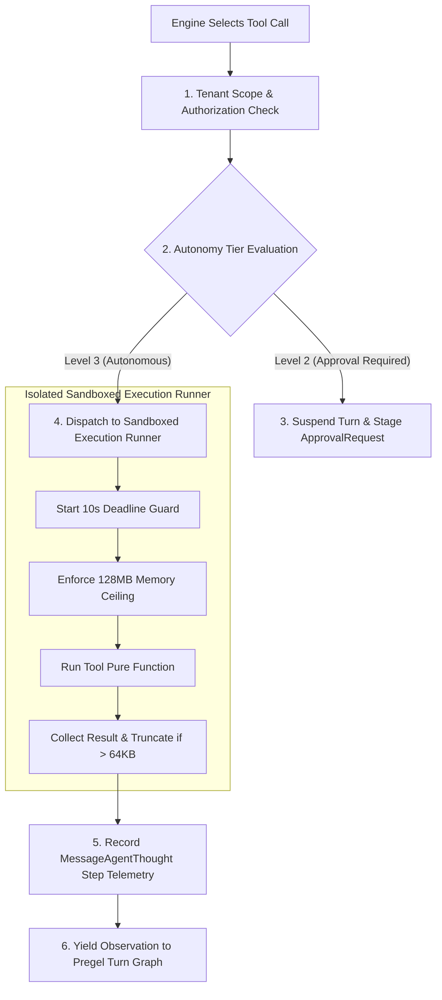

# Tool and Skill Architecture — Unified Contracts, Sandboxing & Evolution

**Document ID:** `TOOL_AND_SKILL_ARCHITECTURE`  
**Governing Standard:** Full-Platform Target Vision (`docs/PROJECT_VISION.md` Sections 3, 4, 10, 15)  
**Target Repository:** `QQYC9/ai-employee-platform`  
**Status:** **AUTHORITATIVE ARCHITECTURAL SPECIFICATION**  
**Date:** 2026-11-04  
**Master Architect:** AI-Employee-Platform Core Architecture Group  

---

## 1. Architectural Distinction: Tools vs. Skills

To prevent semantic confusion, the target platform formalizes the architectural boundary between **Tools** and **Skills**:

| Dimension | **Tool** (Atomic Action Primitive) | **Skill** (Procedural Domain Playbook) |
| :--- | :--- | :--- |
| **Definition** | A discrete, deterministic, single-step executable function that interacts with internal models, databases, or external APIs. | A stateful, multi-step operational procedure combining domain policies, sequential tool invocations, and contextual reasoning. |
| **Execution Nature** | Stateless, atomic, bounded invocation (e.g. `search_catalog`, `charge_card`, `create_ticket`). | Stateful graph or workflow combining multiple tools (e.g. `reconcile_warehouse_inventory`, `resolve_billing_dispute`). |
| **Contract** | Strict Pydantic v2 schema for input arguments and output observations. | Declarative execution graph or sub-agent routine with precondition and postcondition assertions. |
| **Failure Scope** | Local execution exception (timeout, 404, invalid argument). | Procedural deviation, policy violation, or goal unfulfillment requiring rollback or human escalation. |
| **Evolution** | Code synthesized via the 6-Gate evolution engine in an isolated UV virtualenv. | Extracted from high-performing conversational turns, validated over empirical utility runs, and consolidated by the Dream Daemon. |

---

## 2. Strict Tool Contract Specification (Pydantic v2)

Every tool registered in the platform must inherit from the base contract:

```python
from pydantic import BaseModel, ConfigDict, Field
from typing import Any
from uuid import UUID

class BaseToolInput(BaseModel):
    model_config = ConfigDict(extra="forbid", strict=True, frozen=True)
    # extra="forbid" rejects any hallucinated parameters generated by the LLM
    # strict=True blocks unintended type coercions (e.g., converting "true" string to boolean True)

class BaseToolOutput(BaseModel):
    model_config = ConfigDict(extra="forbid", strict=True, frozen=True)
    success: bool
    data: dict[str, Any]
    error_message: str | None = None
    execution_time_ms: float

class ToolContract(BaseModel):
    tool_id: str
    name: str
    description: str
    required_autonomy_level: AutonomyTier  # 1 (Assistant), 2 (Approval-Gated), 3 (Autonomous)
    input_schema: type[BaseToolInput]
    output_schema: type[BaseToolOutput]
    timeout_seconds: float = 10.0
    is_sensitive: bool = False
    required_permissions: list[str] = Field(default_factory=list)
```

### 2.1 Execution Limits & Payload Ceilings
- **Default Execution Timeout (`config.TOOL_DEFAULT_TIMEOUT`):** `10 seconds`.
- **Heavy Query Timeout (`config.TOOL_HEAVY_QUERY_TIMEOUT`):** `30 seconds`.
- **Payload Truncation Ceiling:** 64 KB maximum payload return. Output payloads exceeding 64 KB are automatically written to cold storage/blob storage, and a condensed, structured summary is returned to the LLM context to prevent token starvation.

---

## 3. Sandboxed Tool Execution Pipeline



### 3.1 Defense-in-Depth Execution Guards
1. **Scope Binding:** The runner explicitly injects `tool_context.scope` (`tenant_id`, `session_id`, `agent_id`). Tools cannot access or modify entities belonging to another tenant.
2. **Network Whitelisting:** Sandboxed tools executing external API calls are restricted to declared domain endpoints; arbitrary socket connections are blocked.
3. **Deterministic Error Sanitization:** If a tool raises an unhandled exception or database error, raw database tracebacks and credentials are completely stripped before returning a sanitized error message to the LLM.

---

## 4. The 6-Gate Skill Evolution Pipeline (Memento-Skills Adaptation)

When the platform identifies recurring conversational workflows that can be formalized into permanent operational skills, the synthesis process is governed by Memento-Skills' verified 6-gate engine (`core/skill/evolution/engine.py`):

```
                               THE 6-GATE TRANSACTIONAL EVOLUTION PIPELINE
  ┌─────────────────────────────────────────────────────────────────────────────────────────────┐
  │  Gate 1: Static AST Syntax Verification                                                     │
  │  Ensures syntactical correctness under Python 3.14 with complete type annotations.         │
  ├─────────────────────────────────────────────────────────────────────────────────────────────┤
  │  Gate 2: Contract Schema Validation                                                         │
  │  Verifies that inputs and outputs strictly adhere to Pydantic v2 schemas with extra="forbid".│
  ├─────────────────────────────────────────────────────────────────────────────────────────────┤
  │  Gate 3: Security & AST Import Scanning                                                     │
  │  Scans AST for prohibited imports: os, sys, subprocess, socket, eval, exec, __import__.     │
  ├─────────────────────────────────────────────────────────────────────────────────────────────┤
  │  Gate 4: Isolated UV Unit Execution                                                         │
  │  Executes unit tests in an ephemeral UV virtual environment with zero filesystem write.     │
  ├─────────────────────────────────────────────────────────────────────────────────────────────┤
  │  Gate 5: Mocked Integration Verification                                                    │
  │  Verifies interaction against synthetic tenant models and asserts deterministic outputs.     │
  ├─────────────────────────────────────────────────────────────────────────────────────────────┤
  │  Gate 6: Smoke Latency & Resource Profiling                                                 │
  │  Profiles execution latency (< 2.0s) and memory footprint (< 128 MB).                      │
  └─────────────────────────────────────────────────────────────────────────────────────────────┘
```

### 4.1 Strict Quarantining: Offline Dream Daemon
- **Inviolable Architectural Rule:** Dynamic skill compilation and multi-gate verification **NEVER run synchronously inside customer turns**.
- The synthesis is dispatched to the background **Dream Daemon** during idle worker cycles.
- Only after a skill passes all six gates is it staged for human authorization and registered in `procedural_skills`.

---

## 5. Empirical Utility Scoring & Skill Pruning

To prevent the accumulation of degraded or obsolete skills, the platform tracks empirical utility:

$$\text{Utility Score} = \frac{\text{Successful Executions} - \text{Errors}}{\text{Total Invocations}} \times \text{Recency Factor}$$

### 5.1 Pruning Policy Parameters
- **`[HYPOTHESIS]` `config.SKILL_UTILITY_THRESHOLD = 0.2`**
- **`[HYPOTHESIS]` `config.SKILL_MIN_EVAL_RUNS = 20`**
- If a skill exhibits an empirical utility score below `0.2` after 20 evaluations, the system automatically marks it `QUARANTINED`, removes it from active digital employee prompts, and alerts The Godfather for developer review.
