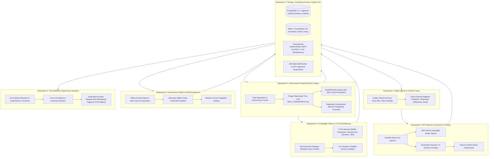

# Whole-Platform Architecture Research — Enterprise Digital Employee Operating System

**Document ID:** `WHOLE_PLATFORM_ARCHITECTURE_RESEARCH`  
**Governing Workstream:** Master Platform Synthesis (Workstreams A through M)  
**Governing Vision:** `docs/PROJECT_VISION.md` (November 2026 Platform Vision Charter)  
**System Designation:** AI Employee Platform (Next-Generation Unified Architecture)  
**Target Repository:** `QQYC9/ai-employee-platform` (Local HEAD `86c1abf`)  
**Status:** **AUDITED & VERIFIED**  
**Date:** 2026-11-04  
**Master Architect:** AI-Employee-Platform Core Architecture Group  

---

## 1. Executive Charter: The Platform is the Product

The AI-Employee-Platform is fundamentally **not** a conversational chatbot engine, nor is it an LLM prompt wrapper. It is an **Enterprise Multi-Tenant Digital Employee Operating System**.

Its mission is to empower businesses to autonomously provision, configure, operate, supervise, and continuously evolve specialized digital employees that perform real business workflows, maintain long-term institutional memory, interact across omni-channel connectors, and execute sensitive tools under strict human-in-the-loop governance.

---

## 2. Platform Subsystem Decomposition & Interaction Topology

The platform architecture is structured into 7 decoupled, interoperating subsystems:

---

## 3. Core Architectural Guarantees

### 3.1 Zero-Starvation Database Connection Preservation (ADR-03)
- Discovered and verified in Dify (`fc_agent_runner.py`).
- Workers claim tasks and load context, then explicitly **commit and close the SQLAlchemy session** before awaiting external streaming LLM responses.
- Eliminates the connection starvation failure mode where 20 simultaneous conversations exhaust the pool for 15+ seconds.

### 3.2 Monotonic Concurrency Fencing & Distributed Leases (ADR-04)
- Implements Martin Kleppmann's distributed locking standard (`REF-DIST-FENCE`).
- Every worker claim increments `fence_token = fence_token + 1` with row-level locking (`UPDATE execution_tasks ... FOR UPDATE SKIP LOCKED`).
- If a slow worker awakens after its lease expires (`locked_until < NOW()`), its delayed commit is rejected because its fence token is stale.

### 3.3 Four-Tier Tenant Defense-in-Depth (ADR-01)
- Tier 1: Immutable `Scope(tenant=..., agent=..., session=...)` passed across all async worker threads.
- Tier 2: `BaseRepository` automatically injects `WHERE tenant_id = scope.tenant` into every SQL statement.
- Tier 3: Relational composite primary keys `PRIMARY KEY (tenant_id, id)` ensure cross-tenant queries fail at the PostgreSQL engine level.
- Tier 4: Dynamically generated tools execute in isolated UV virtual environments with stripped parent environment variables.

### 3.4 Hybrid Dynamic Entity Storage (ADR-06)
- Digital employees can provision custom business modules (sales, invoices, inventory, stock) without dangerous runtime DDL.
- Persisted in the unified `business_entities` table featuring typed native financial decimals (`DECIMAL(18, 4)`) and GIN-indexed `dynamic_attributes JSONB`.

### 3.5 The Ground-Truth Protocol (ADR-10)
- Explicitly rejects the "Green Test Delusion" where synthetic pytest passes mask live conversational failures.
- Automated unit, integration, and security tests are necessary gates, but live conversation and task execution via **Telegram** with the platform founder is the sole authoritative acceptance standard.
