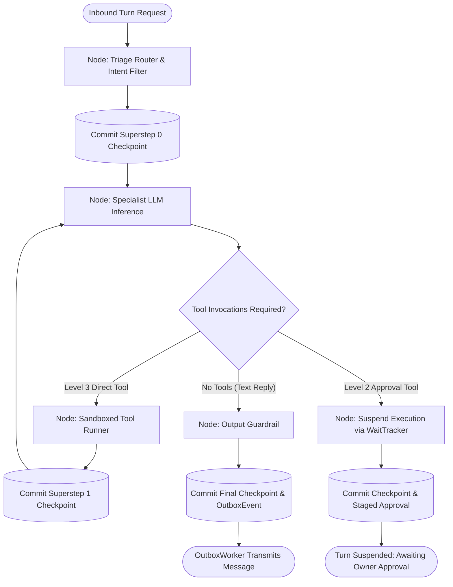

# Workflow and Execution Paths — Pregel StateGraph Runtime & Recovery

**Document ID:** `WORKFLOW_AND_EXECUTION_PATHS`  
**Governing Standard:** Full-Platform Target Vision (`docs/PROJECT_VISION.md` Sections 2, 3, 10, 15, 17)  
**Target Repository:** `QQYC9/ai-employee-platform`  
**Status:** **AUTHORITATIVE ARCHITECTURAL SPECIFICATION**  
**Date:** 2026-11-04  
**Master Architect:** AI-Employee-Platform Core Architecture Group  

---

## 1. The Core Paradigm: Pregel StateGraph Actor Loop

The AI Employee Platform completely excises legacy procedural while-loops in favor of a stateful, graph-based **Pregel StateGraph Execution Engine** (verified in LangGraph `libs/langgraph/langgraph/pregel/_loop.py`).

Conversational turns and multi-step background workflows execute as stateful graphs partitioned into discrete, deterministic **Supersteps**:

$$S_0 \xrightarrow{\text{Superstep 0: Intent Routing}} \Delta_0 \xrightarrow{\text{Checkpoint Commit}} S_1 \xrightarrow{\text{Superstep 1: Tool Execution}} \Delta_1 \xrightarrow{\text{Checkpoint Commit}} S_2$$



---

## 2. Checkpoint Persistence & Monotonic Fencing Schema

Every digital employee turn persists its state progress directly in PostgreSQL using a composite primary key that guarantees data isolation and crash recovery:

```sql
CREATE TABLE execution_tasks (
    tenant_id UUID NOT NULL REFERENCES tenants(id) ON DELETE CASCADE,
    execution_id UUID NOT NULL,
    status VARCHAR(32) NOT NULL DEFAULT 'PENDING', -- PENDING, RUNNING, SUSPENDED, COMPLETED, FAILED
    active_step_index INTEGER NOT NULL DEFAULT 0,
    claimed_by_worker_id VARCHAR(64) NULL,
    lease_expires_at TIMESTAMPTZ NULL,
    fence_token BIGINT NOT NULL DEFAULT 1,
    created_at TIMESTAMPTZ NOT NULL DEFAULT CURRENT_TIMESTAMP,
    updated_at TIMESTAMPTZ NOT NULL DEFAULT CURRENT_TIMESTAMP,
    
    PRIMARY KEY (tenant_id, execution_id)
);

CREATE TABLE execution_checkpoints (
    tenant_id UUID NOT NULL,
    execution_id UUID NOT NULL,
    step_index INTEGER NOT NULL,
    node_name VARCHAR(64) NOT NULL,
    state_payload JSONB NOT NULL,
    fence_token BIGINT NOT NULL,
    created_at TIMESTAMPTZ NOT NULL DEFAULT CURRENT_TIMESTAMP,
    
    PRIMARY KEY (tenant_id, execution_id, step_index),
    FOREIGN KEY (tenant_id, execution_id) REFERENCES execution_tasks(tenant_id, execution_id) ON DELETE CASCADE
);
```

### 2.1 Causal Monotonic Ordering
- While `execution_id` uses **UUIDv7** for chronological B-Tree indexing, distributed clock skew across cluster nodes prevents UUIDv7 from guaranteeing causal ordering.
- **Strict Invariant:** Total causal ordering is strictly guaranteed by the composite sequence `(execution_id, step_index)`, where `step_index` increments monotonically ($0, 1, 2, \dots$).

---

## 3. Distributed Leases, Concurrency & Zombie Worker Fencing

### 3.1 The Split-Brain / Zombie Worker Problem
In distributed background processing, if Worker W1 experiences a slow disk stall or GC pause, its lease may expire. Worker W2 detects the expiration and takes over the task. If Worker W1 then wakes up and attempts to commit its stale step, uncoordinated writes can corrupt the execution history.

### 3.2 Exact PostgreSQL Row-Level Lock & Fencing Protocol
To eliminate this race condition, the platform enforces strict row-level exclusive locking and monotonic fencing tokens:

```sql
BEGIN;
SET LOCAL statement_timeout = '5s';

-- Step 1: Enforce active ownership, extend lease, verify fence_token
-- This IMMEDIATELY acquires an Exclusive Row-Level Lock on execution_tasks!
UPDATE execution_tasks
SET active_step_index = :new_step_index,
    lease_expires_at = CURRENT_TIMESTAMP + INTERVAL '30 seconds',
    updated_at = CURRENT_TIMESTAMP
WHERE execution_id = :execution_id
  AND tenant_id = :tenant_id
  AND claimed_by_worker_id = :my_worker_id
  AND fence_token = :my_fence_token
  AND lease_expires_at > CURRENT_TIMESTAMP;

-- IF rows_updated == 0:
--   ROLLBACK;
--   RAISE StaleWorkerExecutionError("Worker lost lease or fence token superseded");

-- Step 2: Insert checkpoint with composite unique key constraint
INSERT INTO execution_checkpoints (tenant_id, execution_id, step_index, node_name, state_payload, fence_token)
VALUES (:tenant_id, :execution_id, :new_step_index, :node_name, :state_payload, :my_fence_token);

-- Step 3: Insert associated OutboxEvent (within the SAME atomic transaction)
INSERT INTO outbox_events (tenant_id, execution_id, step_index, event_type, payload, idempotency_key)
VALUES (:tenant_id, :execution_id, :new_step_index, :event_type, :payload, :idempotency_key);

COMMIT;
```

### 3.3 Concurrency Invariants
1. **Lock Serialization:** Takeover sweeper queries execute `BEGIN; SET LOCAL lock_timeout = '2s'; UPDATE execution_tasks ...`. If Worker W1 is in the middle of committing, W2 safely blocks for at most 2 seconds.
2. **Read-Committed Re-Evaluation:** When W1 commits and releases the lock, PostgreSQL re-evaluates W2's `WHERE` clause against the newly committed row. Because W1 refreshed `lease_expires_at`, W2 matches **0 rows** and aborts safely with zero state mutation.
3. **Zombie Worker Neutralization:** If W1 was aborted due to `statement_timeout > 5s`, W2 acquires the row and increments `fence_token = fence_token + 1`. When W1 wakes up, its stale query with old `fence_token` matches 0 rows and is rejected.

---

## 4. Execution Suspension & Resumption (`WaitTracker` Model)

Adopted from n8n's verified `WaitTracker` architecture (`packages/core/src/execution-engine/wait-tracker.ts`):
- When an agent initiates a **Level 2 (Approval-Gated)** tool execution, it does not block worker threads or hold memory locks.
- The state graph persists an `ApprovalRequest` record containing the RFC 8785 canonical inputs digest, commits a checkpoint with status `SUSPENDED`, and releases worker resources completely.
- When the owner approves via the dashboard or Telegram:
  1. The resumption transaction acquires `SELECT ... FOR UPDATE` on `approval_requests`, verifying HMAC integrity and transitioning status to `CONSUMED`.
  2. The task is queued to Redis with its last committed `step_index`.
  3. The Pregel engine resumes execution directly from the checkpoint superstep without re-running prior nodes.

---

## 5. The Six Layers of Execution & Deduplication Guarantees

The platform explicitly separates internal transactional consistency from external side-effect guarantees across six discrete layers:

| Layer | Execution Entity | Primary Failure Mode | Deduplication Mechanism | Strict Operational Guarantee |
| :---: | :--- | :--- | :--- | :--- |
| **1** | **Node Execution** | Worker crash mid-computation | In-memory ephemeral execution | Computation re-runs from prior checkpoint. |
| **2** | **Node Result Staging** | Crash before opening DB transaction | Local worker buffer | Discarded upon crash; safely re-evaluated. |
| **3** | **Checkpoint Persistence** | Duplicate commit attempt | `PRIMARY KEY (tenant_id, execution_id, step_index)` | **Single Database Tuple Invariant** conditional on transaction commit. |
| **4** | **Outbox Staging** | Duplicate event enqueue | `UNIQUE (tenant_id, execution_id, step_index, event_type)` | **Single Staged Outbox Event Invariant** in database. |
| **5** | **External Action Dispatch**| Network drop in Post-Dispatch Ambiguity Window | Extensible Idempotency Matrix (Tiers 1, 2A, 2B, 3) | **At-Least-Once Dispatch Attempt** across uncoordinated networks. |
| **6** | **Delivery Recording** | Duplicate incoming webhook | `UNIQUE (tenant_id, external_message_id)` | **Single Inbound Delivery Invariant**; duplicate webhooks dropped. |
