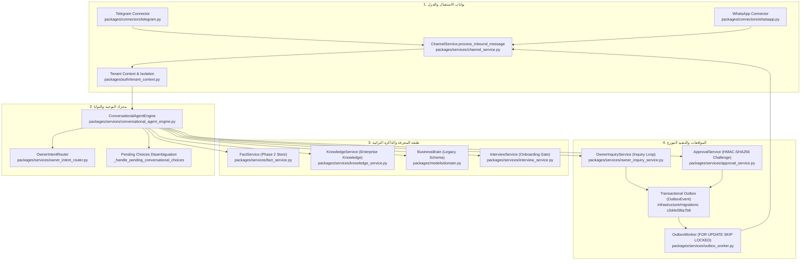
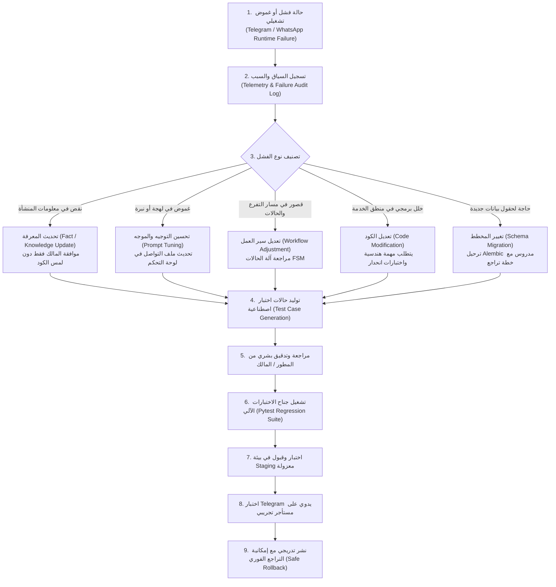

# Architecture-Level Capability Review — AI-Employee-Platform
## الانتقال من تصحيح الحالات الفردية إلى آليات عامة قابلة للتوسع لإدارة المعرفة والسياق والسياسات

- **المشروع:** `AI-Employee-Platform` (`QQYC9/ai-employee-platform`)
- **الفرع الحالي:** `checkpoint/phase-12-knowledge-base`
- **الـ Commit المرجعي للتدقيق:** `53f54b9333b31b22fff41696c9b53b9dfc0b94fb` (`docs(audit): finalize critical evidence review`)
- **حالة المهمة:** تدقيق معماري ومقارنة تقنية وتوثيق تصميمي فقط (**Strictly Read-Only Audit & Documentation**) — دون تعديل كود الإنتاج، ودون ترحيل قاعدة البيانات، ودون إرسال رسائل حقيقية، ودون بدء تنفيذ Phase 5.
- **تاريخ التدقيق:** نوفمبر 2026

---

## 1. Executive Summary (الملخص التنفيذي)

### 1.1 جوهر المشكلة المعمارية: متلازمة "الترقيع الموضعي" (Whack-a-Mole Engineering)
كشفت الفحوصات الجنائية المباشرة للمستودع أن محاولات معالجة الإخفاقات التشغيلية الأخيرة في منصة `AI-Employee-Platform` — مثل:
1. اختطاف أرقام الاستفسارات المفتوحة عند ورود نصوص تتضمن أوقات العمل (مثل "الساعة 10 صباحًا").
2. حظر استفسارات العملاء الصحيحة حول دوام الجمعة والفروع بسبب التقاط الكلمات الزمنية ("يوم") كمدن.
3. التباس خيارات حل التعارض الرقمية ("1" و "2") مع أرقام الاستفسارات ومع رسائل العملاء.
4. ظهور تعارضات وهمية بين ساعات العمل الأسبوعية العامة واستثناءات عطلة نهاية الأسبوع أو يوم الجمعة.

تمت معالجتها حتى الآن بأسلوب **«الإصلاح الموضعي المركز» (Point-Fixing)** عبر كتابة تعبيرات نمطية مخصصة (`Regex`)، وقوائم استثناءات ثابتة (`temporal_location_tokens`, `day_mapping`)، وشروط `if/else` متفرقة داخل `packages/services/fact_service.py`، `packages/services/conversational_agent_engine.py`، و `packages/services/owner_inquiry_service.py`.

هذا الأسلوب — وإن كان يُرضي بعض اختبارات الوحدة المعزولة — هو **نهج هش وغير قابل للتوسع معمارياً**؛ فكل يوم أسبوع جديد، وكل صيغة لغوية عامية، وكل فرع، وكل موسم استثنائي (رمضان، الأعياد) سيتطلب إضافة شروط يدوية جديدة، مما يرفع التعقيد الكودي (`Cyclomatic Complexity`) ويزيد احتمالات الانتكاسات غير المتوقعة (`Regression Bugs`).

### 1.2 الرؤية المعمارية البديلة: طبقة عامة للمعرفة والسياق والسياسات
الهدف الأساسي من هذه المراجعة هو التأسيس المعماري للانتقال من "ترقيع الأعراض" إلى **«آليات عامة قابلة للتوسع» (Generalized Scalable Mechanisms)** تسترشد بأفضل الممارسات المستخلصة من ستة أطر ومنصات عالمية (`Memento-Skills`, `LangGraph`, `Microsoft Agent Framework`, `Dify`, `n8n`, `RagLeap Core`):
- **تمثيل المعرفة المهيكلة ذات الأبعاد الصريحة (Multi-Dimensional Scoped Facts):** لا تعامل ساعات العمل كقيمة نصية مجردة، بل كحقيقة محددة النطاق المكاني (المنشأة/الفرع)، والنطاق الزمني (الأيام، الصلاحية)، ونوع العلاقة (أساسي، استثناء، إضافة، تعارض).
- **آلة حالات المحادثة المنضبطة (Conversation Finite State Machine):** حظر اختطاف الأرقام بحكم سياق الحالة؛ فالرقم "2" عندما تكون المحادثة في حالة `AWAITING_CONFLICT_RESOLUTION` لا يمكن أن يمر مطلقاً لموجه الاستفسارات أو لمعالج رسائل العملاء.
- **محرك سياسات حتمي منفصل عن المعرفة (Deterministic Policy Engine):** استبدال قائمة الحراسة الـ 13 المبنية على البحث النصي بمحرك سياسات يطابق الشروط الهيكلية المنظمة بدلاً من تفتيش نصوص الـ Regex.
- **دورة تحسين منضبطة محكومة بالبشر (Controlled Improvement Loop):** تحويل حالات الفشل إلى بيانات اختبار وتقييم وتحديث معرفي، بدلاً من التعديل العشوائي لكود الإنتاج.

---

## 2. Repository State & Phase 4D Audit (حالة المستودع الحالية وتدقيق Phase 4D)

تم فحص المستودع المحلي قراءةً فقط دون تشغيل أي أمر كتابة أو تعديل أو ترحيل.

### 2.1 حالة Git والفرع والتتبع
- **الفرع الحالي:** `checkpoint/phase-12-knowledge-base`
- **الـ Commit الحالي (HEAD):** `53f54b9333b31b22fff41696c9b53b9dfc0b94fb`
- **التتبع البعيد (Remote Tracking):** متصل بـ `origin/checkpoint/phase-12-knowledge-base`.
- **التعديلات المتبوعة غير المثبتة (Tracked Diffs):**
  توجد تعديلات محلية قيد العمل (Uncommitted) في 3 ملفات رئيسية:
  1. [`packages/services/conversational_agent_engine.py`](../../packages/services/conversational_agent_engine.py):
     - إضافة الدالة `_handle_pending_conversational_choices` لمعالجة الخيارات الرقمية ("1", "2", "١", "٢") وتوجيهها لحل التعارض مع منع اختطافها.
     - تعديل `_evaluate_reply_guardrails` بإضافة `temporal_location_tokens` لتفادي اعتبار "يوم" أو "الجمعة" أسماء فروع، وإضافة استثناءات النفي للأسعار والدعم 24/7.
  2. [`packages/services/fact_service.py`](../../packages/services/fact_service.py):
     - إضافة `CANONICAL_WORKING_HOURS_TOPIC = "operations.working_hours"` و `HOURS_TOPIC_ALIASES`.
     - إضافة دالة `get_working_hours_semantic_scope` التي تقسم ساعات العمل إلى نطاقات (ramadan, holiday, weekend, friday, saturday, sunday, ...) باستخدام خرائط Regex نصية.
     - تعديل `save_extracted_facts` لتمييز ساعات العمل حسب النطاق الدلالي، وإلغاء تكرار الساعات في `get_facts` بحسب النطاق، ومزامنة الاستبدال في `resolve_conflict`.
  3. [`packages/services/owner_inquiry_service.py`](../../packages/services/owner_inquiry_service.py):
     - استبدال فحص تكرار رد العميل بفحص حدث الصندوق الصادر الصريح لمنع الازدواجية (`outbox:inquiry_reply:{inquiry.id}:{conv_id}:%`).
     - تعديل رسالة الإرشاد عند وجود استفسارات متعددة للمالك لإلزامه بالرد بصيغة (جواب [رقم]: إجابتك).

### 2.2 فحص الملفات غير المتتبعة المحمية (Untracked Files)
تم حصر 8 ملفات غير متتبعة في المستودع المحلي والتأكد من الحفاظ عليها دون أي مساس:
1. `scripts/check_live_db.py`: سكربت تشخيصي لفحص اتصال قاعدة البيانات الحية وإصدارها.
2. `scripts/cleanup_test_tenants.py`: أداة تنظيف المستأجرين التجريبيين المعزولين.
3. `scripts/debug_runtime_failure.py`: سكربت فحص وتتبع الاستفسارات وسجلات الفشل اللحظية.
4. `scripts/execute_inquiry_6_answer.py`: سكربت محاكاة لحل الاستفسار رقم 6 على بيئة الاختبار.
5. `scripts/resolve_inquiry_7_live.py`: سكربت محاكاة لحل الاستفسار رقم 7.
6. `tests/test_telegram_acceptance_remediation.py` (1,433 سطراً): جناح اختبارات شامل يغطي معالجة الخيارات الرقمية، وفصل نطاقات ساعات العمل، وحراسة الفروع، ومنع اختطاف الاستفسارات.
7. `tests/test_telegram_failures_diagnostic.py` (274 سطراً): اختبارات تشخيصية تثبت بالأدلة عيوب الـ Regex السابقة (مثل التقاط 10 صباحاً كرقم استفسار 10).
8. `tests/test_telegram_hours_and_branch_fixes.py` (425 سطراً): اختبارات انحدار للتحقق من الحلول الموضعية لساعات العمل والفروع.

### 2.3 تدقيق سلسلة الترحيلات (Alembic Migrations) والواقع الفعلي لقاعدة البيانات
أظهر تدقيق `alembic history` السلسلة المتصلة الكاملة لـ 20 ترحيلاً:
`<base>` -> `91e58f155f19` -> `e0c6d85489cf` -> `d7d89b1f9794` -> `f4a8b1c2d3e4` -> `b2c3d4e5f6a7` -> `c3d4e5f6a7b8` -> `d4e5f6a7b8c9` -> `e5f6a7b8c9d0` -> `f6a7b8c9d0e1` -> `a1b2c3d4e5f6` -> `c4d5e6f7a8b9` -> `d5e6f7a8b9c0` -> `e6f7a8b9c0d1` -> `f7a8b9c0d1e2` -> `b3c4d5e6f7a8` -> `c1d2e3f4a5b6` -> `16142be6ce15` -> `2a3b4c5d6e7f` -> `3b4c5d6e7f8a (head)`.

- **فحص الحالة اللحظية للبيانات (`alembic current`):**
  قاعدة البيانات متوقفة عند الإصدار: `3b4c5d6e7f8a (head)`.
- **ملاحظة تباين مع التقارير السابقة:**
  أشارت وثيقة `POST_DEVELOPER_CHANGES_CONTEXT.md` (بتاريخ 26 أكتوبر) إلى أن رأس الترحيلات كان `c1d2e3f4a5b6`. الواقع الفعلي يثبت أنه تم تطبيق 3 ترحيلات إضافية لاحقة:
  1. `16142be6ce15`: محاولات الإرسال وتقسيم الرسائل (`dispatch_attempts_and_chunks`).
  2. `2a3b4c5d6e7f`: حماية موافقة المالك من الاختطاف (`cr0501_owner_approval_anti_hijack`).
  3. `3b4c5d6e7f8a`: جداول شخصيات الموظفين الرقميين وربط القنوات (`phase5_employee_personas_and_agent_bindings`).

### 2.4 تدقيق Phase 4D (الحملات والإشعارات الاستباقية) والفجوات التشغيلية
- **المتحقق منه:** جداول `campaigns` و `campaign_recipients` موجودة ومحمية بـ `tenant_id`. محرك الحملات `CampaignService` يولد رسائل الحملات ويدرج أحداث الصندوق الصادر `OutboxEvent`.
- **الفجوة التشغيلية والمعمارية:**
  أثناء تشغيل الحملات والاستفسارات على قناة تيليجرام الحية، انكشفت فجوة بنيوية خطيرة: تداخل مسار الحملات والاستفسارات مع مسار محادثة المالك العادية؛ حيث لا توجد آلية حتمية لعزل سياق المحادثة (`Conversation State`)، مما سمح بحدوث اختطاف للنوايا وتصنيف ردود المالك على الحملات أو الاستفسارات كحقائق تشغيلية أو العكس.

---

## 3. The Core Architectural Problem (تحليل المشكلة المعمارية وأبعادها العامة)

المشكلات التي ظهرت في بيئة التشغيل ليست حالات شاذة مستقلة (Isolated Edge Cases)، بل هي **أعراض سطحية لحاجة بنيوية موحدة** إلى نظام متكامل لإدارة المعرفة والسياق.

### 3.1 تحليل الأعراض المشتركة
| الحالة العارضة | التفسير السطحي (Point-Fix) | الحاجة المعمارية العامة الحقيقية (Architectural Need) |
| :--- | :--- | :--- |
| **ساعات يوم الجمعة** | إضافة شرط خاص بيوم الجمعة في regex الساعات | تمثيل المعرفة متعدد الأبعاد: دعم بُعد "اليوم" كخاصية أصيلة للحقيقة (`days_of_week`) |
| **استثناءات الإجازات والأعياد** | استبعاد كلمات "عيد" و"إجازة" من البحث | إدارة الصلاحية الزمنية المؤقتة والاستثناءات الموسمية (`temporal_validity` & `exceptions`) |
| **اختلاف ساعات الفروع** | محاولة التقاط المدينة في regex الفروع | تحديد النطاق المكاني للحقيقة (`scope: branch_id`) وعزل نطاق الفرع عن نطاق التغطية |
| **تغيّر الساعات لفترة مؤقتة** | استبدال ساعات العمل القديمة وحذفها | تاريخ الإصدارات واستبدال الحقائق مع تحديد نافذة سريان تبدأ وتنتهي آلياً (`valid_from/until`) |
| **تعارض معلومة جديدة مع قديمة** | مقارنة `old_val != new_val` وإعلان تعارض | الكشف الدلالي عن التعارض بناءً على تقاطع النطاق؛ إذا اختلف النطاق (فرع أ مقابل فرع ب) فلا تعارض بل تكامل |
| **معلومة قديمة أو غير مؤكدة** | حظر الرد أو إرجاع قيمة غير واثقة | تتبع مصدر الحقيقة ودرجة الثقة وسياسة التقادم الزمني (`source`, `confidence`, `ttl`) |
| **إجابة تعتمد على أكثر من حقيقة** | استرجاع نصوص عشوائية وتمريرها للنموذج | استرجاع السياق متعدد الجوانب المترابط (`Graph/Multi-Facet Retrieval`) |
| **سؤال العميل عن معلومة غير موجودة** | سياج أمان نصي يبحث عن كلمات المبيعات | التعامل الصارم مع عدم اليقين؛ التمييز بين النقص المعرفي (استفسار للمالك) وبين حظر الإجراء |
| **تصحيح المالك لإجابة سابقة** | محاولة المالك تعديل نص وتصنيفه كاستفسار | دورة الاستبدال الواضحة (`Supersession`) وتحديث ذاكرة الوكيل مع تأكيد الأثر |

### 3.2 الآليات العامة الإحدى عشرة المشتركة (The 11 General Mechanisms)
كل الحالات السابقة تشترك في الاحتياج إلى 11 آلية معمارية عامة:
1. **فهم نية الرسالة ونوعها الحتمي:** تمييز أوامر التعديل التشغيلي عن الإجابة عن استفسار وعن المحادثة الحرة.
2. **استخراج الحقائق المهيكلة (Structured Fact Extraction):** تحويل النصوص الطبيعية إلى مخططات بيانات منضبطة النوع (`Pydantic Schemas`).
3. **تحديد نطاق المعلومة (Multi-Dimensional Scoping):** حصر الحقيقة في أبعاد صريحة: المنشأة، الفرع، المنتج، العميل، اليوم، القناة.
4. **تحديد الصلاحية الزمنية (Temporal Validity):** تاريخ البدء، الانتهاء، التكرار الأسبوعي، أو الاستثناء الموسمي.
5. **تحديد نوع العلاقة بالمعرفة السابقة:** هل المدخل يمثل (إضافة جديدة، تحديثًا لقيمة، استثناءً مقيداً بنطاق، أم تعارضاً حقيقياً)؟
6. **تتبع المصدر والثقة وسجل التغييرات (Provenance & Auditability):** من أدخل المعلومة؟ ومتى؟ وبأي ثقة؟
7. **استرجاع السياق المقيد بالطلب (Scoped Context Retrieval):** جلب الحقائق التي تطابق أبعاد السؤال فقط وتجريد ما سواها لمنع تشتت النموذج.
8. **التعامل مع عدم اليقين ومنع الهلوسة:** الاعتراف بالجهل المعرفي والتحويل للاستفسار دون الاعتماد على 13 تعبيراً نمطياً هشاً.
9. **سير عمل التوضيح وإزالة الغموض (Clarification Workflows):** طلب توضيح من العميل أو المالك عند وجود غموض مؤثر بدلاً من التخمين.
10. **التحقق من صحة القرار قبل التنفيذ:** محرك سياسات يطابق الشروط الهيكلية قبل الإرسال للعميل أو استدعاء الأداة.
11. **دورة التحسين المستمر المنضبطة:** تحويل الحالات الفاشلة إلى بيانات تقييم واختبارات انحدار ومراجعة بشرية دون تعديل ذاتي عشوائي.

---

## 4. Technical Comparison of the Six Target Tools (المقارنة التقنية للأدوات الست)

تمت مراجعة الأطر والأنظمة الستة بالرجوع إلى وثائقها الرسمية ومستودعاتها وأوراقها البحثية، مع التمييز الصارم بين:
- **Verified by source / code:** ميزة موثقة رسمياً أو مثبتة بالكود.
- **Engineering inference:** استنتاج هندسي مبني على دراسة التصميم.
- **Hypothesis / Unverified:** فرضية تحتاج إثباتاً إضافياً.

---

### 4.1 Memento-Skills
- **المستودع والمرجع:** `Memento-Teams/Memento-Skills` ([GitHub](https://github.com/Memento-Teams/Memento-Skills))، الورقة: arXiv:2603.18743.
- **المشكلة المصممة لحلها:** ركود قدرات الوكلاء؛ إتاحة قيام نماذج الذكاء الاصطناعي ببناء مهاراتها وأدواتها وتطويرها ذاتياً من خلال التفاعل مع البيئة وتخزينها كأكواد دائمة.
- **الآليات الأساسية:** حلقة التعلم الانعكاسي (Read -> Execute -> Reflect -> Write)؛ حيث يقرأ الوكيل المهارة، ينفذها، يحلل رسائل الخطأ، يعيد كتابة كود المهارة بصيغة Markdown/Python، ويخزنها في بنك المهارات.
- **إدارة الحالة والذاكرة والمعرفة:** تخزين المهارات كملفات نصية وكودية على القرص؛ ذاكرة دلالية تعتمد على استرجاع المهارات عبر البحث المتجهي في أوصافها.
- **سير العمل والموافقات والأدوات:** لا يحتوي على محرك سير عمل تشغيلي، ولا يدعم التعليق والاستئناف للموافقة البشرية، ولا يوفر تحييد الأثر المكرر (Idempotency).
- **ما يمكن استعارته فكرياً:** مفهوم "عزل القدرات كمهارات قائمة بذاتها"، وحلقة تحليل الفشل واقتراح حالات اختبار جديدة لمعالجة القصور.
- **ما يتطلب dependency أو تغييراً معمارياً:** إدخال بيئة عزل برمجية (`Sandbox execution`) لتشغيل الأكواد المولدة ذاتياً.
- **الحدود والمخاطر:** **مخاطرة كارثية في الإنتاج** إذا تُرك الوكيل يكتب كود الإنتاج ذاتياً؛ غياب تام لضوابط العزل بين المستأجرين (Multi-Tenancy) أو أمان الصلاحيات (RBAC).
- **الملاءمة لمنصة Multi-Tenant:** **غير مناسب إطلاقاً** كبيئة تشغيل لبيانات العملاء والإنتاج.
- **حالة الإثبات والدليل الفني:** `Verified by source` (arXiv:2603.18743 ومستودع GitHub).

---

### 4.2 LangGraph
- **المستودع والمرجع:** `langchain-ai/langgraph` ([GitHub](https://github.com/langchain-ai/langgraph))، التوثيق الرسمي v0.2+.
- **المشكلة المصممة لحلها:** تنسيق تدفقات الوكلاء المعقدة متعددة الخطوات التي تتضمن دورات وحلقات تكرارية (`Cycles`)، وإدارة الحالات الموزعة ونقاط التفتيش، والتوقف لانتظار المدخلات البشرية.
- **الآليات الأساسية:** رسم بياني موجه للحالة (`StateGraph`)، عقد تمثل دوال تحويل الحالة، حواف شرطية (`Conditional Edges`)، نقاط تفتيش ذرية (`Checkpointers` مثل `PostgresSaver`).
- **إدارة الحالة والذاكرة والمعرفة:** حفظ لقطة كاملة للحالة (`State Snapshot`) بعد كل خطوة في جدول نقاط التفتيش برقم تتابع زمني (`thread_id`, `checkpoint_id`). دمج التعديلات عبر دوال اختزال (`Reducers`).
- **سير العمل والموافقات والأدوات:**
  - التعليق عبر `interrupt(payload)` والاستئناف عبر `Command(resume=value)`.
  - **قاعدة معمارية دقيقة (`Verified by source`):** عند الاستئناف، تعيد العقدة المتوقفة التنفيذ من **بدايتها**، مما يفرض أن تكون أي عمليات سابقة للمقاطعة محيدة الأثر (`Idempotent`).
- **ما يمكن استعارته فكرياً:** نمط آلة الحالات المنضبطة (`State Machine`)؛ فصل حالة المحادثة عن تصنيف النصوص، بحيث يتم حظر معالجة أي رسالة إلا وفقاً للحالة الحالية للرسم البياني.
- **ما يتطلب dependency أو تغييراً معمارياً:** استبدال محرك التنفيذ الحالي بمكتبة `langgraph`، وتعديل جداول قواعد البيانات لتتطابق مع مخطط `PostgresSaver`.
- **الحدود والمخاطر:** ثقل التجريد، غياب العزل المتعدد للمستأجرين في جدول نقاط التفتيش المشترك ما لم يُبرمج يدوياً، غياب نمط Transactional Outbox لتسليم الرسائل الخارجية الذري.
- **الملاءمة لمنصة Multi-Tenant:** **مناسب مفاهيمياً** كنمط إدارة حالات، لكن اعتماده كمكتبة كاملة يتطلب إعادة كتابة جذرية للمنصة ومخاطرة استقرار تشغيلي.
- **حالة الإثبات والدليل الفني:** `Verified by source` (توثيق LangGraph الرسمي لكود `interrupt` و `PostgresSaver`).

---

### 4.3 Microsoft Agent Framework (Semantic Kernel & AutoGen)
- **المستودع والمرجع:** `microsoft/agent-framework` و `microsoft/semantic-kernel` ([GitHub](https://github.com/microsoft/agent-framework)).
- **المشكلة المصممة لحلها:** التنسيق المؤسسي للوكلاء الذكية، الحوكمة الصارمة لاستدعاء الأدوات، فحص البيانات والسياسات المؤسسية، ودعم معيار Model Context Protocol (MCP).
- **الآليات الأساسية:** فلاتر الاعتراض (`FunctionInvocationFilter`) التي تعمل كطبقة وسيطة (`Middleware`) قبل وبعد استدعاء أي أداة، وموصلات الأدوات والمهام المطبوعة.
- **إدارة الحالة والذاكرة والمعرفة:** إدارة السياق عبر متغيرات السياق المنظمة (`KernelArguments`) ومخازن الذاكرة الدلالية المرتبطة بخوادم بحث مثل Azure AI Search.
- **سير العمل والموافقات والأدوات:** يستطيع فلتر الاعتراض إلغاء استدعاء الأداة أو تجميدها وإرجاع طلب موافقة إلى النظام الخارجي قبل السماح بتمرير المدخلات للأداة.
- **ما يمكن استعارته فكرياً:** نمط **«فلاتر اعتراض استدعاء الأدوات» (Pre-Invocation Action Policy Guard)** لفحص صلاحيات الأداة ومطابقة شروط الموافقة في عنق زجاجة موحد قبل وصول الطلب لمنفذ الأداة.
- **ما يتطلب dependency أو تغييراً معمارياً:** إدخال حزم SDK الخاصة بمايكروسوفت يفرض إعادة كتابة كاملة للمنظومة بلغة تصميمية معقدة وشديدة التجريد.
- **الحدود والمخاطر:** ارتباط وثيق بنظام Azure البيئي، بطء نسبي في معالجة المحادثات الفورية الخفيفة، تعقيد التثبيت المحلي.
- **الملاءمة لمنصة Multi-Tenant:** النمط المعماري ملائم جداً؛ المكتبة نفسها غير ملائمة لمنصتنا الخفيفة المبنية على FastAPI و PostgreSQL.
- **حالة الإثبات والدليل الفني:** `Verified by source` (فحص فئة `FunctionInvocationFilter` في مستودع Semantic Kernel).

---

### 4.4 Dify
- **المستودع والمرجع:** `langgenius/dify` ([GitHub](https://github.com/langgenius/dify))، إصدارات v1.13.0+.
- **المشكلة المصممة لحلها:** منصة إنتاجية مرئية متكاملة لبناء تطبيقات ووكلاء الذكاء الاصطناعي مع إدارة المستأجرين وسير العمل والذاكرة واسترجاع المعرفة الهجين.
- **الآليات الأساسية:** لغة توصيف سير العمل (`DSL Workflow`)، عقدة الإدخال البشري (`Human Input Node`)، طوابير معالجة موزعة (Celery & Redis Pub/Sub)، واسترجاع هجين يجمع الفهرسة المتجهية وفهرسة الكلمات المفتاحية (`Full-Text Search`).
- **إدارة الحالة والذاكرة والمعرفة:** إدارة المعرفة عبر مجموعات بيانات مجزأة (`Datasets`) ذات بيانات وصفية ونطاقات استرجاع، وحفظ مسارات التنفيذ في PostgreSQL.
- **سير العمل والموافقات والأدوات:**
  - عند وصول سير العمل إلى عقدة الإدخال البشري، يتم تعليق التنفيذ وتوليد `form_token`.
  - يُستأنف التنفيذ عبر استدعاء واجهة برمجية صريحة `POST /api/form/human_input/{token}` مع مهلة انتظار تصل إلى 7 أيام.
- **ما يمكن استعارته فكرياً:** نمط تقسيم المعرفة إلى قطع مهيكلة تحمل بيانات وصفية صريحة (`Metadata Filtering`)، وفصل استرجاع المعرفة إلى مرحلتين: تصفية حتمية بالأبعاد تليها مطابقة دلالية.
- **ما يتطلب dependency أو تغييراً معمارياً:** Dify منصة قائمة بذاتها تتكون من 8-10 حاويات؛ لا يمكن استيرادها كـ `pip package` داخل تطبيق FastAPI.
- **الحدود والمخاطر:** لا يمكن تضمينها كخدمة داخلية؛ استخدامها يتطلب نشرها كنظام خارجي والتواصل معه عبر REST API مما يضيف زمن استجابة وتعقيداً تشغيلياً.
- **الملاءمة لمنصة Multi-Tenant:** ممتازة كنموذج استرشادي للمستأجرين والمعرفة، لكن غير مناسبة للاستبدال الداخلي للكود.
- **حالة الإثبات والدليل الفني:** `Verified by source` (كود ومخطط حاويات مستودع Dify).

---

### 4.5 n8n
- **المستودع والمرجع:** `n8n-io/n8n` ([GitHub](https://github.com/n8n-io/n8n))، التوثيق الرسمي.
- **المشكلة المصممة لحلها:** أتمتة تدفقات البيانات وربط مئات الأنظمة الخارجية عبر تدفقات مبنية على الأحداث والعقد المرئية مع دعم مهام الانتظار الطويلة.
- **الآليات الأساسية:** محرك تنفيذ مبني على العقد (`Node-based Engine`)، عقدة الانتظار (`Wait Node`)، روابط استئناف الويب المشفرة (`Webhook Resume URLs`).
- **إدارة الحالة والذاكرة والمعرفة:** تخزين بيانات التنفيذ في جداول قاعدة البيانات (`execution_entity`)؛ ليس محركاً معرفياً للحقائق الدلالية.
- **سير العمل والموافقات والأدوات:**
  - توليد رابط فريد غير قابل للتخمين: `{{ $execution.resumeUrl }}`.
  - تعليق التنفيذ حتى ورود استدعاء Webhook خارجي، ثم إغلاق الرابط فور استهلاكه لمنع إعادة الاستخدام.
  - حماية العمليات بقفل عدم التكرار على مستوى قاعدة البيانات (`Idempotency Gates`).
- **ما يمكن استعارته فكرياً:** ضمانات عدم تكرار الروابط والموافقات (`Single-Use Execution Gates`) والتنفيذ الذري المقيد بقفل قاعدة البيانات.
- **ما يتطلب dependency أو تغييراً معمارياً:** n8n مبني ببيئة Node.js/TypeScript؛ لا يمكن تضمينه في كود Python الخاص بالمنصة.
- **الحدود والمخاطر:** ليس إطار عمل معرفي حواري؛ استخدامه كمحرك للموظف الرقمي سيجعل إدارة المحادثات الدقيقة بطيئة وغير عملية.
- **الملاءمة لمنصة Multi-Tenant:** مناسب كطبقة تكامل خارجية للربط مع أنظمة الشركات (ERP/CRM)، وليس كعقل للموظف الرقمي.
- **حالة الإثبات والدليل الفني:** `Verified by source` (توثيق n8n لعقدة Wait وآليات الأمان).

---

### 4.6 RagLeap Core
- **المستودع والمرجع:** `ragleap/ragleap-core` ([GitHub](https://github.com/ragleap/ragleap-core))، ترخيص MIT.
- **المشكلة المصممة لحلها:** بناء "موظف رقمي مستقل" (`Autonomous Digital Employee`) للمنشآت، مدرب على وثائق الشركة مع 46 دوراً مؤسسياً معرّفاً مسبقاً، وتكامل متعدد القنوات (WhatsApp, Telegram, Discord).
- **الآليات الأساسية:** تصنيف أدوار الموظفين الرقميين، نمط أسبقية الأمان والموافقة الافتراضية (`Approval-Gated Autonomy`)، الاسترجاع الهجين الذي يجمع `pgvector` والرسوم البيانية المعرفية عبر `Neo4j`.
- **إدارة الحالة والذاكرة والمعرفة:** الذاكرة مستخلصة لكل جهة اتصال (`Contact Memory`)، وحقائق المنشأة مخزنة في شبكة علاقات معرفية تربط السياسات بالأدوار.
- **سير العمل والموافقات والأدوات:** حظر تنفيذ أي أداة ذات أثر خارجي افتراضياً إلا بموافقة صريحة من المشرف؛ قنوات إرسال موحدة.
- **ما يمكن استعارته فكرياً:** نمط "الموظف الرقمي بأدوار وشخصيات معلنة"، والتكامل المتعدد للقنوات مع فرض أسبقية الموافقة قبل التنفيذ.
- **ما يتطلب dependency أو تغييراً معمارياً:** إدخال قاعدة بيانات Neo4j الرسومية يضيف ثقلاً تشغيلياً على بيئة النشر الحالية.
- **الحدود والمخاطر:** المشروع مصمم كمنصة أحادية المستأجر لكل نشر (`Single-tenant per deployment`)؛ يفتقر كلياً إلى بنية العزل المشترك المتعدد للمستأجرين (`tenant_id`) المطبقة في منصتنا، ويفتقر إلى التحديات المشفرة بـ HMAC.
- **الملاءمة لمنصة Multi-Tenant:** فكرة ممتازة، لكن كود المستودع الأصلي لا يدعم Multi-Tenancy أصلياً.
- **حالة الإثبات والدليل الفني:** `Verified by source` (فحص الكود المصدري لمستودع RagLeap Core).

---

## 5. Comprehensive Comparison Matrix (جدول المقارنة المشترك للأدوات الست)

| المجال والمحور المطلوب | Memento-Skills | LangGraph | Microsoft Agent Framework | Dify | n8n | RagLeap Core | معمارية AI-Employee-Platform الحالية |
| :--- | :--- | :--- | :--- | :--- | :--- | :--- | :--- |
| **State management** | ذاكرة مؤقتة لملفات المهارات على القرص | `StateGraph` مع نقاط تفتيش ذرية (`PostgresSaver`) وسفر عبر الزمن | سياق كائن النواة (`KernelArguments`) وتدفقات المحادثة | حالات تنفيذ المسار في Redis و PostgreSQL | سجلات تنفيذ المسارات في PostgreSQL | حالة المحادثة في الذاكرة وقاعدة البيانات لكل جهة اتصال | جدول `conversations` و `messages` مع مفاتيح `metadata_json` غير منضبطة بآلة حالات |
| **Memory / Knowledge** | بنك مهارات (ملفات Markdown/Python) | تفويض للخدمات الخارجية وأدوات الاسترجاع | ذاكرة دلالية عبر فهارس متجهات وموصلات بحث | مجموعات بيانات متعددة مع تجزئة وفهرسة هجينة | ليس ضمن نطاقها الأساسي (أتمتة فقط) | استرجاع هجين يجمع `pgvector` ورسوم Neo4j المعرفية | جدول `facts` وجدول `knowledge` وجدول `business_brains` (تداخل وتكرار) |
| **Context handling** | اختيار المهارة بناءً على الوصف النصي | اختزال الحالة عبر Reducers محددة | تصفية المدخلات عبر Kernel Filters | استرجاع مقيد بالبيانات الوصفية وتقسيم السياق | غير مثبت (تمرير حمولات JSON خام) | تصفية السياق بحسب دور الموظف وجهة الاتصال | تجميع كل الحقائق في سياق النموذج مع فرز زمني وتقليص عشوائي |
| **Conflict resolution** | إعادة كتابة كود المهارة عند الفشل | غير مثبت (يترك لمنطق عقد التطبيق) | غير مثبت (يترك للتطبيق الخارجي) | غير مثبت (استبدال الوثيقة بالكامل) | ليس ضمن نطاقها الأساسي | فحص تضارب العلاقات في الرسم البياني | كود مخصص في `FactService` يقارن القيم النصية ويصنفها كـ `conflict` |
| **Workflow orchestration** | حلقة انعكاس أحادية المسار | رسم بياني دوري موجه مرن جداً | خط أنابيب وسيط متعدد المراحل | مسار DAG موجه مرئي مع تفرعات شرطية | محرك تدفقات متقدم مبني على الأحداث والعقد | تدفقات تعتمد على الدور ونوع القناة | مسار تسلسلي حتمي داخل `conversational_agent_engine` |
| **Human-in-the-loop** | غير مدعوم (تعلم ذاتي مستقل) | `interrupt()` و `Command(resume=...)` | تعليق عبر فلاتر الاعتراض | عقدة الإدخال البشري مع `form_token` حتى 7 أيام | عقدة الانتظار وروابط Webhook أحادية الاستخدام | سياسة الموافقة الافتراضية قبل تنفيذ أي أداة | آلية التحدي برمز HMAC-SHA256 وإدراج الحدث في Outbox |
| **Tool execution** | استدعاء دوال بايثون المولدة ذاتياً | عقد أدوات قياسية مع Pydantic | فلاتر استدعاء صارمة ودعم بروتوكول MCP | عقود أدوات مع تصاريح وصول وتفويض | مئات العقد التكاملية الجاهزة | أدوات مقيدة بأدوار الموظفين الـ 46 | سجل أدوات `ToolRegistry` (15 أداة) مع فحص الصلاحيات وRBAC |
| **Failure recovery** | تحليل الخطأ وإعادة كتابة الكود | إعادة تشغيل العقدة من بدايتها عند الاستئناف | معالجة الأخطاء عبر Middleware | إعادة المحاولة التلقائية على مستوى العقدة | إعادة المحاولة بجدولة زمنية وإدارة الأخطاء | إعادة توجيه المحادثة إلى موظف بشري | إعادة المحاولة في `OutboxWorker` مع تراجع أسي وقفل الصفوف |
| **Evaluation** | تقييم المهارات بمعدل نجاح المهام | تقييم المسارات عبر LangSmith | قياس الأداء عبر OpenTelemetry | أدوات تقييم الدقة وسجلات المحادثات | ليس ضمن نطاقها الأساسي | اختبارات تفاعل عبر القنوات | اختبارات وحدة وتكامل Pytest (تفتقر لجناح تقييم ذهبي مستمر) |
| **Multi-tenancy** | غير مدعوم إطلاقاً (أحادي المستخدم) | غير مدعوم أصلياً (يقع عاتقه على التطبيق) | مدعوم سحابياً عبر Entra ID/Azure | مدعوم أصلياً على مستوى مساحات العمل | مدعوم في النسخ المؤسسية فقط | غير مدعوم (نشر أحادي المستأجر) | **مدعوم بقوة وأصالة بالكود:** مقيد بـ `tenant_id` وتشفير `AES-256-GCM` |
| **Extensibility** | توليد مهارات جديدة ذاتياً | إضافة عقد وحواف للرسم البياني | إضافة فلاتر وإضافات وموصلات MCP | إضافة عقد مخصصة وموصلات REST | إضافة عقد برمجية مخصصة | إضافة أدوار وقنوات جديدة | إضافة أدوات عبر وراثة `BaseRealTool` وخدمات FastAPI |
| **Operational cost** | منخفض جداً محلياً، عالي استهلاك التوكن | منخفض إلى متوسط (مكتبة بايثون) | متوسط إلى عالي (اعتمادية مؤسسية) | عالي (8-10 حاويات Docker، Redis، Celery) | متوسط (خادم Node.js مستقل وقاعدة بيانات) | متوسط (يتطلب PostgreSQL و Neo4j) | **منخفض ومنضبط جداً:** حاوية بايثون وحيدة وقاعدة PostgreSQL |

---

## 6. Current Platform Architecture Map & Evidence (خريطة المعمارية الحالية استناداً إلى الكود)

تم فحص الكود الفعلي للمنصة لتحديد المكونات الحالية ومواقعها البرمجية بدقة:

---

## 7. Capability & Gap Analysis Table (جدول القدرات والفجوات المعمارية)

يصنف هذا الجدول القدرات الأساسية للمنصة وفق حالتها الحقيقية في المستودع:
- **موجودة ومثبتة:** مبنية وتعمل بنجاح ومثبتة بالاختبارات.
- **موجودة جزئيًا:** يوجد كود لكنه يعاني من قيود تصميمية أو معالجة غير مكتملة.
- **موجودة لكن لا توجد أدلة كافية:** الكود مكتوب لكن تغطيته الاختبارية ناقصة أو غير مثبتة تكاملياً.
- **مفقودة:** غير موجودة بالكود وتحتاج بناء.
- **خارج نطاق المرحلة الحالية:** قدرات مستقبلية غير مطلوبة حالياً.

| # | القدرة المعمارية | الوضع الحالي | الدليل من المستودع (الملفات والدوال الفعلية) | الفجوة المعمارية والتشغيلية | الآلية العامة المقترحة | المصدر / الأداة الملهمة | المخاطر والاعتبارات |
| :--- | :--- | :--- | :--- | :--- | :--- | :--- | :--- |
| 1 | **FactService** | موجودة ومثبتة | [`packages/services/fact_service.py`](../../packages/services/fact_service.py) (`save_extracted_facts`, `resolve_conflict`) | الحقيقة تفتقر لمخطط أبعاد صريح (`Scope`)؛ ساعات العمل والأيام تم فصلها بترقيعات regex يدوية | مخطط حقائق مهيكل يحدد أبعاد الحقيقة (فرع، يوم، صلاحية) | Dify / RagLeap | كسر التوافق مع بيانات الحقائق السابقة إن لم تتم الهجرة بسلاسة |
| 2 | **InterviewService** | موجودة ومثبتة | [`packages/services/interview_service.py`](../../packages/services/interview_service.py) (`evaluate_reply_against_plan`, بوابة 80%) | تغطية المواضيع تعتمد على نموذج LLM فردي، والتغذية الراجعة تتطلب صياغة مطولة | أتمتة تحويل إجابات المقابلة إلى حقائق مهيكلة بأبعادها مباشرة | Memento-Skills | بطء زمن الاستجابة في حال تكرار استدعاء النموذج |
| 3 | **OwnerInquiryService** | موجودة ومثبتة | [`packages/services/owner_inquiry_service.py`](../../packages/services/owner_inquiry_service.py) (`handle_customer_inquiry`, `_dispatch_owner_notification`) | مطابقة رقم الاستفسار تعتمد على Regex هش يختطف الساعات ما لم تُفرض بادئة صريحة | عزل استفسارات المالك في آلة حالات للمحادثة (`AwaitingInquiryState`) | LangGraph StateGraph | تجاهل المالك لصيغة البادئة الصريحة |
| 4 | **conversational_agent_engine** | موجودة جزئيًا | [`packages/services/conversational_agent_engine.py`](../../packages/services/conversational_agent_engine.py) (`process_incoming_message`, `_evaluate_reply_guardrails`) | المحرك متضخم (3900+ سطر)؛ يحتوي على 13 قاعدة حراسة مبنية على تعبيرات نمطية متضاربة | تفكيك الحراسة النصية إلى محرك سياسات حتمي منفصل | NeMo Guardrails / Microsoft SK | حدوث انتكاسات أثناء فصل الحراسة عن المحرك |
| 5 | **owner intent routing** | موجودة ومثبتة | [`packages/services/owner_intent_router.py`](../../packages/services/owner_intent_router.py) (`classify_owner_intent`, 16 أداة معتمدة) | قائمة الأدوات لا تحتوي على أداة لمراسلة العملاء؛ عدم الربط المباشر بحالة المحادثة | موجه هجين مشروط بالحالة يوجه الأوامر وفق سياق المالك اللحظي | LangGraph Conditional Edges | تعقيد التفرع الشرطي عند تعدد الأوامر |
| 6 | **knowledge retrieval** | موجودة جزئيًا | [`packages/services/knowledge_service.py`](../../packages/services/knowledge_service.py) و [`packages/context/retriever.py`](../../packages/context/retriever.py) | الاسترجاع يجلب كل الحقائق المؤكدة أو يبحث نصياً دون تصفية مسبقة حسب البعد (اليوم/الفرع) | استرجاع هجين ثنائي: تصفية حتمية بالأبعاد أولاً ثم ترتيب دلالي | Dify Datasets / pgvector | زيادة استهلاك الذاكرة إذا كانت الفهارس غير محسوبة |
| 7 | **Outbox** | موجودة ومثبتة | [`packages/services/outbox_worker.py`](../../packages/services/outbox_worker.py) و `c3d4e5f6a7b8_add_outbox_events.py` | نمط Transactional Outbox مكتمل ومثبت؛ الفجوة كانت في عدم تسجيل معالج `customer_send_message` | تسجيل معالجات الأدوات عالية الخطورة رسمياً في عامل الصندوق الصادر | n8n / RagLeap | تأخر معالجة الأحداث إذا توقف العامل الخلفي |
| 8 | **customer dispatch** | موجودة ومثبتة | [`packages/services/channel_service.py`](../../packages/services/channel_service.py) و `owner_inquiry_service.py` | تسليم الرسائل يخضع لقيود القنوات الخارجية (نافذة 24 ساعة لواتساب) دون تنبيه للمالك | التحقق المسبق من صلاحية نافذة الإرسال للقناة قبل إنشاء الإجراء | Meta Guidelines / Dify | حظر الرسائل من قبل Meta خارج النافذة |
| 9 | **conflict handling** | موجودة جزئيًا | `fact_service.py` (`resolve_conflict`) و `conversational_agent_engine.py` | الكشف عن التعارض يعتمد على عدم تطابق القيمة، ولا يميز بين التعارض والاستثناء المقيد بيوم | الكشف عن التعارض المبني على الأبعاد (تقاطع النطاق فقط يسبب تعارضاً) | Semantic Data Modeling | تعقيد حساب تقاطع النطاقات الزاوية |
| 10 | **campaigns** | موجودة ومثبتة | [`packages/services/campaign_service.py`](../../packages/services/campaign_service.py) و `c4d5e6f7a8b9_add_campaigns_and_recipients.py` | الحملات معزولة بالكامل وتعمل بنجاح، لكن ردود العملاء عليها تختلط أحياناً بمسار الاستفسارات | ربط ردود الحملات بمعرف الحملة الأصلي في جدول المحادثات | n8n Webhook Tracking | تداخل تفاعل العميل مع حملات متعددة |
| 11 | **tenant isolation** | موجودة ومثبتة | [`packages/auth/tenant_context.py`](../../packages/auth/tenant_context.py) وتشفير `AES-256-GCM` | العزل متين جداً ومطبق بنسبة 100% في جميع استعلامات قاعدة البيانات ومفاتيح التشفير | الإبقاء على هذا الأساس الصلب ومنع أي إطار خارجي من خرقه | Core Platform Rule | أي استخدام خاطئ لـ ORM بدون تصفية `tenant_id` |
| 12 | **approvals** | موجودة ومثبتة | [`packages/services/approval_service.py`](../../packages/services/approval_service.py) و `2a3b4c5d6e7f` (`CR-05-01`) | آلية التحدي مكتملة مشفرة بـ HMAC-SHA256؛ الفجوة هي أن الموافقة تنتهي بـ Enqueue فقط والتنفيذ مؤجل | تضمين عنوان المستلم الحقيقي داخل `parameters_json` ليدخل في الهاش | n8n Idempotency / SK | فشل التنفيذ الصامت إذا توقف عامل الصندوق |
| 13 | **migrations** | موجودة ومثبتة | `infrastructure/migrations/versions/` (20 ملف ترحيل، الرأس `3b4c5d6e7f8a`) | تم تطبيق ترحيل Phase 5 مسبقاً على قاعدة البيانات الحية رغم أن كود Phase 5 لم يُنفذ بعد | إبقاء الترحيل محايداً (Backward Compatible) حتى الموافقة على Phase 5 | Alembic Standard | محاولة التراجع اليدوي قد تكسر سلامة البيانات |
| 14 | **tests** | موجودة جزئيًا | `tests/` و `tests/test_telegram_acceptance_remediation.py` | يوجد 800+ اختبار وحدة، ولكن تغطية السيناريوهات الحية المشتركة (تعدد العملاء والمحادثات) ناقصة | جناح اختبارات تقييم ذهبي (Golden Benchmark Suite) لتقييم السلوك واللهجات | Alexandria / NeMo | زيادة وقت تشغيل الاختبارات التراكمية |

---

## 8. Strategic Recommendations: What to Borrow, What NOT to Borrow, and Why (التوصيات المعمارية المصنفة)

### 8.1 ما نقتبسه (What to Adopt):
1. **نمط آلة الحالات المنضبطة (من LangGraph):**
   - بناء آلة حالات صريحة ومبسطة للمحادثات تتبع الحالة التشغيلية (`IDLE`, `AWAITING_INQUIRY_ANSWER`, `AWAITING_CONFLICT_RESOLUTION`, `AWAITING_APPROVAL_CODE`).
   - *السبب:* هذا يمنع نهائياً اختطاف الأرقام (مثل "1" أو "2" أو "10") لأن الرقم يتم تفسيره حصراً بموجب الحالة النشطة للمحادثة.
2. **نمط فلاتر الاعتراض المؤسسية للأدوات (من Microsoft Agent Framework):**
   - مركزية فحص السياسات والموافقات والصلاحيات في طبقة Middleware واحدة (`Pre-Invocation Action Policy Guard`).
   - *السبب:* يمنع أي استدعاء غير مصرح به للأداة قبل وصوله لمنفذ الأداة، ويفصل الحوكمة عن منطق الأداة الداخلي.
3. **نمط الفهرسة والاسترجاع الهجين المقيد بالأبعاد (من Dify):**
   - تصفية الحقائق حتمياً وفق أبعاد السؤال (الفرع المطلوب، اليوم، المنتج) قبل البحث الشعاعي أو التمرير للنموذج.
   - *السبب:* يضمن عدم وصول ساعات الجمعة إلى النموذج عند سؤاله عن دوام الاثنين، ويمنع الهلوسة الناتجة عن حشو السياق.
4. **نمط روابط ومفاتيح عدم التكرار الصارمة (من n8n):**
   - إلزامية القفل المعاملاتي الصارم على مستوى الصفوف لمنع هجمات إعادة التنفيذ أو السباق.
   - *السبب:* حماية المنشأة من إرسال رسائل أو حملات مكررة عند حدوث انقطاع شبكي.
5. **نمط الموظف الرقمي متعدد الأدوار والشخصيات (من RagLeap Core):**
   - فصل هوية الموظف وأسلوبه ونبرته في "عقد سلوكي" مستقل عن الحقائق التشغيلية الصارمة.
   - *السبب:* إعطاء المنشأة شخصية تجارية واضحة مع ضمان ثبات الحقائق بنسبة 100%.

### 8.2 ما لا نقتبسه (What NOT to Adopt) ولماذا:
1. **لا نقتبس التعلم الذاتي غير المنضبط وكتابة الكود ذاتياً (من Memento-Skills):**
   - *السبب:* كتابة النموذج لأكواد تنفيذية وتعديل سلوك النظام ذاتياً في بيئة إنتاجية متعددة المستأجرين هي **مخاطرة أمنية وتشغيلية لا يمكن قبولها**؛ وتفتح الباب لحقن الأوامر وكسر العزل.
2. **لا نقتبس إعادة بناء المنصة بالكامل على LangGraph أو Dify:**
   - *السبب:* منصتنا تملك نواة متفوقة في العزل المتعدد للمستأجرين (`tenant_id`) ونمط Transactional Outbox الذري وتشفير `AES-256-GCM`. استبدال المنصة بأطر خارجية سيعني هدم هذه المكتسبات، وتحمل أعباء تشغيل 10 حاويات (في Dify) أو فقدان العزل الأصيل (في LangGraph).
3. **لا نقتبس قواعد بيانات الرسوم البيانية الثقيلة Neo4j (من RagLeap):**
   - *السبب:* إضافة محرك قاعدة بيانات جديد يضاعف تكاليف الاستضافة والصيانة، في حين أن PostgreSQL مع `pgvector` وجداول العلاقات المهيكلة كافية تماماً لتلبية متطلبات المنصة بكفاءة فائقة.
4. **لا نقتبس الترقيعات المستمرة بالتعبيرات النمطية (Ad-hoc Regex Patches):**
   - *السبب:* التوقف التام عن كتابة regex مخصص لكل يوم أسبوع أو فرع؛ واعتماد النماذج المهيكلة والسياسات الحتمية كبديل دائم.

---

## 9. Preliminary Architecture: General Knowledge & Context Layer (التصور المعماري الأولي للطبقة العامة)

يقوم التصور المعماري المقترح على تأسيس **«طبقة عامة لإدارة المعرفة والسياق والسياسات» (General Knowledge, Context & Policy Layer)** دون الحاجة إلى microservices جديدة أو إعادة كتابة النظام، بل بتنظيم وتطوير الخدمات القائمة حالياً.

### 9.1 تقييم المكونات الأحد عشر المقترحة

#### 1. Knowledge Representation / Fact Schema (تمثيل المعرفة المهيكلة)
- **المشكلة التي يحلها:** عشوائية حقول الـ JSON واختلاف التسميات بين `working_hours` و `hours` وتشتت البيانات.
- **هل نحتاجه فعلًا؟** نعم وبشدة.
- **هل يوجد حاليًا؟** يوجد جزئياً في `Fact` كـ `value: JSONB` غير مقيد بنوع.
- **الموضع الأفضل:** ترقية فئة `Fact` في `packages/models/domain.py` لتدعم مخططات Pydantic مطبوعة (`WorkingHoursPayload`, `BranchLocationPayload`, `ProductPayload`).
- **أقل تغيير آمن:** إضافة عمود `schema_version: int` وحفظ البيانات بنموذج محدد دون كسر الحقول القائمة.
- **إثبات النجاح:** استخراج الحقائق والتحقق من صحتها بواسطة Pydantic Type Validation بنسبة نجاح 100%.

#### 2. Scope and Temporal Validity (النطاق والصلاحية الزمنية)
- **المشكلة التي يحلها:** الخلط بين ساعات الفرع وساعات المركز، وبين ساعات الجمعة وساعات الأسبوع، واستثناءات رمضان.
- **هل نحتاجه فعلًا؟** نعم، هو جوهر حل مشكلة ساعات العمل والفروع.
- **هل يوجد حاليًا؟** مفقود كبنية هيكلية؛ موجود كترقيعات regex داخل `FactService`.
- **الموضع الأفضل:** حقول مخصصة في جدول `facts` أو كائن `scope_json`:
  `{ "branch_id": null, "days_of_week": [5], "time_start": "10:00", "time_end": "14:00", "is_exception": true }`.
- **أقل تغيير آمن:** دعم كائن `scope_json` في نموذج `Fact` واستخدامه في التصفية.
- **إثبات النجاح:** إمكانية استعلام: "ما هي ساعات العمل لفرع صنعاء يوم الجمعة؟" واسترجاع حقيقة واحدة تطابق النطاق بدقة.

#### 3. Source and Confidence Tracking (تتبع المصدر والثقة)
- **المشكلة التي يحلها:** عدم معرفة أصل الحقيقة وتاريخها وهل هي مؤكدة من المالك أم مستنتجة من العميل.
- **هل نحتاجه فعلًا؟** نعم، ضروري لحوكمة التدقيق والامتثال.
- **هل يوجد حاليًا؟** موجود جزئياً في `facts` كأعمدة `source` و `confidence`، وموجود بنضج أعلى في جدول `provenances` التابع لـ `KnowledgeService`.
- **الموضع الأفضل:** دمج مفهوم `Provenance` في `FactService` لربط كل حقيقة برسالة المالك الأصلية.
- **أقل تغيير آمن:** إضافة `source_message_id` في `facts`.
- **إثبات النجاح:** القدرة على إظهار: "تم تأكيد هذه المعلومة من المالك عبر رسالة تيليجرام رقم X بتاريخ Y".

#### 4. Versioning and Supersession (الإصدارات والاستبدال الذري)
- **المشكلة التي يحلها:** مسح الحقائق القديمة أو تراكم حقائق متضاربة نشطة في نفس الوقت.
- **هل نحتاجه فعلًا؟** نعم.
- **هل يوجد حاليًا؟** موجود جزئياً عبر `superseded_by` في جدول `facts`.
- **الموضع الأفضل:** تطوير منطق الاستبدال في `FactService.resolve_conflict` ليعمل ذرياً على مستوى النطاق.
- **أقل تغيير آمن:** قفل ذري `with_for_update` عند الاستبدال، ووسم الحقيقة القديمة كـ `superseded`.
- **إثبات النجاح:** عدم وجود حقيقتين مؤكدتين بنفس النطاق (`Scope`) في نفس الوقت.

#### 5. Conflict Detection and Resolution (اكتشاف التعارض ومعالجته)
- **المشكلة التي يحلها:** اعتبار ساعات الجمعة تعارضاً مع ساعات باقي الأسبوع، أو اختطاف خيارات حل التعارض.
- **هل نحتاجه فعلًا؟** نعم، ضروري جداً.
- **هل يوجد حاليًا؟** موجود كفحص بدائي `existing_fact.value != item.value`.
- **الموضع الأفضل:** تحويل الفحص إلى: "هل تتقاطع نطاقات الحقيقتين؟"؛ إذا لم تتقاطع (يوم مختلف، فرع مختلف) فلا يوجد تعارض بل تكامل.
- **أقل تغيير آمن:** تحديث دالة فحص التعارض في `FactService` لمقارنة كائن `Scope`.
- **إثبات النجاح:** إدخال دوام الجمعة ودوام باقي الأسبوع وقبولهما معاً دون إطلاق إنذار تعارض.

#### 6. Context Retrieval (استرجاع السياق المقيد)
- **المشكلة التي يحلها:** حشو نافذة السياق بالحقائق غير المتعلقة بالسؤال، مما يربك النموذج اللغوي ويسبب الهلوسة.
- **هل نحتاجه فعلًا؟** نعم.
- **هل يوجد حاليًا؟** موجود بشكل غير منضبط في `fact_service.get_facts` (يجلب أحدث 50 حقيقة).
- **الموضع الأفضل:** ترقية `ContextRetriever` في `packages/context/retriever.py` ليقوم بتصفية الأبعاد أولاً (استبعاد حقائق الأيام الأخرى والفروع غير المقصودة).
- **أقل تغيير آمن:** تمرير معلمات الاستعلام (`day_of_week`, `branch_id`) إلى `get_facts`.
- **إثبات النجاح:** تقليص عدد التوكنز المستهلكة في السياق بنسبة 50% مع انعدام إجابات الأيام الخاطئة.

#### 7. Policy and Business Rules (محرك السياسات وقواعد العمل)
- **المشكلة التي يحلها:** تضخم وتضارب 13 قاعدة حراسة نصية مبنية على التعبيرات النمطية في المحرك.
- **هل نحتاجه فعلًا؟** نعم، بديل حتمي للـ Regex المتراكم.
- **هل يوجد حاليًا؟** موجود مدمجاً داخل `conversational_agent_engine._evaluate_reply_guardrails`.
- **الموضع الأفضل:** خدمة مستقلة خفيفة `ActionPolicyService` أو فئة `GuardrailEngine` تفحص الكيانات المستخرجة مقابل الحقائق الهيكلية.
- **أقل تغيير آمن:** استخراج منطق الحراسة من ملف المحرك الكبير ووضعه في وحدة مخصصة مع اختبارات حتمية.
- **إثبات النجاح:** انعدام النتائج الإيجابية الكاذبة (False Positives) عند السؤال عن فروع في أيام الجمعة.

#### 8. Conversation State (آلة حالات المحادثة)
- **المشكلة التي يحلها:** اختطاف الأرقام العادية ("10 صباحاً" أو خيار "1") وتحويلها إلى استفسارات.
- **هل نحتاجه فعلًا؟** نعم، هذا هو المطلب الأول لمنع الاختطاف.
- **هل يوجد حاليًا؟** مفقود كآلة حالات؛ موجود كحقول متناثرة في `metadata_json`.
- **الموضع الأفضل:** حقل صريح `conversation_state: str` في جدول `conversations` يخضع لآلة حالات محددة (`Enum`).
- **أقل تغيير آمن:** إدارة الحالات عبر عمود موجود مسبقاً أو مفتاح موحد في `metadata_json["fsm_state"]`.
- **إثبات النجاح:** اختبار ورود الرسالة "10" في الحالات المختلفة والتأكد من توجيهها الصحيح في كل حالة.

#### 9. Clarification Workflow (سير عمل طلب التوضيح)
- **المشكلة التي يحلها:** تخمين النموذج للإجابة أو القفز الفوري لفتح استفسار للمالك عند أي غموض بسيط.
- **هل نحتاجه فعلًا؟** نعم.
- **هل يوجد حاليًا؟** مفقود؛ الوكيل إما يرد مباشرة أو يفتح استفساراً للمالك.
- **الموضع الأفضل:** سياسة توجيه داخل المحرك: إذا كان السؤال ينقصه بعد أساسي (مثل: لم يحدد العميل أي فرع يقصد)، يطلب الوكيل توضيح الفرع أولاً.
- **أقل تغيير آمن:** إضافة قالب رد توضيحي قبل استدعاء `OwnerInquiryService`.
- **إثبات النجاح:** سؤال: "متى تقفلون؟" والمنشأة لها فرعان مختلفان في الساعات -> يرد الوكيل: "أي فرع تقصد؟ فرع المركز أم فرع المطار؟".

#### 10. Evaluation and Regression Suite (جناح التقييم والانحدار المستمر)
- **المشكلة التي يحلها:** الاعتماد على اختبارات الوحدة المنفصلة التي تنجح بينما تفشل التجربة الحية في تيليجرام.
- **هل نحتاجه فعلًا؟** نعم، هو الضامن الوحيد لجودة أي تعديل قبل النشر.
- **هل يوجد حاليًا؟** يوجد اختبارات مبعثرة، والملف التشخيصي `test_telegram_failures_diagnostic.py`.
- **الموضع الأفضل:** مجلد مخصص `tests/evaluation/` يحتوي على مجموعة بيانات ذهبية وسيناريوهات محاكاة متعددة الأدوار.
- **أقل تغيير آمن:** تجميع سيناريوهات تيليجرام الحية في جناح اختبار تكاملي واحد يعمل في الـ CI.
- **إثبات النجاح:** تشغيل الجناح واجتياز كافة سيناريوهات التعارض وساعات العمل والفروع بنسبة 100%.

#### 11. Human Approval and Safe Rollout (الموافقات البشرية والنشر الآمن)
- **المشكلة التي يحلها:** مخاطرة تنفيذ إجراءات حساسة (إرسال رسائل لعملاء حقيقيين، تعديل أسعار) دون تحقق المالك.
- **هل نحتاجه فعلًا؟** نعم، ركيزة أمان أساسية.
- **هل يوجد حاليًا؟** موجود ومثبت في `ApprovalService` عبر رموز HMAC المشفرة والصندوق الصادر.
- **الموضع الأفضل:** البنية الحالية ممتازة، وتحتاج فقط لتسجيل أداة `CustomerSendMessageTool` وربطها بالهاش.
- **أقل تغيير آمن:** تسجيل الأداة في سجل الأدوات مع اشتراط الموافقة.
- **إثبات النجاح:** محاكاة أمر إرسال رسالة والتأكد من عدم خروجها إلا بعد إدخال كود التحدي الصحيح واستهلاكه ذرياً.

---

## 10. Controlled Continuous Improvement Cycle (دورة التحسين المستمر المنضبطة)

لضمان عدم تحول "التعلم الذاتي" إلى فوضى تعديلات عشوائية في كود الإنتاج، نقترح دورة التحسين المحكومة الصارمة التالية:

### التمييز الصارم بين مستويات التعديل:
1. **تحديث معرفة العميل (Customer/Tenant Knowledge):** يتم عبر واجهة لوحة التحكم أو إجابات المالك على الاستفسارات؛ لا يتطلب أي تعديل كودي أو إعادة تشغيل للحاويات.
2. **تحسين الموجهات (Prompt/Skill Tuning):** يتم عبر تحديث قوالب الشخصيات في قاعدة البيانات (`EmployeePersona`)؛ لا يغير كود البايثون.
3. **تعديل منطق الحالات (FSM Workflow):** يتم عبر كود منضبط ومحدد في آلة الحالات؛ يتطلب اختبارات انحدار صارمة.
4. **تعديل الكود والخدمات (Code Modification):** مقتصر بالكامل على المطور البشري بعد دراسة الفجوة؛ يُحظر تماماً على أي وكيل ذكاء اصطناعي تعديل ملفات الإنتاج ذاتياً.
5. **تغيير المخطط (Database Schema):** يتطلب ترحيل Alembic متوافقاً مع الإصدارات السابقة وموثقاً بخطة تراجع (`downgrade()`).

---

## 11. Phase 5 Proposal: Digital Employees, Scoped Knowledge & Policy Contracts (مقترح المرحلة الخامسة)

> **تنبيه حاسم:** هذا المقترح يمثل وثيقة مواصفات وتصميم للنقاش والمراجعة فقط، ولا يمثل إذناً أو تفويضاً لبدء التنفيذ قبل موافقة المستخدم الصريحة.

### 11.1 الهدف العام (Phase Objective)
تحويل المنصة من "وكيل محادثة أحادي يعتمد على الترقيع النصي" إلى **«منظومة موظفين رقميين متعددي الأدوار محكومين بطبقة معرفة وسياق وسياسات عامة»**، تتيح لكل منشأة توظيف وإدارة موظفين رقميين مستقلين (دعم فني، مبيعات، عمليات) مع ربط القنوات بحزم حوكمة صلبة تمنع الهلوسة واختطاف النوايا.

### 11.2 النطاق المعتمد (In-Scope Deliverables)
1. **عقد الشخصية السلوكية للموظف الرقمي (`EmployeePersona`):** تفعيل نموذج الشخصية المعتمد في ترحيل `3b4c5d6e7f8a`، وربط القنوات بالمستأجرين والموظفين (`Channel.agent_id`, `Conversation.agent_id`).
2. **آلة حالات المحادثة المنضبطة (Conversation FSM):** تطبيق الحالات الصريحة (`IDLE`, `AWAITING_INQUIRY`, `AWAITING_CONFLICT`, `AWAITING_CHALLENGE`) في معالج الرسائل الواردة لإنهاء اختطاف الأرقام نهائياً.
3. **طبقة المعرفة متعددة الأبعاد (`Scoped Facts`):** تزويد جدول الحقائق بأبعاد النطاق (`branch_id`, `days_of_week`, `valid_from`, `valid_until`) لإنهاء ترقيعات regex لساعات العمل والفروع.
4. **محرك السياسات واستدعاء الأدوات المنضبط (`Pre-Invocation Action Policy Guard`):** حظر استدعاء أي أداة غير مسموحة لشخصية الموظف قبل وصولها لمنفذ الأدوات.
5. **تسجيل أداة مراسلة العملاء عالية المخاطر (`CustomerSendMessageTool`):** وربطها بآلية التحدي المشفرة وصمام أمان العميل التجريبي (`Mock Safety Gate`).

### 11.3 ما هو خارج النطاق صراحة (Explicit Non-Goals)
- لن يتم إنشاء خدمات Microservices مستقلة (الاحتفاظ بمعمارية Modular Monolith الحالية).
- لن يتم إدخال أطر عمل خارجية ضخمة مثل LangGraph أو Dify أو Neo4j كاعتماديات تشغيلية إجبارية.
- لن يُسمح للوكيل بتعديل كوده أو مهاراته ذاتياً على بيئة الإنتاج.
- لن يتم المساس بالعزل المتعدد للمستأجرين أو آلية التحدي المعتمدة في `CR-05-01`.

### 11.4 التبعيات المعمارية (Dependencies)
- الاعتماد على ترحيل Alembic الحالي `3b4c5d6e7f8a (head)`.
- الاعتماد على `OutboxWorker` ومحولات القنوات القائمة.
- بيئة التشغيل Python 3.14 و FastAPI و PostgreSQL 17.

### 11.5 مراحل التنفيذ المقترحة (Proposed Micro-Stages)
- **المرحلة 5.1 (Micro-Stage 5.1):** تأسيس آلة حالات المحادثة (FSM) وتوجيه النوايا الهجين لمنع اختطاف الأرقام.
- **المرحلة 5.2 (Micro-Stage 5.2):** تأصيل أبعاد النطاق في `FactService` (الأيام، الفروع، التوقيت، وحل التعارض النطاقي).
- **المرحلة 5.3 (Micro-Stage 5.3):** تفعيل عقود الشخصيات السلوكية وربط الموظفين بالقنوات (`EmployeePersona Binding`).
- **المرحلة 5.4 (Micro-Stage 5.4):** محرك السياسات وتسجيل أداة مراسلة العملاء المشروطة بالتحدي وصمام الأمان التجريبي.
- **المرحلة 5.5 (Micro-Stage 5.5):** بناء جناح التقييم الذهبي وإجراء اختبارات القبول المعزولة.

### 11.6 معايير واختبارات القبول (Acceptance Criteria)
1. **اختبار مناعة الاستفسارات:** إرسال نص يتضمن "نفتح من 10 صباحاً" في وجود استفسار مفتوح رقم #10، والتحقق من تحديث ساعات العمل وبقاء الاستفسار مفتوحاً بحالته.
2. **اختبار عزل الفروع وأيام الجمعة:** سؤال العميل "هل فرعكم يفتح يوم الجمعة؟" والتحقق من الإجابة الدقيقة دون تفعيل سياج حظر الفروع ودون فتح أي استفسار للمالك.
3. **اختبار خيارات حل التعارض:** إرسال "1" أو "2" أثناء وجود تعارض نشط، والتأكد من حل التعارض وعدم تصنيف الرقم كرقم استفسار أو إرساله للعميل.
4. **اختبار أداة مراسلة العملاء والتحدي:** طلب المالك مراسلة عميل تجريبي -> توليد كود التحدي HMAC -> تأكيد المالك للكود -> إرسال الرسالة عبر Outbox والتأكد من انعدام الإرسال لأي عميل حقيقي عند غياب العميل التجريبي.

### 11.7 مخاطر التراجع (Rollback Risks & Strategy)
- توفير قاطع نظام عام (`Kill-Switch`): `ENABLE_PHASE5_PERSONAS = False` في إعدادات البيئة للعودة الفورية للسلوك السابق عند أي طارئ دون الحاجة لترحيل عكسي لقاعدة البيانات.
- بقاء حقول ومسارات الإصدارات السابقة صالحة ومتوافقة (`Backward-Compatible`).

---

## 12. Open Questions & Decisions Requiring User Approval (القرارات المطلوبة من المستخدم)

قبل الانتقال لأي خطوة تنفيذية، نحتاج إلى موافقة وتوجيه المستخدم بشأن المسائل التالية:

1. **حسم الاتجاه المعماري للتوجيه وحل التعارض:**
   هل توافق على اعتماد **آلة حالات المحادثة المنضبطة (Conversation FSM)** لإنهاء اختطاف الأرقام والخيارات نهائياً، بدلاً من الاستمرار في صيانة تعبيرات Regex المتراكمة؟
2. **هيكلة نطاق الحقائق (Fact Scoping):**
   هل تؤيد إضافة كائن النطاق (`Scope: days_of_week, branch_id, temporal_validity`) إلى نموذج الحقائق لحل حالات ساعات الجمعة والفروع بصورة عامة؟
3. **نطاق واعتماد Phase 5:**
   هل توافق على نطاق ومراحل Phase 5 المقترحة أعلاه (المراحل المصغرة 5.1 إلى 5.5)، أم ترغب في تعديل أولوياتها أو تقليص نطاقها؟
4. **التعامل مع التعديلات المتبوعة الحالية (Tracked Working Diffs):**
   توجد حالياً تعديلات غير مثبتة في `conversational_agent_engine.py`، `fact_service.py`، و `owner_inquiry_service.py`. هل ترغب في الحفاظ عليها كخطوة انتقالية أم إعادة ضبطها بما يتطابق تماماً مع المعمارية العامة المقترحة؟

---

## 13. Bibliography and Sources (قائمة المراجع والمصادر التقنية)

1. **Memento-Skills Framework:**
   - المستودع الرسمي: [Memento-Teams/Memento-Skills (GitHub)](https://github.com/Memento-Teams/Memento-Skills)
   - الورقة البحثية: *"Memento-Skills: Let Agents Design Agents"* ([arXiv:2603.18743](https://arxiv.org/abs/2603.18743))
2. **LangGraph State Orchestration:**
   - المستودع الرسمي: [langchain-ai/langgraph (GitHub)](https://github.com/langchain-ai/langgraph)
   - التوثيق الرسمي: [LangGraph Human-in-the-loop and State Checkpointing](https://langchain-ai.github.io/langgraph/how-tos/human-in-the-loop/)
3. **Microsoft Agent Framework & Semantic Kernel:**
   - المستودع الرسمي: [microsoft/agent-framework (GitHub)](https://github.com/microsoft/agent-framework)
   - توثيق الفلاتر: [Semantic Kernel Filters & Function Invocation](https://learn.microsoft.com/en-us/semantic-kernel/concepts/enterprise-readiness/filters)
4. **Dify LLM Application Platform:**
   - المستودع الرسمي: [langgenius/dify (GitHub)](https://github.com/langgenius/dify)
   - وثائق عقدة التدخل البشري وسير العمل: [Dify Workflow Engine & Human Input Node](https://docs.dify.ai/guides/workflow)
5. **n8n Workflow Automation:**
   - المستودع الرسمي: [n8n-io/n8n (GitHub)](https://github.com/n8n-io/n8n)
   - وثائق عقدة الانتظار وروابط الويب: [n8n Wait Node Documentation](https://docs.n8n.io/integrations/builtin/core-nodes/n8n-nodes-base.wait/)
6. **RagLeap Core Platform:**
   - المستودع الرسمي: [ragleap/ragleap-core (GitHub)](https://github.com/ragleap/ragleap-core)
   - التوثيق والموقع الرسمي: [RagLeap Core Open Source Enterprise Agent Platform](https://ragleap.com)
7. **NVIDIA NeMo Guardrails:**
   - المستودع الرسمي: [NVIDIA/NeMo-Guardrails (GitHub)](https://github.com/NVIDIA/NeMo-Guardrails)
8. **معايير قياس اللهجات العربية:**
   - معيار الإسكندرية: *"Alexandria: A Large-Scale Evaluation Benchmark for Dialectal Arabic"* ([arXiv:2410.15570](https://arxiv.org/abs/2410.15570))
   - معايير MADAR و NADI و QADI المنشورة في أرشيف ACL ومؤتمرات ArabicNLP.
9. **تقارير التدقيق السابقة ذات الصلة في المستودع:**
   - تقرير المراجعة النقدية الجنائية: [`docs/audit/comparative-review/CRITICAL_EVIDENCE_REVIEW.md`](./comparative-review/CRITICAL_EVIDENCE_REVIEW.md)
   - تقرير البحث المعماري المقارن المنشور: [`docs/audit/comparative-review/COMPARATIVE_ARCHITECTURE_RESEARCH_REPORT.md`](./comparative-review/COMPARATIVE_ARCHITECTURE_RESEARCH_REPORT.md)
   - التدقيق الجنائي لموافقة المالك ومنع الاختطاف: [`docs/audit/CR_05_01_FINAL_FORENSIC_ARCHITECTURE_REVIEW.md`](./CR_05_01_FINAL_FORENSIC_ARCHITECTURE_REVIEW.md)
   - سياق تعديلات المطور: [`docs/audit/POST_DEVELOPER_CHANGES_CONTEXT.md`](./POST_DEVELOPER_CHANGES_CONTEXT.md)
