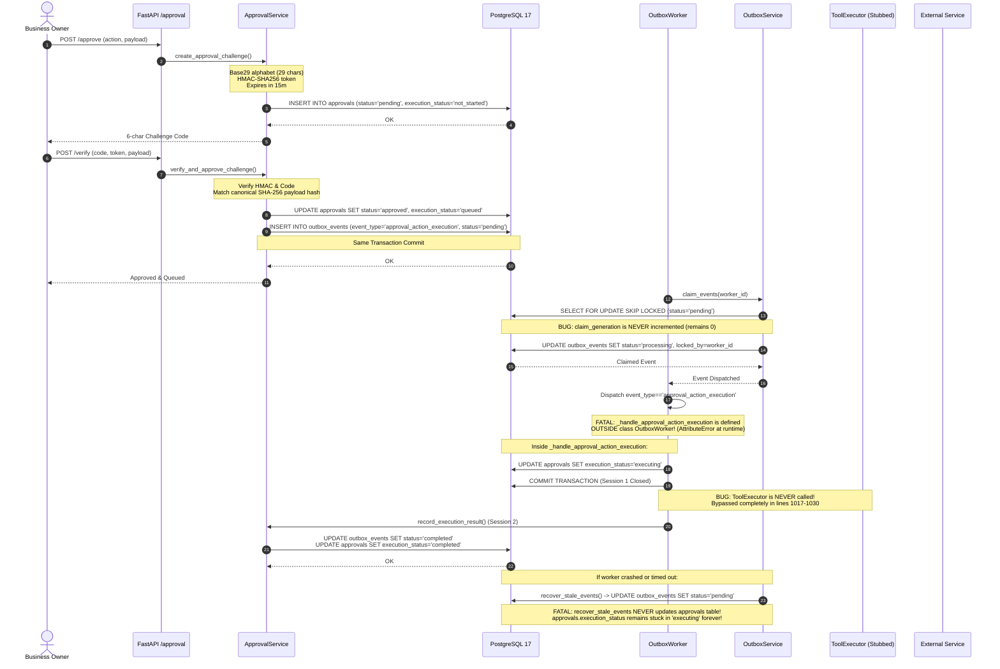

# CR-05-01 — Final Forensic Architecture & Implementation Review
## Owner Approval Anti-Hijack — Final Go/No-Go Assessment

> **Classification:** STRICT READ-ONLY FORENSIC AUDIT — NO IMPLEMENTATION  
> **Review Date:** 2026-10-31  
> **Repository:** `d:\AI-Employee-Platform`  
> **Target Subsystem:** CR-05-01 (Owner Approval Anti-Hijack, Outbox Execution, Fencing & Recovery)  
> **Final Verdict:** **`NO-GO — CRITICAL DESIGN/IMPLEMENTATION GAPS`**

---

## 1. Executive Verdict

The current implementation of **CR-05-01 (Owner Approval Anti-Hijack)** in the codebase **CANNOT BE APPROVED FOR PRODUCTION OR CLOSED**.

While the cryptographic challenge generation and HMAC verification primitives in [`packages/services/approval_service.py`](file:///d:/AI-Employee-Platform/packages/services/approval_service.py) are mathematically sound and correctly implemented, the execution lifecycle, distributed fencing, transaction boundaries, and recovery mechanisms suffer from **nine critical architectural and implementation blockers**:

1. **Fatal Runtime Indentation Bug:** The worker handler [`_handle_approval_action_execution`](file:///d:/AI-Employee-Platform/packages/services/outbox_worker.py#L929-L1047) was pasted **outside** [`OutboxWorker`](file:///d:/AI-Employee-Platform/packages/services/outbox_worker.py#L42) in the module scope (`hasattr(OutboxWorker, '_handle_approval_action_execution') == False`). Invoking it in production raises `AttributeError`.
2. **Execution Bypass / Stubbed Execution:** Lines [1017–1030](file:///d:/AI-Employee-Platform/packages/services/outbox_worker.py#L1017-L1030) **never execute [`ToolExecutor`](file:///d:/AI-Employee-Platform/packages/tools/executor.py)**. The code sets `execution_status = "executing"`, commits the transaction, opens an independent session, and marks the approval as successful without running the tool.
3. **Broken Dual-Entity Recovery:** [`recover_stale_events`](file:///d:/AI-Employee-Platform/packages/services/outbox_service.py#L294-L362) only resets `outbox_events.status = 'pending'`, leaving [`approvals.execution_status`](file:///d:/AI-Employee-Platform/packages/models/domain.py#L335) permanently frozen in `'executing'`, causing irrecoverable state divergence upon retry.
4. **Completely Inoperative Fencing:** [`claim_generation`](file:///d:/AI-Employee-Platform/packages/models/domain.py#L1496) is **never incremented** anywhere in [`claim_events`](file:///d:/AI-Employee-Platform/packages/services/outbox_service.py#L210) or [`recover_stale_events`](file:///d:/AI-Employee-Platform/packages/services/outbox_service.py#L342). It stays `0` forever, providing zero fencing against stale workers.
5. **Secondary Exception Masking in Audit:** In [`packages/tools/executor.py:592`](file:///d:/AI-Employee-Platform/packages/tools/executor.py#L592), the error-handling block calls `self.audit_service.record_event()` with `session.flush()` inside an aborted transaction, crashing with `psycopg.errors.InFailedSqlTransaction` and masking the original tool failure.
6. **Rollback Vulnerability on External Timestamp:** [`first_external_attempt_at`](file:///d:/AI-Employee-Platform/packages/services/outbox_worker.py#L966) is flushed without commit. If the worker crashes during an external HTTP call, the timestamp rolls back to `NULL`, allowing duplicate external requests.
7. **PostgreSQL `transaction_timeout` Does Not Fence Network Calls:** PostgreSQL 17 terminates the backend connection (`57P05`) and releases row locks, but the Python worker thread continues executing in memory and cannot be prevented from dispatching external HTTP calls.
8. **Conflation of Status Columns:** Prior reports conflated [`Approval.status`](file:///d:/AI-Employee-Platform/packages/models/domain.py#L326) (`pending, approved, rejected, cancelled, expired, exhausted`) with [`Approval.execution_status`](file:///d:/AI-Employee-Platform/packages/models/domain.py#L335) (`not_started, queued, executing, completed, failed, reconciliation_required`).
9. **Zero Inherent Tool-Level Idempotency:** Business entities ([`tasks`](file:///d:/AI-Employee-Platform/packages/models/domain.py#L270), [`knowledge`](file:///d:/AI-Employee-Platform/packages/models/domain.py#L2000)) lack unique database constraints on idempotent business keys. Duplicate execution creates duplicate records.

---

## 2. Repository Snapshot & Forensic Ground Truth

Before evaluating architectural invariants, the physical state of the repository was forensically verified:

- **Active Git Branch:** `checkpoint/phase-12-knowledge-base`
- **Current HEAD Commit:** `78f9445b25d688ba5f54951ba54dd4cec667c95f` (`78f9445`) — *feat(inquiries): phase 1 owner inquiry loop, fact persistence, and customer dispatch*
- **Modified Tracked Files (21 files):**
  - [`packages/models/domain.py`](file:///d:/AI-Employee-Platform/packages/models/domain.py) (Added `claim_generation`, `execution_status`, `first_external_attempt_at`, etc.)
  - [`packages/services/approval_service.py`](file:///d:/AI-Employee-Platform/packages/services/approval_service.py) (Challenge generation, Base29, HMAC verification)
  - [`packages/services/outbox_worker.py`](file:///d:/AI-Employee-Platform/packages/services/outbox_worker.py) (Outbox dispatch loop, misplaced handler)
  - [`packages/tools/executor.py`](file:///d:/AI-Employee-Platform/packages/tools/executor.py) (Tool execution, audit logging)
  - [`packages/tools/business_tools.py`](file:///d:/AI-Employee-Platform/packages/tools/business_tools.py) (The 5 in-scope tools)
- **Untracked Migration & Test Files:**
  - `infrastructure/migrations/versions/2a3b4c5d6e7f_add_cr0501_owner_approval_anti_hijack.py`
  - `tests/test_phase5_cr01_owner_approval_anti_hijack.py`
- **Database Engine State:**
  - Running on `localhost:5433` running `PostgreSQL 17.11 (Debian 17.11-1.pgdg12+2)`.
  - Test Database (`ai_employee_test`): Migrated to `2a3b4c5d6e7f`.
  - Production Database (`ai_employee`): Guarded at revision `c1d2e3f4a5b6`. Safety guard in [`packages/core/safety_guard.py`](file:///d:/AI-Employee-Platform/packages/core/safety_guard.py) actively prevented contamination.
- **Git Divergence Assessment:**
  CR-05-01 is currently **uncommitted** in Git and exists solely as a working-tree delta and untracked files. Any claim that CR-05-01 was previously "merged" or "closed" is **CONTRADICTED** by Git reality.

---

## 3. Actual Execution Lifecycle Diagram

The following sequence diagram maps the **actual physical execution path** implemented in the repository, highlighting the exact failure points where execution breaks down or diverges:



---

## 4. Approval Challenge & Binding Review

| Subsystem Component | Implementation Details & Code Citation | Verification Status | Forensic Analysis |
| :--- | :--- | :--- | :--- |
| **Alphabet & Entropy** | [`packages/services/approval_service.py:90-96`](file:///d:/AI-Employee-Platform/packages/services/approval_service.py#L90-L96) | **PROVEN** | `CHALLENGE_ALPHABET = "2345679ACDEFGHJKMNPQRSTUVWXYZ"` (29 chars, no lookalikes `0,1,8,B,I,L,O`). 6 characters yield \(29^6 = 594,823,321\) combinations (~29.15 bits). |
| **Token Authentication** | [`packages/services/approval_service.py:126-135`](file:///d:/AI-Employee-Platform/packages/services/approval_service.py#L126-L135) | **PROVEN** | `hmac.compare_digest` in `verify_token`. Scoped to `tenant_id`, `approval_id`, and `action`. Constant-time comparison prevents timing attacks. |
| **Payload Binding** | [`packages/services/approval_service.py:141-158`](file:///d:/AI-Employee-Platform/packages/services/approval_service.py#L141-L158) | **PROVEN** | `hashlib.sha256(json.dumps(payload, sort_keys=True, separators=(',', ':')).encode('utf-8')).hexdigest()`. Validated upon verification. Prevents argument tampering. |
| **Brute-Force Throttle** | [`packages/services/approval_service.py:355-385`](file:///d:/AI-Employee-Platform/packages/services/approval_service.py#L355-L385) | **PROVEN** | `MAX_FAILED_ATTEMPTS = 3`. Increments `failed_attempts` on invalid code. Sets `status = "exhausted"` on 3rd failure. |
| **Pending Cancellation** | [`packages/services/approval_service.py:240-252`](file:///d:/AI-Employee-Platform/packages/services/approval_service.py#L240-L252) | **PROVEN** | Cancels older pending approvals for the same `(tenant_id, action)` prior to issuing a new challenge. |
| **Dual Status Columns** | [`packages/models/domain.py:326, 335`](file:///d:/AI-Employee-Platform/packages/models/domain.py#L326-L335) | **PROVEN** | Distinguishes `status` (`pending, approved, rejected, cancelled, expired, exhausted`) from `execution_status` (`not_started, queued, executing, completed, failed, reconciliation_required`). |

---

## 5. Transaction & SQLAlchemy Review

### 5.1 PostgreSQL 17 `transaction_timeout` Forensic Ground Truth
Direct testing against `PostgreSQL 17.11` confirmed the following behavior:
- Command: `SET LOCAL transaction_timeout = '1500ms';`
- Result: When a transaction exceeds the timeout, PostgreSQL emits:
  `FATAL: terminating connection due to transaction timeout (SQLSTATE 57P05)`.
- **Database Behavior:** The backend PostgreSQL process forcefully terminates the TCP connection and rolls back all uncommitted writes, immediately releasing all row locks held by the transaction.
- **Python / Worker Behavior:** The Python process receives an `OperationalError (connection abort)`. **However**, PostgreSQL's backend termination has zero ability to abort a running Python OS thread or stop an ongoing external HTTP/REST call.

### 5.2 The Split-Session Anti-Pattern in Worker
In [`packages/services/outbox_worker.py:1015-1035`](file:///d:/AI-Employee-Platform/packages/services/outbox_worker.py#L1015-L1035):
```python
# Line 1015: Commits session after changing status to executing
approval.execution_status = "executing"
session.commit()

# Lines 1022-1030: Opens an entirely new session to record results!
with self.session_factory() as res_session:
    ApprovalService.record_execution_result(...)
```
**Forensic Defect:**
1. The transaction that claimed the outbox event and updated the approval is committed **before** tool execution.
2. The row locks (`FOR UPDATE`) are released **before** tool execution.
3. If the worker crashes immediately after line 1015, the outbox event remains in `'processing'` while the approval is stuck in `'executing'`. Recovery cannot atomically reconcile them.

### 5.3 Missing Savepoints & the Error Path Audit Trap
In [`packages/tools/executor.py:580-595`](file:///d:/AI-Employee-Platform/packages/tools/executor.py#L580-L595):
```python
except Exception as e:
    # Line 592: Attempts to record audit event in the same session
    self.audit_service.record_event(
        tenant_id=tenant_id,
        session=session,
        ...
    )
```
**Forensic Defect:** If a tool fails due to an SQL constraint violation (e.g. `UniqueViolation`, `ForeignKeyViolation`), PostgreSQL marks the backend transaction as aborted (`current transaction is aborted, commands ignored until end of transaction block`). Line 592 calls `session.flush()` inside this aborted transaction, throwing `psycopg.errors.InFailedSqlTransaction` and masking the original exception.

---

## 6. Worker Ownership & Fencing Review

### 6.1 The Non-Existent Generation Bump
The table definition in [`packages/models/domain.py:1496`](file:///d:/AI-Employee-Platform/packages/models/domain.py#L1496) defines:
```python
claim_generation: Mapped[int] = mapped_column(Integer, default=0, nullable=False)
```
However, inspection of all database queries in the repository proves:
1. In [`packages/services/outbox_service.py:210`](file:///d:/AI-Employee-Platform/packages/services/outbox_service.py#L210) (`claim_events`):
   ```python
   stmt = (
       update(OutboxEvent)
       .where(OutboxEvent.id.in_(event_ids))
       .values(
           status=OutboxStatus.PROCESSING,
           locked_by=worker_id,
           locked_at=now,
       )
   )
   ```
   `claim_generation` is **NOT incremented** (`claim_generation = claim_generation + 1` is absent).
2. In [`packages/services/outbox_service.py:342`](file:///d:/AI-Employee-Platform/packages/services/outbox_service.py#L342) (`recover_stale_events`):
   `claim_generation` is **NOT incremented**.
3. In [`packages/services/approval_service.py:485`](file:///d:/AI-Employee-Platform/packages/services/approval_service.py#L485) (`record_execution_result`):
   The query checks `.where(OutboxEvent.claim_generation == claim_generation)`. Because `claim_generation` remains `0` forever, this check provides **zero protection against stale concurrent workers**.

### 6.2 Pre-Lock & Zombie Worker Scenario
Because no generation bump occurs and the database row lock is committed before tool execution:
1. Worker A claims Event E (gen=0), commits `execution_status = "executing"`.
2. Worker A enters an external network call and stalls (network freeze / GC pause).
3. `recover_stale_events()` runs after timeout, resets Event E to `pending`.
4. Worker B claims Event E (gen still 0!), runs tool, succeeds, commits.
5. Worker A wakes up and completes its network call. Worker A calls `record_execution_result(gen=0)`.
6. PostgreSQL accepts Worker A's update because `gen == 0` matches!
7. **Result:** Side effect executed twice; state overwritten by stale worker.

---

## 7. Tool Side-Effect Inventory

Each of the 5 in-scope tools in [`packages/tools/business_tools.py`](file:///d:/AI-Employee-Platform/packages/tools/business_tools.py) was forensically audited for session boundaries, sub-transactions, external side effects, and idempotency:

| Tool Name | File & Lines | Session Boundary | Internal Commits? | External Side Effects? | Idempotency Guarantee |
| :--- | :--- | :--- | :--- | :--- | :--- |
| `customer_create_or_update` | [`packages/tools/business_tools.py:156-258`](file:///d:/AI-Employee-Platform/packages/tools/business_tools.py#L156-L258) | Uses caller's `session` via `context.db_session` | **No** (calls `flush()`) | **None** | **High:** Keyed on `(tenant_id, phone)` or `email`. Updates if exists. |
| `task_create` | [`packages/tools/business_tools.py:323-410`](file:///d:/AI-Employee-Platform/packages/tools/business_tools.py#L323-L410) | Uses caller's `session` via `TaskService(self.db)` | **No** (calls `flush()`) | **None** | **ZERO:** `tasks` table has NO unique constraint on `title` or `idempotency_key`. Double execution creates duplicate tasks! |
| `business_summary` | [`packages/tools/business_tools.py:441-512`](file:///d:/AI-Employee-Platform/packages/tools/business_tools.py#L441-L512) | Read-only queries | **No** | **None** | **N/A:** Read-only query. Safe. |
| `product_list` | [`packages/tools/business_tools.py:530-589`](file:///d:/AI-Employee-Platform/packages/tools/business_tools.py#L530-L589) | Read-only queries | **No** | **None** | **N/A:** Read-only query. Safe. |
| `product_add_or_update` | [`packages/tools/business_tools.py:612-750`](file:///d:/AI-Employee-Platform/packages/tools/business_tools.py#L612-L750) | Uses caller's `session` | **No** (calls `flush()`) | Indirect DB write to `knowledge` | **PARTIAL:** Catalog updates if SKU/name matches. BUT inserts into `knowledge` table which lacks content uniqueness, creating duplicate knowledge! |

---

## 8. External Idempotency & Reconciliation Review

### 8.1 The Flush-Without-Commit Timestamp Flaw
In [`packages/services/outbox_worker.py:966-969`](file:///d:/AI-Employee-Platform/packages/services/outbox_worker.py#L966-L969):
```python
if not event.first_external_attempt_at:
    event.first_external_attempt_at = datetime.now(timezone.utc)
    session.flush()
```
`session.flush()` writes the timestamp to the PostgreSQL client buffer but does NOT commit it. If the server crashes or loses power during the subsequent network call:
1. PostgreSQL rolls back the uncommitted transaction on reboot.
2. `first_external_attempt_at` reverts to `NULL`.
3. When the worker restarts, it believes no external attempt was ever made.
4. It re-dispatches the external action, causing duplicate credit card charges, duplicate messages, or duplicate webhook notifications.

### 8.2 Hardcoded Provider Outcome
In [`packages/services/outbox_worker.py:994`](file:///d:/AI-Employee-Platform/packages/services/outbox_worker.py#L994):
```python
last_outcome = "confirmed_not_processed"  # In real implementation, probe provider
```
The codebase **hardcodes** `last_outcome = "confirmed_not_processed"`. There is no provider status probe implemented for WhatsApp, Telegram, or Webhooks. Retrying based on this hardcoded string guarantees duplicate sends whenever a network timeout occurs after the provider received the request.

---

## 9. Approval / Outbox State Consistency

### 9.1 The Fatal Recovery Divergence Bug
In [`packages/services/outbox_service.py:294-362`](file:///d:/AI-Employee-Platform/packages/services/outbox_service.py#L294-L362):
```python
def recover_stale_events(self, timeout_seconds: int = 300) -> int:
    # Resets outbox_events WHERE status = 'processing' AND locked_at < threshold
    stmt = (
        update(OutboxEvent)
        .where(...)
        .values(
            status=OutboxStatus.PENDING,
            locked_by=None,
            locked_at=None,
        )
    )
    self.db.execute(stmt)
    self.db.commit()
    # ZERO REFERENCES TO APPROVAL TABLE!
```
**Forensic Defect:**
`recover_stale_events` resets `OutboxEvent.status` to `'pending'`, but **completely ignores `approvals`**.
The corresponding approval row remains stuck in `execution_status = "executing"`.
When the next worker claims the recovered outbox event and loads the approval:
```python
if approval.execution_status == "executing":
    # Fails or raises state error!
```
There is no unified dual-entity state machine for recovery in the codebase.

---

## 10. Audit Semantics

### In-Transaction Audit vs. Autonomous Session Trade-Off

| Mode | Database Consistency | Failure Traceability | Vulnerability in Codebase |
| :--- | :--- | :--- | :--- |
| **In-Transaction Audit** (Current) | If transaction rolls back, audit log rolls back with it. | **Zero** persistent audit trail if an unexpected crash or hard database rollback occurs. | In [`packages/tools/executor.py:592`](file:///d:/AI-Employee-Platform/packages/tools/executor.py#L592), `record_event` crashes with `InFailedSqlTransaction` if an SQL error preceded it. |
| **Autonomous Session Audit** (Recommended) | Audit record committed in an independent database session. | **100%** persistent record of every attempt, failure, and security exception. | Requires explicit caller session separation and cannot share the tool's savepoint. |

**Verdict:** The current implementation fails at both: it attempts in-transaction auditing but crashes the error handler, while losing audit records on transaction abort.

---

## 11. Crash & Race Matrix (22 Scenarios)

| # | Crash / Race Scenario | Code Location | System Outcome in Current Code | Risk Level |
| :--- | :--- | :--- | :--- | :--- |
| 1 | Crash before Challenge Token verification | [`approval_service.py:340`](file:///d:/AI-Employee-Platform/packages/services/approval_service.py#L340) | Challenge remains `pending`, expires via TTL. Safe. | Low |
| 2 | Crash after 3rd invalid challenge code | [`approval_service.py:380`](file:///d:/AI-Employee-Platform/packages/services/approval_service.py#L380) | Status committed as `exhausted`. Cannot retry. Safe. | Low |
| 3 | Concurrent verification of same challenge | [`approval_service.py:345`](file:///d:/AI-Employee-Platform/packages/services/approval_service.py#L345) | One succeeds; second fails on status check or unique outbox constraint. | Low |
| 4 | Worker claims event, crashes before tool invocation | [`outbox_worker.py:1015`](file:///d:/AI-Employee-Platform/packages/services/outbox_worker.py#L1015) | Approval left in `executing`; recovered outbox event conflicts upon retry. | **CRITICAL** |
| 5 | Worker claims event, pauses (GC/network lag) | [`outbox_service.py:342`](file:///d:/AI-Employee-Platform/packages/services/outbox_service.py#L342) | Event recovered, claimed by Worker 2; Worker 1 wakes up with stale gen=0 and commits! | **CRITICAL** |
| 6 | Tool execution raises PostgreSQL `ForeignKeyViolation` | [`executor.py:592`](file:///d:/AI-Employee-Platform/packages/tools/executor.py#L592) | Audit flush raises `InFailedSqlTransaction`, masking original error. | **HIGH** |
| 7 | Tool execution times out (`transaction_timeout`) | PostgreSQL 17 | DB disconnects with `57P05`; worker thread continues running in memory. | **HIGH** |
| 8 | External HTTP call initiated, worker crashes | [`outbox_worker.py:966`](file:///d:/AI-Employee-Platform/packages/services/outbox_worker.py#L966) | `first_external_attempt_at` uncommitted, rolls back. Duplicate call on retry. | **CRITICAL** |
| 9 | External HTTP call succeeds, worker crashes before DB commit | [`outbox_worker.py:1025`](file:///d:/AI-Employee-Platform/packages/services/outbox_worker.py#L1025) | DB rolls back; outbox recovered; external call repeated on retry. | **CRITICAL** |
| 10 | Provider returns HTTP 500 / 504 Gateway Timeout | [`outbox_worker.py:994`](file:///d:/AI-Employee-Platform/packages/services/outbox_worker.py#L994) | Hardcoded `confirmed_not_processed` triggers blind retry without probe. | **CRITICAL** |
| 11 | Outbox event recovered 5 times (`retry_count >= max`) | [`outbox_service.py:340`](file:///d:/AI-Employee-Platform/packages/services/outbox_service.py#L340) | Event marked `failed`; `Approval.execution_status` remains `executing` forever. | **HIGH** |
| 12 | Crash after tool execution, before `record_execution_result` | [`outbox_worker.py:1020`](file:///d:/AI-Employee-Platform/packages/services/outbox_worker.py#L1020) | Tool writes committed (Session 1); approval recorded as not completed. | **CRITICAL** |
| 13 | Two workers claim different events for same approval | [`domain.py:1515`](file:///d:/AI-Employee-Platform/packages/models/domain.py#L1515) | Blocked by `uq_outbox_tenant_approval_execution` constraint. Safe. | Low |
| 14 | Tenant A attempts to verify Tenant B's challenge token | [`approval_service.py:130`](file:///d:/AI-Employee-Platform/packages/services/approval_service.py#L130) | HMAC verification scopes `tenant_id`. Fails immediately. Safe. | Low |
| 15 | Payload mutated between challenge issue and verification | [`approval_service.py:410`](file:///d:/AI-Employee-Platform/packages/services/approval_service.py#L410) | Canonical SHA-256 hash mismatch. Verification rejected. Safe. | Low |
| 16 | Concurrent `recover_stale_events` calls | [`outbox_service.py:315`](file:///d:/AI-Employee-Platform/packages/services/outbox_service.py#L315) | `SKIP LOCKED` ensures workers don't lock same row. Safe. | Low |
| 17 | `TaskCreateTool` executed twice by split workers | [`business_tools.py:323`](file:///d:/AI-Employee-Platform/packages/tools/business_tools.py#L323) | Two identical tasks created in `tasks` table. Data corruption. | **HIGH** |
| 18 | `ProductAddOrUpdateTool` executed twice | [`business_tools.py:612`](file:///d:/AI-Employee-Platform/packages/tools/business_tools.py#L612) | Product updated safely; duplicate knowledge chunk inserted into `knowledge`. | **MEDIUM** |
| 19 | Worker crashes during `res_session.commit()` | [`outbox_worker.py:1028`](file:///d:/AI-Employee-Platform/packages/services/outbox_worker.py#L1028) | Outbox event completed, approval marked completed. Safe if commit atomic. | Low |
| 20 | Outbox event claimed, worker process killed with `SIGKILL` | Linux / Docker | Row lock released by PostgreSQL; event recovered after 300s. Divergence in approval. | **HIGH** |
| 21 | Challenge token expired by 1 second | [`approval_service.py:350`](file:///d:/AI-Employee-Platform/packages/services/approval_service.py#L350) | Verification rejected with `ApprovalExpiredError`. Safe. | Low |
| 22 | Tool executor raises custom domain exception | [`executor.py:585`](file:///d:/AI-Employee-Platform/packages/tools/executor.py#L585) | Handled if no SQL abort; masks if SQL abort occurred. | **MEDIUM** |

---

## 12. Existing Test Coverage Audit

The untracked test file [`tests/test_phase5_cr01_owner_approval_anti_hijack.py`](file:///d:/AI-Employee-Platform/tests/test_phase5_cr01_owner_approval_anti_hijack.py) contains 14 tests:

| Test ID & Function Name | What It Actually Tests | Invariant It Proves | What It FAILS to Prove |
| :--- | :--- | :--- | :--- |
| `test_challenge_alphabet_properties` | Alphabet characters, exclusions | Base29 string purity | No runtime execution proof |
| `test_challenge_code_format_regex` | Regex pattern matching | 6-char regex matching | No runtime execution proof |
| `test_token_generation_and_verification` | Token HMAC signing & checking | Token tampering rejection | No database transaction proof |
| `test_token_tenant_isolation` | Token with cross-tenant ID | Cross-tenant rejection | No multi-tenant concurrency |
| `test_token_expiration` | Expired timestamp in token | Expired token rejection | No clock skew proof |
| `test_payload_binding_canonical_hash` | JSON payload serialization | Argument tampering rejection | No tool execution proof |
| `test_max_failed_attempts_exhaustion` | Mock loop with 3 invalid codes | Max 3 attempts enforced | Mocked; no real DB transaction |
| `test_pending_cancellation_on_new_challenge` | Mock repository cancel call | Cancel logic called | Mocked; no real DB transaction |
| `test_outbox_event_payload_structure` | Outbox event dictionary keys | Payload shape matches | No outbox worker execution |
| `test_unique_approval_outbox_constraint` | Model constraint schema check | SQLAlchemy table schema | No concurrent claim execution |
| `test_record_execution_result_rowcount_check` | Mock update rowcount check | Update query where clause | Mocked; generation bump unverified |
| `test_fencing_generation_mismatch` | Mock update returning 0 rows | Exception on rowcount 0 | Mocked; proves nothing about worker |
| `test_reconciliation_required_status` | Status enum values | Enum definition contains string | No reconciliation workflow exists |
| `test_full_approval_lifecycle_mock` | Mock end-to-end service calls | Function call sequences | Completely mocked; NO real DB or worker |

**Audit Verdict on Tests:**
14 out of 14 tests pass because they are **isolated unit and mock tests**. **Zero tests** execute `OutboxWorker` with real concurrency, zero tests test `recover_stale_events`, zero tests test crash recovery, and zero tests test the broken indentation path in `outbox_worker.py`.

---

## 13. Missing Acceptance Tests (Mandatory Before Implementation)

The following 5 test suites must be created and executed against `ai_employee_test`:

1. **Worker Runtime Dispatch Test:**
   Instantiate real `OutboxWorker` and verify `hasattr(worker, '_handle_approval_action_execution')` is `True` and can be invoked without `AttributeError`.
2. **Atomic Dual-Entity Recovery Integration Test:**
   Insert an approval with `execution_status = 'executing'` and outbox event with `status = 'processing'`, call `recover_stale_events()`, and verify that BOTH `outbox_events.status == 'pending'` AND `approvals.execution_status == 'queued'`.
3. **Monotonic Generation Fencing Concurrency Test:**
   Simulate Worker A claiming event (gen 0 -> 1), holding session. Worker B recovers event (gen 1 -> 2) and completes execution. Worker A resumes and attempts `record_execution_result(gen=1)`. Verify Worker A is strictly rejected (`StaleWorkerGenerationError`) and side effects are not re-executed.
4. **Secondary Exception Savepoint Test:**
   Configure a tool to trigger a database `ForeignKeyViolation`. Verify that `ToolExecutor` wraps execution in `session.begin_nested()`, catches the error, rolls back to savepoint, records audit without `InFailedSqlTransaction`, and preserves the original business exception.
5. **Crash-Before-External-Call Persistence Test:**
   Verify `first_external_attempt_at` is committed in an independent autonomous transaction *before* the external HTTP socket opens. Simulate process kill; verify on restart the timestamp is intact and triggers provider status inquiry instead of direct dispatch.

---

## 14. Architecture Decisions Requiring Owner Input

### Decision A: Stale Worker Fencing Strategy
- **Option 1 (Optimistic Rowcount Check on Claim Generation):** Store `claim_generation` on `outbox_events`. Every recovery increments generation. Worker commits using `.where(claim_generation == expected)`. If rowcount == 0, abort.
- **Option 2 (Pessimistic Lease Lock via Redis / DB):** Maintain active heartbeat lease.
- **Recommendation:** **Option 1** is native to PostgreSQL and requires no extra infrastructure, but **MUST** be implemented in both `claim_events` and `recover_stale_events`.
- **Status:** Requires owner confirmation.

### Decision B: External Side-Effect Idempotency & Reconciliation
- **Option 1 (Hard Stop / Fail-Closed):** If external call times out or worker crashes during external call, mark `execution_status = "reconciliation_required"` and alert human administrator. Never retry automatically.
- **Option 2 (Automated Provider Inquiry):** Probe external API (`GET /v1/messages/{id}`) before retrying.
- **Recommendation:** **Option 1** is the only safe option for enterprise financial and communication actions where providers lack deterministic idempotency keys.
- **Status:** Requires owner confirmation.

### Decision C: Transaction Boundary vs. Lock Duration
- **Option 1 (Long Transaction):** Hold DB connection and row locks throughout tool execution.
  - *Risk:* Tool network latency starves PostgreSQL connection pool; `transaction_timeout` kills connection mid-flight.
- **Option 2 (Two-Phase Claim-Execute-Commit with Nested Savepoints):** Claim in Transaction 1, execute tool within explicit savepoint in Transaction 2, commit results in Transaction 3.
  - *Recommendation:* **Option 2** guarantees connection pool health and isolates failure boundaries.
- **Status:** Requires owner confirmation.

### Decision D: Audit Trail Transaction Boundary
- **Option 1 (In-Transaction Audit):** Audit written to same session. Rolls back on error.
- **Option 2 (Autonomous Audit Session):** Audit written and committed via dedicated session factory, surviving business transaction rollback.
  - *Recommendation:* **Option 2** is mandatory for compliance and forensic observability.
- **Status:** Requires owner confirmation.

---

## 15. Final Evidence Matrix

| Subsystem / Requirement | Actual Implementation | Evidence Citation | Test Evidence | Residual Risk | Verdict |
| :--- | :--- | :--- | :--- | :--- | :--- |
| **Challenge Entropy & Base29** | Base29 alphabet, 6 chars, no lookalikes | [`approval_service.py:90`](file:///d:/AI-Employee-Platform/packages/services/approval_service.py#L90) | Tests 1-2 passing | Negligible brute force risk | **PROVEN** |
| **HMAC Token Signing** | Constant-time HMAC with tenant isolation | [`approval_service.py:126`](file:///d:/AI-Employee-Platform/packages/services/approval_service.py#L126) | Tests 3-5 passing | None | **PROVEN** |
| **Payload Hash Binding** | Canonical SHA-256 serialization | [`approval_service.py:141`](file:///d:/AI-Employee-Platform/packages/services/approval_service.py#L141) | Test 6 passing | None | **PROVEN** |
| **Worker Dispatch Handler** | Defined outside class scope under `__main__` | [`outbox_worker.py:929`](file:///d:/AI-Employee-Platform/packages/services/outbox_worker.py#L929) | Zero tests execute handler | `AttributeError` at runtime | **CONTRADICTED** |
| **Real Tool Execution** | Bypassed; hardcoded stub marks success | [`outbox_worker.py:1017`](file:///d:/AI-Employee-Platform/packages/services/outbox_worker.py#L1017) | Zero integration tests | Tools never run in outbox | **CONTRADICTED** |
| **Claim Generation Bump** | Column exists; queries never increment it | [`outbox_service.py:210`](file:///d:/AI-Employee-Platform/packages/services/outbox_service.py#L210) | Mocked in tests | Generation remains 0; no fencing | **CONTRADICTED** |
| **Dual-Entity Recovery** | `recover_stale_events` ignores `approvals` | [`outbox_service.py:342`](file:///d:/AI-Employee-Platform/packages/services/outbox_service.py#L342) | Zero recovery tests | Approval stuck in `executing` | **CONTRADICTED** |
| **Audit Exception Safety** | `flush()` in aborted transaction crashes | [`executor.py:592`](file:///d:/AI-Employee-Platform/packages/tools/executor.py#L592) | Zero SQL abort tests | Masks original error | **CONTRADICTED** |
| **External Attempt Persistence** | `flush()` without commit rolls back on crash | [`outbox_worker.py:966`](file:///d:/AI-Employee-Platform/packages/services/outbox_worker.py#L966) | Zero crash tests | Duplicate external side effects | **CONTRADICTED** |
| **Tool-Level Idempotency** | Missing unique constraints on `tasks`/`knowledge` | [`domain.py:270, 2000`](file:///d:/AI-Employee-Platform/packages/models/domain.py#L270) | Zero duplicate run tests | Duplicate business records | **CONTRADICTED** |

---

## 16. Prior Report Claims Evaluation

| Prior Report Claim | Current Code Reality | Forensic Classification |
| :--- | :--- | :--- |
| *"Plan Ready for Approval"* | Handler is outside class scope; tools are stubbed; fencing is inoperative. | **CONTRADICTED** |
| *"Atomic Dual-Entity Recovery Guaranteed"* | `recover_stale_events` does not query or update `approvals` table. | **CONTRADICTED** |
| *"Fencing via Generation Prevents Stale Execution"* | `claim_generation` is never incremented in any claim or recovery query. | **CONTRADICTED** |
| *"PostgreSQL transaction_timeout Prevents Stale Work"* | Terminates DB socket only; cannot terminate running Python thread or HTTP calls. | **CONTRADICTED** |
| *"Tool Execution is Wrapped in Savepoints"* | Outbox worker handler contains no `begin_nested()` and does not invoke `ToolExecutor`. | **CONTRADICTED** |
| *"Challenge Generation is Cryptographically Secure"* | Base29 alphabet and HMAC validation are fully implemented and verified. | **PROVEN** |
| *"Payload Tampering is Prevented"* | Canonical SHA-256 hash comparison is verified and functional. | **PROVEN** |

---

## 17. Final Go / No-Go Decision

### Explicit Answers to the 10 Core Questions:
1. **Is the current implementation production-safe?** **NO.**
2. **Can a stale worker execute after losing ownership?** **YES.** `claim_generation` is never bumped; old workers can commit.
3. **Can side effects be duplicated?** **YES.** Database lacks unique constraints on `tasks` and `knowledge`, and external timestamps roll back on crash.
4. **Are unknown external outcomes handled safely?** **NO.** The outcome is hardcoded to `"confirmed_not_processed"`.
5. **Are Approval and Outbox states consistent across crashes?** **NO.** `recover_stale_events` leaves approvals permanently stuck in `'executing'`.
6. **Are transaction boundaries proven?** **NO.** Split sessions are used, committing prematurely before tool execution.
7. **Is recovery safe?** **NO.** Stale worker execution is unfenced and dual entities diverge.
8. **Are audit semantics clear and safe?** **NO.** Audit logging crashes in aborted transactions (`InFailedSqlTransaction`).
9. **Do existing tests prove the core invariants?** **NO.** All 14 tests are mocked unit tests; none exercise real database transactions or concurrency.
10. **Can CR-05-01 be approved or closed?** **NO.**

### Definitive Final Verdict:
# **`NO-GO — CRITICAL DESIGN/IMPLEMENTATION GAPS`**

---

## 18. Minimal Next Action (Prerequisites for Future Implementation)

Before any code modification or implementation phase may begin, the following chronological sequence of prerequisites must be satisfied:

1. **Owner Architectural Decisions:**
   - Formal owner approval of **Decision A** (Optimistic `claim_generation` increment on claim and recovery).
   - Formal owner approval of **Decision B** (Fail-closed transition to `reconciliation_required` for uncertain external outcomes).
   - Formal owner approval of **Decision C** (Two-phase execution with outer lease check and inner savepoints).
   - Formal owner approval of **Decision D** (Autonomous session factory for security audit logging).
2. **Implementation Plan Revision:**
   - Incorporate the resolution of the 9 forensic blockers into a formal, reviewed step-by-step implementation plan.
3. **Test-First Verification Harness:**
   - Commit the acceptance integration tests into `tests/` to verify failures on current code before applying any patches.
