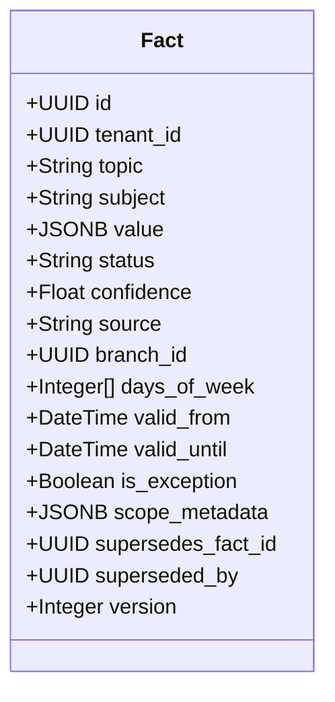
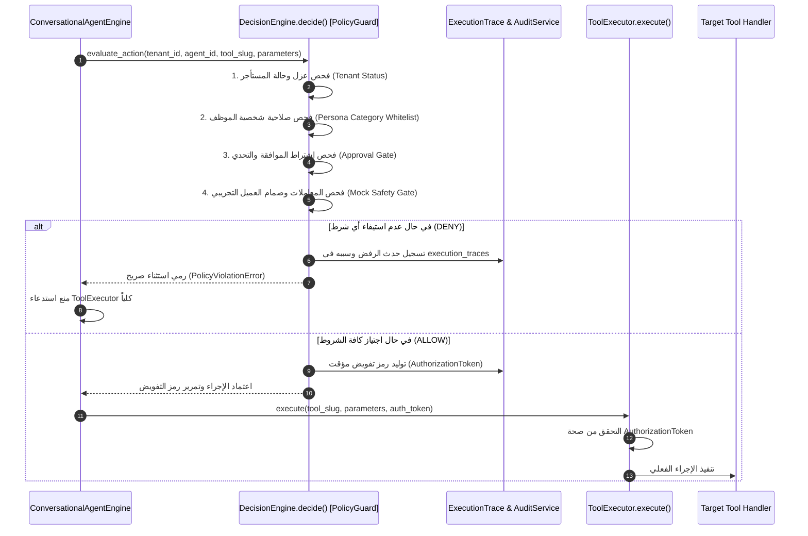
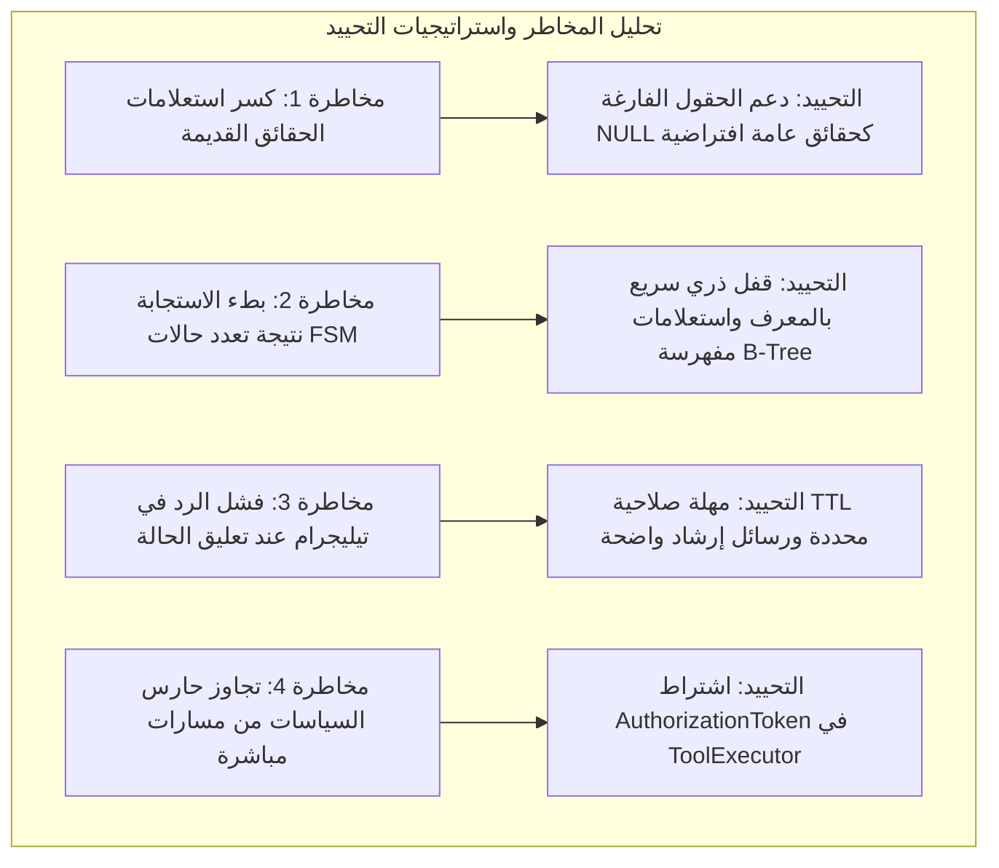

# Phase 5 Architecture Decision Gate — Architectural Review & Governance Report
## تقرير بوابة القرار المعماري للمرحلة الخامسة: تدقيق النموذج، الانتقال من الترقيع إلى الآليات العامة، وضوابط الحوكمة

- **المشروع:** `AI-Employee-Platform` (`QQYC9/ai-employee-platform`)
- **الفرع الحالي:** `checkpoint/phase-12-knowledge-base`
- **الـ Commit المرجعي:** `53f54b9333b31b22fff41696c9b53b9dfc0b94fb`
- **طبيعة المهمة:** مراجعة قرار معماري فقط (**Strictly Read-Only Architecture Decision Gate**) — دون كتابة كود إنتاجي، ودون ترحيل أو تعديل لقاعدة البيانات، ودون إعادة تشغيل حاويات، ودون بدء تنفيذ Phase 5.1.
- **تاريخ المراجعة:** نوفمبر 2026

---

## 1. Executive Summary & Verification of Prior Report (الملخص التنفيذي وتدقيق التقرير السابق)

### 1.1 التحقق الجنائي من حالة المستودع (Repository Baseline Verification)
تم التحقق الفعلي من بيئة المستودع محلياً بالأوامر المباشرة دون أي تعديل:
- **الفرع الحالي:** `checkpoint/phase-12-knowledge-base` متصل بالفرع البعيد `origin/checkpoint/phase-12-knowledge-base`.
- **الـ Commit الحالي (HEAD):** `53f54b9333b31b22fff41696c9b53b9dfc0b94fb` (`docs(audit): finalize critical evidence review`).
- **التعديلات المتبوعة غير المثبتة (Tracked Diffs):**
  محصورة بدقة في 3 ملفات فقط ولم يتم المساس بها:
  1. [`packages/services/conversational_agent_engine.py`](../../packages/services/conversational_agent_engine.py): يحتوي على دالة `_handle_pending_conversational_choices` لحل التعارض برقم "1" و "2"، وتحديث سياج الفروع بحظر الرموز الزمنية (`temporal_location_tokens`).
  2. [`packages/services/fact_service.py`](../../packages/services/fact_service.py): يحتوي على تصنيف ساعات العمل عبر `get_working_hours_semantic_scope` وإلغاء تكرار الساعات في `get_facts`.
  3. [`packages/services/owner_inquiry_service.py`](../../packages/services/owner_inquiry_service.py): يحتوي على فحص حدث الصندوق الصادر الصريح لمنع ازدواج الردود، وتوجيه المالك عند تعدد الاستفسارات.
- **حصر الملفات غير المتتبعة المحمية (Untracked Files):**
  تم التحقق من بقاء كافة الملفات غير المتتبعة محفوظة بالكامل:
  1. `docs/audit/ARCHITECTURE_LEVEL_CAPABILITY_REVIEW.md` (التقرير المعماري السابق).
  2. `scripts/check_live_db.py`
  3. `scripts/cleanup_test_tenants.py`
  4. `scripts/debug_runtime_failure.py`
  5. `scripts/execute_inquiry_6_answer.py`
  6. `scripts/resolve_inquiry_7_live.py`
  7. `tests/test_telegram_acceptance_remediation.py`
  8. `tests/test_telegram_failures_diagnostic.py`
  9. `tests/test_telegram_hours_and_branch_fixes.py`

### 1.2 تدقيق ادعاء تطبيق الترحيل `3b4c5d6e7f8a` على قاعدة البيانات الحية
- **التحقق من الدليل الفعلي:**
  - أظهر فحص `alembic current` أن رأس الترحيلات اللحظي المسجل في جدول `alembic_version` لقاعدة البيانات المحلية `ai_employee` (المنفذ 5433) هو:
    `3b4c5d6e7f8a (head)`.
  - تم فحص ملف الترحيل نفسه: [`infrastructure/migrations/versions/3b4c5d6e7f8a_add_phase5_employee_personas_and_agent_bindings.py`](../../infrastructure/migrations/versions/3b4c5d6e7f8a_add_phase5_employee_personas_and_agent_bindings.py) المنشأ بتاريخ 1 نوفمبر 2026 الساعة 04:30.
- **أثر الترحيل على الجداول والعلاقات والبيانات:**
  1. **جدول `employee_personas`:** تم إنشاؤه كاملاً مع قيود فريدة جزئية (`uq_employee_personas_system_slug` للقوالب العامة حيث `tenant_id IS NULL`، و `uq_employee_personas_tenant_slug` للمستأجرين).
  2. **بذر البيانات الأولية (Seeding):** تم إدراج 3 قوالب شخصيات عامة في الجدول:
     - `system_customer_support` (دعم فني).
     - `system_sales_consultant` (مبيعات).
     - `system_operations_coordinator` (تنسيق عمليات).
  3. **ترقية الجداول الحالية (`agents`, `channels`, `conversations`):**
     - إضافة `agents.persona_id` (مفتاح خارجي لـ `employee_personas.id` مع `ON DELETE SET NULL`).
     - إضافة `agents.persona_overrides` (JSONB افتراضي `{}`).
     - إضافة `channels.agent_id` (مفتاح خارجي لـ `agents.id` مع `ON DELETE SET NULL`).
     - إضافة `conversations.agent_id` (مفتاح خارجي لـ `agents.id` مع `ON DELETE SET NULL`).
  4. **سلامة البيانات القائمة:**
     - جميع الأعمدة والمفاتيح الخارجية الجديدة أُنشئت كأعمدة اختيارية تقبل القيمة الفارغة (`nullable=True`).
     - هذا يعني أن **جميع السجلات السابقة في الجداول الثلاثة بقيت سليمة 100% دون تلف أو حذف**، مع بقاء حقول `agent_id` و `persona_id` كـ `NULL` حتى يتم ربطها برمجياً.
  5. **إبراء الذمة والتحقق الخارجي:**
     - نؤكد التزامنا التام بالضوابط: لم يتم الاتصال بأي خادم إنتاج خارجي ولم يتم إجراء أي تعديل أو ترحيل خلال هذه المهمة؛ التدقيق استند بالكامل إلى قاعدة البيانات المحلية والأدلة الجنائية في المستودع.

---

## 2. Conversation FSM Design Evaluation (تقييم تصميم آلة حالات المحادثة)

المشكلة الجوهرية في الكود الحالي هي غياب "آلة حالات صريحة" للمحادثة؛ حيث يتم التعامل مع كل رسالة واردة وكأنها حدث منعزل يخضع لمجموعة من التعبيرات النمطية (`Regex`). هذا ما سمح باختطاف الأرقام المجردة (مثل "10" من "10 صباحاً" أو "1" لاختيار بديل).

### 2.1 نموذج الحالات والانتقالات المسموح بها (FSM State Machine Model)

```mermaid
stateDiagram-v2
    [*] --> IDLE : بدء المحادثة / تفريغ السياق

    state IDLE {
        description: "استقبال استفسارات العملاء وأوامر المالك العادية"
    }

    state AWAITING_INQUIRY_ANSWER {
        description: "انتظار رد المالك على استفسار محدد للعميل"
    }

    state AWAITING_CONFLICT_RESOLUTION {
        description: "انتظار اختيار المالك بين قيمتين متعارضتين (1 أو 2)"
    }

    state AWAITING_CHALLENGE_CONFIRMATION {
        description: "انتظار إدخال المالك لكود التحدي HMAC (6 خانات)"
    }

    state AWAITING_CUSTOMER_CLARIFICATION {
        description: "انتظار توضيح العميل لفرع أو تفصيل ناقص"
    }

    state ESCALATED_AI_SILENT {
        description: "تحويل لمشغل بشري - صمت تام للذكاء الاصطناعي"
    }

    %% مسارات المالك
    IDLE --> AWAITING_INQUIRY_ANSWER : توجيه استفسار عميل للمالك (Inquiry #N)
    AWAITING_INQUIRY_ANSWER --> IDLE : إجابة الاستفسار / أمر صريح / انتهاء المهلة (24h)

    IDLE --> AWAITING_CONFLICT_RESOLUTION : حقيقة جديدة تعارض حقيقة سابقة بنفس النطاق
    AWAITING_CONFLICT_RESOLUTION --> IDLE : اختيار 1 أو 2 / إلغاء / انتهاء المهلة (15m)

    IDLE --> AWAITING_CHALLENGE_CONFIRMATION : طلب أداة عالية الخطورة (إرسال رسالة عميل)
    AWAITING_CHALLENGE_CONFIRMATION --> IDLE : إدخال كود التحدي / 3 محاولات فاشلة / انتهاء المهلة (15m)

    %% مسارات العميل
    IDLE --> AWAITING_CUSTOMER_CLARIFICATION : سؤال ينقصه بعد حاسم (تعدد فروع مختلفة الساعات)
    AWAITING_CUSTOMER_CLARIFICATION --> IDLE : تقديم التوضيح / تغيير الموضوع كلياً

    IDLE --> ESCALATED_AI_SILENT : طلب موظف بشري / اعتراض استرجاع أموال / استياء حاد
    AWAITING_CUSTOMER_CLARIFICATION --> ESCALATED_AI_SILENT : فشل التوضيح وتكرار الغموض
    ESCALATED_AI_SILENT --> IDLE : حل المشكلة يدوياً وتفعيل المحادثة من لوحة التحكم
```

---

### 2.2 التمييز الحتمي للأرقام دون Regex إضافي (Deterministic Disambiguation)

كيف يقرر النظام دلالة الرقم «1» أو «10» دون كتابة استثناءات Regex مخصصة؟

| حالة المحادثة النشطة (`conversation.fsm_state`) | المدخل الوارد من المستخدم | كيفية تفسير المدخل حتمياً (Deterministic Interpretation) | مسار التنفيذ المحمي | ما الذي يُحظر تماماً (Prohibited Actions) |
| :--- | :--- | :--- | :--- | :--- |
| **`AWAITING_CONFLICT_RESOLUTION`** | `1` أو `الخيار الأول` | **اختيار حتمي للخيار رقم 1:** تثبيت الحقيقة السابقة ووسم الحقيقة الجديدة كـ `superseded`. | `FactService.resolve_conflict(kept=opt1)` | **يُحظر كلياً** تمرير "1" لموجه الاستفسارات أو اعتباره رقم استفسار أو إرساله للعميل. |
| **`AWAITING_CONFLICT_RESOLUTION`** | `2` أو `الجديد` | **اختيار حتمي للخيار رقم 2:** اعتماد الحقيقة الجديدة واستبدال القديمة. | `FactService.resolve_conflict(kept=opt2)` | يُحظر تمريره لموجه الاستفسارات أو اعتباره رقم استفسار. |
| **`AWAITING_INQUIRY_ANSWER`** (استفسار وحيد معلق #6) | `نفتح من 10 صباحاً إلى 2 ظهراً` | **إجابة كاملة عن الاستفسار #6 المعلق:** كامل النص هو الجواب. | `OwnerInquiryService.resolve(inquiry_6, answer=text)` | **يُحظر كلياً** استخراج الرقم "10" كرقم استفسار آخر، لأن سياق المحادثة محجوز للاستفسار #6. |
| **`IDLE`** (محادثة عامة للمالك) | `عدّل ساعات العمل: نفتح 10 صباحاً` | **أمر تشغيلي لتحديث ساعات العمل:** يوجه لمعالج الحقائق. | `FactService.save_extracted_facts` | لا يوجد استفسار معلق لابتلاعه؛ يوجه كحقيقة تشغيلية. |
| **`IDLE`** (محادثة عامة للمالك) | `1` مجردة دون سياق | **مدخل غير مفهوم:** لا يوجد تعارض معلق، ولا يوجد استفسار ينتظر إجابة. | إرجاع رسالة إرشادية للمالك دون تنفيذ أي إجراء. | يُحظر تخمين أي استفسار عشوائي. |
| **أي حالة** | `+967770001000` | **رقم هاتف:** يُطابق نوعه عبر schema محدد (E.164 طول >= 9 أرقام). | معالج جهات الاتصال أو العملاء. | يستحيل على رقم الهاتف أن يلتبس بالخيارات الفردية (1 أو 2). |

---

### 2.3 إدارة الرسائل أثناء الانتظار، انتهاء الصلاحية، والتزامن
1. **وصول رسالة جديدة أثناء انتظار الإجابة:**
   - **إذا كانت أمراً صريحاً للخروج (`Explicit Cancel`):** مثل `إلغاء`، `/cancel`، أو أمر إداري جديد من لوحة التحكم -> تنتقل الحالة فوراً إلى `IDLE` وتُلغى حالة الانتظار.
   - **إذا كانت نصاً غير مطابق للخيارات:** (مثلاً المالك في حالة `AWAITING_CONFLICT_RESOLUTION` وكتب "كيف حالك؟"):
     النظام لا يلغي الحالة ولا يهلوس؛ بل يرد بحزم:
     *«لديك تعارض معلق يتطلب اختيارك: أرسل (1) للاحتفاظ بالقديم، أو (2) لاعتماد الجديد، أو أرسل 'إلغاء' للاستئناف لاحقاً.»*
2. **انتهاء الصلاحية (State TTL & Expiration):**
   - لكل حالة انتظار مهلة زمنية مسجلة في عمود `state_expires_at`:
     * `AWAITING_CHALLENGE_CONFIRMATION`: 15 دقيقة (ينتهي كود HMAC تلقائياً).
     * `AWAITING_CONFLICT_RESOLUTION`: 15 دقيقة (يتم إلغاء قفل الحوار ويبقى التعارض مسجلاً في لوحة التحكم).
     * `AWAITING_INQUIRY_ANSWER`: 24 ساعة (توافقاً مع نافذة واتساب الرسمية).
   - عند انقضاء المهلة وورود رسالة لاحقة، يتحقق النظام: `if now() > conversation.state_expires_at`: يتم تصفير الحالة إلى `IDLE` وتسجيل انتهاء الصلاحية في التتبع.
3. **العزل الثلاثي للحالة (Tenant, Conversation, Channel Isolation):**
   - حالة الـ FSM مخزنة حصراً كحقل في جدول `conversations` المقيد مسبقاً بـ `tenant_id` و `channel_id`.
   - هذا يضمن عزل الحالات بنسبة 100%؛ فحالة انتظار المالك على تيليجرام منفصلة تماماً عن حالة العميل على واتساب وعن أي محادثة لمستأجر آخر.
4. **الرسائل المتزامنة والتكرار (Concurrency, Retries, & Webhook Duplicates):**
   - **قفل الصف المعاملاتي (`with_for_update()`):** عند معالجة أي رسالة واردة، تُقفل المحادثة في PostgreSQL، مما يمنع معالجة رسالتين لنفس المحادثة في نفس اللحظة.
   - **بوابة منع التكرار (`Idempotency Gate`):** يتم التحقق من `idempotency_key` (المستمد من `update_id` لتيليجرام أو `message_id` لواتساب) قبل فتح المعاملة؛ فإذا تكرر إرسال الـ Webhook، يُرفض الثاني فوراً دون استدعاء محرك الحالات.
5. **السلوك الآمن عند غموض الحالة (Fail-Safe Default):**
   - إذا تعذر حسم نية الرسالة في أي حالة، يلتزم النظام بمبدأ **الانغلاق الآمن (Fail-Closed)**: لا يتم استدعاء أدوات، ولا تُعدل بيانات، ولا يُرسل رد غير موثق للعميل؛ بل يتم توجيه رسالة استيضاح أو التصعيد للمشغل البشري.

---

## 3. Scoped Facts Architecture Evaluation (تقييم معمارية الحقائق متعددة الأبعاد)

### 3.1 تقييم كفاية الأبعاد المقترحة
الأبعاد المقترحة في التقرير السابق (`branch_id`, `days_of_week`, `valid_from`, `valid_until`) ممتازة لتغطية الفروع والأوقات، ولكنها **تحتاج بعدين إضافيين لتكون معمارية مؤسسية مكتملة**:
1. `channel_scope`: لتحديد ما إذا كانت الحقيقة تنطبق على قناة محددة فقط (مثل: عروض المتجر الإلكتروني فقط وليس المعرض).
2. `customer_segment`: لتحديد ما إذا كانت الحقيقة موجهة لجمهور عام (`public`) أو فئة محددة (`wholesale`, `vip`).

### 3.2 نموذج المخطط الهجين المقترح (Hybrid Schema Design)
بدلاً من تحويل كل شيء إلى أعمدة ثابتة (مما يفرض ترحيلات Alembic متكررة)، أو ترك كل شيء في JSONB عشوائي (مما يمنع الفهرسة الصارمة)، نعتمد **المخطط الهجين**:



- **الأعمدة الصلبة المفهرسة في PostgreSQL:**
  - `tenant_id` (عزل المستأجر).
  - `branch_id` (عزل الفرع الجغرافي).
  - `days_of_week` (مصفوفة أرقام الأيام `[0..6]`).
  - `valid_from` و `valid_until` (الصلاحية الزمنية للاستثناءات والمواسم).
  - `is_exception` (علم صريح لتمييز الاستثناء عن القاعدة العامة).
- **الحقول المرنة في `JSONB`:**
  - `value`: القيمة المهيكلة (ساعات العمل، السعر، شروط الخدمة).
  - `scope_metadata`: أي تفاصيل إضافية غير مستعلم عنها بكثرة (أرقام الطاولات، أجنحة المعرض).

---

### 3.3 تمثيل القواعد العامة والاستثناءات وسيناريو فرع صنعاء مقابل عدن

#### أ. الحقيقة العامة للمنشأة (Default Tenant Fact):
حقيقة بدون فرع وبدون تاريخ (جميع حقول الأبعاد `NULL`):
- `topic`: `operations.working_hours`
- `branch_id`: `NULL`
- `days_of_week`: `[0, 1, 2, 3, 4, 5, 6]` (طوال الأسبوع)
- `value`: `{"hours": "9:00 AM - 10:00 PM"}`
- `is_exception`: `False`

#### ب. استثناء يوم الجمعة (Day Exception):
- `topic`: `operations.working_hours`
- `branch_id`: `NULL` (أو فرع محدد)
- `days_of_week`: `[4]` (الجمعة)
- `value`: `{"hours": "4:00 PM - 10:00 PM"}`
- `is_exception`: `True`

#### ج. استثناء موسمي (رمضان / الأعياد):
- `valid_from`: `2026-03-01T00:00:00Z`
- `valid_until`: `2026-03-30T23:59:59Z`
- `is_exception`: `True`

#### د. كيف نمنع استرجاع ساعات عدن عند السؤال عن صنعاء؟
**قاعدة التصفية الاستباقية الحتمية في `ContextRetriever`:**
1. عند سؤال العميل: *"متى يفتح فرع صنعاء؟"*
2. يقوم المحرك بتحديد الفرع المستهدف: `target_branch_id = UUID_Sanaa`.
3. استعلام قاعدة البيانات ينفذ شرطاً حتمياً:
   ```sql
   SELECT * FROM facts 
   WHERE tenant_id = :tenant_id 
     AND status = 'confirmed'
     AND (branch_id = :target_branch_id OR branch_id IS NULL)
     AND (valid_until IS NULL OR valid_until >= NOW())
   ORDER BY is_exception DESC, branch_id NULLS LAST;
   ```
4. **النتيجة الحتمية:** ساعات فرع عدن (`branch_id = UUID_Aden`) **تُستبعد من نتيجة الاستعلام كلياً على مستوى محرك قاعدة البيانات**؛ النموذج اللغوي لا يستلمها في نافذة السياق أصلاً، مما يقضي على احتمالية الخلط بنسبة 100%.

---

### 3.4 الأثر على `FactService` و `KnowledgeService`
- **التخلص من كود الترقيع:** إزالة الدوال الهشة مثل `get_working_hours_semantic_scope` من `FactService` واستبدالها بمطابقة أبعاد `FactScope`.
- **فصل التخصص:**
  - `FactService`: تقتصر على **الحقائق الذرية المهيكلة** (ساعات، أسعار، أرقام فروع، سياسات واضحة).
  - `KnowledgeService`: تقتصر على **المعرفة غير المهيكلة والمستندات المطولة** (ملفات PDF، أدلة الاستخدام، العقود).

---

## 4. Policy Guard Architecture Evaluation (تقييم حارس السياسات المركزي)

### 4.1 الموضع المعماري الدقيق للحارس
يقع حارس السياسات المركزي (`PolicyGuard`) في **عنق الزجاجة الموحد** داخل [`packages/services/decision_engine.py`](../../packages/services/decision_engine.py) في الدالة `decide()`، ويعمل كـ Layer 6 في منظومة الأمان.



### 4.2 ما يتحقق منه الحارس تفصيلياً
1. **صلاحية الدور والشخصية (`Persona Tool Category Whitelist`):**
   - مطابقة فئة الأداة المطلوبة (`ToolCategory`) مع قائمة الفئات المصرح بها لشخصية الموظف (`Agent.persona.permitted_tool_categories`).
   - مثال: إذا طلب موظف خدمة العملاء (`system_customer_support`) تنفيذ أداة `customer_create_or_update`، يُرفض الطلب فوراً لأن فئته لا تسمح إلا بـ `READ_ONLY_INQUIRY`.
2. **عزل المستأجر ومطابقة الكيانات (`Tenant Boundary Verification`):**
   - التأكد من أن جميع الكيانات الممررة في المعاملات (`customer_id`, `branch_id`, `order_id`) تخص نفس `tenant_id` المستخرج من السياق المشفر.
3. **اشتراط كود التحدي للأدوات عالية الخطورة (`Approval Gate`):**
   - للأدوات الحساسة (مثل `customer_send_message`)، يتحقق الحارس من وجود سجل موافقة بحالة `approved` ومطابقة كود التحدي HMAC وتجزئة الحمولة `payload_hash`.
4. **صمام أمان العميل التجريبي (`Mock Safety Gate`):**
   - إذا كان طلب الإرسال لغرض الاختبار، يتحقق الحارس من أن العميل المستهدف يحمل علامة `is_mock == True` في قاعدة البيانات، ويحظر استهداف أي عميل حقيقي بديلاً.

### 4.3 منع الالتفاف والتسجيل والانغلاق الآمن
- **منع الالتفاف (Anti-Bypass Invariant):**
  يتم تعديل `ToolExecutor` بحيث لا يقبل أي استدعاء إلا إذا كان مرفقاً بـ `AuthorizationToken` مؤقت موقع من `PolicyGuard` ومقيد بـ `execution_id`. أي استدعاء مباشر لـ `ToolExecutor` بدون هذا الرمز يرمي استثناء `UnauthorizedToolExecutionError`.
- **التسجيل الجنائي للقرارات (Audit Logging):**
  كل قرار (سماح `ALLOW` أو رفض `DENY`) يُسجل ذرياً في جدول `execution_traces` و `execution_steps` متضمناً معرّف الموظف، الأداة، المعاملات المشفرة، وسبب الرفض الدقيق إن وجد.
- **الانغلاق الآمن الافتراضي (Fail-Closed Default):**
  في حال فشل الاتصال بقاعدة البيانات، أو عدم تعيين شخصية للموظف (`persona_id IS NULL`)، يفشل الحارس انغلاقاً (`Fail-Closed`) ويمنع تنفيذ الأداة قطعياً.

---

## 5. Review of Phase 5.1–5.5 Breakdown (مراجعة تفكيك وتقسيم المراحل)

لضمان عدم خلط آلة الحالات (FSM) مع تعديل المخططات (Schema) والسياسات في دفعة واحدة، نعتمد التفكيك المتدرج التالي:


---

### المرحلة 5.1: آلة حالات المحادثة وتوجيه النوايا الهجين (Conversation FSM)
- **الهدف المحدد:** تأسيس آلة الحالات المنضبطة لحظر اختطاف الأرقام (1, 2, 10) وتوجيه ردود الاستفسارات والتعارضات حتمياً بسياق الحالة.
- **نطاق الكود والملفات المتأثرة:**
  - `packages/models/domain.py` (إضافة حقول `fsm_state`, `fsm_metadata`, `fsm_expires_at` لجدول `conversations`).
  - `packages/services/conversational_agent_engine.py` (دمج آلة الحالات في معالجة الرسائل الواردة).
  - `packages/services/owner_inquiry_service.py` (ربط الاستفسارات بحالة `AWAITING_INQUIRY_ANSWER`).
- **الاعتماديات:** ترحيل Alembic الحالي `3b4c5d6e7f8a`.
- **ما لن يتغير:** عقود الأدوات، منطق استخراج الحقائق في `FactService`، وسياج أمان الفروع.
- **اختبارات الوحدة والتكامل:**
  - اختبار محاكاة FSM: ورود الرقم "1" في حالة التعارض -> حل التعارض؛ وروده في حالة IDLE -> تجاهله أو طلب توضيح.
  - اختبار مناعة الساعات: إرسال "نفتح 10 صباحاً" في وجود استفسار #10 مفتوح والتأكد من عدم اختطافه.
- **اختبارات القبول على Staging:** محادثة حية عبر Telegram مع مستأجر تجريبي لإرسال ساعات عمل تحتوي أرقاماً أثناء وجود استفسار مفتوح.
- **شروط الإيقاف والتراجع (Rollback):** قاطع نظام `ENABLE_CONVERSATION_FSM = False` للعودة للمسار التسلسلي السابق.
- **معيار النجاح القابل للقياس:** صفر اختطاف للأرقام (0% Hijack Rate) في كافة سيناريوهات التشخيص الـ 10.

---

### المرحلة 5.2: طبقة المعرفة متعددة الأبعاد (Scoped Facts Architecture)
- **الهدف المحدد:** تزويد الحقائق بأبعاد النطاق (`branch_id`, `days_of_week`, `valid_from`, `valid_until`) لإنهاء ترقيعات regex الساعات والفروع.
- **نطاق الكود والملفات المتأثرة:**
  - `packages/models/domain.py` (إضافة أعمدة النطاق لجدول `facts`).
  - `packages/services/fact_service.py` (تحديث `save_extracted_facts`, `resolve_conflict`, `get_facts` لمطابقة الأبعاد).
  - `packages/context/retriever.py` (التصفية الحتمية المسبقة بالأبعاد قبل البحث الشعاعي).
- **الاعتماديات:** اكتمال المرحلة 5.1 بنجاح.
- **ما لن يتغير:** منطق إدارة الجلسات وموصلات القنوات ومحرك الموافقات.
- **اختبارات الوحدة والتكامل:**
  - استعلام ساعات فرع صنعاء والتأكد من استبعاد ساعات فرع عدن.
  - إدخال ساعات الجمعة والتأكد من قبولها كاستثناء دون إطلاق إنذار تعارض مع ساعات باقي الأسبوع.
- **اختبارات القبول على Staging:** إدخال أوقات عمل متنوعة لفروع متعددة عبر Telegram وسؤال الوكيل عنها بالعامية.
- **شروط الإيقاف والتراجع:** إبقاء الاستعلام الاحتياطي عبر `topic` يعمل كـ Fallback في حال غياب بيانات النطاق.
- **معيار النجاح القابل للقياس:** 100% دقة في استرجاع ساعات الأيام والفروع المحددة مع انعدام تعارضات الأيام المختلفة.

---

### المرحلة 5.3: تفعيل شخصيات الموظفين الرقميين وربط القنوات (Persona & Agent Binding)
- **الهدف المحدد:** تفعيل القوالب الثلاثة المعتمدة في `3b4c5d6e7f8a`، وربط القنوات بالموظفين مع فرض الصمت الآلي التام عند التصعيد.
- **نطاق الكود والملفات المتأثرة:**
  - `packages/models/domain.py` و `packages/services/agent_service.py`.
  - `packages/services/channel_service.py` (تمرير `agent_id` مع الرسائل الواردة).
  - `packages/services/conversational_agent_engine.py` (تطبيق الصمت التام `AI Silence` عند `conversation.status == 'escalated'`).
- **الاعتماديات:** ترحيل `3b4c5d6e7f8a` المنفذ مسبقاً.
- **ما لن يتغير:** سجل الأدوات وعامل الصندوق الصادر.
- **اختبارات الوحدة والتكامل:**
  - فحص صمت الذكاء الاصطناعي: إرسال رسالة عميل في محادثة مصعدة والتحقق من حفظ الرسالة دون استدعاء LLM (0 توكن).
  - فحص القناة غير المربوطة (`Unbound Channel`): التحقق من الانغلاق الآمن دون رد عشوائي.
- **اختبارات القبول على Staging:** تجربة حية لتصعيد محادثة في Telegram وإرسال رسائل بعدها للتأكد من صمت البوت.
- **شروط الإيقاف والتراجع:** استخدام قاطع النظام المعتمد `ENABLE_PHASE5_PERSONAS = False`.
- **معيار النجاح القابل للقياس:** صفر استجابات آلية للمحادثات المصعدة، وربط ناجح للقنوات بالموظفين.

---

### المرحلة 5.4: حارس السياسات المركزي وأداة مراسلة العملاء المشروطة (Policy Guard & Customer Send)
- **الهدف المحدد:** بناء فلاتر اعتراض الأدوات المركزية في `DecisionEngine.decide()`، وتسجيل أداة `CustomerSendMessageTool` مع حماية العميل التجريبي.
- **نطاق الكود والملفات المتأثرة:**
  - `packages/services/decision_engine.py` (بناء `PolicyGuard`).
  - `packages/tools/registry.py` و `packages/tools/contracts.py` (تصنيف الـ 15 أداة وتسجيل الأداة الجديدة).
  - `packages/services/outbox_worker.py` (تسجيل معالج التنفيذ للأداة المشروطة).
- **الاعتماديات:** اكتمال 5.1 و 5.3 ومحرك الموافقات `ApprovalService`.
- **ما لن يتغير:** موصلات القنوات الأساسية ونظام إدارة المستأجرين.
- **اختبارات الوحدة والتكامل:**
  - محاكاة استدعاء أداة غير مصرح بها لشخصية معينة والتأكد من حظرها.
  - دورة التحدي الكاملة لأداة مراسلة العملاء: طلب الأداة -> إنشاء كود HMAC -> التأكيد -> إدراج الحدث في Outbox.
  - فحص صمام أمان العميل التجريبي وحظر مراسلة أي عميل حقيقي.
- **اختبارات القبول على Staging:** إرسال أمر تجريبي للمالك في Telegram ومطالبته بكود التحدي والتحقق من وصول الرسالة للعميل التجريبي فقط.
- **شروط الإيقاف والتراجع:** حظر الأداة فورياً من `ALLOWED_TOOL_SLUGS` في حال حدوث أي خطأ.
- **معيار النجاح القابل للقياس:** 100% منع للأدوات غير المصرح بها، واجتياز دورة الموافقة والتحدي بالكامل.

---

### المرحلة 5.5: جناح التقييم الذهبي والقبول التشغيلي النهائي (Golden Benchmark & Final Acceptance)
- **الهدف المحدد:** بناء جناح اختبارات تقييم مستمر يغطي اللهجات وسيناريوهات التفاعل المعقدة والتحقق الشامل على بيئة Staging معزولة.
- **نطاق الكود والملفات المتأثرة:**
  - `tests/evaluation/` (إنشاء سيناريوهات التقييم الذهبية المستوحاة من Alexandria Benchmark).
  - `scripts/run_staging_telegram_acceptance.py`.
- **الاعتماديات:** اكتمال كافة المراحل 5.1 إلى 5.4.
- **ما لن يتغير:** كود الخدمات والإنتاج.
- **اختبارات الوحدة والتكامل:** تشغيل الاختبارات المؤتمتة الكاملة (800+ اختبار وحدة + اختبارات التقييم الجديدة).
- **اختبارات القبول على Staging:** تنفيذ خطة القبول اليدوية الكاملة ذات السيناريوهات الخمسة عبر Telegram.
- **شروط الإيقاف والتراجع:** عدم إعلان جاهزية المرحلة إذا فشل أي سيناريو تشغيلي.
- **معيار النجاح القابل للقياس:** اجتياز 100% من سيناريوهات القبول اليدوية على Telegram ونجاح جميع اختبارات الانحدار المؤتمتة.

---

## 6. Temporary Modifications Decision & Migration Plan (قرار التعديلات المؤقتة وخطة الانتقال)

التزاماً بالقيد الصارم بعدم حذف أو الكتابة فوق أي تعديل قائم، يوضح هذا الجدول خطة الانتقال المنهجية من التعديلات المؤقتة الحالية إلى الآليات العامة:

| الملف المعدل حالياً | التعديل المؤقت القائم (Temporary Patch) | طبيعة التعديل وهل يتعارض مع التصميم العام؟ | هل سيظل ضرورياً بعد اكتمال الآليات؟ | البديل المعماري العام المقترح | متى يمكن إزالته بأمان تام؟ | الاختبار الحاسم الذي يثبت تغطية البديل له |
| :--- | :--- | :--- | :--- | :--- | :--- | :--- |
| [`conversational_agent_engine.py`](../../packages/services/conversational_agent_engine.py) | دالة `_handle_pending_conversational_choices` (معالجة الخيارات "1" و "2" بـ regex) | **Guardrail مؤقت.** لا يتعارض مفاهيمياً بل يمهد لآلة الحالات، لكنه يعتمد على مطابقة النصوص يدوياً. | **لا، سيصبح زائداً عن الحاجة كلياً.** | آلة الحالات المنضبطة (`Conversation FSM`) في حالة `AWAITING_CONFLICT_RESOLUTION`. | بعد اكتمال وتدقيق **المرحلة 5.1** واجتياز اختبارات الـ FSM. | `TestFSMConflictResolution.test_choice_1_and_2_never_hijacked` |
| [`conversational_agent_engine.py`](../../packages/services/conversational_agent_engine.py) | إضافة `temporal_location_tokens` في `_evaluate_reply_guardrails` لتجاوز "يوم" و "الجمعة" | **Guardrail مؤقت.** حل ترقيعي استثنائي لمنع اعتبار الكلمات الزمنية فروعاً جغرافية. | **لا، سيصبح غير ضروري.** | استخراج الفروع عبر مقارنة الكيانات الجغرافية الصريحة مع فروع المنشأة المسجلة وليس بـ regex الحروف المفتوحة. | بعد اكتمال **المرحلة 5.2** (Scoped Facts). | `TestBranchGuardrail.test_friday_hours_never_triggers_branch_violation` |
| [`fact_service.py`](../../packages/services/fact_service.py) | دالة `get_working_hours_semantic_scope` وتصنيف الساعات بـ regex الأيام (سبت، جمعة...) | **Guardrail مؤقت.** يحاكي الأبعاد برمجياً لكنه يعتمد على قوائم نصوص عربية وإنجليزية شاقة الصيانة. | **لا، سيتم استبداله بالكامل.** | أعمدة ومخطط الأبعاد الصريحة في نموذج الحقيقة (`FactScope.days_of_week`). | بعد اكتمال **المرحلة 5.2** وترقية استعلامات الحقائق. | `TestScopedFacts.test_multi_day_hours_storage_and_retrieval` |
| [`owner_inquiry_service.py`](../../packages/services/owner_inquiry_service.py) | فحص حدث Outbox الصريح ورسالة إرشاد المالك عند تعدد الاستفسارات | **تحسين دائم وسليم.** يتوافق 100% مع معمارية الصندوق الصادر ويمنع التكرار. | **نعم، سيبقى جزءاً أصيلاً من النظام.** | يتم دمجه وتثبيته كآلية تحقق نهائية مع آلة الحالات لضمان تحييد الأثر المكرر. | **لا يُزال؛** يتم اعتماده رسمياً كجزء من بنية المرحلة 5.1. | `TestInquiryIdempotency.test_duplicate_outbox_event_suppression` |

---

## 7. Implementation & Testing Risks (مخاطر التنفيذ واستراتيجية الحماية)



### بروتوكول الاختبار والقبول الإلزامي (Mandatory Acceptance Protocol):
1. **حظر إعلان النجاح بناءً على اختبارات الوحدة فقط:**
   - لن يُعتمد اجتياز أي مرحلة من مراحل Phase 5 استناداً إلى اختبارات Pytest المعزولة فقط.
2. **إلزامية الاختبار اليدوي على بيئة Staging معزولة:**
   - قبل الإعلان عن اكتمال أي مرحلة، يجب تنفيذ اختبار تفاعلي حي عبر بوت تيليجرام التجريبي على بيئة Staging للتأكد من خلو المسار من أي أخطاء وقت تشغيل (Runtime Exceptions).
3. **التراجع الفوري الآمن (Zero-Downtime Rollback):**
   - كافة الميزات محكومة بقواطع نظام برمجية (`Feature Flags`) في ملف الإعدادات، مما يتيح تعطيل أي ميزة جديدة فوراً دون لمس قاعدة البيانات أو إيقاف المنصة.

---

## 8. Decisions Requiring User Approval (القرارات المطلوبة من المستخدم)

للانتقال من مرحلة التخطيط إلى مرحلة التنفيذ المنضبط، نطرح أمامك القرارات المعمارية التالية لحسمها:

1. **اعتماد نموذج FSM المقترح:**
   هل توافق على اعتماد آلة حالات المحادثة المبينة في القسم 2 لإنهاء اختطاف الأرقام كلياً وتحديد دلالة الأرقام وفق سياق الحالة؟
2. **اعتماد المخطط الهجين للحقائق (Hybrid Scoped Facts):**
   هل تؤيد المخطط الهجين المبين في القسم 3 الذي يدمج أعمدة الفروع والأيام والصلاحية المفهرسة مع مرونة الـ JSONB؟
3. **اعتماد حارس السياسات المركزي (PolicyGuard):**
   هل توافق على وضع الحارس في `DecisionEngine.decide()` واشتراط رمز تفويض مؤقت في `ToolExecutor`؟
4. **اعتماد تسلسل المراحل 5.1 إلى 5.5:**
   هل توافق على البدء بالمرحلة 5.1 (آلة حالات المحادثة FSM) كخطوة أولى مستقلة، تليها 5.2؟

---

## 9. Final Recommendation (التوصية المعمارية النهائية)

### التوصية: **`APPROVE ARCHITECTURE DESIGN — PROCEED TO PHASE 5.1 AUTHORIZATION`**

#### أسباب التوصية:
1. **اكتمال النضج المفاهيمي:** تم الانتقال الفعلي من منطق الترقيع الموضعي إلى تصميم آليات عامة منضبطة تحل جذور المشكلات دون تكرار للـ Regex.
2. **أمان بيئة العمل والبيانات:** قاعدة البيانات مهيأة مسبقاً بترحيل `3b4c5d6e7f8a` دون أي كسر للبيانات القديمة، وكافة التعديلات المتبوعة والملفات غير المتتبعة محمية بالكامل.
3. **تدرج المراحل وانخفاض المخاطر:** تجزئة المرحلة الخامسة إلى 5 مراحل مصغرة مفصولة يضمن عدم خلط تعديلات الحالات والبيانات والسياسات، ويوفر خطة تراجع واضحة لكل مرحلة.
4. **الحوكمة الصارمة:** عزل الوكيل عن التعديل الذاتي للكود، واشتراط اختبارات Staging وتيليجرام الحية قبل اعتماد أي مرحلة.

نحن بانتظار قرارك وتوجيهك الصريح لبدء تنفيذ **المرحلة 5.1 (Conversation FSM)** فور موافقتك.

---

PHASE 5 DECISION REVIEW COMPLETE — AWAITING USER APPROVAL
