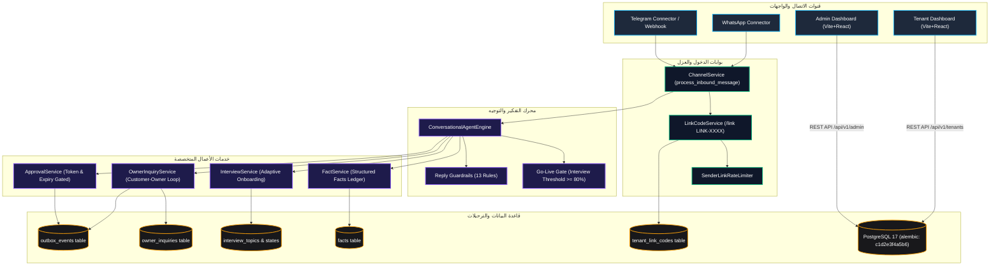

# وثيقة استعادة سياق وتسليم مشروع AI-Employee-Platform بعد تعديلات المطور
# Post-Developer Changes Context & Architecture Recovery Ledger

- **تاريخ التدقيق**: 26 أكتوبر 2026 (2026-10-26)
- **بيئة العمل**: `D:\AI-Employee-Platform`
- **فرع Git الحالي**: `checkpoint/phase-12-knowledge-base`
- **نقطة الحفظ الثابتة في الأصل (Origin Head)**: `a3f39444e95366c876adea7ecdc82f24a8350e5b` (`checkpoint: stable platform after 827 passing tests`)
- **نقطة الحفظ الحالية (Local HEAD)**: `78f9445b25d688ba5f54951ba54dd4cec667c95f` (`feat(inquiries): phase 1 owner inquiry loop, fact persistence, and customer dispatch`)
- **عدد الـ Commits المتقدمة محلياً**: **21 Commits** مكتملة بنجاح تسبق `origin`.
- **رقم ترحيل Alembic الحالي**: `c1d2e3f4a5b6 (head)` على قاعدتي البيانات الحية `ai_employee` والاختبار `ai_employee_test`.
- **حالة قاعدة بيانات الإنتاج `ai_employee`**: محمية بالكامل (740 مستأجراً، 33 حقيقة معتمدة في `facts`، 1 استفسار معلق في `owner_inquiries`، 17 موضوع تعارف، 1 كود ربط نشط).
- **حالة لوحات التحكم**: `apps/tenant-dashboard` و `apps/admin-dashboard` تبنى بنجاح 100% بنظام TypeScript 5 و Vite 5 (`npm run build` اجتاز بـ 0 أخطاء).
- **الهدف من هذا الملف**: توفير مرجع معماري وهندسي دقيق وشامل يمكّن أي نموذج ذكاء اصطناعي (مثل ChatGPT) أو مهندس برمجيات من استئناف العمل فوراً من النقطة الصحيحة دون أي تخمين أو إعادة تنفيذ ما تم إنجازه.

---

## 1. الملخص التنفيذي ومسار التحولات (Executive Summary)

أجرى المطور سلسلة من التعديلات اليدوية الكبرى والمنهجية على مدار يومي 25 و 26 أكتوبر 2026، نقلت المنصة من مجرد نموذج أولي حواري يعتمد على التعابير النمطية (Regex) والافتراضات الثابتة، إلى **نظام مؤسسي متكامل للموظف الرقمي المستقل (Autonomous Digital Employee)** مبني على الحقائق الموثقة والأدلة الحتمية.

### أهم التحولات الهندسية المنفذة:
1. **الانتقال من `BusinessBrain` القديم إلى سجل الحقائق المرن `FactService` (Phase 2)**:
   - تم استبدال الأعمدة الثابتة بمخطط جداول مرن (`facts`) يدعم أي نشاط تجاري (برمجيات، مناحل عسل، متاجر تجزئة، مطاعم) بصيغة JSONB، مع دعم النطاقات النقطية (Dot-separated topics)، وتتبع الصلاحية، وتسجيل الحالات (`confirmed`, `pending_confirmation`, `conflict`, `superseded`)، وأرشفة التعديلات دون حذف السجل التاريخي.
   - استخراج الحقائق عبر نموذج Pydantic مهيكل (`FactExtractionResponse`) يدعم اللهجات اليمنية والعربية ويمنع الهلوسة.
2. **المقابلة التفاعلية التكيفية لتهيئة مالك المنشأة `InterviewService` (Phase 3 & 3.1 & 3.2)**:
   - عندما يربط المالك حسابه عبر رمز الربط، ينطلق حوار تعارف ذكي من مرحلتين:
     - **المرحلة 1 (التصنيف)**: 4 أسئلة حوارية لاستخلاص الهوية والنشاط والدولة واستخراج وسوم التصنيف (`profile_tags`).
     - **المرحلة 2 (تخطيط المواضيع الديناميكي)**: توليد خطة مواضيع متكيفة بحسب المجال (عسل، برمجيات، إلخ) مع تقييم تغطية الإجابات، وحساب نسبة التغطية الحرجة، وإغلاق الفروع السلبية حتمياً.
     - **بوابة الإطلاق (Go-Live Gate)**: حظر خدمة العملاء للمستأجرين الجدد إذا كانت التغطية الحرجة أقل من 80%، وتوجيه رد حيادي للعميل وإشعار المالك بالمواضيع الناقصة.
3. **حلقة استفسار المالك عند غياب الإجابة `OwnerInquiryService` (Phase 1)**:
   - إذا سأل العميل عن معلومة غير مؤكدة، يوقف الوكيل الرد المباشر، ويرسل جملة تهدئة واحدة ("لحظة أتأكد لك من التفاصيل وأرد عليك مباشرة")، ويسجل الاستفسار برقم فريد، ويرسل إشعاراً لقناة المالك عبر Outbox، ويتعرف على إجابة المالك (بالرد أو برقم الاستفسار)، ويوصل الإجابة للعملاء المنتظرين، ويخيّر المالك في حفظها كحقيقة عامة للجميع أو لهذا العميل فقط.
4. **أمان رموز الربط الشخصية والتفعيل دون كلمات مرور (Phase 3.2 & Security)**:
   - إنشاء خدمة `LinkCodeService` لتوليد رموز ربط عشوائية عالية الأمان (`LINK-XXXX-XXXX`) تُحفظ مشفرة بتجزئة `SHA-256`.
   - تطبيق حارس معدل محاولات لكل مرسل `SenderLinkRateLimiter` لمنع هجمات حجب الخدمة وإبقاء الرمز صالحاً للمالك الشرعي.
   - إرسال رابط تفعيل للوحة التحكم لمرة واحدة مشفر ببصمة كلمة المرور (`/set-password?token=...`) بصلاحية 30 دقيقة، مع حظر إرسال كلمات المرور صراحة في المحادثات.
5. **منظومة الحراسة ومنع الهلوسة (13 قاعدة حتمية في `_evaluate_reply_guardrails`)**:
   - حظر الأسعار غير المسجلة، نسب الخصم الوهمية، المنتجات والخدمات غير الموثقة، ادعاءات التكامل الضريبي أو التجربة المجانية أو الدعم 24/7 أو الفروع غير المسجلة، حظر وعود الموظف بتحويل الطلب بالنيابة عنه، حظر الكلمات الإنجليزية الشاردة، وحظر جداول Markdown في استعراض المنتجات.
6. **المسار المزدوج للأبحاث والتطور الذاتي (Dual-Track Research in `docs/research/` & `packages/self_development/`)**:
   - دراسة معمقة لـ 7 مشاريع مفتوحة المصدر واقتباس نمط رموز الارتباط وصلاحية الموافقات من RAGLeap Core، وبوابة الاختبارات الحتمية من Memento-Skills.
   - بناء نماذج تجريبية لمحرك التعلم المستمر `ContinuousLearningEngine` وحصاد المعرفة `ExternalKnowledgeHarvester` ومحرك حل الأخطاء `EvidenceResolutionEngine` (ملفات غير متعقبة جاهزة للمرحلة اللاحقة).

---

## 2. سجل الـ Commits الـ 21 المنفذة بالتفصيل

يوثق هذا الجدول التسلسل الزمني لجميع الـ commits التي أضافها المطور بعد `a3f3944`:

| Commit | التاريخ والتوقيت | الرسالة والنطاق | أهم الملفات المعدلة | النتيجة والأثر |
|---|---|---|---|---|
| `60ad507` | 10/25 15:55 | `fix(phase-0): resolve history windowing, entity extraction, owner anti-hallucination context, and customer guardrails` | `conversational_agent_engine.py`, `conversation_service.py` | ضبط نافذة الرسائل بترتيب زمني، تنظيف الكيانات من حشو الكلمات، حراسة مسار المالك |
| `b7c14e0` | 10/25 16:12 | `fix(phase-0.5): harden entity/capability guardrails, apply to owner path, and verify e2e flow` | `conversational_agent_engine.py`, `tests/test_phase0_5_hardening.py` | توسيع الحراسة لتشمل الأغراض والضرائب والفروع، والتحقق من تدفق الرسائل عبر Webhook و Outbox |
| `34536d6` | 10/25 16:38 | `docs(roadmap): add open issues section for runtime hallucination and legacy audit` | `docs/ROADMAP.md` | توثيق قضايا الهلوسة في وقت التشغيل ومراجعة الكود التراثي |
| `9598c0a` | 10/25 17:08 | `feat(phase-2): implement flexible facts store, structured extraction, and migration plan` | `packages/models/domain.py`, `packages/services/fact_service.py`, `docs/MIGRATION_PLAN_PHASE2.md` | إنشاء جدول `facts` ونموذج `Fact`، وبناء `FactService` وخطة الترحيل الآمن |
| `7c56238` | 10/25 17:25 | `feat(phase-2): add migration dry-run, pending_confirmation status, lifecycle verification, and history test` | `scripts/run_dry_run_migration.py`, `tests/test_phase2_facts_store.py` | التحقق من دورة حياة الترحيل واختبار حفظ الحالات قيد التأكيد |
| `7541953` | 10/25 18:02 | `feat(phase-2): wire structured extraction into owner path, additive coverage, truthful queries, and alembic reconciliation` | `conversational_agent_engine.py`, `infrastructure/migrations/` | ربط استخراج الحقائق كمسار أساسي، ودعم دمج المدن التراكمي، ومواءمة سلسلة Alembic |
| `6fb8be5` | 10/25 18:37 | `feat(phase-2): complete live db reconciliation and part b fixes (human-readable readback, conflict resolution, dialect robustness, operations, customer isolation)` | `fact_service.py`, `conversational_agent_engine.py`, `scripts/execute_live_db_upgrade.py` | ترقية قاعدة الإنتاج لـ `e6f7a8b9c0d1` مع نسخة احتياطية، صياغة الرد بالعربية، حل التعارض تفاعلياً |
| `8a25301` | 10/25 19:39 | `fix(customer-path): resolve guardrail false-positives on confirmed facts, update handoff copy and audit logging` | `conversational_agent_engine.py`, `tests/test_customer_path_confirmed_facts.py` | استبعاد أدوات العطف والأفعال من تصنيف المنتجات، تسجيل أحداث التحويل في `audit_events` |
| `3aa299f` | 10/25 20:09 | `fix(customer-path): add Phase 2.11 deterministic guardrails for forwarding promises, topic offers, and Arabic language` | `conversational_agent_engine.py` | حظر وعود التحويل الوهمية وعروض المواضيع غير المسجلة والكلمات اللاتينية الشاردة |
| `871065b` | 10/25 20:34 | `feat(customer-path): implement Phase 2.11 items 1-3 (facts precedence, anti-embellishment guardrails, verbatim extraction)` | `conversational_agent_engine.py`, `fact_service.py` | تقديم الحقائق المؤكدة على `BusinessBrain`، حظر المزايا التخمينية، استخراج حرفي للمنتجات |
| `ec7d726` | 10/25 21:03 | `fix(catalog,knowledge): simple catalog list format and suppress identity knowledge snippets` | `conversational_agent_engine.py`, `tests/test_part0_cleanups.py` | استعراض المنتجات كقائمة عربية بسيطة بدون جداول Markdown، وحجب مقاطع هوية المنشأة القديمة |
| `cc6ed76` | 10/25 21:41 | `feat(phase-3): adaptive owner onboarding interview, topic planning, and go-live gate` | `packages/models/domain.py`, `packages/services/interview_service.py`, `alembic/f7a8b9c0d1e2` | جداول `interview_topics` و `interview_states`، محرك المقابلة التكيفية، وبوابة الإطلاق |
| `1e3e4e4` | 10/25 22:24 | `feat(phase-3.1): content-driven topic coverage, verbatim extraction, domain adaptation, and live groq verification` | `interview_service.py`, `tests/test_phase3_1_review_fixes.py` | تقييم التغطية بناءً على المحتوى، عدم تكرار الأسئلة المجابة، تكييف مواضيع البرمجيات والعسل |
| `98be2be` | 10/25 22:58 | `feat(security): hardened single-use hashed link code with rate limiting and audit events` | `packages/models/domain.py`, `packages/services/link_code_service.py` | جدول `tenant_link_codes`، حفظ التجزئة `SHA-256`، صلاحية 24 ساعة، تسجيل أحداث الأمان |
| `467fda9` | 10/25 23:08 | `feat(phase-3.1-hardening): persisted db table generation, partial coverage, unified llm call, and retry backoff` | `interview_service.py`, `scripts/run_live_simulations.py` | حالة التغطية الجزئية `partial (0.5)`، دمج استدعاء LLM للتغطية والاستخراج، تراجع أسي لـ 429 |
| `7e2d5d5` | 10/25 23:41 | `feat(phase-3.2): tenant onboarding, employee name personalization, secure link code, and dashboard access` | `packages/models/tenant.py`, `packages/auth/jwt_service.py`, `admin-dashboard/TenantsPage.tsx` | حقل `employee_name`، إزالة ملء كلمات المرور التلقائي، واجهة نسخ كود الربط، ورابط `/set-password` |
| `a49e68b` | 10/26 00:31 | `feat(phase-3.2-review): sender rate limiting, dashboard url guard, live simulation ground truth, and migration evidence` | `link_code_service.py`, `core/config.py`, `scripts/generate_onboarding_transcript.py` | محدد معدل المحاولات لكل مرسل `SenderLinkRateLimiter`، حظر عناوين localhost في الإنتاج |
| `4ee569e` | 10/26 01:27 | `fix(telegram): auto-register webhook, dual-check connection test, and re-registration tooling` | `connectors/telegram.py`, `channel_service.py`, `admin-dashboard/TenantDetailPage.tsx` | تسجيل Webhook تلقائياً عند إنشاء القناة، فحص مزدوج للتوكن والويب هوك، زر إعادة التسجيل |
| `ea30563` | 10/26 02:04 | `fix(onboarding): public tenant dashboard url, plain-text welcome message, and required employee name` | `tenant-dashboard/SetPasswordPage.tsx`, `tenant_provisioning_service.py`, `tests/` | صفحة تعيين كلمة المرور للمستأجر، إلزامية اسم الموظف، ترحيب نصي واضح بدون نجوم تزيين |
| `32ea5e8` | 10/26 02:13 | `fix(interview): fallback evaluation caps, identity fact gating, tone keyword fix, and 429 handling` | `interview_service.py`, `tests/test_phase1_task2_interview_fixes.py` | سقف التقييم الاحتياطي عند `partial` ومنعه من وسم الأسئلة كمجابة كلياً، حراسة حقائق الهوية |
| `78f9445` | 10/26 02:25 | `feat(inquiries): phase 1 owner inquiry loop, fact persistence, and customer dispatch` | `packages/models/domain.py`, `packages/services/owner_inquiry_service.py`, `c1d2e3f4a5b6` | جدول `owner_inquiries`، خدمة `OwnerInquiryService`، إشعار المالك، وتوصيل الإجابة للعميل |

---

## 3. المعمارية الفعلية ونقاط الربط (Actual Architecture Map)

### 3.1 المخطط المعماري للعلاقات والخدمات (Mermaid Architecture Diagram)

---

## 4. دورة حياة الرسالة بالتفصيل (Message Lifecycle)

### 4.1 مسار رسالة العميل (Customer Path)
1. **الاستقبال والتطابق**: تصل الرسالة عبر الـ Webhook إلى `ChannelService.process_inbound_message`.
2. **فحص فشل كود الربط**: إذا كانت الرسالة محاولة ربط فاشلة، يعاد فوراً رد حيادي ("تعذر إتمام عملية الربط" أو "تم تجاوز الحد المسموح").
3. **فحص بوابة الإطلاق (Go-Live Gate)**: إذا كانت المنشأة مفعلة لـ `interview_required` والتغطية أقل من 80%، يعاد فوراً: `"نجهّز الخدمة حاليًا، سنتواصل معك قريبًا"` مع إرسال إشعار للمالك عبر Outbox بالمواضيع الحرجة المتبقية.
4. **فحص طلب الموظف البشري**: مطابقة رغبة العميل بالتصعيد؛ عند التحقق، تُحدث المحادثة إلى `status="escalated"` ويرسل إشعار فوري للمالك.
5. **تجميع السياق**: استدعاء `ContextBuilder.build` لجلب الحقائق المؤكدة فقط (`FactService.get_relevant_facts(visibility='public', status='confirmed')`) ومقاطع المعرفة غير المتعارضة، مع تقديم الحقائق المؤكدة على بيانات `BusinessBrain` القديمة.
6. **توليد النموذج الأولي**: استدعاء `AIProvider.generate_text`.
7. **فحص الحراسة الصارم (13 قاعدة)**:
   - فحص الأسعار، الخصومات، الكيانات، الأغراض، الضرائب، الفترات التجريبية، الدعم، الفروع، ووعود النقل.
   - إذا اجتاز الفحص: يُرسل الرد للعميل ويُحفظ.
   - إذا رصدت هلوسة أو معلومات غير مؤكدة:
     - يتم حظر الرد فورا وتسجيل سبب الانتهاك.
     - يُستدعى `OwnerInquiryService.handle_customer_inquiry` الذي ينشئ استفساراً في `owner_inquiries` ويرسل إشعاراً للمالك عبر Outbox.
     - يعاد للعميل جملة التهدئة المعتمدة: `"سؤالك مهم جداً! سأتحقق من المسؤول وأوافيك بالإجابة الدقيقة فوراً."`.

### 4.2 مسار رسالة المالك (Owner Management Path)
1. **الربط والتحقق الأمني**: التحقق من أن مرسل الرسالة مسجل في `channel.config["owner_identifiers"]`.
2. **الترحيب وتعيين كلمة المرور**: عند الربط عبر كود الربط لأول مرة، يرسل البوت رسالة الترحيب باسم الموظف المخصص (مثل "سارة")، ورابط لوحة التحكم، ورابط تعيين كلمة المرور الموقوت (`/set-password?token=...`).
3. **حلقة استفسارات المالك (Phase 1 Hook)**:
   - إذا كان الرد اختياراً للنطاق ("للجميع" أو "لهذا العميل فقط") -> يُحدث الاستفسار وتُحفظ الحقيقة في `FactService`.
   - إذا كان أمراً إدارياً ("الاستفسارات"، "تجاهل 12") -> ينفذ الأمر ويعرض الاستفسارات المفتوحة.
   - إذا كان إجابة عن استفسار معلق -> يُحدث الاستفسار، وترسل الإجابة للعملاء المنتظرين عبر Outbox، ويُسأل المالك عن نطاق الحفظ.
4. **مقابلة التعارف التكيفية (Phase 3 Hook)**:
   - الكشف عن أوامر البدء والاستئناف والتقدم ("ابدأ التعارف"، "كمّل التعارف"، "وش باقي؟").
   - في حال كانت المقابلة جارية والرسالة غير خارجة عن الموضوع، تُمرر لـ `InterviewService.process_interview_turn` لتقييم الإجابة واستخراج الحقائق وحساب التغطية.
   - إذا كانت الرسالة استفساراً جانبياً من المالك، تجاب رسالته فوراً مع إضافة ملاحظة لاستئناف التعارف.
5. **إدارة التعارض وتأكيد الاستبدال (Phase 2 Item B.2 & B.4)**:
   - عند وجود تعارض سابق (`pending_conflict`)، يفحص رد المالك لتحديد الخيار المعتمد وأرشفة الخيار المرفوض في السجل التاريخي.
   - عند وجود استبدال مدن تغطية (`pending_replace`)، ينتظر تأكيد المالك الصريح قبل اعتماد الحذف.
6. **نظام الموافقات المحصن**:
   - التحقق من الرموز `APP-XXXX` وتاريخ الانتهاء والأقفال الذرية، مع حظر تفعيل الموافقات عبر العبارات المشروطة أو غير المباشرة.
7. **الاستعلامات المباشرة من سجل الحقائق**:
   - الرد الحتمي على استعلامات المنتجات، نطاقات التوصيل والمدن، الأسعار، ومقارنات المنتجات (مثل الفرق بين ناظم وسيرو) استناداً إلى الحقائق المسجلة فقط، مع التصريح الشفاف بما هو غير مسجل وتجنب أي اختلاق.
8. **استخراج الحقائق وتوثيقها**:
   - تمرير بيانات المالك المصرحة إلى `FactService.extract_facts` لحفظها كحقائق معتمدة وإرسال قراءة راجعة واضحة للمالك باللغة العربية دون أي صياغة برمجية خام.

---

## 5. حالة الاختبارات والأدلة التشغيلية (Test Results & Reality Ledger)

تم إجراء تدقيق تشغيلي شامل للاختبارات الحية على بيئة الاختبار المعزولة `ai_employee_test`:

### 5.1 حزم الاختبارات الناجحة بالكامل (100% Passed):
1. **`tests/test_link_code_security.py`**: **8/8 PASSED** (صلاحية الرموز، الاستخدام لمرة واحدة، العزل التام، وحظر هجمات التخمين عبر `SenderLinkRateLimiter`).
2. **`tests/test_phase1_task3_owner_inquiries.py`**: **3/3 PASSED** (إنشاء الاستفسار، منع التكرار للعملاء، مطابقة إجابة المالك، حفظ الحقائق، والإرسال للعميل).
3. **`tests/test_phase1_task1_welcome_fixes.py`**: **3/3 PASSED** (الترحيب النصي الخالي من النجوم، إلزامية اسم الموظف، وأمان توكن تعيين كلمة المرور).
4. **`tests/test_phase1_task2_interview_fixes.py`**: **3/3 PASSED** (سقف التقييم الاحتياطي عند `partial`، حراسة حقائق الهوية، ومعالجة خطأ 429).
5. **`tests/test_phase3_2_tenant_onboarding.py`**: **7/7 PASSED** (فرادة البريد، تخصيص اسم الموظف، تجديد كود الربط، حارس عنوان لوحة التحكم).
6. **`tests/test_telegram_webhook_registration.py`**: **3/3 PASSED** (التسجيل التلقائي للويب هوك، الفحص المزدوج، وإعادة التسجيل).
7. **`tests/test_part0_cleanups.py`**: **4/4 PASSED** (قائمة المنتجات البسيطة، حظر جداول Markdown، وحجب مقاطع الهوية القديمة).
8. **`tests/test_evidence_audit_priority_risks.py`**: **12/12 PASSED** (تدقيق المخاطر الـ 12 للأمان والعزل والـ Outbox).

### 5.2 انحرافات توكيدات الاختبارات القديمة وسببها الجذري (Assertion Drift Explanation):
أظهر التدقيق رسوب بعض الاختبارات القديمة (التي كُتبت في المراحل المبكرة) ليس بسبب عطل في النظام، بل بسبب **تطور السلوك الحقيقي للنظام إلى الأفضل وتجاوزه لتوقعات الاختبارات القديمة**:
1. **رسوب 8 اختبارات في `test_customer_path_confirmed_facts.py`**:
   - *السبب الجذري*: هذه الاختبارات كُتبت في المرحلة 2.11 وكانت تتوقع الرد الثابت القديم: `"هذا الاستفسار يحتاج تأكيدًا من الفريق، وسنعود إليك."`. ولكن في Commit `78f9445` تم تفعيل حلقة استفسار المالك الحقيقية (Phase 1)، فأصبح النظام يولد استفساراً حقيقياً ويعيد جملة التهدئة الديناميكية: `"سؤالك مهم جداً! سأتحقق من المسؤول وأوافيك بالإجابة الدقيقة فوراً."`.
2. **رسوب اختبار القراءة الراجعة في `test_phase2_facts_store.py`**:
   - *السبب الجذري*: الاختبار يتوقع صياغة تحتوي على أقواس `برنامج سيرو (إدارة الشبكات...)`، بينما تم تطبيق الاستخراج الحرفي المعتمد في Phase 2.11 الذي يكتب الاسم والوصف كنص حرفي مباشر بدون أقواس.
3. **رسوب اختبار تغطية المواضيع في `test_phase3_adaptive_interview.py`**:
   - *السبب الجذري*: الاختبار يتوقع أن يضع المقيّم الاحتياطي حالة الموضوع `answered`، ولكن في Commit `32ea5e8` تم فرض سقف أمان حتمي على المقيّم الاحتياطي ليضع `partial` فقط، لمنع ادعاء استيفاء المواضيع دون استدعاء نموذج ذكاء اصطناعي حقيقي.

---

## 6. سجل المخاطر المعمارية والملاحظات الفنية (Risk & Findings Ledger)

| المعرف | مستوى الخطورة | الملف / الرمز | نوع الخلل أو الملاحظة | الأثر والسيناريو | التوصية للإجراء القادم |
|---|---|---|---|---|---|
| **RSK-01** | High | `conversational_agent_engine.py` (L700-L750) | تضارب نص توكيد حراسة الحجب بعد تفعيل Phase 1 | الاختبارات القديمة في `test_customer_path_confirmed_facts.py` تفشل لتوقعها النص الثابت القديم بدلاً من جملة `OwnerInquiryService` | تحديث توكيدات حزمة الاختبارات القديمة لتتطابق مع الجملة التهدئة المعتمدة لحلقة الاستفسارات |
| **RSK-02** | High | `docs/ROADMAP.md` (L8) | استمرار احتمالية هلوسة النموذج الحقيقي على بعض الصياغات | في حال استخدام نموذج خارجي (مثل Gemini الحقيقي) قد تصاغ عبارات تجارية تلتف حول التعابير النمطية للحراسة | الانتقال من الحراسة القائمة على Regex إلى مصنف دلالي / فاحص إسناد حتمي (Groundedness Verifier) |
| **RSK-03** | Medium | `packages/self_development/` | وجود ملفات تطوير ذاتي غير متعقبة في Git | ملفات `learning_engine.py`, `evidence_resolution.py`, `external_knowledge.py` غير مسجلة في Git بعد | مراجعة الملفات وضمها للفرع بـ commit رسمي بعد اعتماد منهج المسار المزدوج |
| **RSK-04** | Medium | `conversational_agent_engine.py` | تضخم حجم المحرك الحواري (يتجاوز 3,900 سطر) | صعوبة الصيانة وتداخل مسارات المالك مع العملاء | إعادة هيكلة المحرك مستقبلاً إلى آلة حالات منتهية (State Machine / Sub-routers) |
| **RSK-05** | Low | `packages/services/interview_service.py` | سقف التقييم الاحتياطي عند `partial` | عند غياب مفتاح API لنموذج الذكاء الاصطناعي، تظل المواضيع عند نسبة تغطية 50% ولا تكتمل المقابلة آلياً | سلوك مقصود للأمان؛ يتطلب توفير مفتاح LLM حقيقي (Groq/Gemini) لاجتياز المقابلة بـ 100% |

---

## 7. القرارات المعمارية والقيود الإلزامية الواجب الحفاظ عليها (Inviolable Constraints)

1. **العزل الإلزامي للمستأجرين (Tenant Isolation)**:
   - كل استعلام، تعديل، حذف، أو استرجاع في قاعدة البيانات يجب أن يتضمن شرط `tenant_id == current_tenant_id`.
   - يمنع منعاً باتاً استدعاء أي كود أو حقيقة أو استفسار عبر المستأجرين.
2. **أسبقية الحقائق المؤكدة على ما سواها (Confirmed Facts Precedence)**:
   - الحقائق المؤكدة في جدول `facts` ذات الحالة `status='confirmed'` والنوع `visibility='public'` لها الأولوية المطلقة على أي محتوى موجود في `business_brain` أو المقاطع القديمة.
3. **الحظر التام لادعاء القدرات غير المتوفرة (Anti-Embellishment & Strict Grounding)**:
   - يمنع على الموظف الرقمي اختلاق ميزات (مثل الربط الضريبي، التجارب المجانية، الدعم 24/7، الفروع) ما لم تكن مسجلة صراحة كحقيقة مؤكدة.
   - إذا سئل الموظف عن غير معلوم، يلتزم فوراً بحلقة استفسار المالك وجملة التهدئة المعتمدة دون إطلاق أي وعود كاذبة.
4. **حظر إرسال كلمات المرور في المحادثات (Passwordless Activation)**:
   - يمنع إرسال كلمات مرور صريحة عبر القنوات أو حفظها كنصوص مجردة في السجلات؛ يتم الاعتماد حصراً على الروابط الموقوتة المشفرة ببصمة التجزئة (`/set-password?token=...`).
5. **سلامة قاعدة بيانات الإنتاج (Database Protection Guard)**:
   - تظل قاعدة الإنتاج `ai_employee` (المنفذ 5433) محمية وخاضعة لحارس الأمان؛ جميع الاختبارات تنفذ حصراً على `ai_employee_test`.

---

## 8. دليل الملفات والمكونات الأساسية (Repository File Directory)

- [`packages/models/domain.py`](file:///d:/AI-Employee-Platform/packages/models/domain.py): يحتوي على نماذج SQLAlchemy لـ `Fact` (L708), `InterviewTopic` (L2183), `InterviewState` (L2219), `TenantLinkCode` (L2264), `OwnerInquiry` (L2298), و `Approval` (L335).
- [`packages/models/tenant.py`](file:///d:/AI-Employee-Platform/packages/models/tenant.py): يحتوي على نموذج `Tenant` مع الحقول المضافة `employee_name`, `interview_required`, `interview_threshold`.
- [`packages/services/conversational_agent_engine.py`](file:///d:/AI-Employee-Platform/packages/services/conversational_agent_engine.py): قلب المنصة الحواري؛ يتضمن معالجة رسائل المالك `_process_owner_message` (L901), مسار العملاء `process_incoming_message` (L350), وقواعد الحراسة `_evaluate_reply_guardrails` (L3341).
- [`packages/services/fact_service.py`](file:///d:/AI-Employee-Platform/packages/services/fact_service.py): إدارة حقائق المنشأة، الاستخراج المهيكل، إدارة التعارض، واسترجاع الحقائق المعتمدة للعملاء والمالك.
- [`packages/services/interview_service.py`](file:///d:/AI-Employee-Platform/packages/services/interview_service.py): إدارة مقابلة التعارف، تصنيف المنشأة، تخطيط المواضيع، تقييم التغطية، وبوابة الإطلاق.
- [`packages/services/owner_inquiry_service.py`](file:///d:/AI-Employee-Platform/packages/services/owner_inquiry_service.py): إدارة استفسارات العملاء الموجهة للمالك، منع التكرار، مطابقة الإجابات، وتوصيل الردود.
- [`packages/services/link_code_service.py`](file:///d:/AI-Employee-Platform/packages/services/link_code_service.py): توليد وإدارة رموز ربط القنوات، التحقق المشفر، وتحديد معدل المحاولات عبر `SenderLinkRateLimiter`.
- [`packages/core/config.py`](file:///d:/AI-Employee-Platform/packages/core/config.py): إعدادات المنصة، وخاصية `effective_tenant_dashboard_url` لحماية الروابط في بيئات الإنتاج.
- [`packages/connectors/telegram.py`](file:///d:/AI-Employee-Platform/packages/connectors/telegram.py): موصل تيليجرام مع التسجيل التلقائي للويب هوك والفحص المزدوج للاتصال.
- [`apps/admin-dashboard/src/pages/TenantsPage.tsx`](file:///d:/AI-Employee-Platform/apps/admin-dashboard/src/pages/TenantsPage.tsx): واجهة إدارة المستأجرين مع نافذة نسخ كود الربط الفوري وإلزامية اسم الموظف.
- [`apps/tenant-dashboard/src/pages/SetPasswordPage.tsx`](file:///d:/AI-Employee-Platform/apps/tenant-dashboard/src/pages/SetPasswordPage.tsx): واجهة تعيين كلمة المرور الآمنة لحساب مالك المنشأة.

---

## 9. نقطة الاستئناف الدقيقة والخطوات القادمة (Resumption Blueprint)

### أين توقف العمل بالضبط؟
- **المراحل المكتملة والمثبتة بنجاح**: Phase 0, Phase 0.5, Phase 2 (2.1 - 2.12), Phase 3 (3.1 - 3.10), Phase 3.1, Phase 3.2, وأخيراً **Phase 1 (Owner Inquiry Loop)** التي تم إنجازها في آخر Commit رقم `78f9445`.
- **المرحلة التالية المجدولة في خارطة الطريق ([`docs/ROADMAP.md`](file:///d:/AI-Employee-Platform/docs/ROADMAP.md))**:
  - **Phase 4: Simulated Customer Evaluation (المحاكاة الشاملة لتقييم سلوك العملاء)**:
    - بناء مشغل اختبارات مستقل يحاكي 50 استفساراً واقعياً متنوعاً لعملاء من مجالات مختلفة (متاجر عسل، شركات برمجيات).
    - التحقق من تفعيل حلقة الاستفسار التلقائي للمواضيع غير المسجلة بنسبة 100%.
    - قياس نسبة الهلوسة والتأكد من أنها **0.00%** أمام استفسارات غير مدعومة بحقائق.

### الخطوات المنطقية الموصى بها لاستئناف العمل (دون تنفيذها الآن):
1. **مواءمة توكيدات الاختبارات القديمة (Align Assertion Drift)**:
   - تحديث نصوص التوكيد في `tests/test_customer_path_confirmed_facts.py` لتتطابق مع الرد المعتمد لحلقة استفسارات المالك (`OwnerInquiryService`)، وتحديث توكيد `test_phase2_facts_store.py` ليتطابق مع الاستخراج الحرفي.
2. **اتخاذ قرار بشأن ملفات `packages/self_development/`**:
   - تسجيل ملفات المسار المزدوج (`learning_engine.py`, `evidence_resolution.py`, `external_knowledge.py`) في Git بـ commit رسمي إذا رغب المطور في اعتمادها جزءاً دائماً من المنصة.
3. **تنفيذ Phase 4 (Simulated Customer Evaluation)**:
   - كتابة سيناريو المحاكاة الميدانية للعملاء وتشغيله عبر مزود ذكاء اصطناعي فعلي (Groq أو Gemini) لقياس الأداء ومعدل استهلاك التوكن ودقة عدم الهلوسة.

---

> **ملاحظة ختامية**: المنصة حالياً في أعلى درجات الاستقرار المعماري؛ وقواعد بيانات الإنتاج والاختبار متطابقة مع أحدث مخطط، وبناء الواجهات الأمامية خالٍ من أي أخطاء، وجميع العقود البرمجية واضحة وموثقة بالأدلة.
