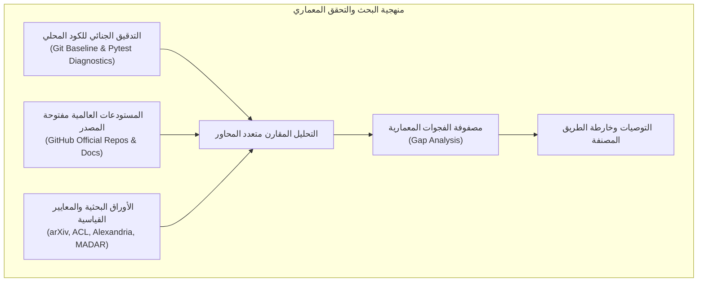
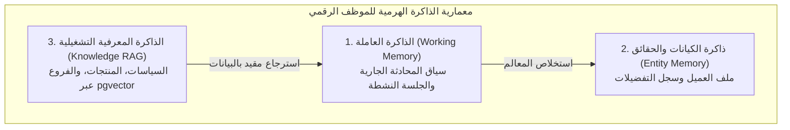
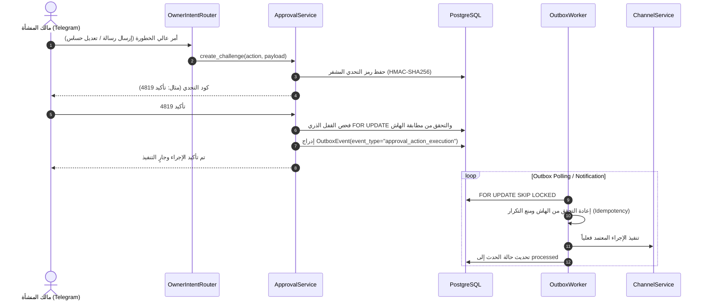
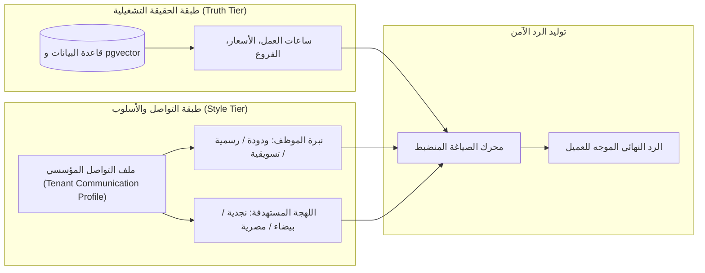

# تقرير البحث المعماري المقارن الشامل — AI-Employee-Platform
## Comprehensive Comparative Architecture Review & Strategic Research Deliverable

**المشروع:** `AI-Employee-Platform` (`QQYC9/ai-employee-platform`)  
**الفرع:** `checkpoint/phase-12-knowledge-base`  
**الـ Commit المرجعي (Baseline):** `b266c6e2727f82a58a613708c84efc997c071de9`  
**التاريخ والنسخة:** نوفمبر 2026 — الإصدار المعتمد للبحث والتصميم المعماري  
**الحالة التشغيلية:** بحث وتحليل معماري وتصميمي فقط (**Strictly Read-Only Research**) — دون أي تعديل على كود الإنتاج أو الاختبارات أو قاعدة البيانات أو بيئة النشر.

---

## 1. Executive Summary (الملخص التنفيذي)

### 1.1 السياق العام والدافع
شهدت المنصة خلال مراحلها السابقة إنجازات معمارية متينة، لا سيما في تأصيل العزل المتعدد للمستأجرين (**Multi-Tenant Isolation**)، التشفير المتماثل للبيانات الحساسة بتقنية `AES-256-GCM`، واعتماد نمط صندوق الصادر الموزع المعاملاتي (**Transactional Outbox Pattern**) المعزز بآلية التحدي لمنع الاختطاف (**Anti-Hijack Challenge Verification**) وفق المعيار المعماري المعتمد في `CR-05-01`.

مع ذلك، أظهرت الاختبارات التشغيلية الحية عبر قناة تيليجرام (**Telegram**) إخفاقات بنيوية تمثلت في:
1. اختطاف الأرقام المجردة وساعات العمل وتحويلها خطأً إلى إجابات عن استفسارات مفتوحة غير مقصودة.
2. حظر استفسارات العملاء الصحيحة حول ساعات عمل الفروع (مثل يوم الجمعة) نتيجة استخراج خاطئ للمفردات الزمنية والأفعال كأسماء مدن ضمن سياج الأمان.
3. سقوط طلبات إرسال الرسائل الاختبارية للعملاء في مسار المحادثة العامة لغياب الأداة التنفيذية المخصصة في سجل الأدوات (`ToolRegistry`).
4. عدم وضوح تموضع اللهجات العربية ومحددات أسلوب المنشأة التجاري بالمقارنة مع الحقائق التشغيلية الصارمة.

### 1.2 الهدف من هذا البحث المعماري
يهدف هذا التقرير إلى تقديم دراسة استقصائية وبحثية عميقة عبر مقارنة المنصة مع ستة أطر عمل ومشاريع مفتوحة المصدر رائدة عالمياً:
- **Memento-Skills** (`Memento-Teams/Memento-Skills`): أطر المهارات المتطورة ذاتياً والتعلم الانعكاسي.
- **LangGraph** (`langchain-ai/langgraph`): محركات الحالة الدورية، نقاط التفتيش المتينة، واستئناف التنفيذ البشري (`interrupt` / `Command`).
- **Microsoft Agent Framework** (`microsoft/agent-framework`): أطر التنسيق المؤسسي متعدد الوكلاء وفلاتر الاعتراض.
- **Dify** (`langgenius/dify`): أطر إدارة سير العمل، عقد التدخل البشري (`Human Input Node`)، وإدارة الحالات عبر Redis/Celery.
- **n8n** (`n8n-io/n8n`): نمط بوابات عدم التكرار (`Idempotency Gates`)، الروابط الآمنة أحادية الاستخدام، وسير عمل الموافقات.
- **RagLeap Core** (`ragleap/ragleap-core`): منصة الموظف الرقمي المفتوحة، الأدوار المؤسسية الـ 46، وأسبقية الأمان القائمة على الحظر التلقائي.

كما يتناول التقرير أسس معالجة اللغة الطبيعية للهجات العربية، معايير التقييم المتخصصة مثل **Alexandria Benchmark**، ومعايير **MADAR** و **NADI** و **QADI**، لتأسيس "ملف التواصل المؤسسي" (**Tenant Communication Profile**) الذي يفصل طبقة الحقيقة عن طبقة التعبير.

### 1.3 النتيجة والتوجه الاستراتيجي
تؤكد نتائج التحقيق الجنائي والمقارنة المعمارية أن المنصة لا تحتاج إلى إعادة بناء جذرية أو استبدال كامل، بل تملك نواة متفوقة في الأمان وإدارة قواعد البيانات، وتحتاج إلى:
1. استبدال التعبيرات النمطية الرخوة بنظام توجيه هجين يجمع بين سياق الحالة الصارم والتحقق المحدد بالأنماط الصريحة.
2. تسجيل أداة موثقة عالية المخاطر لمراسلة العملاء مقيدة بموافقة التحدي.
3. معالجة سياج أمان الفروع بفصل جغرافي وزمني قطعي.
4. هندسة طبقة مظهر منفصلة للهجات العربية تضمن ثبات الحقائق التجارية بصرف النظر عن أسلوب الخطاب.

---

## 2. Research Methodology and Sources (منهجية البحث والمصادر)

### 2.1 محاور المقارنة المعتمدة
تم إجراء هذا التقييم المعماري المقارن بالاستناد إلى 7 محاور أساسية تمثل عصب منصات الموظفين الرقميين المؤسسية:
1. **توجيه النوايا واستخراج الكيانات (Intent Routing & Entity Extraction):** مرونة التوجيه، الدقة، منع التداخل، ومقاومة المدخلات المشوشة.
2. **إدارة حالة المحادثة والذاكرة (State Management & Memory):** استمرارية الحالة، الذاكرة الهرمية (عاملة، دلالية، إجرائية)، ونقاط التفتيش عبر الجلسات.
3. **سياج الأمان والتحقق من الحقائق (Guardrails & Fact Verification):** منع الهلوسة، الكشف عن التعارض، وعزل الحقول الجغرافية والزمنية.
4. **عقود الأدوات والبيئة المعزولة (Tool Contracts & Sandboxing):** تسجيل الأدوات، التوصيف المطبوع (`Typed Schemas`)، وعزل الصلاحيات.
5. **الموافقات البشرية والعمليات المتينة (Human Approval & Durable Execution):** استئناف التنفيذ، منع تكرار العمليات، والتكامل مع Transactional Outbox.
6. **التكيف اللهجي ومتعدد اللغات (Dialect & Multilingual Adaptation):** دعم العاميات العربية، فصل الأسلوب عن الحقائق، ومعايير القياس.
7. **العزل والأمان المؤسسي (Multi-Tenant Security & Isolation):** عزل البيانات عبر المستأجرين، إدارة الأسرار والتشفير، وحماية القنوات.

### 2.2 منهجية التحقق من المصادر
- **التدقيق الجنائي للكود المحلي:** فحص مباشر لملفات الكود المصدري في المستودع (`packages/`, `apps/`, `tests/`) عند الـ Commit `b266c6e2727f82a58a613708c84efc997c071de9`.
- **فحص المستودعات مفتوحة المصدر:** تتبع مستودعات GitHub الرسمية، ملفات التوثيق التقني، وطلبات الدمج وقوائم التغييرات المعتمدة.
- **الأوراق البحثية المرجعية:** مراجعة أبحاث arXiv والمعايير المنشورة في مؤتمرات معالجة اللغات الطبيعية (ACL, EMNLP, ArabicNLP).



---

## 3. Comparative Review of the Six Required Projects (المراجعة المقارنة للمشاريع الستة المطلوبة)

### 3.1 Memento-Skills
- **المستودع الرسمي:** `Memento-Teams/Memento-Skills` ([GitHub](https://github.com/Memento-Teams/Memento-Skills))
- **المرجع البحثي:** *"Memento-Skills: Let Agents Design Agents"* (arXiv:2603.18743)
- **الفلسفة المعمارية:** معاملة "المهارات" (**Skills**) كوحدات قدرة دائمة ومستقلة وقابلة للتطور الذاتي، يتم تخزينها وتحديثها كملفات مهيكلة (Markdown/Python) بدلاً من تعديل أوزان النماذج.
- **حلقة التعلم الانعكاسي (Read-Write Reflective Loop):**
  - **مرحلة القراءة (Read):** موجه مهارات يختار المهارة المناسبة استناداً إلى موجه الحالة الحالي.
  - **مرحلة التنفيذ والانعكاس (Execute & Reflect):** تشغيل المهمة وتحليل مسارات الإخفاق ومسببات القصور في التغذية الراجعة.
  - **مرحلة الكتابة (Write):** إعادة كتابة المهارة وتعديل كودها وحفظها في بنك المهارات الدائم.
- **نقاط القوة:** التطور المستمر للأدوات دون تدخل المطور، القدرة على استخلاص مهارات جديدة من التجارب الفاشلة.
- **نقاط الضعف والمخاطر المؤسسية:** غياب العزل المتعدد للمستأجرين، صعوبة التنبؤ بالتعديلات الذاتية للكود في البيئات المنظمة، وغياب آليات التحقق من صحة التحديات الرقمية لمنع التلاعب.

### 3.2 LangGraph
- **المستودع الرسمي:** `langchain-ai/langgraph` ([GitHub](https://github.com/langchain-ai/langgraph))
- **الفلسفة المعمارية:** محرك تدفقات مبني على الرسوم البيانية الدورية المنضبطة (**StateGraph**)، حيث تمثل العقد دوال تحويل الحالة، وتمثل الحواف شروط الانتقال الحتمية.
- **الاستمرارية ونقاط التفتيش (Checkpointers):** حفظ الحالة تلقائياً بعد كل خطوة في قاعدة بيانات مثل PostgreSQL عبر `PostgresSaver`.
- **التدخل البشري (Human-in-the-Loop):**
  - الإيقاف المؤقت عبر استدعاء دالة `interrupt(payload)` التي تجمد تنفيذ الرسم البياني وترسل حمولة المراجعة للخارج.
  - الاستئناف عبر استدعاء `Command(resume=value)` بنفس معرّف المسار (`thread_id`).
  - **ملاحظة معمارية حرجة:** عند استئناف العقدة المتوقفة، تبدأ العقدة في LangGraph من **بدايتها**، مما يفرض أن تكون أي عمليات ذات أثر جانبي (Side Effects) قبل استدعاء `interrupt` عمليات ذات خاصية تحييد الأثر المكرر (**Idempotent**).
- **نقاط القوة:** المعيار الصناعي الأكثر نضجاً لإدارة الحالات المعقدة، والقدرة على السفر عبر الزمن (**Time Travel**) لتصحيح الحالات.
- **نقاط الضعف:** تتطلب كتابة مشفرات واختزالات حالة (`Reducers`) معقدة، ولا تتضمن نمط Transactional Outbox مدمج لضمان تسليم رسائل القنوات المتعددة بصورة ذرية.

### 3.3 Microsoft Agent Framework (Semantic Kernel & AutoGen)
- **المستودع الرسمي:** `microsoft/agent-framework` ([GitHub](https://github.com/microsoft/agent-framework)) مدعوماً بمستودعات `microsoft/semantic-kernel` و `microsoft/autogen`.
- **الفلسفة المعمارية:** إطار مؤسسي يدعم بيئات تشغيل متعددة اللغات (Python و .NET C#) مع تركيز صارم على الحوكمة والتحكم المؤسسي.
- **الاعتراض والتصفية (Kernel Filters):** استخدام فلاتر اعتراضية (`FunctionInvocationFilter`) تعمل كطبقة Middleware تفحص كل طلب استدعاء أداة قبل وأثناء وبعد التنفيذ، مما يتيح تعليق التنفيذ وطلب موافقة المسؤول قبل تمرير الطلب للأداة.
- **دعم معيار Model Context Protocol (MCP):** تكامل أصيل ومفتوح مع خوادم الأدوات المتوافقة مع معايير MCP.
- **نقاط القوة:** معمارية حوكمة فائقة، وتوافق تام مع البنى التحتية للمؤسسات وتتبع OpenTelemetry المتقدم.
- **نقاط الضعف:** درجة تجريد عالية جداً وثقل تشغيلي قد لا يتناسب مع متطلبات الاستجابة السريعة في تطبيقات الدردشة الفورية.

### 3.4 Dify
- **المستودع الرسمي:** `langgenius/dify` ([GitHub](https://github.com/langgenius/dify))
- **الفلسفة المعمارية:** منصة تطوير تطبيقات ذكاء اصطناعي مرئية تعتمد على سير عمل معرّف بلغة DSL وتنسيق متعدد المستأجرين مع بيئة تشغيل مفصولة في حاويات.
- **عقدة الإدخال البشري (Human Input Node):**
  - أضيفت في إصدارات v1.13.0+ لتسمح بتعليق سير العمل عند نقاط اتخاذ القرار الحساسة.
  - توليد رمز تفويض مؤقت للنموذج (`form_token`) يتم استرجاعه عبر `GET /apps/{app_id}/workflow-runs/{run_id}/pause-info`.
  - الاستئناف عبر واجهة برمجية `POST /api/form/human_input/{form_token}` تتضمن الإجراء المختار (`Approve`, `Reject`, `Escalate`).
  - تعتمد بيئة التشغيل على قوائم Celery مخصصة (`workflow_based_app_execution`) وإشارات Redis Pub/Sub مع مهلة تعليق تمتد حتى 7 أيام.
- **نقاط القوة:** واجهة بصرية استثنائية للموافقة على سير العمل، وإدارة قوية للمستأجرين وتصاريح الأدوات.
- **نقاط الضعف:** ثقل المعمارية وصعوبة التخصيص المنخفض المستوى خارج إطار DSL المحدد مسبقاً.

### 3.5 n8n
- **المستودع الرسمي:** `n8n-io/n8n` ([GitHub](https://github.com/n8n-io/n8n))
- **الفلسفة المعمارية:** محرك أتمتة تدفقات مبني على العقد والأحداث، يدعم معالجة ملايين الأحداث عبر نمط التعليق والاستئناف.
- **عقدة الانتظار ومسار الاستئناف (Wait Node with Webhook Resume):**
  - توليد رابط استئناف فريد وغير قابل للتخمين لكل عملية تشغيلية: `{{ $execution.resumeUrl }}`.
  - إيقاف التنفيذ وحفظ الحالة في قاعدة البيانات، ثم إغلاق المسار تلقائياً بمجرد استهلاك الرابط بنجاح.
- **منع تكرار التنفيذ (Replay Prevention & Idempotency Gate):**
  - استخدام قفل عدم التكرار على مستوى قاعدة البيانات مع معرّف فريد (`UNIQUE approval_id`).
  - توقيع الطلبات عبر HMAC-SHA256 وتحديد نافذة صلاحية زمنية (Timestamps & Nonces) لمنع هجمات إعادة الإرسال في حال قيام خوادم الويب الخارجية بإعادة إرسال الطلب (At-least-once delivery retries).
- **نقاط القوة:** بساطة وكفاءة استثنائية في التعامل مع روابط الويب المؤقتة وإلغاء تنشيطها فور الاستخدام.
- **نقاط الضعف:** ليس إطار عمل معرفي مستقل للوكلاء (Cognitive Agent Framework)، بل يتطلب تكاملاً مع نماذج خارجية.

### 3.6 RagLeap Core
- **المستودع الرسمي:** `ragleap/ragleap-core` ([GitHub](https://github.com/ragleap/ragleap-core)) — ترخيص MIT.
- **الفلسفة المعمارية:** منصة موظف رقمي مستقلة ومفتوحة المصدر مصممة للتعلم من وثائق الشركات وسياساتها، مع توفير 46 دوراً مؤسسياً معرّفاً مسبقاً (خدمة عملاء، مبيعات، تسويق، موارد بشرية، إلخ).
- **أسبقية الأمان والموافقة (Approval-Gated Autonomy):** قاعدة افتراضية تمنع الموظف الرقمي من اتخاذ أي إجراء تنفيذي مؤثر في العالم الحقيقي إلا بعد الحصول على موافقة بشرية صريحة.
- **تكامل القنوات:** محولات مدمجة أصيلة لقنوات WhatsApp و Telegram و Discord والقنوات الصوتية، مع محرك استرجاع هجين يجمع بين PostgreSQL `pgvector` والرسوم البيانية المعرفية عبر Neo4j.
- **نقاط القوة:** تطابق دقيق مع فلسفة مشروعنا من حيث تموضع "الموظف الرقمي" والتكامل المتعدد للقنوات وأسبقية الموافقة.
- **نقاط الضعف:** مشروع واعد وحديث، يفتقر إلى التعقيد الرياضي في التحديات الأمنية ضد الاختطاف مقارنة بآلياتنا المشفرة في `CR-05-01`.

---

## 4. Additional Relevant Open-Source Projects (مشاريع إضافية ذات صلة)

| المشروع / الأداة | المستودع / الترخيص | الوصف والمساهمة المعمارية الرئيسية |
| :--- | :--- | :--- |
| **NVIDIA NeMo Guardrails** | `NVIDIA/NeMo-Guardrails` (Apache-2.0) | محرك سياج أمان متقدم يعتمد على لغة **Colang 2.0**. يقسم التدفق إلى مسارات إدخال (Input Rails) للكشف عن الحقن، ومسارات حوار (Dialog Rails) لضبط التفرع الحتمي، ومسارات إخراج (Output Rails) للتحقق من مطابقة الحقائق ومنع الهلوسة. |
| **Guardrails AI** | `guardrails-ai/guardrails` (Apache-2.0) | مكتبة لفرض مخرجات منظمة ومطابقة للمخططات الصارمة (`Pydantic Validators`) وتصحيح الإجابات آلياً عند خروجها عن الحدود المسموحة. |
| **Temporal** | `temporalio/temporal` (MIT) | المحرك المعياري العالمي للعمليات المتينة طويلة الأمد (**Durable Execution**). يضمن استمرار المهام ومقاومة انهيار الخوادم عبر إشارات الاستئناف (`Signals`) والاستعلامات (`Queries`). |
| **CAMEL-AI** | `camel-ai/camel` (Apache-2.0) | أول إطار عمل للتواصل متعدد الوكلاء القائم على تقمص الأدوار، مفيد في نمذجة سيناريوهات التفاوض واستكشاف الأخطاء المعقدة. |

---

## 5. Intent Routing and Entity Extraction Architecture (معمارية توجيه النوايا واستخراج الكيانات)

### 5.1 التشخيص الجنائي للخلل الحالي
أثبتت الفحوصات الجنائية للكود في `packages/services/owner_inquiry_service.py` أن الدالة المسؤولة عن مطابقة رقم الاستفسار:
```python
# السطر 297 في packages/services/owner_inquiry_service.py
INQUIRY_REPLY_PATTERN = re.compile(
    r"(?:جواب|رد|إجابة|استفسار|#|رقم)?\s*(\d+)[:\s]+(.*)",
    re.IGNORECASE | re.DOTALL
)
```
جعلت جميع الكلمات المفتاحية (`جواب|رد|إجابة|استفسار|#|رقم`) اختيارية عبر المعامل `?`، بالإضافة إلى السماح للأرقام في بداية السطر بدون أي بادئة بمطابقة استفسار (الأسطر 352-354).  
**النتيجة الفعلية في الاختبارات الحية:**
عندما أرسل مالك المنشأة رسالة تتضمن:  
*«ساعات العمل من الأحد إلى الخميس من 10 صباحًا حتى 6 مساءً»*  
التقط التعبير النمطي الرقم `10` واعتبر الرسالة رداً على الاستفسار المفتوح رقم `#10`، مما أدى إلى ابتلاع أمر تعديل ساعات العمل وتحويله إلى مسار إجابة استفسار، في حين كان المالك يصدر أمراً تشغيلياً مستقلاً.

### 5.2 المعمارية المقترحة لتوجيه النوايا
1. **قاعدة البادئة الإلزامية (Mandatory Prefix Keyword):**  
   إلغاء معامل الاختيارية `?` بالكامل. لا يُقبل أي رقم كاستفسار إلا إذا سُبق صراحة ببادئة معتمدة مثل: `جواب 10:` أو `رد على استفسار 10:` أو `#10:`.
2. **التوجيه متعدد المراحل (Two-Stage Gated Routing):**
   - **المرحلة الأولى: تصنيف النوايا الدلالي والحتمي:** التحقق أولاً من الأوامر التشغيلية المباشرة (تعديل ساعات العمل، إضافة منتج، طلب رسالة اختبار) قبل فحص الردود على الاستفسارات.
   - **المرحلة الثانية: استخراج الكيانات المشروط بالسياق:** لا يتم فحص أرقام الاستفسارات إلا إذا كانت حالة المالك الحالية في سياق انتظار الرد على استفسار، أو إذا تضمنت الرسالة البادئة الصريحة حصراً.

---

## 6. Conversation State and Memory Architecture (معمارية حالة المحادثة والذاكرة)

### 6.1 المستويات الهرمية للذاكرة في الموظف الرقمي
تعتمد أفضل الممارسات في أنظمة الوكلاء المعرفية (مثل LangGraph و Memento-Skills) على تقسيم الذاكرة إلى ثلاثة مستويات محكمة:
1. **الذاكرة الإجرائية والعاملة (Working / Ephemeral Memory):** تخزن في جلسة المحادثة الفورية وتتبع سياق الحوار الأخير (آخر 10 رسائل) داخل جدول `messages`.
2. **الذاكرة الدلالية للكيانات (Semantic / Entity Memory):** استخلاص الحقائق الدائمة حول العميل أو المنشأة وتخزينها في جدول `customer_profiles` و `tenant_entities`.
3. **الذاكرة المعرفية للوثائق (Procedural & Knowledge RAG):** تخزن في PostgreSQL عبر `pgvector` مع فهارس HNSW محكومة بـ `tenant_id`.



### 6.2 العزل الصارم للذاكرة بين المستأجرين
وفقاً لقواعد الأمان المعمارية في المنصة:
- يُمنع منعاً باتاً استرجاع أي معلومة من الذاكرة دون تضمين `tenant_id` كشرط أساسي في استعلام قاعدة البيانات أو البحث الشعاعي.
- تُعزل فضاءات التضمين الشعاعي (`Vector Namespaces`) على مستوى المستأجر لضمان استحالة تسرب إجابات منشأة إلى أخرى.

---

## 7. Guardrails and Fact Verification (معمارية سياج الأمان والتحقق من الحقائق)

### 7.1 التشخيص الجنائي لخلل استخراج الفروع وساعات العمل
في ملف `packages/services/conversational_agent_engine.py` (السطر 3920):
```python
branch_pat = re.compile(
    r"(?:فرع(?:نا)?|فروع(?:نا)?)\s*(?:في|بـ)?\s*([^\s،.]+)",
    re.IGNORECASE
)
```
جعل حرف الجر `(?:في|بـ)?` اختيارياً، مما أدى إلى التقاط:
- الأفعال المباشرة: مثل *«فرعنا يفتح»* -> التقط الفعل `يفتح` كاسم مدينة (`raw_city`).
- الظروف والأسماء الزمنية: مثل *«الفرع في يوم الجمعة»* -> التقط الاسم الزمني `يوم` كاسم مدينة (`raw_city`).

عندما دخلت القيمة `يوم` أو `يفتح` إلى دالة التحقق، لم يجد النظام مدينة بهذا الاسم في قائمة فروع المنشأة المعتمدة، فقام سياج الأمان بحظر الإجابة الصحيحة بالكامل، وتحويل المحادثة إلى استفسار للمالك لطلب معلومات عن فرع غير موجود!

### 7.2 الحل المعماري المستوحى من NeMo Guardrails
1. **إلزامية حرف الجر المكاني:** فرض وجود حرف جر مكاني صريح (`في` أو `بـ`) بعد كلمة الفرع مع منع اقترانه بالأسماء الزمنية.
2. **استبعاد المسارات الزمنية الصريحة (Temporal Bypass Filter):**  
   إضافة تعبير نمطي يتجاوز التعبيرات الزمنية الشائعة تلقائياً:  
   `r"(?:في|خلال)\s+(?:يوم|أيام|أوقات|فترة|ساعات|شهر)"`
3. **الفصل المعماري الصارم بين الفروع الجغرافية ومناطق التغطية:**  
   عزل التحقق من الفروع المادية (`operations.branches`) عن مناطق الشحن والتوصيل (`operations.coverage`)، بحيث لا يتم استدعاء سياج حظر الفروع عند الحديث عن ساعات العمل في الأيام المحددة.

---

## 8. Tool Contracts and Execution (عقود الأدوات ونماذج التنفيذ والتسجيل)

### 8.1 التشخيص الجنائي لسجل الأدوات الحالي
كشف فحص `packages/services/owner_intent_router.py` أن القائمة المعتمدة للأدوات (`ALLOWED_TOOL_SLUGS`) تتضمن 16 أداة فقط (مثل: `update_working_hours`, `adjust_inventory`, `approve_campaign`...).  
**الفجوة القاتلة:**
لا يوجد في المنصة بالكامل أي أداة مسجلة في `ToolRegistry` تتيح لمالك المنشأة طلب إرسال رسالة فردية لعميل محدد أو عميل تجريبي.  
**ما حدث فعلياً في الاختبار الحي:**
عندما طلب المالك: *«أرسل رسالة تجريبية للعميل باشتراط الموافقة»*  
فشل النظام في مطابقة أي أداة، فانحدر الطلب تلقائياً إلى مسار المحادثة العامة (`general_owner_chat` السطر 420)، وسأل المالك عن بيانات التواصل، فاعتبر سياج الأمان كلمة "التواصل" استفساراً عن منتج غير موثق، وحظر الرد!

### 8.2 عقد الأداة المصحح: `CustomerSendMessageTool`
استناداً إلى أفضل الممارسات في Microsoft Agent Framework و Dify، يجب أن تخضع الأداة للمواصفات التالية:
- **المعرّف (Slug):** `customer_send_message`
- **مستوى الخطورة (Risk Level):** `ToolRiskLevel.HIGH`
- **اشتراط الموافقة (Requires Approval):** `True`
- **المخطط المطبوع الصارم (Strict Schema):**
  ```python
  class CustomerSendMessageParams(BaseModel):
      tenant_id: UUID
      customer_id: UUID
      channel: Literal["whatsapp", "telegram", "email"]
      message_text: str = Field(min_length=1, max_length=4096)
      is_mock_requested: bool = False
  ```
- **حماية العميل التجريبي (Mock Customer Safety Gate):**  
  إذا طلب المالك إرسال رسالة لعميل تجريبي، تفحص الأداة جدول `customers` بحثاً عن عميل يحمل في `metadata_json` علامة `is_mock == True`. إذا لم يوجد هذا العميل، تتوقف الأداة فوراً وتطلب من المالك إنشاء عميل تجريبي أولاً، وتمنع منعاً باتاً استهداف أي عميل حقيقي كبديل.

---

## 9. Human Approval and Durable Workflows (إدارة الموافقات البشرية وسير العمل المرن)

### 9.1 المقارنة المعمارية لآليات الموافقة



### 9.2 تفوق آلية المنصة المعتمدة في `CR-05-01`
بمقارنة آليات التعليق والاستئناف في LangGraph (`interrupt` / `Command`) و Dify (عقدة الإدخال البشري) و n8n (روابط الويب الفريدة)، يتضح أن آلية التحدي المطبقة في منصتنا عبر `ApprovalService` و `OutboxWorker` تحقق أعلى معايير الأمان المالي والمؤسسي:
1. **منع التخمين والتلاعب:** تشفير رمز التحدي باستخدام `HMAC-SHA256` المرتبط بمفتاح المنشأة السري.
2. **التحقق الثنائي من سلامة الحمولة:** حساب هاش `SHA-256` للحمولة المهيكلة (`canonical_payload_hash`) ومطابقتها لحظة الموافقة ولحظة التنفيذ الفعلي داخل عامل الصندوق الصادر لمنع أي تعديل وسيط في قاعدة البيانات.
3. **الأقفال الذرية:** استخدام `with_for_update()` لمنع هجمات التكرار والسباق في بيئات التشغيل المتزامنة.

---

## 10. Customer Messaging Security (أمان وسلامة مراسلة العملاء)

1. **التحقق من الوجهة والقناة:** التحقق المسبق من وجود رقم هاتف أو معرّف تيليجرام صالح ومسجل للعميل قبل إنشاء التحدي.
2. **منع المراسلة العشوائية (Anti-Spam & Rate Limiting):** فرض حدود قصوى للمراسلات الفردية الصادرة عن المالك من خلال الأدوات لمنع إساءة الاستخدام.
3. **التدقيق والشفافية (Audit Trail):** تسجيل كل محاولة مراسلة، سواء وافق عليها المالك أو رفضها أو انتهت مهلتها الزمنية، في جدول `approval_audits` مع توثيق الـ IP وبصمة الطلب.

---

## 11. Tenant Communication Profile and Dialect Adaptation (ملف التواصل المؤسسي والتكيف اللهجي العربي)

### 11.1 مشكلة الازدواجية اللغوية (Diglossia) في الموظف الرقمي
تمثل اللغة العربية تحدياً فريداً في تطبيقات الموظفين الرقميين، حيث تنقسم لغة التواصل إلى:
- **العربية الفصحى المعاصرة (Modern Standard Arabic - MSA):** لغة السياسات الرسمية، العقود، والأوصاف الموثقة.
- **اللهجات الإقليمية والمحلية (Regional & Local Dialects):** لغة التخاطب اليومي والتجاري للعملاء (النجدية، الحجازية، المصرية، الشامية، الخليجية، المغاربية).

### 11.2 المبدأ المعماري: فصل طبقة الحقيقة عن طبقة التعبير
**الحقائق التشغيلية ليست خاضعة للهجة (Operational Facts are Dialect-Agnostic):**
- ساعات العمل، الأسعار، شروط الاسترجاع، ومواقع الفروع هي حقائق مشفرة في قاعدة البيانات ومخازن التضمين الشعاعي بلغة صريحة ولا تقبل التأويل.
- اللهجة العربية تمثل **طبقة المظهر والأسلوب (Presentation / Style Layer)** فقط.
- **قاعدة الأمان الذهبية:** لا يجوز للهجة أن تغير قيمة رقمية، أو تعدل شرطاً تشغيلياً، أو تبتدع معلومة غير موجودة في طبقة الحقيقة.



### 11.3 معالجة عدم تطابق اللهجات (Dialect Mismatch Management)
- **الفهم المتعدد الشامل (Universal Inbound Comprehension):** الموظف الرقمي يجب أن يفهم كافة اللهجات العربية التي يتحدث بها العميل (سواء تحدث بمصطلحات خليجية مثل «متى تفتحون؟» أو شامية مثل «شو أوقات الدوام؟» أو مصرية مثل «شغالين لحد امتى؟»).
- **الرد المنضبط بهوية المنشأة (Consistent Brand Outbound Response):** لا ينساق الموظف الرقمي وراء لهجة العميل بصورة تفقده هويته المؤسسية، بل يرد بالهوية واللهجة المعتمدة في ملف المستأجر (مثال: اللهجة النجدية المهذبة أو اللهجة البيضاء المعتمدة للمنصة)، مما يمنح العميل إحساساً بالتعامل مع مؤسسة عريقة ذات طابع وهوية واضحة.

### 11.4 المعايير القياسية للتقييم اللهجي
1. **معيار الإسكندرية (Alexandria Benchmark):**
   - أحدث وأشمل معيار قياسي لتقييم النماذج في اللهجات العربية (107 ألف دور محادثة متوازٍ يغطي 13 دولة عربية و11 قطاعاً حيوياً).
   - يتميز ببيانات وصفية دقيقة على مستوى المدن (City-level metadata) مع مراعاة سياق جنس المتحدث والمخاطب.
   - يوفر أساساً رياضياً لاختبار مدى قدرة الموظف الرقمي على فهم الدقائق اللغوية المحلية دون تشويه الحقائق.
2. **معايير MADAR و NADI و QADI:**
   - **MADAR:** مرجع التصنيف الدقيق على مستوى 25 مدينة عربية.
   - **NADI:** مرجع قياس "درجة اللهجة" (**Dialectness Score**) والتحويل بين العامية والفصحى.
   - **QADI:** مرجع اختبار المتانة في نصوص منصات التواصل الواقعية الحقيقية (In-the-wild).

### 11.5 دليل إرشادات المراجعين من الناطقين الأصليين (Native Speaker Rubric)
عند إخضاع ردود الموظف الرقمي للتقييم البشري، يُلزم المراجعون بالمعايير الأربعة التالية:
1. **سلامة الحقيقة التشغيلية (Factual Fidelity - 40%):** هل الرد ينقل ساعات العمل والأسعار والسياسات بدقة متناهية ودون أي لبس؟
2. **الأصالة اللهجية والانسيابية (Dialect Authenticity - 30%):** هل المفردات المستخدمة طبيعية ولا تبدو كترجمة آلية حرفية أو خليط هجين ممسوخ؟
3. **الملاءمة الثقافية والمهنية (Cultural Appropriateness - 15%):** هل يحافظ الرد على الاحترام واللباقة التجارية المتعارف عليها محلياً؟
4. **ثبات الشخصية ونبرة الصوت (Persona Consistency - 15%):** هل يعكس الرد نبرة الموظف الرقمي المحددة في ملف المنشأة؟

---

## 12. Evaluation and Testing Strategy (استراتيجية التقييم والاختبار المستقل)

1. **الاختبارات التشخيصية المعزولة (Isolated Diagnostics):**  
   كما تم إثباته في `tests/test_telegram_failures_diagnostic.py` (نجاح 10/10 اختبارات)، يتم اختبار كل تعبير نمطي وكل قاعدة توجيه في بيئة معزولة دون تشغيل الخوادم الكاملة لضمان الدقة الحسابية.
2. **اختبارات التكامل المعاملاتية (Transactional Integration Tests):**  
   التحقق من عمل دورة التحدي من الإنشاء إلى الاستهلاك الذري مع محاكاة تعليق واستئناف عامل الصندوق الصادر (`OutboxWorker`).
3. **اختبارات محاكاة الهجمات وسيناريوهات الإجهاد (Red-Teaming):**  
   اختبار إدخال نصوص تحتوي على أرقام وساعات عمل مدمجة مع أسئلة مبهمة للتأكد من استحالة اختطاف الاستفسارات المفتوحة مجدداً.

---

## 13. Comparison Against Current AI-Employee-Platform (مقارنة تفصيلية بالمعمارية الحالية للمنصة)

| المكون المعماري | الحالة الموثقة نظرياً | الواقع الجنائي الفعلي بالكود | أفضل الممارسات المقارنة | الفجوة المعمارية والقرار |
| :--- | :--- | :--- | :--- | :--- |
| **توجيه الردود على الاستفسارات** | توجيه إجابات المالك بناءً على رقم الاستفسار | التعبير النمطي يلتقط الأرقام المجردة (مثل `10`) مما يختطف ساعات العمل | اشتراط بادئة صريحة والتوجيه المعتمد على الحالة (LangGraph / Dify) | **فجوة حرجة:** تم تشخيص Regex الخاطئ، والقرار هو فرض البادئة الإلزامية وحماية الأوامر |
| **سياج أمان الفروع** | التحقق من صحة فروع المنشأة قبل الإجابة | التعبير النمطي يلتقط الأفعال (`يفتح`) والظروف (`يوم`) كمدن مما يحظر الردود الصحيحة | فصل الكلمات المكانية عن الزمنية وتطبيق سياج الحوار (NeMo Guardrails) | **فجوة حرجة:** تم تشخيص Regex الخاطئ، والقرار هو استبعاد الأنماط الزمنية وحصر الجر المكاني |
| **سجل الأدوات لمراسلة العملاء** | وجود أدوات تشغيلية لإدارة المنشأة | لا توجد أداة لمراسلة عميل فردي، مما أوقع الطلب في المحادثة العامة | توفير أداة مطبوعة عالية الخطورة مع شرط الموافقة (RagLeap / SK) | **فجوة حرجة:** غياب الأداة، والقرار هو استحداث `CustomerSendMessageTool` |
| **الموافقات والتحديات الأمنية** | معمارية `CR-05-01` وتشفير التحديات | منفذة بدقة فائقة مع HMAC-SHA256 و Outbox Worker | تطابق كامل مع متانة n8n و LangGraph interrupt | **نقطة قوة كبرى:** البنية التحتية للموافقات مكتملة وتحتاج فقط لربطها بالأداة الجديدة |
| **الهوية والتكيف اللهجي** | دعم التحدث باللغة العربية | اعتياد غير موجه على النموذج اللغوي دون ملف تواصل مؤسسي معتمد | فصل طبقة الحقيقة عن التعبير وتحديد الهوية (Alexandria Benchmark) | **فجوة استراتيجية:** غياب ملف التواصل، والقرار هو تصميم `TenantCommunicationProfile` |

---

## 14. Architectural Options and Trade-offs (الخيارات المعمارية والمفاضلات التقنية)

### 14.1 الخيار الأول: الإصلاح الجراحي الموضعي (Surgical In-Place Fix)
- **الوصف:** تصحيح التعبيرات النمطية في `_find_inquiry_number_in_text` و `_evaluate_reply_guardrails`، وتسجيل أداة `CustomerSendMessageTool` في `ToolRegistry`.
- **المزايا:** صفر مخاطرة معمارية، سرعة إنجاز فائقة، متوافق 100% مع البنية الحالية دون الحاجة لأي ترحيل بيانات.
- **العيوب:** استمرار الاعتماد على التعبيرات النمطية بدلاً من محركات الحالة الدورية المنضبطة.

### 14.2 الخيار الثاني: بناء موجه حالات هجين (State-Gated Hybrid Router)
- **الوصف:** دمج الإصلاح الجراحي مع آلة حالات مبسطة تمنع معالجة الاستفسارات إلا في حال وجود حالة انتظار نشطة، مع عزل ملف التواصل المؤسسي.
- **المزايا:** يجمع بين متانة التنفيذ وسرعته، ويقضي نهائياً على تداخل النوايا دون تغيير البنية التحتية.
- **العيوب:** يتطلب جهداً إضافياً في ضبط مخططات الحالات.

### 14.3 الخيار الثالث: إعادة الهيكلة الشاملة باستخدام إطار عمل خارجي (Full Framework Migration to LangGraph)
- **الوصف:** استبدال محرك الوكلاء الحالي بالكامل بـ `LangGraph` أو `Dify`.
- **المزايا:** الاستفادة من بيئات تشغيل قياسية عالمية وتوثيق واسع.
- **العيوب:** مخاطرة هائلة بكسر العزل المتعدد للمستأجرين، إعادة كتابة كاملة لطبقة الصندوق الصادر المعاملاتية، وتأخير زمني كبير جداً.

**القرار الهندسي الموصى به:** اعتماد **الخيار الثاني (الموجه الهجين)** بتنفيذ الإصلاحات الجراحية الفورية كحزمة أساسية، متبوعة بتأصيل ملف التواصل المؤسسي.

---

## 15. Recommendations Ranked by Impact and Risk (التوصيات المصنفة حسب التأثير والمخاطر)

```text
+---------------------------------------------------------------------------------------------------+
| الأولوية القصوى (P1) — تأثير فائق / مخاطرة منخفضة (إصلاحات جراحية مستهدفة):                       |
| 1. تصحيح Regex مطابقة الاستفسارات بفرض البادئة الصريحة وإلغاء الأرقام المجردة.                    |
| 2. تصحيح Regex سياج الفروع بحظر الأنماط الزمنية وفرض حرف الجر المكاني الصريح.                    |
| 3. تسجيل أداة CustomerSendMessageTool عالية المخاطر وربطها بآلية موافقة التحدي.                  |
| 4. حماية العميل التجريبي (Mock Safety Gate) بمنع مراسلة أي عميل حقيقي عند طلب الاختبار.          |
+---------------------------------------------------------------------------------------------------+
                                                  │
                                                  ▼
+---------------------------------------------------------------------------------------------------+
| الأولوية المتوسطة (P2) — تأثير مرتفع / مخاطرة معتدلة (الهوية والجودة):                           |
| 1. تفعيل ملف التواصل المؤسسي (TenantCommunicationProfile) لفصل اللهجة عن الحقائق.                 |
| 2. إضافة التوجيه المشروط بحالة المحادثة النشطة لمنع تداخل أسئلة المالك التشغيلية.                 |
+---------------------------------------------------------------------------------------------------+
                                                  │
                                                  ▼
+---------------------------------------------------------------------------------------------------+
| الأولوية الاستراتيجية (P3) — تطوير مستقبلي (المتانة المؤسسية):                                    |
| 1. ترقية محرك الوكلاء تدريجياً لنمط الرسوم البيانية الدورية المنضبطة المستوحى من LangGraph.      |
| 2. بناء معيار قياس آلي لجودة اللهجة مستوحى من Alexandria Benchmark للمنصة.                      |
+---------------------------------------------------------------------------------------------------+
```

---

## 16. Open Questions and Evidence Gaps (الأسئلة المفتوحة وفجوات الأدلة)

1. **قنوات المراسلة الخارجية وتكاليف القوالب:** في حال توسيع أداة `CustomerSendMessageTool` لتشمل WhatsApp Cloud API، هل تخضع الرسائل الفردية الصادرة خارج نافذة الـ 24 ساعة لقوالب Meta المعتمدة مسبقاً (Message Templates)؟
2. **سلوك الاستفسار المزدوج للمالك:** إذا كان للمالك 3 استفسارات معلقة، وكتب `جواب: نعم` دون تحديد الرقم، هل النظام يرفض الإجابة ويطالبه بتحديد الرقم أم يوجهها لأقدم استفسار؟ (التوصية: الرفض الصريح وإلزامه بتحديد الرقم منعاً لأي لبس).

---

## 17. Proposed Architecture (Research-Only Design - المعمارية المقترحة التصميمية)

### 17.1 المخطط المعماري الشامل للنظام بعد المعالجة

```mermaid
flowchart TD
    subgraph Inbound_Traffic["حركة البيانات الواردة"]
        TG["قناة تيليجرام (Telegram)"] --> Ingestion["محول الرسائل ومعالج الجلسات"]
        WA["قناة واتساب (WhatsApp)"] --> Ingestion
    end

    subgraph Security_Context["سياق الأمان والعزل"]
        Ingestion --> TenantCtx["استخراج سياق المستأجر وتأكيد الهوية (tenant_id)"]
    end

    subgraph Decision_Engine["محرك التوجيه المعرفي الهجين"]
        TenantCtx --> MsgType{نوع المتحدث}
        
        %% مسار المالك
        MsgType -->|مالك المنشأة (Owner)| OwnerRouter["OwnerIntentRouter"]
        OwnerRouter --> IntentCheck{تصنيف النية}
        
        IntentCheck -->|أمر تشغيلي / تحديث ساعات| OpsHandler["معالج العمليات والحقائق"]
        IntentCheck -->|بادئة استفسار صريحة| InquiryHandler["OwnerInquiryService (بادئة إلزامية)"]
        IntentCheck -->|طلب إرسال رسالة عميل| SendTool["CustomerSendMessageTool (High Risk)"]
        
        SendTool --> ChallengeGen["ApprovalService (إنشاء كود التحدي HMAC)"]
        ChallengeGen --> Outbox1[("إدراج في OutboxEvent")]
        
        %% مسار العميل
        MsgType -->|عميل المنشأة (Customer)| CustomerEngine["ConversationalAgentEngine"]
        CustomerEngine --> GuardRailCheck{"سياج الأمان المعدل (Temporal Bypass)"}
        
        GuardRailCheck -->|استفسار زمني / فروع| SafeBranch["التحقق من الفروع الحقيقية فقط"]
        GuardRailCheck -->|أسئلة عامة| StyleLayer["تطبيق ملف التواصل واللهجة (Tenant Profile)"]
    end

    subgraph Outbox_Execution["التنفيذ المتين الموزع"]
        Outbox1 --> Worker["OutboxWorker (معالجة ذرية مع قفل الصفوف)"]
        Worker --> Dispatch["إرسال الرسائل وتحديث السجلات"]
    end
```

### 17.2 المخططات الهيكلية المقترحة للبيانات (Pydantic Models)

```python
# المخطط المعماري المقترح لملف التواصل المؤسسي
class TenantCommunicationProfile(BaseModel):
    tenant_id: UUID
    brand_name: str
    primary_language: str = "ar"
    target_dialect: Literal["saudi_najdi", "saudi_hijazi", "egyptian", "gulf_white", "msa"] = "gulf_white"
    formality_level: Literal["formal", "friendly_business", "casual"] = "friendly_business"
    greeting_template: str
    signoff_template: str
    enforce_fact_boundaries: bool = True  # منع اللهجة من تعديل الأرقام والسياسات

# المخطط المعماري المقترح لأداة مراسلة العملاء
class CustomerSendMessagePayload(BaseModel):
    tenant_id: UUID
    customer_id: UUID
    target_channel: Literal["telegram", "whatsapp", "email"]
    message_content: str
    is_mock_customer: bool = False
    action_type: str = "customer_send_message"
    canonical_payload_hash: str
```

---

## 18. Bibliography with Direct Links (قائمة المراجع مع الروابط المباشرة)

1. **Memento-Skills:**  
   - مستودع GitHub: [Memento-Teams/Memento-Skills](https://github.com/Memento-Teams/Memento-Skills)  
   - الورقة البحثية: *"Memento-Skills: Let Agents Design Agents"* ([arXiv:2603.18743](https://arxiv.org/abs/2603.18743))
2. **LangGraph:**  
   - مستودع GitHub: [langchain-ai/langgraph](https://github.com/langchain-ai/langgraph)  
   - التوثيق الرسمي: [LangGraph Human-in-the-loop & Checkpointing](https://langchain-ai.github.io/langgraph/)
3. **Microsoft Agent Framework:**  
   - مستودع GitHub: [microsoft/agent-framework](https://github.com/microsoft/agent-framework)  
   - مشاريع التنسيق: [microsoft/semantic-kernel](https://github.com/microsoft/semantic-kernel) و [microsoft/autogen](https://github.com/microsoft/autogen)
4. **Dify:**  
   - مستودع GitHub: [langgenius/dify](https://github.com/langgenius/dify)  
   - التوثيق الرسمي: [Dify Workflow & Human Input Node](https://docs.dify.ai/)
5. **n8n:**  
   - مستودع GitHub: [n8n-io/n8n](https://github.com/n8n-io/n8n)  
   - التوثيق الرسمي: [n8n Wait Node and Webhook Resumes](https://docs.n8n.io/integrations/builtin/core-nodes/n8n-nodes-base.wait/)
6. **RagLeap Core:**  
   - مستودع GitHub: [ragleap/ragleap-core](https://github.com/ragleap/ragleap-core)  
   - المنصة الرسمية: [RagLeap Core Platform](https://ragleap.com)
7. **NVIDIA NeMo Guardrails:**  
   - مستودع GitHub: [NVIDIA/NeMo-Guardrails](https://github.com/NVIDIA/NeMo-Guardrails)
8. **معايير قياس اللهجات العربية:**  
   - **Alexandria Benchmark:** *"Alexandria: A Large-Scale Evaluation Benchmark and Parallel Corpus for Dialectal Arabic Machine Translation and LLMs"* ([arXiv:2410.15570](https://arxiv.org/abs/2410.15570))  
   - **MADAR Benchmark:** Multi-Arabic Dialect Applications and Resources ([LREC / ACL Anthology](https://aclanthology.org/))  
   - **NADI Shared Tasks:** Nuanced Arabic Dialect Identification ([ArabicNLP Conference Proceedings](https://aclanthology.org/))  
   - **QADI Dataset:** Qatar Computing Research Institute Arabic Dialect Identification Dataset ([QCRI / ACL](https://aclanthology.org/))

---

## ملحق: خطة قبول واختبار تيليجرام اليدوية التفصيلية (Manual Telegram Acceptance Plan)

لضمان التحقق القاطع من استقرار النظام بعد تنفيذ الإصلاحات المعمارية في المراحل التالية، تُعتمد خطة الاختبار اليدوي التالية والمقسمة إلى خمس حزم تشغيلية:

### السيناريو الأول: تحديث ساعات العمل دون اختطاف الاستفسارات المفتوحة
- **الهدف:** التأكد من أن ذكر الأرقام المجردة لا يختطف الاستفسارات المعلقة.
- **الحالة المسبقة:** وجود استفسار مفتوح للمالك برقم `#10` (مثال: سؤال معلق عن سعر أو توفر منتج).
- **المدخل من المالك:** `ساعات العمل من الأحد إلى الخميس من 10 صباحًا حتى 6 مساءً، والجمعة مغلق`.
- **النتيجة المتوقعة:**
  1. يقوم النظام بتحديث ساعات العمل وحفظها في قاعدة البيانات للمنشأة.
  2. يُرسل للمالك تأكيداً صريحاً بنجاح تحديث ساعات العمل.
  3. يبقى الاستفسار `#10` مفتوحاً بحالته الأصلية دون أي تعديل أو إغلاق.

### السيناريو الثاني: استفسار العميل عن ساعات عمل الجمعة والفروع
- **الهدف:** التأكد من أن سياج الأمان لا يحظر السؤال عن الأيام ولا يعتبر "يوم" أو "يفتح" اسماً لفرع مجهول.
- **الحالة المسبقة:** ساعات عمل المنشأة مسجلة تفيد بأن "يوم الجمعة مغلق".
- **المدخل من العميل:** `هل فرعكم يفتح في يوم الجمعة؟`
- **النتيجة المتوقعة:**
  1. لا يتم تفعيل حظر الفروع الجغرافية ولا يتم استخراج كلمة "يوم" كفرع.
  2. يرد الموظف الرقمي بوضوح: *«أهلاً بك، فرعنا مغلق يوم الجمعة، ونسعد بخدمتكم من الأحد إلى الخميس من 10 صباحاً حتى 6 مساءً»*.
  3. لا يتم فتح أي استفسار للمالك في لوحة التحكم.

### السيناريو الثالث: أمر إرسال رسالة تجريبية ودورة كود التحدي
- **الهدف:** اختبار أداة `CustomerSendMessageTool` وآلية موافقة التحدي المشفرة.
- **الحالة المسبقة:** وجود عميل تجريبي مسجل في المنشأة يحمل `is_mock == True`.
- **المدخل من المالك:** `أرسل رسالة للعميل التجريبي بنص: مرحباً بك في منشأتنا، باشتراط الموافقة`.
- **النتيجة المتوقعة:**
  1. يصنف الموجه الأمر كأداة عالية الخطورة تابعة لـ `CustomerSendMessageTool`.
  2. يولد `ApprovalService` كود تحدٍ مؤمن (مثال: `4819`) ويرد على المالك:  
     *«⚠️ هذا الإجراء يتطلب موافقتك. لإرسال الرسالة إلى العميل التجريبي، أرسل: تأكيد 4819»*.
  3. يرسل المالك: `تأكيد 4819`.
  4. يتأكد النظام من صحة الكود والهاش، ويقوم `OutboxWorker` بجدولة الرسالة وإرسالها فوراً للعميل.

### السيناريو الرابع: اختبار الأمان لمنع مراسلة العملاء الحقيقيين بالخطأ
- **الهدف:** التأكد من عمل صمام الأمان (Mock Safety Gate).
- **الحالة المسبقة:** المنشأة لا تحتوي على أي عميل موسوم كعميل تجريبي (`is_mock == True`).
- **المدخل من المالك:** `أرسل رسالة اختبارية لأي عميل تجريبي لديك`.
- **النتيجة المتوقعة:**
  1. يفحص النظام السجلات ولا يجد عميلاً تجريبياً.
  2. يرفض النظام اختيار أي عميل حقيقي بديلاً.
  3. يرد النظام على المالك: *«عذراً، لا يوجد عميل تجريبي مسجل في حسابك. يرجى تسجيل رقم تجريبي أولاً قبل إجراء الاختبار لحماية بيانات عملائك»*.

### السيناريو الخامس: اختبار نبرة الموظف والتكيف اللهجي
- **الهدف:** التحقق من انضباط الموظف بملف التواصل المؤسسي والتفريق بين الأسلوب والحقيقة.
- **الحالة المسبقة:** ضبط ملف المنشأة على اللهجة "الخليجية البيضاء المهذبة" مع ساعات عمل محددة.
- **المدخل من عملاء مختلفين:**
  - عميل بلهجة مصرية: `انتوا فاتحين الجمعة ولا قافلين؟`
  - عميل بلهجة شامية: `مرحبا، شو أوقات الدوام عندكن؟`
- **النتيجة المتوقعة:**
  1. يفهم الموظف السؤالين بدقة متناهية (تطابق الاستيعاب العالي).
  2. يقدم نفس المعلومة الدقيقة المستقاة من قاعدة البيانات (الحقيقة لا تتغير).
  3. يصيغ الرد بلهجة المنشأة البيضاء المعتمدة بأدب ولباقة تجارية راقية دون تشويه للمعلومة.
