# AI-Employee-Platform — Final Evidence-Based Comparative Architecture Review
## Comprehensive Evaluation & Audit of Six External Frameworks vs. Actual Repository Architecture

> **Repository:** `AI-Employee-Platform` (`QQYC9/ai-employee-platform`)  
> **Inspected Branch:** `checkpoint/phase-12-knowledge-base`  
> **Inspected HEAD Commit:** `e6f89c5476cdda4d171ee879ed774f38a50331eb` (`feat(phase-5): implement Stage 5.1 database schema, persona models, and multi-agent bindings`)  
> **Git Working Tree State:** Clean (1 commit ahead of remote; 5 untracked diagnostic scripts in `scripts/` preserved intact)  
> **Operating Mode:** STRICT READ-ONLY AUDIT — Stage 5.1 Schema Committed (Commit e6f89c5); Stage 5.2 Runtime Wiring Not Started; Application Code Untouched  
> **Review Date:** 2026-11-01  
> **Target Systems:** Memento-Skills, LangGraph, Microsoft Agent Framework, Dify, n8n, RagLeap Core  
> **Calibrated Status:** Stage 2 Final Evidence-Based Synthesis (Post-Approval Repair Audit)  

---

## 1. Executive Summary

This document delivers the definitive, evidence-based comparative architecture review evaluating six external agent frameworks, orchestration engines, and autonomous employee platforms against the physical codebase and operational mandate of **`AI-Employee-Platform`**.

### 1.1 The Platform Mandate
`AI-Employee-Platform` is neither an unconstrained conversational chatbot nor an open-ended prompt experimentation harness. Its architectural purpose is to host **autonomous, multi-tenant digital employees (AI Agents)** for commercial enterprises. Each digital employee must:
1. **Represent the business safely across omni-channel connectors:** Ingest customer messages asynchronously from Telegram, WhatsApp Cloud API, and Webhooks without message loss or race conditions.
2. **Ground conversations in deterministic business facts:** Enforce strict factual precedence via [`FactService`](file:///d:/AI-Employee-Platform/packages/services/fact_service.py) and anti-hallucination guardrails, completely preventing generative fabrication of commercial terms (prices, policies, availability).
3. **Perform real business mutations through gated tools:** Execute operations through [`ToolRegistry`](file:///d:/AI-Employee-Platform/packages/tools/registry.py) with structured context isolation.
4. **Escalate high-impact actions to business owners:** Escalate unrecorded business inquiries via [`OwnerInquiryService`](file:///d:/AI-Employee-Platform/packages/services/owner_inquiry_service.py) and sensitive/destructive operations via cryptographic OTP approval challenge loops in [`ApprovalService`](file:///d:/AI-Employee-Platform/packages/services/approval_service.py).
5. **Execute outbound marketing and notification campaigns:** Coordinate batch audience dispatch, delivery tracking, and proactive customer engagement.
6. **Enforce absolute tenant boundary isolation:** Enforce tenant isolation across every database read, write, and background queue using AES-256-GCM secret encryption at rest.

### 1.2 Strategic Audit Conclusions
1. **Wholesale Platform Replacement is Explicitly Rejected:**  
   None of the six evaluated external systems can or should replace `AI-Employee-Platform`. Off-the-shelf frameworks either lack native multi-tenancy by design (Memento-Skills, RagLeap Core), treat tenant isolation as an unverified application concern (LangGraph, Microsoft Agent Framework), require monolithic multi-container stacks violating lean VPS budgets (Dify), or carry restrictive commercial licensing prohibiting multi-tenant SaaS hosting (n8n Sustainable Use License).
2. **Material Corrections to Prior Architectural Claims:**  
   - *Memento-Skills* (arXiv:2603.18743) stores reusable skills as **stateful structured markdown prompt files** encoding behavioral descriptions, tool recipes, and contextual examples that direct the agent's tool-calling cycle, continuously refined via a read-write reflective learning loop and failure attribution. It does not generate raw Python bytecode, but its lack of multi-tenancy and sandbox boundaries makes direct package adoption unviable for a shared multi-tenant SaaS.
   - *LangGraph's* checkpointing does **not** provide Exactly-Once execution for external side-effects (e.g. sending messages over Telegram/WhatsApp). External delivery is strictly At-Least-Once; checkpointing without idempotent external receiver keys risks duplicate dispatches upon recovery.
   - *Microsoft Agent Framework (MAF)* is Microsoft's official convergence SDK unifying Semantic Kernel (enterprise middleware, invocation filters, typed plugins, OpenTelemetry) and AutoGen (conversational multi-agent actors and graph workflows) into a single 1.0 GA platform with native Model Context Protocol (MCP) support.
   - *n8n's Sustainable Use License (SUL)* explicitly forbids commercial multi-tenant SaaS hosting where third-party clients create or manage workflows on shared instances. The prior claim that "deploying a container per client automatically resolves licensing" is a dangerous legal misconception.
   - *RagLeap Core* is designed for self-hosted single-company deployments, lacking multi-tenant database partitioning. Its "46 roles" are static persona configurations and tool schemas. While it includes an optional Neo4j service for Graph RAG entity-boosted scoring, it gracefully falls back to PostgreSQL pgvector when Neo4j is omitted.
3. **Calibrated Status of AI-Employee-Platform Approval Execution (Phase 4D / CR-05-01):**  
   - *Functional Execution-Path Defects:* **`CLOSED`**. The module-level scoping bug in `OutboxWorker` was resolved by relocating `_handle_approval_action_execution` inside `class OutboxWorker`. Tool execution is integrated via `ToolExecutor.handlers` with `ToolExecutionContext`. Tool successes record `completed`; tool exceptions record `failed` with sanitized error details. Verified by 6 focused and 36 regression tests (`42/42 PASSED`).
   - *Overall Approval Execution Safety:* **`CONDITIONALLY READY`** (Not fully closed). External delivery semantics are **at-least-once**; mid-handler crashes before local result commit risk duplicate external side effects upon stale event recovery. Explicit-deny policy checks (`has_tenant_explicit_deny`) and unified audit/tracing (`audit_events`, `execution_traces`) are bypassed during direct handler dispatch.
   - *Phase 4D Milestone Status:* **`OPEN`**. The campaign scheduler loop (G-1), multi-batch continuation (G-2), and campaign API RBAC (G-5) remain open. Stage 5.2 implementation has NOT started.
4. **Selective Pattern Adoption over Package Dependencies:**  
   The platform will adopt zero full framework distributions. Specific, proven design patterns will be implemented natively within our existing FastAPI, SQLAlchemy 2.0, and PostgreSQL 17 architecture.

---

## 2. Scope & Methodology

### 2.1 Audit Governance & Verification Rules
- **Strict Read-Only Enforcement:** Zero modification of application code, database tables, or Alembic migrations.
- **Evidence-Based Grounding:** Every claim regarding `AI-Employee-Platform` is tied directly to verified file paths, class names, and line numbers in the working tree.
- **Authoritative External Sourcing:** Framework capabilities are verified against primary technical documentation, GitHub source code, and published research papers. Marketing claims and landing-page promises are discounted.
- **Roadmap Order Commitment:**
  1. Audit Phase 4D gaps in actual repo (Completed).
  2. Complete comparative framework review (Completed).
  3. Document verified findings against current platform architecture (This Document).
  4. Only after owner review and decision, formulate Phase 5 specifications.

### 2.2 Classification Standards
- **Claim Status Categories:** `Verified` · `Partially verified` · `Unverified` · `Incorrect` · `Outdated`
- **Platform Capability Categories:** `Already implemented and verified` · `Partially implemented` · `Missing` · `Present but architecturally weak` · `Not relevant to our requirements` · `Requires further investigation`

---

## 3. Comprehensive Deep-Dive Investigation of All Six Projects

Every framework was forensically analyzed across thirteen standardized architectural dimensions:

```
[13 Evaluation Dimensions]
1. Core Architecture & Execution Model      8. Workflow Durability & Idempotency
2. Agent Lifecycle & State Management       9. Observability, Tracing & Auditability
3. Memory & Knowledge Retrieval            10. Extensibility & Custom Components
4. Tool / Function Integration             11. Deployment Model & VPS Complexity
5. Human Approval & HITL Support           12. Licensing & Commercial Constraints
6. Multi-Agent Orchestration               13. Practical Adaptation for AI-Employee-Platform
7. Multi-Tenant Isolation & Security
```

---

### 3.1 Memento-Skills

- **Primary Source:** Research Paper *"Memento-Skills: Let Agents Design Agents"* (Wang et al., arXiv:2603.18743, March 2026); GitHub Repository: `Memento-Teams/Memento-Skills`.
- **1. Core Architecture & Execution Model:** Skill-centric, continually learnable agent framework decoupled from model weight fine-tuning. Operates on a closed-loop **Read–Write Reflective Mechanism**:
  - *Read Phase:* A behavior-trainable skill router evaluates the stateful prompt and retrieves the most relevant skill from memory.
  - *Write Phase:* Based on environmental feedback and execution evaluation, the system updates, refines, and synthesizes skills (improving weak skills and purging noise).
- **2. Agent Lifecycle & State Management:** Ephemeral, task-driven execution. The agent is initialized with task context, queries the skill router, executes the workflow via structured tool calls, and evaluates task completion.
- **3. Memory & Knowledge Retrieval:** Externalized Memory treated as a reinforcement learning optimization space. Reusable skills are stored as **structured stateful markdown files** encoding behavioral guidelines, procedural logic, and contextual few-shot trajectories.
- **4. Tool/Function Integration:** Standard LLM tool-calling driven by procedural markdown instructions and external API wrappers. It does **not** compile arbitrary raw Python bytecode, but instead generates structured prompts and execution scripts.
- **5. Human Approval & HITL Support:** **Weak / Absent.** Relies on automated LLM-as-a-Judge evaluators and task-completion assertions rather than synchronous human-in-the-loop gating.
- **6. Multi-Agent Orchestration:** End-to-end agent generation where a generalist "agent-designing agent" synthesizes specialized sub-agent configurations and prompts for novel tasks.
- **7. Multi-Tenant Isolation & Security Model:** **Zero native multi-tenancy.** Skills and memory trajectories reside in a flat shared storage space without tenant scoping or cryptographic secret partitioning.
- **8. Workflow Durability, Retries, & Idempotency:** Durability is file-based (markdown skill persistence). Retries trigger the failure-attribution module to refine prompts rather than providing transactional idempotency.
- **9. Observability, Tracing, & Auditability:** Detailed trajectory logging and failure attribution traces, but lacks enterprise OpenTelemetry or tamper-evident audit logging.
- **10. Extensibility & Custom Components:** Highly extensible via markdown skill authoring and tool definition.
- **11. Deployment Model & Complexity:** Lightweight Python library; minimal host dependencies.
- **12. Licensing & Constraints:** Open source (MIT / Apache 2.0).
- **13. What Can Realistically Be Adapted:** The concept of **Structured Procedural Skills (SOPs)**—storing verified multi-step operational guidelines as structured markdown/JSON in `FactService`—allowing digital employees to accumulate tenant-specific workflows without code generation.

---

### 3.2 LangGraph

- **Primary Source:** GitHub: `langchain-ai/langgraph`; Official Docs: `https://langchain-ai.github.io/langgraph/`.
- **1. Core Architecture & Execution Model:** Directed cyclic computation graph (`StateGraph`). Nodes represent computations/tools; edges represent conditional branching. Execution progresses through state transitions persisted at super-steps.
- **2. Agent Lifecycle & State Management:** Checkpointed state machine. State is represented as a typed schema (e.g. `TypedDict` or Pydantic) mutated via node return values. Every super-step saves a versioned snapshot (`checkpoints`, `checkpoint_blobs`, `checkpoint_writes`).
- **3. Memory & Knowledge Retrieval:** Short-term state via graph state history; long-term memory via `BaseStore` (namespaced key-value store with semantic search).
- **4. Tool/Function Integration:** Standard Python functions or LangChain tools. Tools return state updates.
- **5. Human Approval & HITL Support:** **First-Class Primitive.** `interrupt()` suspends graph execution, persists checkpoint to DB, and releases the execution thread. Resumption occurs via `Command(resume=value)` or passing state updates to the checkpointer, resuming from the exact interruption node.
- **6. Multi-Agent Orchestration:** Multi-agent network via subgraphs, supervisor nodes, or conversational handoffs (multi-agent swarms).
- **7. Multi-Tenant Isolation & Security Model:** **Tenant-Agnostic.** Checkpointers partition solely by `thread_id` and `checkpoint_ns`. Tenant isolation must be manually enforced at the application boundary via query pre-filters or PostgreSQL Row-Level Security (RLS).
- **8. Workflow Durability, Retries, & Idempotency:**
  - High internal durability: State transitions are transactional in PostgreSQL (`AsyncPostgresSaver`).
  - **External Side-Effect Idempotency Limitation:** Checkpointing restores internal graph state, but **does not guarantee Exactly-Once execution of external side-effects**. If a node executes an external HTTP POST (e.g. to Telegram) and the process crashes before the checkpointer transaction commits, the node will re-run on restart, duplicating the external action unless external idempotency keys or two-phase reconciliation are implemented.
- **9. Observability, Tracing, & Auditability:** Deep integration with LangSmith (commercial SaaS) or OpenTelemetry via LangChain callbacks.
- **10. Extensibility & Custom Components:** High via custom nodes, edges, and checkpointers.
- **11. Deployment Model & Complexity:** Lean core (`pip install langgraph`). LangGraph Server (production multi-worker API) is proprietary/commercial.
- **12. Licensing & Constraints:** MIT License for core open source; proprietary for LangGraph Cloud/Server.
- **13. What Can Realistically Be Adapted:** The **Checkpointed State Graph & Interrupt/Resume Protocol** for task execution and human approvals (replacing ad-hoc status polling with formal state suspension and resumption).

---

### 3.3 Microsoft Agent Framework (MAF)

- **Primary Source:** Microsoft Learn: `learn.microsoft.com/semantic-kernel/`; GitHub: `microsoft/semantic-kernel` & `microsoft/autogen`.
- **Exact Framework Relationship:** Microsoft Agent Framework is Microsoft's official unified SDK and runtime that merges **Semantic Kernel** (enterprise middleware, typed plugins, invocation filters, OpenTelemetry) with **AutoGen** (event-driven multi-agent actor patterns and conversational collaboration) into a single production platform (v1.0 GA).
- **1. Core Architecture & Execution Model:** Graph-based workflow API combined with event-driven agent actors. Explicitly supports sequential, parallel, and handoff orchestration patterns alongside open-ended multi-agent conversations.
- **2. Agent Lifecycle & State Management:** Session-based and actor-based state management (`AgentId`, typed context variables, explicit message routing queues).
- **3. Memory & Knowledge Retrieval:** Pluggable semantic memory connectors (PostgreSQL with pgvector, Azure AI Search, Qdrant) with semantic embedding generation and retrieval filters.
- **4. Tool/Function Integration:** Typed plugins/functions with attribute decorators, OpenAPI specification connectors, and native client support for the **Model Context Protocol (MCP)**.
- **5. Human Approval & HITL Support:** Pre-invocation and post-invocation middleware filters (`IFunctionInvocationFilter` / `FunctionFilter`). Interceptors evaluate parameters, enforce authorization, and suspend execution for approval.
- **6. Multi-Agent Orchestration:** Structured agent handoffs, round-robin group chats, and graph-defined multi-step workflows.
- **7. Multi-Tenant Isolation & Security Model:** Seamless when backed by Azure Entra ID and Azure AI Foundry Agent Service. For self-hosted on-premise Python deployments, tenant scoping and secret encryption must be implemented at the application layer.
- **8. Workflow Durability, Retries, & Idempotency:** Built-in connector retries with exponential backoff; durable distributed workflow execution integrates with Azure Durable Task Framework.
- **9. Observability, Tracing, & Auditability:** **Industry standard OpenTelemetry instrumentation.** Emits structured spans, metrics, and traces for every agent turn, LLM prompt, token count, and tool execution.
- **10. Extensibility & Custom Components:** High modularity across .NET and Python.
- **11. Deployment Model & Complexity:** Moderate. Runs embedded as a Python library within FastAPI or as standalone microservices.
- **12. Licensing & Constraints:** MIT License (fully permissive open source).
- **13. What Can Realistically Be Adapted:**
  1. **Pre-Invocation Filter Pipeline:** Evaluating permission policies, rate limits, and approval challenges before executing tools.
  2. **Deterministic Role Handoffs:** Structured, rule-based handoffs between personas based on intent classification rather than open-ended chat loops.
  3. **Model Context Protocol (MCP):** Dynamic connection to enterprise tool servers.

---

### 3.4 Dify & Dify-Sandbox

- **Primary Source:** GitHub: `langgenius/dify` & `langgenius/dify-sandbox`; Docs: `https://docs.dify.ai/`.
- **1. Core Architecture & Execution Model:** Full-stack visual AI orchestration engine. Backend built on Flask, Celery, SQLAlchemy, and Redis. Workflows are DAGs authored visually and compiled to Celery task graphs.
- **2. Agent Lifecycle & State Management:** Persistent conversations stored in relational database (`conversations`, `messages`, `workflow_runs`). Celery workers execute steps asynchronously.
- **3. Memory & Knowledge Retrieval:** Built-in Dataset & Knowledge management (document parsing, chunking, hybrid search combining keyword and vector via Weaviate/Qdrant/pgvector).
- **4. Tool/Function Integration:** Built-in tool collection (Google Search, Wolfram, WebScraper), custom OpenAPI REST tools, and code execution nodes.
- **5. Human Approval & HITL Support:** Primitive. Workflows support question-answering nodes, but formal human-in-the-loop task suspension and resume requires webhooks or external integrations.
- **6. Multi-Agent Orchestration:** Agent assistant nodes within workflows; multi-agent conversation is limited compared to AutoGen or LangGraph.
- **7. Multi-Tenant Isolation & Security Model:** **Multi-workspace multi-tenant platform.** Supports multiple organizations, workspaces, and users with RBAC. Workspace-level dataset and API key scoping.
- **8. Code Execution Sandbox (`dify-sandbox`):** Go-based service running inside a dedicated Docker container using `syscall.Chroot` and Linux `seccomp` system call filtering. Isolates Python/Node code from the host filesystem.
- **9. Workflow Durability, Retries, & Idempotency:** Celery-based async task execution. Retries handled via Celery task retry; lacks transactional outbox pattern for guaranteed messaging.
- **10. Observability & Tracing:** Built-in execution log, step timing, token metrics, and export to Langfuse / Langsmith.
- **11. Deployment Model & Complexity:** **Heavy Multi-Container Stack.** Standard Docker Compose deployment runs **8 core services**: `api` (Flask), `worker` (Celery), `web` (Next.js), `postgres`, `redis`, `sandbox` (Go/seccomp), `nginx` / `ssrfproxy`, and a vector database (`weaviate`, `qdrant`, or `milvus`).
  - *Host Requirements:* Minimum **4 GB RAM** (2 vCPUs) strictly for small-scale evaluation / testing; **8 GB+ RAM** (4 vCPUs) recommended for stable production multi-user operation; spikes heavily during large document RAG chunking.
- **12. Licensing & Constraints:** Dify Open Source License (based on Apache 2.0 with commercial restrictions on providing Dify itself as a SaaS).
- **13. What Can Realistically Be Adapted:** Visual dataset chunking and hybrid retrieval concepts; seccomp container sandboxing architecture (if dynamic user script execution is ever required).

---

### 3.5 n8n

- **Primary Source:** GitHub: `n8n-io/n8n`; Docs: `https://docs.n8n.io/`; License: `https://n8n.io/legal/sustainable-use-license/`.
- **1. Core Architecture & Execution Model:** Node.js / TypeScript workflow automation platform. Workflows are JSON DAGs executed by an event-driven engine with synchronous and asynchronous (worker queue) execution modes.
- **2. Agent Lifecycle & State Management:** LangChain-powered AI nodes embedded within workflow graphs. State is maintained per workflow execution in PostgreSQL or SQLite.
- **3. Memory & Knowledge Retrieval:** Memory nodes (Window Buffer, Summary, PostgreSQL Chat Memory); Vector store nodes (Pinecone, Qdrant, Supabase, In-Memory).
- **4. Tool/Function Integration:** 400+ native pre-built API nodes, HTTP Request node, and JavaScript/Python code nodes.
- **5. Human Approval & HITL Support:** Native **"Wait for Webhook"** and **"Approval"** nodes. Execution pauses and generates a unique callback URL; upon approval via web link or webhook, the workflow resumes execution.
- **6. Multi-Agent Orchestration:** Can build multi-agent routing graphs visually using AI agent nodes and sub-workflows.
- **7. Multi-Tenant Isolation & Security Model:** Enterprise edition offers user management and project RBAC. Community edition is single-organization.
- **8. Workflow Durability, Retries, & Idempotency:** Execution history saved in PostgreSQL. Failed executions can be retried from the failed node.
- **9. Observability & Tracing:** Detailed visual execution log showing inputs and outputs of every single node in the DAG.
- **10. Extensibility & Custom Components:** High via custom community nodes (Node.js).
- **11. Deployment Model & Complexity:** Medium footprint. Single Node.js container for community edition; multi-container (Main + Webhook + Workers + Redis + Postgres) for enterprise queue mode.
- **12. Licensing & Constraints (Critical Disqualifier):**
  - **Sustainable Use License (SUL):** n8n source code is licensed under the SUL. The SUL permits free self-hosting *only* for internal business operations and direct consulting outcomes where clients do not receive access to the software.
  - **Commercial SaaS Embedding Prohibition:** Using n8n (either directly or embedded behind a custom UI) to power customer-facing automation or workflow processing in a commercial product where the product derives commercial value from n8n violates the SUL.
  - Commercial embedding strictly requires a negotiated proprietary **Enterprise / Commercial agreement** from n8n GmbH.
  - Packaging individual containers per customer does not bypass SUL restrictions if the commercial value proposition involves offering n8n workflow capabilities as a service.
- **13. What Can Realistically Be Adapted:** The **Webhook Callback & Wait Pattern** for external async approvals.

---

### 3.6 RagLeap Core

- **Primary Source:** GitHub: `ragleap/ragleap-core`; Docs: `https://ragleap.com/docs`.
- **1. Core Architecture & Execution Model:** Autonomous AI Employees platform designed for small-to-medium businesses. Python FastAPI backend orchestrating role-based agents across omni-channel connectors (Telegram, WhatsApp, Discord).
- **2. Agent Lifecycle & State Management:** Role-based digital employee personas (Sales, Support, HR, Operations, Accounting). Agents are defined by static prompt configurations and tool schemas.
- **3. Memory & Knowledge Retrieval:** **Dual Retrieval Architecture:** Relational vector search (PostgreSQL with `pgvector`) combined with an **optional Neo4j Graph RAG service** (`ragleap-graph`). When Neo4j is enabled, entity co-occurrence graphs boost vector search similarity scores; if Neo4j is disabled or unreachable, the system gracefully falls back to dense vector search without failing chat execution.
- **4. Tool/Function Integration:** Tool contracts with defined risk levels and permission boundaries.
- **5. Human Approval & HITL Support:** Multi-tier approval gating (Auto-execute, Notify & Execute, Owner Approval Required). Approvals generate review requests.
- **6. Multi-Agent Orchestration:** Agent collaboration via role-based routing (e.g. Sales routing billing inquiries to Accounting).
- **7. Multi-Tenant Isolation & Security Model:** Designed primarily for **single-company self-hosting**. Lacks cryptographic multi-tenant secret encryption, tenant-isolated outbox queues, and multi-tenant quotas.
- **8. Workflow Durability, Retries, & Idempotency:** Basic database task tracking; lacks formal transactional outbox with monotonic fencing.
- **9. Observability & Tracing:** Application logging and execution records.
- **10. Extensibility & Custom Components:** High in Python.
- **11. Deployment Model & Complexity:** Runs on FastAPI, PostgreSQL with pgvector, and Redis. If optional Neo4j Graph RAG is deployed, it adds a Java container requiring 2+ GB RAM.
- **12. Licensing & Constraints:** MIT License (open source).
- **13. What Can Realistically Be Adapted:**
  - **Role-Based Digital Employee Persona Taxonomy** (aligns directly with our Stage 5.1 `EmployeePersona` schema).
  - Multi-tier risk gating (Safe inquiry vs Sensitive write vs Financial transaction).

---

## 4. Comprehensive 13-Dimension Comparative Matrix

| Evaluation Dimension | Memento-Skills | LangGraph | Microsoft Agent FW | Dify | n8n | RagLeap Core | AI-Employee-Platform (Current Reality) |
| :--- | :--- | :--- | :--- | :--- | :--- | :--- | :--- |
| **1. Core Architecture** | Reflective skill trial/error | Cyclic StateGraph | Semantic Kernel + AutoGen actors | Visual DAG compiled to Celery | Visual Node.js workflow DAG | FastAPI role-based agents | Layered Modular Service Pipeline (FastAPI) |
| **2. State Management** | Ephemeral task run | Checkpointed super-steps | Context variables / Actor queues | DB Conversation / Celery tasks | PostgreSQL Execution state | DB Task & Step models | Relational DB + Redis task coordination |
| **3. Knowledge Retrieval** | Trajectory / Skill store | StateStore / Semantic Key-Value | Semantic Memory connectors | Built-in Dataset & Vector hybrid | Memory & Vector nodes | Optional Neo4j Graph + pgvector | `FactService` (JSONB topic hierarchy) |
| **4. Tool Integration** | Stateful Markdown SOPs & Tools | Python functions / Tools | Typed Kernel Plugins / MCP | OpenAPI tools & Code nodes | 400+ pre-built API nodes | Tool contracts & Risk levels | `ToolRegistry` (15 built-in tools) |
| **5. Human-in-the-Loop** | Weak (LLM Judge) | **First-class `interrupt()`** | Invocation Filter pipeline | Primitive prompt nodes | **Wait for Webhook / Approval** | Multi-tier approval thresholds | Base29 OTP challenge + Outbox execution |
| **6. Multi-Agent** | Hierarchical synthesis | Subgraphs / Swarms | Conversational handoffs | Agent assistant nodes | Sub-workflow routing | Role-based routing | Stage 5.1 Persona Schema (Runtime pending) |
| **7. Multi-Tenancy** | None (Single-user) | Tenant-Agnostic | Entra ID (Azure only) | Multi-workspace SaaS | Single-org (SUL commercial ban) | Single-company focus | **Native Multi-Tenant Isolation (JWT + DB FKs)** |
| **8. External Idempotency**| None | At-Least-Once (Unsafe HTTP) | Connector retry policies | Celery task retry | Failed node retry | Basic status tracking | **Transactional Outbox (`FOR UPDATE SKIP LOCKED`)** |
| **9. Observability** | Execution trace logs | LangSmith (Proprietary) | **Native OpenTelemetry** | Langfuse / Execution logs | Visual step-by-step UI | Application logging | Logging + `audit_events` (Partial bypass) |
| **10. Extensibility** | Python files | Python nodes & edges | C# / Python plugins | Custom tools & providers | Custom community nodes | Python classes | Real tools in `packages/tools/` |
| **11. VPS Footprint** | Low (Python only) | Low (Python core) | Moderate (Python runtime) | **Heavy (8–9 containers, 4–8GB)** | Medium (Node.js + Postgres) | Medium (FastAPI; optional Neo4j +2GB) | **Lean (1 API + 1 DB + 1 Redis on 2-4GB VPS)** |
| **12. Licensing Model** | Open Source (MIT) | MIT (Cloud is proprietary) | MIT (Open source) | Dify License (Commercial limits) | **SUL (Commercial SaaS Ban)** | MIT (Open source) | Proprietary Commercial Codebase |
| **13. Adaptation Verdict** | Adapt SOP pattern | **Adapt Checkpoint Pattern** | **Adapt Pre-Invocation Filters** | Defer Sandbox container | Defer (SUL restriction) | **Adapt Persona Role Taxonomy** | **Retain Core Architecture; selectively adopt patterns** |

---

## 5. Mapping Against Actual AI-Employee-Platform Architecture

```mermaid
flowchart TD
    subgraph Ingestion ["Omni-Channel Ingestion (Fully Functional)"]
        TG["Telegram Connector"]
        WA["WhatsApp Cloud API"]
        WEB["Webhook Ingestion"]
    end

    subgraph Boundaries ["Multi-Tenant Boundary & Security (Strictly Enforced)"]
        JWT["JWT Tenant Scoping (tenant_id)"]
        AES["AES-256-GCM Secrets Encryption"]
    end

    subgraph Intelligence ["Grounded Intelligence Layer (Fully Functional)"]
        Fact["FactService (SSOT Business Truth)"]
        Inq["OwnerInquiryService (HITL Unknown Facts)"]
        Engine["ConversationalAgentEngine (Context Retriever)"]
    end

    subgraph ActionGating ["Action Execution & Human-in-the-Loop (Partially Calibrated)"]
        AppSvc["ApprovalService (HMAC Base29 Challenge)"]
        Outbox["Transactional Outbox (uq_outbox_tenant_approval_execution)"]
        Worker["OutboxWorker (_handle_approval_action_execution)"]
        Tools["ToolRegistry (15 Real Tools) & ToolExecutor.handlers"]
    end

    subgraph Deficiencies ["Confirmed Platform Gaps & Limitations (Active Constraints)"]
        Sched["G-1: Campaign Scheduler (No background loop in main.py)"]
        Cont["G-2: Multi-Batch Continuation (Stalls after batch 1)"]
        RBAC["G-5: Campaign API RBAC (Missing require_roles)"]
        AtLeastOnce["External Idempotency Risk (At-least-once on mid-crash recovery)"]
        PolicyBypass["Explicit-Deny Policy Bypass (Unresolved Policy Question)"]
        AuditBypass["Audit/Tracing Bypass (Direct handler call skips audit_events)"]
    end

    Ingestion --> Boundaries
    Boundaries --> Intelligence
    Intelligence --> ActionGating
    ActionGating -.-> Deficiencies
```



### Detailed Capability Mapping:

| Architectural Component | Current Platform Implementation | Classification | Evidence & Real Status |
| :--- | :--- | :---: | :--- |
| **Multi-Tenant Boundary Isolation** | Foreign keys to `tenants.id`, JWT claims, AES-256-GCM encrypted secrets | **Already implemented and verified** | Strict tenant scoping across database queries. PostgreSQL composite foreign key `fk_outbox_events_approval_composite` strictly prevents cross-tenant outbox execution. |
| **Conversational Runtime** | [`ConversationalAgentEngine`](file:///d:/AI-Employee-Platform/packages/services/conversational_agent_engine.py), Arabic normalization, context retriever | **Already implemented and verified** | Ingests omni-channel messages, matches intent, queries facts, and invokes tools within tenant boundaries. |
| **Fact & Knowledge Retrieval** | [`FactService`](file:///d:/AI-Employee-Platform/packages/services/fact_service.py) with structured topic slugs, public/private visibility, and TTL | **Already implemented and verified** | Deterministic factual grounding prevents model hallucinations on business terms. |
| **Human-in-the-Loop Inquiry** | [`OwnerInquiryService`](file:///d:/AI-Employee-Platform/packages/services/owner_inquiry_service.py) | **Already implemented and verified** | Normalizes owner questions, dispatches alerts to owner via Telegram/WhatsApp, and resolves waiting customer conversations. |
| **Approval Challenge Verification** | [`ApprovalService.verify_and_approve_challenge`](file:///d:/AI-Employee-Platform/packages/services/approval_service.py) | **Already implemented and verified** | Generates Base29 6-char OTP, verifies HMAC-SHA256 signature, matches canonical SHA-256 payload hash, and enqueues Outbox event. |
| **Approval Action Execution** | [`OutboxWorker._handle_approval_action_execution`](file:///d:/AI-Employee-Platform/packages/services/outbox_worker.py) | **Repaired (`CLOSED`) / Safety: `CONDITIONALLY READY`** | Method relocated inside `class OutboxWorker`. Dispatches to `tool_executor.handlers` with `ToolExecutionContext`. Results recorded atomically via `ApprovalService.record_execution_result`. Bounded by at-least-once external semantics. |
| **Tool Registry & Execution** | [`ToolRegistry`](file:///d:/AI-Employee-Platform/packages/tools/registry.py) with 15 built-in tools; [`ToolExecutor`](file:///d:/AI-Employee-Platform/packages/tools/executor.py) | **Already implemented and verified** | Tools execute with tenant context isolation and parameter validation. |
| **Multi-Agent Persona Bindings** | `EmployeePersona` table, `Agent.persona_id`, `Channel.agent_id` (Stage 5.1) | **Stage 5.1 Schema Committed; Stage 5.2 Runtime Wiring Not Started** | Commit `e6f89c54...` implemented migration `5a1b2c3d4e5f`, domain models, and unit tests (all passing). Zero runtime logic in `packages/services/` consumes them yet. |
| **Campaign Scheduler** | [`CampaignService.schedule_campaign`](file:///d:/AI-Employee-Platform/packages/services/campaign_service.py) | **Confirmed Gap (G-1)** | Sets `status = 'scheduled'`, but zero background polling thread exists in `apps/agent/main.py`. |
| **Multi-Batch Campaign Continuation** | [`CampaignService.dispatch_batch`](file:///d:/AI-Employee-Platform/packages/services/campaign_service.py) | **Confirmed Gap (G-2)** | Stalls after the first 50 recipients; no self-chaining continuation outbox event. |
| **Campaign API RBAC** | [`apps/agent/api/v1/campaigns.py`](file:///d:/AI-Employee-Platform/apps/agent/api/v1/campaigns.py) | **Confirmed Gap (G-5)** | Endpoints lack role-based access control guards (`require_roles`). |
| **Proactive Workflow Engine** | [`ProactiveWorkflowService`](file:///d:/AI-Employee-Platform/packages/services/proactive_workflow_service.py) | **Present but dormant** | Fully coded and tested in isolation, but `apps/agent/main.py` has no background thread running it. |

---

## 6. Confirmed Gaps Versus Assumptions

| # | Specific Architectural Claim | Evidence in Codebase | Reality vs Assumption |
| :---: | :--- | :--- | :--- |
| **G-1** | Scheduled campaigns run automatically in background. | [`apps/agent/main.py:87-125`](file:///d:/AI-Employee-Platform/apps/agent/main.py#L87-L125) | **GAP CONFIRMED.** `apps/agent/main.py` starts `OutboxWorker` but has no scheduler loop polling `Campaign.status == 'scheduled'`. |
| **G-2** | Campaigns handle large audiences across multiple batches. | [`packages/services/campaign_service.py:165-220`](file:///d:/AI-Employee-Platform/packages/services/campaign_service.py#L165-L220) | **GAP CONFIRMED.** Batch 1 dispatches up to 50 recipients. When batch 1 completes, no continuation event is enqueued. Campaigns with >50 recipients stall permanently in `running`. |
| **G-3** | Campaign dispatch respects channel rate limits. | [`packages/services/channel_service.py:85-120`](file:///d:/AI-Employee-Platform/packages/services/channel_service.py#L85-L120) | **GAP CONFIRMED.** Rate limiting is rudimentary; burst dispatches risk triggering provider spam blocks. |
| **G-4** | Campaign events write to unified audit log. | [`packages/services/campaign_service.py:140-310`](file:///d:/AI-Employee-Platform/packages/services/campaign_service.py#L140-L310) | **GAP CONFIRMED.** Status changes are recorded on `campaigns` table, but no structured rows are written to `audit_events`. |
| **G-5** | Campaign management endpoints enforce RBAC. | [`apps/agent/api/v1/campaigns.py:125-410`](file:///d:/AI-Employee-Platform/apps/agent/api/v1/campaigns.py#L125-L410) | **GAP CONFIRMED.** Endpoints require authenticated tenant context, but do not enforce `require_roles(["tenant_owner", "tenant_admin"])`. Any tenant user can launch campaigns. |
| **G-6** | Conversational agent can query and report on campaigns. | [`packages/services/conversational_agent_engine.py`](file:///d:/AI-Employee-Platform/packages/services/conversational_agent_engine.py) | **GAP CONFIRMED.** Engine lacks campaign lookup tools. |
| **G-7** | Approval execution guarantees exactly-once side effects. | [`packages/services/outbox_worker.py:985, 1055, 1074`](file:///d:/AI-Employee-Platform/packages/services/outbox_worker.py#L985) | **GAP CONFIRMED.** Operates under **at-least-once semantics**. If worker crashes mid-handler or before local result commit, stale recovery resets event to `pending` and re-runs the handler, risking duplicate external side effects. |
| **G-8** | Approval execution enforces tenant explicit-deny policies. | [`packages/services/outbox_worker.py:1072-1085`](file:///d:/AI-Employee-Platform/packages/services/outbox_worker.py#L1072-L1085) | **GAP CONFIRMED.** Approval dispatch calls `handler(**exec_params)` directly, bypassing `ToolExecutor.execute()` and `permission_service.has_tenant_explicit_deny()`. Unresolved policy question. |
| **G-9** | Approval execution writes to unified audit and tracing. | [`packages/services/outbox_worker.py:1088-1104`](file:///d:/AI-Employee-Platform/packages/services/outbox_worker.py#L1088-L1104) | **GAP CONFIRMED.** Updates `approvals` and `outbox_events`, but bypasses `audit_events` and `execution_traces`. |

---

## 7. Architectural Recommendations (Ranked by Value, Risk, and Complexity)

> [!IMPORTANT]
> **PROPOSALS ONLY — NO ROADMAP COMMITMENT:**  
> The architectural patterns evaluated below (such as `task_checkpoints`, Model Context Protocol integration, structured SOPs, and pre-invocation policy interceptors) are **preliminary technical proposals submitted for owner review**.  
> They do **NOT** constitute roadmap commitments or approved implementation tasks until the project owner formally reviews, approves, and prioritizes them.

```
[Recommendation Prioritization Matrix]
High Value, Low Complexity   --> Rank 1: Pre-Invocation Policy Interceptor
High Value, Moderate Complexity --> Rank 2: Checkpointed Task Interrupt / Resume
High Value, High Complexity  --> Rank 3: Phase 4D Continuation & Scheduler Loop
Moderate Value, Low Risk     --> Rank 4: Structured Procedural Skills (SOPs in Facts)
```

### Rank 1: Pre-Invocation Policy Interceptor (Inspired by Microsoft Agent Framework)
- **Concept:** Implement a formal pipeline interceptor in `ToolExecutor` that evaluates `ActionPolicy` rules (tenant RBAC, approval thresholds, rate limits, explicit deny) in memory before executing tools.
- **Value:** **High.** Centralizes security enforcement and resolves the explicit-deny bypass gap.
- **Risk:** **Low.** Pure Python middleware within existing classes.
- **Complexity:** **Low (1–2 days).** Zero database schema changes.

### Rank 2: Checkpointed Task Interrupt / Resume (Inspired by LangGraph)
- **Concept:** Replace ad-hoc status polling for approvals with a formal task suspension/checkpoint mechanism. Long-running tasks that hit an approval boundary serialize state to a `task_checkpoints` table; upon owner approval via Base29 OTP, the task resumes from the exact interrupted step.
- **Value:** **High.** Robust human-in-the-loop task execution.
- **Risk:** **Moderate.** Requires serializable step state dictionary.
- **Complexity:** **Moderate (3–4 days).** Requires `task_checkpoints` migration and versioned state serializers.

### Rank 3: Close Phase 4D Gaps (Harden Campaign Continuation & Scheduler)
- **Concept:** Complete Phase 4D before starting Stage 5.2. Add background scheduler thread in `apps/agent/main.py` (G-1), implement self-chaining `dispatch_campaign_batch` continuation events in Outbox (G-2), and add `require_roles` to campaign API routes (G-5).
- **Value:** **High.** Fulfills core platform promise of reliable outbound campaigns.
- **Risk:** **Moderate.** Interacts with background workers.
- **Complexity:** **Moderate (3–5 days).** Pure backend logic; zero external package dependencies.

### Rank 4: Structured Procedural Skills in `FactService` (Inspired by Memento-Skills)
- **Concept:** Pivot agent capability expansion away from dangerous raw Python code generation toward structured Standard Operating Procedures (SOPs) stored as markdown/JSON in `FactService`.
- **Value:** **Moderate.** Enables digital employees to learn and execute compound multi-step business procedures safely.
- **Risk:** **Low.** Zero RCE risk; zero container sandboxing required.
- **Complexity:** **Low (2–3 days).** Utilizes existing `FactService` schema.

### Rank 5: Model Context Protocol (MCP) Client (Inspired by Open Standard)
- **Concept:** Build an async MCP client inside `ToolRegistry` allowing tenants to connect standardized third-party tool servers (Google Drive, Slack, CRM).
- **Value:** **Moderate to High.** Expands tool ecosystem without custom code.
- **Risk:** **Moderate.** Network latency and external tool reliability.
- **Complexity:** **Moderate (4–6 days).** Defer to post-Phase 5.

---

## 8. Sources and Verification Notes

1. **Memento-Skills:**
   - Wang et al., *"Memento-Skills: Let Agents Design Agents"*, arXiv:2603.18743 (March 2026).
   - GitHub Repository: [Memento-Teams/Memento-Skills](https://github.com/Memento-Teams/Memento-Skills).
2. **LangGraph:**
   - LangChain AI, *LangGraph Concepts: Persistence, Checkpoints & Human-in-the-Loop*, [https://langchain-ai.github.io/langgraph/concepts/persistence/](https://langchain-ai.github.io/langgraph/concepts/persistence/).
   - GitHub Repository: [langchain-ai/langgraph](https://github.com/langchain-ai/langgraph).
3. **Microsoft Agent Framework:**
   - Microsoft Learn, *Semantic Kernel Architecture & Middleware Pipeline*, [https://learn.microsoft.com/semantic-kernel/](https://learn.microsoft.com/semantic-kernel/).
   - GitHub Repositories: [microsoft/semantic-kernel](https://github.com/microsoft/semantic-kernel) & [microsoft/autogen](https://github.com/microsoft/autogen).
4. **Dify & Dify-Sandbox:**
   - Dify Documentation, *Architecture & Code Sandbox Execution Engine*, [https://docs.dify.ai/](https://docs.dify.ai/).
   - GitHub Repositories: [langgenius/dify](https://github.com/langgenius/dify) & [langgenius/dify-sandbox](https://github.com/langgenius/dify-sandbox).
5. **n8n:**
   - n8n.io, *Sustainable Use License (SUL) Terms & Commercial Embedding Policies*, [https://n8n.io/legal/sustainable-use-license/](https://n8n.io/legal/sustainable-use-license/).
   - GitHub Repository: [n8n-io/n8n](https://github.com/n8n-io/n8n).
6. **RagLeap Core:**
   - RagLeap Documentation, *Autonomous AI Employees & Graph RAG Architecture*, [https://ragleap.com/docs](https://ragleap.com/docs).
   - GitHub Repository: [ragleap/ragleap-core](https://github.com/ragleap/ragleap-core).
7. **AI-Employee-Platform Physical Codebase:**
   - Conversational Engine: [`packages/services/conversational_agent_engine.py`](file:///d:/AI-Employee-Platform/packages/services/conversational_agent_engine.py).
   - Knowledge & Facts: [`packages/services/fact_service.py`](file:///d:/AI-Employee-Platform/packages/services/fact_service.py).
   - Human-in-the-Loop Inquiry: [`packages/services/owner_inquiry_service.py`](file:///d:/AI-Employee-Platform/packages/services/owner_inquiry_service.py).
   - Approval Challenge Service: [`packages/services/approval_service.py`](file:///d:/AI-Employee-Platform/packages/services/approval_service.py).
   - Outbox Worker & Repaired Execution: [`packages/services/outbox_worker.py`](file:///d:/AI-Employee-Platform/packages/services/outbox_worker.py).
   - Proactive Engine: [`packages/services/proactive_workflow_service.py`](file:///d:/AI-Employee-Platform/packages/services/proactive_workflow_service.py).
   - Tool Execution & Registry: [`packages/tools/registry.py`](file:///d:/AI-Employee-Platform/packages/tools/registry.py) & [`packages/tools/executor.py`](file:///d:/AI-Employee-Platform/packages/tools/executor.py).
   - Stage 5.1 Persona Schema: [`packages/models/domain.py:47-100`](file:///d:/AI-Employee-Platform/packages/models/domain.py#L47-L100).
   - Background Lifespan: [`apps/agent/main.py:87-125`](file:///d:/AI-Employee-Platform/apps/agent/main.py#L87-L125).

---

## 9. Explicit List of Unresolved Questions

These are open product, architectural, and governance decisions requiring explicit owner determination before defining Phase 5:

1. **Unresolved Policy Question on Approvals (Explicit Deny vs Owner OTP):**
   When a tenant owner verifies an approval challenge with an HMAC-SHA256 OTP token, does that cryptographic authorization **supersede** tenant explicit-deny policies, or must `permission_service.has_tenant_explicit_deny()` evaluate and fail-closed even against approved actions?
2. **Unresolved Roadmap Sequencing Decision:**
   - *Option A (Harden Phase 4D First - Recommended):* Resolve campaign scheduler loop (G-1), multi-batch continuation (G-2), and campaign RBAC (G-5) before starting Stage 5.2.
   - *Option B (Proceed to Stage 5.2 in Parallel):* Begin Stage 5.2 runtime persona wiring while leaving campaign scheduler hardening as an operational backlog item.
3. **Unresolved Dynamic Capability Model:**
   - *Option A (Structured SOPs in Facts - Recommended):* Allow agents to accumulate multi-step procedural knowledge in `FactService` without runtime code generation.
   - *Option B (Containerized Code Sandbox):* Invest in container sandboxing (`dify-sandbox` style) to execute synthesized Python code.
4. **Unresolved Unified Audit Logging for Approvals:**
   Should asynchronous approval executions write separate audit entries into the `audit_events` and `execution_traces` tables in addition to updating `approvals` and `outbox_events`?

---
*End of Final Evidence-Based Comparative Architecture Review. Submitted for Owner Review.*
