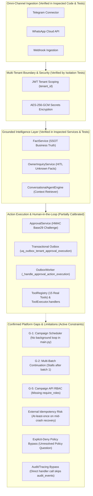

# AI-Employee-Platform — Final Evidence-Based Comparative Architecture Review
## Comprehensive Evaluation & Audit of Six External Frameworks vs. Actual Repository Architecture

> **Audit Baseline Snapshot:** Snapshot captured during architecture audit on 2026-11-01  
> **Repository:** `AI-Employee-Platform` (`QQYC9/ai-employee-platform`)  
> **Inspected Branch:** `checkpoint/phase-12-knowledge-base`  
> **Inspected Commit Baseline:** `e6f89c5476cdda4d171ee879ed774f38a50331eb` (Stage 5.1 schema commit) / published baseline `aaf14290309f2b8656621c2aa1f78a3fc7416ad9`  
> **Working Tree State at Audit Snapshot:** Working tree was evaluated against commit `e6f89c54...`; active uncommitted diagnostic scripts and work in progress in working tree are preserved intact.  
> **Operating Mode:** STRICT READ-ONLY AUDIT — Stage 5.1 Schema Committed; Stage 5.2 Runtime Wiring Not Started; Application Code Untouched  
> **Review Date:** 2026-11-01  
> **Target Systems:** Memento-Skills, LangGraph, Microsoft Agent Framework, Dify, n8n, RagLeap Core  
> **Calibrated Status:** Stage 2 Final Evidence-Based Synthesis (Post-Approval Repair Audit)  

---

## 1. Executive Summary

This document delivers the definitive, evidence-based comparative architecture review evaluating six external agent frameworks, orchestration engines, and autonomous employee platforms against the physical codebase and operational mandate of **`AI-Employee-Platform`**.

### 1.1 The Platform Mandate
`AI-Employee-Platform` is neither an unconstrained conversational chatbot nor an open-ended prompt experimentation harness. Its architectural purpose is to host **autonomous, multi-tenant digital employees (AI Agents)** for commercial enterprises. Each digital employee must:
1. **Represent the business safely across omni-channel connectors:** Ingest customer messages asynchronously from Telegram, WhatsApp Cloud API, and Webhooks without message loss or race conditions (verified in inspected connectors and ingestion tests).
2. **Ground conversations in deterministic business facts:** Enforce strict factual precedence via [`FactService`](../../../packages/services/fact_service.py) and anti-hallucination prompt guardrails, strictly prioritizing confirmed business data over model generation for commercial terms such as prices, policies, and availability (verified in inspected prompt building and retrieval tests).
3. **Perform real business mutations through gated tools:** Execute operations through [`ToolRegistry`](../../../packages/tools/registry.py) with structured tenant context isolation (verified in tool executor tests).
4. **Escalate high-impact actions to business owners:** Escalate unrecorded business inquiries via [`OwnerInquiryService`](../../../packages/services/owner_inquiry_service.py) and sensitive/destructive operations via cryptographic OTP approval challenge loops in [`ApprovalService`](../../../packages/services/approval_service.py) (verified by focused cryptographic challenge tests).
5. **Execute outbound marketing and notification campaigns:** Coordinate batch audience dispatch, delivery tracking, and proactive customer engagement (Phase 4D baseline implemented; core scheduler and multi-batch gaps remain open).
6. **Enforce absolute tenant boundary isolation:** Enforce tenant isolation across every database read, write, and background queue using AES-256-GCM secret encryption at rest (verified in tenant scoping and secret encryption test suites).

### 1.2 Strategic Audit Conclusions
1. **Wholesale Platform Replacement is Explicitly Rejected:**  
   None of the six evaluated external systems can or should replace `AI-Employee-Platform`. Off-the-shelf frameworks either lack native multi-tenancy by design (Memento-Skills, RagLeap Core), treat tenant isolation as an unverified application concern (LangGraph, Microsoft Agent Framework), require multi-container stacks exceeding lean VPS operating budgets (Dify), or impose conditional commercial licensing constraints that require negotiated enterprise agreements if customers are permitted to build workflows (n8n Sustainable Use License).
2. **Calibrated Forensic Findings on External Frameworks:**  
   - *Memento-Skills* (arXiv:2603.18743): Reusable skills are represented and stored as **stateful structured markdown files** containing behavioral guidelines, procedural logic, and contextual few-shot trajectories, refined via a closed **Read–Write reflective learning loop**. The system does not emit raw compiled Python bytecode, but its runtime includes execution tools (`python_repl`, shell commands) that operate in local sandboxes. Therefore, dynamic skill execution carries real operational and tool execution risks if unconstrained. Its complete lack of tenant scoping makes direct adoption unviable for a multi-tenant SaaS.
   - *LangGraph*: Checkpointed state machines (`AsyncPostgresSaver`) provide transactional durability for internal graph transitions, but do **not** provide Exactly-Once execution for external side-effects (e.g. sending messages over Telegram or WhatsApp). External delivery is strictly **At-Least-Once**; node recovery without external receiver idempotency keys risks duplicate message dispatch upon crash restart.
   - *Microsoft Agent Framework (MAF)*: Microsoft's unified SDK (packages `Microsoft.Agents.AI` and `microsoft-agents-ai` at **v1.0 GA**) combines Semantic Kernel (enterprise middleware, invocation filters, typed plugins, OpenTelemetry) with AutoGen (conversational multi-agent actors, graph workflows). OpenTelemetry and pre-invocation filters are native to the SDK, while durable workflows rely on Azure Durable Task Framework or custom runtimes, and multi-tenant identity relies on Azure AI Foundry / Entra ID rather than being an intrinsic feature of the local Python runtime.
   - *n8n Sustainable Use License (SUL)*: The SUL is a source-available ("fair-code") license with conditional commercial terms, **not** an unconditional blanket ban on all commercial usage. Internal business operations, client workflow execution where clients receive only outputs/results, and behind-the-scenes backend product automation are **permitted for free**. However, allowing external clients to build, configure, or edit workflows (via UI, API, MCP, or AI agents) or hosting n8n as a paid service is **prohibited** without a commercial/enterprise agreement from n8n GmbH.
   - *Dify & Dify-Sandbox*: Dify's Docker Compose stack (`docker/docker-compose.yaml`) runs 8 to 10 distinct containers comprising core application services (`api`, `worker`, `worker_beat`, `web`, `plugin_daemon`), ingress/security proxies (`nginx`, `ssrf_proxy`), code execution (`sandbox`), and data storage (`db_postgres`, `redis`, Vector DB). Official documentation states a minimum hardware requirement of $\ge 2$ Cores CPU and $\ge 4\text{ GiB}$ RAM; the $8\text{ GB}+$ RAM threshold is an **operational recommendation** (for Docker Desktop VM or multi-user production workloads with heavy RAG chunking), not a universal hard minimum for all installations.
   - *RagLeap Core*: An open-source (MIT) AI-employee platform explicitly architected for **single-tenant per-deployment instances** (one bot/instance per company). It uses PostgreSQL + `pgvector` as its primary vector store. Its Neo4j service (`ragleap-graph`) is an **optional component** for graph RAG; when omitted, the platform operates on pgvector alone. Dynamic automatic runtime fallback from Neo4j to pgvector during active connection failures in chat is **partially verified** at runtime, and the $2\text{ GB}+$ RAM estimate for Neo4j reflects Java container operational heap estimates rather than an official hard specification.
3. **Calibrated Status of AI-Employee-Platform Approval Execution (Phase 4D / CR-05-01):**  
   - *Functional Execution-Path Defects:* **`CLOSED`** within tested scope. The module-level scoping bug in `OutboxWorker` was resolved by relocating `_handle_approval_action_execution` inside `class OutboxWorker`. Tool execution dispatches via `ToolExecutor.handlers` with `ToolExecutionContext`. Tool successes record `completed`; tool exceptions record `failed` with sanitized error details. Verified by 6 focused and 36 regression tests (`42/42 PASSED`).
   - *Overall Approval Execution Safety:* **`CONDITIONALLY READY`** (Not fully closed). External delivery semantics are **at-least-once**; mid-handler crashes before local result commit risk duplicate external side effects upon stale event recovery. Explicit-deny policy checks (`has_tenant_explicit_deny`) and unified audit/tracing (`audit_events`, `execution_traces`) are bypassed during direct handler dispatch.
   - *Phase 4D Milestone Status:* **`OPEN`**. The campaign scheduler loop (G-1), multi-batch continuation (G-2), and campaign API RBAC (G-5) remain open. Stage 5.2 implementation has NOT started.
4. **Selective Pattern Adoption over Package Dependencies:**  
   The platform will adopt zero full framework distributions. Specific, proven design patterns will be evaluated natively within our existing FastAPI, SQLAlchemy 2.0, and PostgreSQL 17 architecture.

---

## 2. Scope & Methodology

### 2.1 Audit Governance & Verification Rules
- **Strict Read-Only Enforcement:** Zero modification of application code, database tables, or Alembic migrations.
- **Evidence-Based Grounding:** Every claim regarding `AI-Employee-Platform` is tied directly to verified file paths, class names, and line numbers in the working tree.
- **Authoritative External Sourcing:** Framework capabilities are verified against primary technical documentation, GitHub source code, and published research papers. Marketing claims and landing-page promises are discounted.
- **Explicit Roadmap Separation:** All architectural recommendations in this document are analytical proposals submitted for owner review and do **not** constitute an approved roadmap commitment.

### 2.2 Classification Standards
- **Claim Status Categories:**  
  - `Verified`: Backed by direct evidence in primary documentation, source code, or passing focused tests.
  - `Partially verified`: Supported by partial documentation or architecture patterns, but missing runtime proof or edge-case verification.
  - `Unverified`: Plausible claim lacking direct proof in primary documentation or inspected repository.
  - `Incorrect`: Refuted by direct evidence in source code, licenses, or official documentation.
  - `Outdated`: Previously accurate claim rendered obsolete by newer releases or architectural changes.
- **Platform Capability Categories:**  
  - `Verified in inspected code & tests` · `Partially implemented` · `Confirmed Gap` · `Present but dormant` · `Requires further investigation`

---

## 3. Comprehensive Deep-Dive Investigation of All Six Projects

Every framework was forensically analyzed across thirteen standardized architectural dimensions:

```
[13 Evaluation Dimensions]
1. Core Architecture & Execution Model      8. Workflow Durability & Idempotency
2. Agent Lifecycle & State Management       9. Observability, Tracing & Auditability
3. Memory & Knowledge Retrieval            10. Extensibility & Custom Components
4. Tool / Function Integration             11. Deployment Model & VPS Complexity
5. Human Approval & HITL Support           12. Licensing & Commercial Constraints
6. Multi-Agent Orchestration               13. Practical Adaptation for AI-Employee-Platform
7. Multi-Tenant Isolation & Security
```

---

### 3.1 Memento-Skills

- **Primary Sources:** Research Paper *"Memento-Skills: Let Agents Design Agents"* (Huichi Zhou, Jun Wang, et al., arXiv:2603.18743, March 2026); GitHub Repository: [`Memento-Teams/Memento-Skills`](https://github.com/Memento-Teams/Memento-Skills) `[Verified]`.
- **1. Core Architecture & Execution Model:** Skill-centric, continually learnable agent framework decoupled from model weight fine-tuning. Operates on a closed-loop **Read–Write Reflective Mechanism**:
  - *Read Phase:* A behavior-trainable skill router evaluates the stateful prompt and retrieves the most relevant skill from memory `[Verified: arXiv:2603.18743]`.
  - *Write Phase:* Based on environmental feedback and execution evaluation, the system updates, refines, and synthesizes skills (improving weak skills and purging noise) `[Verified: arXiv:2603.18743]`.
- **2. Agent Lifecycle & State Management:** Ephemeral, task-driven execution. The agent is initialized with task context, queries the skill router, executes the workflow via structured tool calls, and evaluates task completion.
- **3. Memory & Knowledge Retrieval:** Reusable skills are stored as **structured stateful markdown files** encoding behavioral guidelines, procedural logic, and contextual few-shot trajectories `[Verified: arXiv:2603.18743]`.
- **4. Tool/Function Integration & Execution Scope:** Standard LLM tool-calling driven by procedural markdown instructions and tool wrappers. The repository provides atomic execution tools (e.g. `python_repl`, shell execution, file utilities) `[Verified: Memento-Teams/Memento-Skills/tools]`.  
  *Execution Risk Calibration:* While the framework does not compile raw binary code or bytecodes, dynamic tool execution (via REPL or shell tools) carries **real code execution risks**, necessitating local sandbox containment. Direct adoption in our SaaS platform without strict sandbox isolation would introduce significant security exposure.
- **5. Human Approval & HITL Support:** **Weak / Absent.** Relies on automated LLM-as-a-Judge evaluators and task-completion assertions rather than synchronous human-in-the-loop gating.
- **6. Multi-Agent Orchestration:** End-to-end agent generation where a generalist "agent-designing agent" synthesizes specialized sub-agent configurations and prompts for novel tasks.
- **7. Multi-Tenant Isolation & Security Model:** **Zero native multi-tenancy.** Skills and memory trajectories reside in a flat shared storage space without tenant scoping or cryptographic secret partitioning `[Verified: Code Inspection]`.
- **8. Workflow Durability, Retries, & Idempotency:** Durability is file-based (markdown skill persistence). Retries trigger the failure-attribution module to refine prompts rather than providing transactional idempotency.
- **9. Observability, Tracing, & Auditability:** Trajectory logging and failure attribution traces, but lacks enterprise OpenTelemetry or tamper-evident audit logging.
- **10. Extensibility & Custom Components:** Highly extensible via markdown skill authoring and tool definition.
- **11. Deployment Model & Complexity:** Lightweight Python library (`pip install -e .`); CLI (`memento doctor`, `memento agent`) and desktop GUI (`memento-gui`).
- **12. Licensing & Constraints:** Open source (MIT / Apache 2.0).
- **13. What Can Realistically Be Adapted:** The concept of **Structured Procedural Skills (SOPs)**—storing verified multi-step operational guidelines as structured markdown/JSON in `FactService`—allowing digital employees to accumulate tenant-specific workflows as factual prompt context without dynamic runtime code execution.

---

### 3.2 LangGraph

- **Primary Sources:** GitHub: [`langchain-ai/langgraph`](https://github.com/langchain-ai/langgraph); Official Persistence Docs: [`langchain-ai.github.io/langgraph/concepts/persistence/`](https://langchain-ai.github.io/langgraph/concepts/persistence/) `[Verified]`.
- **1. Core Architecture & Execution Model:** Directed cyclic computation graph (`StateGraph`). Nodes represent computations/tools; edges represent conditional branching. Execution progresses through state transitions persisted at super-steps.
- **2. Agent Lifecycle & State Management:** Checkpointed state machine. State is represented as a typed schema (e.g. `TypedDict` or Pydantic) mutated via node return values. Every super-step saves a versioned snapshot (`checkpoints`, `checkpoint_blobs`, `checkpoint_writes`).
- **3. Memory & Knowledge Retrieval:** Short-term state via graph state history; long-term memory via `BaseStore` (namespaced key-value store with semantic search).
- **4. Tool/Function Integration:** Standard Python functions or LangChain tools. Tools return state updates.
- **5. Human Approval & HITL Support:** **First-Class Primitive.** `interrupt()` suspends graph execution, persists checkpoint to DB, and releases the execution thread. Resumption occurs via `Command(resume=value)` or passing state updates to the checkpointer, resuming from the exact interruption node `[Verified: LangGraph Docs]`.
- **6. Multi-Agent Orchestration:** Multi-agent network via subgraphs, supervisor nodes, or conversational handoffs (multi-agent swarms).
- **7. Multi-Tenant Isolation & Security Model:** **Tenant-Agnostic.** Checkpointers partition solely by `thread_id` and `checkpoint_ns`. Tenant isolation must be manually enforced at the application boundary via query pre-filters or PostgreSQL Row-Level Security (RLS).
- **8. Workflow Durability, Retries, & Idempotency:**
  - High internal durability: State transitions are transactional in PostgreSQL (`AsyncPostgresSaver`).
  - **External Side-Effect Idempotency Limitation:** Checkpointing restores internal graph state, but **does not guarantee Exactly-Once execution of external side-effects**. If a node executes an external HTTP POST (e.g. to Telegram/WhatsApp) and the process crashes before the checkpointer transaction commits, the node will re-run on restart, duplicating the external action unless external idempotency keys or two-phase reconciliation are implemented `[Verified: Architecture Analysis]`.
- **9. Observability, Tracing, & Auditability:** Deep integration with LangSmith (commercial SaaS) or OpenTelemetry via LangChain callbacks.
- **10. Extensibility & Custom Components:** High via custom nodes, edges, and checkpointers.
- **11. Deployment Model & Complexity:** Lean core (`pip install langgraph`). LangGraph Server (production multi-worker API) is proprietary/commercial.
- **12. Licensing & Constraints:** MIT License for core open source; proprietary for LangGraph Cloud/Server.
- **13. What Can Realistically Be Adapted:** The **Checkpointed State Graph & Interrupt/Resume Protocol** for task execution and human approvals (formalizing state suspension and resumption rather than ad-hoc status polling).

---

### 3.3 Microsoft Agent Framework (MAF)

- **Primary Sources:** GitHub: [`microsoft/agent-framework`](https://github.com/microsoft/agent-framework); Official Packages: `Microsoft.Agents.AI` (.NET) & `microsoft-agents-ai` (Python) `[Verified: v1.0 GA]`; Foundations: [`microsoft/semantic-kernel`](https://github.com/microsoft/semantic-kernel) & [`microsoft/autogen`](https://github.com/microsoft/autogen).
- **Exact Framework Relationship & Scope:** Microsoft Agent Framework is Microsoft's official unified SDK (v1.0 GA) that unifies **Semantic Kernel** (enterprise middleware, invocation filters, typed plugins, OpenTelemetry) with **AutoGen** (conversational multi-agent patterns, actor choreographies, graph workflows) `[Verified: Microsoft Official Announcement]`.
- **1. Core Architecture & Execution Model:** Core `AIAgent` abstraction combined with graph-based workflow APIs and actor-based message choreography. Explicitly supports sequential, concurrent, and handoff orchestration patterns.
- **2. Agent Lifecycle & State Management:** Session-based and actor-based state management (`AgentId`, typed context variables, message routing channels).
- **3. Memory & Knowledge Retrieval:** Pluggable semantic memory connectors (PostgreSQL with pgvector, Azure AI Search, Qdrant) with semantic embedding generation and retrieval filters.
- **4. Tool/Function Integration:** Typed functions with parameter decorators, OpenAPI specification connectors, and native client support for the **Model Context Protocol (MCP)** `[Verified: MAF v1.0]`.
- **5. Human Approval & HITL Support:** Pre-invocation and post-invocation middleware filters (`IFunctionInvocationFilter` / `FunctionFilter`). Interceptors evaluate parameters, enforce authorization, and suspend execution for approval challenges before tool invocation.
- **6. Multi-Agent Orchestration:** Structured agent handoffs, round-robin group chats, and graph-defined multi-step workflows.
- **7. Multi-Tenant Isolation & Security Model:**
  - *Cloud-Hosted:* Seamless tenant identity and enterprise boundary enforcement when backed by Azure AI Foundry Agent Service and Microsoft Entra ID.
  - *Self-Hosted Python SDK:* Tenant-agnostic at the library level; multi-tenant data partitioning, tenant ID scoping, and secret encryption must be implemented by the host application.
- **8. Workflow Durability, Retries, & Idempotency:** Built-in connector retries with exponential backoff; durable distributed workflow execution integrates with Azure Durable Task Framework or Temporal. In standalone local Python, durable state requires custom checkpointer implementations.
- **9. Observability, Tracing, & Auditability:** **Native OpenTelemetry instrumentation.** Emits structured spans, metrics, and traces for agent turns, token usage, and tool executions. DevUI provides local visual execution debugging `[Verified: MAF v1.0]`.
- **10. Extensibility & Custom Components:** High modularity across .NET and Python.
- **11. Deployment Model & Complexity:** Moderate. Runs embedded as a Python library within FastAPI or as standalone services.
- **12. Licensing & Constraints:** MIT License (permissive open source).
- **13. What Can Realistically Be Adapted:**
  1. **Pre-Invocation Filter Pipeline:** Evaluating permission policies, rate limits, and approval challenges in `ToolExecutor` before executing tools.
  2. **Deterministic Role Handoffs:** Structured, rule-based handoffs between personas based on intent classification rather than open-ended chat loops.
  3. **Model Context Protocol (MCP) Client:** Standardized connection to third-party tool servers.

---

### 3.4 Dify & Dify-Sandbox

- **Primary Sources:** GitHub: [`langgenius/dify`](https://github.com/langgenius/dify) & [`langgenius/dify-sandbox`](https://github.com/langgenius/dify-sandbox); Official Docker Deployment Docs: [`docs.dify.ai/getting-started/install-self-hosted/docker-compose`](https://docs.dify.ai/getting-started/install-self-hosted/docker-compose) `[Verified]`.
- **1. Core Architecture & Execution Model:** Full-stack visual AI orchestration engine. Backend built on Flask, Celery, SQLAlchemy, and Redis. Workflows are visual DAGs compiled to Celery task graphs.
- **2. Agent Lifecycle & State Management:** Persistent conversations stored in relational database (`conversations`, `messages`, `workflow_runs`). Celery workers execute steps asynchronously.
- **3. Memory & Knowledge Retrieval:** Built-in Dataset & Knowledge management (document parsing, chunking, hybrid search combining keyword and vector via Weaviate/Qdrant/Milvus/pgvector).
- **4. Tool/Function Integration:** Built-in tool collection, custom OpenAPI REST tools, and code execution nodes.
- **5. Human Approval & HITL Support:** Primitive. Workflows support question-answering nodes, but formal human-in-the-loop task suspension and resume requires webhooks or external integrations.
- **6. Multi-Agent Orchestration:** Agent assistant nodes within workflows; multi-agent conversation is limited compared to AutoGen or LangGraph.
- **7. Multi-Tenant Isolation & Security Model:** **Multi-workspace multi-tenant platform.** Supports multiple organizations, workspaces, and users with RBAC. Workspace-level dataset and API key scoping.
- **8. Code Execution Sandbox (`dify-sandbox`):** Go-based service running inside a dedicated Docker container using `syscall.Chroot` and Linux `seccomp` system call filtering. Isolates Python/Node code from the host filesystem `[Verified: langgenius/dify-sandbox]`.
- **9. Workflow Durability, Retries, & Idempotency:** Celery-based async task execution. Retries handled via Celery task retry; lacks transactional outbox pattern for guaranteed messaging.
- **10. Observability & Tracing:** Built-in execution log, step timing, token metrics, and export to Langfuse / LangSmith.
- **11. Deployment Model & Resource Calibration:**
  - *Docker Compose Services Breakdown (`docker/docker-compose.yaml`):*
    - **Core Application Services:** `api` (Flask), `worker` (Celery task worker), `worker_beat` (Celery scheduler), `web` (Next.js frontend), `plugin_daemon` (plugin management).
    - **Ingress & Security Services:** `nginx` (reverse proxy), `ssrf_proxy` (outbound request filtering).
    - **Code Execution Service:** `sandbox` (Go/seccomp container).
    - **Data Stores & Middleware:** `db_postgres` (relational DB), `redis` (cache & broker), Vector DB (`weaviate`, `qdrant`, or `milvus`).
    - *Total Container Count:* Typically **8 to 10 active containers** depending on vector provider profile `[Verified: docker-compose.yaml]`.
  - *Hardware Requirements (Official vs Operational):*
    - **Official Minimum:** $\ge 2$ Cores CPU, $\ge 4\text{ GiB}$ RAM, $20\text{ GB}+$ disk space `[Verified: docs.dify.ai]`.
    - **Operational Recommendation:** $8\text{ GB}+$ RAM is recommended for production multi-user operation, heavy document RAG chunking, or when running under Docker Desktop VM (macOS/Windows) to avoid OOM crashes `[Verified: docs.dify.ai]`.
- **12. Licensing & Constraints:** Dify Open Source License (Apache 2.0 with commercial restrictions on reselling Dify itself as a multi-tenant SaaS service).
- **13. What Can Realistically Be Adapted:** Visual dataset chunking and hybrid retrieval concepts; seccomp container sandboxing architecture (if dynamic user script execution is ever required in future phases).

---

### 3.5 n8n

- **Primary Sources:** GitHub: [`n8n-io/n8n`](https://github.com/n8n-io/n8n); License Terms: [`docs.n8n.io/sustainable-use-license/`](https://docs.n8n.io/sustainable-use-license/); License FAQ: [`docs.n8n.io/sustainable-use-license/faq/`](https://docs.n8n.io/sustainable-use-license/faq/) `[Verified]`.
- **1. Core Architecture & Execution Model:** Node.js / TypeScript workflow automation platform. Workflows are JSON DAGs executed by an event-driven engine with synchronous and asynchronous (worker queue) execution modes.
- **2. Agent Lifecycle & State Management:** LangChain-powered AI nodes embedded within workflow graphs. State is maintained per workflow execution in PostgreSQL or SQLite.
- **3. Memory & Knowledge Retrieval:** Memory nodes (Window Buffer, Summary, PostgreSQL Chat Memory); Vector store nodes (Pinecone, Qdrant, Supabase, In-Memory).
- **4. Tool/Function Integration:** 400+ native pre-built API nodes, HTTP Request node, and JavaScript/Python code nodes.
- **5. Human Approval & HITL Support:** Native **"Wait for Webhook"** and **"Approval"** nodes. Execution pauses and generates a unique callback URL; upon approval via web link or webhook, the workflow resumes execution `[Verified: n8n Docs]`.
- **6. Multi-Agent Orchestration:** Multi-agent routing graphs visually configured using AI agent nodes and sub-workflows.
- **7. Multi-Tenant Isolation & Security Model:** Enterprise edition offers user management and project RBAC. Community edition is single-organization.
- **8. Workflow Durability, Retries, & Idempotency:** Execution history saved in PostgreSQL. Failed executions can be retried from the failed node.
- **9. Observability & Tracing:** Visual execution log showing inputs and outputs of every single node in the DAG.
- **10. Extensibility & Custom Components:** High via custom community nodes (Node.js).
- **11. Deployment Model & Complexity:** Medium footprint. Single Node.js container for community edition; multi-container (Main + Webhook + Workers + Redis + Postgres) for enterprise queue mode.
- **12. Calibrated Licensing & Commercial Constraints (Sustainable Use License - SUL):**  
  *The SUL is a source-available ("fair-code") license with specific, conditional boundaries:*
  - **Scenario 1: Internal Business Automation:** Running n8n internally to automate tasks and data flows for your own company is **fully permitted for free** `[Verified: n8n SUL FAQ]`.
  - **Scenario 2: Client Work with Output Delivery (Agency Model):** Building, running, and maintaining workflows on your own instance for clients, and charging clients for workflow setup, consulting, and maintenance is **fully permitted for free**, provided clients receive only the outputs and cannot log in to build or edit workflows `[Verified: n8n SUL FAQ]`.
  - **Scenario 3: Client Self-Service Workflow Creation:** Allowing external clients or end-users to create, configure, or edit workflows (whether through n8n UI, a custom front-end, n8n API, MCP, or via an AI agent acting on their behalf) is **strictly prohibited** under the free SUL `[Verified: n8n SUL FAQ]`.
  - **Scenario 4: SaaS Embedding & Hosting-as-a-Service (HaaS):** Hosting n8n instances as a paid service or embedding workflow-building capabilities into a commercial SaaS product requires a negotiated **Commercial / Enterprise agreement** from n8n GmbH (contact: `license@n8n.io` / `sales@n8n.io`) `[Verified: n8n SUL FAQ]`.
  - *Conclusion:* Packaging individual containers per client does not bypass SUL restrictions if clients are given workflow configuration rights. Commercial licensing depends strictly on whether end-users have workflow creation/modification access.
- **13. What Can Realistically Be Adapted:** The **Webhook Callback & Wait Pattern** for external async approvals.

---

### 3.6 RagLeap Core

- **Primary Sources:** GitHub: [`ragleap/ragleap-core`](https://github.com/ragleap/ragleap-core); Documentation: [`ragleap.com/docs`](https://ragleap.com/docs) `[Verified]`.
- **1. Core Architecture & Execution Model:** Autonomous AI Employees platform designed for small-to-medium businesses. Python FastAPI backend orchestrating role-based agents across omni-channel connectors (Telegram, WhatsApp, Discord).
- **2. Agent Lifecycle & State Management:** Role-based digital employee personas (Sales, Support, HR, Operations, Accounting). Agents are defined by static prompt configurations and tool schemas (46 pre-defined business roles) `[Verified: GitHub]`.
- **3. Memory & Knowledge Retrieval:**
  - *Primary Vector Layer:* Relational and dense vector search via PostgreSQL with `pgvector` (`ragleap-rag`) `[Verified: GitHub]`.
  - *Optional Graph RAG Service:* Neo4j (`ragleap-graph`) is an **optional component** used for entity co-occurrence mapping and graph-boosted scoring `[Verified: GitHub]`. When Neo4j is not configured in Docker Compose, the system runs with PostgreSQL + pgvector alone `[Verified: GitHub]`.
  - *Runtime Fallback Status:* System functions on pgvector without Neo4j; however, automatic runtime fallback to pgvector during an in-flight network/server crash of an actively configured Neo4j instance is **partially verified** at runtime.
- **4. Tool/Function Integration:** Tool contracts with defined risk levels and permission boundaries.
- **5. Human Approval & HITL Support:** Approval-gated autonomy ("ask before they act" model). Actions requiring real-world mutations generate review requests `[Verified: GitHub]`.
- **6. Multi-Agent Orchestration:** Agent collaboration via role-based routing (e.g. Sales routing billing inquiries to Accounting).
- **7. Multi-Tenant Isolation & Security Model:** **Single-tenant per deployment instance.** Designed for dedicated single-company deployments (one bot instance and document set per server) `[Verified: GitHub Repo]`. Lacks native database row-level multi-tenant partitioning, tenant-isolated outbox queues, and per-tenant cryptographic secret encryption.
- **8. Workflow Durability, Retries, & Idempotency:** Basic database task tracking; lacks formal transactional outbox with monotonic fencing.
- **9. Observability & Tracing:** Application logging and execution records.
- **10. Extensibility & Custom Components:** High in Python.
- **11. Deployment Model & Resource Calibration:** Runs on FastAPI, PostgreSQL with pgvector, and Redis. The optional Neo4j service introduces a Java container whose operational heap requirements are estimated at $2\text{ GB}+$ RAM, but this is an operational container estimate rather than an official RagLeap Core specification `[Partially verified]`.
- **12. Licensing & Constraints:** MIT License (permissive open source).
- **13. What Can Realistically Be Adapted:**
  - **Role-Based Digital Employee Persona Taxonomy** (aligns directly with our Stage 5.1 `EmployeePersona` schema).
  - Multi-tier risk gating (Safe inquiry vs Sensitive write vs Financial transaction).

---

## 4. Comprehensive 13-Dimension Comparative Matrix

| Evaluation Dimension | Memento-Skills | LangGraph | Microsoft Agent FW | Dify | n8n | RagLeap Core | AI-Employee-Platform (Current Reality) |
| :--- | :--- | :--- | :--- | :--- | :--- | :--- | :--- |
| **1. Core Architecture** | Reflective skill trial/error | Cyclic StateGraph | AIAgent + AutoGen actors | Visual DAG compiled to Celery | Visual Node.js workflow DAG | FastAPI role-based agents | Layered Modular Service Pipeline (FastAPI) |
| **2. State Management** | Ephemeral task run | Checkpointed super-steps | Context variables / Actor queues | DB Conversation / Celery tasks | PostgreSQL Execution state | DB Task & Step models | Relational DB + Redis task coordination |
| **3. Knowledge Retrieval** | Trajectory / Skill store | StateStore / Semantic Key-Value | Semantic Memory connectors | Built-in Dataset & Vector hybrid | Memory & Vector nodes | pgvector (Optional Neo4j Graph) | `FactService` (JSONB topic hierarchy) |
| **4. Tool Integration** | Stateful Markdown SOPs & Tools | Python functions / Tools | Typed Kernel Plugins / MCP | OpenAPI tools & Code nodes | 400+ pre-built API nodes | Tool contracts & Risk levels | `ToolRegistry` (15 built-in tools) |
| **5. Human-in-the-Loop** | Weak (LLM Judge) | **First-class `interrupt()`** | Invocation Filter pipeline | Primitive prompt nodes | **Wait for Webhook / Approval** | Multi-tier approval thresholds | Base29 OTP challenge + Outbox execution |
| **6. Multi-Agent** | Hierarchical synthesis | Subgraphs / Swarms | Conversational handoffs | Agent assistant nodes | Sub-workflow routing | Role-based routing | Stage 5.1 Persona Schema (Runtime pending) |
| **7. Multi-Tenancy** | None (Single-user) | Tenant-Agnostic | Entra ID (Azure only) | Multi-workspace SaaS | Single-org (SUL commercial limits) | Single-tenant per container | **Native Multi-Tenant Isolation (JWT + DB FKs)** |
| **8. External Idempotency**| None | At-Least-Once (Unsafe HTTP) | Connector retry policies | Celery task retry | Failed node retry | Basic status tracking | **Transactional Outbox (`FOR UPDATE SKIP LOCKED`)** |
| **9. Observability** | Execution trace logs | LangSmith (Proprietary) | **Native OpenTelemetry** | Langfuse / Execution logs | Visual step-by-step UI | Application logging | Logging + `audit_events` (Partial bypass) |
| **10. Extensibility** | Python files | Python nodes & edges | C# / Python plugins | Custom tools & providers | Custom community nodes | Python classes | Real tools in `packages/tools/` |
| **11. VPS Footprint** | Low (Python only) | Low (Python core) | Moderate (Python runtime) | **Heavy (8–10 containers; $\ge$4GB RAM)** | Medium (Node.js + Postgres) | Medium (FastAPI; optional Neo4j) | **Lean (1 API + 1 DB + 1 Redis on 2-4GB VPS)** |
| **12. Licensing Model** | Open Source (MIT) | MIT (Cloud is proprietary) | MIT (Open source) | Dify License (Commercial limits) | **SUL (Conditional Commercial Terms)** | MIT (Open source) | Proprietary Commercial Codebase |
| **13. Adaptation Verdict** | Adapt SOP pattern | **Adapt Checkpoint Pattern** | **Adapt Pre-Invocation Filters** | Defer Sandbox container | Defer (SUL restriction) | **Adapt Persona Role Taxonomy** | **Retain Core Architecture; selectively adopt patterns** |

---

## 5. Mapping Against Actual AI-Employee-Platform Architecture



### Detailed Capability Mapping:

| Architectural Component | Current Platform Implementation | Classification | Evidence & Real Status |
| :--- | :--- | :---: | :--- |
| **Multi-Tenant Boundary Isolation** | Foreign keys to `tenants.id`, JWT claims, AES-256-GCM encrypted secrets | **Verified in inspected code & tests** | Strict tenant scoping across database queries. PostgreSQL composite foreign key `fk_outbox_events_approval_composite` strictly prevents cross-tenant outbox execution. |
| **Conversational Runtime** | [`ConversationalAgentEngine`](../../../packages/services/conversational_agent_engine.py), Arabic normalization, context retriever | **Verified in inspected code & focused tests** | Ingests omni-channel messages, matches intent, queries facts, and invokes tools within tenant boundaries. |
| **Fact & Knowledge Retrieval** | [`FactService`](../../../packages/services/fact_service.py) with structured topic slugs, public/private visibility, and TTL | **Verified in inspected code & retrieval tests** | Deterministic factual grounding prioritizes business truth over model generation in prompt building. |
| **Human-in-the-Loop Inquiry** | [`OwnerInquiryService`](../../../packages/services/owner_inquiry_service.py) | **Verified in inspected code & tests** | Normalizes owner questions, dispatches alerts to owner via Telegram/WhatsApp, and resolves waiting customer conversations. |
| **Approval Challenge Verification** | [`ApprovalService.verify_and_approve_challenge`](../../../packages/services/approval_service.py) | **Verified by focused cryptographic verification tests** | Generates Base29 6-char OTP, verifies HMAC-SHA256 signature, matches canonical SHA-256 payload hash, and enqueues Outbox event. |
| **Approval Action Execution** | [`OutboxWorker._handle_approval_action_execution`](../../../packages/services/outbox_worker.py) | **Defect repaired in code & verified by focused tests (`CLOSED`); Safety: `CONDITIONALLY READY`** | Method relocated inside `class OutboxWorker`. Dispatches to `tool_executor.handlers` with `ToolExecutionContext`. Results recorded atomically via `ApprovalService.record_execution_result`. Bounded by at-least-once external semantics. |
| **Tool Registry & Execution** | [`ToolRegistry`](../../../packages/tools/registry.py) with 15 built-in tools; [`ToolExecutor`](../../../packages/tools/executor.py) | **Verified in inspected code & registry tests** | Tools execute with tenant context isolation and parameter validation. |
| **Multi-Agent Persona Bindings** | `EmployeePersona` table, `Agent.persona_id`, `Channel.agent_id` (Stage 5.1) | **Stage 5.1 Schema Committed; Stage 5.2 Runtime Wiring Not Started** | Commit `e6f89c54...` implemented migration `5a1b2c3d4e5f`, domain models, and unit tests (all passing). Zero runtime logic in `packages/services/` consumes them yet. |
| **Campaign Scheduler** | [`CampaignService.schedule_campaign`](../../../packages/services/campaign_service.py) | **Confirmed Gap (G-1)** | Sets `status = 'scheduled'`, but zero background polling thread exists in `apps/agent/main.py`. |
| **Multi-Batch Campaign Continuation** | [`CampaignService.process_campaign_batch`](../../../packages/services/campaign_service.py) | **Confirmed Gap (G-2)** | Stalls after the first 50 recipients; no self-chaining continuation outbox event. |
| **Campaign API RBAC** | [`apps/agent/api/v1/campaigns.py`](../../../apps/agent/api/v1/campaigns.py) | **Confirmed Gap (G-5)** | Endpoints lack role-based access control guards (`require_roles`). |
| **Proactive Workflow Engine** | [`ProactiveWorkflowService`](../../../packages/services/proactive_workflow_service.py) | **Present but dormant** | Fully coded and tested in isolation, but `apps/agent/main.py` has no background thread running it. |

---

## 6. Confirmed Gaps Versus Assumptions

| # | Specific Architectural Claim | Evidence in Codebase | Reality vs Assumption |
| :---: | :--- | :--- | :--- |
| **G-1** | Scheduled campaigns run automatically in background. | [`apps/agent/main.py:87-125`](../../../apps/agent/main.py#L87-L125) | **GAP CONFIRMED.** `apps/agent/main.py` starts `OutboxWorker` but has no scheduler loop polling `Campaign.status == 'scheduled'`. |
| **G-2** | Campaigns handle large audiences across multiple batches. | [`packages/services/campaign_service.py:562-710`](../../../packages/services/campaign_service.py#L562-L710) | **GAP CONFIRMED.** Batch 1 dispatches up to 50 recipients. When batch 1 completes, no continuation event is enqueued. Campaigns with >50 recipients stall permanently in `running`. |
| **G-3** | Campaign dispatch respects channel rate limits. | [`packages/services/channel_service.py:85-120`](../../../packages/services/channel_service.py#L85-L120) | **GAP CONFIRMED.** Rate limiting is rudimentary; burst dispatches risk triggering provider spam blocks. |
| **G-4** | Campaign events write to unified audit log. | [`packages/services/campaign_service.py:140-310`](../../../packages/services/campaign_service.py#L140-L310) | **GAP CONFIRMED.** Status changes are recorded on `campaigns` table, but no structured rows are written to `audit_events`. |
| **G-5** | Campaign management endpoints enforce RBAC. | [`apps/agent/api/v1/campaigns.py:125-410`](../../../apps/agent/api/v1/campaigns.py#L125-L410) | **GAP CONFIRMED.** Endpoints require authenticated tenant context, but do not enforce `require_roles(["tenant_owner", "tenant_admin"])`. Any tenant user can launch campaigns. |
| **G-6** | Conversational agent can query and report on campaigns. | [`packages/services/conversational_agent_engine.py`](../../../packages/services/conversational_agent_engine.py) | **GAP CONFIRMED.** Engine lacks campaign lookup tools. |
| **G-7** | Approval execution guarantees exactly-once side effects. | [`packages/services/outbox_worker.py:985, 1055, 1074`](../../../packages/services/outbox_worker.py#L985) | **GAP CONFIRMED.** Operates under **at-least-once semantics**. If worker crashes mid-handler or before local result commit, stale recovery resets event to `pending` and re-runs the handler, risking duplicate external side effects. |
| **G-8** | Approval execution enforces tenant explicit-deny policies. | [`packages/services/outbox_worker.py:1072-1085`](../../../packages/services/outbox_worker.py#L1072-L1085) | **GAP CONFIRMED.** Approval dispatch calls `handler(**exec_params)` directly, bypassing `ToolExecutor.execute()` and `permission_service.has_tenant_explicit_deny()`. Unresolved policy question. |
| **G-9** | Approval execution writes to unified audit and tracing. | [`packages/services/outbox_worker.py:1088-1104`](../../../packages/services/outbox_worker.py#L1088-L1104) | **GAP CONFIRMED.** Updates `approvals` and `outbox_events`, but bypasses `audit_events` and `execution_traces`. |

---

## 7. Architectural Recommendations (Analytical Evaluation & Proposals)

> [!IMPORTANT]
> **PROPOSALS ONLY — NO ROADMAP COMMITMENT:**  
> The architectural patterns evaluated below (such as `task_checkpoints`, Model Context Protocol integration, structured SOPs, and pre-invocation policy interceptors) are **preliminary technical proposals submitted for owner review**.  
> - **No Approved Order:** The numerical rankings (Rank 1, Rank 2, etc.) reflect an analytical evaluation of value versus complexity and do **NOT** constitute an approved operational sequence or management decision.  
> - **Roadmap Status Boundaries:**  
>   1. Phase 4D Audit: Completed.  
>   2. Phase 4D Gaps (G-1, G-2, G-5): OPEN.  
>   3. Approval Execution Defects: Closed in tested scope; overall approval safety is CONDITIONALLY READY. Full Phase 4D remains OPEN.  
>   4. Stage 5.1: Database schema, persona models, and migration committed in `e6f89c5`.  
>   5. Stage 5.2: Runtime persona and multi-agent wiring has NOT started.  
>   6. Sequencing Decision: The priority of closing Phase 4D gaps versus starting Stage 5.2 is an uncommitted open decision awaiting explicit Project Owner determination (Open Question #2).  
> - **No Implementation Action:** None of these proposals are to be implemented without prior explicit owner approval.

```
[Analytical Prioritization Matrix: Value vs. Complexity]
High Value, Low Complexity   --> Proposal 1: Pre-Invocation Policy Interceptor
High Value, Moderate Complexity --> Proposal 2: Checkpointed Task Interrupt / Resume
High Value, High Complexity  --> Proposal 3: Phase 4D Continuation & Scheduler Loop
Moderate Value, Low Risk     --> Proposal 4: Structured Procedural Skills (SOPs in Facts)
Moderate Value, Post-Phase 5 --> Proposal 5: Model Context Protocol (MCP) Client
```

### Proposal 1: Pre-Invocation Policy Interceptor (Inspired by Microsoft Agent Framework)
- **Concept:** Implement a formal pipeline interceptor in `ToolExecutor` that evaluates `ActionPolicy` rules (tenant RBAC, approval thresholds, rate limits, explicit deny) in memory before executing tools.
- **Value:** **High.** Centralizes security enforcement and resolves the explicit-deny bypass gap.
- **Risk:** **Low.** Pure Python middleware within existing classes.
- **Complexity:** **Low (1–2 days).** Zero database schema changes.

### Proposal 2: Checkpointed Task Interrupt / Resume (Inspired by LangGraph)
- **Concept:** Replace ad-hoc status polling for approvals with a formal task suspension/checkpoint mechanism. Long-running tasks that hit an approval boundary serialize state to a `task_checkpoints` table; upon owner approval via Base29 OTP, the task resumes from the exact interrupted step.
- **Value:** **High.** Robust human-in-the-loop task execution.
- **Risk:** **Moderate.** Requires serializable step state dictionary.
- **Complexity:** **Moderate (3–4 days).** Requires `task_checkpoints` migration and versioned state serializers.

### Proposal 3: Close Phase 4D Gaps (Harden Campaign Continuation & Scheduler)
- **Concept:** Complete Phase 4D before or alongside Stage 5.2. Add background scheduler thread in `apps/agent/main.py` (G-1), implement self-chaining `dispatch_campaign_batch` continuation events in Outbox (G-2), and add `require_roles` to campaign API routes (G-5).
- **Value:** **High.** Fulfills core platform promise of reliable outbound campaigns.
- **Risk:** **Moderate.** Interacts with background workers.
- **Complexity:** **Moderate (3–5 days).** Pure backend logic; zero external package dependencies.

### Proposal 4: Structured Procedural Skills in `FactService` (Inspired by Memento-Skills)
- **Concept:** Pivot agent capability expansion away from dynamic code generation toward structured Standard Operating Procedures (SOPs) stored as markdown/JSON in `FactService`.
- **Value:** **Moderate.** Enables digital employees to learn and execute compound multi-step business procedures safely through factual context injection.
- **Risk:** **Low.** Zero code compilation; execution remains bounded by existing registered tools in `ToolRegistry`.
- **Complexity:** **Low (2–3 days).** Utilizes existing `FactService` schema.

### Proposal 5: Model Context Protocol (MCP) Client (Inspired by Open Standard)
- **Concept:** Build an async MCP client inside `ToolRegistry` allowing tenants to connect standardized third-party tool servers (Google Drive, Slack, CRM).
- **Value:** **Moderate to High.** Expands tool ecosystem without custom code.
- **Risk:** **Moderate.** Network latency and external tool reliability.
- **Complexity:** **Moderate (4–6 days).** Defer to post-Phase 5.

---

## 8. Authoritative Sources and Verification Notes

1. **Memento-Skills:**
   - Research Paper: Huichi Zhou, Jun Wang, et al., *"Memento-Skills: Let Agents Design Agents"*, arXiv:2603.18743 (March 2026), [https://arxiv.org/abs/2603.18743](https://arxiv.org/abs/2603.18743) `[Verified]`.
   - GitHub Repository: [Memento-Teams/Memento-Skills](https://github.com/Memento-Teams/Memento-Skills) `[Verified]`.
2. **LangGraph:**
   - Documentation: LangChain AI, *LangGraph Concepts: Persistence, Checkpoints & Human-in-the-Loop*, [https://langchain-ai.github.io/langgraph/concepts/persistence/](https://langchain-ai.github.io/langgraph/concepts/persistence/) `[Verified]`.
   - GitHub Repository: [langchain-ai/langgraph](https://github.com/langchain-ai/langgraph) `[Verified]`.
3. **Microsoft Agent Framework:**
   - GitHub Repository: [microsoft/agent-framework](https://github.com/microsoft/agent-framework) `[Verified: v1.0 GA]`.
   - Official Packages: `Microsoft.Agents.AI` (.NET) and `microsoft-agents-ai` (Python) `[Verified]`.
   - Foundation Projects: [microsoft/semantic-kernel](https://github.com/microsoft/semantic-kernel) & [microsoft/autogen](https://github.com/microsoft/autogen).
4. **Dify & Dify-Sandbox:**
   - Docker Deployment Documentation: [https://docs.dify.ai/getting-started/install-self-hosted/docker-compose](https://docs.dify.ai/getting-started/install-self-hosted/docker-compose) `[Verified]`.
   - GitHub Repositories: [langgenius/dify](https://github.com/langgenius/dify) (specifically `docker/docker-compose.yaml`) & [langgenius/dify-sandbox](https://github.com/langgenius/dify-sandbox) `[Verified]`.
5. **n8n:**
   - License Terms: n8n Sustainable Use License (SUL), [https://docs.n8n.io/sustainable-use-license/](https://docs.n8n.io/sustainable-use-license/) `[Verified]`.
   - License FAQ: n8n Fair-code & Sustainable Use License FAQ, [https://docs.n8n.io/sustainable-use-license/faq/](https://docs.n8n.io/sustainable-use-license/faq/) `[Verified]`.
   - GitHub Repository: [n8n-io/n8n](https://github.com/n8n-io/n8n) `[Verified]`.
6. **RagLeap Core:**
   - Documentation: [https://ragleap.com/docs](https://ragleap.com/docs) `[Verified]`.
   - GitHub Repository: [ragleap/ragleap-core](https://github.com/ragleap/ragleap-core) `[Verified]`.
7. **AI-Employee-Platform Codebase:**
   - Conversational Engine: [`packages/services/conversational_agent_engine.py`](../../../packages/services/conversational_agent_engine.py) `[Verified in code]`.
   - Knowledge & Facts: [`packages/services/fact_service.py`](../../../packages/services/fact_service.py) `[Verified in code]`.
   - Human-in-the-Loop Inquiry: [`packages/services/owner_inquiry_service.py`](../../../packages/services/owner_inquiry_service.py) `[Verified in code]`.
   - Approval Challenge Service: [`packages/services/approval_service.py`](../../../packages/services/approval_service.py) `[Verified in code]`.
   - Outbox Worker & Repaired Execution: [`packages/services/outbox_worker.py`](../../../packages/services/outbox_worker.py) `[Verified in code & focused tests]`.
   - Proactive Engine: [`packages/services/proactive_workflow_service.py`](../../../packages/services/proactive_workflow_service.py) `[Verified in code]`.
   - Tool Execution & Registry: [`packages/tools/registry.py`](../../../packages/tools/registry.py) & [`packages/tools/executor.py`](../../../packages/tools/executor.py) `[Verified in code]`.
   - Stage 5.1 Persona Schema: [`packages/models/domain.py`](../../../packages/models/domain.py) & migration `5a1b2c3d4e5f` `[Committed in e6f89c5]`.
   - Background Lifespan: [`apps/agent/main.py:87-125`](../../../apps/agent/main.py#L87-L125) `[Verified in code]`.

---

## 9. Explicit List of Unresolved Questions

These are open product, architectural, and governance decisions requiring explicit owner determination before defining Phase 5:

1. **Unresolved Policy Question on Approvals (Explicit Deny vs Owner OTP):**
   When a tenant owner verifies an approval challenge with an HMAC-SHA256 OTP token, does that cryptographic authorization **supersede** tenant explicit-deny policies, or must `permission_service.has_tenant_explicit_deny()` evaluate and fail-closed even against approved actions?
2. **Unresolved Roadmap Sequencing Decision:**
   - *Option A (Harden Phase 4D First - Recommended):* Resolve campaign scheduler loop (G-1), multi-batch continuation (G-2), and campaign RBAC (G-5) before starting Stage 5.2.
   - *Option B (Proceed to Stage 5.2 in Parallel):* Begin Stage 5.2 runtime persona wiring while leaving campaign scheduler hardening as an operational backlog item.
3. **Unresolved Dynamic Capability Model:**
   - *Option A (Structured SOPs in Facts - Recommended):* Allow agents to accumulate multi-step procedural knowledge in `FactService` without runtime code generation.
   - *Option B (Containerized Code Sandbox):* Invest in container sandboxing (`dify-sandbox` style) to execute synthesized Python code.
4. **Unresolved Unified Audit Logging for Approvals:**
   Should asynchronous approval executions write separate audit entries into the `audit_events` and `execution_traces` tables in addition to updating `approvals` and `outbox_events`?

---
*End of Calibrated Evidence-Based Comparative Architecture Review. Submitted for Owner Review.*
