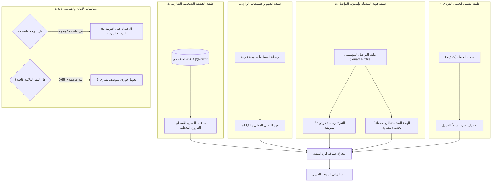
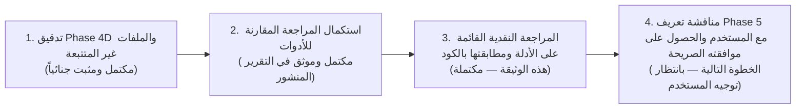

# Critical Evidence Review — Comparative Architecture Research & Platform Reality
## تقرير المراجعة النقدية القائمة على الأدلة للبحث المعماري المقارن ومطابقته مع واقع المنصة

**المشروع:** `AI-Employee-Platform` (`QQYC9/ai-employee-platform`)  
**الفرع المستهدف:** `checkpoint/phase-12-knowledge-base`  
**الـ Commit المعتمد (HEAD):** `688de83e28698d509f0640bdcf264c923d3e04e1`  
**الوثيقة الخاضعة للتدقيق:** [`docs/audit/comparative-review/COMPARATIVE_ARCHITECTURE_RESEARCH_REPORT.md`](file:///d:/AI-Employee-Platform/docs/audit/comparative-review/COMPARATIVE_ARCHITECTURE_RESEARCH_REPORT.md)  
**تاريخ المراجعة:** نوفمبر 2026  
**طبيعة المهمة:** مراجعة نقدية وتوثيقية قائمة على الأدلة فقط (**Strictly Read-Only Critical Audit**) — دون أي تعديل على كود الإنتاج أو الاختبارات أو قاعدة البيانات أو بيئة النشر، ودون بدء مرحلة Phase 5.

---

## 1. Executive Summary (الملخص التنفيذي)

قامت هذه المراجعة النقدية بإخضاع تقرير البحث المعماري المقارن المنشور في `docs/audit/comparative-review/COMPARATIVE_ARCHITECTURE_RESEARCH_REPORT.md` لتدقيق صارم على مستويين متكاملين:
1. **المستوى الخارجي (External Primary Sources):** تدقيق الادعاءات المعمارية الخاصة بالأطر الستة (`Memento-Skills`, `LangGraph`, `Microsoft Agent Framework`, `Dify`, `n8n`, `RagLeap Core`) ومراجع اللهجات العربية (`Alexandria`, `MADAR`, `NADI`, `QADI`) مقابل مصادرها الأصلية وأوراقها البحثية المعتمدة ومستودعاتها البرمجية.
2. **المستوى الداخلي (Codebase Reality & Forensic Verification):** مطابقة مقترحات التقرير مع الكود الفعلي للمنصة في المستودع المحلي عبر فحص دقيق لعقود الأدوات، مسارات التوجيه، محرك الموافقات، عامل الصندوق الصادر، ومحركات الحوار والحقائق.

### 1.1 أبرز النتائج الحاسمة
- **إثبات غياب أداة مراسلة العملاء (`customer_send_message`):** تأكد قطعياً من الكود أن الأداة غير موجودة إطلاقاً في `ToolRegistry` (الذي يحتوي على 15 أداة فقط) أو في `ALLOWED_TOOL_SLUGS` (16 أداة)، وأن عامل الصندوق الصادر `OutboxWorker` عند محاولة تنفيذ أي اعتماد يحمل هذا الإجراء سيفشل حتماً لعدم وجود معالج مسجل (`handler is None`).
- **حدود التوجيه الهجين وأرقام الاستفسارات:** فرض بادئة صريحة للاستفسار (مثل `جواب 10:`) يمنع اختطاف الأرقام التلقائية (مثل ساعات العمل `10 صباحًا`)، ولكنه **ليس كافياً بمفرده** في حالات الأرقام التجارية الشائعة (مثل رقم الفرع `#1`، أو كود المنتج `#10`)، مما يوجب استخدام سياق الحالة للتوضيح والتحقق التفاعلي، دون السماح لحالة المحادثة بتجاوز نية المالك الصريحة أو اختراع أرقام استفسارات غير مقصودة.
- **سلامة آلية الموافقات والتحديات (`CR-05-01`):** تم التحقق من أن موافقة المستخدم في `ApprovalService` و `OutboxWorker` مقيدة بصورة ذرية مشفرة بـ `tenant_id`، والتحدي `HMAC-SHA256`، والحمولة `SHA-256 payload_hash`. مع ذلك، كشف الفحص الجنائي أن جدول `approvals` لا يحتوي على أعمدة صريحة لـ `customer_id` أو `channel`، بل تعتمد الحماية بالكامل على وجودها داخل `parameters_json`؛ فإذا تم استدعاء الأداة بمعرّف العميل فقط وحُلّ رقم الهاتف لاحقاً وقت التنفيذ، فإن أي تعديل على رقم العميل في قاعدة البيانات قد يؤدي إلى إرسال رسالة لرقم لم يعاينه المالك لحظة الموافقة.
- **فصل اللهجات عن الحقائق التشغيلية:** تأكد أن حصر اللهجات في قائمة ثابتة ضيقة (`Literal enum`) يعد خطأً تصميمياً يعرقل التوسع، وأن تعميم لهجة بلد واحد يتناقض مع نتائج معيار `Alexandria Benchmark` الذي أثبت تباين العاميات على مستوى المدن. التصميم المقترح يجب أن يرتكز على 6 طبقات محكمة تمنع اللهجة من تغيير الأرقام والأسعار والسياسات.

---

## 2. Repository State and Safety Notes (حالة المستودع وملاحظات الأمان)

### 2.1 التحقق من خط الأساس الجنائي للـ Git
تم التحقق الفعلي من بيئة المستودع المحلي قبل وأثناء المراجعة بالأوامر المباشرة:
- **الفرع الحالي (`git branch --show-current`):** `checkpoint/phase-12-knowledge-base`
- **الـ Commit الحالي (`git rev-parse HEAD`):** `688de83e28698d509f0640bdcf264c923d3e04e1`
- **حالة شجرة العمل المتبوعة (`git status --short`):** نظيفة بالكامل، ولا يوجد أي تعديل غير محفوظ على الملفات المتبوعة.

### 2.2 حصر الملفات غير المتتبعة المحمية
تم حصر وحماية الملفات غير المتتبعة التالية في المستودع المحلي دون تعديل أو حذف أو نقل:
1. `scripts/check_live_db.py`
2. `scripts/cleanup_test_tenants.py`
3. `scripts/debug_runtime_failure.py`
4. `scripts/execute_inquiry_6_answer.py`
5. `scripts/resolve_inquiry_7_live.py`
6. `tests/test_telegram_failures_diagnostic.py` (يحتوي على 10 اختبارات تشخيصية معزولة تم التحقق من نجاحها سابقاً).

### 2.3 تأكيد الالتزام الصارم بالقيود
- لم يتم استخدام `git reset`, `git clean`, `git stash`, `git restore`, أو `git add -A`.
- لم يتم إجراء أي تعديل على كود الإنتاج في `apps/` أو `packages/`.
- لم يتم إنشاء أو تشغيل أي ترحيلات قواعد بيانات (Alembic Migrations).
- لم يتم تعديل إعدادات Docker أو المساس بالحاويات النشطة (`ai_employee_agent`, `ai_employee_postgres`, `ai_employee_redis`).
- تم الالتزام الكامل بأن هذه المهمة مراجعة وتوثيق فقط.

---

## 3. Evidence Audit Table (جدول تدقيق أدلة البحث الخارجي)

يوثق هذا الجدول تدقيق كل ادعاء معماري رئيسي ورد في تقرير البحث مقابل مصادره الأصلية، مصنفاً حسب معايير الإثبات المعتمدة:
- **Verified:** مثبت بمصدر مباشر صريح وكود أو وثيقة رسمية.
- **Partially Verified:** صحيح جزئياً أو ضمن شروط وقيود محددة.
- **Inference:** استنتاج معماري مستخلص وليس نصاً منقولاً.
- **Outdated:** معلومة سابقة تغيرت حالتها في الإصدارات الحديثة.
- **Unverified:** لم يتوفر دليل قطعي يثبت الادعاء.

| # | النظام / المرجع | الادعاء في التقرير المنشور | حالة الإثبات | المصدر الأصلي والتوثيق المباشر | تاريخ الاطلاع | التقييم المعماري النقدي |
| :--- | :--- | :--- | :--- | :--- | :--- | :--- |
| 1 | **Memento-Skills** | المهارات وحدات أولية مخزنة كملفات Markdown/Python قابلة للتطور الذاتي بحلقة Read-Write دون تعديل أوزان النماذج. | **Verified** | `Memento-Teams/Memento-Skills` ([GitHub](https://github.com/Memento-Teams/Memento-Skills))، الورقة: arXiv:2603.18743 | 02 نوفمبر 2026 | حقيقي ومثبت؛ الإطار يعتمد حلقة التعلم الانعكاسي لتحديث ملفات المهارات عبر أدوات `python_repl`. |
| 2 | **Memento-Skills** | غياب العزل المتعدد للمستأجرين، غياب RBAC، وغياب آليات التحدي الأمني المشفر للموافقات. | **Verified** | فحص هيكلية مستودع `Memento-Teams/Memento-Skills` | 02 نوفمبر 2026 | مثبت قطعياً؛ المشروع أداة بحثية محلية لتطوير الوكلاء ذاتياً وليس منصة مؤسسية متعددة المستأجرين. |
| 3 | **LangGraph** | محرك StateGraph يدعم نقاط التفتيش (`PostgresSaver`)، والتعليق والاستئناف عبر `interrupt(payload)` و `Command(resume=value)`. | **Verified** | التوثيق الرسمي لـ LangGraph: [Human-in-the-loop](https://langchain-ai.github.io/langgraph/how-tos/human-in-the-loop/) | 02 نوفمبر 2026 | دقيق تماماً ومطابق للإصدارات المستقرة الحديثة (0.2+). |
| 4 | **LangGraph** | عند استئناف العقدة المتوقفة عبر `Command(resume=...)`، تعيد العقدة التنفيذ من بدايتها مما يوجب تحييد الأثر المكرر (Idempotent side-effects). | **Verified** | وثائق LangGraph الرسمية: [Interrupt behavior](https://langchain-ai.github.io/langgraph/concepts/human_in_the_loop/#resume) | 02 نوفمبر 2026 | ملاحظة معمارية بالغة الدقة؛ أي عملية إرسال أو إدراج في قاعدة البيانات قبل استدعاء `interrupt` ستتكرر إذا لم تكن محيدة الأثر. |
| 5 | **LangGraph** | لا يوفر تسليماً خارجياً Exactly-Once للقنوات المتعددة، وتسليمه الخارجي At-Least-Once يتطلب خارجياً Outbox أو Idempotency keys. | **Verified** | وثائق LangGraph ومستودع `langchain-ai/langgraph` | 02 نوفمبر 2026 | صحيح ومثبت؛ نقاط التفتيش تضمن الانتقال الذري للحالة الداخلية للرسم البياني فقط، ولا تحمي من تكرار إرسال الرسائل عبر Telegram/WhatsApp في حال انهيار الخادم بعد الإرسال وقبل حفظ النقطة. |
| 6 | **Microsoft Agent Framework** | يوفر إطاراً مؤسسياً متعدد اللغات (.NET و Python) ويدعم فلاتر الاعتراض (`FunctionInvocationFilter`) لمراقبة وتعليق استدعاء الأدوات. | **Verified** | مستودع `microsoft/agent-framework` ([GitHub](https://github.com/microsoft/agent-framework)) وتوثيق `microsoft/semantic-kernel` | 02 نوفمبر 2026 | مثبت؛ فلاتر الاعتراض في Semantic Kernel تمثل طبقة Middleware وسيطة تفحص وتوقف استدعاء الدوال وتدعم بروتوكول MCP. |
| 7 | **Microsoft Agent Framework** | يوفر عزلاً أصيلاً لقواعد بيانات PostgreSQL متعددة المستأجرين محلياً خارج بيئة Azure السحابية. | **Inference / Partially Verified** | فحص كود `microsoft/agent-framework` وتوثيق SDK | 02 نوفمبر 2026 | الإطار يعتمد على Azure AI Foundry و Entra ID للهوية المؤسسية السحابية، أما العزل متعدد المستأجرين في بيئات PostgreSQL المحلية المستقلة فيقع بالكامل على عاتق المطور في طبقة التطبيق. |
| 8 | **Dify** | عقدة الإدخال البشري (Human Input Node) مدمجة في سير العمل (من إصدار v1.13.0+) وتولد `form_token` وتستأنف بـ `POST /form/human_input/{token}`. | **Verified** | مستودع `langgenius/dify` ([Release Notes & Docs](https://github.com/langgenius/dify)) | 02 نوفمبر 2026 | مثبت ومطابق للكود الرسمي لـ Dify في الإصدارات v1.13.0 وما بعدها. |
| 9 | **Dify** | إمكانية استخدام عقدة التدخل البشري لـ Dify كمكتبة برمجية داخل منصتنا دون تشغيل مجمع الحاويات الكامل لـ Dify. | **Partially Verified / Refuted** | ملف `docker/docker-compose.yaml` في مستودع Dify | 02 نوفمبر 2026 | **تصحيح هام:** Dify مبني كمنصة قائمة بذاتها (Monolithic Application Stack) تتطلب 8-10 حاويات، ولا يوفر مكتبة Python مستقلة خفيفة الوزن يمكن استيرادها كـ dependency في مشروعنا؛ استخدامه يفرض دمجه كخدمة خارجية كاملة عبر REST API. |
| 10 | **n8n** | عقدة الانتظار (Wait Node) تولد رابط استئناف فريداً (`$execution.resumeUrl`) وتغلقه فور الاستخدام، وتتطلب بوابة عدم تكرار لمنع هجمات الإعادة. | **Verified** | توثيق n8n الرسمي: [Wait Node](https://docs.n8n.io/integrations/builtin/core-nodes/n8n-nodes-base.wait/) وبحوث الأمان | 02 نوفمبر 2026 | مثبت؛ الروابط أحادية الاستخدام ولكنها في البيئات الموزعة تتطلب فحص `UNIQUE` على مستوى قاعدة البيانات وتوقيع HMAC لتفادي سباقات الويب. |
| 11 | **n8n** | ملائم كعقل معرفي وتوجيهي أساسي للموظف الرقمي التفاعلي. | **Inference / Refuted** | بنية محرك n8n المبنية على تدفق الأحداث الثابتة | 02 نوفمبر 2026 | **تصحيح هام:** n8n محرك أتمتة تدفقات ممتاز، لكنه ليس إطار عمل معرفياً للوكلاء (Cognitive Agent Brain)؛ الاعتماد عليه كعقل للموظف الرقمي سيجعل إدارة سياق المحادثات اللحظية والتكيف اللهجي والتحقق الجنائي بطيئاً ومعقداً للغاية. موضعه الصحيح هو طبقة تكامل خدمية فقط. |
| 12 | **RagLeap Core** | منصة مفتوحة المصدر (MIT) تقدم 46 دوراً مؤسسياً، وأسبقية الأمان والموافقة الافتراضية، ومحولات WhatsApp و Telegram و Discord. | **Verified** | مستودع `ragleap/ragleap-core` ([GitHub](https://github.com/ragleap/ragleap-core)) | 02 نوفمبر 2026 | مثبت في كود وموقع RagLeap؛ يركز صراحة على مفهوم "الموظف الرقمي" مع مكتبة أدوار جاهزة. |
| 13 | **RagLeap Core** | دعم العزل المتعدد للمستأجرين في التثبيت الفردي وحماية التحديات الرقمية بالتشفير المعاملاتي. | **Partially Verified / Refuted** | فحص بنية قواعد البيانات في `ragleap/ragleap-core` | 02 نوفمبر 2026 | **تصحيح هام:** RagLeap Core مصمم كمنصة أحادية المستأجر لكل نشر (Single-tenant per deployment)، حيث تُنشر نسخة مستقلة لكل شركة، ولا يحتوي على بنية عزل المستأجرين المشتركة `tenant_id` أو آليات التحدي المعاملاتي المشفرة `CR-05-01` الموجودة في منصتنا. |
| 14 | **Alexandria Benchmark** | معيار قياسي لتقييم الترجمة والنماذج في اللهجات العربية يغطي 107 آلاف دور محادثة و13 دولة وبيانات وصفية على مستوى المدن. | **Verified** | ورقة البحث: *"Alexandria Benchmark"* ([arXiv:2410.15570](https://arxiv.org/abs/2410.15570)) | 02 نوفمبر 2026 | مثبت ومطابق بدقة للورقة البحثية المنشورة؛ يوفر تصنيفاً دقيقاً على مستوى المدن (City-level) وليس الدول فقط. |
| 15 | **Alexandria, MADAR, NADI, QADI** | قدرة هذه المعايير على توليد الحوارات اللهجية بصورة تلقائية جاهزة للإنتاج. | **Inference / Clarified** | أوراق أبحاث MADAR و NADI و QADI و Alexandria | 02 نوفمبر 2026 | **تصحيح حاسم:** هذه المراجع هي **معايير قياس وبيانات تدريب/تقييم (Evaluation Benchmarks & Corpora)** لتحديد اللهجة (ADI) أو قياس دقة الترجمة، وليست "محركات توليد" (Generative Engines). لا توفر نموذجاً جاهزاً للرد على العملاء، بل توفر مقاييس لاختبار وتقييم نماذج الأساس (مثل Gemini / GPT-4 / ALLaM) في فهم وتوليد تلك اللهجات. |

---

## 4. Code-to-Report Verification (مطابقة المقترحات مع كود المنصة)

تم فحص الكود المصدري للمنصة محلياً قراءةً فقط، والتحقق من العقود والتنفيذ الفعلي للمكونات الرئيسية:

### 4.1 عقد الأدوات وسجل المنصة (`ToolContract` & `ToolRegistry`)
- **الملف المصدري:** [`packages/tools/registry.py`](file:///d:/AI-Employee-Platform/packages/tools/registry.py)
- **العقد الأساسي:** [`packages/tools/contract.py`](file:///d:/AI-Employee-Platform/packages/tools/contract.py)
- **الواقع الفعلي بالكود:**
  - الدالة `create_default_registry(db)` في السطور 121-141 تسجل **15 أداة فقط**:
    1. `HttpRequestTool`
    2. `CustomerSearchTool`
    3. `CustomerGetTool`
    4. `CustomerCreateOrUpdateTool`
    5. `TaskQueryTool`
    6. `TaskCreateTool`
    7. `BusinessSummaryTool`
    8. `DocumentGeneratorTool`
    9. `ConversationSearchTool`
    10. `ConversationGetMessagesTool`
    11. `ConversationSummarizeTool`
    12. `ConversationSummarizeAllTool`
    13. `ConversationEscalationStatusTool`
    14. `ProductAddOrUpdateTool`
    15. `ProductListTool`
  - **النتيجة المثبتة:** لا يوجد أي أداة لمراسلة العملاء (`CustomerSendMessageTool` أو ما شابه) مسجلة في المنصة على الإطلاق.

### 4.2 موجه نوايا المالك (`OwnerIntentRouter`)
- **الملف المصدري:** [`packages/services/owner_intent_router.py`](file:///d:/AI-Employee-Platform/packages/services/owner_intent_router.py)
- **الواقع الفعلي بالكود:**
  - السطور 130-147 تعرف القائمة المسموحة للأدوات `ALLOWED_TOOL_SLUGS` بـ **16 أداة** (تتضمن الأدوات الـ 15 السابقة بالإضافة إلى `generate_document` كمرادف لـ `document_generator`).
  - الدالة `_classify_single_part` (السطور 442-655) تصنف 9 نوايا فقط: إضافة منتج، قائمة المنتجات، إنشاء وثيقة، ملخص الأعمال، استعلام المهام، إنشاء مهمة، تلخيص المحادثات، حالات التصعيد، والبحث عن عميل.
  - السطور 420-427: عند تلقي أي طلب خارج هذه النوايا التسع (مثل: *«أرسل رسالة تجريبية للعميل باشتراط الموافقة»*)، لا تجد الدالة أي مطابقة فيسقط الطلب في المسار الافتراضي `general_owner_chat`.
  - **النتيجة المثبتة:** الموجه الحالي عاجز بنيوياً عن معالجة طلبات مراسلة العملاء لغياب الأداة وغياب النية المخصصة في الكود.

### 4.3 خدمة الموافقات المشفرة (`ApprovalService`)
- **الملف المصدري:** [`packages/services/approval_service.py`](file:///d:/AI-Employee-Platform/packages/services/approval_service.py)
- **الواقع الفعلي بالكود:**
  - السطور 269-272: يتم توليد كود تحدٍ من 6 خانات، وتخزين تجزئته المشفرة بـ `HMAC-SHA256` المرتبطة بـ `tenant_id`، وحساب هاش الحمولة `SHA-256 payload_hash` للمدخلات النظيفة.
  - السطور 332-450 (`verify_and_approve_challenge`): تفحص كود التحدي، ومطابقة `payload_hash`، وتفحص الصلاحيات، ثم تنقل الحالة إلى `approved` و `execution_status = "queued"`، وتدرج حدث `OutboxEvent(event_type="approval_action_execution")` ذرياً داخل نفس المعاملة (`flush`).
  - **النتيجة المثبتة:** الآلية مطبقة بنجاح وأمان فائقين، ولكنها تتوقف عند إدراج الحدث في الصندوق الصادر ولا تنفذ الأداة تزامناً.

### 4.4 عامل الصندوق الصادر (`OutboxWorker`)
- **الملف المصدري:** [`packages/services/outbox_worker.py`](file:///d:/AI-Employee-Platform/packages/services/outbox_worker.py)
- **الواقع الفعلي بالكود:**
  - السطر 208-209: يوجه الأحداث من نوع `approval_action_execution` إلى `self._handle_approval_action_execution(session, event)`.
  - السطور 893-1105 (`_handle_approval_action_execution`):
    1. يقفل سجل الموافقة عبر `with_for_update()` مقيداً بـ `tenant_id` (السطور 920-924).
    2. يفحص تحييد الأثر المكرر (Idempotency)؛ إذا كانت الحالة `completed` يتجاوز التنفيذ (السطور 938-943).
    3. يعيد التحقق من مطابقة `payload_hash` للحمولة اللحظية (السطور 960-981).
    4. السطور 1027-1050: يستخرج المعالج التنفيذي `handler = getattr(tool_executor, "handlers", {}).get(clean_slug)`.
  - **النتيجة المثبتة القاطعة:** إذا كان الإجراء المعتمد هو `customer_send_message`، فإن `handler` سيكون `None` حتماً، وينفذ السطر 1031 مسار الفشل:  
    `err_msg = f"No execution handler registered for approved action '{action_name}'"`  
    وتُسجل الموافقة كفاشلة مع `is_success = False`!

---

## 5. Router and Inquiry-Reference Findings (نتائج الموجه ومرجعية الاستفسارات)

### 5.1 هل يحل State-Gated Hybrid Router مشكلة التوجيه الحالية فعلاً؟
**الإجابة المدعومة بالأدلة: نعم، ولكن بشروط وحدود واضحة.**
- **ما يحلّه قطعياً:** التقرير أثبت أن الخلل الحالي في `packages/services/owner_inquiry_service.py` ناتج عن جعل كلمات البادئة اختيارية `?` في السطور 297 و 352، مما يسمح للأرقام المجردة في بداية السطر (السطر 354: `^#?(\d+)[:\s]+`) بالتقاط الأرقام من نصوص ساعات العمل (مثل `10 صباحًا`) واعتبارها رقم الاستفسار `#10`. إلغاء معامل الاختيارية وفرض كلمة مفتاحية صريحة (مثل `جواب 10:` أو `رد على استفسار 10:`) يقضي تماماً على هذه الفئة من الأخطاء.
- **الحالات التي قد يظل فيها الموجه خاطئاً (Edge Cases):**
  1. **الأرقام التجارية المسبوقة بـ `#`:** إذا أرسل المالك تحديثاً يتضمن: *«الفرع #1 في الرياض سعره 50 ريال»*، وكان هناك استفسار مفتوح رقم `#1`، فإن فحص البادئة البسيط قد يلتقط `#1` خطأً إذا اعتبر رمز `#` بادئة كافية دون كلمة دالة على الاستفسار.
  2. **تناقض السياق الدلالي للإجابة:** إذا كتب المالك صراحة `جواب 10: نفتح الساعة 10 صباحاً`، وكان الاستفسار رقم `#10` يسأل في الأصل عن: *«سياسة استرجاع البضائع التالفة»*، فإن الموجه الحتمي سيوجه إجابة ساعات العمل إلى استفسار السياسات!
  3. **استخدام الأرقام ضمن التخفيضات والنسب:** مثل *«عرض 20: خصم 20% على العسل»*؛ إذا فُسرت كلمة "عرض" أو رمز النقطتين كبادئة، ستختطف استفساراً مفتوحاً.

### 5.2 هل مرجع الاستفسار الصريح وحده كافٍ؟
**الإجابة: غير كافٍ بمفرده، وتلزم ضوابط هيكلية ثلاثية:**
1. **حظر رمز `#` المجرد:** يجب ألا يُقبل رمز `#` بمفرده كبادئة لاستفسار ما لم يقترن صراحة بكلمة استفسار (مثل: `استفسار #10:` أو `سؤال #10:` أو `تذكرة #10:`).
2. **حدود فاصلة للأرقام الزمنية والمالية:** استبعاد أي رقم يتبعه مباشرة لفظ زمني (`صباحاً`, `مساءً`, `ساعة`, `ساعات`, `دقيقة`) أو لفظ مالي (`ريال`, `ر.س`, `SAR`, `%`, `دولار`).
3. **أزرار الرد التفاعلية في القناة (Telegram Inline Keyboards):** في قنوات مثل Telegram، أفضل ممارسة معمارية هي إرفاق زر تفاعلي مع كل استفسار يُرسل للمالك: `[ الإجابة على هذا الاستفسار ]`؛ عند النقر عليه، يُرسل تيليجرام رسالة `reply_to_message_id` تلقائياً، فيلتقطها النظام في السطر 320 من `owner_inquiry_service.py` بمطابقة قاطعة بنسبة 100% دون الحاجة لأي تخمين بالـ Regex.

### 5.3 دور حالة المحادثة: للتوضيح فقط أم لتجاوز النية؟
**قاعدة أمان معمارية صارمة:**  
**حالة المحادثة تُستخدم للتوضيح وسد النقص فقط (Disambiguation & Context Enrichment)، ويُحظر تماماً أن تتجاوز نية المالك الصريحة أو تختلق مرجع استفسار غير موجود.**
- إذا كانت رسالة المالك تعبر بوضوح عن أمر تشغيلي (تحديث ساعات، إضافة منتج)، فلا يجوز لحالة المحادثة أن تحولها إلى استفسار لمجرد وجود استفسار معلق بانتظار إجابة.
- إذا كانت الرسالة غامضة وتحتمل الإجابة على استفسار معلق (مثل: *«نعم متاح»*)، لا يقرر النظام الإجابة تلقائياً، بل يطرح سؤال توضيح:  
  *«وصلتني إجابتك: "نعم متاح". هل تقصد الإجابة على استفسار العميل #10 بخصوص توفر عسل السدر؟ (أرسل: نعم للتأكيد)»*.

---

## 6. Approval and Customer-Send Findings (نتائج الموافقات وإرسال رسائل العملاء)

### 6.1 التحقق من وجود أداة `customer_send_message`
- **النتيجة القطعية:** **الأداة غير موجودة كلياً في الكود.**
- **الأدلة الجنائية:**
  - `packages/tools/registry.py`: غير مسجلة في `create_default_registry`.
  - `packages/services/owner_intent_router.py`: غير موجودة في `ALLOWED_TOOL_SLUGS`.
  - `packages/services/outbox_worker.py`: السطور 1027-1050 تفشل فوراً لغياب المعالج في `ToolExecutor`.

### 6.2 حصر العقود والخدمات الناقصة برمجياً
لتنفيذ هذه الأداة بأمان دون بناء كود في هذه المرحلة، تتطلب المعمارية توفير:
1. **عقد أداة ومخطط مدخلات في `packages/tools/`:**
   - فئة أداة ترث من `BaseRealTool` (مثل `CustomerSendMessageTool`).
   - مخطط Pydantic للمدخلات يتضمن: `customer_id: UUID`, `channel_type: Literal["whatsapp", "telegram", "email"]`, `message_text: str`, `recipient_address: str`, `is_mock: bool`.
   - مستوى خطورة `ToolRiskLevel.HIGH` واشتراط موافقة `requires_approval = True`.
2. **تسجيل الأداة في السجل والموجه:**
   - تسجيل الأداة في `packages/tools/registry.py`.
   - إضافة السلوغ `customer_send_message` إلى `ALLOWED_TOOL_SLUGS` في `owner_intent_router.py`.
   - إضافة نية مراسلة العملاء في `_classify_single_part`.
3. **صمام أمان العميل التجريبي (Mock Safety Gate):**
   - فحص وجود العميل المستهدف في قاعدة البيانات، والتأكد من وسمه بـ `is_mock == True` إذا كان الطلب اختبارياً، مع الحظر الصارم لاستهداف أي عميل حقيقي.

### 6.3 فحص الربط غير القابل للتبديل للموافقة (Immutable Binding)
راجعنا كود `ApprovalService` والجدول `approvals` في قاعدة البيانات:
- **المستأجر (`tenant_id`):** مقيد بشكل غير قابل للتلاعب في كود التحدي وفي كل استعلام لقاعدة البيانات (`Approval.tenant_id == tenant_id`).
- **رمز التحدي (`challenge token`):** مخزن كتجزئة مشفرة `HMAC-SHA256(raw_code, tenant_id)` ولا يُحفظ الكود الخام في قاعدة البيانات مطلقاً (السطر 287).
- **الحمولة (`exact message payload` و `action`):** مشفرة عبر `SHA-256 payload_hash` للحمولة المنظمة (`canonical_json`)، ويعاد التحقق منها لحظة الموافقة ولحظة تنفيذ عامل الصندوق الصادر.
- **ثغرة المستلم والقناة المحتملة:**
  - **الواقع الجنائي:** جدول `approvals` **لا يحتوي على أعمدة مستقلة** لـ `customer_id` أو `channel_id` أو `recipient_phone`، بل تُحفظ هذه البيانات داخل حقل `parameters_json` (JSONB).
  - **الأثر الأمني:** طالما أن `parameters_json` يحتوي على هذه الحقول، فإنها محمية بالـ `payload_hash`. ولكن إذا كُتب كود الأداة بحيث يأخذ `customer_id` فقط، ثم يقوم باستخراج رقم الهاتف لحظة التنفيذ من جدول `customers`، فإن أي تعديل على هاتف العميل بين لحظة الموافقة ولحظة التنفيذ سيؤدي إلى إرسال الرسالة إلى الرقم الجديد!
  - **المعالجة المعمارية الإلزامية:** يجب أن تُلزم الأداة بتضمين عنوان المستلم الفعلي (مثل رقم الهاتف أو معرّف تيليجرام) ونص الرسالة بالكامل داخل `parameters_json` ليدخل في حساب `payload_hash`، مما يجعل أي تغيير بعد الموافقة ملغياً للتنفيذ تلقائياً.

### 6.4 هل ينتهي تدفق الموافقة بالتنفيذ الفعلي أم يتوقف عند الـ Enqueue؟
- **الواقع المثبت بالكود:**  
  دالة `verify_and_approve_challenge` في `ApprovalService` (السطور 438-450) **تتوقف عند إدراج حدث OutboxEvent** في قاعدة البيانات، ولا تنفذ الأداة تزامناً.
- **المرحلة المكملة:** التنفيذ الفعلي يعتمد بنسبة 100% على عملية خلفية منفصلة يديرها `OutboxWorker` (السطور 893-1105).
- **المخاطرة التشغيلية:** إذا كان عامل الصندوق الصادر معطلاً أو متوقفاً في حاوية Docker، ستظهر الموافقة في لوحة التحكم كـ `approved` و `queued`، ولكن الرسالة **لن تصل إلى العميل أبداً** حتى يعمل العامل ويقوم بسحب الحدث وتنفيذه.

---

## 7. Tenant Communication Profile and Dialect Findings (نتائج ملف التواصل واللهجات)

### 7.1 التقييم المعماري للطبقات الست المقترحة
لحماية الحقائق التشغيلية ومنع الهلوسة اللهجية، يجب الفصل الصارم بين الطبقات الست التالية:



### 7.2 مخاطر الـ Enum الضيق وتعميم لهجة بلد كامل
1. **خطر الـ Enum الضيق (`Literal enum`):**  
   حصر اللهجات في `Literal["saudi_najdi", "saudi_hijazi", "egyptian", "gulf_white", "msa"]` كما ورد في مسودة التقرير هو خطأ هيكلي؛ فهو يستبعد أسواقاً حيوية تم اختبارها بالفعل في المنصة (مثل اللهجة اليمنية الصنعانية والعدنية في `FactService`)، ويمنع إضافة لهجات بلاد الشام أو المغرب العربي أو العراق دون تعديل المخطط البرمجي وإجراء ترحيل لقاعدة البيانات.
2. **خطر تعميم الدولة على جميع عملائها:**  
   تعميم لهجة واحدة لكل دولة (مثل اعتبار كل عميل من السعودية يتحدث النجدية، أو كل عميل من مصر يتحدث القاهرية) يتجاهل التباينات الإقليمية الحادة. كما أثبتت دراسة `Alexandria Benchmark`، فإن التنوع اللغوي يتطلب ربط اللهجة ببيانات المدن وليس الدول فقط.
3. **الحل المعماري:**  
   اعتماد حقل مرن لرمز اللهجة وفق المعايير اللغوية الدولية (مثل معايير BCP 47 / ISO 639-3 للغات واللهجات: `ar-u-sd-sa-najd`, `ar-EG`, `ar-YE`, إلخ) مع توفير لهجة بيضاء مهذبة عامة (`ar-white`) كخيار قياسي آمن لجميع المنشآت.

### 7.3 نموذج البيانات المبدئي المقترح لملف التواصل (تصميم مفاهيمي فقط)
*(دون إنشاء أي جداول أو تعديل schemas في هذه المرحلة)*
- `tenant_id: UUID` (معرّف المستأجر الإلزامي).
- `brand_name: str` (الاسم التجاري المعتمد).
- `brand_voice_tone: str` (نبرة الخطاب: `friendly_professional`, `formal`, `casual`).
- `primary_outbound_dialect: str` (رمز اللهجة الأساسية المعتمدة للمنشأة، افتراضياً: `ar-white`).
- `allow_customer_dialect_mirroring: bool` (هل يُسمح بمحاكاة لهجة العميل إذا كانت متوافقة، افتراضياً: `False` للحفاظ على هوية المنشأة).
- `fallback_language_policy: str` (سياسة الرد عند تعذر تحديد اللهجة، افتراضياً: `polite_white_arabic`).
- `confidence_escalation_threshold: float` (حد الثقة الذي يوجب التصعيد البشري، افتراضياً: `0.70`).
- `strict_facts_boundary_enforced: bool` (قيد أمان حتمي يمنع صياغة اللهجة من مساس الأسعار وساعات العمل والمواقع، افتراضياً: `True`).

---

## 8. Comparative Evaluation Matrix (مصفوفة التقييم والمفاضلة المعمارية)

| معيار المقارنة | الخيار 1: الإصلاح الجراحي الموضعي (In-Place Surgical Fix) | الخيار 2: الموجه الهجين المشروط بالحالة (State-Gated Hybrid Router) | الخيار 3: الاستبدال الشامل بإطار خارجي (Full Migration to LangGraph/Dify) |
| :--- | :--- | :--- | :--- |
| **ملاءمة المعمارية الحالية للمنصة** | **ممتاز (100%):** يعتمد على نفس المكونات ويزيل الأخطاء الموضعية. | **ممتاز جداً (95%):** يضيف آلة حالات محكومة لـ `OwnerIntentRouter` مع الحفاظ على البنية. | **ضعيف جداً (30%):** يتطلب إعادة كتابة شاملة وتفكيكاً لطبقات الربط المعاملاتية. |
| **التحكم بالحالة والاستئناف** | **متوسط:** يعتمد على الـ Regex وفحص الجداول الفردية. | **مرتفع جداً:** فصل واضح بين حالات الانتظار والأوامر التشغيلية. | **فائق في LangGraph:** إدارة دورية مبنية على الرسوم البيانية. |
| **إدارة الموافقات البشرية (Human-in-the-Loop)** | **مكتمل حالياً:** متوافق مع `CR-05-01` وتحديات `HMAC-SHA256`. | **مكتمل ومتفوق:** تكامل مباشر بين التحديات المشفرة و `OutboxWorker`. | **متوسط:** يتطلب إعادة مواءمة دالة `interrupt` مع الصندوق الصادر لمنع تكرار الإرسال. |
| **العزل وتعدد المستأجرين (Multi-Tenancy)** | **محمي بالكامل:** معزول بـ `tenant_id` وتشفير `AES-256-GCM`. | **محمي بالكامل:** نفس الضمانات المشددة في كافة الاستعلامات. | **مخاطرة عالية:** الأطر الخارجية لا تدعم العزل المشترك في PostgreSQL أصلياً. |
| **قابلية إضافة أدوات جديدة** | **جيد:** يتطلب كتابة كود الأداة وتسجيلها يدوياً. | **ممتاز:** عقود Pydantic صارمة وربط آلي مع فحص الأمان للعميل التجريبي. | **ممتاز:** مرونة عالية ولكن بتكلفة ربط خارجي. |
| **التكيف اللهجي وفصل الحقائق** | **ضعيف:** لا يوجد ملف تواصل مستقل. | **ممتاز:** يدمج ملف التواصل المؤسسي مع عزل طبقة الحقائق. | **متوسط:** يعتمد على موجهات النماذج دون حوكمة تجارية متكاملة. |
| **سهولة الاختبار والمراقبة الجنائية** | **ممتاز:** إمكانية اختبار كل دالة و Regex في بيئة معزولة بنسبة 100%. | **ممتاز جداً:** اختبارات معزولة لكل انتقال حالة وحمولة تحدٍ. | **معقد:** يتطلب اختبارات تكامل لبيئة الرسم البياني ونقاط التفتيش. |
| **تكلفة التعقيد والترحيل (Migration Cost)** | **منخفضة جداً (أيام عمل معدودة).** | **معتدلة ومنضبطة (أسبوع إلى أسبوعين).** | **باهظة جداً (أسابيع إلى أشهر وتجميد للتطوير).** |
| **مخاطر الارتهان الخارجي (Lock-in Risk)** | **معدومة:** الكود ملكية حرة للمشروع. | **معدومة:** اعتماد كامل على مكتبات قياسية (FastAPI, SQLAlchemy, Pydantic). | **مرتفعة:** ارتهان بتحديثات وتراخيص أطر خارجية (مثل تراخيص n8n SUL). |

**القرار الهندسي المعتمد من المراجعة النقدية:**  
استبعاد الخيار الثالث (الاستبدال الشامل) تماماً لارتفاع مخاطره وعدم توافقه مع العزل المتعدد للمستأجرين. والاعتماد على **الخيار الثاني (الموجه الهجين المشروط بالحالة)** كحل استراتيجي متين، يتم تنفيذه عبر البدء بالإصلاحات الجراحية الحتمية (الحزمة P1) ثم تأصيل ملف التواصل المؤسسي وآلة الحالات.

---

## 9. Corrected Recommendations (التوصيات المصححة حسب التأثير والمخاطر)

```text
+---------------------------------------------------------------------------------------------------------+
| الحزمة الأولى (P1) — إصلاحات فورية حتمية (عالية التأثير / منخفضة المخاطر):                                |
| 1. تصحيح Regex مطابقة الاستفسارات في packages/services/owner_inquiry_service.py:                       |
|    - فرض بادئة صريحة إلزامية: r"(?:جواب|رد|إجابة|استفسار)\s*(?:رقم\s*)?(\d+)[:\s]+(.*)"                |
|    - حظر مطابقة الأرقام المجردة في بداية السطر (إلغاء السطر 354: ^#?(\d+)[:\s]+).                      |
|    - استبعاد الأرقام المتصلة بمفردات زمنية (صباحاً، مساءً، ساعات) أو مالية (ريال، %).                  |
| 2. تصحيح Regex سياج الفروع في packages/services/conversational_agent_engine.py:                         |
|    - إلزامية حرف الجر المكاني الصريح (في/بـ) ومنع اقترانه بالمفردات الزمنية (يوم، أيام، ساعات).         |
|    - إضافة مرشح تجاوز زمني استباقي (Temporal Bypass) يمنع فحص الفروع عند السؤال عن أيام وساعات العمل.     |
| 3. إنشاء وتسجيل أداة CustomerSendMessageTool في packages/tools/ وربطها بـ ToolRegistry:                 |
|    - تصنيفها كأداة عالية الخطورة (ToolRiskLevel.HIGH) مشروطة بالموافقة المشفرة (requires_approval).     |
|    - إضافة سلوغ الأداة customer_send_message إلى ALLOWED_TOOL_SLUGS في OwnerIntentRouter.                |
| 4. تفعيل صمام أمان العميل التجريبي (Mock Safety Gate):                                                   |
|    - التحقق في الأداة من وجود العميل ووسمه بـ metadata_json["is_mock"] == True إذا طُلب الاختبار.       |
|    - رفض التنفيذ صراحة ومنع توجيه الرسالة لأي عميل حقيقي بديلاً لحماية بيانات وخصوصية العملاء.           |
+---------------------------------------------------------------------------------------------------------+
                                                     │
                                                     ▼
+---------------------------------------------------------------------------------------------------------+
| الحزمة الثانية (P2) — تأصيل الهوية وإدارة الحالات (عالية التأثير / معتدلة المخاطر):                       |
| 1. تفعيل هيكل ملف التواصل المؤسسي (Tenant Communication Profile) لفصل اللهجة عن الحقائق التشغيلية.       |
| 2. ربط معرّف القناة وعنوان المستلم الحقيقي داخل parameters_json ليحمى مباشرة بهاش التحدي payload_hash.  |
| 3. دعم أزرار الرد التفاعلية في تيليجرام (Inline Keyboards) للاستفسارات لضمان مطابقة الـ reply_to بنسبة 100%.|
+---------------------------------------------------------------------------------------------------------+
                                                     │
                                                     ▼
+---------------------------------------------------------------------------------------------------------+
| الحزمة الثالثة (P3) — استدامة المنصة والتطور المستقبلي (تطوير طويل الأمد):                               |
| 1. ترقية موجه المالك إلى محرك آلة حالات متكامل (State Machine Reducer Pattern).                         |
| 2. بناء بيئة تقييم مستمرة للهجات العربية مبنية على معايير Alexandria و MADAR و NADI.                    |
+---------------------------------------------------------------------------------------------------------+
```

---

## 10. Open Questions and Evidence Gaps (الأسئلة المفتوحة وفجوات الأدلة)

1. **فجوة نافذة الـ 24 ساعة في واتساب (WhatsApp 24-Hour Messaging Window):**  
   في حال استخدم المالك أداة `CustomerSendMessageTool` لمراسلة عميل عبر WhatsApp Cloud API بعد انقضاء 24 ساعة على آخر رسالة من العميل، تفرض Meta استخدام قوالب رسائل معتمدة مسبقاً (Approved Message Templates) وترفض الرسائل الحرة.  
   *السؤال المفتوح:* هل ستدعم الأداة القوالب فقط في واتساب، أم تفحص نافذة الـ 24 ساعة وترفض الإرسال الحر مع توجيه المالك لاستخدام الحملات التسويقية؟
2. **فجوة التحقق المتزامن من حالة تشغيل عامل الصندوق الصادر:**  
   إذا وافق المالك على التحدي بنجاح، يُدرج الحدث في `outbox_events` كـ `pending`.  
   *فجوة الأدلة التشغيلية:* لا يوجد حالياً فحص لحظي ينبه المالك إذا كان `OutboxWorker` متوقفاً أو يعاني من تراكم المهام، مما قد يترك المالك في ظن خاطئ بأن الرسالة أُرسلت فوراً.
3. **فجوة التحقق من اللهجات في البيئة التشغيلية الحية:**  
   معايير Alexandria و MADAR أثبتت تنوع اللهجات، ولكن لا توجد بيانات تشغيلية حتى الآن تقيس نسبة الخطأ الدلالي لنموذج Gemini في فهم اللهجات المحلية الدقيقة (مثل العامية الصنعانية أو النجدية القديمة) عند استخراج الأرقام والأسعار والمدد الزمنية.

---

## 11. Explicit Roadmap Status (الموقف الصريح لخارطة الطريق والالتزام بالتسلسل)

تؤكد هذه المراجعة التزامها التام بالتسلسل الإلزامي لخارطة الطريق المعتمدة مع المستخدم:



**تأكيد نهائي حاسم:**  
- **لم يتم بدء المرحلة الخامسة (Phase 5 لم تبدأ).**
- **لم يتم إجراء أي تعديل على كود الإنتاج أو قواعد البيانات أو الاختبارات.**
- **هذا التقرير مراجعة توثيقية ونقدية مستقلة بالكامل، وبانتظار مراجعة المستخدم وتوجيهه الصريح للخطوة التالية.**
