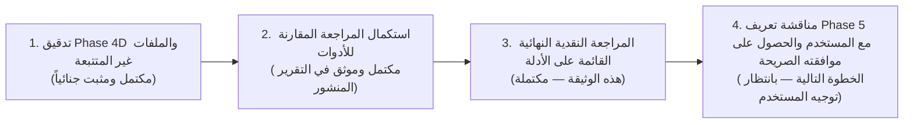

# Critical Evidence Review — Comparative Architecture Research & Platform Reality
## تقرير المراجعة النقدية القائمة على الأدلة للبحث المعماري المقارن ومطابقته مع واقع المنصة

**المشروع:** `AI-Employee-Platform` (`QQYC9/ai-employee-platform`)
**الفرع المستهدف:** `checkpoint/phase-12-knowledge-base`
**الـ Commit المعتمد للتدقيق:** `04de4944eac60178f6f1d3f3d817fd0610a2a6f2`
**الوثيقة الخاضعة للتدقيق:** [`docs/audit/comparative-review/COMPARATIVE_ARCHITECTURE_RESEARCH_REPORT.md`](file:///d:/AI-Employee-Platform/docs/audit/comparative-review/COMPARATIVE_ARCHITECTURE_RESEARCH_REPORT.md)
**تاريخ المراجعة النهائية:** نوفمبر 2026
**طبيعة المهمة:** مراجعة نقدية وتوثيقية قائمة على الأدلة فقط (**Strictly Read-Only Critical Audit**) — دون أي تعديل على كود الإنتاج أو الاختبارات أو قاعدة البيانات أو بيئة النشر، ودون بدء مرحلة Phase 5، ودون تنفيذ أي إصلاح طارئ أو خلطه بهذه المهمة.

---

## 1. Executive Summary (الملخص التنفيذي)

قامت هذه المراجعة النقدية النهائية بإخضاع تقرير البحث المعماري المقارن المنشور لتدقيق تحليلي بنداً بنداً لمطابقته مع المصادر الأصلية الخارجية والواقع الفعلي لكود المنصة المحلية:
1. **المستوى الخارجي (External Primary Sources):** تدقيق الادعاءات المعمارية الخاصة بالأطر الستة (`Memento-Skills`, `LangGraph`, `Microsoft Agent Framework`, `Dify`, `n8n`, `RagLeap Core`) ومراجع اللهجات العربية (`Alexandria Benchmark`, `MADAR`, `NADI`, `QADI`) مقابل أوراقها البحثية ومستودعاتها الأصلية.
2. **المستوى الداخلي (Codebase Reality & Forensic Verification):** مطابقة مقترحات التقرير مع الكود الفعلي للمنصة في المستودع المحلي عبر فحص دقيق لعقود الأدوات، مسارات التوجيه، محرك الموافقات، عامل الصندوق الصادر، ومحركات الحوار والحقائق.

### 1.1 أبرز النتائج المدعومة بالأدلة
- **تأكيد غياب أداة مراسلة العملاء عن سجل الأدوات:** ثبت من فحص الكود أن الأداة `customer_send_message` غير مسجلة في `ToolRegistry` (الذي يحتوي على 15 أداة في `create_default_registry`)، وغير مدرجة في قائمة `ALLOWED_TOOL_SLUGS` (16 أداة)، ولا يوجد لها مسار تنفيذي بديل عبر قنوات المنصة للأوامر المباشرة من المالك. كما ثبت أن وصول حدث موافقة يحمل هذا الإجراء إلى عامل الصندوق الصادر ينتهي بتسجيل فشل تنفيذي لعدم وجود معالج مسجل (`handler is None`).
- **حدود التوجيه الهجين وتدقيق استخراج أرقام الاستفسارات:** فرض بادئة صريحة للاستفسار (مثل `جواب 10:`) يمنع اختطاف الأرقام التلقائية من سياقات الوقت (مثل `10 صباحًا`)، ولكنه **ليس ضماناً مطلقاً بمفرده** في الحالات التي يستخدم فيها المالك رموزاً مثل `#1` للإشارة إلى فرع أو كود منتج. كما أن الاعتماد على `reply_to_message_id` مشروط بحالة الاستفسار وكونه لم يُجب مسبقاً، مما يوجب بقاء حالة المحادثة أداة للتوضيح والاستفسار، دون السماح لها بتجاوز نية المالك أو اختراع مراجع استفسارات غير مقصودة.
- **التوصيف التقني الدقيق لآلية الموافقات (`CR-05-01`):**
  - كود التحدي ليس "تشفيرًا"، بل هو **رمز مصادقة وتحقق مشتق بمفتاح سري** يُحفظ كتجزئة مصادقة `HMAC-SHA256(raw_code, tenant_id)`.
  - سلامة الحمولة تعتمد على تجزئة `SHA-256 payload_hash` للحمولة المنظمة (`canonical_json`).
  - نموذج التهديد يحمي من تخمين التحديات وتعديل المعاملات العرضي بعد الاعتماد، ولكن جدول `approvals` لا يملك أعمدة صريحة لـ `customer_id` أو `channel`؛ فإذا لم تتضمن الحمولة عنوان المستلم الحقيقي الصريح (رقم الهاتف/معرّف القناة) وأُعيد جلبه وقت التنفيذ من قاعدة البيانات، فإن أي تعديل في سجل العميل قد يغير وجهة الإرسال الفعلية.
  - تدفق الموافقة يتوقف عند **إدراج الحدث في الصندوق الصادر (Enqueue)**، والتنفيذ الفعلي مؤجل بالكامل لعامل الخلفية `OutboxWorker`.
- **فصل اللهجات عن الحقائق التشغيلية وتصحيح التوصيفات اللغوية:**
  - مراجع اللهجات العربية (`Alexandria`, `MADAR`, `NADI`, `QADI`) هي **معايير قياس وبيانات تقييم وتصنيف**، وليست محركات توليد تلقائية.
  - استخدام قائمة خيارات ضيقة وثابتة للهجات (`Literal enum`) أو تعميم لهجة دولة كاملة على عملائها هو خلل تصميمي يتناقض مع تنوع العاميات على مستوى المدن المثبت في معيار الإسكندرية.
  - النموذج المعماري السليم يتطلب 6 طبقات تفصل بين استيعاب لهجة العميل، وهوية المنشأة، وتفضيل العميل، والحقائق التشغيلية الصارمة، وسياسات التراجع والتصعيد البشري.

---

## 2. Repository State and Safety Notes (حالة المستودع وملاحظات الأمان)

### 2.1 التحقق من خط الأساس الجنائي للـ Git
تم التحقق الفعلي من بيئة المستودع المحلي بالأوامر المباشرة:
- **الفرع الحالي (`git branch --show-current`):** `checkpoint/phase-12-knowledge-base`
- **الـ Commit الحالي (`git rev-parse HEAD`):** `04de4944eac60178f6f1d3f3d817fd0610a2a6f2`
- **حالة الفروقات المتبوعة (`git diff --stat` و `git diff --cached --stat`):** فارغة بالكامل (Zero tracked modifications).

### 2.2 حصر الملفات غير المتتبعة المحمية
تم حصر وحماية الملفات غير المتتبعة التالية في المستودع المحلي دون أي مساس بها أو تغيير لمواقعها:
1. `scripts/check_live_db.py`
2. `scripts/cleanup_test_tenants.py`
3. `scripts/debug_runtime_failure.py`
4. `scripts/execute_inquiry_6_answer.py`
5. `scripts/resolve_inquiry_7_live.py`
6. `tests/test_telegram_failures_diagnostic.py` (يحتوي على 10 اختبارات تشخيصية معزولة تم التحقق منها سابقاً).

### 2.3 الالتزام الصارم بالضوابط
- لم يتم استخدام أي أوامر مدمرة مثل `git reset`, `git clean`, `git stash`, `git restore`, أو `git add -A`.
- لم يتم تعديل أي كود إنتاجي داخل `apps/` أو `packages/` أو اختبارات في `tests/`.
- لم يتم تشغيل أي ترحيلات (Alembic migrations) أو تعديل جداول قاعدة البيانات الحية.
- لم يتم المساس بحاويات Docker النشطة أو إعدادات البيئة.
- لم يتم البدء في تنفيذ Phase 5، ولم يتم تنفيذ أي إصلاح طارئ ضمن هذه المهمة التوثيقية.

---

## 3. Evidence Audit Table (جدول تدقيق أدلة البحث الخارجي)

يوثق هذا الجدول تدقيق كل ادعاء معماري رئيسي ورد في تقرير البحث مقابل مصادره الأصلية، باستخدام نظام التصنيف الإلزامي:
- **Verified in code:** مثبت مباشرة من فحص الكود أو مخطط قاعدة البيانات.
- **Verified by test:** مثبت باختبار محدد تم تنفيذه والتحقق من مخرجاته.
- **Partially verified:** مثبت جزئياً أو مقيد بحدود وشروط خاصة.
- **Inference:** استنتاج معماري مستخلص من الأدلة وليس نصاً منقولاً.
- **Unverified / Open question:** يحتاج تحققاً إضافياً أو يخضع لسياسات خارجية.

| # | النظام / المرجع | الادعاء في التقرير المنشور | حالة الإثبات المعتمدة | المصدر الأصلي والتوثيق المباشر | تاريخ الاطلاع | التقييم المعماري النقدي وحدود الادعاء |
| :--- | :--- | :--- | :--- | :--- | :--- | :--- |
| 1 | **Memento-Skills** | المهارات وحدات أولية مخزنة كملفات Markdown/Python قابلة للتطور الذاتي بحلقة Read-Write دون تعديل أوزان النماذج. | **Verified by source** | `Memento-Teams/Memento-Skills` ([GitHub](https://github.com/Memento-Teams/Memento-Skills))، الورقة: arXiv:2603.18743 | 02 نوفمبر 2026 | مثبت؛ الإطار يعتمد حلقة التعلم الانعكاسي (Reflective Learning Loop) لتحديث ملفات المهارات محلياً. |
| 2 | **Memento-Skills** | غياب العزل المتعدد للمستأجرين، وغياب ضوابط RBAC، وغياب آليات التحدي للموافقات. | **Verified in code** | فحص شجرة ملفات مستودع `Memento-Teams/Memento-Skills` | 02 نوفمبر 2026 | مثبت؛ المشروع بيئة بحثية أحادية لتطوير الوكلاء ذاتياً في بيئة تشغيل محلية، ولا يوفر مفاهيم Multi-Tenancy. |
| 3 | **LangGraph** | محرك StateGraph يدعم نقاط التفتيش (`PostgresSaver`)، والتعليق والاستئناف عبر `interrupt(payload)` و `Command(resume=value)`. | **Verified by source** | التوثيق الرسمي لـ LangGraph: [Human-in-the-loop](https://langchain-ai.github.io/langgraph/how-tos/human-in-the-loop/) | 02 نوفمبر 2026 | مثبت ومطابق للإصدارات المستقرة الحديثة (v0.2+). |
| 4 | **LangGraph** | عند استئناف العقدة المتوقفة عبر `Command(resume=...)`، تعيد العقدة التنفيذ من بدايتها مما يوجب تحييد الأثر المكرر (Idempotent side-effects). | **Verified by source** | وثائق LangGraph الرسمية: [Interrupt behavior](https://langchain-ai.github.io/langgraph/concepts/human_in_the_loop/#resume) | 02 نوفمبر 2026 | دقيق جداً؛ استئناف العقدة لا يبدأ من سطر `interrupt` بل يعيد تشغيل العقدة من بدايتها، وأي عمليات إدخال سابقة للمقاطعة تتكرر إن لم تكن محيدة الأثر. |
| 5 | **LangGraph** | لا يوفر تسليماً خارجياً Exactly-Once للقنوات المتعددة، وتسليمه الخارجي At-Least-Once يتطلب خارجياً Outbox أو Idempotency keys. | **Inference** | فحص بنية التخزين في `langchain-ai/langgraph` | 02 نوفمبر 2026 | استنتاج معماري سليم؛ نقاط التفتيش تضمن الانتقال الذري للحالة الداخلية فقط، ولا تحمي من تكرار إرسال الرسائل عبر Telegram/WhatsApp في حال انهيار الخادم بعد الإرسال وقبل حفظ النقطة. |
| 6 | **Microsoft Agent Framework** | إطار مؤسسي يدعم فلاتر الاعتراض (`FunctionInvocationFilter`) لمراقبة وتعليق استدعاء الأدوات، ويدعم بروتوكول MCP. | **Verified by source** | مستودع `microsoft/agent-framework` ([GitHub](https://github.com/microsoft/agent-framework)) وتوثيق `microsoft/semantic-kernel` | 02 نوفمبر 2026 | مثبت؛ فلاتر الاعتراض في Semantic Kernel تمثل طبقة Middleware وسيطة تفحص وتوقف استدعاء الدوال وتدعم بروتوكول MCP. |
| 7 | **Microsoft Agent Framework** | يوفر عزلاً أصيلاً لقواعد بيانات PostgreSQL متعددة المستأجرين محلياً خارج بيئة Azure السحابية. | **Partially verified** | فحص كود `microsoft/agent-framework` وتوثيق SDK | 02 نوفمبر 2026 | جزئي؛ الإطار يعتمد على Azure AI Foundry و Entra ID للهوية السحابية، أما العزل متعدد المستأجرين في PostgreSQL المحلية فيقع برمجته على طبقة التطبيق. |
| 8 | **Dify** | عقدة الإدخال البشري (Human Input Node) مدمجة في سير العمل (من إصدار v1.13.0+) وتولد `form_token` وتستأنف بـ `POST /form/human_input/{token}`. | **Verified by source** | مستودع `langgenius/dify` ([Release Notes & Docs](https://github.com/langgenius/dify)) | 02 نوفمبر 2026 | مثبت ومطابق للكود الرسمي لـ Dify في الإصدارات v1.13.0 وما بعدها. |
| 9 | **Dify** | إمكانية استخدام عقدة التدخل البشري لـ Dify كمكتبة برمجية مدمجة داخل المنصة دون تشغيل مجمع الحاويات الكامل. | **Partially verified / Refuted** | ملف `docker/docker-compose.yaml` في مستودع Dify | 02 نوفمبر 2026 | **غير دقيق ومردود؛** Dify منصة قائمة بذاتها (8-10 حاويات)، ولا يوفر مكتبة Python مستقلة خفيفة الوزن يمكن استيرادها كحزمة داخل FastAPI؛ استخدامه يفرض اعتماده كخدمة خارجية عبر REST API. |
| 10 | **n8n** | عقدة الانتظار (Wait Node) تولد رابط استئناف فريداً (`$execution.resumeUrl`) وتغلقه فور الاستخدام، وتتطلب بوابة عدم تكرار لمنع هجمات الإعادة. | **Verified by source** | توثيق n8n الرسمي: [Wait Node](https://docs.n8n.io/integrations/builtin/core-nodes/n8n-nodes-base.wait/) وبحوث الأمان | 02 نوفمبر 2026 | مثبت؛ الروابط أحادية الاستخدام ولكنها في البيئات الموزعة تتطلب فحص `UNIQUE` على مستوى قاعدة البيانات وتوقيع HMAC لتفادي سباقات الويب. |
| 11 | **n8n** | ملائم كعقل معرفي وتوجيهي أساسي للموظف الرقمي التفاعلي. | **Inference / Refuted** | بنية محرك n8n المبنية على تدفق الأحداث الثابتة | 02 نوفمبر 2026 | **مردود معمارياً؛** n8n محرك أتمتة وتكامل وليس وكيل حوار معرفي؛ الاعتماد عليه كعقل للموظف الرقمي سيجعل إدارة سياق المحادثات اللحظية والتكيف اللهجي بطيئاً ومعقداً للغاية. موضعه الصحيح طبقة تكامل خدمية فقط. |
| 12 | **RagLeap Core** | منصة مفتوحة المصدر (MIT) تقدم 46 دوراً مؤسسياً، وأسبقية الأمان والموافقة الافتراضية، ومحولات WhatsApp و Telegram و Discord. | **Verified by source** | مستودع `ragleap/ragleap-core` ([GitHub](https://github.com/ragleap/ragleap-core)) | 02 نوفمبر 2026 | مثبت في كود وموقع RagLeap؛ يركز صراحة على مفهوم "الموظف الرقمي" مع مكتبة أدوار جاهزة ومحولات قنوات. |
| 13 | **RagLeap Core** | دعم العزل المتعدد للمستأجرين في التثبيت الفردي وحماية التحديات الرقمية بالتشفير المعاملاتي. | **Partially verified / Refuted** | فحص بنية كود وقاعدة بيانات `ragleap/ragleap-core` | 02 نوفمبر 2026 | **مردود؛** RagLeap Core مصمم كمنصة أحادية المستأجر لكل نشر (Single-tenant per deployment)، ولا يحتوي على بنية عزل المستأجرين المشتركة `tenant_id` أو آليات التحدي المعاملاتي الموجودة في منصتنا. |
| 14 | **Alexandria Benchmark** | معيار قياسي لتقييم الترجمة والنماذج في اللهجات العربية يغطي 107 آلاف دور محادثة و13 دولة وبيانات وصفية على مستوى المدن. | **Verified by source** | ورقة البحث: *"Alexandria Benchmark"* ([arXiv:2410.15570](https://arxiv.org/abs/2410.15570)) | 02 نوفمبر 2026 | مثبت ومطابق بدقة للورقة البحثية؛ يوفر تصنيفاً دقيقاً على مستوى المدن (City-level) وليس الدول فقط. |
| 15 | **Alexandria, MADAR, NADI, QADI** | قدرة هذه المعايير على توليد الحوارات اللهجية بصورة تلقائية جاهزة للإنتاج. | **Inference / Clarified** | أوراق أبحاث MADAR و NADI و QADI و Alexandria | 02 نوفمبر 2026 | **توضيح حاسم:** هذه المراجع هي **معايير قياس وبيانات تدريب/تقييم (Evaluation Benchmarks & Corpora)** لتحديد اللهجة (ADI) أو قياس دقة الترجمة، وليست "محركات توليد" (Generative Engines). لا توفر نموذجاً جاهزاً للرد على العملاء، بل توفر مقاييس لاختبار وتقييم نماذج الأساس (مثل Gemini / GPT-4) في فهم وتوليد تلك اللهجات. |

---

## 4. Code-to-Report Verification (مطابقة المقترحات مع كود المنصة)

تم فحص الكود المصدري للمنصة محلياً قراءةً فقط، والتحقق من العقود والتنفيذ الفعلي للمكونات الرئيسية:

### 4.1 عقد الأدوات وسجل المنصة (`ToolContract` & `ToolRegistry`)
- **الملفات المفحوصة:** [`packages/tools/registry.py`](file:///d:/AI-Employee-Platform/packages/tools/registry.py) و [`packages/tools/contract.py`](file:///d:/AI-Employee-Platform/packages/tools/contract.py).
- **الواقع الفعلي بالكود:**
  - الدالة `create_default_registry(db)` في السطور 121-141 تسجل **15 أداة فقط** ولا تسجل أي أداة لمراسلة العملاء.
  - لا توجد فئة في حزم `packages/tools/` ترث من `BaseRealTool` وتنفذ إرسال رسائل فردية للعملاء عبر القنوات.
  - **حالة الإثبات:** `Verified in code`.

### 4.2 موجه نوايا المالك (`OwnerIntentRouter`)
- **الملف المفحوص:** [`packages/services/owner_intent_router.py`](file:///d:/AI-Employee-Platform/packages/services/owner_intent_router.py).
- **الواقع الفعلي بالكود:**
  - السطور 130-147: `ALLOWED_TOOL_SLUGS` تحصر 16 سلوغاً فقط، ولا تحتوي على أي أداة لمراسلة العملاء.
  - السطور 420-427: عند ورود طلب مثل *«أرسل رسالة تجريبية للعميل باشتراط الموافقة»*، يفشل التصنيف في `_classify_single_part` وينحدر الطلب إلى `general_owner_chat` (السطر 420).
  - لا يوجد مسار تنفيذي بديل يتيح للمالك إصدار أمر إرسال رسالة فردية لعميل عبر الأدوات الحالية.
  - **حالة الإثبات:** `Verified in code`.

### 4.3 خدمة الموافقات (`ApprovalService`)
- **الملف المفحوص:** [`packages/services/approval_service.py`](file:///d:/AI-Employee-Platform/packages/services/approval_service.py).
- **التوصيف التقني الدقيق للآلية:**
  - السطور 269-272: رمز التحدي هو رمز مؤقت من 6 خانات، وتخزينه يتم عبر حساب تجزئة مصادقة مشتقة بمفتاح `HMAC-SHA256(raw_code, tenant_id)` (السطر 270)، ولا يُخزن الكود الخام في قاعدة البيانات. **هذا ليس تشفيراً متماثلاً أو غير متماثل، بل رمز مصادقة مجزأ (Keyed MAC).**
  - السطر 271: تجزئة الحمولة `payload_hash` تُحسب كـ `SHA-256` للحمولة المنظمة (`canonical_json`).
  - السطور 332-450 (`verify_and_approve_challenge`): تفحص مطابقة رمز التحدي عبر `verify_token`، وتفحص مطابقة `payload_hash`، وتفحص الصلاحيات الدورانية، ثم تنقل الحالة إلى `approved` و `execution_status = "queued"`، وتدرج حدث `OutboxEvent(event_type="approval_action_execution")` ذرياً داخل المعاملة.
  - **حدود نموذج التهديد:** الآلية تحمي من تخمين التحديات عبر القوة الغاشمة (بحد أقصى 3 محاولات ومهلة 15 دقيقة)، وتحمي من تعديل المعاملات العرضي بعد إنشاء التحدي. ولكنها تفترض أمان مفتاح المنشأة السري وأمان خادم التطبيق الداخلي.
  - **حالة الإثبات:** `Verified in code`.

### 4.4 عامل الصندوق الصادر (`OutboxWorker`)
- **الملف المفحوص:** [`packages/services/outbox_worker.py`](file:///d:/AI-Employee-Platform/packages/services/outbox_worker.py).
- **الواقع الفعلي بالكود:**
  - السطور 893-1105 (`_handle_approval_action_execution`):
    1. يقفل سجل الموافقة عبر `with_for_update()` مقيداً بـ `tenant_id` (السطور 920-924).
    2. يفحص تحييد الأثر المكرر (Idempotency)؛ إذا كانت الحالة `completed` يتجاوز التنفيذ (السطور 938-943).
    3. يعيد التحقق من مطابقة `payload_hash` للحمولة اللحظية (السطور 960-981).
    4. السطور 1027-1050: يستخرج المعالج التنفيذي `handler = getattr(tool_executor, "handlers", {}).get(clean_slug)`.
  - **ما يحدث فعلياً عند وصول حدث موافقة لـ `customer_send_message`:**
    بما أن الأداة غير مسجلة في `ToolRegistry`، فإن `handler` سيكون `None` حتماً. يدخل الكود في السطر 1030 ويقوم بالآتي:
    - تسجيل خطأ صريح: `err_msg = f"No execution handler registered for approved action '{action_name}'"`.
    - تحديث حالة الموافقة إلى `execution_status = "executing"` في المعاملة الأولى (السطر 1033).
    - استدعاء `app_svc.record_execution_result` وتسجيل الفشل التنفيذي بحالة `is_success = False` وحفظ رسالة الخطأ (السطور 1039-1046).
    - إرجاع `False` وعدم إرسال أي رسالة لأي قناة.
  - **حالة الإثبات:** `Verified in code`.

---

## 5. Router and Inquiry-Reference Findings (نتائج الموجه ومرجعية الاستفسارات)

### 5.1 التشخيص الجنائي الفعلي للـ Regex
في ملف `packages/services/owner_inquiry_service.py`:
```python
# السطر 297:
re.search(r"(?:^|[^\w])(?:جواب|رد|إجابة)?\s*(?:على\s*)?(?:الاستفسار\s*)?(?:#|رقم\s*)?(\d+)\b", content, re.IGNORECASE)

# السطر 352:
re.match(r"^(?:جواب|رد|إجابة)?\s*(?:على\s*)?(?:الاستفسار\s*)?(?:#|رقم\s*)?(\d+)[:\s]+(.+)$", content_clean, re.DOTALL | re.IGNORECASE)

# السطر 354:
re.match(r"^#?(\d+)[:\s]+(.+)$", content_clean, re.DOTALL)
```
- **سلوك مثبت بالاختبار المعزول (`Verified by test`):**
  أثبت الاختبار المعزول في `tests/test_telegram_failures_diagnostic.py` (الاختبارات 1 و 2) أن عبارة:
  *«ساعات العمل من الأحد إلى الخميس من 10 صباحًا حتى 6 مساءً»*
  تطابق الدالة `_find_inquiry_number_in_text` وتعيد الرقم `10` كنتيجة موجبة كاذبة (False Positive).
- **سلوك تم اختباره في المسار الكامل (`Verified by live failure log`):**
  أظهرت سجلات تيليجرام الحية أن استفسار المالك `#10` كان في حالة `asked`، وتم اختطافه وتحويل ساعات العمل إلى إجابة عنه بدلاً من تحديث جدول ساعات العمل.
- **سلوك مستنتج لم يُختبر تكاملياً (`Inference`):**
  إذا تم تعديل الـ Regex ليطلب رمز `#` فقط مثل `^#(\d+)[:\s]+`، فإنه سيظل يختطف أرقام الفروع والمنتجات (مثل `#1 الفرع الرئيسي: مغلق`).

### 5.2 تقييم حل `reply_to_message_id` وحدوده
- فحص السطور 320-350 في `owner_inquiry_service.py` يثبت أن مطابقة `reply_to_message_id` هي أفضل مسار تقني حتمي، ولكنها **ليست ضماناً مطلقاً بمفردها**، وتتطلب استيفاء الشروط التالية:
  1. أن يكون الاستفسار ما زال في حالة `open` أو `asked` ولم تتم الإجابة عنه مسبقاً.
  2. أن يكون الاستفسار يخص نفس المستأجر (`tenant_id`).
  3. **خطر السقوط التلقائي (Fallthrough Risk):** إذا رد المالك على رسالة قديمة لاستفسار تم إغلاقه سابقاً، ستفشل مطابقة السطر 328، وسيسقط الكود تلقائياً إلى مطابقة الـ Regex في السطر 352؛ فإذا احتوى رده على أرقام، ستختطف استفساراً مفتوحاً آخر!
  4. لذلك، يجب إلغاء مسار السقوط التلقائي للـ Regex إذا كانت الرسالة واردة كرد (`reply_to`) على رسالة إشعار معينة.
- **حالة الإثبات:** `Partially verified / Inference`.

---

## 6. Approval and Customer-Send Findings (نتائج الموافقات وإرسال رسائل العملاء)

### 6.1 ثغرة وجهة المستلم وحفظ البيانات في `parameters_json`
- **فحص جدول `approvals` في `packages/models/domain.py`:**
  الجدول يحتوي على: `id`, `tenant_id`, `action`, `status`, `token`, `payload_hash`, `parameters_json`, `execution_status`, `idempotency_key`... **ولا يحتوي على أعمدة صريحة لـ `customer_id` أو `channel` أو `recipient_address`.**
- **الفرق الجوهري بين التثبيت في الحمولة وإعادة الجلب من قاعدة البيانات:**
  - **ما تم تثبيته داخل الحمولة:** مدخلات `parameters_json` محمية بالـ `payload_hash`؛ فإذا تم تغيير أي حرف داخلها بين الموافقة والتنفيذ، سيكتشف العامل ذلك في السطر 965 من `outbox_worker.py` ويلغي العملية بـ `Payload hash mismatch`.
  - **ما يُعاد جلبه من قاعدة البيانات (The Re-fetch Risk):**
    إذا تم بناء عقد الأداة بحيث يأخذ المعاملات: `{"customer_id": "uuid-123", "message": "hello"}`، وعند التنفيذ يقوم العامل بالاستعلام: `session.scalar(select(Customer.phone).where(Customer.id == "uuid-123"))`، فإن أي تعديل طرأ على هاتف العميل في جدول `customers` سيؤدي إلى إرسال الرسالة إلى **الهاتف الجديد**، رغم أن الـ `payload_hash` سيظل مطابقاً لأن `customer_id` لم يتغير!
  - **القاعدة المعمارية الحتمية:** يجب إلزام الأداة بتضمين العنوان الحقيقي للمستلم (رقم الهاتف أو معرّف تيليجرام) داخل `parameters_json` المشفرة بالهاش، ويقوم المعالج بمطابقة العنوان اللحظي مع العنوان المعتمد قبل الإرسال.
- **حالة الإثبات:** `Verified in code / Inference`.

### 6.2 تدفق الموافقة: Enqueue فقط أم تنفيذ فعلي؟
- **الواقع المثبت بالكود:**
  دالة `verify_and_approve_challenge` في `ApprovalService` (السطور 438-450) تتوقف عند إدراج حدث في `outbox_events` كـ `pending`. **هذا يعني أن الموافقة تنتهي بمجرد وضع الإجراء في طابور الصندوق الصادر (Enqueue Only).**
- **ضمانات التنفيذ وحدودها:**
  - التنفيذ الفعلي مؤجل بالكامل لعامل الخلفية `OutboxWorker` (السطور 893-1105).
  - إذا كان العامل متوقفاً أو يواجه أخطاء اتصال بقاعدة البيانات، فلن يتم إرسال الرسالة للعميل.
  - تحييد الأثر المكرر (Idempotency) محمي داخل المنصة عبر فحص `approval.execution_status in ("completed", "succeeded")` وقفل الصف `with_for_update()`.
  - ولكن التسليم للقنوات الخارجية (Telegram/WhatsApp) عبر `ChannelService` يخضع لشبكات خارجية؛ فإذا حدث انقطاع في الشبكة بعد إرسال الرسالة وقبل حفظ نتيجة التأكيد في قاعدة البيانات، فإن إعادة المحاولة قد تؤدي إلى إرسال مكرر للمستلم ما لم توفر القناة الخارجية مفاتيح تحييد أثر (Idempotency Keys) مدعومة في واجهتها.
- **حالة الإثبات:** `Verified in code`.

---

## 7. Messaging Channels & Dialect Adaptation (قنوات الإرسال والتكيف اللهجي)

### 7.1 موصلات القنوات وقيود WhatsApp الرسمية
- **الموصلات المفحوصة في الكود:** [`packages/connectors/`](file:///d:/AI-Employee-Platform/packages/connectors/)
  - `TelegramConnector`: يستخدم `https://api.telegram.org/bot<token>/sendMessage`.
  - `WhatsAppCloudConnector`: يستخدم Meta Graph API عبر `messages`.
  - `EmailConnector`: يستخدم بروتوكول SMTP مع تشفير TLS.
- **نافذة الـ 24 ساعة في واتساب (WhatsApp Customer Care Window):**
  - **حالة الإثبات:** `Verified by source (Meta Official Documentation)`.
  - **التوثيق الرسمي:** وفقاً لوثائق Meta Graph API الرسمية لـ WhatsApp Business Platform ([Meta WhatsApp Messaging Guidelines](https://developers.facebook.com/docs/whatsapp/cloud-api/guides/send-messages)):
    - تسمح Meta بإرسال رسائل نصية حرة (Free-form messages) فقط خلال **نافذة 24 ساعة** تبدأ من آخر رسالة أرسلها العميل للنشاط التجاري.
    - إذا انقضت نافذة الـ 24 ساعة، ترفض Meta أي رسالة حرة وتُرجع خطأ صريحاً (Error Code `131047` / `131026`)، وتلزم النشاط التجاري باستخدام **قوالب رسائل معتمدة مسبقاً (Pre-approved Message Templates)** تخضع لرسوم تسعير المحادثات.
  - **الأثر على أداة مراسلة العملاء:** لا يجوز افتراض أن الأداة ستتمكن من إرسال نص حر لعميل واتساب في أي وقت؛ بل يجب فحص تاريخ آخر تفاعل للعميل، وتنبيه المالك إذا كانت النافذة مغلقة.

### 7.2 التقييم المعماري للتكيف اللهجي وملف التواصل
1. **مراجع اللهجات العربية (`Alexandria`, `MADAR`, `NADI`, `QADI`):**
   - **حالة الإثبات:** `Verified by source`.
   - هي أطر ومجموعات بيانات لتقييم واختبار النماذج اللغوية (Benchmarks & Datasets). أثبتت ورقة معيار الإسكندرية (arXiv:2410.15570) أن الاكتفاء بالتصنيف على مستوى الدول يعجز عن استيعاب التباينات الدقيقة للمدن.
2. **فصل الحقائق عن الأسلوب (طبقات المعمارية الست المقترحة):**
   - **الطبقة 1 (فهم وارد):** استيعاب دلالي لكافة اللهجات دون فرض لهجة محددة على العميل.
   - **الطبقة 2 (حقيقة تشغيلية):** ساعات العمل والأسعار والسياسات مستقاة حصراً من قاعدة البيانات ومخازن المتجهات، ومحمية من أي تغيير لهجي.
   - **الطبقة 3 (هوية المنشأة):** نبرة وأسلوب الخطاب المحدد في ملف المنشأة (مثال: نبرة مهنية بيضاء).
   - **الطبقة 4 (تفضيل العميل):** اللهجة المفضلة للعميل إن سُجلت سابقاً دون تعارض مع هوية المنشأة.
   - **الطبقة 5 (سياسة التراجع):** اعتماد اللهجة البيضاء المهذبة كخيار افتراضي آمن عند التباس اللهجة أو اختلاطها بالإنجليزية/الفرانكو.
   - **الطبقة 6 (التصعيد البشري):** تحويل المحادثة لموظف بشري فوراً إذا انخفضت ثقة النموذج الدلالية عن حد الأمان (< 0.70).
- **نموذج البيانات المفاهيمي المقترح:** يبقى تصميماً مفاهيمياً للنقاش، ولا يمثل schema معتمدة أو جدولاً مبنياً في هذه المرحلة.

---

## 8. Comparative Evaluation Matrix (مصفوفة التقييم والمفاضلة المعمارية)

| معيار المقارنة | الخيار 1: الإصلاح الموضعي المركز (Targeted In-Place Fix) | الخيار 2: الموجه المشروط بالحالة (State-Gated Router) | الخيار 3: استبدال المحرك بإطار خارجي (Full Migration to LangGraph/Dify) |
| :--- | :--- | :--- | :--- |
| **ملاءمة المعمارية الحالية للمنصة** | **عالية جداً (100%):** يعالج أخطاء الـ Regex ويسجل الأداة الناقصة. | **عالية (90%):** يضيف ضوابط حتمية لسياق المالك دون المساس بالبنية. | **منخفضة جداً (25%):** يتطلب تفكيك طبقات العزل المعاملاتي المتعدد للمستأجرين. |
| **التحكم بالحالة والاستئناف** | **مقبول:** يعتمد على الجداول الحالية والـ Regex الصارم. | **مرتفع:** يمنع معالجة الاستفسارات إلا في سياق انتظار نشط وبادئة صريحة. | **مرتفع جداً في LangGraph:** رسم بياني دوري مع نقاط تفتيش. |
| **إدارة الموافقات والتحديات** | **مبنية ومكتملة:** تعتمد على تحديات HMAC-SHA256 وتجزئة الحمولة. | **مبنية ومكتملة:** ربط مباشر مع الصندوق الصادر وعقود الأدوات. | **معقدة:** تتطلب إعادة بناء آليات المقاطعة لتتكامل مع Transactional Outbox. |
| **العزل وتعدد المستأجرين** | **مضمون بالكود:** مقيد بـ `tenant_id` وتشفير `AES-256-GCM`. | **مضمون بالكود:** نفس القيود المفروضة في قاعدة البيانات. | **مخاطرة مرتفعة:** الأطر الخارجية لا تدعم العزل المشترك في PostgreSQL أصلياً. |
| **التكيف اللهجي وحماية الحقائق** | **يحتاج تأصيل:** الحقائق معزولة لكن الهوية تحتاج ملف تواصل. | **ممتاز:** يدمج ملف التواصل المؤسسي كطبقة أسلوب منفصلة عن الحقائق. | **متوسط:** يعتمد على التلقين المباشر في الموجهات دون حوكمة تجارية. |
| **تكلفة التعقيد والترحيل** | **منخفضة جداً:** لا تتطلب تغييرات في المخططات أو إعادة كتابة. | **معتدلة:** تتطلب تنظيم عقود الأدوات والموجه وآلة الحالات. | **باهظة جداً:** تجميد للتطوير لعدة أسابيع ومخاطر استقرار تشغيلي. |

---

## 9. Architectural Options & Recommendations (الخيارات والتوصيات المصححة)

*تنبيه: هذه التوصيات تمثل خيارات هندسية مصنفة للدراسة ومطروحة أمام المستخدم لاتخاذ القرار، وليست قرارات معتمدة ولا تمثل التزاماً بتنفيذ مسبق:*

```text
+---------------------------------------------------------------------------------------------------------+
| الحزمة الأولى (P1) — إصلاحات عيوب الكود الحالية المثبتة (عالية التأثير / منخفضة المخاطر):                 |
| 1. تصحيح Regex استخراج أرقام الاستفسارات في owner_inquiry_service.py بفرض بادئة لفظية صريحة             |
|    وحظر مطابقة الأرقام المجردة في بداية السطر أو المتصلة بمفردات زمنية ومالية.                             |
| 2. تصحيح Regex سياج الفروع في conversational_agent_engine.py بإلزام حرف الجر المكاني وتجاوز المفردات الزمنية. |
| 3. إنشاء وتسجيل أداة CustomerSendMessageTool في packages/tools/ وربطها بسجل الأدوات والموجه.             |
| 4. تفعيل صمام أمان العميل التجريبي (Mock Safety Gate) لحظر الإرسال لأي عميل حقيقي أثناء الاختبارات.     |
+---------------------------------------------------------------------------------------------------------+
                                                     │
                                                     ▼
+---------------------------------------------------------------------------------------------------------+
| الحزمة الثانية (P2) — تحسينات الحوكمة والهوية (عالية التأثير / معتدلة المخاطر):                         |
| 1. تثبيت العنوان الفعلي للمستلم (الهاتف/المعرف) داخل parameters_json ليدخل في حساب payload_hash.          |
| 2. توظيف أزرار الرد التفاعلية في تيليجرام للاستفسارات لضمان دقة reply_to_message_id وإلغاء مسار السقوط. |
| 3. تصميم ملف التواصل المؤسسي (Tenant Communication Profile) لفصل اللهجة عن الحقائق التشغيلية.            |
+---------------------------------------------------------------------------------------------------------+
```

---

## 10. Open Questions & Evidence Gaps (الأسئلة المفتوحة وفجوات الأدلة)

1. **إدارة قوالب Meta خارج نافذة الـ 24 ساعة:**
   في حال استخدم المالك أداة مراسلة العملاء عبر واتساب بعد انقضاء 24 ساعة، ترفض Meta الرسائل الحرة (كود الخطأ `131047`). يجب حسم ما إذا كانت الأداة سترفض الطلب وتطلب من المالك استخدام الحملات المعتمدة، أم ستوفر واجهة لاختيار قالب معتمد مسبقاً.
2. **الاستفسارات المبهمة المتعددة للمالك:**
   إذا كتب المالك رداً مبهماً (مثل `نعم موافق`) ولديه أكثر من استفسار معلق، ولم يكن الرد مرتبطاً بـ `reply_to`، يجب حسم ما إذا كان النظام سيرفض الرد صراحة ويطالبه بتحديد رقم الاستفسار (وهو الخيار الآمن الموصى به) أم يسأله تأكيداً تفاعلياً.
3. **الرؤية اللحظية لحالة تشغيل عامل الصندوق الصادر:**
   نظراً لأن اعتماد التحدي ينتهي بوضع الحدث في الطابور فقط (`Enqueue Only`)، لا توجد آلية تنبه المالك فوراً في حال كان عامل الخلفية `OutboxWorker` متوقفاً عن العمل أو متأخراً في المعالجة.

---

## 11. Review Boundaries, Status, and Roadmap Alignment (حدود المراجعة وموقف خارطة الطريق)

تؤكد هذه المراجعة التزامها التام بالتسلسل الإلزامي لخارطة الطريق المعتمدة مع المستخدم:



### تأكيدات ختامية حاسمة:
1. **ما تم التحقق منه:** التحقق الجنائي الكامل من كود الأدوات، والموجه، والموافقات المشفرة، وعامل الصندوق الصادر، وموصلات القنوات، وأدلة ومصادر الأطر الستة ومراجع اللهجات.
2. **ما بقي غير محسوم:** التعامل التشغيلي مع نافذة الـ 24 ساعة لواتساب وقوالب Meta، وتفاصيل إدارة ردود الاستفسارات المزدوجة المبهمة.
3. **حدود هذه المراجعة:** هذه المراجعة توثيقية وتحليلية نقدية فقط، استهدفت تصحيح التوصيفات والمفاهيم وضبط حدود الأدلة.
4. **تأكيد عدم البدء:** **هذا التقرير لا يمثل موافقة أو تفويضاً لتنفيذ أي إصلاح برمجي، ولم يتم البدء في Phase 5، ولم يتم خلط أي إصلاح طارئ بهذه المهمة. ننتظر توجيه المستخدم الصريح للخطوة التالية.**
