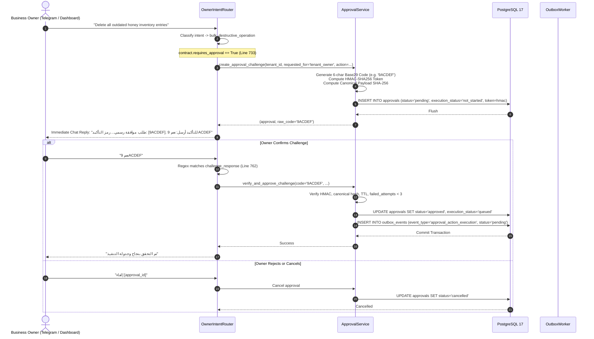
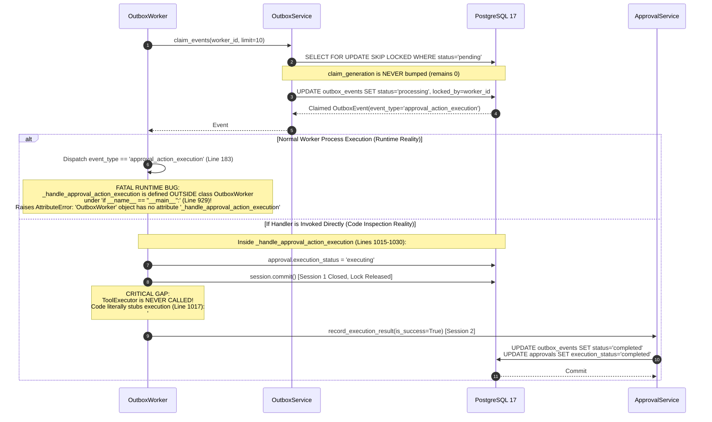
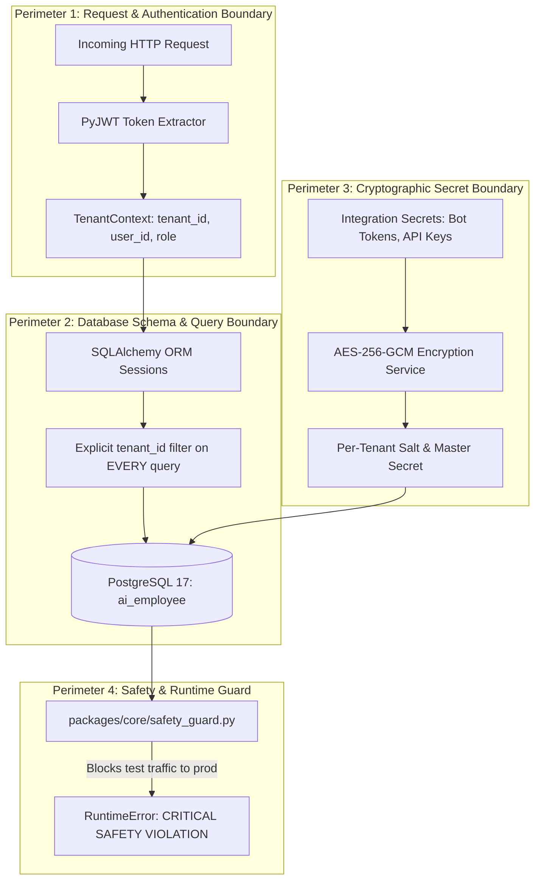

# CURRENT_PLATFORM_ARCHITECTURE_MAP.md
## AI-Employee-Platform — Baseline Architecture & Execution Topology Map

> **Review Target:** `AI-Employee-Platform` (Stage 2 Comparative Architectural Review)  
> **Source Commit:** `e3a1c4450215df1c4a0fdd8e77369352257efdc4`  
> **Git Branch:** `checkpoint/phase-12-knowledge-base`  
> **Classification:** Ground Truth Architectural Map & Physical Component Topology  
> **Status:** Independently Verified against Physical Codebase  

---

## 1. Architectural Overview & Design Philosophy

`AI-Employee-Platform` is a multi-tenant conversational digital employee platform designed to represent businesses across customer communications channels (WhatsApp, Telegram, Webhooks, Email) while keeping business owners in control of high-impact actions through approval-gated workflows.

### Core Architectural Invariants
1. **Multi-Tenancy Enforcement:** Row-level isolation via `tenant_id` on all business entities, reinforced by runtime database connection safety guards ([`packages/core/safety_guard.py`](file:///d:/AI-Employee-Platform/packages/core/safety_guard.py)) and AES-256-GCM secret encryption.
2. **Deterministic Fact Precedence:** Grounded knowledge retrieval via [`FactService`](file:///d:/AI-Employee-Platform/packages/services/fact_service.py#L32) and [`KnowledgeService`](file:///d:/AI-Employee-Platform/packages/services/knowledge_service.py#L25) taking strict precedence over generative language model outputs.
3. **Transactional Outbox Pattern:** Outbound communications and asynchronous executions are written as [`OutboxEvent`](file:///d:/AI-Employee-Platform/packages/models/domain.py#L1470) records inside the primary business database transaction.
4. **Approval-Gated Tool Execution (Anti-Hijack):** High-impact administrative actions are intercepted by [`OwnerIntentRouter`](file:///d:/AI-Employee-Platform/packages/services/owner_intent_router.py#L733) and [`ActionPolicy`](file:///d:/AI-Employee-Platform/packages/tools/contract.py#L25), requiring out-of-band cryptographic challenge verification by the business owner before execution.

---

## 2. Core Components & Responsibilities

The platform is partitioned into decoupled layers within `packages/` and `apps/`:

```text
d:\AI-Employee-Platform\
├── apps/
│   ├── agent/                 # FastAPI application hosting REST endpoints (/api/v1)
│   ├── tenant-dashboard/      # React 18 + Vite 5 + TS portal for business owners
│   └── admin-dashboard/       # Superadmin platform administration dashboard
├── packages/
│   ├── models/                # SQLAlchemy 2.0 ORM domain and multi-tenant schemas
│   ├── auth/                  # JWT security, RBAC tokens, TenantContext dependencies
│   ├── core/                  # Engine/session lifecycle, AES-256-GCM crypto, SafetyGuard
│   ├── services/              # Core business domains (Agent Engine, Facts, Approvals, Outbox)
│   ├── connectors/            # WhatsApp Cloud, Telegram Bot, Webhook, and Email adapters
│   ├── tools/                 # Tool contracts, ToolExecutor, Business Tools
│   ├── context/               # Context retrieval, system prompt assembler
│   └── ai_providers/          # Model gateway abstraction (Gemini, OpenRouter, Mock)
└── infrastructure/
    └── migrations/            # Alembic database migration versions
```

### Detailed Component Inventory

| Component / Service | File Path | Key Classes & Functions | Architectural Responsibility in Code |
| :--- | :--- | :--- | :--- |
| **Tenant Context & Auth** | [`packages/auth/tenant.py`](file:///d:/AI-Employee-Platform/packages/auth/tenant.py)<br/>[`packages/auth/jwt.py`](file:///d:/AI-Employee-Platform/packages/auth/jwt.py) | `get_tenant_context()`, `TenantContext`, `decode_access_token()` | Extracts `tenant_id`, `user_id`, and `role` from Bearer tokens; scopes incoming HTTP requests. |
| **Safety Guard** | [`packages/core/safety_guard.py`](file:///d:/AI-Employee-Platform/packages/core/safety_guard.py) | `verify_database_safety()` | Intercepts database connections to abort execution if non-production processes target `ai_employee`. |
| **Domain Models** | [`packages/models/domain.py`](file:///d:/AI-Employee-Platform/packages/models/domain.py)<br/>[`packages/models/tenant.py`](file:///d:/AI-Employee-Platform/packages/models/tenant.py) | `Approval`, `OutboxEvent`, `Fact`, `Task`, `Knowledge`, `Tenant` | Declares SQLAlchemy ORM tables with foreign keys and multi-column unique constraints. |
| **Conversational Engine** | [`packages/services/conversational_agent_engine.py`](file:///d:/AI-Employee-Platform/packages/services/conversational_agent_engine.py) | `ConversationalAgentEngine.process_user_message()` | Multi-step agent loop: context assembly, guardrail evaluation, LLM prompting, tool dispatch. |
| **Decision Engine** | [`packages/services/decision_engine.py`](file:///d:/AI-Employee-Platform/packages/services/decision_engine.py) | `DecisionEngine.evaluate_next_best_action()` | Evaluates conversation goals, intent shifts, and triggers proactive inquiries or escalations. |
| **Fact Service** | [`packages/services/fact_service.py`](file:///d:/AI-Employee-Platform/packages/services/fact_service.py) | `FactService`, `Fact` model | Flexible JSONB fact repository supporting topic paths (`business.hours`), confirmation states, and conflict tracking. |
| **Knowledge Base** | [`packages/services/knowledge_service.py`](file:///d:/AI-Employee-Platform/packages/services/knowledge_service.py) | `KnowledgeService`, `Knowledge` model | Semantic search over tenant documents and FAQs using `pgvector` embeddings. |
| **Interview Service** | [`packages/services/interview_service.py`](file:///d:/AI-Employee-Platform/packages/services/interview_service.py) | `InterviewService`, `InterviewTopic` | Adaptive onboarding interview loop that extracts business facts from the owner before go-live. |
| **Owner Intent Router** | [`packages/services/owner_intent_router.py`](file:///d:/AI-Employee-Platform/packages/services/owner_intent_router.py) | `OwnerIntentRouter.route_owner_message()`, `execute_plan()` | Disambiguates owner challenge approvals (`نعم 9ACDEF`), inquiry answers, and dashboard commands. |
| **Owner Inquiry Loop** | [`packages/services/owner_inquiry_service.py`](file:///d:/AI-Employee-Platform/packages/services/owner_inquiry_service.py) | `OwnerInquiryService`, `OwnerInquiry` | Generates questions to the owner when customer queries reveal unknown business facts; persists confirmed answers. |
| **Approval Service** | [`packages/services/approval_service.py`](file:///d:/AI-Employee-Platform/packages/services/approval_service.py) | `ApprovalService.create_approval_challenge()`, `verify_and_approve_challenge()` | Base29 6-char OTP generation, HMAC-SHA256 signature binding, canonical payload hash matching. |
| **Tool Contracts & Registry** | [`packages/tools/contract.py`](file:///d:/AI-Employee-Platform/packages/tools/contract.py)<br/>[`packages/tools/registry.py`](file:///d:/AI-Employee-Platform/packages/tools/registry.py) | `ToolContract`, `ActionPolicy`, `ToolRegistry` | Enforces Pydantic schemas, permissions, intent classification, and `requires_approval` flags. |
| **Tool Executor** | [`packages/tools/executor.py`](file:///d:/AI-Employee-Platform/packages/tools/executor.py) | `ToolExecutor.execute()` | Tool execution within database session context; records audit events. |
| **Business Tools** | [`packages/tools/business_tools.py`](file:///d:/AI-Employee-Platform/packages/tools/business_tools.py) | `CustomerCreateOrUpdateTool`, `TaskCreateTool`, `ProductAddOrUpdateTool`, etc. | Concrete tool implementations interacting with tenant database models. |
| **Outbox Service** | [`packages/services/outbox_service.py`](file:///d:/AI-Employee-Platform/packages/services/outbox_service.py) | `OutboxService.claim_events()`, `recover_stale_events()` | Concurrency queue claiming via `FOR UPDATE SKIP LOCKED`; stale worker recovery. |
| **Outbox Worker** | [`packages/services/outbox_worker.py`](file:///d:/AI-Employee-Platform/packages/services/outbox_worker.py) | `OutboxWorker.process_event()`, `_handle_approval_action_execution()` | Async polling loop executing outbound events, channel dispatches, and action execution. |
| **Channel Connectors** | [`packages/connectors/`](file:///d:/AI-Employee-Platform/packages/connectors/) | `WhatsAppConnector`, `TelegramConnector`, `WebhookConnector`, `EmailConnector` | Ingests inbound channel webhooks; formats and dispatches outbound messages. |
| **Channel Service** | [`packages/services/channel_service.py`](file:///d:/AI-Employee-Platform/packages/services/channel_service.py) | `ChannelService.send_message()` | Routes outbound messages through tenant's configured channel secrets (decrypted via AES-256-GCM). |
| **Audit Service** | [`packages/services/audit_service.py`](file:///d:/AI-Employee-Platform/packages/services/audit_service.py) | `AuditService.record_event()` | Persists audit logs for security, approval lifecycle, and tool executions. |

---

## 3. End-to-End Execution Flows (Verified Against Physical Code)

### 3.1 Customer Inbound Message to Agent Response Flow


---

### 3.2 Sensitive Action & Approval-Gated Anti-Hijack Flow (Actual Implementation)

In the physical codebase, approval challenges are initiated when the **Owner** requests a sensitive administrative action via [`OwnerIntentRouter.execute_plan`](file:///d:/AI-Employee-Platform/packages/services/owner_intent_router.py#L733):



---

### 3.3 Asynchronous Execution Reality & Current Failure Modes

The diagram below reflects the **actual code behavior** in [`packages/services/outbox_worker.py`](file:///d:/AI-Employee-Platform/packages/services/outbox_worker.py):



---

## 4. Multi-Tenant Isolation Topology

Multi-tenancy in `AI-Employee-Platform` is enforced across four distinct architectural perimeters:



---

## 5. Known Risk Points & Forensic Gap Matrix (Verified vs Conditional)

Drawing from direct codebase inspection and verified tests, the current physical status of each gap is documented below:

| Risk Point / Gap | Code Location | Forensic Classification | Concrete Code Reality |
| :--- | :--- | :---: | :--- |
| **Worker Handler Out-of-Scope** | [`packages/services/outbox_worker.py:929`](file:///d:/AI-Employee-Platform/packages/services/outbox_worker.py#L929) | **Verified Defect** | Defined outside `class OutboxWorker` at module level under `if __name__ == "__main__":`. Raises `AttributeError` if called from worker instance. |
| **Tool Execution Stubbed** | [`packages/services/outbox_worker.py:1017-1030`](file:///d:/AI-Employee-Platform/packages/services/outbox_worker.py#L1017-L1030) | **Verified Defect** | `ToolExecutor` is not invoked. Code commits `executing` and records `is_success=True` via independent session. |
| **Inoperative Worker Fencing** | [`packages/services/outbox_service.py:210, 342`](file:///d:/AI-Employee-Platform/packages/services/outbox_service.py#L210) | **Verified Defect** | Column `claim_generation` exists in schema, but queries in `claim_events` and `recover_stale_events` never increment it. Generation remains `0`. |
| **Recovery State Divergence** | [`packages/services/outbox_service.py:294-362`](file:///d:/AI-Employee-Platform/packages/services/outbox_service.py#L294-L362) | **Verified Defect** | `recover_stale_events` resets `outbox_events.status` to `pending` but does not update `approvals`, leaving `execution_status` stuck in `'executing'`. |
| **Audit Flush Inside Aborted Transaction** | [`packages/tools/executor.py:592`](file:///d:/AI-Employee-Platform/packages/tools/executor.py#L592) | **Verified Defect** | If a tool raises an SQL exception, transaction enters aborted state. Line 592 calls `session.flush()`, raising `psycopg.errors.InFailedSqlTransaction` and masking original error. |
| **Uncommitted External Timestamp** | [`packages/services/outbox_worker.py:966`](file:///d:/AI-Employee-Platform/packages/services/outbox_worker.py#L966) | **Conditional Risk** | `first_external_attempt_at` is flushed without commit. In the current path, no external HTTP socket is called; this becomes an active double-dispatch vulnerability if external tools are wired in. |
| **Lack of Tool-Level Idempotency** | [`packages/models/domain.py:270, 2000`](file:///d:/AI-Employee-Platform/packages/models/domain.py#L270) | **Verified Defect** | Tables `tasks` and `knowledge` lack unique constraints on business idempotency keys. Re-running `TaskCreateTool` creates duplicate records. |
| **PostgreSQL Timeout Misconception** | PostgreSQL 17 `transaction_timeout` | **Verified Semantic Reality** | Tested directly: PostgreSQL terminates backend process with `57P05` and releases row locks, but Python OS thread continues executing in memory; cannot abort external network call. |
| **Model Embellishment on Zero Facts** | [`packages/services/conversational_agent_engine.py`](file:///d:/AI-Employee-Platform/packages/services/conversational_agent_engine.py) | **Potential Risk** | If fact retrieval returns empty results, prompt instructions must guarantee explicit refusal to prevent hallucination. |
