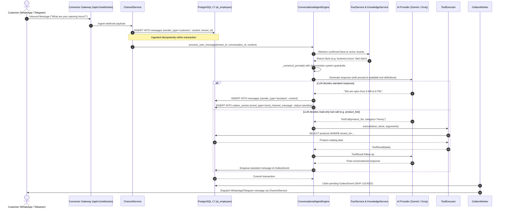
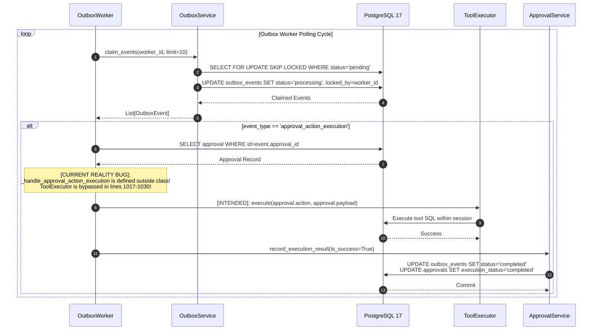
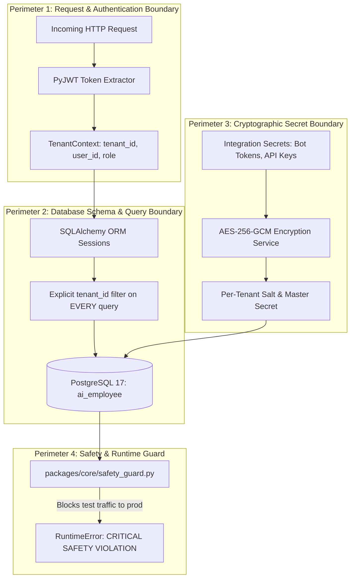

# CURRENT_PLATFORM_ARCHITECTURE_MAP.md
## AI-Employee-Platform — Baseline Architecture & Execution Topology Map

> **Review Target:** `AI-Employee-Platform` (Stage 2 Comparative Architectural Review)  
> **Source Commit:** `8803f3c634ca17f9bf79f7cce0f15b01dc0b7660`  
> **Git Branch:** `checkpoint/phase-12-knowledge-base`  
> **Classification:** Ground Truth Architectural Map & Component Topology  

---

## 1. Architectural Overview & Design Philosophy

`AI-Employee-Platform` is an enterprise-grade, multi-tenant conversational digital employee platform designed to autonomously represent businesses across customer communications channels (WhatsApp, Telegram, Webhooks, Email) while keeping business owners in strict control of high-impact actions through approval-gated workflows.

### Core Architectural Invariants
1. **Decoupled Multi-Tenancy:** Strict row-level isolation via `tenant_id` on all business entities, reinforced by runtime database connection safety guards and AES-256-GCM secret encryption.
2. **Deterministic Precedence over LLM Embellishment:** Grounded knowledge retrieval via [`FactService`](file:///d:/AI-Employee-Platform/packages/services/fact_service.py#L32) and [`KnowledgeService`](file:///d:/AI-Employee-Platform/packages/services/knowledge_service.py#L25) taking strict precedence over generative hallucinations.
3. **Transactional Outbox Pattern:** All outbound customer communications and asynchronous tool executions are written as [`OutboxEvent`](file:///d:/AI-Employee-Platform/packages/models/domain.py#L1470) records inside the primary business database transaction.
4. **Approval-Gated Tool Execution (Anti-Hijack):** High-impact actions are intercepted by [`ActionPolicy`](file:///d:/AI-Employee-Platform/packages/tools/contract.py#L25), requiring out-of-band cryptographic challenge verification by the business owner before execution.

---

## 2. Core Components & Responsibilities

The platform is partitioned into decoupled layers within `packages/` and `apps/`:

```
d:\AI-Employee-Platform\
├── apps/
│   ├── agent/                 # FastAPI application hosting REST endpoints (/api/v1)
│   ├── tenant-dashboard/      # React 18 + Vite 5 + TS portal for business owners
│   └── admin-dashboard/       # Superadmin platform administration dashboard
├── packages/
│   ├── models/                # SQLAlchemy 2.0 ORM domain and multi-tenant schemas
│   ├── auth/                  # JWT security, RBAC tokens, TenantContext dependencies
│   ├── core/                  # Engine/session lifecycle, AES-256-GCM crypto, SafetyGuard
│   ├── services/              # Core business domains (Agent Engine, Facts, Approvals, Outbox)
│   ├── connectors/            # WhatsApp Cloud, Telegram Bot, Webhook, and Email adapters
│   ├── tools/                 # Tool contracts, sandboxed ToolExecutor, Business Tools
│   ├── context/               # Context retrieval, system prompt assembler
│   └── ai_providers/          # Model gateway abstraction (Gemini, OpenRouter, Mock)
└── infrastructure/
    └── migrations/            # Alembic database migration versions
```

### Detailed Component Inventory

| Component / Service | File Path | Key Classes & Functions | Architectural Responsibility |
| :--- | :--- | :--- | :--- |
| **Tenant Context & Auth** | [`packages/auth/tenant.py`](file:///d:/AI-Employee-Platform/packages/auth/tenant.py)<br/>[`packages/auth/jwt.py`](file:///d:/AI-Employee-Platform/packages/auth/jwt.py) | `get_tenant_context()`, `TenantContext`, `decode_access_token()` | Extracts `tenant_id`, `user_id`, and `role` from Bearer tokens; scopes incoming HTTP requests. |
| **Safety Guard** | [`packages/core/safety_guard.py`](file:///d:/AI-Employee-Platform/packages/core/safety_guard.py) | `verify_database_safety()` | Intercepts database connections to strictly prevent test runs from writing to production `ai_employee`. |
| **Domain Models** | [`packages/models/domain.py`](file:///d:/AI-Employee-Platform/packages/models/domain.py)<br/>[`packages/models/tenant.py`](file:///d:/AI-Employee-Platform/packages/models/tenant.py) | `Approval`, `OutboxEvent`, `Fact`, `Task`, `Knowledge`, `Tenant` | Declares SQLAlchemy ORM tables with foreign keys and multi-column unique constraints. |
| **Conversational Engine** | [`packages/services/conversational_agent_engine.py`](file:///d:/AI-Employee-Platform/packages/services/conversational_agent_engine.py) | `ConversationalAgentEngine.process_user_message()` | Multi-step agent loop: context assembly, guardrail evaluation, LLM prompting, tool dispatch. |
| **Decision Engine** | [`packages/services/decision_engine.py`](file:///d:/AI-Employee-Platform/packages/services/decision_engine.py) | `DecisionEngine.evaluate_next_best_action()` | Evaluates conversation goals, intent shifts, and triggers proactive inquiries or escalations. |
| **Fact Service** | [`packages/services/fact_service.py`](file:///d:/AI-Employee-Platform/packages/services/fact_service.py) | `FactService`, `Fact` model | Flexible JSONB fact repository supporting topic paths (`business.hours`), confirmation states, and conflict tracking. |
| **Knowledge Base** | [`packages/services/knowledge_service.py`](file:///d:/AI-Employee-Platform/packages/services/knowledge_service.py) | `KnowledgeService`, `Knowledge` model | Semantic search over tenant documents and FAQs using `pgvector` embeddings. |
| **Interview Service** | [`packages/services/interview_service.py`](file:///d:/AI-Employee-Platform/packages/services/interview_service.py) | `InterviewService`, `InterviewTopic` | Adaptive onboarding interview loop that extracts business facts from the owner before go-live. |
| **Owner Intent Router** | [`packages/services/owner_intent_router.py`](file:///d:/AI-Employee-Platform/packages/services/owner_intent_router.py) | `OwnerIntentRouter.route_owner_message()` | Disambiguates owner challenge approvals (`confirm 9ACDEF`), inquiry answers, and dashboard commands. |
| **Owner Inquiry Loop** | [`packages/services/owner_inquiry_service.py`](file:///d:/AI-Employee-Platform/packages/services/owner_inquiry_service.py) | `OwnerInquiryService`, `OwnerInquiry` | Generates questions to the owner when customer queries reveal unknown business facts; persists confirmed answers. |
| **Approval Service** | [`packages/services/approval_service.py`](file:///d:/AI-Employee-Platform/packages/services/approval_service.py) | `ApprovalService.create_approval_challenge()`, `verify_and_approve_challenge()` | Base29 6-char OTP generation, HMAC-SHA256 signature binding, canonical payload hash matching. |
| **Tool Contracts & Registry** | [`packages/tools/contract.py`](file:///d:/AI-Employee-Platform/packages/tools/contract.py)<br/>[`packages/tools/registry.py`](file:///d:/AI-Employee-Platform/packages/tools/registry.py) | `ToolContract`, `ActionPolicy`, `ToolRegistry` | Enforces Pydantic schemas, permissions, intent classification, and `requires_approval` gates. |
| **Tool Executor** | [`packages/tools/executor.py`](file:///d:/AI-Employee-Platform/packages/tools/executor.py) | `ToolExecutor.execute()` | Sandboxed tool execution within database session context; records audit events. |
| **Business Tools** | [`packages/tools/business_tools.py`](file:///d:/AI-Employee-Platform/packages/tools/business_tools.py) | `CustomerCreateOrUpdateTool`, `TaskCreateTool`, `ProductAddOrUpdateTool`, etc. | Concrete tool implementations interacting with tenant database models. |
| **Outbox Service** | [`packages/services/outbox_service.py`](file:///d:/AI-Employee-Platform/packages/services/outbox_service.py) | `OutboxService.claim_events()`, `recover_stale_events()` | High-concurrency queue claiming via `FOR UPDATE SKIP LOCKED`; stale worker recovery. |
| **Outbox Worker** | [`packages/services/outbox_worker.py`](file:///d:/AI-Employee-Platform/packages/services/outbox_worker.py) | `OutboxWorker.process_event()`, `_handle_approval_action_execution()` | Async polling loop executing outbound events, channel dispatches, and approved action execution. |
| **Channel Connectors** | [`packages/connectors/`](file:///d:/AI-Employee-Platform/packages/connectors/) | `WhatsAppConnector`, `TelegramConnector`, `WebhookConnector`, `EmailConnector` | Ingests inbound channel webhooks; formats and dispatches outbound messages. |
| **Channel Service** | [`packages/services/channel_service.py`](file:///d:/AI-Employee-Platform/packages/services/channel_service.py) | `ChannelService.send_message()` | Routes outbound messages through tenant's configured channel secrets (decrypted via AES-256-GCM). |
| **Audit Service** | [`packages/services/audit_service.py`](file:///d:/AI-Employee-Platform/packages/services/audit_service.py) | `AuditService.record_event()` | Persists immutable audit logs for security, approval lifecycle, and tool executions. |

---

## 3. End-to-End Execution Flows

### 3.1 Customer Inbound Message to Agent Response Flow



---

### 3.2 Sensitive Action & Approval-Gated Anti-Hijack Flow

```mermaid
sequenceDiagram
    autonumber
    actor Customer as Customer
    actor Owner as Business Owner
    participant CAE as ConversationalAgentEngine
    participant TE as ToolExecutor
    participant AS as ApprovalService
    participant DB as PostgreSQL 17
    participant OW as OutboxWorker
    participant CS as ChannelService

    Customer->>CAE: "Delete my past appointments and reschedule."
    CAE->>TE: Check ToolContract & ActionPolicy
    Note over TE: ActionPolicy.requires_approval == True<br/>Intent: bulk_destructive_operation / sensitive_write
    
    TE->>AS: request_approval(tenant_id, action, payload, requester="customer")
    AS->>AS: Generate Base29 6-character Challenge Code<br/>Sign HMAC-SHA256 Token<br/>Compute Canonical Payload SHA-256
    AS->>DB: INSERT INTO approvals (status='pending', execution_status='not_started', challenge_code_hash)
    AS->>DB: INSERT INTO outbox_events (event_type='send_owner_approval_prompt', status='pending')
    DB-->>AS: Commit
    
    OW->>DB: Claim outbox event
    OW->>CS: Dispatch approval prompt to Owner (Telegram / Dashboard)
    CS-->>Owner: "Customer requested sensitive action [reschedule_bulk].<br/>To approve, reply: CONFIRM 9ACDEF"

    alt Owner Approves
        Owner->>CS: "CONFIRM 9ACDEF"
        CS->>AS: verify_and_approve_challenge(code="9ACDEF", token, payload)
        AS->>AS: Verify HMAC & canonical hash<br/>Verify failed_attempts < 3
        AS->>DB: UPDATE approvals SET status='approved', execution_status='queued'
        AS->>DB: INSERT INTO outbox_events (event_type='approval_action_execution', status='pending')
        DB-->>AS: Commit Atomic Transaction
    else Owner Rejects or Timeout
        Owner->>CS: "REJECT 9ACDEF"
        CS->>AS: Mark approval status='rejected'
        Note over AS: Challenge invalidated; outbox event never enqueued
    end
```

---

### 3.3 Asynchronous Tool Execution via Outbox Worker



---

## 4. Multi-Tenant Isolation Topology

Multi-tenancy in `AI-Employee-Platform` is enforced across four distinct architectural perimeters:



---

## 5. Known Risk Points & Forensic Gap Matrix (Verified vs Potential)

Drawing from the forensic audit conducted in Stage 1 ([`docs/audit/CR_05_01_FINAL_FORENSIC_ARCHITECTURE_REVIEW.md`](file:///d:/AI-Employee-Platform/docs/audit/CR_05_01_FINAL_FORENSIC_ARCHITECTURE_REVIEW.md)), the following gaps currently exist in the physical code:

| Risk Point / Gap | Code Location | Status | Architectural Impact |
| :--- | :--- | :---: | :--- |
| **Worker Handler Out-of-Scope** | [`packages/services/outbox_worker.py:929`](file:///d:/AI-Employee-Platform/packages/services/outbox_worker.py#L929) | **VERIFIED BUG** | Defined outside `class OutboxWorker` under `if __name__ == "__main__":`. Raises `AttributeError` if invoked at runtime. |
| **Tool Execution Stubbed** | [`packages/services/outbox_worker.py:1017-1030`](file:///d:/AI-Employee-Platform/packages/services/outbox_worker.py#L1017-L1030) | **VERIFIED BUG** | Bypasses `ToolExecutor` completely; fakes success by committing `executing` and opening an independent session. |
| **Inoperative Worker Fencing** | [`packages/services/outbox_service.py:210, 342`](file:///d:/AI-Employee-Platform/packages/services/outbox_service.py#L210) | **VERIFIED GAP** | `claim_generation` exists in schema but is never incremented. Stale workers waking up after timeout remain unfenced. |
| **Recovery State Divergence** | [`packages/services/outbox_service.py:294-362`](file:///d:/AI-Employee-Platform/packages/services/outbox_service.py#L294-L362) | **VERIFIED BUG** | `recover_stale_events` resets `outbox_events.status` to `pending` but never updates `approvals`, leaving `execution_status` stuck in `executing`. |
| **Audit Flush Inside Aborted Transaction** | [`packages/tools/executor.py:592`](file:///d:/AI-Employee-Platform/packages/tools/executor.py#L592) | **VERIFIED BUG** | If tool raises an SQL error, transaction is aborted. Calling `session.flush()` inside error handler raises `psycopg.errors.InFailedSqlTransaction`, masking original error. |
| **Uncommitted External Timestamp** | [`packages/services/outbox_worker.py:966`](file:///d:/AI-Employee-Platform/packages/services/outbox_worker.py#L966) | **VERIFIED GAP** | `first_external_attempt_at` is flushed but not committed before network call. If worker crashes, timestamp rolls back to `NULL`, risking duplicate retry. |
| **Lack of Tool-Level Idempotency** | [`packages/models/domain.py:270, 2000`](file:///d:/AI-Employee-Platform/packages/models/domain.py#L270) | **VERIFIED GAP** | Tables `tasks` and `knowledge` lack unique constraints on business idempotency keys. Retried tool execution creates duplicate entities. |
| **PostgreSQL Timeout Misconception** | PostgreSQL 17 `transaction_timeout` | **VERIFIED SEMANTIC GAP** | Exceeding timeout terminates DB connection (`57P05`), but running Python worker thread continues in memory; cannot abort ongoing external HTTP call. |
| **Model Embellishment on Zero Facts** | [`packages/services/conversational_agent_engine.py`](file:///d:/AI-Employee-Platform/packages/services/conversational_agent_engine.py) | **POTENTIAL RISK** | In edge cases where customer asks about unspecified catalog items, prompt engineering must guarantee hard-stop refusal without hallucination. |
