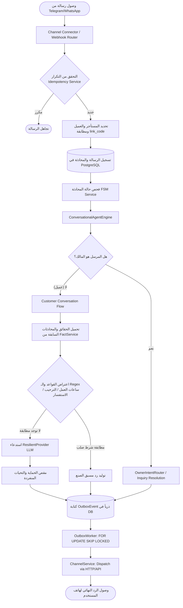

# 02_REPOSITORY_MAP.md — الخريطة المعمارية الشاملة لمستودع المنصة (AI-Employee-Platform)

- **تاريخ الاعتماد:** 2026-11-03T03:02:00+03:00
- **الفرع الحالي:** `checkpoint/phase-12-knowledge-base`
- **الالتزام المثبت:** `8c28bc2a8927e02be356971a30016c2de8d5044c`

---

## 1. الهيكل العام والمجلدات الرئيسية للمشروع

```text
D:\AI-Employee-Platform\
├── apps/
│   ├── agent/                     # خادم واجهات برمجة التطبيقات (FastAPI Backend /api/v1)
│   │   ├── main.py                # نقطة الدخول، إعداد التطبيق، الوسيطات (CORS, Tenant, RateLimit)
│   │   └── api/v1/                # مسارات الـ API (26 موجه فرعي يغطي كل نطاق)
│   ├── tenant-dashboard/          # لوحة تحكم المستأجر (React 18 + Vite + TS + Tailwind)
│   └── admin-dashboard/           # لوحة تحكم الإدارة العليا للمنصة (Superadmin Portal)
├── packages/
│   ├── models/                    # نماذج قاعدة البيانات (SQLAlchemy 2.0 ORM - 54 جدولاً)
│   │   ├── domain.py              # كيانات الأعمال والمهام والمعرفة والقنوات والمراسلات
│   │   └── tenant.py              # كيانات المستأجرين والمستخدمين والصلاحيات
│   ├── auth/                      # التوثيق وعزل المستأجر وتوليد رموز JWT والتحقق
│   ├── core/                      # المحرك الأساسي: الاتصال بقاعدة البيانات، تشفير الأسرار (AES-256-GCM)، الإعدادات
│   ├── services/                  # منطق الأعمال (45 خدمة متخصصة)
│   ├── connectors/                # موصلات القنوات (Telegram, WhatsApp Cloud, Webhooks, Email)
│   ├── tools/                     # عقود الأدوات وسجلها والتشغيل المعزول
│   ├── memory/                    # استخراج الذاكرة والكيانات وذاكرة المحادثات
│   ├── context/                   # مسترجع السياق الديناميكي وحقن البيانات في الـ Prompts
│   └── ai_providers/              # طبقة تجريد النماذج (Gemini, OpenRouter, Mock, ResilientProvider)
├── infrastructure/
│   ├── migrations/                # ترحيلات Alembic (19 إصدار ترحيلي نشط)
│   │   └── versions/              # من إنشاء المستأجر وحتى بروفايلات الموظفين وتتبع العمليات
│   ├── docker/                    # ملفات Dockerfile وتكوين الحاويات
│   └── caddy/                     # إعدادات Caddy 2 Reverse Proxy
├── scripts/                       # نصوص التشغيل والتحقق الآلي وتنظيف المستأجرين الوهميين
└── tests/                         # حزم اختبارات شاملة (وحدات، تكامل، قنوات، حملات، FSM)
```

---

## 2. تصنيف المكونات التفصيلي ومسارات البيانات

### أ. واجهات برمجة التطبيقات (`apps/agent/api/v1/`)
تتكون من **26 مساراً تخصصياً** يتم تسجيلها مركزياً في `apps/agent/api/router.py`:
1. `auth.py`: تسجيل الدخول، تجديد الجلسات، التحقق من التوكنات، واستخراج `tenant_id`.
2. `tenants.py` & `agents.py`: إدارة المستأجرين وإنشاء وتكوين الموظفين الرقميين.
3. `conversations.py` & `customers.py`: إدارة جلسات المحادثة وبيانات العملاء وسجل المراسلات.
4. `channels.py` & `webhooks.py`: استقبال ومعالجة رسائل Telegram وWhatsApp وWebhooks الواردة والصادرة.
5. `tasks.py`, `approvals.py`, `action_policies.py`: دورة حياة المهام والموافقات والسياسات الأمنية.
6. `campaigns.py` & `proactive_workflows.py`: الحملات التسويقية والتدفقات الاستباقية ومتابعة المستلمين.
7. `knowledge.py`, `memory.py`, `documents.py`: البحث الدلالي وإدارة الذاكرة والحقائق وتوليد الوثائق.
8. `admin.py`, `audit.py`, `traces.py`: لوحة تحكم السوبر أدمن، سجلات التدقيق الجنائي، وتتبع الخطوات.

### ب. طبقة الخدمات التنفيذية (`packages/services/`)
- **محرك المحادثة وتوجيه النوايا:**
  - `conversational_agent_engine.py` (303 KB, 5,291 سطراً): المحرك الحالي الذي يعترض الرسائل ويوجه الردود ويدير الحالات.
  - `conversation_fsm_service.py` (19 KB, 444 سطراً): آلة الحالة المحدودة لإدارة الحالات الصريحة وحماية تدفق التحاور.
  - `owner_intent_router.py` (53 KB, 1,082 سطراً): موجه نوايا المالك عبر Regex لاستخراج أوامر المهام والموافقات والمنتجات.
- **إدارة المعرفة والذاكرة:**
  - `fact_service.py` (67 KB): إدارة حقائق المستأجر المؤسسية والتحقق من التعارض وساعات العمل.
  - `knowledge_service.py` & `business_brain_service.py`: إدارة أصول المعرفة والذاكرة التراكمية.
- **التنفيذ والمهام والموافقات:**
  - `outbox_worker.py` (53 KB) & `outbox_service.py`: تسليم الرسائل والأحداث عبر نمط Transactional Outbox بضمانة `FOR UPDATE SKIP LOCKED`.
  - `approval_service.py` & `task_execution_service.py`: تعليق الإجراءات الحساسة وانتظار موافقة المالك والتنفيذ الآمن.
  - `campaign_service.py`: جدولة وبث الحملات وتصفية الجماهير وإرسال الرسائل عبر Outbox.
  - `owner_inquiry_service.py` (69 KB): حلقة استفسار الوكيل من المالك عند نقص المعلومات، وتنسيق رد العميل.

### ج. طبقة النماذج وقواعد البيانات (`packages/models/`)
تحتوي على **54 جدولاً** في قاعدة بيانات PostgreSQL 17 مفهرسة ومربوطة بـ `tenant_id`:
- **جداول المستأجر والمستخدمين:** `tenants`, `users`, `credentials`, `tenant_link_codes`.
- **جداول الوكلاء والأدوار:** `agents`, `employee_personas`, `capabilities`, `tools`, `integrations`.
- **جداول المعرفة والذاكرة:** `facts`, `knowledge`, `memories`, `business_brains`, `provenance`.
- **جداول العمليات والمراسلات:** `conversations`, `messages`, `customers`, `channels`.
- **جداول نمط Outbox والمهام:** `outbox_events`, `dispatch_attempts`, `dispatch_attempt_chunks`, `tasks`, `approvals`, `action_policies`, `idempotency_records`.
- **جداول التتبع والرصد والتقارير:** `execution_traces`, `execution_steps`, `audit_events`, `ai_usage_logs`, `tenant_ai_budgets`, `daily_reports`.

---

## 3. مسار تدفق البيانات الحقيقي (End-to-End Data Lifecycle)



هذا التدفق يثبت المسار الفعلي الدقيق في المستودع الحالي، وسنستخدمه كمرجع أساسي في التدقيق الجنائي.
