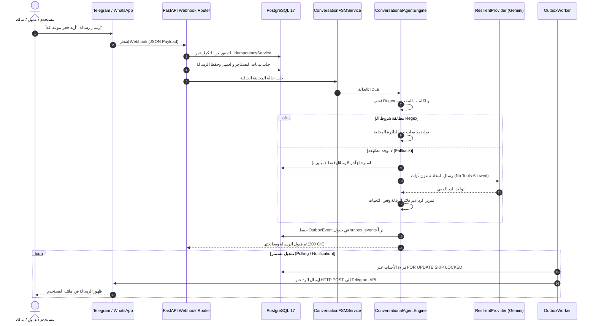

# 04_CURRENT_ARCHITECTURE_AUDIT.md — التدقيق المعماري الشامل للمنصة الحالية (AI-Employee-Platform)

- **تاريخ التدقيق:** 2026-11-03T03:06:00+03:00
- **الهدف المعماري:** تشريح المنصة الحالية طبقة بطبقة، وتوثيق نقاط القوة الحقيقية المكتملة، وتحديد نقاط الفشل والاختناق، وتتبع المسارات التشغيلية بالأدلة البرمجية القاطعة.

---

## 1. نقاط القوة المعمارية المثبتة في الكود (Architectural Strengths)

1. **نمط صندوق الصادر الموزع (Transactional Outbox Pattern):**
   - **الدليل:** `packages/services/outbox_worker.py` (L120–L240) وجدول `outbox_events`.
   - يتم حفظ الرسائل الخارجية والأحداث ذرياً داخل نفس المعاملة المصرفية/التجارية في قاعدة البيانات (`session.add(OutboxEvent(...))`).
   - يقوم العامل المستقل `OutboxWorker` بقراءة السجلات باستخدام تعليمة الأمان المعياري `FOR UPDATE SKIP LOCKED` في PostgreSQL، مما يمنع التنافس (Race Conditions) ويدعم التوسع الأفقي (Horizontal Scaling) دون ازدواج الإرسال.
   - يدعم التجزئة للرسائل الطويلة وحفظ المحاولات في `dispatch_attempts`.

2. **العزل التام للمستأجرين (Strict Tenant Isolation):**
   - **الدليل:** `packages/auth/context.py` و `packages/auth/dependencies.py` وجميع جداول `packages/models/domain.py`.
   - كل جدول من الـ 54 جدولاً يحتوي على عمود `tenant_id` المفهرس.
   - يعتمد الـ Backend على `contextvars` لعزل معرّف المستأجر ضمن كل طلب API أو مهمة خلفية، مما يمنع تسرب البيانات بين الشركات قطعيًا على مستوى الاستعلامات.

3. **تشفير الأسرار المصادق (Authenticated Encryption with AEAD):**
   - **الدليل:** `packages/core/crypto.py` (L45–L110).
   - توكنات البوتات وحسابات WhatsApp وWebhooks تُشفر عند الاستقرار (At-rest) باستخدام **AES-256-GCM** مع ملح عشوائي فريد لكل عملية تشفير ومفتاح مشتق من البيئة، وتُخفى بالكامل عن واجهات المستخدم والـ Logs (`******`).

4. **بنية الموافقات ومكافحة الاختطاف (Approval & Anti-Hijacking Architecture):**
   - **الدليل:** `packages/services/approval_service.py` وجدول `approvals`.
   - الإجراءات الحساسة (مثل الحملات الإعلانية وتعديل الصلاحيات) لا تُنفذ مباشرة بل تولد سجل موافقة مشفر برمز مؤقت ومهلة زمنية (`expires_at`) ولا يمكن تفعيلها إلا بموافقة المالك.

---

## 2. نقاط الضعف والاختناقات المعمارية الحرجة (Critical Bottlenecks & Flaws)

1. **مصادرة قدرات الذكاء الاصطناعي بواسطة الـ Regex والقوالب الجاهزة:**
   - **الدليل:** `packages/services/conversational_agent_engine.py` (L1450–L1650, L3140–L3440).
   - بدلاً من أن يكون الوكيل كائناً ذكياً يستمع ويفهم ويقرر استدعاء الأدوات، يعمل المحرك كـ "جدار اعتراض صلب".
   - يتم اعتراض أي رسالة بآلاف التعابير النمطية (`re.search`)، وإذا طابقت كلمة مفتاحية (مثل "ساعات العمل" أو "كم سعر" أو رقم معزول "1")، يتم قطع الطريق فوراً على النموذج اللغوي وإرجاع نص جاهز معلب!

2. **حرمان النموذج اللغوي من استدعاء الأدوات قطعيًا (Zero Tool-Calling):**
   - **الدليل:** `packages/services/conversational_agent_engine.py` (L5165).
   - تنص التعليمات الإلزامية المحقونة للنموذج:
     `"4. You CANNOT execute administrative, financial, or state-changing tools directly from conversational text."`
   - الثابت `MAX_TOOL_CALL_ITERATIONS = 3` في السطر L98 هو **كود ميت** لم يُستدعَ في أي مكان!
   - الأدوات لا يستدعيها النموذج اللغوي إطلاقاً، بل تستدعيها دوال Python تقليدية عبر مطابقة Regex قبل وصول الرسالة للنموذج!

3. **بتر السياق وفقدان الذاكرة القسري (Context Starvation & Forced Amnesia):**
   - **الدليل:** `packages/services/conversational_agent_engine.py` (L574, L596, L605).
   - يتم تحديد سياق المحادثة بحد أقصى بـ 8 رسائل فقط (`min(history_limit, 8)`).
   - يتم قص أي رسالة تتجاوز 350 حرفاً.
   - إذا تجاوز المجموع 2,000 حرف، يُبتر التاريخ عشوائياً!
   - **الأثر الميداني:** في أي محادثة حقيقية على تيليجرام تتجاوز 4 أسئلة، يصاب الوكيل بفقدان ذاكرة كامل وينسى ما وافق عليه المستخدم قبل دقيقة.

4. **غياب التنفيذ المستمر واستعادة الحالة (Zero Durable Execution):**
   - لا يوجد محرك للتعليق والاستئناف الحقيقي مثل LangGraph Checkpointer أو Temporal.
   - عند انتظار موافقة أو استفسار، تتحول المحادثة لحالة صلبة في جدول FSM، وإذا أرسل المستخدم أي رسالة غير متطابقة حرفياً مع الأمر المطلوب، يعلق النظام أو يُسقط سياق المهمة الأصلية بالكامل.

5. **فخ احتجاز أقفال قاعدة البيانات أثناء استدعاء الذكاء الاصطناعي (DB Lock Starvation):**
   - **الدليل:** التعديل الحديث في `conversational_agent_engine.py` والملف `tests/test_ai_usage_lock_prevention.py`.
   - في التصميم السابق، كان يتم فتح معاملة قاعدة البيانات واستدعاء الـ LLM الخارجي والانتظار لثوانٍ، مما يؤدي لاستنفاد مجمع اتصالات PostgreSQL (Connection Pool Exhaustion) وتعليق بقية العمليات.

---

## 3. تتبع المسارات التشغيلية ومصفوفة التدفق التفصيلية

---

## 4. تقييم الجاهزية والقرار المعماري

| المكوّن | التقييم الحالي | التوصية المعمارية |
| :--- | :--- | :--- |
| **قاعدة البيانات ونماذجها** | ممتازة، تغطي 54 جدولاً بعزل كامل ومفهرس. | **الاحتفاظ بها وتوسيعها** بإضافة جداول الـ Checkpointing وحالة المهام المستمرة. |
| **Transactional Outbox** | متين وعالي الاعتمادية ويمنع التكرار. | **الاحتفاظ به كاملاً** كمسار إرسال قياسي لجميع القنوات. |
| **محرك المحادثة الحالي** | غير صالح بنيوياً، يعتمد على الـ Regex الصلب وبتر الذاكرة ويصادر قدرات الذكاء الاصطناعي. | **الاستبدال الجذري الشامل** بمحرك `StateGraph Engine` تفاعلي مستوحى من LangGraph و RagLeap Core. |
| **نظام الموافقات والصلاحيات** | جيد جداً ولكنه منفصل عن مسار استدعاء الأدوات للوكيل. | **دمجه المباشر** في حلقة اتخاذ القرار للوكيل (Tool Guardrails & Dynamic Interrupts). |
| **نظام الرقابة المركزي (الأب الروحي)** | غير موجود ككيان تنفيذي مستقل؛ مقتصر على جداول رصد متفرقة وتقارير يومية بدائية. | **بناء خدمة "الأب الروحي" (Guardian Engine)** ككيان علوي مستقل متصل بـ Telegram الخاص بالمؤسس. |
