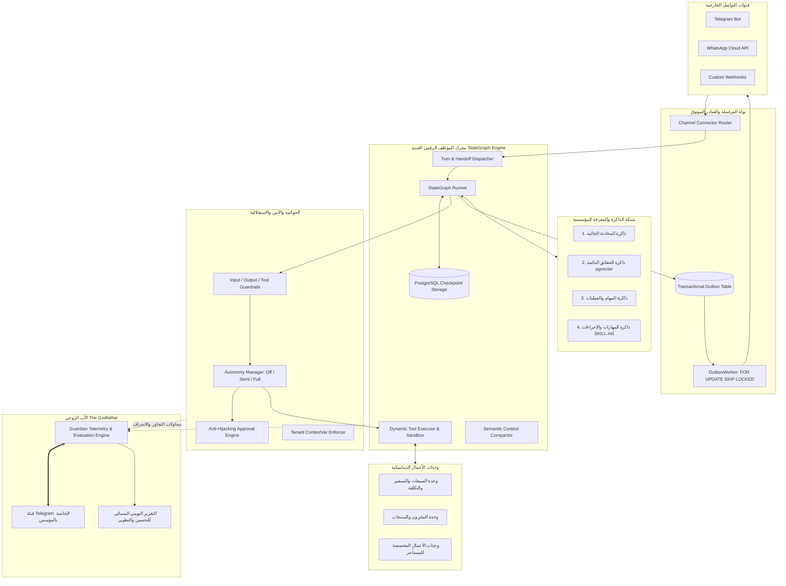

# 08_TARGET_ARCHITECTURE.md — تصميم المعمارية المستهدفة لمحرك الموظف الرقمي البديل

- **تاريخ التصميم والاعتماد:** 2026-11-03T03:18:00+03:00
- **المرجع الحاكم:** [docs/PROJECT_VISION.md](../../PROJECT_VISION.md)
- **الهدف المعماري:** استبدال المحرك التحاوري الصلب الحالي (`conversational_agent_engine.py`) بنواة تشغيل ذكية متطورة قائمة على الرسم البياني للحالة (`StateGraph Engine`)، مع التنفيذ المستمر الموثق في PostgreSQL، والذاكرة المؤسسية رباعية الطبقات، ونظام المهارات المعزولة، وخط رقابة "الأب الروحي" المركزي.

---

## 1. المكونات الرئيسية للمعمارية المستهدفة (Core Subsystems)

---

## 2. تفصيل الطبقات المعمارية (Detailed Architectural Blueprint)

### A. Agent Runtime & Lifecycle (دورة حياة الوكيل وتشغيل المهام)
1. **استقبال الحدث (Event Ingestion):**
   - استلام الرسالة عبر موصل القناة، والتحقق من الـ Idempotency، وتحميل معرّف المستأجر `tenant_id` في `TenantContextVar`.
2. **استعادة الحالة من الـ Checkpointer:**
   - قراءة مسار المحادثة أو المهمة من جدول `checkpoints` في PostgreSQL عبر مفتاح `(tenant_id, thread_id)`.
   - إذا كانت المحادثة معلقة على مقاطعة (`Interrupt` لطلب موافقة أو استفسار)، يتم استئناف العقدة المعنية وتزويدها بمدخل المستخدم مباشرة عبر نمط Resume.
3. **تحميل الشخصية والصلاحيات:**
   - تحميل بطاقة الوكيل (`AgentManifest`) التي تحدد الدور، ونطاق الصلاحيات، ومستوى الاستقلالية (`off`, `semi`, `full`)، والأدوات المصرح بها.
4. **تجميع السياق الذكي (Context Assembly & Compaction):**
   - استدعاء `_compaction.py` لتلخيص الرسائل السابقة دون بتر قسري.
   - استرجاع الحقائق المعتمدة ذات الصلة عبر البحث الهجين في `FactService` (Vector + Keyword BM25).
5. **حلقة التفكير وتنفيذ الأدوات (Reasoning & Tool Execution Loop):**
   - تمرير الأدوات بصيغة Function Calling قياسية للنموذج عبر `ResilientProvider`.
   - قبل استدعاء النموذج: **تحرير معاملة قاعدة البيانات (`session.commit(); session.close()`)** لمنع تجويع الـ Connection Pool.
   - عند طلب النموذج تنفيذ أداة: فحص حواجز الحماية (`ToolInputGuardrail`) وتطبيق سياسة الاستقلالية.
   - إذا تطلبت الأداة موافقة بشرية: تفعيل المقاطعة الذرية `interrupt()`، وتوليد سجل موافقة مشفر، وحفظ حالة الرسم البياني في قاعدة البيانات، وإرسال تنبيه للمالك.
   - إذا كانت الأداة مصرحاً بها تلقائياً: تنفيذها في بيئة آمنة، وفحص مخرجها عبر `ToolOutputGuardrail`، وتغذية النتيجة في دورة التفكير التالية.

---

### B. Durable Task Execution & Checkpointing (التنفيذ المتين وحفظ الحالة)
- **مخطط جداول الـ Checkpointing في PostgreSQL:**
  1. `agent_checkpoints`: لتخزين لقطات الحالة (State Snapshots) لكل مهمة مع رقم النسخة ومعرّف المستأجر.
  2. `agent_checkpoint_blobs`: لتخزين البيانات الكبيرة وسجلات الأدوات دون تكرار (Deduplication).
  3. `agent_checkpoint_writes`: لتسجيل الكتابات المرحلية الوسيطة قبل اكتمال الخطوة ذرية.
- **خصائص الاستئناف والتعافي:**
  - القدرة على تنفيذ مهام تستغرق ساعات أو أياماً (مثل إعداد حملة، جمع بيانات، انتظار موافقة المالك).
  - منع تكرار الإجراءات قطعيًا عبر التحقق من `checkpoint_id` لكل كتابة خارجية.
  - إمكانية استئناف المهمة بعد إعادة تشغيل الخادم أو الحاوية دون أي فقدان للتقدم.

---

### C. Multi-Tier Memory Architecture (نظام الذاكرة المؤسسية رباعي الطبقات)

| طبقة الذاكرة | ما تحفظه | ما لا تحفظه | آلية الاسترجاع | آلية التحديث وحل التعارضات |
| :--- | :--- | :--- | :--- | :--- |
| **1. ذاكرة المحادثة القصيرة (Conversation Context)** | سياق الجلسة الحالية، الرسائل الأخيرة، ومعاملات الخطوة الحالية. | لا تحفظ الحوارات القديمة غير ذات الصلة ولا أسرار القنوات. | استرجاع فوري من جدول الـ Checkpoint للجلسة. | تلخيص دلالي مستمر (`Compaction`) عند تجاوز 4,000 توكن. |
| **2. الذاكرة الدائمة للحقائق (Persistent Fact Memory)** | حقائق النشاط المعتمدة: الفروع، ساعات العمل، الأسعار، والسياسات الثابتة. | لا تحفظ الثرثرة العابرة أو الافتراضات غير المؤكدة. | بحث هجين (Hybrid Search: pgvector Cosine + BM25 Text) مفهرس بـ `tenant_id`. | وزن الثقة والتاريخ؛ في حال التعارض تطلب حسم المالك ولا تحذف القديم عشوائياً. |
| **3. ذاكرة العمليات والمهام (Operation & Task Memory)** | مسار المهمة الحالية: ما بدأ، ما تم، ما فشل، وما ينتظر موافقة. | لا تحفظ تفاصيل الـ Prompts الخام ولا بيانات البطاقات الائتمانية. | استعلام مفتاحي بـ `task_id` و `thread_id`. | تحديث ذري مع كل خطوة تنفيذ داخل معاملة قاعدة البيانات. |
| **4. ذاكرة المهارات والإجراءات (Skill & Procedure Memory)** | خبرات وإجراءات العمل المعتمدة (`SKILL.md`) ومعدلات نجاحها السابقة. | لا تحفظ المهارات غير المختبرة أو التي رسبت في بيئة التقييم. | تحميل تدريجي (Metadata للتعريف، ثم Body عند الحاجة للاستخدام). | لا تُعتمد إلا بعد اجتياز دورة التقييم والتدريب المزدوج بنجاح مثبت. |

---

### D. Skills & Tools Engineering (هندسة المهارات والأدوات)

- **التمييز المفاهيمي الصارم:**
  - **Tool (الأداة):** وظيفة تنفيذية محددة ذات مدخلات ومخرجات صريحة (مثل: `query_database`, `send_email`, `calculate_vat`).
  - **Skill (المهارة):** إجراء عملي مهني متكامل يوجه الوكيل لكيفية تحقيق هدف معقد باستخدام أدوات متعددة وسياق معرفي (مثل: `handle_angry_customer_refund`, `qualify_b2b_lead`).
  - **Workflow (تدفق العمل):** مسار هندسي صارم محدد الخطوات ومتفرع منطقياً يُنفذ دون اجتهاد عشوائي.
  - **Agent (الموظف الرقمي):** كيان تشغيلي متكامل يمتلك دوراً، وشخصية، وصلاحيات، ومهارات، وأدوات، وذاكرة، ومستوى استقلالية.

- **دورة تطوير وتقييم المهارات الجديدة (10-Step Evaluation Cycle):**
  1. اكتشاف الفجوة أو الحاجة لمهارة جديدة.
  2. صياغة مسودة المهارة بتنسيق `SKILL.md` (Metadata + Instructions + Resources).
  3. إنشاء حزمة اختبارات تتضمن حالات طبيعية وحالات حدية (Edge cases).
  4. إجراء التشغيل المزدوج الموازي: نسخة بالمهارة (`with-skill`) مقابل نسخة أساسية (`baseline`).
  5. قياس الأداء الفعلي في `timing.json` (استهلاك التوكنات، زمن التنفيذ، دقة الاستدعاء).
  6. تشغيل المصحح الصارم (`grader.md`) للتحقق من الادعاءات الموضوعية ومنع النجاح الشكلي.
  7. تشغيل المحلل الأعمى (`analyzer.md`) لتقديم مقترحات تحسين مهيكلة.
  8. اختبار المهارة في بيئة معزولة (`uv sandbox`) والتأكد من عدم العبث بملفات خارج مجلد العمل.
  9. مراجعة نتائج التقييم واعتمادها برمجياً (تخزينها في جدول `learnings` و `capability_versions`).
  10. إتاحة المهارة للوكلاء المخولين مع مراقبة أدائها الميداني المستمر.

---

### E. Autonomy Levels & Permission Enforcement (مستويات الاستقلالية والصلاحيات)

1. **المستوى 1 (مساعد فقط - Assistant Only):**
   - يقدم المعلومات والاقتراحات والإجابات النصية فقط.
   - يُحظر عليه تنفيذ أي أداة تغير الحالة أو ترسل بيانات للخارج.
2. **المستوى 2 (التنفيذ بعد الموافقة - Approval Gated):**
   - يجهز الإجراء كاملاً بجميع معاملاته ويتحقق من سلامتها.
   - يُعلق التنفيذ عبر `interrupt()` ويطلب موافقة المالك عبر Telegram برمز وإشعار واضح.
   - عند وصول الموافقة، يفحص النظام تطابق المعاملات (`Anti-Tampering`) ثم ينفذ الإجراء.
3. **المستوى 3 (التنفيذ التلقائي ضمن الحدود - Autonomous Within Bounds):**
   - ينفذ المهام المسموح بها والمحددة في بطاقة الوكيل تلقائياً دون إزعاج المالك.
   - يطلب الموافقة فوراً في حالتين:
     - عند محاولة تنفيذ إجراء حساس أو ذي أثر مالي/قانوني.
     - عند تلوث بيانات الجلسة (`tainted = True`) نتيجة قراءة مدخلات خارجية غير موثوقة.

---

### F. Dynamic Business Modules Provisioning (إنشاء وحدات الأعمال الديناميكية)

- **المبدأ:** إذا احتاج وكيل مبيعات إلى إدارة المبيعات، لا نكتفي بإجابة نصية، بل تتيح المنصة إنشاء **وحدة مبيعات متكاملة** للمستأجر تتضمن:
  1. **المنتجات والخدمات (`products`):** الأسعار الرسمية، تكلفة الشراء الموثوقة، وتصنيف السلع.
  2. **العملاء والطلبات (`orders`, `order_items`):** تسجيل المعاملات مع معرّف العميل وتاريخ العملية.
  3. **الفواتير والمدفوعات (`invoices`, `payments`):** حالة السداد، الخصومات المصرح بها، وطرق الدفع.
  4. **المرتجعات والتسويات (`returns`):** إدارة سياسات الإرجاع المعتمدة وأثرها المالي.
  5. **احتساب الأرباح النظيفة:** **تُحسب الأرباح فقط عند توفر بيانات التكلفة الحقيقية المسجلة**؛ ويُحظر قطعيًا اختلاق أرقام أرباح تخمينية.
  6. **واجهات API ولوحات العرض:** توفير مسارات REST API موثقة في `/api/v1/modules/sales/` وربطها بواجهة لوحة تحكم المستأجر.

---

### G. Guardian — الأب الروحي (The Central Overseer)

- **الهوية والارتباط:**
  - كيان رقابي مركزي علوي لا يتبع أي مستأجر، ولا يتواصل مع عملاء المستأجرين.
  - **مرتبط حصرياً بالمؤسس/المبرمج منشئ النظام عبر قناة تيليجرام خاصة**.
- **المبادئ الرقابية الصارمة:**
  1. **الاعتماد على القياسات المركزية غير القابلة للتلاعب (Telemetry-First):**
     - الأب الروحي لا يسأل الوكلاء "كيف كان أداؤكم؟"، بل يقرأ الأحداث من جدول `audit_events`, `execution_traces`, و `ai_usage_logs` مباشرة.
  2. **حظر الوصول العبثي لأسرار المستأجرين:**
     - يراقب المؤشرات التشغيلية ومعدلات الأخطاء والانحرافات دون كشف بيانات العملاء الشخصية أو أسرارهم التجارية.
  3. **الفصل بين المراقبة وتنفيذ التغييرات:**
     - يرصد ويقترح ويجهز الحلول ويختبرها في بيئة معزولة، لكنه **لا يعدل كود الإنتاج أو قواعد البيانات تلقائياً دون موافقة صريحة من المؤسس**.
- **التقرير اليومي المسائي للأب الروحي:**
  يصدر كل مساء عبر تيليجرام ويتضمن:
  - **ملخص صحة المنظومة:** إجمالي المهام، معدل النجاح، معدل اللجوء للـ Fallback، والأخطاء الحرجة.
  - **تحليل الفجوات والنواقص:** مهارات طلبها العملاء ولم تكن متوفرة، أو بيانات ناقصة أعاقت إتمام مهام.
  - **منحنى التعلم والتطور:** المهارات التي تم تدريبها واختبارها في البيئة المعزولة ونسبة تحسن أدائها.
  - **مقترحات التطوير المبررة بالأدلة:** خطة عمل محددة لتطوير المنصة ليصبح نظام الغد أقوى من نظام اليوم.
