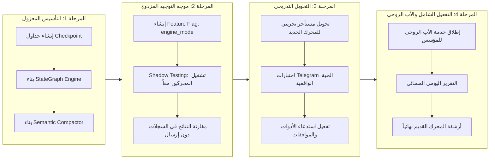

# 10_MIGRATION_AND_REPLACEMENT_STRATEGY.md — استراتيجية استبدال المحرك القديم والانتقال المعماري الآمن

- **تاريخ الاعتماد:** 2026-11-03T03:25:00+03:00
- **المبدأ الحاكم:** **التطوير دون تدمير ما يعمل حالياً (Zero Regression Migration)**.
- **الهدف التنفيذي:** استبدال محرك المحادثة الصلب القديم (`conversational_agent_engine.py`) بنواة `StateGraph Engine` التفاعلية الحديثة، مع الحفاظ الكامل على البنية التحتية المتينة، وخدمات صندوق الصادر، وتشفير الأسرار، وقواعد البيانات الموثوقة.

---

## 1. ما سيبقى وما سيعاد بناؤه (The Architecture Retention & Replacement Ledger)

### أ. المكونات المتينة التي سنحتفظ بها 100% (`Preserved Assets`):
1. **نظام صندوق الصادر الموزع (`Transactional Outbox Pattern`):**
   - كود `packages/services/outbox_worker.py` وجداول `outbox_events`, `dispatch_attempts`.
   - يضمن تسليم الرسائل بدقة وبدون تكرار عبر `FOR UPDATE SKIP LOCKED`.
2. **خدمة تشفير الأسرار (`SecretsEncryptionService`):**
   - كود `packages/core/crypto.py` بتشفير AES-256-GCM الموثوق.
3. **موصلات القنوات الرسمية (`Channel Connectors`):**
   - موصلات Telegram و WhatsApp Cloud API و Webhooks في `packages/connectors/`.
4. **خدمة الموافقات ومكافحة الاختطاف (`ApprovalService`):**
   - كود `packages/services/approval_service.py` وتوكنات الموافقات المؤقتة.
5. **خدمة استفسارات المالك (`OwnerInquiryService`):**
   - إدارة دورة حياة استفسار الوكيل وتنسيق رد المالك عبر تيليجرام.
6. **مخطط قاعدة البيانات الأساسي (54 جدولاً):**
   - نماذج `packages/models/domain.py` و `tenant.py` بكامل فهارسها وعزل المستأجرين.
7. **لوحات التحكم والواجهات الأمامية:**
   - لوحة تحكم المستأجر (`tenant-dashboard`) ولوحة تحكم الإدارة (`admin-dashboard`) وعقود الـ APIs.

### ب. المكونات المعيبة التي سيتم عزلها واستبدالها بالكامل (`Replaced Assets`):
1. **محرك المحادثة القديم (`conversational_agent_engine.py`):**
   - عزل الملف المتضخم (5,290 سطراً) الذي يعتمد على شجرة Regex صلبة تصادر الذكاء الاصطناعي وبتر الذاكرة القسري.
2. **موجه نوايا المالك القديم (`owner_intent_router.py`):**
   - التخلص من الازدواجية البرمجية والاعتماد على أدوات الذكاء الاصطناعي المهيكلة لإدارة المهام.
3. **آلة الحالة البدائية (`conversation_fsm_service.py`):**
   - استبدالها بمحرك `StateGraph Checkpointing` متين في PostgreSQL.
4. **الأكواد الحسابية المحقونة يدوياً (L3140–L3440):**
   - نقلها إلى مهارات معيارية مفحوصة في مجلد `skills/` تستدعى ديناميكياً بدلاً من حقنها نصياً.

---

## 2. مراحل الانتقال الزمني والترتيب التنفيذي (Phase-by-Phase Roadmap)



---

## 3. تفاصيل خطوات التنفيذ وضمانات السلامة

### المرحلة 1: التأسيس المعزول (Foundation & Checkpoint Storage)
1. إنشاء ترحيل Alembic جديد يضيف جداول الـ Checkpointing:
   - `agent_checkpoints`
   - `agent_checkpoint_blobs`
   - `agent_checkpoint_writes`
2. بناء حزمة `packages/engine/` المستقلة لتضمين:
   - `state_graph.py`: مشغل الرسم البياني المستوحى من LangGraph.
   - `compactor.py`: ضاغط السياق الدلالي المستوحى من Microsoft Agent Framework.
   - `tool_executor.py`: مشغل الأدوات المهيكل المستوحى من Dify و OpenAI SDK.
3. **ضمان السلامة:** المحرك القديم يظل يعمل بنسبة 100% دون أي تعديل في هذه المرحلة.

### المرحلة 2: موجه التوجيه المزدوج واختبار الظل (Shadow Testing & Routing)
1. إضافة مفتاح تبديل في إعدادات المستأجر: `engine_mode: Literal["legacy", "state_graph", "shadow"]`.
2. في وضع `shadow`:
   - يتم معالجة الرسالة بواسطة المحرك القديم وإرسال الرد للمستخدم كالمعتاد.
   - بالتوازي، تُرسل الرسالة في خيط خلفي لمحرك `state_graph`، ويتم تسجيل رد ومسار المحرك الجديد في جدول `engine_shadow_traces`.
3. مقارنة زمن الاستجابة، دقة استدعاء الأدوات، وجودة الردود بين المحركين برمجياً.

### المرحلة 3: التحويل التجريبي والتحقق الميداني الحقيقي (Telegram Acceptance)
1. تفعيل المحرك الجديد لمستأجر تجريبي مخصص للمؤسس (`Founder Test Tenant`).
2. إجراء محادثات حية ومطولة عبر Telegram:
   - اختبار المحادثة الطبيعية وتذكر التفاصيل بعد 10 أسئلة.
   - اختبار استدعاء أدوات الحسابات وساعات العمل.
   - اختبار تعليق المهمة وانتظار موافقة المالك ثم استئنافها بنجاح.
3. **معيار القبول الصارم (Vision Section 17):** لا يُعتمد الانتقال إلا بعد اجتياز المحادثات البشرية الحية على تيليجرام بنجاح تام، وليس بمجرد اخضرار اختبارات pytest!

### المرحلة 4: تأسيس الأب الروحي والأرشفة النهائية (Guardian & Decommission)
1. إطلاق خدمة "الأب الروحي" (`GuardianEngine`) كخدمة خلفية مستقلة ترتبط حصرياً بمعرّف تيليجرام الخاص بالمؤسس.
2. تفعيل التقرير اليومي المسائي الذي يلخص صحة المنظومة واحتياجات الوكلاء ومقترحات التطوير.
3. تحويل باقي المستأجرين تدريجياً إلى `engine_mode = "state_graph"`.
4. أرشفة ملف `conversational_agent_engine.py` القديم ونقله لمجلد `legacy/`.

---

## 4. خطة التراجع الطارئ ونقاط الرجوع الآمنة (Rollback Gates)

- **بوابة التراجع الفوري (One-Click Emergency Rollback):**
  - في حال حدوث أي عطل غير متوقع أو بطء في المحرك الجديد، يتم تغيير مفتاح المستأجر فورياً عبر قاعدة البيانات أو لوحة التحكم:
    ```sql
    UPDATE tenants SET engine_mode = 'legacy' WHERE id = :tenant_id;
    ```
  - يعود النظام فورياً لاستخدام المحرك القديم دون الحاجة لإعادة نشر الكود أو إعادة تشغيل الحاويات.
- **حماية البيانات المشتركة:**
  - كل الرسائل الصادرة تمر عبر جدول `outbox_events` نفسه، وموصلات القنوات لم تتغير، مما يعني عدم ضياع أي رسالة للمستخدم أثناء التبديل.
