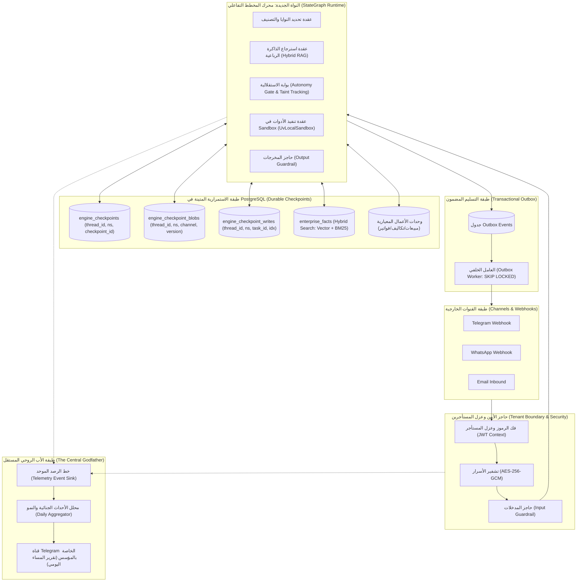

# المعمارية المستهدفة للمنظومة والمحرك الجديد (Target Architecture Blueprint)
## 08_TARGET_ARCHITECTURE.md

- **تاريخ التصميم والتحديث:** 2026-11-03T03:20:00+03:00
- **الهدف:** توثيق التصميم الهندسي التفصيلي للمحرك الجديد والمنظومة الشاملة استناداً للأدلة الملموسة المستخلصة من الكود المصدري لمنصتنا وللمشاريع المرجعية السبعة.

---

## 1. المخطط المعماري الشامل للنظام (System Architecture Blueprint)

---

## 2. تفكيك النواة الجديدة: المحرك التحاوري (StateGraph Runtime Engine)

### أ. استبدال المحرك القديم نهائياً
- يُلغى بالكامل ملف `conversational_agent_engine.py` (5,291 سطراً) بما يحتويه من ترقيعات Regex وكود ميت وتوليد نصوص عشوائي.
- تُبنى حزمة جديدة مستقلة: `packages/engine/` مقسمة إلى عقد متخصصة ومنفصلة.

### ب. هيكل الجداول الثلاثة لحفظ الحالة المتينة في PostgreSQL (مستوحى من LangGraph Checkpointing)
1. **جدول `engine_checkpoints`:**
   - المفتاح الأساسي: `PRIMARY KEY (thread_id, checkpoint_ns, checkpoint_id)`.
   - يحفظ الحالة الأساسية والميتاداتا بصيغة `jsonb`.
2. **جدول `engine_checkpoint_blobs`:**
   - المفتاح الأساسي: `PRIMARY KEY (thread_id, checkpoint_ns, channel, version)`.
   - يخزن الكتل الكبيرة والرسائل دون تكرار مع التحكم برقم إصدار كل قناة.
3. **جدول `engine_checkpoint_writes`:**
   - المفتاح الأساسي: `PRIMARY KEY (thread_id, checkpoint_ns, checkpoint_id, task_id, idx)`.
   - يخزن العمليات الوسيطة ذرياً لضمان عدم فقدان أي خطوة.

### ج. خوارزمية التعليق والاستئناف للموافقات البشرية (HITL Interrupt & Resume)
1. **التعليق الديناميكي (`interrupt(...)`):**
   - عندما يحتاج الوكيل موافقة المالك على إجراء حساس، يستدعي:
     `decision = interrupt({"action": "create_campaign", "cost": 500})`
   - يتم احتساب الفهرس `idx = scratchpad.interrupt_counter()` وإطلاق استثناء `raise GraphInterrupt(...)` ليتم حفظ الحالة فوراً في PostgreSQL في جدول الـ checkpoints وإيقاف التنفيذ بأمان.
2. **الاستئناف المتين عبر Telegram:**
   - يرسل المالك موافقته عبر Telegram (`YES <id>`).
   - يُستأنف المخطط عبر `Command(resume=decision)`.
   - يُحمّل المحرك الـ Checkpoint من PostgreSQL ويعيد تشغيل العقدة؛ وعند وصول التنفيذ إلى استدعاء `interrupt(...)` يجد القيمة الممررة في `scratchpad.resume[idx]`، يتحقق منها بـ Pydantic، **ويُرجع القيمة مباشرة دون إطلاق أي استثناء!** ليكمل الوكيل مهمته بسلاسة.

---

## 3. حواجز الحماية وتتبع التلوث (Taint Tracking & Guardrails)

مستوحى مباشرة من كود `ragleap-core` و `OpenAI Agents SDK`:
1. **تتبع التلوث (Taint Flagging):**
   - إذا استدعى الوكيل أداة قراءة بيانات خارجية غير موثوقة (`fetch_page`, `read_untrusted_file`)، يتم وسم الجلسة بـ `tainted = True`.
   - أي استدعاء خارجي لاحق (`send_webhook`, `send_email`, `send_message`) يُجبر قسرياً على طلب موافقة المالك (`force_semi = True`) حتى لو كان مستوى استقلالية الوكيل `full`، مما يمنع تسريب البيانات وسرقة الأسرار عبر الـ Prompt Injection.
2. **الخفض القسري للأدوار الحساسة:**
   - أي وكيل يعمل في مجالات عالية الخطورة (المالية، الفواتير، الحسابات) يُحظر من وضع الاستقلالية الكاملة قسرياً.

---

## 4. المعمارية الرباعية للذاكرة والبحث الهجين (Four-Tier Memory)

1. **ذاكرة المحادثة اللحظية (Session Context):** محفوظة كـ Checkpoint في جداول المحرك.
2. **الذاكرة الدائمة للحقائق (Persistent Enterprise Facts):**
   - جدول `enterprise_facts`: ساعات العمل، الأسعار، السياسات، التفضيلات.
   - يدعم البحث الهجين: **Vector Embeddings (pgvector) + Full-Text BM25 + Re-ranking**.
   - حقول الصلاحية: `verified_at`, `expires_at`, وحالة الحقيقة (*Active, Conflicting, Deprecated*).
3. **ذاكرة المهام والعمليات (Operation Log):** سجل غير قابل للتعديل لكافة القرارات والمهام.
4. **ذاكرة المهارات والإجراءات (Skill Provenance Store):** الإجراءات المعتمدة ونتائج تقييمها.

---

## 5. الأب الروحي المركزي (The Central Godfather)

- **الهوية والارتباط:** خادم رصد مستقل يستمع لكافة الأحداث الجنائية والتشغيلية عبر Event Sink موحد.
- **القناة الحصرية:** محادثة خاصة ومباشرة عبر **Telegram** مع المؤسس فقط.
- **التقرير المسائي اليومي:** يتم توليده تلقائياً كل مساء عبر دالة تجميع مستوحاة من `generate_observability_report`، ويشمل:
  1. *أحداث اليوم:* ما نجح، ما فشل، معدل الأخطاء، ومتوسط الـ Latency.
  2. *حالة الوكلاء:* من تعثر وما هي المهارات الناقصة.
  3. *المقترحات ذات الأولوية:* طلب إذن المؤسس لتفعيل وحدات أعمال أو أدوات جديدة غداً ليصبح النظام أقوى.

---

## 6. دورة التطوير المهني المستمر للوكلاء (Eval-Driven Skill Evolution)

مستوحاة مباشرة من `memento-skills`:
1. **التحميل التدريجي للمهارة:** (Metadata ~100 كلمة -> Body <500 سطر -> مراجع ملحقة).
2. **التشغيل المزدوج المتزامن:** تنفيذ نسختين متوازيتين لكل مهمة (`With-skill` مقابل `Baseline`).
3. **المصحح الصارم (`Grader`) والمحلل العمياء (`Analyzer`):** قياس نسبة النجاح الرقمية ومنع أي اعتماد شكلي.
4. **عزل التنفيذ (`UvLocalSandbox`):** إنشاء بيئات بايثون افتراضية مؤقتة عبر `uv` ومراقبة حدود مجلد العمل عبر `SandboxAuditHook` لضمان عدم المساس بالإنتاج.
