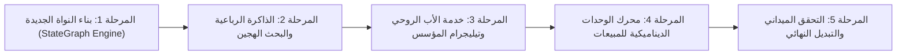

# استراتيجية الاستبدال والانتقال المرحلي للمحرك الجديد (Migration & Replacement Strategy)
## 10_MIGRATION_AND_REPLACEMENT_STRATEGY.md

- **تاريخ الصياغة:** 2026-11-03T03:02:00+03:00
- **المبدأ الأساسي:** استبدال المحرك المتداعي دون تدمير ما يعمل حالياً، ودون انقطاع للخدمة، وبناء مسار تراجع آمن (Rollback Points) عند كل مرحلة.

---

## 1. جدول تصنيف المكونات: ما يبقى وما يُعاد بناؤه وما يُلغى

| المكون | القرار الهندسي | المبرر البرمجي | آلية التوافق والربط |
| :--- | :---: | :--- | :--- |
| **`outbox_worker.py` & Outbox Table** | **يُحتفظ به 100%** | نمط معتمد ومستقر يضمن تسليم الرسائل عبر القنوات | يظل كطبقة التسليم النهائية للمحرك الجديد |
| **`packages/core/crypto.py`** | **يُحتفظ به 100%** | تشفير أسرار القنوات بـ AES-256-GCM يعمل بكفاءة وأمان | استخدامه لحماية بيانات التكاملات |
| **`packages/auth/tenant_context.py`** | **يُحتفظ به 100%** | آلية عزل المستأجرين عبر JWT سليمة وقوية | استخدامه لحقن سياق المستأجر في الـ Checkpoints |
| **`packages/connectors/`** | **يُحتفظ بها** | موصلات Telegram و WhatsApp تؤدي دورها بنظافة | استقبال الـ Webhook وتمريره للمحرك الجديد |
| **`conversational_agent_engine.py`** | **يُستبدل بالكامل** | ملف متضخم (4,864 سطراً) يعتمد على الترقيع والـ Regex | يتم بناء `packages/engine/` محرك StateGraph بديل |
| **`packages/services/fact_service.py`** | **يُعاد تصميمه** | تخزين سطحي غير مصنف دلالياً أو زمنياً | التحول لجدول `enterprise_facts` بالبحث الهجين |
| **`owner_inquiry_service.py`** | **يُفصل ويُعاد بناؤه** | مدمج حالياً مع قنوات المستأجرين | تحويله إلى **خدمة الأب الروحي المستقلة** |

---

## 2. مراحل الانتقال الخمس الممنهجة (Phased Rollout Plan)

### المرحلة 1: بناء النواة الجديدة (StateGraph Engine Core)
- إنشاء حزمة مستقلة: `packages/engine/` تضم:
  - `graph.py`: محرك المخطط التفاعلي المستقل.
  - `checkpoint.py`: محول حفظ الحالة المتينة في جدول PostgreSQL جديد `engine_checkpoints`.
  - عقد المعالجة الأساسية (`InputGuardrail`, `IntentRouter`, `ToolExecutor`).
- **نقطة الرجوع (Rollback):** الكود القديم يعمل كالمعتاد عبر الـ Webhook الحالي؛ النواة الجديدة تُبنى وتُختبر بشكل متوازٍ.

### المرحلة 2: ترقية الذاكرة إلى المعمارية الرباعية
- إنشاء ترحيل Alembic جديد يضيف جدول `enterprise_facts` (مع حقول `verified_at`, `expires_at`, `status`).
- تفعيل البحث الهجين (Vector + BM25) لربط الحقائق بمحرك الـ StateGraph.
- **نقطة الرجوع:** قراءة الحقائق القديمة تظل متاحة كـ Fallback في حال تعثر البحث الهجين.

### المرحلة 3: تدشين خدمة "الأب الروحي" (The Central Godfather)
- بناء خدمة رصد خلفية مستقلة `packages/services/godfather_service.py`.
- ربطها بحساب تيليجرام المؤسس فقط وتفعيل التقرير اليومي المسائي.
- **نقطة الرجوع:** خدمة الأب الروحي تعمل كمراقب غير متزامن؛ أي عطل فيها لا يؤثر مطلقاً على خدمة العملاء.

### المرحلة 4: محرك وحدات الأعمال الديناميكية (Dynamic Business Modules)
- بناء مخطط وحدة المبيعات والتكاليف والفواتير كـ Modular Migration.
- تزويد الوكيل بقدرة كشف النقص والمطالبة بتفعيل الوحدة.

### المرحلة 5: التبديل التدريجي والتحقق الميداني عبر Telegram
- تفعيل المحرك الجديد لقناة تجريبية خاصة بالمؤسس أولاً.
- إجراء محادثات حقيقية واختبار مهام معقدة.
- بعد التأكد الميداني التام، تحويل مسار الـ Webhooks في `apps/agent/api/v1/webhooks.py` ليمر عبر المحرك الجديد بدلاً من القديم.
- أرشفة الملف القديم `conversational_agent_engine.py` نهائياً.
