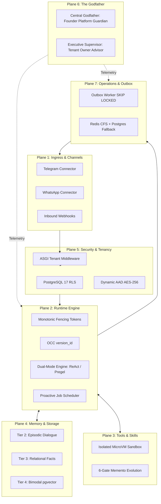

# Component-by-Component Architectural Audit: The 7 Decoupled Planes

**Document ID:** `ARCHITECTURE_COMPONENT_AUDIT`  
**Governing Standard:** Full-Platform Target Vision (`docs/PROJECT_VISION.md`)  
**Audit Standard:** Strict Adversarial Forensics & Verification against Ground Truth  
**Target Repository:** `QQYC9/ai-employee-platform` (Local HEAD `fc94752`)  
**Audit Scope:** Comprehensive analysis of all architectural subsystems across the 7 decoupled planes.

---

## 1. Executive Summary & Plane Scorecard

| Architectural Plane | Documented Vision | Technical Feasibility | Implementation Status | Overall Rating | Critical Findings |
| :--- | :---: | :---: | :---: | :---: | :---: |
| **Plane 1: Ingress & Omni-Channel** | High | Sound (with WhatsApp/TG gaps) | Phase 4C/4D Partial | **P1 (High)** | WhatsApp 24h window drop; Telegram UTF-16 astral chunking; 60s quarantine recovery. |
| **Plane 2: Runtime & Orchestration** | High | Flawed in Turn Concurrency | Legacy Deprecated; Redesign 0% | **P0 (Critical)** | Reactive chatbot collapse; Phantom OCC `version_id`; Superstep arithmetic collision; BSP turn latency. |
| **Plane 3: Tools & Evolution** | High | Vulnerable Sandbox & AST | Prototype 10% | **P0 (Critical)** | Ephemeral UV sandbox illusion; AST dynamic bypass; In-turn tool gap customer deferral missing. |
| **Plane 4: Memory & Knowledge** | High | Mathematically Invalid pgvector | Baseline 20% | **P0 (Critical)** | Composite HNSW syntax impossibility; 99% recall collapse; Episodic dialogue omitted; Statutory erasure breach. |
| **Plane 5: Multi-Tenancy & Security** | High | Robust Design / Broken Code | Defective Ingress in Code | **P0 (Critical)** | 15 routers missing tenant context; Static AES-256 AAD cross-tenant exploit; Hardcoded approval HMAC key. |
| **Plane 6: Supervisory Guardian** | High | Watertight Authority | Design 0% Implemented | **P1 (High)** | Multi-tenant conflation (Founder vs Tenant Owner); 5s alert flood window during 30m outage. |
| **Plane 7: Operational Infrastructure** | High | Resilient Outbox & Fencing | Outbox Active; Redis CFS Spec | **P1 (High)** | Redis token bucket crash recovery undefined; Celery vs OutboxWorker coordination drift. |

---

## 2. Deep Dive: Plane 1 — Ingress & Omni-Channel Connectors Plane

### 2.1 Telegram Bot Connector
- **Governing Specs:** `docs/architecture/INTEGRATIONS_AND_CHANNELS_RESEARCH.md` §2.1, `docs/architecture/MASTER_ARCHITECTURE_BLUEPRINT.md` §5.
- **Architectural Strengths:**
  - Strict recognition of Telegram 4096-character limits and MarkdownV2 strict entity nesting.
  - Sub-30ms webhook acknowledgment decoupling ingress from LLM turn execution.
- **Forensic Deficiencies & Vulnerabilities:**
  - **[P1] Astral Plane Emoji & Surrogate Pair Chunking:** Telegram measures length strictly in UTF-16 code units. If an Arabic response contains emoji combinations (e.g. flags, colored gestures, or family combinations consisting of 4–8 surrogate bytes) near character 4095, splitting on naive UTF-8 string slicing splits a high surrogate from a low surrogate, producing an unparsable unicode error and an immediate `HTTP 400 Bad Request` from the Telegram API.
  - **[P1] Unclosed Markdown Entity Cascade:** When splitting long Arabic text (>4096 chars) containing bold (`*`) or code blocks (` ``` `), chunking mid-block leaves tags unclosed in Chunk 1 and unopened in Chunk 2. Telegram rejects both chunks with `HTTP 400: can't parse entities`.
- **Remediation:** Implement an AST-aware Markdown tokenizer and UTF-16 length scanner (`packages/connectors/telegram_chunker.py`) that terminates chunks at paragraph boundaries and re-balances open formatting tokens across chunks.

### 2.2 Meta WhatsApp Cloud API Connector
- **Governing Specs:** `docs/architecture/INTEGRATIONS_AND_CHANNELS_RESEARCH.md` §2.2, `docs/architecture/RESEARCH_EVIDENCE_GAPS.md` Gap 6.
- **Architectural Strengths:**
  - Recognition of `biz_opaque_callback_data` for correlation.
  - 60-second Quarantine Window for outbound message status recovery (ADR-13 Tier 2B).
- **Forensic Deficiencies & Vulnerabilities:**
  - **[P1] 24-Hour Customer Service Window Expiration:** Meta enforces a strict policy: free-form text messages can only be sent within 24 hours of the customer's last inbound message. In `packages/services/outbox_worker.py:608-618`, outbound campaign and proactive messages attempt to send free-form text indiscriminately. If the recipient hasn't messaged within 24 hours, Meta returns error `#131047` (`Re-engagement message required`). The current OutboxWorker treats this as a generic failure, retries repeatedly, and marks the customer as failed without triggering the required pre-approved Template Message flow.
- **Remediation:** In `WhatsAppConnector`, check customer session recency before dispatch; if $>24$ hours, wrap the payload in an approved Meta utility/marketing template.

---

## 3. Deep Dive: Plane 2 — Runtime Execution & Turn Orchestration Plane

### 3.1 Digital Employee Turn Runtime Paradigm
- **Governing Specs:** `docs/architecture/MASTER_ARCHITECTURE_BLUEPRINT.md` §2, §3; `docs/architecture/ARCHITECTURAL_DECISION_RECORDS.md` ADR-01, ADR-02, ADR-03.
- **Architectural Strengths:**
  - Monotonic fencing tokens (`fence_token = fence_token + 1`) preventing split-brain execution across distributed workers.
  - Two-Phase Staged Intent pattern preventing orphan side-effects during uncommitted turns.
- **Forensic Deficiencies & Vulnerabilities:**
  - **[P0] Reactive Turn-Loop Monoculture (The Chatbot Collapse):** Blueprint §2.1 and §2.2 model runtime execution strictly as:
    $$	ext{Client} \to 	ext{Gateway} \to 	ext{Pregel Turn} \to 	ext{Outbox} \to 	ext{Client}$$
    This architecture only executes when an external customer sends an inbound message! It lacks an internal autonomous proactive scheduler (`AgentJobScheduler`). A digital employee that cannot wake up on a cron schedule to perform a morning stock audit, run daily billing reconciliation, or conduct outbound outreach is an interactive chatbot, not an autonomous employee.
  - **[P0] Phantom OCC `version_id` & Lost Update Anomaly:** `ARCHITECTURAL_CONFLICTS_AND_OPEN_QUESTIONS.md` (Mitigation 2) promises Optimistic Concurrency Control using a `version_id` column to prevent lost updates when database sessions are released during 15-second LLM streaming. **In the actual DDL and commit logic of `execution_tasks`, `version_id` is completely missing!** A concurrent inbound message can overwrite the agent state checkpoint silently.
  - **[P1] Superstep Arithmetic Collision:** Blueprint §8.2 configures `MAX_SUPERSTEPS = 10`, while ADR-05 configures `MAX_HANDOFF_HOPS = 5`. Because a single handoff hop requires at least 2 supersteps (Tool Call node + Agent Invocation node), a 5-hop delegation chain requires $5 \times 2 = 10$ steps minimum. Any intermediate tool call immediately triggers a `GraphRecursionError`, terminating the customer's turn mid-conversation.
  - **[P1] Pregel BSP Latency Overhead for Simple Turns:** Pregel Bulk Synchronous Parallel execution incurs 3 full database roundtrips and row locks per turn. For 80% of routine customer queries, this adds 300–600ms overhead, threatening the sub-3s SLA.
- **Remediation:**
  1. Add an **Autonomous Proactive Scheduler** (`packages/engine/proactive_scheduler.py`) to trigger autonomous digital employee tasks without inbound chat triggers.
  2. Implement true `version_id INT NOT NULL DEFAULT 1` in `execution_tasks` with `UPDATE execution_tasks SET version_id = version_id + 1 WHERE id = :id AND version_id = :expected_version`.
  3. Increase `MAX_SUPERSTEPS` to 25.
  4. Implement a **Dual-Mode Engine**: Fast Sequential ReAct for simple conversational turns; Pregel StateGraph for multi-agent workflows.

---

## 4. Deep Dive: Plane 3 — Tools, Sandboxing & Capability Evolution Plane

### 4.1 Tool Contract & Execution Safety
- **Governing Specs:** `docs/architecture/TOOL_AND_SKILL_ARCHITECTURE.md`, `docs/architecture/AUTONOMOUS_CAPABILITY_GENERATION.md`.
- **Architectural Strengths:**
  - Granular 3-level tool categorization (Level 1: Read-only, Level 2: Low-risk write, Level 3: High-impact financial/destructive).
  - Explicit Pydantic schema validation for arguments and outputs.
- **Forensic Deficiencies & Vulnerabilities:**
  - **[P0] The Subprocess Sandbox Illusion:** `PLATFORM_SELF_DEVELOPMENT_RESEARCH.md` and `TOOL_AND_SKILL_ARCHITECTURE.md` propose executing newly synthesized Python tools inside an ephemeral `uv venv` subprocess. An ephemeral virtual environment provides **zero kernel namespace isolation, zero cgroup resource limits, and zero network shielding**. A synthesized tool can execute:
    ```python
    import os
    print(os.environ.get("DATABASE_URL"))  # Steals database credentials!
    ```
    or establish outbound socket connections to an external server. In a multi-tenant enterprise platform, executing untrusted synthesized code in a local subprocess allows total host compromise.
  - **[P0] Static AST Guarantee Fallacy:** The documents claim static AST node whitelisting guarantees safety. However, dynamic reflection in Python (`().__class__.__base__.__subclasses__()`) allows arbitrary command execution without using `import`, `eval`, or `getattr`. Static AST is a syntax validator, not a security boundary.
  - **[P1] In-Turn Gap Dialogue Paradox:** When an agent encounters a capability gap mid-turn, capability synthesis takes 10–60 seconds offline. The runtime lacks an in-turn customer deferral protocol specifying how the conversational turn completes gracefully while the tool is being synthesized and verified.
- **Remediation:**
  1. For production deployment, untrusted code synthesis must execute inside MicroVMs (Firecracker / gVisor) or isolated container runners with dropped capabilities (`cap-drop=ALL`), non-root execution, and read-only root filesystems.
  2. Add an explicit **Turn Deferral Response Contract**: When a tool gap is queued, the agent replies: *"لقد قيدت طلبك وسيقوم فريق العمل بمراجعته والرد عليك قريباً"* and suspends the turn safely.

---

## 5. Deep Dive: Plane 4 — Memory, Knowledge & Context Plane

### 5.1 Memory Tiers & Vector Storage
- **Governing Specs:** `docs/architecture/KNOWLEDGE_AND_MEMORY_ARCHITECTURE.md`, `docs/architecture/RESEARCH_EVIDENCE_GAPS.md` Gap 1.
- **Architectural Strengths:**
  - Multi-dimensional scoping (`tenant_id`, `domain`, `topic`, `branch_id`, `temporal_scope`).
  - Strict supersession lineage (`superseded_by_fact_id`).
- **Forensic Deficiencies & Vulnerabilities:**
  - **[P0] Syntactic Impossibility in pgvector Indexing:** `RESEARCH_EVIDENCE_GAPS.md:29` proposes a composite HNSW index on `(tenant_id, embedding)`. In PostgreSQL `pgvector`, HNSW indexes **cannot be composite**! PostgreSQL throws: `ERROR: access method "hnsw" does not support multi-column indexes`.
  - **[P0] Mathematical Recall Collapse for Small Tenants:** For a tenant with 100 vector chunks in a table of 1,000,000 chunks (selectivity $S = 0.0001$), `SET LOCAL hnsw.ef_search = 100` yields a **99.00% probability of returning zero matching vectors** during post-filtered graph traversal. The query fails to find the tenant's documents in 99 out of 100 inquiries!
  - **[P0] Omission of Episodic Conversation Memory:** The 5-tier memory model designates Tier 2 as `execution_checkpoints`. Checkpoints store internal Pregel graph supersteps, not customer conversation history. When a customer returns days later asking about an earlier quote, the agent has zero cognitive mechanism to search or retrieve historical dialogue episodes!
  - **[P0] Statutory Privacy Non-Compliance (Saudi PDPL & GDPR):** The specification relies on soft deletion (`status = 'DELETED'`), leaving raw customer PII baked inside immutable HMAC-SHA256 audit logs and checkpoint payloads in direct violation of Saudi PDPL Article 18.
- **Remediation:**
  1. Implement **Bimodal Vector Search**: Exact B-Tree scan for tenants $<5,000$ chunks ($<2$ms, 100% recall); declarative table partitioning for tenants $>50,000$ chunks.
  2. Redefine Tier 2 as **Episodic Dialogue Memory** (customer session transcripts and summaries in `conversations`/`messages`).
  3. Implement **Envelope Encryption with Data Subject Keys ($K_{subject}$)**: Cryptographically shred PII on erasure without invalidating HMAC audit chains.

---

## 6. Deep Dive: Plane 5 — Multi-Tenancy, Security & Cryptography Plane

### 6.1 Tenant Isolation & Routing Ingress
- **Governing Specs:** `docs/architecture/SECURITY_AND_MULTI_TENANCY.md`, `docs/architecture/EXISTING_SECURITY_AND_TENANCY_ASSESSMENT.md`.
- **Architectural Strengths:**
  - Theoretical 4-Tier Defense-in-Depth model.
  - Strict separation of customer data from platform supervisory intelligence.
- **Forensic Deficiencies & Vulnerabilities:**
  - **[P0] The 15-Router Defect in `apps/agent/main.py`:** Out of 28 API routers, exactly 15 routers use `Depends(get_current_user)` without binding the `tenant_context` ContextVar. If downstream services invoke `get_current_tenant_id()`, the call crashes with `RuntimeError: No tenant context is active`.
  - **[P0] Static Cross-Tenant AAD in `packages/core/crypto.py`:** Integration secrets are encrypted via AES-256-GCM using a static global byte string `ASSOCIATED_DATA = b"ai-employee-platform-secret-v1"`. Ciphertext is not cryptographically bound to `tenant_id`, allowing encrypted secrets from Tenant A to be decrypted inside Tenant B's environment if copied!
  - **[P0] Hardcoded Approval Secret Key:** `packages/services/approval_service.py:113` contains a fallback secret key `"fallback_approval_hmac_secret_key_32b_minimum!"`, permitting challenge token forgery if the environment variable is omitted.
  - **[P1] Missing Database Row-Level Security (RLS):** Despite documentation claims, zero PostgreSQL RLS policies exist in `infrastructure/migrations/`, leaving data isolation dependent purely on application-level filtering.
- **Remediation:**
  1. Add a **Global ASGI Tenant Middleware** in `apps/agent/main.py` that extracts the JWT, initializes tenant scope, and binds ContextVars before route handling.
  2. Bind AES-256-GCM AAD dynamically to `tenant_id`: `aad = f"ai-employee-platform:{tenant_id}:v1".encode()`.
  3. Remove the hardcoded fallback secret key; enforce startup crash if `APPROVAL_SECRET_KEY` is missing.
  4. Implement an automated SQLAlchemy connection listener executing `SET LOCAL app.current_tenant_id = :tid` and apply PostgreSQL RLS policies.

---

## 7. Deep Dive: Plane 6 — Supervisory Guardian Plane (The Godfather)

### 7.1 Authority & Notification Architecture
- **Governing Specs:** `docs/architecture/GODFATHER_SUPERVISORY_ARCHITECTURE_RESEARCH.md`, `docs/architecture/OPERATIONAL_ARCHITECTURE.md` §5.
- **Architectural Strengths:**
  - Strict read-only supervisory posture: zero autonomous write authority to alter production code or database records.
  - HMAC-signed webhook confirmation for founder Telegram approvals (`YES <proposal_id>`).
- **Forensic Deficiencies & Vulnerabilities:**
  - **[P0] Multi-Tenant Conflation in The Godfather:** `PROJECT_VISION.md` and research documents depict The Godfather as advising the platform founder on tenant-specific operational nuances (e.g. retail margins, pricing anomalies). In a 500-tenant platform, notifying the founder about individual tenant operational decisions creates an unmanageable bottleneck, while tenant business owners are left without any supervisory interface.
  - **[P1] Alert Flooding Window Conflict (5s vs 15m):** Blueprint specifies a 5-second sliding window for Telegram alert coalescing. During a 30-minute OpenAI/Meta outage, a 5-second window still emits 360 Telegram messages, violating Telegram rate limits (1 msg/sec per chat) and spamming the founder.
- **Remediation:**
  1. Establish a **Two-Tier Supervisory Model**:
     - *Tier 1: Central Godfather (الأب الروحي):* Platform-wide infrastructure guardian advising the founder on fleet health, global outages, and cross-tenant capacity.
     - *Tier 2: Executive Digital Supervisor (المشرف التنفيذي):* Tenant-scoped executive agent advising the tenant business owner on their business KPIs, approvals, and employee performance.
  2. Implement a **Two-Stage Alert Aggregator**: 5-second burst deduplication + 15-minute incident rate ceiling.

---

## 8. Deep Dive: Plane 7 — Operational Infrastructure & Resilience Plane

### 8.1 Transactional Outbox & Queuing
- **Governing Specs:** `docs/architecture/OPERATIONAL_ARCHITECTURE.md`, `docs/architecture/RESEARCH_EVIDENCE_GAPS.md` Gap 2.
- **Architectural Strengths:**
  - PostgreSQL `FOR UPDATE SKIP LOCKED` outbox claiming.
  - Decoupled asynchronous worker containers (`outbox_worker`, `worker_engine`, `godfather_daemon`).
- **Forensic Deficiencies & Vulnerabilities:**
  - **[P1] Redis CFS Scheduler Token Bucket Crash Recovery:** During a 10,000-recipient campaign, if Redis crashes, the in-memory token bucket state is lost. Without a persistent reconstruction protocol from PostgreSQL outbox logs, workers restarting either burst uncontrollably (triggering Meta WhatsApp Cloud API rate limits and number suspension) or deadlock.
  - **[P1] Celery vs OutboxWorker Coordination Drift:** Legacy docs describe Celery background tasks, while target blueprints specify custom `OutboxWorker` and `PregelWorker`. Both mechanisms exist concurrently in the repository without an explicit cutover lifecycle.
- **Remediation:**
  1. Codify a deterministic token bucket initialization protocol in `packages/services/rate_limiter.py` that queries PostgreSQL outbox records from the past 60 seconds upon Redis cold boot.
  2. Formally deprecate Celery and unify all asynchronous task execution under the Transactional Outbox and Pregel Engine.

---

## 9. Synthesis & Component Interoperability Matrix



---
*End of Component-by-Component Architectural Audit.*
