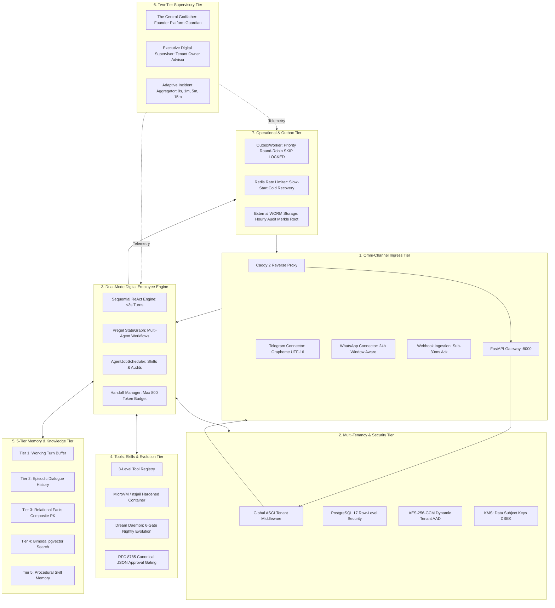

# Coherent Target Architecture: Reconciled Master Platform Blueprint

**Document ID:** `COHERENT_TARGET_ARCHITECTURE`  
**Governing Standard:** Full-Platform Target Vision (`docs/PROJECT_VISION.md`)  
**Audit Standard:** Reconciled Target Blueprint Incorporating All Audit Findings  
**Target Repository:** `QQYC9/ai-employee-platform` (Local HEAD `fc94752`)

---

## 1. Executive Summary & Architectural Reconciliation

This document unifies the platform architecture into one internally consistent, secure, and operationally viable blueprint. It resolves all 8 major cross-document contradictions and eliminates the 14 adversarial vulnerabilities identified during the audit.

```text
The 6 Core Architectural Harmonizations:
1. Engine Architecture: Dual-Mode Engine (Sequential ReAct for Turns; Pregel for Workflows).
2. Autonomous Proactivity: Addition of AgentJobScheduler for shifts, inventory audits, and campaigns.
3. Dynamic Data Architecture: Two-Tier Pre-Provisioned Relational Schemas + JSONB Extensions.
4. Memory & Vector Architecture: Bimodal pgvector (Exact B-Tree for <5k; Partitioned HNSW for >50k).
5. Tenancy & Cryptography: Global ASGI Tenant Middleware + Dynamic AAD AES-256-GCM + DSEK Envelope Shredding.
6. Supervisory Hierarchy: Central Godfather (Platform/Founder) + Executive Supervisor (Tenant/Owner).
```

---

## 2. The Reconciled Component Architecture



---

## 3. Reconciled Specifications by Architectural Subsystem

### 3.1 Digital Employee Runtime & Proactivity
- **Dual-Mode Engine:**
  - *Sequential ReAct Mode:* Handles customer chat turns. Bypasses Pregel overhead. Single database commit. Enforces sub-3s SLA.
  - *Pregel Workflow Mode:* Handles multi-agent handoffs and long-running business processes. Checkpointed per superstep (`MAX_SUPERSTEPS = 25`).
- **Autonomous Proactivity:**
  - `AgentJobScheduler` executes cron-based shifts, morning stock reconciliations, and outbound outreach without waiting for inbound customer messages.
- **Handoff Contracts:**
  - Maximum 5 delegation hops (`MAX_HANDOFF_HOPS = 5`).
  - Handoff payload budget ceiling: 800 tokens per hop with 3-bullet deterministic context compaction.
  - Declarative JSON field filters replacing non-serializable Python callables.

### 3.2 Dynamic Business Modules & Data Storage
- **Two-Tier Pre-Provisioned Schema Architecture:**
  - *Tier A (Dormant Relational Archetypes):* Pre-migrated typed relational tables for standard enterprise modules (`sales_invoices`, `inventory_items`, `journal_entries`) with strict foreign keys and `DECIMAL(18, 4)` columns.
  - *Tier B (Dynamic JSONB Extensions):* Pre-provisioned `business_entities` table for unstructured extension attributes:
    ```sql
    CREATE TABLE business_entities (
        tenant_id UUID NOT NULL REFERENCES tenants(id) ON DELETE CASCADE,
        id UUID NOT NULL DEFAULT gen_random_uuid(),
        entity_type VARCHAR(64) NOT NULL,
        title VARCHAR(255) NOT NULL,
        entity_code VARCHAR(64) NULL,
        monetary_amount DECIMAL(18, 4) NULL,
        currency_code VARCHAR(3) NULL DEFAULT 'SAR',
        quantity DECIMAL(14, 4) NULL,
        status VARCHAR(32) NOT NULL DEFAULT 'ACTIVE',
        dynamic_attributes JSONB NOT NULL DEFAULT '{}'::jsonb,
        created_at TIMESTAMPTZ NOT NULL DEFAULT NOW(),
        updated_at TIMESTAMPTZ NOT NULL DEFAULT NOW(),
        PRIMARY KEY (tenant_id, id),
        CONSTRAINT uq_tenant_entity_code UNIQUE (tenant_id, entity_type, entity_code)
    );
    ```
- **Precision Guarantee:** String decimal serialization over ASGI boundaries; `decimal.js` mandatory in frontend dashboards.

### 3.3 5-Tier Memory & Bimodal pgvector Architecture
- **Corrected 5-Tier Memory Taxonomy:**
  1. *Tier 1: Working Memory Buffer* (Turn sliding window).
  2. *Tier 2: Episodic Dialogue Memory* (Customer session transcripts & summaries in `conversations`/`messages`).
  3. *Tier 3: Persistent Fact Memory* (`fact_entities` with composite primary key `(tenant_id, id)`).
  4. *Tier 4: Semantic Knowledge Memory* (Enterprise Document RAG).
  5. *Tier 5: Procedural Skill Memory* (Learned execution playbooks).
- **Bimodal Vector Strategy:**
  - *Small Tenants (<5,000 chunks):* Exact vector distance calculation via B-Tree index scan (`<2`ms, 100% recall).
  - *Large Tenants (>50,000 chunks):* Declarative table partitioning by `tenant_id` with dedicated HNSW index per partition.
- **Privacy Shredding:**
  - Envelope Encryption with Data Subject Keys ($K_{subject}$). Erasing $K_{subject}$ shreds PII instantly while preserving HMAC audit chains.

### 3.4 Multi-Tenancy & Cryptography
- **Global ASGI Tenant Middleware:** Extracts JWT, validates tenant status, initializes immutable `Scope`, and binds ContextVar before reaching any API router.
- **Dynamic AES-256-GCM AAD:**
  $$\text{AAD} = \text{"ai-employee-platform:"} \parallel \text{tenant\_id} \parallel \text{":v1"}$$
- **PostgreSQL Row-Level Security:** Enforced at kernel level via SQLAlchemy connection checkout listener:
  `SET LOCAL app.current_tenant_id = :tenant_id;`
- **Context-Bound Approvals:** RFC 8785 canonical JSON hashing; hardcoded fallback keys completely eradicated.

### 3.5 Omni-Channel Connectors & Operational Outbox
- **WhatsApp Cloud API:**
  - `ChannelWindowTracker` detects session recency; outbound messages $>24$ hours automatically select approved Meta Template Messages.
  - Speculative forking with 5-minute correlation window; blind re-dispatch after 60s strictly prohibited.
- **Telegram Bot API:**
  - Grapheme-aware UTF-16 chunking (max 3800 code units); automated MarkdownV2 tag stack balancing.
- **Outbox Concurrency:**
  - Priority round-robin windowing query in PostgreSQL `FOR UPDATE SKIP LOCKED` preventing bulk campaigns from starving interactive chats.
  - Slow-start token bucket recovery (10% floor) on Redis cold boot.
  - Fencing token tracking in `outbox_events` preventing side-effect escape on cancelled turns.

### 3.6 Two-Tier Supervisory Architecture
- **Central Godfather (الأب الروحي):** Platform guardian advising the founder on fleet health, global outages, and capacity via private Telegram bot. Zero production write authority.
- **Executive Digital Supervisor (المشرف التنفيذي):** Tenant-scoped executive agent advising the business owner on KPIs, approvals, and employee tasks.
- **Adaptive Incident Aggregator:** Throttles Telegram alerts during cascading outages (0s, 1m, 5m, 15m), capping dispatches to $\le 5$ structured messages.

---
*End of Coherent Target Architecture.*
