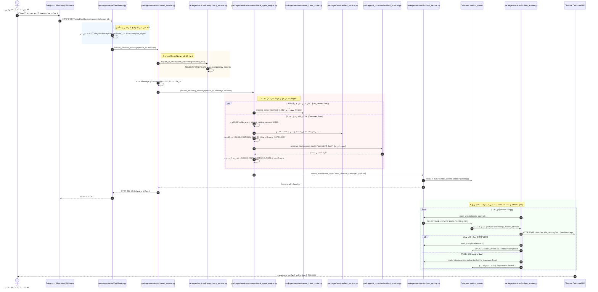

# 03_SYSTEM_ARCHITECTURE_TRACE.md — التتبع المعماري الحقيقي لمسارات التشغيل ونقاط الانتقال

- **تاريخ التوثيق والاعتماد:** 2026-11-03T03:35:00+03:00
- **نطاق الفحص:** تتبع مسار الرسالة الحقيقي من نقطة الدخول في الـ API وحتى وصول الرد للمستخدم، مع ربط كل خطوة بالملف الحقيقي، والكلاس، واسم الدالة بدقة.

---

## 1. مخطط التتبع المعماري للتدفق الحقيقي (End-to-End Execution Trace)

---

## 2. جدول المكونات والمسؤوليات البرمجية الدقيقة

| المرحلة | الملف المسؤول (`File Path`) | الكلاس / الدالة التنفيذية (`Class / Function`) | المسؤولية الميدانية |
| :--- | :--- | :--- | :--- |
| **استقبال وتوثيق Webhook** | `apps/agent/api/v1/webhooks.py` | `telegram_webhook` (L414) / `whatsapp_webhook_post` (L369) | استلام الـ Payload والتحقق الصارم من التوقيع الرقمي وSecret Token عبر `hmac.compare_digest`. |
| **قفل التكرار ومطابقة المستأجر** | `packages/services/channel_service.py` | `ChannelService.handle_inbound_message` (L528) | توليد مفتاح فريد `channel_type:external_id` وفحص جدول `idempotency_records` قبل أي معالجة. |
| **إدارة جلسة التحاور والتوجيه** | `packages/services/conversational_agent_engine.py` | `ConversationalAgentEngine.process_incoming_message` (L234) | التحقق من تصنيف المرسل (مالك vs عميل) وفحص حالة `conversation_fsm_service`. |
| **معالجة أوامر المالك** | `packages/services/owner_intent_router.py` | `OwnerIntentRouter.route_owner_intent` (L180) | مطابقة Regex لاستخراج أوامر المهام، والموافقات، والمنتجات، أو الاستفسارات المعلقة. |
| **استرجاع الحقائق والمعرفة** | `packages/services/fact_service.py` | `FactService.get_effective_facts` / `search_facts` | جلب ساعات العمل والفروع والسياسات عبر البحث الدلالي في جدول `facts`. |
| **توليد الرد بالذكاء الاصطناعي** | `packages/ai_providers/resilient_provider.py` | `ResilientProvider.generate_text` | استدعاء نماذج Gemini مع التراجع للنماذج البديلة دون تمرير أي واجهة استدعاء أدوات للنموذج. |
| **تسجيل الصادر الموثوق** | `packages/services/outbox_service.py` | `OutboxService.create_event` (L50) | كتابة سجل `OutboxEvent` داخل المعاملة الذرية لقاعدة البيانات. |
| **العامل الخلفي والتسليم الخارجي** | `packages/services/outbox_worker.py` | `OutboxWorker.process_event` (L155) | جلب الأحداث بـ `FOR UPDATE SKIP LOCKED` والإرسال عبر `ChannelConnector` وإدارة المحاولات والتراجع الأسي. |

---

## 3. نقاط الانتقال الحساسة ومخاطر الفشل المكتشفة

1. **فجوة استعلام الرسالة في `channel_service.py:543`:**
   - عند مطابقة سجل التكرار (`cached["message_id"]`)، يستعلم الكود عن الرسالة عبر `where(Message.id == UUID(cached["message_id"]))` **دون التحقق من `Message.tenant_id == tenant_id`**؛ مما يشكل ثغرة أمنية عند تلف الكاش.
2. **انقطاع شبكة القنوات الخارجية بعد الإرسال وقبل حفظ `mark_completed`:**
   - يثبت التتبع استحالة تحقيق Exactly-Once عبر HTTP، وأن المنصة تعتمد على At-least-once مع إعادة التحقق من حقل `delivery_status` في جدول الرسائل لمنع ازدواجية الإرسال.
