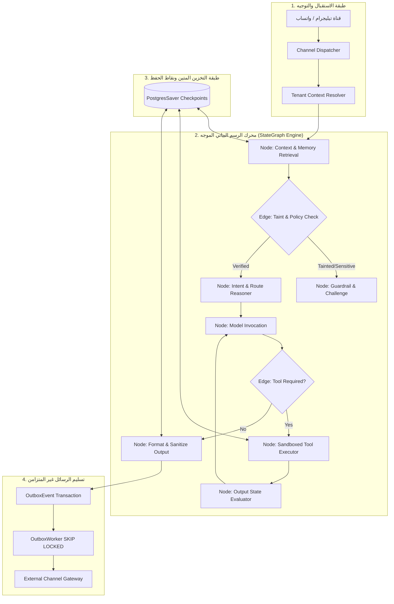

# التصميم المعماري المستهدف والمفاضلات الهندسية (Target Design & Tradeoffs)

**تاريخ التوثيق:** 2026-11-03  
**المشروع المستهدف:** `AI-Employee-Platform`  
**المرجعية الاستراتيجية:** وثيقة الرؤية المعتمدة `docs/PROJECT_VISION.md`  
**الحالة:** تصميم معماري تحضيري فقط (دون كتابة كود إنتاجي أو تنفيذ ترحيلات في هذه المرحلة).

---

## 1. المعمارية المستهدفة لمحرك الموظف الرقمي (In-House StateGraph Engine)

لمعالجة الاختناق المعماري المتمثل في الكود المتراص الحالي (ملف `conversational_agent_engine.py` ذي الـ 5,290 سطراً، ودالة معالجة رسائل المالك ذات الـ 1,702 سطر)، يتم اعتماد معمارية الرسم البياني الحالاتي المحلي الموجه (StateGraph Engine) المنفذ كلياً بكود نقي معزول يضمن استقلالية المنصة:



### 1.1 عقود العقد والحواف الشرطية (Node Contracts & Conditional Edges)
- كل خطوة تمثل عقدة نقية (Pure Node Function) تستقبل كائن حالة موحد `AgentState` وتُرجع تعديلات جزئية (State Updates):
  ```python
  class AgentState(BaseModel):
      tenant_id: str
      thread_id: str
      checkpoint_id: str
      dialogue_turn: int
      messages: list[BaseMessage]
      active_intent: str | None
      extracted_facts: list[FactItem]
      pending_action: ToolAction | None
      taint_flags: set[str]
      approval_challenge: str | None
      is_completed: bool
  ```
- **الحواف الشرطية (Conditional Edges):** دوال تقييمية خفيفة تحدد العقدة التالية بناءً على مخرجات الحالة دون وجود أي جمل `if/elif` ضخمة مكدسة في دالة واحدة.

### 1.2 مخطط نقاط الحفظ المخصصة لعزل المستأجرين (Tenant-Isolated Checkpointing Schema)
تعديل نمط `PostgresSaver` ليشمل `tenant_id` كقيد أساسي مركب لضمان استحالة تداخل حالات العملاء:
```sql
CREATE TABLE agent_checkpoints (
    tenant_id VARCHAR(36) NOT NULL,
    thread_id VARCHAR(64) NOT NULL,
    checkpoint_ns VARCHAR(64) NOT NULL DEFAULT '',
    checkpoint_id VARCHAR(64) NOT NULL,
    parent_checkpoint_id VARCHAR(64),
    state_payload JSONB NOT NULL,
    metadata JSONB NOT NULL DEFAULT '{}',
    created_at TIMESTAMP WITH TIME ZONE DEFAULT CURRENT_TIMESTAMP,
    PRIMARY KEY (tenant_id, thread_id, checkpoint_ns, checkpoint_id),
    CONSTRAINT fk_checkpoint_tenant FOREIGN KEY (tenant_id) REFERENCES tenants(id) ON DELETE CASCADE
);

CREATE INDEX idx_checkpoints_lookup ON agent_checkpoints(tenant_id, thread_id, created_at DESC);
```

### 1.3 إدارة اتصالات قاعدة البيانات (DB Session Lifecycle - نمط Dify)
- **المشكلة الحالية:** احتجاز جلسة الـ DB أثناء انتظار استدعاء الـ LLM الخارجي (مما يهدد بنفاد مجمع الاتصالات).
- **التصميم المستهدف:**
  1. تقوم العقدة بقراءة البيانات وحفظ الحالة الأولية.
  2. يتم عمل `session.commit()` و `session.close()` فوراً قبل إرسال طلب الشبكة للـ LLM.
  3. يتم استدعاء الـ LLM مع مؤقت زمني صارم (Timeout).
  4. عند وصول الرد، يتم طلب اتصال جديد من المجمع (Pool) لحفظ الحالة ونقاط الحفظ في جدول الـ Checkpoints.

---

## 2. هيكلية الذاكرة رباعية الطبقات (4-Tier Memory Hierarchy)

لإلغاء التقطيع التعسفي الحالي (350 حرفاً للرسالة و 8 رسائل كحد أقصى)، يُعتمد النموذج التالي:

```text
+-----------------------------------------------------------------------------------+
| Tier 1: ذاكرة العمل اللحظية (Working Turn Buffer)                                  |
| نافذة انزلاقية ديناميكية مبنية على عدد الرموز (Tokens) مع ضغط سياقي دلالي مستمر.     |
+-----------------------------------------------------------------------------------+
                                         │
+-----------------------------------------------------------------------------------+
| Tier 2: الذاكرة العرضية قصيرة المدى (Episodic Conversation Memory)                 |
| خيوط المحادثات، أهداف العميل الحالية، واستمرارية السياق المرتبطة بالـ thread_id.   |
+-----------------------------------------------------------------------------------+
                                         │
+-----------------------------------------------------------------------------------+
| Tier 3: الذاكرة الدلالية للحقائق (Semantic Fact Memory)                            |
| استرجاع متجهي حقيقي عبر pgvector (Cosine Distance) مدمج مع البحث النصي الهجين.     |
+-----------------------------------------------------------------------------------+
                                         │
+-----------------------------------------------------------------------------------+
| Tier 4: الذاكرة الإجرائية والسلوكية طويلة المدى (Procedural Behavioral Memory)     |
| مهارات الموظف الرقمي المعتمدة، قوالب الإجراءات، وقواعد العمل المصرح بها للمنشأة.   |
+-----------------------------------------------------------------------------------+
```

---

## 3. المشرف المركزي: "الأب الروحي" (The Godfather / Guardian)

بناءً على وثيقة الرؤية المعتمدة `PROJECT_VISION.md`، يتم تخصيص كيان رقابي مستقل أعلى من وكلاء المستأجرين:

1. **الاستقلالية التامة عن مسار المحادثة اليومية:**
   - لا يشارك في توليد ردود العملاء لكي لا يؤثر على زمن الاستجابة (Latency).
   - يعمل كخدمة مراقبة خلفية (Daemon / Event Consumer) تستمع لأحداث مسار التدقيق `audit_events`.
2. **الوظائف الرقابية الحيوية:**
   - **اكتشاف الانحراف السلوكي (Drift Detection):** رصد محاولات الوكيل لتوليد إجابات تخالف الذاكرة المعتمدة أو تكرار حالات الفشل.
   - **المراقبة الجنائية لعزل المستأجرين (Tenant Boundary Guard):** مراقبة أي استعلام يحاول الوصول لبيانات بدون `tenant_id` وإيقاف العملية فوراً.
   - **التقارير الموحدة لمؤسس المنصة:** إرسال إشعارات ذكية ملخصة يومياً للمؤسس عبر تيليجرام تتضمن: معدل استهلاك التوكنز، الأخطاء التشغيلية، ومقترحات المهارات الجديدة التي تنتظر الإجازة.

---

## 4. مستويات الاستقلالية التدرجية وتتبع التلويث (Autonomy Tiers & Taint Tracking)

| المستوى | اسم المستوى | الصلاحيات الممنوحة | متطلبات التنفيذ |
| :---: | :--- | :--- | :--- |
| **Tier 1** | **Read-Only Autonomy** | استرجاع الأسعار، قراءة كتالوج المنتجات، البحث في الذاكرة الدلالية | تنفيذ فوري ومباشر دون طلب موافقة |
| **Tier 2** | **Reversible Operations** | إنشاء تذكرة عميل، تحديث مواعيد الحجز، تدوين ملاحظات | تنفيذ فوري مع تسجيل جنائي في الـ Audit وإشعار لاحق للمالك |
| **Tier 3** | **High-Impact / Financial** | حذف بيانات، إرسال حملات تسويقية جماعية، تغيير الأسعار المعتمدة | **إيقاف إجباري + طلب تحدي تشفيري (رمز سري عشوائي 6 خانات)** |

- **آلية تتبع التلويث (Taint Tracking):**
  - كل نص قادم من قناة خارجية (رسالة عميل) يتم وسمه تلقائياً كـ `TAINTED_INPUT`.
  - إذا قرر النموذج استدعاء أداة من أدوات Tier 2 أو Tier 3 باستخدام معطيات مستخلصة من نص ملوث، يمرر الطلب إجبارياً إلى عقدة التحقق الأمني (Sanitizer Node) لمنع هجمات Prompt Injection والتحايل غير المصرح به.

---

## 5. اكتساب المهارات التخصصية بنمط Memento-Skills

- **إلغاء أسلوب الـ Hardcoded Calculators:** إزالة كود الـ Regex الذي يحقن نصوص بايثون لحساب الزكاة والضريبة.
- **دورة حياة المهارة الجديدة (Skill Lifecycle):**
  1. **الرصد (Gap Detection):** يرصد الوكيل عجزاً في الإجابة على طلب حسابي أو إجرائي متكرر.
  2. **الصياغة (Skill Proposal):** يقترح كود مهارة محدد المدخلات والمخرجات وفق عقد Pydantic.
  3. **الفحص الأمني (AST Security Scan):** فحص الكود والتأكد من خلوه من أي مكتبات محظورة (`os`, `sys`, `eval`, `subprocess`).
  4. **التقييم التلقائي (Benchmarking):** تشغيل 5 اختبارات افتراضية للتحقق من دقة النتائج وزمن الاستجابة.
  5. **الإجازة البشرية:** إرسال بطاقة موافقة للمالك أو المشرف المركزي عبر تيليجرام؛ وبمجرد الموافقة، تُسجل المهارة كإصدار جديد في جدول `agent_skills` للمستأجر المعني فقط.

---

## 6. تحليل المفاضلات الهندسية (Architectural Tradeoffs Analysis)

| القرار المعماري | الخيار المعتمد | الخيار البديل المستبعد | أسباب الاعتماد الهندسي والمخاطر المتفادية |
| :--- | :--- | :--- | :--- |
| **بنية محرك الرسم البياني** | **بناء StateGraph محلي نقي (In-house Engine)** | استيراد مكتبة LangGraph بالكامل كاعتمادية ضخمة | الحفاظ على خفة الحزمة، التحكم المطلق في كود الأمان، ضمان دمج `tenant_id` في نواة كل عقدة، وتجنب التغييرات الجذرية المتكررة في واجهات LangGraph الخارجية. |
| **وسيط نقاط الحفظ (Checkpointer Storage)** | **PostgreSQL مع JSONB** | Redis كـ Checkpointer أساسي | الحفاظ على تناسق المعاملات (ACID) مع جداول المحادثات والـ Outbox، وتوفير سجل دائم للتحقيق الجنائي لا يضيع عند إعادة تشغيل Redis. |
| **دورة معالجة التنافسية** | **Transactional Outbox مع `SKIP LOCKED`** | Message Broker خارجي معقد (RabbitMQ / Kafka) | بساطة البنية التحتية، انعدام مخاطر Distributed Transactions، وضمان تسليم الرسائل بدقة (At-least-once) باستخدام نفس قاعدة بيانات المنصة الحالية. |
| **استرجاع المعرفة** | **Real pgvector Cosine Similarity** | الاستمرار في مطابقة الـ Regex الحالية | إلغاء هشاشة البحث الحرفي، استيعاب المرادفات والأخطاء الإملائية في اللهجات العربية، ورفع دقة ردود الموظف الرقمي إلى المستويات العالمية. |
| **ضغط سياق المحادثة** | **الضغط الدلالي والنافذة المتغيرة** | التقطيع الحاد عند 350 حرفاً | منع فقدان سياق الحوار بين العميل والموظف، وتوفير ردود متماسكة حتى في المحادثات الطويلة دون إهدار ميزانية الـ Tokens. |
