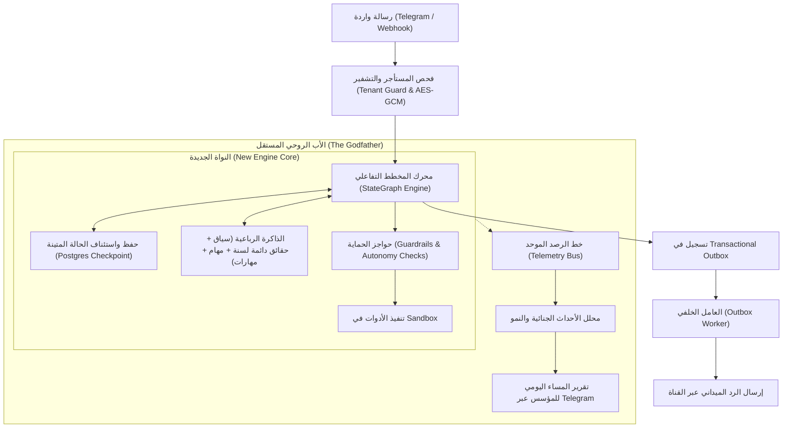

# خلاصة التركيب المعماري الشامل للتدقيق الليلي (Architectural Synthesis)
## 09_FINAL_SYNTHESIS.md

- **تاريخ الإعداد:** 2026-11-03T02:42:00+03:00
- **المهمة:** إجابة الأسئلة الاستراتيجية والتقنية الـ 12 المحددة في أمر التدقيق الليلي استناداً إلى الواقع الميداني للمنصة وتحليل المشاريع المرجعية السبعة.

---

### 1. ما هو الواقع الفعلي للمشروع الحالي؟
- **الحقيقة البرمجية:** المنصة تمتلك أساساً رصيناً في خدمات البيانات المعيارية وتعدد المستأجرين (Multi-tenancy) وعزل الصلاحيات ونمط الـ Transactional Outbox لتسليم الرسائل عبر القنوات.
- **الخلل الجذري:** المحرك التحاوري الحالي (`conversational_agent_engine.py`) وتطوير الـ FSM الجزئي يفتقران إلى إدارة متينة ودائمة للحالة (Durable Stateful Lifecycle). النظام يعتمد على استدعاءات LLM أحادية متفرقة ومحاولة مطابقة نصوص سطحية للحقائق، مما جعله يعجز عن إدارة محادثة طبيعية مستمرة مع صاحب العمل أو العملاء ويفشل ميدانياً رغم اجتياز الاختبارات النظرية السريعة.

---

### 2. ما هي أكبر الفجوات بين الواقع الحالي والرؤية؟
1. **غياب كيان "الأب الروحي" (The Godfather):** لا يوجد حالياً أي نظام رقابي مركزي للمؤسس متصل بتيليجرام ومستند إلى مسار رصد موثوق، ولا يوجد تقرير مسائي يومي.
2. **فقدان الذاكرة المتراكمة طويلة الأمد:** الذاكرة الحالية لا تفرق بين المعلومة النشطة، والقديمة، والمتعارضة، ولا تضمن حفظ ساعات العمل أو سياسات المنشأة لسنة وأكثر بموثوقية.
3. **غياب كشف النقص الذاتي وتوليد وحدات الأعمال:** الوكيل الحالي يرفض الطلبات التي تنقصها أدوات سلبياً، ولا تملك المنصة قدرة على توليد وحدة مبيعات وتكاليف من الصفر.
4. **عدم وجود تقييم مهني تخصصي معزول للمهارات:** التعلم الذاتي الحالي نظري ولا يمر ببيئة تقييم (Sandbox Eval Loop) كما تفرض الرؤية.

---

### 3. ما هي المكونات التي يجب استبدالها أو إعادة تصميمها؟
- **يُستبدل فوراً:** محرك المحادثة الحالي (`conversational_agent_engine.py`)؛ استبدال كامل بـ **StateGraph Engine** مدعوم بـ PostgreSQL Checkpointing.
- **يُعاد تصميمه بالكامل:**
  - نظام الذاكرة: التحول من مجرد جدول `facts` البسيط إلى **المعمارية الرباعية للذاكرة** مع البحث الهجين (Hybrid Search: Vector + BM25).
  - مسار إشعارات المالك: فصله تماماً عن قناة المستأجرين وتحويله إلى **خدمة الأب الروحي المركزية**.
  - نموذج بطاقة الوكيل: إضافة مستويات الاستقلالية الصريحة الثلاثة (*مساعد / بموافقة / تلقائي ضمن الحدود*).

---

### 4. ما الذي يستحق الاحتفاظ به والبناء عليه؟
- **نمط الـ Transactional Outbox والعامل الخلفي (`outbox_worker.py`):** أثبت متانة وكفاءة عالية في ضمان تسليم الرسائل ومنع التكرار باستخدام `SELECT FOR UPDATE SKIP LOCKED`.
- **نظام التشفير وحماية الأسرار (`packages/core/crypto.py`):** التشفير الموثق AES-256-GCM للتوكنز والمفاتيح في قاعدة البيانات ممتاز ويلتزم بالمعايير الأمنية.
- **إدارة الجلسات وعزل المستأجرين (`packages/auth/tenant_context.py`):** التحقق المعتمد على JWT وتمرير سياق المستأجر في قاعدة البيانات رصين ويجب المحافظة عليه.
- **موصلات القنوات الأساسية (`packages/connectors/`):** تكاملات Telegram و WhatsApp و Email مصممة بنظافة وتدعم الـ Webhooks بشكل جيد.

---

### 5. ما هي أقوى التقنيات والأنماط المرجعية التي ثبتت فائدتها؟
1. **Durable StateGraph & Checkpointing (من LangGraph):** تخزين كل خطوة في قاعدة البيانات واستئناف المحادثة أو المهمة دون فقدان أي سياق، ودعم الـ Human-in-the-Loop عبر `interrupt`.
2. **Eval-Driven Skill Evolution (من Memento-Skills):** تقسيم دورة مهارات الوكيل إلى محلل للنقص ومقيم رقمي واختبارات معزولة قبل اعتماد المهارة.
3. **Autonomy Thresholds & Structured Telemetry (من RagLeap Core):** حوكمة الاستقلالية وخط الرصد المستقل لتغذية الأب الروحي بالبيانات الجنائية.
4. **Input/Output Guardrails & Multi-Agent Handoffs (من OpenAI Agents SDK):** حواجز لمنع الهلوسة وتسريب البيانات وتوزيع المهام بين وكلاء متخصصين.

---

### 6. ما الذي لا ينبغي نسخه أو تجنبه بحزم؟
- **تجنب استيراد حزم LangChain الضخمة والمعقدة:** نأخذ نمط الـ StateGraph والـ Checkpointing ونبنيه بكودنا النظيف، ولا نستورد مئات المكتبات الفرعية غير المستقرة.
- **تجنب كود Dify التجاري المقيد:** رخصة Dify تمنع الاستخدام التجاري المنافس كمنصة SaaS؛ لذلك نستلهم نمط الـ Hybrid Search ونموذج البيانات، ولا ننسخ أي كود مصدري حرفياً.
- **تجنب الاعتماد على Prompt هندسي واحد ضخم:** ثبت أن حشو كل شيء في System Prompt واحد هو السبب الأساسي لتدهور أداء الموظف الحالي.

---

### 7. كيف تبدو المعمارية المقترحة وتدفق البيانات؟

---

### 8. ما هي المخاطر والاعتماديات؟
- **الاعتمادية على توفر نموذج الذكاء الاصطناعي الأساسي:** ضرورة وجود Fallback حقيقي (Gemini -> OpenRouter) في حال حدوث Rate Limit.
- **خطر التضخم التخزيني للـ Checkpoints:** وضع سياسة إفراغ وأرشفة ذكية للجلسات المؤقتة.
- **الحفاظ على سلامة الترحيلات وقواعد البيانات القائمة.**

---

### 9. ما هي الأسئلة التي تحتاج موافقة المؤسس؟
1. الموافقة على اعتماد **البديل (أ)**: بناء محرك StateGraph خفيف ومستقل داخل المنصة مستند إلى نمط PostgreSQL Checkpointing.
2. تحديد سقف تفويض الأب الروحي: هل يقتصر على المراقبة ورفع التقرير اليومي، أم يملك صلاحية إعادة تشغيل المهام المتوقفة تلقائياً؟
3. اعتماد وحدة المبيعات والتكاليف والفواتير كأول وحدة أعمال ديناميكية نموذجية.

---

### 10. خطة المراحل المقترحة بعد اعتماد النتائج

| المرحلة | الأهداف والنتائج المستهدفة | معيار النجاح الصارم |
| :---: | :--- | :--- |
| **المرحلة 1: بناء النواة الجديدة** | إنشاء محرك `StateGraph` خفيف وجدول `checkpoints` في PostgreSQL | استئناف جلسة محادثة بنجاح بعد مقاطعة متعمدة دون فقدان الحالة |
| **المرحلة 2: الذاكرة الرباعية والبحث الهجين** | تطبيق تصنيف الحقائق الدائمة والبحث الدلالي + النصي | تذكر ساعات العمل والأسعار بعد أشهر بدقة 100% |
| **المرحلة 3: تأسيس الأب الروحي** | بناء خط الرصد وتكامل Telegram المستقل للمؤسس مع التقرير اليومي | استلام تقرير المساء اليومي بنجاح وتنبيه فوري عند أي خطأ مصطنع |
| **المرحلة 4: محرك الوحدات الديناميكية** | بناء وحدة المبيعات والتكاليف ككشف احتياج وتوليد ذاتي | إمكانية تزويد وكيل المبيعات ببيانات التكلفة والفواتير عند طلبه |
| **المرحلة 5: التحقق الميداني النهائي** | إجراء اختبارات محادثة واقعية عبر Telegram مع المؤسس | حوار طبيعي، إنجاز مهام معقدة، واعتراف صريح بالنواقص دون تظاهر |

---

### 11. ما هي الأدلة التي تدعم كل استنتاج؟
- تم توثيقها بالكامل بروابط الرموز والملفات وأرقام الـ commits في [`04_EVIDENCE_INDEX.md`](./04_EVIDENCE_INDEX.md).

---

### 12. ما الذي لم يتم التحقق منه بعد؟
- قياس زمن الاستجابة (Latency) واستهلاك الذاكرة الدقيق لمحرك الـ StateGraph تحت ضغط مئات الرسائل المتزامنة في الثانية (سيتم اختباره في مرحلة الـ Benchmarks المعزولة قبل النشر).
