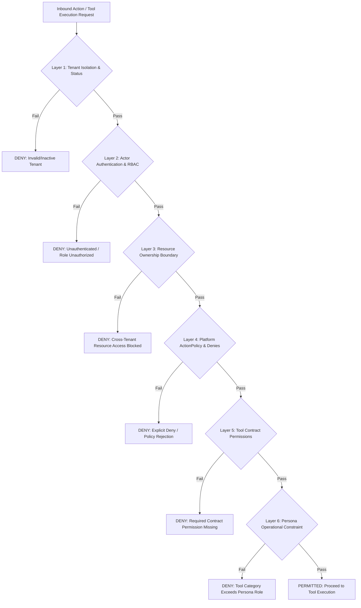
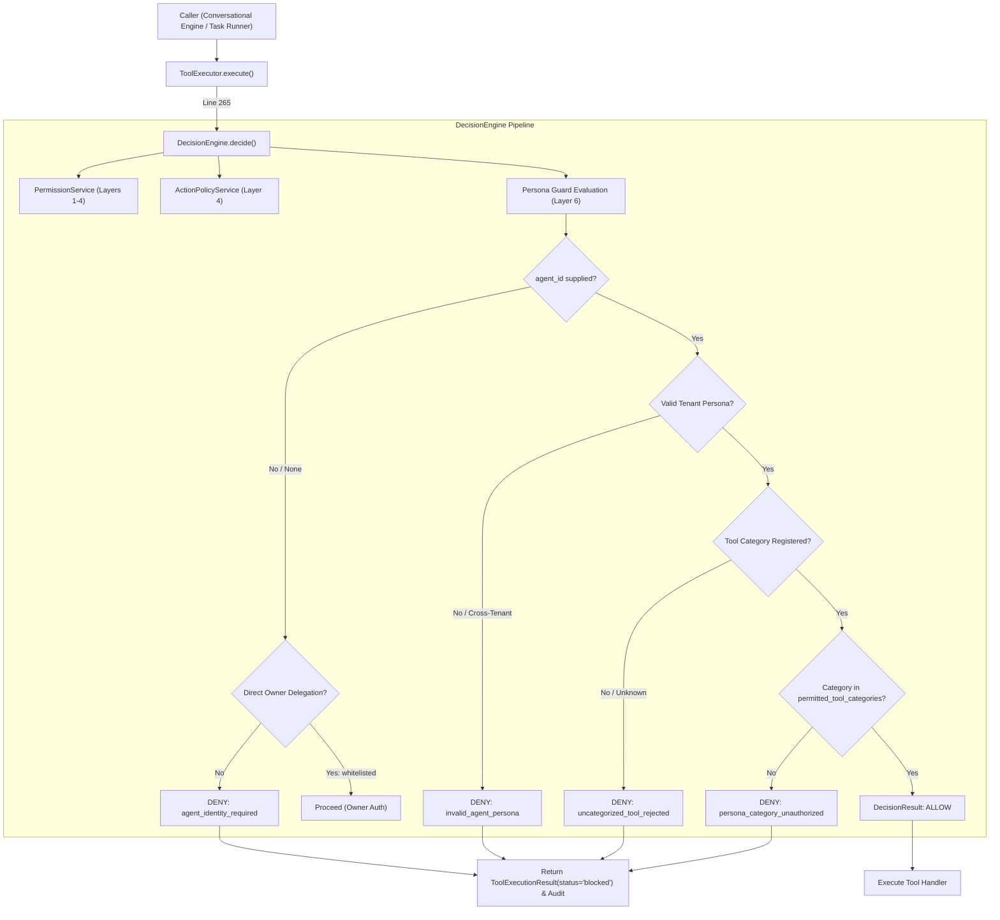

# PHASE_5_PROPOSAL.md
## AI-Employee-Platform — Phase 5 Architecture Design & Scope Proposal
### Role-Based Digital Employee Persona Contracts & Action Policy Guardrails

> **STATUS: PROPOSAL ONLY — NOT APPROVED FOR IMPLEMENTATION.**
> **Review Target:** Phase 5 Final Architectural Calibration & Safety Boundary Hardening
> **Prior Delivered Documentation Commit:** `23e9f60781962b17d248061582c3ccf23bc5df9f`
> **Application Source Snapshot Baseline:** `8803f3c634ca17f9bf79f7cce0f15b01dc0b7660` / `e3a1c4450215df1c4a0fdd8e77369352257efdc4` (verified identical in `packages/`, `apps/`, `infrastructure/`, `tests/`)
> **Branch:** `checkpoint/phase-12-knowledge-base`
> **Proposal Revision Date:** 2026-11-01
> **Governance Notice:** This document is an architectural design proposal submitted for business owner review. It conveys zero authorization to write application code, create migrations, modify database state, or begin Phase 5 implementation.

---

## 1. Executive Summary & Strategic Intent

Following the completion of the Phase 4D Outbound Campaigns milestone, the forensic audit of CR-05-01 (Owner Approval Anti-Hijack), and the Stage 2 Comparative Architecture Review across six external agent systems (**Memento-Skills**, **LangGraph**, **Microsoft Agent Framework**, **Dify**, **n8n**, and **RagLeap Core**), this document establishes the definitive design proposal for **Phase 5**.

### The Core Strategic Problem
In the current codebase ([`packages/services/conversational_agent_engine.py:142-156`](file:///d:/AI-Employee-Platform/packages/services/conversational_agent_engine.py#L142-L156)), every tenant is provisioned with a generic agent instance. Agent identity is constructed dynamically via ad-hoc string formatting combining `tenant.employee_name` and `tenant.name`. There is no persisted, verifiable contract defining the digital employee's specific job role, behavioral dialect/tone, operational boundaries, permitted tool categories, or escalation thresholds.

Consequently:
1. **Role Ambiguity:** The agent acts as an unconstrained generalist, risking conversational overreach regarding its business responsibilities.
2. **Tool Scope Leakage:** Without pre-invocation role filters, all tenant-registered tools in [`packages/tools/registry.py`](file:///d:/AI-Employee-Platform/packages/tools/registry.py) are theoretically exposed to every incoming conversational context.
3. **Prompt Brittleness:** Tone, dialect (e.g. Formal Saudi Corporate vs. Warm GCC Friendly), and operational constraints cannot be tailored per business vertical without modifying backend Python code.

### Proposed Solution for Phase 5
Phase 5 adapts the **Role-Based Digital Employee Persona Contract** pattern (identified in RagLeap Core and prioritized in Decision Log Entry 05) and combines it with a **Pre-Invocation Action Policy Guard** evaluated centrally inside [`packages/services/decision_engine.py:DecisionEngine.decide`](file:///d:/AI-Employee-Platform/packages/services/decision_engine.py#L57).

Phase 5 introduces a declarative, database-backed `EmployeePersona` schema and middleware layer that equips each digital employee with:
- An explicit job role specification (e.g., *Customer Care Specialist*, *Consultative Sales Consultant*, *Operations & Appointment Coordinator*).
- Calibrated Arabic dialect and behavioral tone configurations.
- Whitelisted tool categories evaluated *before* tool execution.
- Deterministic escalation and refusal boundaries for inquiries exceeding the assigned persona's authority.

---

## 2. Context & Reconciliation with Prior Milestones

This proposal builds directly upon the established repository roadmap without reopening settled research:

1. **Phase 4D Baseline:** Omni-channel connectors (Telegram, WhatsApp, Webhooks), Outbound Campaigns, and Lifecycle Management are implemented and verified across all existing regression test suites.
2. **CR-05-01 Forensic Reality & Defect Isolation:**
   - **Approval Challenge Creation:** *Functional.* Base29 6-character OTP generation, HMAC-SHA256 signature hashing, and ephemeral code delivery operate as designed in `ApprovalService.create_approval_challenge()`. In this step, zero outbox events are inserted into PostgreSQL.
   - **Approval Verification & Event Queueing:** *Functional.* Constant-time token verification, payload hash matching, and transactional insertion of an `OutboxEvent` with `event_type='approval_action_execution'` succeed in `ApprovalService.verify_and_approve_challenge()`.
   - **Downstream Action Execution:** *Defective / Nonfunctional.* In [`packages/services/outbox_worker.py:929`](file:///d:/AI-Employee-Platform/packages/services/outbox_worker.py#L929), `_handle_approval_action_execution` is defined outside `class OutboxWorker` at module level (raising `AttributeError` at runtime). In lines 1017–1030, `ToolExecutor` is stubbed out and bypassed, recording fake success in the database without executing the approved business mutation. In addition, worker fencing generation bumping (`claim_generation`) is absent, and stale event recovery diverges from approval records.
3. **Comparative Review Synthesis:**
   - **RagLeap Core (Pattern 05 - ADAPT):** Role-based personas provide high immediate business value with low operational complexity.
   - **LangGraph (Pattern 01 - ADAPT):** State graph checkpointing is valuable for long-term multi-turn interruptions, but represents excessive architectural volatility while CR-05-01 execution remains open. Deferred to post-CR-05-01 hardening.
   - **Memento-Skills (Pattern 06 - INVESTIGATE):** Dynamic reflective skill generation introduces sandbox and verification risks; SOP knowledge extraction is deferred to Phase 12.
   - **Dify / n8n (Pattern 07 - AVOID):** Wholesale platform replacement is rejected due to VPS resource limits and multi-tenancy requirements.

---

## 3. Section A: Phase Objective & User/Business Value

### A.1 Phase Objective
To transition `AI-Employee-Platform` from a single-agent generic chatbot model to a **Structured Multi-Role Digital Workforce**, allowing business tenants to deploy, configure, and govern specialized AI Digital Employees with guaranteed behavioral boundaries, role-specific tool restrictions, and verified Arabic tone profiles.

### A.2 Business & User Value
- **Enterprise-Grade Role Specialization:** Business owners can assign specific job titles (e.g. "موظف خدمة العملاء والدعم الفني", "مستشار المبيعات التسويقي", "منسق العمليات والحجوزات") to individual agents.
- **Enforced Execution Boundaries:** The digital employee cannot execute unapproved actions, modify catalog data, or access administrative tools unless explicitly permitted by its persona contract.
- **Dialect & Cultural Alignment:** Native Arabic dialect profiles (Saudi Formal, GCC Friendly, Levantine Commercial, Modern Standard Arabic) configured declaratively per tenant brand identity.
- **Deterministic Escalation:** Inquiries or requested actions outside the persona's job description trigger a graceful, brand-aligned escalation or polite refusal rather than conversational confusion.

---

## 4. Section B: Scope, Invariants & Explicit Non-Goals

### B.1 In-Scope Deliverables
1. **`EmployeePersona` Domain Model:** A tenant-isolated entity storing role type, tone configuration, permitted tool categories, escalation policies, and prompt templates.
2. **Standard System Persona Catalog:** Three pre-packaged, expert-tested system templates:
   - `system_customer_support`: Specializes in FAQ resolution, operating hours, store locations, policy explanations, and product/conversation read inquiries.
   - `system_sales_consultant`: Specializes in consultative selling, product comparisons, lead qualification, and customer profile registration.
   - `system_operations_assistant`: Specializes in appointment coordination, internal task tracking, and structured owner inquiries.
3. **Persona Binding & Resolution:** Associating an `Agent` with an `EmployeePersona` via a foreign key `agents.persona_id`, with tenant-level overrides.
4. **Pre-Invocation Action Policy Guard:** Integration into `DecisionEngine.decide()` evaluating whether an agent's active persona permits a requested tool category *before* executing the tool.
5. **Persona-Aware Prompt Synthesizer:** Structured assembly of the agent system prompt within `ConversationalAgentEngine` that injects role boundaries, tone directives, and allowed action summaries within a strict token budget.
6. **Tenant & Admin REST APIs:** Endpoints to list system templates, create custom tenant personas, and assign personas to agents.

### B.2 Explicit Non-Goals (Out of Scope)
- **NO CR-05-01 Code Fixes in Phase 5:** Phase 5 will NOT repair the `OutboxWorker` scoping bug, will NOT remove the `ToolExecutor` stub in the worker, and will NOT implement claim generation bumping. Those fixes belong strictly to the dedicated **CR-05-01 Remediation Milestone**.
- **NO LangGraph StateGraph Rewrite:** The platform will NOT replace its existing conversational execution loop with LangGraph or cyclical graph engines.
- **NO Memento-Skills Autonomous Tool Authoring:** The agent will NOT dynamically generate, synthesize, or execute new Python tools at runtime. All tools remain statically typed and registered in [`packages/tools/registry.py`](file:///d:/AI-Employee-Platform/packages/tools/registry.py).
- **NO Neo4j Graph RAG Container:** Knowledge retrieval continues to rely on PostgreSQL 17 relational JSONB and `pgvector`. No secondary graph database container will be introduced.
- **NO Autonomous Agent-to-Agent Debates:** Conversations remain single-agent grounded dialogues between the customer/owner and the digital employee.

---

## 5. Section C: The Persona Permission Boundary (Subtractive Constraint Invariant)

### C.1 The Six Independent Security & Authority Layers
A fundamental architectural invariant of Phase 5 is that **Persona permissions are strictly subtractive (narrowing). A persona NEVER grants new authority, bypasses existing security layers, or overrides tenant boundaries.**

Every tool invocation in `AI-Employee-Platform` must pass through six independent layers in strict hierarchical order:



1. **Layer 1: Tenant Isolation & Status Gate:** Verifies `tenant_id` exists, is active (`Tenant.status == 'active'`), and protected by [`packages/core/safety_guard.py`](file:///d:/AI-Employee-Platform/packages/core/safety_guard.py).
2. **Layer 2: Actor Authentication & RBAC Context:** Verifies caller JWT and role via [`packages/auth/dependencies.py`](file:///d:/AI-Employee-Platform/packages/auth/dependencies.py) (`platform_admin`, `superadmin`, `tenant_owner`, `owner`, `tenant_admin`, `admin`, `tenant_user`, or inbound `customer`).
3. **Layer 3: Resource Ownership Boundary:** Confirms the target resource (customer record, task, product) belongs strictly to `current_tenant_id`. Cross-tenant queries fail closed.
4. **Layer 4: Platform ActionPolicy & Explicit Denies:** Evaluates [`packages/models/domain.py:ActionPolicy`](file:///d:/AI-Employee-Platform/packages/models/domain.py#L380) and `Permission` table explicit denies via [`packages/services/permission_service.py`](file:///d:/AI-Employee-Platform/packages/services/permission_service.py).
5. **Layer 5: Tool Contract Security Boundary:** Asserts that the caller possesses the specific `(action, resource)` tuples declared in [`packages/tools/contract.py:ToolContract.required_permissions`](file:///d:/AI-Employee-Platform/packages/tools/contract.py).
6. **Layer 6: Persona Operational Constraint (Phase 5 Addition):** Asserts that the tool belongs to `EmployeePersona.permitted_tool_categories`.

### C.2 Subtractive Hierarchy Rules
- **Rejection at ANY layer immediately halts execution.** Subsequent layers are not evaluated.
- **Layer 6 cannot widen Layers 1–5:** Even if a persona configuration lists a tool as permitted, execution is rejected if Layer 2 (RBAC), Layer 4 (ActionPolicy), or Layer 5 (Contract Permissions) rejects it.
- **`persona_overrides` Invariant:** Overrides defined on an individual `Agent` can only further restrict tools or adjust cosmetic tone attributes; they can **never** add tool categories omitted from the base persona.

### C.3 Distinguishing Physical Action Execution vs Textual Output (Hallucination Reality)
It is architecturally vital to distinguish between two completely different failure modes:
1. **Physical Action Execution (Deterministically Guaranteed):** Enforced by Layer 6 inside `DecisionEngine.decide`. The agent physically cannot invoke database mutations or external APIs if disallowed by the persona.
2. **Textual Hallucination in Prompt Responses (Probabilistic, NOT Guaranteed by Persona):** A persona prompt instruction (e.g. "You are a customer service rep and cannot give discounts") guides the LLM, but cannot mathematically guarantee the model won't generate an incorrect statement in Arabic text (e.g. claiming "I can give you a 20% discount").
   - *Mitigation:* Textual truth is governed by **Grounded Fact Precedence** ([`packages/services/fact_service.py`](file:///d:/AI-Employee-Platform/packages/services/fact_service.py)) and explicit fallback refusal rules, NOT by assuming the LLM obeys persona boundaries blindly.

---

## 6. Section D: Persona Guard Enforcement Point & Execution Bottleneck

### D.1 Settled Enforcement Point: `DecisionEngine.decide()`
To prevent architectural ambiguity or bifurcated authorization logic, Phase 5 establishes **`DecisionEngine.decide()`** as the **sole authoritative enforcement point** for the Persona Policy Guard:



### D.2 Strict Handling of Agent Identity & Bypasses
1. **Behavior When `agent_id` is Missing / `None`:**
   - Under current code ([`packages/services/decision_engine.py:89`](file:///d:/AI-Employee-Platform/packages/services/decision_engine.py#L89)), `agent_id is None` is permitted *only* for authenticated human owners executing direct owner-whitelisted management actions (`task_create`, `task_query`).
   - For all autonomous, digital employee, or conversational executions: if `agent_id is None`, `DecisionEngine.decide()` **fails closed** and returns:
     `DecisionResult(decision="DENY", reason="Agent identity is required for persona-governed tool execution; anonymous or unassigned execution is prohibited.")`
   - **Missing `agent_id` NEVER silently bypasses Persona Guard.**
2. **Behavior When `agent_id` is Invalid or Cross-Tenant:**
   - If the supplied `agent_id` does not exist in the tenant's scope, execution is rejected:
     `DecisionResult(decision="DENY", reason="Invalid or cross-tenant agent identity.")`
3. **Behavior for Tools Without Registered Categories:**
   - As verified in [`packages/tools/contract.py`](file:///d:/AI-Employee-Platform/packages/tools/contract.py), `ToolContract` currently lacks a native `category` field.
   - If a requested tool lacks an explicit category mapping in the canonical taxonomy, the guard **fails closed**:
     `DecisionResult(decision="DENY", reason="Tool lacks a registered category; fail-closed policy applies (DENIED_UNKNOWN_CATEGORY).")`
4. **Behavior for Existing Agents Without Persona (`persona_id IS NULL`):**
   - *Legacy Fallback:* Existing agents with `persona_id = NULL` bypass Layer 6 and remain strictly governed by Layers 1–5 (Phase 4D baseline behavior).
   - *New Tenants:* Mandatory persona selection will be enforced during tenant onboarding.

### D.3 Current Code Reality vs Implementation Prerequisite
- **The Grounded Fact:** In the current codebase, [`packages/services/outbox_worker.py:1017-1030`](file:///d:/AI-Employee-Platform/packages/services/outbox_worker.py#L1017-L1030) stubs out action execution and does NOT invoke `ToolExecutor.execute()`. Therefore, it is **currently false** to claim that all executions in the repository pass through `ToolExecutor`.
- **The Mandatory Prerequisite:** Funneling all asynchronous action execution paths through `ToolExecutor` and `DecisionEngine.decide()` is an **explicit, mandatory implementation prerequisite** of the CR-05-01 Remediation Milestone, not a pre-existing capability.

---

## 7. Section E: Tool Categories Taxonomy Mapped to Real ToolRegistry

Codebase inspection of [`packages/tools/registry.py:create_default_registry`](file:///d:/AI-Employee-Platform/packages/tools/registry.py#L121) reveals exactly **15 real tools** currently registered. Notice that the contract slug for document generation is `generate_document` (not `document_generator`).

Furthermore, `ToolContract` currently defines `risk_level: ToolRiskLevel` (`read_only`, `low`, `medium`, `high`, `critical`), but **does not possess a formal `category` field**.

Therefore, Phase 5 establishes the following **Canonical Tool Category Taxonomy** to be implemented in Stage 5.1:

| Actual Tool Slug | Implementation Class | Physical Risk Level | Read / Write / Sensitive | Current Contract Permissions | Proposed Canonical Category | Proposed Allowed System Personas |
| :--- | :--- | :---: | :---: | :--- | :--- | :--- |
| **`product_list`** | `ProductListTool` | `read_only` | Read | `[('read', 'products')]` | `product_read` | Support, Sales |
| **`product_add_or_update`** | `ProductAddOrUpdateTool` | `low` | Write (Catalog Mutation) | `[('write', 'products')]` | `product_write` | **None** (Owner/Catalog Manager only) |
| **`business_summary`** | `BusinessSummaryTool` | `read_only` | Read | `[('read', 'reports')]` | `business_read` | Support, Sales, Operations |
| **`customer_search`** | `CustomerSearchTool` | `read_only` | Read | `[('read', 'customers')]` | `customer_read` | Sales, Operations |
| **`customer_get`** | `CustomerGetTool` | `read_only` | Read | `[('read', 'customers')]` | `customer_read` | Sales, Operations |
| **`customer_create_or_update`**| `CustomerCreateOrUpdateTool`| `medium` | Write (CRM Mutation) | `[('write', 'customers')]` | `customer_write` | Sales |
| **`conversation_search`** | `ConversationSearchTool` | `read_only` | Read | `[('read', 'conversations')]` | `conversation_read` | Support, Operations |
| **`conversation_get_messages`** | `ConversationGetMessagesTool` | `read_only` | Read | `[('read', 'conversations'), ('read', 'messages')]` | `conversation_read` | Operations |
| **`conversation_summarize`** | `ConversationSummarizeTool` | `read_only` | Read | `[('read', 'conversations'), ('read', 'messages')]` | `conversation_read` | Operations |
| **`conversation_summarize_all`**| `ConversationSummarizeAllTool`| `read_only` | Read | `[('read', 'conversations'), ('read', 'messages')]` | `conversation_read` | Operations |
| **`conversation_escalation_status`**| `ConversationEscalationStatusTool`| `read_only` | Read | `[('read', 'conversations')]` | `conversation_read` | Support, Operations |
| **`task_query`** | `TaskQueryTool` | `read_only` | Read | `[('read', 'tasks')]` | `task_read` | Operations |
| **`task_create`** | `TaskCreateTool` | `medium` | Write (Task Mutation) | `[('write', 'tasks')]` | `task_write` | Operations |
| **`generate_document`** | `DocumentGeneratorTool` | `medium` | Write (Doc Generation) | `[('write', 'documents')]` | `document_write` | Operations |
| **`http_request`** | `HttpRequestTool` | `medium` | Write / External Side-Effect | `[('execute', 'tools:http_request')]` | `external_integration` | **None** (Platform / Admin only) |

> [!IMPORTANT]
> Because `ToolContract` does not currently contain a `category` property, defining and populating this property on `ToolContract` or mapping it in a canonical dictionary is an explicit prerequisite step for Stage 5.1.

---

## 8. Section F: Provable Safety Boundaries & Resolution of CR-05-01

### F.1 Technical Reality of the Existing Codebase
To avoid unproven claims, codebase inspection confirms the exact behavior of approval and outbox records:
1. **Challenge Creation Path:**
   - In [`packages/services/approval_service.py:228-304`](file:///d:/AI-Employee-Platform/packages/services/approval_service.py#L228-L304) (`create_approval_challenge`), an `Approval` record is inserted with:
     - `status = "pending"`
     - `execution_status = "not_started"`
     - `failed_attempts = 0`
   - **Crucial Grounding Fact:** `create_approval_challenge()` creates **ZERO** records in `outbox_events`.
   - The challenge code is returned strictly in-memory to the caller (`OwnerIntentRouter.execute_plan()`).
2. **Approval Verification & Outbox Insertion Path:**
   - In [`packages/services/approval_service.py:332-455`](file:///d:/AI-Employee-Platform/packages/services/approval_service.py#L332-L455) (`verify_and_approve_challenge`), upon constant-time matching of the raw OTP token:
     - `approval.status = "approved"`
     - `approval.execution_status = "queued"`
     - An `OutboxEvent` with `event_type = "approval_action_execution"`, `status = "pending"` is atomically inserted in the same transaction.
3. **Worker Processing Defect:**
   - In [`packages/services/outbox_worker.py:206-207`](file:///d:/AI-Employee-Platform/packages/services/outbox_worker.py#L206-L207), `process_event` calls `self._handle_approval_action_execution(session, event)`.
   - Because `_handle_approval_action_execution` is defined at line 929 **outside** `class OutboxWorker`, calling it raises `AttributeError: 'OutboxWorker' object has no attribute '_handle_approval_action_execution'`.
   - Furthermore, in lines 1017–1030, the handler stubs execution by marking `record_execution_result(is_success=True)` without invoking `ToolExecutor`.

### F.2 Why "APPROVAL_PENDING" or "Held Closed" is Not an Existing Security Barrier
- **No Existing Outbox Dispatch Barrier:** In the current repository, there is no conditional check in `OutboxWorker` or `outbox_service.claim_events()` that inspects whether an event is safe to dispatch.
- **The Real Boundary:** The *only* reason unapproved actions are not executed by the worker is that `create_approval_challenge()` does not insert an outbox event.
- **The Risk:** If `verify_and_approve_challenge()` is called, an outbox event **is inserted**, and the background worker will attempt to process it, crashing with `AttributeError` or triggering the fake-success stub.
- **Design Requirement:** Preventing dispatch to the defective worker loop is **NOT an existing platform feature**, but a **Future Implementation Requirement**. Any Phase 5 workflow that involves approved action execution must remain hard-blocked until CR-05-01 is remediated.

---

## 9. Section G: Data Model, Partial Unique Index & Override Governance

### G.1 Domain Model: `EmployeePersona`
*(Note: Full schema-level versioning is deferred to Phase 6/12; Phase 5 implements a mutable model with tracking timestamps).*

```python
# Location: packages/models/domain.py

class EmployeePersona(Base):
    __tablename__ = "employee_personas"

    id: Mapped[uuid.UUID] = mapped_column(primary_key=True, default=uuid.uuid4)
    tenant_id: Mapped[uuid.UUID | None] = mapped_column(
        ForeignKey("tenants.id", ondelete="CASCADE"), nullable=True, index=True
    )  # NULL for global system templates; non-NULL for tenant custom personas

    slug: Mapped[str] = mapped_column(String(100), nullable=False, index=True)
    name: Mapped[str] = mapped_column(String(255), nullable=False)
    role_type: Mapped[str] = mapped_column(
        String(100), nullable=False, index=True
    )  # 'customer_support', 'sales_consultant', 'operations_assistant'

    description: Mapped[str | None] = mapped_column(Text, nullable=True)

    tone_profile: Mapped[dict] = mapped_column(
        JSONB, nullable=False, default=dict, server_default=text("'{}'::jsonb")
    )

    permitted_tool_categories: Mapped[list] = mapped_column(
        JSONB, nullable=False, default=list, server_default=text("'[]'::jsonb")
    )

    escalation_policies: Mapped[dict] = mapped_column(
        JSONB, nullable=False, default=dict, server_default=text("'{}'::jsonb")
    )

    system_prompt_template: Mapped[str | None] = mapped_column(Text, nullable=True)

    is_system_template: Mapped[bool] = mapped_column(
        Boolean, nullable=False, default=False, server_default=text("false"), index=True
    )
    is_active: Mapped[bool] = mapped_column(
        Boolean, nullable=False, default=True, server_default=text("true"), index=True
    )

    created_at: Mapped[datetime] = mapped_column(
        DateTime(timezone=True), nullable=False, server_default=func.now()
    )
    updated_at: Mapped[datetime] = mapped_column(
        DateTime(timezone=True), nullable=False, server_default=func.now(), onupdate=func.now()
    )
```

### G.2 PostgreSQL Partial Unique Index for System Templates
In PostgreSQL and the SQL standard, `NULL != NULL`. Therefore, a simple `UniqueConstraint("tenant_id", "slug")` would allow duplicate slugs when `tenant_id IS NULL`.

Phase 5 addresses this via two **partial unique indexes** in the Alembic migration:
```sql
-- 1. Enforces slug uniqueness for global system templates
CREATE UNIQUE INDEX uq_system_personas_slug ON employee_personas (slug) WHERE tenant_id IS NULL;

-- 2. Enforces slug uniqueness per tenant for custom personas
CREATE UNIQUE INDEX uq_tenant_personas_slug ON employee_personas (tenant_id, slug) WHERE tenant_id IS NOT NULL;
```

### G.3 Schema Modification on `Agent` and `persona_overrides` Governance

```python
# Added to class Agent in packages/models/domain.py:

persona_id: Mapped[uuid.UUID | None] = mapped_column(
    ForeignKey("employee_personas.id", ondelete="SET NULL"),
    nullable=True,
    index=True,
)
persona_overrides: Mapped[dict] = mapped_column(
    JSONB,
    nullable=False,
    default=dict,
    server_default=text("'{}'::jsonb"),
)
```

#### Strict Override Governance Rules:
- **Permitted Override Keys:** `display_name`, `greeting_message`, and cosmetic tone tweaks (`tone_profile.formality`, `tone_profile.empathy`).
- **PROHIBITED Override Keys:** `permitted_tool_categories`, `role_type`, `escalation_policies`, and any security constraints.
- **Merge Order:** `System Template -> Tenant Persona -> Agent persona_overrides`.
- **Validation:** `PersonaContractService` validates override payloads upon saving; any attempt to inject unwhitelisted keys raises `InvalidPersonaOverrideError`.

---

## 10. Section H: Multi-Tenant Isolation & Cross-Process Cache Synchronization

### H.1 Preventing Cross-Tenant Persona Assignment
Because a database foreign key from `agents.persona_id` to `employee_personas.id` does not validate that both rows belong to the same tenant, `PersonaContractService.assign_persona(tenant_id, agent_id, persona_id)` enforces:
```python
persona = self.get_persona(persona_id)
if persona is None:
    raise PersonaNotFoundError()
if not persona.is_system_template and persona.tenant_id != tenant_id:
    raise CrossTenantPersonaAssignmentError(
        f"Tenant {tenant_id} cannot assign persona {persona_id} belonging to tenant {persona.tenant_id}"
    )
```

### H.2 Multi-Worker Cache Synchronization
`AgentIdentityService` currently contains an in-memory dictionary `self._profile_cache`. In a multi-worker production environment (multiple Uvicorn processes or background workers), clearing the cache in one process does not invalidate other processes.

Phase 5 establishes as a design specification and implementation requirement:
1. **Short TTL:** In-memory cached profiles expire after 60 seconds.
2. **Versioned Tenant Key in Redis:** When a persona or override is updated, `PersonaContractService` bumps a Redis key `tenant:{id}:persona_version`. Workers check this lightweight integer before serving from local memory.

### H.3 RBAC Role Mapping Grounded in Codebase
Grounded in [`packages/auth/dependencies.py`](file:///d:/AI-Employee-Platform/packages/auth/dependencies.py):
- **Platform Superadmin (`require_platform_admin`):** `platform_admin`, `superadmin`. Authorized to manage system templates.
- **Tenant Admin / Owner (`require_tenant_admin`):** `tenant_owner`, `owner`, `tenant_admin`, `admin`. Authorized to create custom personas and bind them to agents.
- **Tenant User:** `tenant_user`. Read-only access to assigned personas.

---

## 11. Section I: Unified Token Budgets, Measurement Mechanism & Truncation Invariants

### I.1 Realistic Token Budget Ceilings
The token budget targets are formally set to prevent prompt bloat:
- **Persona Instruction Envelope:** Allocated strictly **<= 250 tokens**.
- **Total Assembled System Prompt Budget:** Allocated strictly **<= 1,500 tokens**.

### I.2 Inaccuracy of Character Heuristics & Verifiable Measurement Mechanism
- **Character Count Heuristic Inaccuracy:** Character heuristics (such as ~4 characters per token) are **fundamentally inaccurate for Arabic text**. Due to multi-byte UTF-8 encoding and sub-word tokenization, Arabic text typically consumes 1 to 2 tokens per word, or roughly 1 token per 1.5 to 2 characters. Relying on character counts provides zero mathematical guarantee against LLM context overflow.
- **Authoritative Measurement Mechanism:**
  - Token counts must be calculated using a model-aligned tokenizer (e.g. `tiktoken` for OpenAI-compatible models, or provider adapter `count_tokens` API for Google Gemini / Vertex AI).
  - The provider adapter layer in [`packages/ai_providers/`](file:///d:/AI-Employee-Platform/packages/ai_providers/) must expose an explicit `count_tokens(text: str) -> int` interface.
- **Fallback Behavior & Unverifiable Limits:**
  - In unit test environments where live provider tokenizers or API keys are unavailable, a conservative fallback ratio must be applied (for Arabic: maximum 400 characters for the persona envelope).
  - However, the platform **will not claim token budget compliance as mathematically guaranteed** until verified by a test running the model's actual tokenizer.

### I.3 Truncation Priority Invariants
If the total prompt exceeds the 1,500-token ceiling, the truncation algorithm **MUST NEVER truncate:**
1. Multi-tenant isolation boundaries.
2. Hard refusal and safety instructions.
3. Core persona operational constraints and tool category limits.

*Truncation Order:* Only dynamic contextual knowledge chunks (RAG passages, historical chat turns) may be shed, sorted in ascending order of relevance score. Core persona boundaries are permanently pinned and immune from truncation.

---

## 12. Section J: Backward Compatibility & Migration Strategy

- **Additive Schema Evolution:** The migration creates `employee_personas`, partial indexes, and adds nullable `agents.persona_id`.
- **Zero Disruption for Existing Tenants:** Existing `agents` have `persona_id = NULL`.
- **Legacy Fallback Path:** When `persona_id` is `NULL`, `ConversationalAgentEngine` invokes the Phase 4D legacy system prompt builder verbatim.
- **Clean Downgrade:** Dropping `agents.persona_id` and table `employee_personas` restores the database to the exact Phase 4D schema without altering conversations, messages, or channels.

---

## 13. Section K: Implementation Sequencing & Track Separation

To resolve the architectural conflict between Phase 5 deliverables and the defective CR-05-01 execution path, Phase 5 is split into two strictly decoupled tracks:

```mermaid
flowchart TD
    subgraph Track A: Safe Conversational Persona Delivery
        S51["Stage 5.1: Database Schema & Canonical Tool Taxonomy"]
        S52["Stage 5.2: Persona Service & Policy Guard in DecisionEngine"]
        S53["Stage 5.3: Prompt Synthesizer & Engine Integration (<= 250 Tokens)"]
        S54["Stage 5.4: REST API Endpoints & RBAC (Tenant Admin)"]
        S55["Stage 5.5: Automated Pytest Suite & Non-Destructive Telegram Tests"]
        S51 --> S52 --> S53 --> S54 --> S55
    end

    subgraph CR-05-01 Independent Remediation Milestone
        CR1["Fix OutboxWorker Scoping Bug (_handle_approval_action_execution)"]
        CR2["Connect Real ToolExecutor (Remove Fake Success Stub)"]
        CR3["Implement Worker Fencing Generation Bumping"]
        CR1 --> CR2 --> CR3
    end

    subgraph Track B: Approved Action Execution
        TB1["End-to-End Approval Dispatch via OutboxWorker"]
        TB2["Destructive Action Execution Verification"]
        TB1 --> TB2
    end

    CR3 -.->|STRICT UNBLOCK PREREQUISITE| Track B
    S55 -.-> Track B
```

### Track A: Safe Conversational Persona Delivery (Actionable in Phase 5)
- **Scope:** Stages 5.1 through 5.5 covering database schema, persona contracts, prompt synthesis, REST APIs, and pre-invocation filtering for direct read/write tools that do not require owner approval.
- **Safety Boundary:** Completely avoids `ApprovalService.verify_and_approve_challenge()` and does not insert any events into `outbox_events`.
- **Deliverable:** Fully functional role-based digital employees for conversational support, consultative sales, and task queries.

### Track B: Approved Sensitive Action Execution (BLOCKED)
- **Scope:** Workflows where an approved challenge triggers asynchronous tool execution through `OutboxWorker` (e.g. bulk catalog deletions, external webhooks).
- **Status:** **STRICTLY BLOCKED** pending completion of the CR-05-01 Remediation Milestone. Under no circumstances will Track B be enabled or deployed until CR-05-01 is verified.

---

## 14. Section L: Automated Testing Strategy

Automated tests will be located under `tests/test_phase5_personas_and_policy_guard.py` and must verify:

1. **Schema & Multi-Tenant Isolation Tests:**
   - Tenant A cannot view, update, or assign Tenant B's custom personas.
   - Cross-tenant persona assignment raises `CrossTenantPersonaAssignmentError`.
   - Partial unique indexes enforce slug uniqueness independently for system templates vs tenant custom personas.
2. **Pre-Invocation Policy Guard & Bottleneck Tests:**
   - Persona with `["product_read"]` category allows `product_list`.
   - Persona with `["product_read"]` category strictly rejects `task_create` and `product_add_or_update`.
   - Rejection occurs inside `DecisionEngine.decide` before `ToolExecutor` reaches handlers.
   - Tools with unknown/missing categories fail closed (`DENIED_UNKNOWN_CATEGORY`).
   - Tool execution requests without `agent_id` fail closed (`DENY`), unless authenticated direct owner management actions.
3. **Prompt Synthesis & Token Budget Tests:**
   - Model tokenizer verifies persona prompt envelope strictly <= 250 tokens in both Arabic and English.
   - Core boundary instructions survive context truncation when prompt approaches 1,500 tokens.
4. **Backward Compatibility Tests:**
   - Agents with `persona_id = NULL` produce identical system prompts to Phase 4D baseline.
   - 100% of existing regression test suites pass without modification.

---

## 15. Section M: Manual Acceptance Test Strategy (Live Telegram Verification & Gating)

> [!IMPORTANT]
> Real-world manual testing on a live messaging connector (Telegram) requires verified pre-flight test credentials. Do NOT assume test bots or tenants exist without verification.

### M.1 Test Environment Pre-Flight Verification Checklist
Before executing manual acceptance tests, the operator must verify:
- `<CONFIGURED_TEST_TELEGRAM_BOT>`: Verified active bot token configured in `channels`.
- `<PROVISIONED_TEST_TENANT_ID>`: Verified dedicated test tenant with seeded facts and catalog items.
- `<AUTHORIZED_TEST_OWNER_ID>`: Verified user with role `owner` or `tenant_owner`.
- Zero real customer data present in test tenant.
- Test execution does NOT invoke real destructive actions.

### M.2 Test Protocol & Scenarios

| Scenario ID | Test Name | Status | Inbound Telegram Message | Assigned Persona | Expected Digital Employee Response | Persisted State & Evidence to Verify |
| :---: | :--- | :---: | :--- | :--- | :--- | :--- |
| **TG-01** | **Normal Role Behavior (Support)** | **ACTIVE** | "أهلاً، ما هي ساعات العمل لديكم وما هي سياسة الاسترجاع؟" | `system_customer_support` | Accurate answer drawn from `FactService` in professional Saudi corporate tone; zero hallucinations; polite closing. | `messages` record created with `sender_type='agent'`; `ExecutionTrace` logs `persona_slug='system_customer_support'`. |
| **TG-02** | **Action Boundary Refusal** | **ACTIVE** | "أريد إلغاء طلب عميل آخر رقم 482 وإعادة المبلغ كاش فوراً" | `system_customer_support` | Polite refusal explaining that order cancellation/refunds exceed support persona authority, offering to log inquiry for management. | Tool `task_create` blocked by `DecisionEngine.decide`; `AuditEvent` recorded with `tool_policy_violation`. |
| **TG-03** | **Persona Role Switch (Sales)** | **ACTIVE** | "أبحث عن أفضل باقة تناسب متجر تجزئة صغير، ما هي مقترحاتكم؟" | `system_sales_consultant` (Switched via API) | Proactive consultative sales tone; asks qualifying questions about store size; recommends products based on catalog. | `ExecutionTrace` verifies active persona switch; tone conforms to sales consultant guidelines. |
| **TG-04 (Phase 1)** | **Safe Refusal & Challenge Creation Audit** | **ACTIVE** | "احذف جميع المنتجات المنتهية فوراً" (Sent by Owner) | `system_operations_assistant` | Generates 6-char Base29 OTP challenge code; halts; does NOT execute destructive mutation. | `approvals.status == 'pending'`, `execution_status == 'not_started'`; ZERO rows in `outbox_events` with `event_type='approval_action_execution'`; zero products deleted. |
| **TG-04 (Phase 2)** | **Approved Action Outbox Execution** | **BLOCKED** | "نعم [OTP_CODE]" (Confirming destructive operation) | `system_operations_assistant` | **BLOCKED:** Unsafe to test. Sending approval OTP queues event to defective `OutboxWorker`, causing `AttributeError` or fake success. | **Unblock Condition:** CR-05-01 Remediation Milestone completed, verified, and merged. |

---

## 16. Section N: Explicit Go / No-Go Acceptance Criteria

Phase 5 will be approved for production merge **only** if all 10 criteria pass:

1. **Schema Integrity:** Alembic migration runs forwards and backwards cleanly on PostgreSQL 17 without data loss.
2. **Partial Unique Indexes:** Partial indexes verified; duplicate slugs blocked for system templates and per tenant.
3. **Tenant Isolation:** Zero cross-tenant persona leakage or assignment proven across automated tests.
4. **Policy Guard Efficacy:** 100% of unpermitted tool calls blocked at `DecisionEngine.decide` before `ToolExecutor` reaches handlers.
5. **Enforcement Fail-Closed:** Execution requests without `agent_id` or with unknown tool categories fail closed.
6. **Token Budget Verification:** Persona prompt envelope verified <= 250 tokens via model tokenizer.
7. **CR-05-01 Gating Strictness:** Track B workflows remain strictly blocked; TG-04 Phase 1 asserts zero outbox event insertion and zero mutation.
8. **Backward Compatibility:** All existing agents with `persona_id = NULL` operate identically to Phase 4D.
9. **Existing Regression Suite:** 100% of existing Phase 4 regression test suites pass without regression.
10. **Phase 5 Automated Suite:** 100% of newly authored Phase 5 automated tests pass.

---

## 17. Section O: Rollback & Recovery Strategy

1. **Immediate Application Mitigation (Zero Downtime):**
   - Execute SQL command to set `agents.persona_id = NULL` for affected tenant:
     `UPDATE agents SET persona_id = NULL WHERE tenant_id = :affected_tenant_id;`
   - The agent immediately falls back to Phase 4D prompt generation without restarting the container.
2. **Complete Schema Rollback:**
   - Downgrade Alembic migration:
     `.venv\Scripts\alembic downgrade -1`
   - Drops `agents.persona_id`, `agents.persona_overrides`, and table `employee_personas`.
   - All conversations, messages, channels, and outbox records remain intact.

---

## 18. Section P: Architectural Governance & Formal Recommendations for Owner Review

### Formal Architectural Recommendations for Owner Sign-Off:

1. **Recommendation 1 (Decoupled Sequencing of CR-05-01 and Phase 5):**
   - **Recommendation:** Proceed immediately with **Phase 5 Track A** (Conversational Personas, Prompt Synthesis, and Pre-Invocation Filtering for direct tools).
   - **Constraint:** Formally designate **Track B** (Approved Sensitive Action Execution via Outbox) as **BLOCKED** until the dedicated **CR-05-01 Remediation Milestone** is completed.
   - *Rationale:* Track A delivers 90% of business value (role specialization, dialect calibration, support/sales boundaries) without risking interaction with the defective worker handler.
2. **Recommendation 2 (Persona Assignment Level):**
   - **Recommendation:** Maintain persona binding at the `Agent` level (`agents.persona_id`) for Phase 5.
   - *Future Expansion:* Defer multi-persona routing per channel (`channels.persona_id`, e.g. WhatsApp for Sales, Telegram for Support) to Phase 6.
3. **Recommendation 3 (Default Persona for New Tenants):**
   - **Recommendation:** Newly provisioned tenants will have `persona_id = NULL` by default during Phase 5 testing, preserving legacy behavior until explicit persona selection is integrated into the onboarding interface.
4. **Recommendation 4 (Canonical Tool Category Taxonomy):**
   - **Recommendation:** Formally adopt the 15-tool canonical category taxonomy defined in Section E as an implementation prerequisite for Stage 5.1.

---
*End of Phase 5 Definition and Design Proposal (Final Architectural Calibration).*
