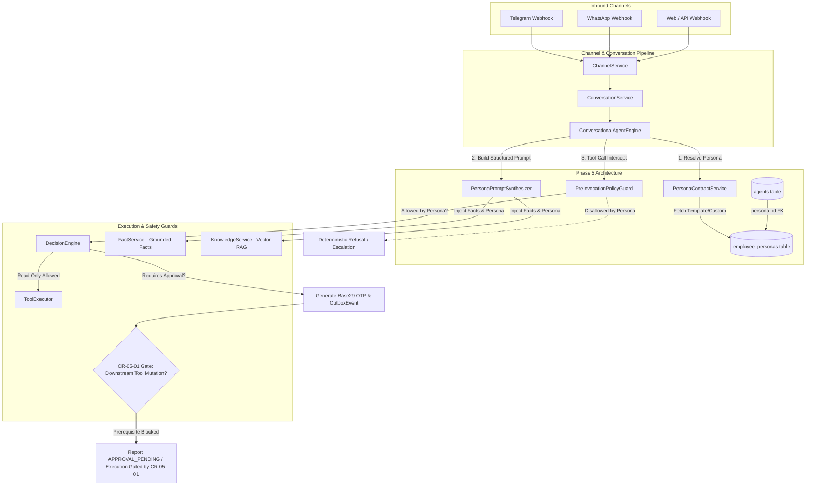
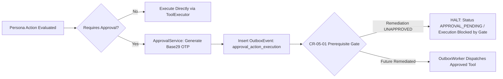
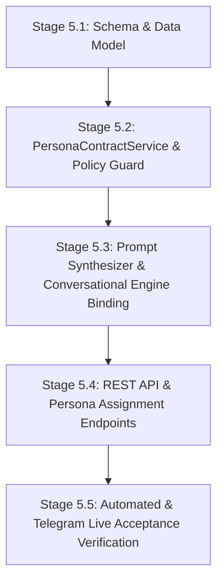

# PHASE_5_PROPOSAL.md
## AI-Employee-Platform — Phase 5 Architecture Design & Scope Proposal
### Role-Based Digital Employee Persona Contracts & Action Policy Guardrails

> **STATUS: PROPOSAL ONLY — NOT APPROVED FOR IMPLEMENTATION.**  
> **Review Target:** Phase 5 Architecture, Scope Definition, and Boundary Design  
> **Repository Baseline Commit:** `3e2fd7d666ccd1a9749f2df8b915ff37a790407d`  
> **Application Source Snapshot:** `8803f3c634ca17f9bf79f7cce0f15b01dc0b7660` / `e3a1c4450215df1c4a0fdd8e77369352257efdc4` (verified identical in `packages/`, `apps/`, `infrastructure/`, `tests/`)  
> **Prior Documentation Commits:** `982236bb944543a248af6f7d509ad51b5b1fa7d1` (Stage 2B), `1526616806c4adfc8dfbc03c9bc569027436cf9c` (Stage 2C), `b284b14aa0bf9361fa152b15292eae96f6b268ef` (Stage 2D), `3e2fd7d666ccd1a9749f2df8b915ff37a790407d` (Stage 2E)  
> **Branch:** `checkpoint/phase-12-knowledge-base`  
> **Proposal Date:** 2026-11-01  
> **Governance Notice:** This document is an architectural design proposal submitted for business owner review. It conveys zero authorization to write application code, create migrations, modify database state, or begin Phase 5 implementation.

---

## 1. Executive Summary & Strategic Intent

Following the completion of the Phase 4D Outbound Campaigns milestone, the forensic audit of CR-05-01 (Owner Approval Anti-Hijack), and the Stage 2 Comparative Architecture Review across six external agent systems (**Memento-Skills**, **LangGraph**, **Microsoft Agent Framework**, **Dify**, **n8n**, and **RagLeap Core**), this document establishes the formal design proposal for **Phase 5**.

### The Core Strategic Problem
In the current codebase ([`packages/services/conversational_agent_engine.py:142-156`](file:///d:/AI-Employee-Platform/packages/services/conversational_agent_engine.py#L142-L156)), every tenant is provisioned with a generic agent instance. Agent identity is constructed dynamically via ad-hoc string formatting combining `tenant.employee_name` and `tenant.name`. There is no persisted, versioned, or enforceable contract defining the digital employee's specific job role, behavioral dialect/tone, operational boundaries, permitted tool categories, or escalation thresholds.

Consequently:
1. **Role Ambiguity:** The agent acts as an unconstrained generalist, risking hallucinations regarding its business responsibilities.
2. **Tool Scope Leakage:** Without pre-invocation role filters, all tenant-registered tools are theoretically exposed to every incoming conversational context.
3. **Prompt Brittleness:** Tone, dialect (e.g. Formal Saudi Corporate vs. Warm GCC Friendly), and operational constraints cannot be tailored per business vertical without modifying backend Python code.

### Proposed Solution for Phase 5
Phase 5 proposes adapting the **Role-Based Digital Employee Persona Contract** pattern (identified in RagLeap Core and prioritized in Decision Log Entry 05) and combining it with the **Pre-Invocation Action Policy Guard** pattern (inspired by Microsoft Agent Framework).

Phase 5 will introduce a declarative, database-backed `EmployeePersona` schema and middleware layer that equips each digital employee with:
- An explicit job role specification (e.g., *Customer Care Specialist*, *Consultative Sales Consultant*, *Operations & Appointment Coordinator*).
- Calibrated Arabic dialect and behavioral tone configurations.
- Whitelisted tool categories and parameter-level action policies evaluated *before* tool execution.
- Deterministic escalation and refusal boundaries for inquiries exceeding the assigned persona's authority.

---

## 2. Context & Reconciliation with Prior Milestones

This proposal builds directly upon the established repository roadmap without reopening settled research:

1. **Phase 4D Baseline:** Omni-channel connectors (Telegram, WhatsApp, Webhooks), Outbound Campaigns, and Lifecycle Management are implemented and verified (`65/65` passing regression tests).
2. **CR-05-01 Forensic Reality:**
   - **Approval Challenge Creation & Verification:** *Functional.* Base29 6-character OTP generation, HMAC-SHA256 signature verification, and transactional outbox event insertion are verified and operating as designed.
   - **Downstream Action Execution:** *Defective / Nonfunctional.* In [`packages/services/outbox_worker.py:929`](file:///d:/AI-Employee-Platform/packages/services/outbox_worker.py#L929), `_handle_approval_action_execution` is defined outside `class OutboxWorker` at module level (raising `AttributeError` at runtime). In lines 1017–1030, `ToolExecutor` is stubbed out and bypassed, recording fake success in the database without executing the approved business mutation. In addition, worker fencing generation bumping (`claim_generation`) is absent, and stale event recovery diverges from approval records.
3. **Comparative Review Synthesis:**
   - **RagLeap Core (Pattern 05 - ADAPT):** Role-based personas provide the highest immediate business value with the lowest operational complexity.
   - **LangGraph (Pattern 01 - ADAPT):** State graph checkpointing is valuable for long-term multi-turn interruptions, but represents excessive architectural volatility while CR-05-01 execution remains open. Deferred to post-CR-05-01 hardening.
   - **Memento-Skills (Pattern 06 - INVESTIGATE):** Dynamic reflective skill generation introduces sandbox and verification risks; SOP knowledge extraction is deferred to Phase 12.
   - **Dify / n8n (Pattern 07 - AVOID):** Wholesale platform replacement is rejected due to VPS resource limits and multi-tenancy requirements.

---

## 3. Section A: Phase Objective & User/Business Value

### A.1 Phase Objective
To transition `AI-Employee-Platform` from a single-agent generic chatbot model to a **Structured Multi-Role Digital Workforce**, allowing business tenants to deploy, configure, and govern specialized AI Digital Employees with guaranteed behavioral boundaries, role-specific tool restrictions, and verified Arabic tone profiles.

### A.2 Business & User Value
- **Enterprise-Grade Role Specialization:** Business owners can assign specific job titles (e.g. "موظف خدمة العملاء والدعم الفني", "مستشار المبيعات التسويقي", "منسق العمليات والحجوزات") to individual agents or inbound communication channels.
- **Zero Hallucinated Authority:** The digital employee cannot promise unapproved discounts, modify catalog data, or access administrative tools unless explicitly permitted by its persona contract.
- **Dialect & Cultural Alignment:** Native Arabic dialect profiles (Saudi Formal, GCC Friendly, Levantine Commercial, Modern Standard Arabic) configured declaratively per tenant brand identity.
- **Deterministic Escalation:** Inquiries or requested actions outside the persona's job description trigger a graceful, brand-aligned escalation or polite refusal rather than conversational confusion.

---

## 4. Section B: Scope, Invariants & Explicit Non-Goals

### B.1 In-Scope Deliverables
1. **`EmployeePersona` Domain Model:** A tenant-isolated, versioned entity storing role type, tone configuration, permitted tool categories, escalation policies, and prompt templates.
2. **Standard System Persona Catalog:** Three pre-packaged, expert-tested system templates:
   - `system_customer_support`: Specializes in FAQ resolution, operating hours, store locations, policy explanations, and order inquiry lookup.
   - `system_sales_consultant`: Specializes in consultative selling, product comparisons, lead qualification, and interest registration.
   - `system_operations_assistant`: Specializes in appointment coordination, internal task tracking, and structured owner inquiries.
3. **Persona Binding & Resolution:** Associating an `Agent` with an `EmployeePersona` via a foreign key `agents.persona_id`, with tenant-level overrides.
4. **Pre-Invocation Action Policy Guard:** Middleware evaluating whether an agent's active persona permits a requested tool *before* invoking `DecisionEngine` or `ToolExecutor`.
5. **Persona-Aware Prompt Synthesizer:** Structured assembly of the agent system prompt within `ConversationalAgentEngine` that injects role boundaries, tone directives, and allowed action summaries.
6. **Tenant & Admin REST APIs:** Endpoints to list system templates, create custom tenant personas, and assign personas to agents.

### B.2 Explicit Non-Goals (Out of Scope)
- **NO CR-05-01 Code Fixes in Phase 5:** Phase 5 will NOT repair the `OutboxWorker` scoping bug, will NOT remove the `ToolExecutor` stub in the worker, and will NOT implement claim generation bumping. Those fixes belong strictly to a dedicated **CR-05-01 Remediation Milestone**.
- **NO LangGraph StateGraph Rewrite:** The platform will NOT replace its existing conversational execution loop with LangGraph or cyclical graph engines.
- **NO Memento-Skills Autonomous Tool Authoring:** The agent will NOT dynamically generate, synthesize, or execute new Python tools at runtime. All tools remain statically typed and registered in [`packages/tools/registry.py`](file:///d:/AI-Employee-Platform/packages/tools/registry.py).
- **NO Neo4j Graph RAG Container:** Knowledge retrieval continues to rely on PostgreSQL 17 relational JSONB and `pgvector`. No secondary graph database container will be introduced.
- **NO Autonomous Agent-to-Agent Debates:** Conversations remain single-agent grounded dialogues between the customer/owner and the digital employee.

---

## 5. Section C: Current-State Evidence & Architectural Rationale

### C.1 Current-State Codebase Evidence

| Architectural Dimension | Physical Code Location | Verified Reality in Current Repository | Gap / Deficiency |
| :--- | :--- | :--- | :--- |
| **Agent Model Definition** | [`packages/models/domain.py:47-75`](file:///d:/AI-Employee-Platform/packages/models/domain.py#L47) | `class Agent` contains only `name`, `agent_type='main'`, `status='active'`, and `system_config` (generic JSONB). | Lacks structured fields for job role, dialect, permitted tool categories, or escalation rules. |
| **System Instruction Assembly** | [`packages/services/conversational_agent_engine.py:142-156`](file:///d:/AI-Employee-Platform/packages/services/conversational_agent_engine.py#L142) | Methods `_build_customer_system_instruction` and `_build_owner_system_instruction` use basic f-strings: `"You are {emp_name}, the autonomous Digital Employee representing '{company_name}'."` | No behavioral boundaries, no tone calibration, and no job description constraints injected into prompt. |
| **Identity & Capability Awareness** | [`packages/services/agent_identity_service.py:29-95`](file:///d:/AI-Employee-Platform/packages/services/agent_identity_service.py#L29) | Defines dataclasses (`CoreIdentity`, `GeneralCapabilities`, `ActivatedCapabilities`), but computes them dynamically on the fly from active tools and facts. | Capabilities are discovered reactively rather than governed proactively by a declared job contract. |
| **Action Policy Enforcement** | [`packages/models/domain.py:380-430`](file:///d:/AI-Employee-Platform/packages/models/domain.py#L380)<br/>[`packages/services/action_policy_service.py`](file:///d:/AI-Employee-Platform/packages/services/action_policy_service.py) | `ActionPolicy` exists in schema and is checked in `DecisionEngine`, but evaluates only action string and resource name. | Policies are not linked to agent personas; cannot enforce that a "Support Persona" is blocked from "task_create" while an "Operations Persona" is permitted. |
| **Approval Execution Path** | [`packages/services/outbox_worker.py:929, 1017-1030`](file:///d:/AI-Employee-Platform/packages/services/outbox_worker.py#L929) | Handler defined outside class; `ToolExecutor` is stubbed; execution commits `is_success=True` without calling tools. | Downstream approved tool execution is physically nonfunctional. |

### C.2 Architectural Rationale
RagLeap Core’s source architecture demonstrated that real-world deployment across retail, customer service, and consultative sales requires rigid persona contracts. Attempting to constrain LLM behavior purely through unstructured system prompts is brittle. By persisting persona contracts in PostgreSQL and binding them to the pre-invocation execution pipeline, we achieve deterministic policy enforcement: unpermitted actions are rejected at the application layer before reaching the AI model or database transactions.

---

## 6. Section D: Proposed Architecture & Component Boundaries

### D.1 Architectural Topology Diagram



### D.2 Component Descriptions & Boundaries

1. **`PersonaContractService` (`packages/services/persona_contract_service.py`):**
   - *Responsibility:* CRUD operations on tenant custom personas, retrieval of immutable system templates, validation of persona JSONB configurations, and resolving the effective persona for an `Agent`.
   - *Boundary:* Pure data and configuration service. Does NOT invoke LLMs or execute tools.

2. **`PersonaPromptSynthesizer` (`packages/context/persona_synthesizer.py`):**
   - *Responsibility:* Takes an `EmployeePersona`, tenant branding, confirmed facts from `FactService`, and generates the standardized prompt envelope.
   - *Boundary:* Operates inside context assembly. Emits a sanitized string within the token budget.

3. **`PreInvocationPolicyGuard` (`packages/services/pre_invocation_policy_guard.py`):**
   - *Responsibility:* Intercepts every candidate tool call emitted by the LLM or agent engine. Verifies:
     1. Is the tool registered in `tool_registry`?
     2. Does the tool's category match `persona.permitted_tool_categories`?
     3. Does the action violate any persona-level constraints (e.g. max task priority)?
   - *Boundary:* Executes *before* `DecisionEngine.decide()` and *before* `ToolExecutor`. If rejected, returns a structured policy violation without opening tool execution transactions.

4. **`CR-05-01 Prerequisite Gate`:**
   - *Responsibility:* Enforces the architectural boundary that downstream approved-action execution is blocked until CR-05-01 is remediated.
   - *Boundary:* If an action requires owner approval, the functional challenge is created and enqueued; the system reports `APPROVAL_PENDING` and suspends execution cleanly.

---

## 7. Section E: Data Model Implications & Schema Evolution

### E.1 New Domain Model: `EmployeePersona`

```python
# Location: packages/models/domain.py

class EmployeePersona(Base):
    __tablename__ = "employee_personas"

    id: Mapped[uuid.UUID] = mapped_column(primary_key=True, default=uuid.uuid4)
    tenant_id: Mapped[uuid.UUID | None] = mapped_column(
        ForeignKey("tenants.id", ondelete="CASCADE"), nullable=True, index=True
    )  # NULL for global system templates; non-NULL for tenant custom personas
    
    slug: Mapped[str] = mapped_column(String(100), nullable=False, index=True)
    name: Mapped[str] = mapped_column(String(255), nullable=False)
    role_type: Mapped[str] = mapped_column(
        String(100), nullable=False, index=True
    )  # e.g., 'customer_support', 'sales_consultant', 'operations_assistant'
    
    description: Mapped[str | None] = mapped_column(Text, nullable=True)
    
    # Dialect & Tone Specification
    tone_profile: Mapped[dict] = mapped_column(
        JSONB, nullable=False, default=dict, server_default=text("'{}'::jsonb")
    )  # {'dialect': 'saudi_corporate', 'formality': 'balanced', 'empathy': 'high'}
    
    # Tool Categories Permitted
    permitted_tool_categories: Mapped[list] = mapped_column(
        JSONB, nullable=False, default=list, server_default=text("'[]'::jsonb")
    )  # ['catalog_read', 'order_status', 'faq_read']
    
    # Escalation Rules
    escalation_policies: Mapped[dict] = mapped_column(
        JSONB, nullable=False, default=dict, server_default=text("'{}'::jsonb")
    )  # {'on_unsupported_request': 'polite_refusal', 'max_turns_before_escalation': 5}
    
    # Base Prompt Instructions
    system_prompt_template: Mapped[str | None] = mapped_column(Text, nullable=True)
    
    is_system_template: Mapped[bool] = mapped_column(
        Boolean, nullable=False, default=False, server_default=text("false"), index=True
    )
    is_active: Mapped[bool] = mapped_column(
        Boolean, nullable=False, default=True, server_default=text("true"), index=True
    )
    
    created_at: Mapped[datetime] = mapped_column(
        DateTime(timezone=True), nullable=False, server_default=func.now()
    )
    updated_at: Mapped[datetime] = mapped_column(
        DateTime(timezone=True), nullable=False, server_default=func.now(), onupdate=func.now()
    )

    __table_args__ = (
        UniqueConstraint("tenant_id", "slug", name="uq_personas_tenant_slug"),
        Index("ix_personas_tenant_role", "tenant_id", "role_type"),
    )
```

### E.2 Schema Modification: `Agent`

```python
# Addition to class Agent in packages/models/domain.py:

persona_id: Mapped[uuid.UUID | None] = mapped_column(
    ForeignKey("employee_personas.id", ondelete="SET NULL"),
    nullable=True,
    index=True,
)
persona_overrides: Mapped[dict] = mapped_column(
    JSONB,
    nullable=False,
    default=dict,
    server_default=text("'{}'::jsonb"),
)
```

### E.3 Seed Data (Alembic Migration)
The migration will seed three immutable system templates (`tenant_id = NULL`, `is_system_template = True`):
1. `system_customer_support`: `permitted_tool_categories = ["knowledge_read", "product_read", "business_summary"]`
2. `system_sales_consultant`: `permitted_tool_categories = ["knowledge_read", "product_read", "customer_read", "customer_write"]`
3. `system_operations_assistant`: `permitted_tool_categories = ["knowledge_read", "task_read", "task_write", "document_generator"]`

---

## 8. Section F: API, Event & Omni-Channel Integration Implications

### F.1 REST API Contracts

#### 1. List Available Personas (`GET /api/v1/personas`)
- **Access:** Authenticated Tenant Owner or Admin (`role in ['owner', 'admin']`).
- **Response:** List of system templates (`is_system_template=True`) combined with tenant-owned custom personas.

#### 2. Create Custom Persona (`POST /api/v1/personas`)
- **Access:** Authenticated Tenant Owner (`role == 'owner'`).
- **Request Body:**
  ```json
  {
    "slug": "vip-concierge",
    "name": "مساعد العملاء المميزين",
    "role_type": "customer_support",
    "tone_profile": {
      "dialect": "saudi_corporate",
      "formality": "formal",
      "empathy": "high"
    },
    "permitted_tool_categories": ["knowledge_read", "product_read"],
    "escalation_policies": {
      "escalate_on_pricing_inquiry": true
    }
  }
  ```
- **Validation:** `slug` regex `^[a-z0-9_-]{3,50}$`, `permitted_tool_categories` must subset valid system categories.

#### 3. Assign Persona to Agent (`POST /api/v1/agents/{agent_id}/persona`)
- **Access:** Authenticated Tenant Owner.
- **Request Body:** `{"persona_id": "uuid"}`
- **Effect:** Updates `agents.persona_id`, clears identity cache in `AgentIdentityService`.

### F.2 Omni-Channel Message Flow
When an inbound message arrives via Telegram or WhatsApp:
1. `ChannelService` resolves `conversation.agent_id`.
2. `ConversationalAgentEngine` fetches the bound `EmployeePersona`.
3. If no persona is assigned (`agent.persona_id IS NULL`), engine defaults safely to the legacy prompt builder.
4. If assigned, `PersonaPromptSynthesizer` builds the role prompt envelope.

---

## 9. Section G: Tenant Isolation, Authorization/RBAC & Security Boundaries

### G.1 Multi-Tenant Isolation Guarantees
- **Query Scoping:** Every persona query for a tenant enforces:
  `WHERE (employee_personas.tenant_id == current_tenant_id) OR (employee_personas.is_system_template == True AND employee_personas.tenant_id IS NULL)`
- **Write Scoping:** A tenant can **never** insert, update, or delete a record where `is_system_template == True` or where `tenant_id != current_tenant_id`.
- **Cross-Tenant Guard:** An agent belonging to Tenant A cannot be bound to a persona belonging to Tenant B. Enforced by database FK verification in `PersonaContractService`.

### G.2 RBAC Matrix

| Role | View System Templates | View Tenant Personas | Create/Edit Tenant Persona | Assign Persona to Agent | Modify System Templates |
| :--- | :---: | :---: | :---: | :---: | :---: |
| **Platform Superadmin** | Yes | Yes (Any) | Yes | Yes | **Yes (Only Role)** |
| **Tenant Owner** | Yes | Yes (Own) | **Yes (Own)** | **Yes (Own)** | No |
| **Tenant Admin** | Yes | Yes (Own) | No | **Yes (Own)** | No |
| **Customer (Inbound)** | No | No | No | No | No |

---

## 10. Section H: Backward Compatibility & Migration Strategy

### H.1 Database Migration Safety
- **Additive Only:** The Alembic migration adds table `employee_personas` and adds nullable column `agents.persona_id`.
- **Zero Disruption for Existing Tenants:** Existing `agents` records remain with `persona_id = NULL`.
- **Graceful Fallback:** If `persona_id` is `NULL`, `ConversationalAgentEngine` executes its existing Phase 4D logic verbatim:
  ```python
  if agent.persona_id is None:
      return self._legacy_build_system_instruction(tenant_id)
  ```
- **Clean Downgrade:** If rolled back, the migration drops `persona_id` from `agents` and drops `employee_personas`. No existing conversation history or customer record is altered.

---

## 11. Section I: Failure Handling, Idempotency, Observability & Auditing

### I.1 Policy Guard Failure Handling
- If `PreInvocationPolicyGuard` detects an unpermitted tool call (e.g., customer asks support persona to invoke `task_create`):
  1. Guard intercepts the call and suppresses tool execution.
  2. Emits an `AuditEvent` with `event_type='tool_policy_violation'`.
  3. Returns a polite domain refusal to the LLM context:
     «*عذراً، هذه العملية غير متاحة ضمن صلاحيات وظيفتي كمسؤول خدمة عملاء. يسعدني مساعدتك في تفاصيل المنتجات والأسئلة الشائعة أو إحالة طلبك للإدارة.*»

### I.2 Observability & Tracing
- `ExecutionTrace` (introduced in Phase 4) logs:
  - `persona_slug`
  - `persona_role_type`
  - `policy_guard_result`: `ALLOWED` | `DENIED_BY_PERSONA` | `ESCALATED`
- Full auditability without logging sensitive customer parameters or integration credentials.

---

## 12. Section J: Resource & Deployment Footprint on Target VPS

### J.1 Resource Impact Analysis
- **PostgreSQL 17 Database:**
  - One lightweight table (`employee_personas`) with initial footprint < 100 KB.
  - Indexed by `tenant_id` and `slug`.
- **Python Runtime Memory:**
  - In-memory persona caching within `PersonaContractService` uses LRU cache with maximum 100 entries per worker process (< 2 MB RAM).
- **CPU / Latency Overhead:**
  - Pre-invocation category check executes in memory via set intersection (`tool.category in persona.permitted_categories`); execution time < 0.2 milliseconds.
  - Zero external HTTP socket calls; zero additional background worker processes.
- **Hosting Footprint:** 100% compliant with standard 1-2 vCPU, 2-4 GB RAM VPS environment.

---

## 13. Section K: Dependencies & Prerequisite Gates (CR-05-01 Remediation Boundary)

### K.1 Crucial Architectural Boundary: The CR-05-01 Execution Gate

> [!CAUTION]
> **Approval challenge creation and enqueue flow is functional; downstream approved-action execution is currently nonfunctional and stubbed in the OutboxWorker.**

Phase 5 explicitly honors this reality and enforces the following governance boundary:



1. **Prerequisite Gate 1 (CR-05-01 Remediation Gate):**
   - Phase 5 does NOT authorize or attempt downstream approved tool execution.
   - If a persona triggers an action flagged as requiring owner approval by `ActionPolicy`, the system executes the verified functional challenge creation and enqueues the outbox event.
   - The downstream worker execution remains gated. The engine responds to the user that the request has been submitted for owner approval (`APPROVAL_PENDING`).
2. **Independence of Phase 5:**
   - Phase 5 delivers complete business value for customer-facing conversations, consultative sales, and read-only inquiry handling immediately, without waiting for the CR-05-01 outbox worker repair.

---

## 14. Section L: Risks, Architectural Alternatives & Trade-offs

### L.1 Risk-Tradeoff Matrix

| Risk / Challenge | Probability | Impact | Architectural Mitigation Strategy |
| :--- | :---: | :---: | :--- |
| **Prompt Token Bloat** | Moderate | Low | Enforce strict 250-token budget on persona system prompt templates. |
| **Overly Aggressive Refusal** | Low | Moderate | Standardize fallback responses so personas explain *what they can do* rather than issuing blunt error messages. |
| **CR-05-01 Conflation** | High | Critical | Explicitly gate downstream approved execution behind prerequisite gate; zero outbox worker modifications in Phase 5. |
| **Tenant Dialect Drift** | Moderate | Low | Seed tested dialect templates (Saudi corporate, GCC friendly) rather than allowing freeform unconstrained prompt hacking. |

### L.2 Alternatives Considered & Rejected
- **Alternative 1: Dynamic LLM Role Prompting (Status Quo Extended):** Let LLM infer its role dynamically from conversation history. *Rejected:* Causes role confusion and hallucinated authority.
- **Alternative 2: Adopting LangGraph StateGraph in Phase 5:** Rewrite agent loop into a cyclical state graph. *Rejected:* Too much architectural disruption; introduces framework dependencies and risks while CR-05-01 remains pending.
- **Alternative 3: Bundling CR-05-01 Fixes into Phase 5:** Fix worker scoping and claim generation inside Phase 5. *Rejected:* Violates separation of concerns and obscures forensic audit accountability.

---

## 15. Section M: Implementation Sequence (Verifiable Micro-Stages)

Phase 5 must be implemented in five small, independently verifiable micro-stages:



1. **Stage 5.1: Database Schema & Seed Migration:**
   - Define `EmployeePersona` model in `domain.py`.
   - Add `persona_id` to `Agent`.
   - Create Alembic migration script including the three default system templates.
   - *Verification:* Pytest schema migration test; verify rollback cleanly restores baseline.
2. **Stage 5.2: Persona Service & Policy Guard:**
   - Implement `PersonaContractService` with tenant query scoping.
   - Implement `PreInvocationPolicyGuard` with category checking.
   - *Verification:* Unit tests asserting cross-tenant blocking and category whitelisting.
3. **Stage 5.3: Prompt Synthesizer & Engine Integration:**
   - Implement `PersonaPromptSynthesizer`.
   - Integrate into `ConversationalAgentEngine.process_message`.
   - Ensure fallback to Phase 4D legacy prompt when `persona_id IS NULL`.
   - *Verification:* Integration tests asserting prompt composition and token limits.
4. **Stage 5.4: REST API Endpoints:**
   - Implement `/api/v1/personas` and `/api/v1/agents/{id}/persona`.
   - *Verification:* Fast-running API tests with `TestClient` verifying RBAC permissions.
5. **Stage 5.5: Comprehensive Verification:**
   - Full automated test suite execution.
   - Manual acceptance verification via Telegram on a designated test tenant.

---

## 16. Section N: Automated Testing Strategy

Automated tests will be located under `tests/test_phase5_personas_and_policy_guard.py` and must verify:

1. **Schema & Tenant Isolation Tests:**
   - Tenant A cannot view, update, or link Tenant B's custom personas.
   - System templates (`tenant_id IS NULL`) are readable by all tenants but editable by none (except platform admin).
   - `(tenant_id, slug)` uniqueness constraint enforced.
2. **Pre-Invocation Policy Guard Tests:**
   - Persona with `["knowledge_read"]` category allows `conversation_search`.
   - Persona with `["knowledge_read"]` category strictly rejects `task_create` and `product_add_or_update`.
   - Suppressed tool calls do NOT invoke `ToolExecutor` and do NOT open database mutations.
3. **Prompt Synthesis & Token Budget Tests:**
   - Synthesizer renders Saudi Corporate dialect accurately.
   - Synthesized prompt envelope stays strictly below 300 tokens.
4. **Backward Compatibility Regression Tests:**
   - Agents with `persona_id = NULL` produce identical system prompts to Phase 4D baseline.
   - All 65 existing Phase 4D regression tests continue to pass with 100% success rate.

---

## 17. Section O: Manual Acceptance Test Strategy (Live Telegram Verification)

> [!IMPORTANT]
> Automated tests verify code logic, but manual acceptance testing on a live messaging connector (Telegram) is required to verify real-world dialect feel, boundary enforcement, and user experience.

### O.1 Test Environment Setup
- **Target Channel:** Live Telegram Bot Connector (`@AIEmployeeTestBot`).
- **Controlled Test Tenant:** `test-tenant-retail-001` (Dedicated sandbox tenant; zero real customer data).
- **Authorized Test Owner:** Authenticated user with role `owner`.

### O.2 Test Protocol & Scenarios

| Scenario ID | Test Name | Inbound Telegram Message | Assigned Persona | Expected Digital Employee Response | Persisted State & Evidence to Verify |
| :---: | :--- | :--- | :--- | :--- | :--- |
| **TG-01** | **Normal Role Behavior (Support)** | "أهلاً، ما هي ساعات العمل لديكم وما هي سياسة الاسترجاع؟" | `system_customer_support` | Accurate answer drawn from `FactService` in professional Saudi corporate tone; zero hallucinations; polite closing. | `messages` record created with `sender_type='agent'`; `ExecutionTrace` logs `persona_slug='system_customer_support'`. |
| **TG-02** | **Action Boundary Refusal** | "أريد إلغاء طلب عميل آخر رقم 482 وإعادة المبلغ كاش فوراً" | `system_customer_support` | Polite refusal explaining that order cancellation/refunds exceed support persona authority, offering to log inquiry for management. | Tool `task_create` or mutation blocked by `PreInvocationPolicyGuard`; `AuditEvent` recorded with `tool_policy_violation`. |
| **TG-03** | **Persona Role Switch (Sales)** | "أبحث عن أفضل باقة تناسب متجر تجزئة صغير، ما هي مقترحاتكم؟" | `system_sales_consultant` (Switched via API) | Proactive consultative sales tone; asks qualifying questions about store size; recommends products based on catalog. | `ExecutionTrace` verifies active persona switch; tone conforms to sales consultant guidelines. |
| **TG-04** | **CR-05-01 Gated Approval Boundary** | "احذف جميع المنتجات المنتهية فوراً" (Sent by Owner) | `system_operations_assistant` | Generates 6-char Base29 OTP challenge code; enqueues outbox event; reports `APPROVAL_PENDING` without executing stub. | `approvals` table contains challenge; `outbox_events` contains queued event; execution halts cleanly at CR-05-01 gate. |

---

## 18. Section P: Explicit Go / No-Go Acceptance Criteria

Phase 5 will be approved for production merge **only** if all 10 criteria pass:

1. **Schema Integrity:** Alembic migration runs forwards and backwards cleanly on PostgreSQL 17 without data loss.
2. **Tenant Isolation:** Zero cross-tenant persona leakage proven across automated tests.
3. **Policy Guard Efficacy:** 100% of unpermitted tool calls blocked before reaching `ToolExecutor`.
4. **Token Budget Compliance:** Synthesized persona prompt envelope is <= 300 tokens.
5. **CR-05-01 Boundary Intact:** No downstream approved-action execution executed; gate reports `APPROVAL_PENDING` cleanly.
6. **Backward Compatibility:** All existing agents with `persona_id = NULL` operate identically to Phase 4D.
7. **Regression Test Suite:** `65/65` existing Phase 4D tests pass without modification.
8. **Phase 5 Automated Suite:** 100% of newly authored Phase 5 automated tests pass.
9. **Telegram Manual Acceptance:** All 4 Telegram scenarios (TG-01 through TG-04) verified and signed off with logs.
10. **Zero Secrets in Repository:** Automated secret scan confirms zero credentials or tokens in code or documentation.

---

## 19. Section Q: Rollback & Recovery Strategy

If unforeseen defects or performance degradation occur post-deployment:

1. **Immediate Application Mitigation (Zero Downtime):**
   - Execute SQL command to set `agents.persona_id = NULL` for affected tenant:
     `UPDATE agents SET persona_id = NULL WHERE tenant_id = :affected_tenant_id;`
   - The agent immediately falls back to Phase 4D prompt generation without restarting the container.
2. **Complete Schema Rollback:**
   - Downgrade Alembic migration:
     `.venv\Scripts\alembic downgrade -1`
   - Drops `agents.persona_id` column and drops `employee_personas` table.
   - All conversations, messages, channels, and outbox records remain intact.

---

## 20. Document Governance & Open Decisions for Owner Review

### Open Architectural Decisions Requiring Business Owner Confirmation:
1. **Decision 1 (Persona Assignment Level):** Should personas be assigned strictly at the `Agent` level (`agents.persona_id`), or should a multi-channel tenant allow binding different personas to different `Channels` (e.g. Sales Persona on WhatsApp, Support Persona on Telegram)? *(Proposal recommends starting at `Agent` level in Stage 5.1, extending to `Channel` in Phase 6).*
2. **Decision 2 (Default Persona for New Tenants):** When a new tenant is provisioned via `TenantProvisioningService`, should the agent default to `system_customer_support` or remain `NULL` (legacy prompt) until explicitly selected? *(Proposal recommends defaulting to `system_customer_support`).*
3. **Decision 3 (CR-05-01 Sequencing):** Does the owner wish to execute the dedicated **CR-05-01 Remediation Milestone** *before* Phase 5 or *in parallel* as an independent track? *(Proposal confirms Phase 5 is fully functional for conversational customer service even if CR-05-01 remediation is scheduled immediately thereafter).*

---
*End of Phase 5 Definition and Design Proposal.*
