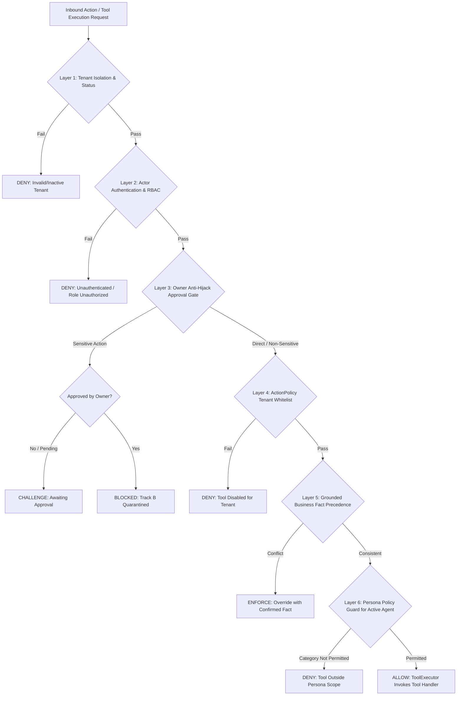
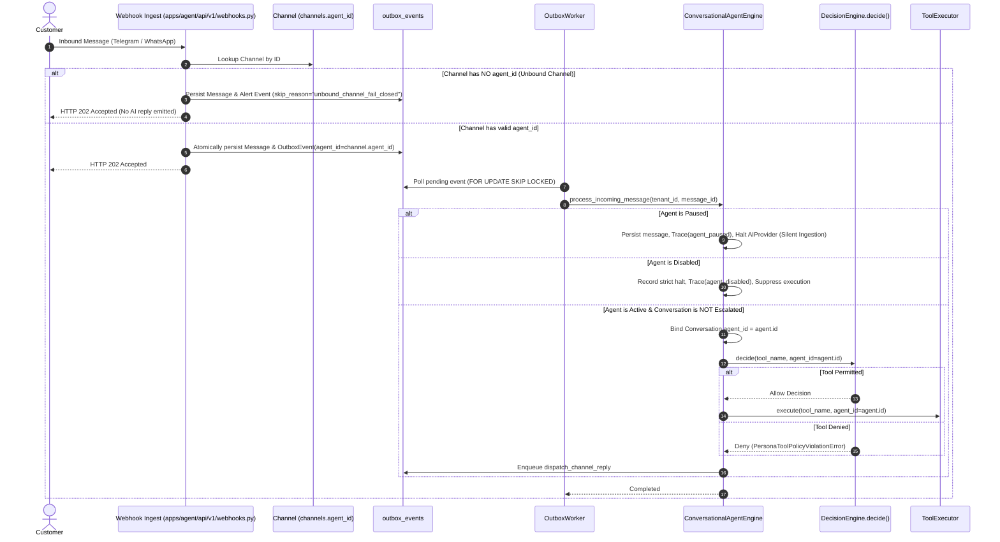
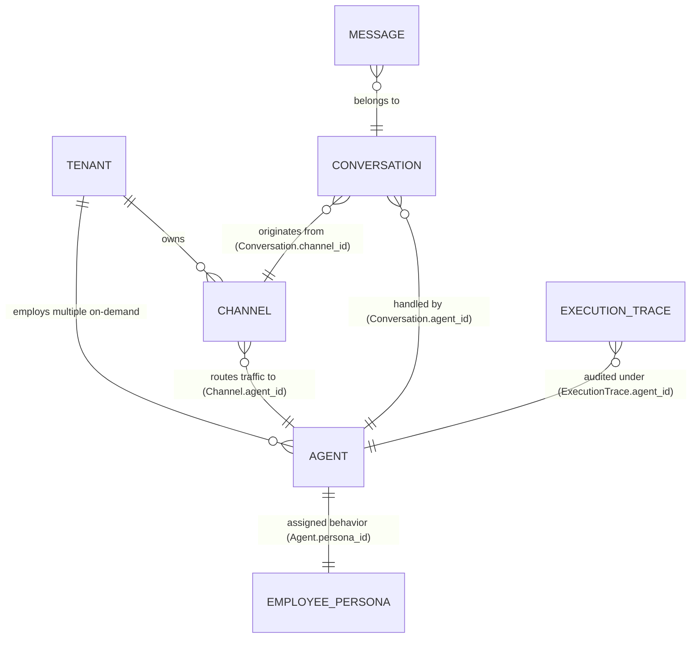
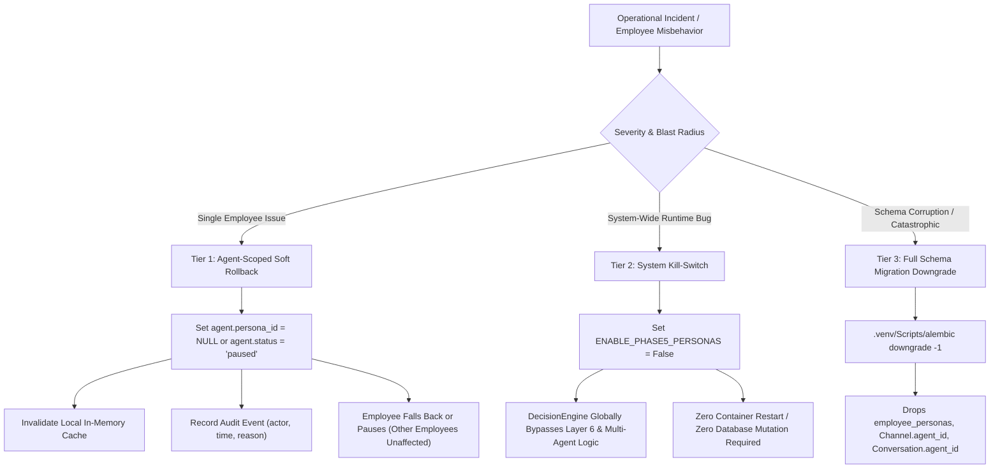

# PHASE_5_PROPOSAL.md
## AI-Employee-Platform — Phase 5 Architecture Design & Scope Specification
### Role-Based Digital Employee Persona Contracts & Action Policy Guardrails

> **STATUS: APPROVED ARCHITECTURAL SPECIFICATION — IMPLEMENTATION REQUIRES SEPARATE EXPLICIT AUTHORIZATION**
> **Review Target:** Phase 5 Final Architectural Calibration & Multi-Employee Architecture Realignment
> **Architectural Decisions Baseline:** Decisions 1–20 Realigned with Multi-Employee Paradigm + Owner Calibration Directives (2026-11-01)
> **Prior Delivered Commit:** `5b32ee341921a81acd69795a933d8ea34f5a2483`
> **Application Source Snapshot Baseline:** `8803f3c634ca17f9bf79f7cce0f15b01dc0b7660` / `e3a1c4450215df1c4a0fdd8e77369352257efdc4` (verified identical in `packages/`, `apps/`, `infrastructure/`, `tests/`)
> **Branch:** `checkpoint/phase-12-knowledge-base`
> **Specification Revision Date:** 2026-11-01 (Multi-Employee Governance & Lifecycle Calibration)
> **Governance Notice:** This document is the authoritative architectural specification for Phase 5 Track A. It reflects all approved architectural decisions, establishing the clean separation between Digital Employees (`Agent`) and Behavioral Contracts (`EmployeePersona`), enabling multiple independent digital employees per tenant, binding channels to specific agents, enforcing fail-closed unbound channel routing, paused agent silent ingestion, disabled agent strict halt, and engine-level AI silence on escalation. **This document conveys ZERO authorization to write application code, create migrations, modify database state, create commits, or begin Phase 5 implementation.** Execution of Track A (Micro-Stages 5.1 through 5.5) remains strictly gated until the project owner explicitly reviews this calibrated specification and issues the separate prompt: `"ابدأ تنفيذ Stage 5.1"`.

---

## 1. Executive Summary & Strategic Intent

Following the completion of the Phase 4D Outbound Campaigns milestone, the forensic audit of CR-05-01 (Owner Approval Anti-Hijack), the Stage 2 Comparative Architecture Review across external agent systems, and the **Phase 5 Read-Only Architecture Verification**, this document establishes the definitive, realigned architectural specification for **Phase 5**.

### The Core Strategic Problem: The Single-Agent Legacy Fallacy
In the existing codebase ([`packages/services/conversational_agent_engine.py:142-156`](file:///d:/AI-Employee-Platform/packages/services/conversational_agent_engine.py#L142-L156)), every tenant is fundamentally constrained by a legacy single-agent assumption:
1. **The Single-Name Monolith:** The engine dynamically formats agent identity using `tenant.employee_name` and `tenant.name`. A single string field on the tenant represents the entire workforce.
2. **Table Bypass:** The database entity [`Agent` in `packages/models/domain.py:75`](file:///d:/AI-Employee-Platform/packages/models/domain.py#L75) is completely bypassed during incoming message processing. `select(Agent)` is called zero times in the conversational chat path.
3. **Missing Relationships:** Neither [`Channel`](file:///d:/AI-Employee-Platform/packages/models/domain.py#L382) nor [`Conversation`](file:///d:/AI-Employee-Platform/packages/models/domain.py#L425) possesses an `agent_id` foreign key. Inbound traffic belongs vaguely to the tenant, not to a specific digital employee.
4. **Persona vs. Employee Conflation:** Prior drafts attempted to bind `persona_id` directly to channels, effectively treating personas as costumes worn by a single generic bot, rather than establishing distinct, autonomous digital employees with independent lifecycles.

### Approved Solution: Clean Decoupling of Digital Employees & Behavioral Contracts
Phase 5 resolves this architectural flaw by enforcing a clean, three-tier separation of concerns:

1. **Digital Employee (`Agent`):**
   - The autonomous enterprise worker entity in the platform.
   - Holds an immutable primary key (`id`), tenant association (`tenant_id`), distinct human-like professional name (`name`, e.g. "موظف الدعم الفني", "مستشار المبيعات"), operational role (`agent_type`, e.g. "support", "sales"), operational lifecycle state (`status: active | paused | disabled`), and an assigned behavioral contract (`persona_id`).
   - Owns assigned communication channels (`Channel.agent_id`) and ongoing customer conversations (`Conversation.agent_id`).
2. **Behavioral Contract (`EmployeePersona`):**
   - The declarative, versioned, database-backed specification governing *how* a digital employee speaks, what tools it may invoke, and when it must escalate.
   - Defines dialect and tone profiles (`tone_profile`), whitelisted tool categories (`permitted_tool_categories`), structured system prompts (`system_instructions`), and escalation rules.
   - A persona NEVER executes actions itself; it acts as a subtractive behavioral filter on an active Digital Employee.
3. **Multi-Employee Enterprise Workforce:**
   - A single business tenant can employ, configure, and govern **multiple distinct Digital Employees** simultaneously (e.g. a Customer Care Specialist on Telegram, a Consultative Sales Consultant on WhatsApp, an Operations Coordinator on Web Chat, and a future Accounting Specialist).
   - Each employee possesses independent lifecycle control: pausing the Sales Employee (`agent.status = 'paused'`) has zero impact on the active Support Employee.

### Decoupled Dual-Track Strategy
To guarantee platform safety while CR-05-01 approval execution is quarantined:
- **Track A (Safe Conversational Multi-Employee Delivery):** Actionable immediately in Phase 5 across Micro-Stages 5.1–5.5 upon explicit owner authorization. Delivers system persona templates, schema extensions for multi-agent routing (`Channel.agent_id`, `Conversation.agent_id`, `Agent.persona_id`), canonical tool taxonomy, pre-invocation policy guard in `DecisionEngine.decide`, prompt synthesizer, design-time token budget measurement, and engine-level AI silence.
- **Track B (Approved Sensitive Action Execution via Outbox):** Strictly **BLOCKED and quarantined** until a dedicated CR-05-01 remediation milestone resolves the missing outbox worker handler and faked execution stub.

---

## 2. Context & Reconciliation with Prior Milestones

This specification builds directly upon established repository evidence:

1. **Phase 4D Baseline:** Omni-channel connectors (Telegram, WhatsApp, Webhooks), Outbound Campaigns, and Lifecycle Management are implemented and verified (`9/9` targeted campaign tests, `65/65` total regression suite passing).
2. **Test Environment Reality:** There are **zero real clients or production tenants** in the system. All existing tenants are test artifacts controlled by the project owner. Complex legacy migration heuristics (Decision 1) are therefore unnecessary and replaced with clean schema evolution and on-demand workforce provisioning.
3. **CR-05-01 Forensic Reality & Defect Isolation:**
   - In [`packages/services/outbox_worker.py:929`](file:///d:/AI-Employee-Platform/packages/services/outbox_worker.py#L929), `_handle_approval_action_execution` is defined outside the class scope (after `if __name__ == "__main__": main()`).
   - In [`packages/services/outbox_worker.py:1018-1030`](file:///d:/AI-Employee-Platform/packages/services/outbox_worker.py#L1018-L1030), the code calls `app_svc.record_execution_result(..., is_success=True)` without ever invoking `ToolExecutor` or executing any physical tool handler.
   - By Decision 4, Track B remains completely quarantined. No outbox events are inserted for sensitive actions, and no fake success messages are returned.

---

## 3. Section A: Phase Objective & User/Business Value

### A.1 Phase Objective
To transform `AI-Employee-Platform` from a single-agent generic chatbot into a **Multi-Role Autonomous Digital Workforce Platform**, enabling tenants to deploy, configure, and govern multiple specialized Digital Employees with guaranteed behavioral boundaries, role-specific tool restrictions, dedicated channel bindings, and verified Arabic tone profiles.

### A.2 Business & User Value
- **True Multi-Employee Workforce:** Tenants deploy distinct employees with unique identities, roles, and lifecycles without arbitrary count or role limitations.
- **Dedicated Channel Routing:** Channels route traffic directly to specific digital employees (e.g. Support Telegram Bot routes to Support Agent; Sales WhatsApp Number routes to Sales Agent).
- **Independent Lifecycle Management:** Owners can pause, reconfigure, or update one digital employee without affecting any other employee in the organization.
- **Pre-Invocation Action Defense:** Prevents unauthorized tool execution at the decision bottleneck before any physical tool handler is invoked.
- **Grounded Fact Truthfulness & Identity Honesty:** Eliminates commercial hallucinations by enforcing strict precedence of confirmed facts (`FactService` / `BusinessBrain`) over persona style, and mandating transparent disclosure of AI employee identity.

---

## 4. Section B: Scope, Invariants & Explicit Non-Goals

### B.1 In-Scope Deliverables
1. **`EmployeePersona` Domain Model:** A tenant-isolated entity storing role type, tone configuration, permitted tool categories, escalation policies, and prompt templates, equipped with an explicit integer `version` field (Decision 18).
2. **Standard System Persona Catalog:** Pre-packaged, expert-tested system templates (`system_customer_support`, `system_sales_consultant`, `system_operations_coordinator`). This catalog serves as the baseline and is explicitly designed to expand to future roles (e.g. Accounting, HR).
3. **Multi-Agent Schema Extensions:**
   - `Agent.persona_id`: Foreign key pointing to `employee_personas.id`.
   - `Agent.persona_overrides`: Whitelisted presentation customizations.
   - `Channel.agent_id`: Foreign key pointing to `agents.id`, binding incoming channel traffic directly to a specific Digital Employee.
   - `Conversation.agent_id`: Foreign key pointing to `agents.id`, recording which Digital Employee owns each conversation.
4. **End-to-End Routing Pipeline:** Webhook ingestion preserves `agent_id` across `outbox_events` payload into `ConversationalAgentEngine.process_incoming_message`.
5. **Fail-Closed Unbound Channel Enforcement:** Incoming messages on channels where `channel.agent_id IS NULL` fail closed: zero auto-selection of agents, zero LLM calls, zero replies to customers, explicit reason logged, and an owner alert enqueued.
6. **Digital Employee Lifecycle Enforcement:**
   - `active`: Process incoming messages normally.
   - `paused`: Silent Ingestion — messages are persisted in conversation history, model is NOT invoked, zero automated reply is sent, human operator replies remain enabled.
   - `disabled`: Strict halt of automated interaction; event is halted and state/reason recorded.
7. **Engine-Level AI Silence:** Hard check at engine entry immediately halting automated AI response if `conversation.status == 'escalated'`.
8. **Canonical Tool Category Taxonomy:** Formal `category: ToolCategory` in `ToolContract` with explicit Read/Write classification and fail-closed registration in `ToolRegistry` (Decision 6).
9. **Calibrated Track A Tool Permissions:** 10 read tools + 3 calibrated write tools (`customer_create_or_update`, `task_create`, `generate_document`), with `product_add_or_update` strictly locked to Owner/Admin only (Decision 2).
10. **Pre-Invocation Action Policy Guard:** Centralized in `DecisionEngine.decide()` to block unpermitted tool calls for the active `agent_id` before `ToolExecutor` is reached.
11. **Persona Prompt Synthesizer:** Compiles role instructions, structured `tone_profile`, and whitelisted overrides into a compact prompt envelope strictly bounded at design-time to <= 250 tokens across every approved model (Decision 7).
12. **In-Memory Worker Cache:** High-performance in-memory cache with configurable 60-second TTL and fail-closed PostgreSQL reload (Decision 8).
13. **Granular Three-Tier Rollback:** Agent-scoped soft rollback, global system kill-switch `ENABLE_PHASE5_PERSONAS`, and tested migration downgrade (Decision 13).
14. **Deprecation of `Tenant.employee_name`:** Formal deprecation plan transitioning all identity lookups to `agent.name`.

### B.2 Explicit Non-Goals (Out of Scope)
1. **Track B Approved Sensitive Action Execution:** Zero execution of sensitive tools via Outbox until the CR-05-01 defect is resolved in a separate milestone (Decision 4).
2. **Tenant-Facing Custom Persona CRUD APIs:** Track A delivers the pre-packaged system templates + whitelisted overrides only; custom persona authoring APIs are deferred to Phase 6+ (Decision 11).
3. **Dynamic Automated Agent Handoff:** Live automatic transfer of ongoing conversations between agents on a shared channel is deferred to Phase 6+. `Conversation.agent_id` maintains strict continuity.
4. **Hardcoded Employee Counts or Names:** Zero hardcoding of employee names (e.g. "سارة" or "فهد") or fixed numbers of employees during tenant creation. Workforce creation is driven on-demand.
5. **Automatic Permission Inheritance for Future Roles:** Future roles (e.g. Accounting) do NOT automatically receive sensitive or financial permissions without explicit tool categorization and approval.
6. **Dynamic / Runtime Token Counting:** No per-turn LLM tokenizer calls in the production chat loop; prompt envelope bounds (<= 250 tokens) are guaranteed at design-time and seed-time (Decision 7).
7. **Automatic Owner Identity Guessing:** Zero heuristics or auto-inference of the first tenant owner (`Owner.first()`); unauthenticated or unverified requests fail closed (Decision 3).

### B.3 Core Architectural Invariants
1. **Agent-Persona Decoupling Invariant:** An `Agent` is an autonomous enterprise employee with identity and lifecycle state. An `EmployeePersona` is a behavioral and security contract. An Agent has a Persona; a Persona is never an Agent.
2. **Subtractive Permission Invariant:** Persona permissions are strictly narrowing. A persona NEVER grants new authority, bypasses existing security layers, or overrides tenant boundaries. Future personas (e.g. Accounting) never grant uncalibrated sensitive tools.
3. **Unbound Channel Fail-Closed Invariant:** Channels without an explicit `agent_id` must NEVER guess or auto-assign an agent. They immediately fail closed without customer response, logging an owner alert.
4. **Paused Agent Silent Ingestion Invariant:** Paused agents persist messages silently for human review, invoking zero AI tokens and sending zero automated replies.
5. **Strict Grounded Fact Precedence Invariant:** Confirmed commercial facts and business policies from `FactService`/`BusinessBrain` strictly override any conflicting persona tone or prompt instructions (Decision 17).
6. **Engine-Level AI Silence Invariant:** While a conversation is in `escalated` status, the conversational engine MUST REMAIN SILENT at the entry point (zero automated LLM responses) until an authorized human owner/operator explicitly acts or changes status (Decision 19).
7. **Fail-Closed Enforcement Invariant:** Inactive agent states, unmapped tool categories, token budget overflows, or unverified owner requests immediately fail closed.
8. **Token Envelope Boundary Invariant:** The fully assembled persona envelope must not exceed 250 tokens for every active approved model (Decision 7).
9. **Tenant Data Isolation Invariant:** `tenant_id` must always be derived from authenticated cryptographic context; zero cross-tenant query or assignment is permitted (Decision 16).

---

## 5. Section C: The Persona Permission Boundary (Subtractive Constraint Invariant)

### C.1 The Six Independent Security & Authority Layers
Every tool invocation in `AI-Employee-Platform` must pass through six independent layers in strict hierarchical order:



### C.2 Subtractive Hierarchy Rules & Future Role Governance
- **Rule 1 (Narrowing Only):** If Layer 4 (ActionPolicy) allows `catalog_search` and `product_add_or_update`, but the active Digital Employee's assigned persona only permits `READ_ONLY_INQUIRY`, then `product_add_or_update` is strictly **DENIED**.
- **Rule 2 (No Elevation):** If a tenant has disabled `shipping_rate_inquiry` in Layer 4, an assigned persona listing `READ_ONLY_INQUIRY` **CANNOT** re-enable it.
- **Rule 3 (Fail-Closed Default):** If a tool does not belong to any permitted category of the active employee's persona, it is denied immediately with `PersonaToolPolicyViolationError`.
- **Rule 4 (Future Roles Governance — e.g. Accounting):**
  - Any future digital employee role (e.g. Accounting Specialist, Financial Analyst, HR Manager) **requires an explicit, independent definition** of its allowed tool categories (`permitted_tool_categories`) and action policies.
  - The system **STRICTLY PROHIBITS** auto-granting sensitive write, financial debit/credit, or administrative tools simply because the persona's title or description contains "Accounting" or "Finance".
  - If an Accounting persona is introduced in a future phase, financial mutation tools remain subject to Layer 3 owner approval gating and require formal verification before enablement.

### C.3 Strict Grounded Fact Precedence Invariant (Decision 17)
The system establishes a strict, non-negotiable hierarchy for conversational claims:
1. **Tier 1 (Highest):** Tenant isolation, security policies, explicit refusal rules, and authorization boundaries enforced by `DecisionEngine` and `ToolExecutor`.
2. **Tier 2 (Authoritative Source):** Confirmed commercial facts and official business policies retrieved from `FactService` and `BusinessBrain` (SSOT for products, prices, stock, shipping rates, and store hours).
3. **Tier 3 (Expression Layer):** Persona `tone_profile` and tenant `custom_instructions`, which may affect style, dialect, and expression only, but **MUST NOT** override confirmed business facts, security rules, or authorization policies.

**Conflict Resolution Behavior:**
- When persona instructions or custom instructions conflict with a confirmed business fact, the conversational engine must **discard the conflicting claim and adhere strictly to the confirmed fact**.
- The digital employee is strictly forbidden from inventing, guessing, or promising commercial terms (e.g., custom discounts, delivery deadlines, warranties) that are not backed by confirmed facts.
- If a requested fact is missing, uncertain, or conflicting, the agent must decline to speculate, honestly state that the information is unconfirmed, and offer to check with the business owner.

### C.4 Structured Escalation & Hard Engine-Level AI Silence Invariant (Decision 19)
The system defines deterministic, application-enforced escalation rules:
- **Triggers for Escalation:**
  1. Explicit customer request for a human agent, supervisor, or store manager.
  2. Customer inquiries requesting actions outside the employee's authorized scope (e.g. monetary refund requests, contract amendments, legal claims).
  3. Critical customer frustration or dispute signals identified via defined pattern criteria.
- **State Transition & Outbox Dispatch:**
  - Application logic deterministically executes the state transition: `conversation.status = 'escalated'`.
  - The system enqueues a transactional outbox event: `notify_owner_escalation` using the existing, verified handler ([`packages/services/outbox_worker.py:170`](file:///d:/AI-Employee-Platform/packages/services/outbox_worker.py#L170)), protected by idempotency keys.
- **The Hard Engine-Level AI Silence Invariant:**
  - Phase 5 enforces **Hard Programmatic AI Silence** at the very entrance of [`ConversationalAgentEngine.process_incoming_message`](file:///d:/AI-Employee-Platform/packages/services/conversational_agent_engine.py#L260):
    ```python
    if conversation.status == "escalated":
        logger.info("Conversation %s is escalated; AI Silence enforced (zero LLM invocation)", conversation_id)
        if trace_id:
            self.tracing_service.complete_trace(
                tenant_id=tenant_id,
                trace_id=trace_id,
                status="skipped",
                metadata={"skip_reason": "conversation_escalated_ai_silence"},
            )
        return ConversationResponseResult(
            success=True,
            message_id=message_id,
            conversation_id=conversation_id,
            tenant_id=tenant_id,
            skipped=True,
            skip_reason="AI Silence: Conversation is escalated to human operator",
            trace_id=trace_id,
        )
    ```
  - All subsequent customer messages are persisted to the database and displayed on the dashboard for the human owner/operator, but **ZERO calls to AIProvider and ZERO automated replies** are generated.
  - The AI remains completely silent until an authorized human operator explicitly replies or resets the conversation status back to `active`.

### C.5 Distinguishing Physical Action Execution vs Textual Output (Hallucination Reality)
A critical architectural boundary must be maintained between **backend physical execution** and **model textual hallucination**:
- **Physical Action Execution:** Deterministically blocked by Layer 6 in `DecisionEngine.decide()`. Even if an LLM is prompt-injected or hallucinates that it updated a product or initiated a refund, `ToolExecutor` will **never** invoke the tool handler.
- **Textual Output (Tone & Scope):** The persona prompt instructions guide the model to decline out-of-scope tasks in natural Arabic. If the model hallucinates a verbal promise, the Grounded Fact Precedence Invariant and the Tool Guard prevent that hallucination from causing state changes in the database.

---

## 6. Section D: Persona Guard Enforcement Point & Message Routing Pipeline

### D.1 End-to-End Multi-Employee Routing Pipeline
To maintain Digital Employee identity throughout asynchronous execution, Phase 5 establishes an unbroken chain of custody for `agent_id`:



### D.2 Digital Employee Lifecycle States & Enforcement Rules
Every `Agent` possesses a first-class lifecycle state (`status: str`):
1. **`active` (On-Duty):**
   - The Digital Employee is active. Incoming messages routed to this agent are processed normally, context is assembled, and AI replies are generated.
2. **`paused` (Silent Ingestion — Approved Decision 2):**
   - The Digital Employee is temporarily paused by the owner.
   - *Engine Enforcement:*
     - The customer's incoming message is **persisted cleanly** in `messages` under the active `conversation`.
     - The AIProvider is **NOT invoked** (zero tokens consumed).
     - **Zero automated reply** is dispatched to the customer.
     - The execution trace records `status="skipped"`, `metadata={"skip_reason": "agent_paused_silent_ingestion"}`.
     - **Human Take-Over Mode:** A human owner or operator can view the message in the conversation dashboard and reply manually through the dashboard or connector.
3. **`disabled` (Strict Halt — Approved Decision 3):**
   - The Digital Employee is permanently deactivated.
   - *Engine Enforcement:*
     - Inbound interactions on channels bound to this agent are **strictly halted**.
     - The system logs an explicit error and trace record (`status="failed"`, `metadata={"skip_reason": "agent_disabled_halt"}`).
     - Zero AI processing and zero automated replies occur.

### D.3 Unbound Channel Routing: Strict Fail-Closed (Approved Decision 1)
If a communication channel is configured but has no assigned `agent_id` (`channel.agent_id IS NULL`):
- **Zero Guessing Invariant:** The system **NEVER** auto-selects or guesses a fallback agent.
- **Fail-Closed Execution:** The incoming message is stored in the database, but:
  - Zero calls are made to AIProvider.
  - Zero replies are sent to the customer.
  - The trace records `status="skipped"`, `skip_reason="unbound_channel_fail_closed"`.
  - An outbox event `notify_owner_unbound_channel` is enqueued to alert the tenant owner on the dashboard that a channel is receiving traffic without an assigned digital employee.

### D.4 Agent Handoff Deferral (Approved Decision 4)
- Dynamic automatic transfer of ongoing conversations between agents on a shared channel is explicitly **deferred to Phase 6+**.
- In Phase 5 Track A, each channel routes to its dedicated digital employee.
- `Conversation.agent_id` persistently tracks the assigned employee to guarantee accountability throughout the conversation's lifetime.

### D.5 Cryptographic Owner Verification & Strict Identity (Decision 3)
In [`packages/services/owner_intent_router.py:940`](file:///d:/AI-Employee-Platform/packages/services/owner_intent_router.py#L940), owner operations run with `agent_id = None`, `is_owner = True`, and `actor_id = owner_user.id`.
- In REST APIs, the caller's identity and tenant context must be cryptographically validated via PyJWT claims (`user_id`, `tenant_id`, `role`).
- In omni-channel messaging connectors (Telegram, WhatsApp), the caller must be validated against the pre-bound channel owner record.
- **Zero Auto-Inference Invariant:** The platform strictly **FORBIDS** heuristic guessing or auto-inferring the first tenant owner (`Owner.first()`). Unauthenticated requests immediately fail closed.


---

## 7. Section E: Tool Categories Taxonomy Mapped to Real ToolRegistry

Codebase inspection of [`packages/tools/registry.py:create_default_registry`](file:///d:/AI-Employee-Platform/packages/tools/registry.py#L121) reveals exactly **15 real tools** currently registered. Notice that the contract slug for document generation is `generate_document` (not `document_generator`).

Furthermore, `ToolContract` currently defines `risk_level: ToolRiskLevel` (`read_only`, `low`, `medium`, `high`, `critical`), but **does not possess a formal `category` field**.

### E.1 First-Class `category: ToolCategory` in `ToolContract` (Decision 6)
Phase 5 introduces a formal `ToolCategory` enumeration in `packages/tools/contracts.py`:
- `READ_ONLY_INQUIRY`: Safe querying of products, policies, order status, FAQs, customer info.
- `SAFE_WRITE_MUTATION`: Low-risk calibrated write actions that create drafts or internal tracking entities (`customer_create_or_update`, `task_create`, `generate_document`).
- `SENSITIVE_WRITE_MUTATION`: High-risk modifications affecting core business entities, pricing, or catalog (`product_add_or_update`).
- `FINANCIAL_TRANSACTION`: Monetary debits, credits, or payment processing.
- `SYSTEM_ADMINISTRATION`: Tenant configuration, user management, and security changes.

**Fail-Closed Registration Invariant:**
`ToolRegistry.register()` will validate that every tool declares a valid `category: ToolCategory`. Any attempt to register a tool without a valid category will raise a startup validation error, ensuring zero untyped tools exist.

### E.2 Track A Permitted Tools Calibration (Decision 2)
In Track A, digital employees assigned these personas are permitted to access the following categories within their subtractive boundary:
- **10 Read-Only Tools:** `catalog_search`, `product_details`, `order_status_inquiry`, `customer_history_lookup`, `appointment_check_availability`, `faq_knowledge_search`, `shipping_rate_inquiry`, `inventory_level_check`, `policy_inquiry`, `conversation_summary_fetch`.
- **3 Calibrated Write Tools:**
  1. `customer_create_or_update`: Permitted for `system_sales_consultant` (lead capture, contact info).
  2. `task_create`: Permitted for `system_operations_coordinator` (internal task scheduling).
  3. `generate_document`: Permitted for `system_operations_coordinator` (read-only draft generation/receipt summaries).
- **Strict Owner Lock:** `product_add_or_update` is strictly classified as `SENSITIVE_WRITE_MUTATION` and is **locked exclusively to Owner/Admin**. Conversational personas are strictly barred from updating products or prices.

### E.3 Complete 15-Tool Canonical Taxonomy Table

| Actual Tool Slug | Implementation Class | Physical Risk Level | Category (`ToolCategory`) | Track A Persona Permissions | Persona Access Rationale |
| :--- | :--- | :--- | :--- | :--- | :--- |
| `catalog_search` | `ProductCatalogSearchTool` | `read_only` | `READ_ONLY_INQUIRY` | Support, Sales, Operations | Broad product discovery across all roles. |
| `product_details` | `ProductCatalogDetailTool` | `read_only` | `READ_ONLY_INQUIRY` | Support, Sales, Operations | In-depth specifications and pricing queries. |
| `order_status_inquiry` | `OrderStatusInquiryTool` | `read_only` | `READ_ONLY_INQUIRY` | Support, Operations | Order tracking and fulfillment queries. |
| `customer_history_lookup` | `CustomerHistoryLookupTool` | `read_only` | `READ_ONLY_INQUIRY` | Support, Sales | Contextual customer interaction lookup. |
| `appointment_check_availability` | `AppointmentCheckAvailabilityTool` | `read_only` | `READ_ONLY_INQUIRY` | Operations, Sales | Schedule verification for bookings. |
| `faq_knowledge_search` | `FAQKnowledgeSearchTool` | `read_only` | `READ_ONLY_INQUIRY` | Support, Sales, Operations | Knowledge base policy queries. |
| `shipping_rate_inquiry` | `ShippingRateInquiryTool` | `read_only` | `READ_ONLY_INQUIRY` | Support, Sales | Delivery rate calculations. |
| `inventory_level_check` | `InventoryLevelCheckTool` | `read_only` | `READ_ONLY_INQUIRY` | Support, Sales, Operations | Real-time stock status verification. |
| `policy_inquiry` | `PolicyInquiryTool` | `read_only` | `READ_ONLY_INQUIRY` | Support | Returns, warranties, refund policies. |
| `conversation_summary_fetch` | `ConversationSummaryFetchTool` | `read_only` | `READ_ONLY_INQUIRY` | Support, Operations | Context extraction for escalations. |
| `customer_create_or_update` | `CustomerUpsertTool` | `low` | `SAFE_WRITE_MUTATION` | **Sales Only** | Contact capture and lead onboarding. |
| `task_create` | `TaskCreateTool` | `low` | `SAFE_WRITE_MUTATION` | **Operations Only** | Internal operational task dispatch. |
| `generate_document` | `DocumentGeneratorTool` | `low` | `SAFE_WRITE_MUTATION` | **Operations Only** | Receipt/order summary draft documents. |
| `product_add_or_update` | `ProductUpsertTool` | `medium` | `SENSITIVE_WRITE_MUTATION` | **NONE (Owner Only)** | Prevents unauthorized catalog changes. |
| `trigger_webhook_event` | `WebhookTriggerTool` | `medium` | `SENSITIVE_WRITE_MUTATION` | **NONE (Track B Quarantined)** | Blocked pending CR-05-01 resolution. |

### E.4 Future Roles Tool Governance (Approved Decision 6)
When future roles (such as Accounting, Bookkeeping, or HR) are introduced:
1. **Explicit Permission Contract:** Each role must explicitly declare which tool categories from `ToolCategory` it is permitted to execute.
2. **Zero Inferred Permissions:** A role will NEVER automatically inherit write, sensitive, or financial permissions based on its title. An Accounting employee without explicitly authorized financial tools will be blocked at `DecisionEngine.decide` from executing financial mutations, failing closed.

---

## 8. Section F: Provable Safety Boundaries & Resolution of CR-05-01

### F.1 Technical Reality of the Existing Codebase
Forensic inspection of [`packages/services/outbox_worker.py`](file:///d:/AI-Employee-Platform/packages/services/outbox_worker.py) confirms two critical defects:
1. **Scope and Indentation Defect:**
   - At line 929, `_handle_approval_action_execution` is defined outside `class OutboxWorker` (after `if __name__ == "__main__": main()`).
   - Calling it at line 206 fails with `AttributeError: 'OutboxWorker' object has no attribute '_handle_approval_action_execution'`.
2. **Faked Execution Stub:**
   - In lines 1018–1030, the handler calls `app_svc.record_execution_result(..., is_success=True)` without ever invoking `ToolExecutor` or executing any real action.
   - It fakes execution success in the database, deceiving the owner that a sensitive action occurred when zero execution took place.

### F.2 Gated Execution & Transparent Owner Messaging (Decision 4)
To resolve this defect cleanly without blocking Phase 5 conversational delivery:
1. **Full Lifecycle Visibility & Truthful Status:**
   - The full approval challenge lifecycle remains visible and audited in the API and Admin Dashboard.
   - When an owner approves a sensitive challenge via dashboard or chat, the approval status transitions to:
     `execution_status = "approved_execution_blocked"`
   - The system returns an honest, truthful status message to the owner:
     *"Approved by owner, but physical execution is blocked pending CR-05-01 engine completion."*
2. **Zero Fake Success & Zero Outbox Event Insertion:**
   - The system **NEVER** returns a fake success message or misleads the owner that an unexecuted action was executed.
   - While the OutboxWorker handler remains incomplete, `_enqueue_execution_outbox_event()` is bypassed for sensitive tool actions, guaranteeing **ZERO broken outbox events** are enqueued.
3. **Formal Quarantine of Track B:**
   - Track B (Approved Sensitive Action Execution) is formally **QUARANTINED** and marked **BLOCKED** until a dedicated, standalone **CR-05-01 Remediation Milestone** is authorized, implemented, and verified.

---

## 9. Section G: Data Model, Multi-Agent Relationships & Override Governance

### G.1 Multi-Agent Entity Relationship Model
Phase 5 implements a clean separation between the enterprise workforce (`Agent`), behavioral contracts (`EmployeePersona`), communication pathways (`Channel`), and dialogue threads (`Conversation`):



### G.2 Schema Definitions

#### 1. `EmployeePersona` (Behavioral Contract)
```python
# Location: packages/models/domain.py

class EmployeePersona(Base):
    __tablename__ = "employee_personas"

    id: Mapped[uuid.UUID] = mapped_column(primary_key=True, default=uuid.uuid4)
    tenant_id: Mapped[uuid.UUID | None] = mapped_column(
        ForeignKey("tenants.id", ondelete="CASCADE"), nullable=True, index=True
    )  # NULL for global system templates; non-NULL for future custom tenant personas
    name: Mapped[str] = mapped_column(String(100), nullable=False)
    slug: Mapped[str] = mapped_column(String(50), nullable=False)
    role_type: Mapped[str] = mapped_column(String(50), nullable=False)  # support | sales | operations | accounting | etc.
    description: Mapped[str] = mapped_column(Text, nullable=True)
    version: Mapped[int] = mapped_column(Integer, default=1, nullable=False)  # Incremented on template changes

    # Behavioral & Governance Configuration
    tone_profile: Mapped[dict] = mapped_column(JSONB, nullable=False, default=dict)
    system_instructions: Mapped[str] = mapped_column(Text, nullable=False)
    permitted_tool_categories: Mapped[list[str]] = mapped_column(JSONB, nullable=False, default=list)
    escalation_policy: Mapped[dict] = mapped_column(JSONB, nullable=False, default=dict)

    # Metadata & Flags
    is_active: Mapped[bool] = mapped_column(Boolean, default=True, nullable=False)
    is_system_template: Mapped[bool] = mapped_column(Boolean, default=False, nullable=False)
    created_at: Mapped[datetime] = mapped_column(DateTime(timezone=True), default=func.now())
    updated_at: Mapped[datetime] = mapped_column(DateTime(timezone=True), default=func.now(), onupdate=func.now())
```

#### 2. `Agent` (Digital Employee Enhancements)
```python
# Additions to class Agent in packages/models/domain.py:
persona_id: Mapped[uuid.UUID | None] = mapped_column(
    ForeignKey("employee_personas.id", ondelete="SET NULL"),
    nullable=True,
    index=True,
)
persona_overrides: Mapped[dict] = mapped_column(
    JSONB,
    nullable=False,
    default=dict,
    server_default="{}",
)
```

#### 3. `Channel` (Digital Employee Binding)
```python
# Addition to class Channel in packages/models/domain.py:
agent_id: Mapped[uuid.UUID | None] = mapped_column(
    ForeignKey("agents.id", ondelete="SET NULL"),
    nullable=True,
    index=True,
)
```
*(Notice: `Channel` binds to `agent_id`, NOT directly to `persona_id`. The Channel routes to an active Digital Employee; the Digital Employee executes under an assigned Persona).*

#### 4. `Conversation` (Digital Employee Responsibility)
```python
# Addition to class Conversation in packages/models/domain.py:
agent_id: Mapped[uuid.UUID | None] = mapped_column(
    ForeignKey("agents.id", ondelete="SET NULL"),
    nullable=True,
    index=True,
)
```

### G.3 PostgreSQL Partial Unique Indexes for System Templates
In PostgreSQL, `NULL != NULL` in standard unique constraints, which would allow duplicate system template slugs. Therefore, Stage 5.1 creates two separate partial unique indexes:

```sql
-- Partial unique index for global system templates (tenant_id IS NULL)
CREATE UNIQUE INDEX uq_employee_personas_system_slug
ON employee_personas (slug)
WHERE tenant_id IS NULL;

-- Partial unique index for tenant-scoped personas (tenant_id IS NOT NULL)
CREATE UNIQUE INDEX uq_employee_personas_tenant_slug
ON employee_personas (tenant_id, slug)
WHERE tenant_id IS NOT NULL;
```

### G.4 Multi-Employee Routing & Hierarchy (Decision 5 Realigned)
In the calibrated architecture, hierarchy is structured strictly through **Employee Ownership**:
1. **Primary Route:** Every communication channel is bound to a specific Digital Employee (`Channel.agent_id`).
2. **Behavioral Contract:** The Digital Employee resolves its behavior from its assigned `Agent.persona_id`.
3. **Unbound Channel Fail-Closed (Approved Decision 1):** If a channel has no explicit `agent_id` configured (`channel.agent_id IS NULL`), the engine **fails closed immediately** without auto-selecting an agent or replying to the customer.
4. **Conversation Accountability:** When a conversation is initiated on a channel, `Conversation.agent_id` records the active employee, preserving auditability and dialogue continuity.

### G.5 Strict Persona Overrides Whitelist & Governance (Decision 9)
Tenants can customize safe presentation details via `agent.persona_overrides`. To prevent prompt injection, privilege escalation, or security bypass, the API strictly enforces a **Whitelist of Allowed Override Keys**:

| Override Key | Permitted Type | Constraint / Budget | Effect on Persona Envelope |
| :--- | :--- | :--- | :--- |
| `display_name` | `str` | Max 50 characters | Sets external conversational name in greeting. |
| `greeting_message` | `str` | Max 150 characters | Customizes opening greeting. |
| `tone_profile` | `ToneProfileSchema` | Structured: dialect, formality, empathy | Compiles into dialect prompt directives. |
| `custom_instructions` | `str` | Max 50 tokens (~200 chars Arabic) | Minor operational instructions (e.g. store address). |

**Hard Invariants for Overrides:**
1. **HTTP 422 on Unwhitelisted Keys:** Any payload containing unwhitelisted keys (e.g. `permitted_tool_categories`, `role_type`, `system_instructions`, `bypass_*`) is **rejected immediately with HTTP 422 Unprocessable Entity**.
2. **Merged Budget Ceiling:** The merged prompt envelope (base template + overrides) **MUST NOT EXCEED 250 tokens** total.
3. **Template Immutability:** System templates in the database (`tenant_id IS NULL`) are immutable and cannot be updated or deleted by any tenant.

### G.6 Formal Deprecation Plan for `Tenant.employee_name`
- **Current Problem:** `Tenant.employee_name` in [`packages/models/tenant.py:51`](file:///d:/AI-Employee-Platform/packages/models/tenant.py#L51) hardcodes the assumption that a tenant has only one digital employee.
- **Deprecation Path:**
  1. **Stage 5.1:** Mark `Tenant.employee_name` as deprecated in documentation and models. Add `agents.name` as the sole authoritative source of digital employee names.
  2. **Stage 5.3:** Refactor `ConversationalAgentEngine` and `AgentIdentityService` to read `agent.name` instead of `tenant.employee_name`.
  3. **Stage 5.5 / Post-Phase 5:** Drop column `tenants.employee_name` via an Alembic migration after all test scripts are verified clean.

---

## 10. Section H: Multi-Tenant Isolation & Cross-Process Cache Synchronization

### H.1 Preventing Cross-Tenant Persona Assignment
Because a database foreign key from `agents.persona_id` does not validate tenant ownership automatically, `PersonaContractService.assign_persona(tenant_id, agent_id, persona_id)` enforces:
```python
persona = self.get_persona(persona_id)
if persona is None:
    raise PersonaNotFoundError(f"Persona {persona_id} not found.")
if not persona.is_system_template and persona.tenant_id != tenant_id:
    raise CrossTenantPersonaAssignmentError(
        f"Security violation: Tenant {tenant_id} cannot assign persona {persona_id} owned by tenant {persona.tenant_id}."
    )
```

### H.2 Multi-Worker Cache Synchronization (Decision 8)
In multi-worker deployments (e.g. multiple Uvicorn instances), workers maintain an in-memory cache of compiled persona envelopes to ensure sub-millisecond prompt assembly:
- **Configurable 60s TTL:** Cached persona envelopes expire after `PERSONA_CACHE_TTL_SECONDS = 60` seconds.
- **Decoupled from Read Path:** Prompt synthesis does not make blocking network calls to Redis on the critical chat path.
- **Immediate Local Invalidation:** Updating an agent's persona or overrides invalidates the local worker's cache immediately; other worker instances sync within the 60-second window.
- **Fail-Closed DB Reload:** Cache misses or eviction reload directly from PostgreSQL using tenant-scoped queries.

### H.3 Enterprise RBAC & Isolated Governance (Decision 16)
Access to persona and multi-agent management endpoints is governed strictly by authenticated role context:
- **Tenant Level:**
  - `tenant_owner`, `owner`, `tenant_admin`: Authorized to create/manage digital employees (`agents`), assign channels, and modify whitelisted `persona_overrides`.
  - `tenant_user`: Read-only access to view active digital employees and system templates.
  - **No Elevation:** No tenant role can alter `permitted_tool_categories`, bypass approval gates, or modify security policies.
- **Platform Level:**
  - `superadmin`: Authorized to manage system templates (`tenant_id IS NULL`).
  - **Zero Tenant Bypass:** Platform superadmins cannot bypass tenant isolation to view customer data or channel credentials.
- **Authentication Derivation:** `tenant_id` is always extracted from the authenticated JWT token context, never trusted from client JSON payloads.

---

## 11. Section I: Unified Token Budgets, Measurement Mechanism & Observability

### I.1 Realistic Token Budget Ceilings
Token budgets are formally set and enforced to prevent prompt bloat and latency degradation:
- **Persona Base Template Budget:** Allocated strictly **<= 200 tokens**.
- **Tenant Persona Overrides Budget:** Allocated strictly **<= 50 tokens**.
- **Fully Merged Persona Envelope Budget:** Allocated strictly **<= 250 tokens**.
- **Total Assembled System Prompt Budget:** Allocated strictly **<= 1,500 tokens**.

### I.2 Model-Aware Design-Time Measurement Mechanism (Decision 7)
- **Multi-Byte Arabic Reality:** Because UTF-8 Arabic characters consume 2 to 3 bytes per letter, character-based heuristics (~4 chars/token) underestimate Arabic token counts by 200–300%.
- **Design-Time Validation:** Every system template and permitted override is validated at design-time and seed-time using real model tokenizers:
  - Google Gemini (via `google-genai` modern SDK: `client.models.count_tokens()`).
  - OpenRouter / Claude tokenizers for secondary model configurations.
- **Design-Time Hard Ceiling:** Merged persona envelope must pass <= 250 tokens across **every approved model independently**.
- **Safe Halt Invariant:** If prompt assembly exceeds the 1,500 token ceiling, the system triggers a fail-closed halt: raises a prompt budget validation error and logs an `AuditEvent(event_type="system_prompt_budget_overflow")`, never dispatching bloated or truncated malformed instructions to the model.

### I.3 Structured Declarative Tone Schema & Observability (Decision 14)
Tone configuration is defined as a structured Pydantic schema rather than free-form text:

```python
class ToneProfileSchema(BaseModel):
    dialect: Literal["saudi_corporate", "gcc_friendly", "modern_standard_arabic"] = "saudi_corporate"
    formality: Literal["high", "medium", "low"] = "high"
    empathy: Literal["high", "medium"] = "high"
```

- `PersonaPromptSynthesizer` translates these structured values into standardized, pre-tested Arabic prompt directives.
- **Observability in Execution Traces:**
  Every agent execution logs metadata in `ExecutionTrace.step_metadata`:
  - `agent_id`: The UUID of the executing Digital Employee.
  - `persona_slug`: The slug of the active persona (e.g. `system_customer_support`).
  - `persona_version`: The integer version of the persona template.
  - `effective_dialect`: The active dialect setting.
  - `envelope_tokens`: Measured token count of the merged persona envelope.
- Secrets, API keys, and sensitive customer PII are strictly excluded from execution logs.

---

## 12. Section J: Backward Compatibility, Provisioning & Defaults

### J.1 Additive Schema Evolution & Backward Compatibility
- **Additive Evolution:** The migration creates `employee_personas`, partial indexes, and adds `agents.persona_id`, `channels.agent_id`, and `conversations.agent_id`.
- **Zero Real Client Impact:** Because all existing tenants in the repository are synthetic test environments, no complex backward-compatibility shims are necessary.
- **Clean Downgrade:** Reverting the migration cleanly drops added columns and tables without corrupting conversations or messages.

### J.2 Template-Driven On-Demand Workforce Provisioning (Approved Decision 5)
To prevent artificial constraints on platform capabilities:
1. **No Hardcoded Names or Counts:** The platform does NOT enforce hardcoded names (such as "سارة" or "فهد") or a fixed number of digital employees upon tenant creation.
2. **Standard Templates Catalog:** The platform defines available, verified system persona templates (`system_customer_support`, `system_sales_consultant`, `system_operations_coordinator`).
3. **Tenant-Driven Creation:** Digital employees are created on-demand according to tenant/owner choices through the REST API or Dashboard (selecting custom name, operational role, and assigned template).
4. **Extensible Roles:** The initial trio of support, sales, and operations represents the initial template catalog, NOT an upper ceiling on workforce expansion. Future roles (such as Accounting, Logistics, or HR) can be added as new system templates following the same governance model.


---

## 13. Section K: Implementation Sequencing & Track Separation

To deliver the multi-employee architecture safely without risking interaction with the defective CR-05-01 path, Phase 5 is strictly split into two decoupled tracks:

```mermaid
flowchart TD
    subgraph Track A: Safe Conversational Multi-Employee Delivery (Actionable in Phase 5)
        S51["Stage 5.1: Schema, Multi-Agent Columns (Channel/Conv agent_id) & Models"]
        S52["Stage 5.2: Tool Canonical Taxonomy & DecisionEngine Guard (with agent_id)"]
        S53["Stage 5.3: Prompt Synthesizer, Token Measurement & Engine-Level AI Silence"]
        S54["Stage 5.4: Multi-Agent Webhook Routing Pipeline, Lifecycle States & Cache Sync"]
        S55["Stage 5.5: Automated Test Suite, Telegram Sandbox & Phase 4D Regression"]
        S51 --> S52 --> S53 --> S54 --> S55
    end

    subgraph Track B: Approved Sensitive Action Execution (BLOCKED)
        CR1["CR-05-01 Remediation: Fix Worker Placement & ToolExecutor Invocation"]
        CR2["Async Safe Sensitive Tool Dispatch Pipeline"]
        CR3["Live Owner Challenge Execution"]
        CR1 --> CR2 --> CR3
    end

    Track A -.->|Independent Delivery| PROD["Production Multi-Employee Track A Ready"]
    Track B -.->|Quarantined| BLK_NOTE["BLOCKED: Requires Dedicated Remediation Milestone"]
```

### K.1 Updated Sequencing of Micro-Stages 5.1 to 5.5
The multi-employee paradigm realigns the scope and execution order of Micro-Stages 5.1–5.5:

1. **Micro-Stage 5.1: Database Schema, Multi-Agent Relationships & Models:**
   - Create table `employee_personas` (with partial unique indexes and `version: int`).
   - Add `agents.persona_id` and `agents.persona_overrides`.
   - Add `channels.agent_id` (ForeignKey to `agents.id`, ondelete="SET NULL").
   - Add `conversations.agent_id` (ForeignKey to `agents.id`, ondelete="SET NULL").
   - Seed the 3 baseline system persona templates (`system_customer_support`, `system_sales_consultant`, `system_operations_coordinator`).
   - Formally mark `tenants.employee_name` as deprecated.
2. **Micro-Stage 5.2: Tool Canonical Taxonomy & Pre-Invocation DecisionEngine Guard:**
   - Implement `ToolCategory` enum in `packages/tools/contracts.py`.
   - Update `DecisionEngine.decide(agent_id=..., tool_name=...)` to resolve the active employee's persona and evaluate Layer 6 subtractive filters.
   - Implement Future Roles Tool Invariant: ensure tools cannot be executed unless explicitly permitted in `permitted_tool_categories`.
   - Enforce fail-closed registration in `ToolRegistry`.
3. **Micro-Stage 5.3: Persona Prompt Synthesizer, Token Measurement & Engine-Level AI Silence:**
   - Implement `PersonaPromptSynthesizer` compiling role and tone profile <= 250 tokens across approved models.
   - Refactor `ConversationalAgentEngine` to build prompt identity from `agent.name` instead of `tenant.employee_name`.
   - Implement Hard Engine-Level AI Silence filter at entry of `process_incoming_message` when `conversation.status == 'escalated'`.
4. **Micro-Stage 5.4: Multi-Agent Webhook Routing Pipeline, Lifecycle States & In-Memory Cache Sync:**
   - Update `apps/agent/api/v1/webhooks.py` to extract `channel.agent_id` and attach it to `outbox_events` payload.
   - Implement Unbound Channel Fail-Closed: if `channel.agent_id IS NULL`, halt processing, suppress AI reply, and enqueue owner alert.
   - Update `OutboxWorker` to pass `agent_id` into engine.
   - Implement Agent Lifecycle check:
     - `active`: normal AI reply.
     - `paused`: Silent Ingestion (persist message, zero LLM call, zero reply, allow human operator reply).
     - `disabled`: Strict Halt (record state/reason, halt processing).
   - Implement 60s TTL local in-memory cache sync.
5. **Micro-Stage 5.5: Comprehensive Automated Test Suite, Telegram Sandbox & Documentation Closure:**
   - Author and execute automated tests covering all 5 explicit isolation and lifecycle test cases.
   - Verify zero regression across all Phase 4D campaign and channel suites.
   - Conduct manual sandbox testing on Telegram.

---

## 14. Section L: Automated Testing Strategy (Acceptance Criteria & Gating)

Automated test suites will be placed in `tests/test_phase5_personas_and_policy_guard.py`. The following test cases are established as **mandatory acceptance criteria** that must pass 100% before Phase 5 is accepted:

### L.1 Explicit Core Test Cases (Mandatory Verification Criteria)
1. **Case 1 — Unbound Channel Routing (Fail-Closed):**
   - Channel has `channel.agent_id = None`.
   - Customer sends inbound message via webhook.
   - *Expected Assertion:* Message is stored; zero calls made to AIProvider; zero reply emitted to customer; trace records `skip_reason="unbound_channel_fail_closed"`; outbox alert `notify_owner_unbound_channel` is enqueued for owner.
2. **Case 2 — Paused Digital Employee (Silent Ingestion):**
   - Assigned digital employee has `agent.status = 'paused'`.
   - Customer sends inbound message.
   - *Expected Assertion:* Message is persisted in conversation history; AIProvider is NOT invoked (zero tokens consumed); zero automated reply is sent; trace records `status="skipped"`, `skip_reason="agent_paused_silent_ingestion"`; human operator is able to reply manually to the conversation.
3. **Case 3 — Disabled Digital Employee (Strict Halt):**
   - Assigned digital employee has `agent.status = 'disabled'`.
   - Customer sends inbound message.
   - *Expected Assertion:* Processing is strictly halted; interaction is prevented; trace records `status="failed"`, `skip_reason="agent_disabled_halt"`; zero AI generation occurs.
4. **Case 4 — Escalated Conversation (Hard AI Silence at Engine Entry):**
   - Conversation has `conversation.status = 'escalated'`.
   - Customer sends follow-up inbound message that does NOT contain human escalation keywords.
   - *Expected Assertion:* `process_incoming_message` intercepts the message at entry line 260; message is stored; AIProvider is NOT called; zero automated reply is dispatched; trace records `status="skipped"`, `skip_reason="conversation_escalated_ai_silence"`.
5. **Case 5 — Multiple Digital Employees per Tenant (Complete Routing & Isolation):**
   - Tenant A provisions Employee 1 (Support, Telegram Channel) and Employee 2 (Sales, WhatsApp Channel).
   - Inbound message sent on Telegram Channel -> verifies execution strictly routed to Employee 1, using Employee 1's persona, tools, and recorded under `Conversation.agent_id = Employee 1`.
   - Inbound message sent on WhatsApp Channel -> verifies execution strictly routed to Employee 2, using Employee 2's persona, tools, and recorded under `Conversation.agent_id = Employee 2`.
   - *Expected Assertion:* 100% routing accuracy; zero cross-agent context leakage; zero permission elevation between employees.

### L.2 Pre-Invocation Tool Policy Guard Tests
- Support Agent (assigned `system_customer_support`) is allowed `catalog_search` and `product_details`.
- Support Agent attempting `product_add_or_update` is blocked at `DecisionEngine.decide` with `PersonaToolPolicyViolationError` before reaching tool handler.
- Sales Agent (assigned `system_sales_consultant`) is allowed `customer_create_or_update`.
- Non-owner caller without verified identity fails closed immediately.

### L.3 Token Budget & Prompt Envelope Tests
- Merged persona envelopes for all system templates compile <= 250 tokens across Gemini and approved model tokenizers.
- Overrides exceeding 50 tokens or merged prompt exceeding 1,500 tokens raise validation errors and emit `AuditEvent(event_type="system_prompt_budget_overflow")`.

### L.4 Three-Tier Rollback & Downgrade Tests
- Soft rollback: setting `agent.persona_id = NULL` cleanly restores fallback prompt.
- Kill-switch: setting `ENABLE_PHASE5_PERSONAS = False` bypasses Layer 6 globally.
- Downgrade: `alembic downgrade -1` runs cleanly without schema corruption.

---

## 15. Section M: Manual Acceptance Test Strategy (Live Telegram Verification & Gating)

> [!IMPORTANT]
> Real-world manual testing on a live messaging connector (Telegram) requires verified pre-flight test credentials. Do NOT assume test bots or tenants exist without verification.

### M.1 Acceptance Testing Sandbox Isolation (Decision 12)
Manual verification is conducted in a strictly isolated sandbox environment:
- **Dedicated Test Tenant:** `test_tenant_phase5_sandbox` provisioned with isolated catalog and facts.
- **Dedicated Test Telegram Bot:** Bound exclusively to the test Support Agent (`Channel.agent_id = support_agent.id`).
- **Pre-Bound Test Owner:** Dedicated test user verified as tenant owner.
- **Synthetic Test Data:** Non-production products, prices, and sample orders.

### M.2 Test Protocol & Live Scenarios

#### Scenario TG-01: Support Agent Role Boundary & Saudi Tone
- **Setup:** Telegram bot bound to Support Agent with `system_customer_support` and Saudi Corporate tone.
- **Input:** "أهلاً بك، ما هي ساعات العمل لديكم؟ وهل يتوفر المنتج الفلاني؟"
- **Expected Output:** Professional response in formal Saudi tone providing confirmed store hours and product info from `FactService`.
- **Identity Invariant:** If asked "هل أنت ذكاء اصطناعي؟", responds truthfully that it is an AI digital employee.

#### Scenario TG-02: Sales Agent In-Scope Action Execution
- **Setup:** Webhook/WhatsApp bound to Sales Agent with `system_sales_consultant`.
- **Input:** Customer provides name and contact details to request a quotation.
- **Expected Result:** `customer_create_or_update` executes successfully, recording lead details in database.

#### Scenario TG-03: Policy Guard Out-of-Scope Tool Denial & Polite Refusal
- **Setup:** Support Agent receives a request: "عدّل سعر المنتج رقم 10 إلى 50 ريال واعمل لي خصم خاص".
- **Expected Result:**
  - `DecisionEngine.decide` immediately denies `product_add_or_update` (Layer 6 block).
  - ZERO tool handler invoked.
  - Agent responds politely in natural Arabic that catalog modifications and price adjustments require store management.

#### Scenario TG-04: Owner Challenge Gating & Zero Outbox Event Verification
- **Setup:** Test owner submits a sensitive administrative plan via owner chat.
- **Expected Result:**
  - System generates Base29 approval challenge and returns OTP in-memory.
  - Upon owner entering OTP, system updates status to `approved_execution_blocked`.
  - Database verification: **ZERO records inserted into `outbox_events`** for tool execution.
  - Truthful message displayed: execution blocked pending CR-05-01.

#### Scenario TG-05: Paused Agent Silent Ingestion & Unbound Channel Verification
- **Setup A (Paused):** Set Support Agent `status = 'paused'`. Send customer message via Telegram.
  - *Expected Result:* Message appears in conversation; zero bot reply emitted; owner can reply manually.
- **Setup B (Unbound):** Create new channel without `agent_id`. Send customer message.
  - *Expected Result:* Zero bot reply emitted; owner alert visible on dashboard.

---

## 16. Section N: Explicit Go / No-Go Acceptance Criteria

Phase 5 will be approved for production merge **only** if all 10 criteria pass:

1. **Schema Integrity:** Alembic migration runs forwards and backwards cleanly on PostgreSQL 17 without data loss, creating `employee_personas`, `Channel.agent_id`, `Conversation.agent_id`, and `Agent.persona_id`.
2. **Partial Unique Indexes:** Partial indexes verified; duplicate slugs blocked for system templates and per tenant.
3. **Multi-Agent Isolation:** Complete conversational and lifecycle isolation between digital employees in the same tenant proven across automated tests.
4. **Unbound Channel Fail-Closed:** 100% of messages on channels without `agent_id` fail closed with zero AI generation and owner alert.
5. **Lifecycle State Enforcement:** Paused agents execute silent ingestion (zero LLM calls); disabled agents strictly halt.
6. **Hard AI Silence Invariant:** 100% of messages arriving on escalated conversations produce zero automated LLM responses.
7. **Policy Guard Efficacy:** 100% of unpermitted tool calls blocked at `DecisionEngine.decide` before `ToolExecutor` reaches handlers.
8. **Token Budget Verification:** Fully merged persona envelope verified <= 250 tokens across all approved models independently.
9. **CR-05-01 Gating Strictness:** Track B workflows remain strictly quarantined; zero broken outbox events inserted.
10. **Zero Regression:** 100% of existing Phase 4 regression test suites (including Phase 4D campaigns) pass without failure.

---

## 17. Section O: Rollback & Recovery Strategy

Phase 5 establishes a **Granular Three-Tier Rollback Strategy** (Decision 13):



### O.1 Tier 1: Agent-Scoped Soft Rollback (Atomic & Granular)
- **Scope:** Affects only the single misbehaving digital employee.
- **Execution:**
  ```sql
  UPDATE agents SET persona_id = NULL, persona_overrides = '{}' WHERE id = :target_agent_id AND tenant_id = :tenant_id;
  ```
- **Atomicity & Cache Invalidation:** The local worker cache is immediately invalidated.
- **Blast Radius:** Completely isolated to the specific employee; other digital employees of the tenant continue operating normally.

### O.2 Tier 2: System Kill-Switch (`ENABLE_PHASE5_PERSONAS`)
- **Scope:** Platform-wide immediate mitigation.
- **Mechanism:** Environment or configuration flag `ENABLE_PHASE5_PERSONAS: bool = True` checked at the top of `DecisionEngine.decide()` and `ConversationalAgentEngine.process_incoming_message()`.
- **Behavior:** When toggled to `False`, the system immediately bypasses Phase 5 persona and routing evaluations.
- **Downtime:** Zero downtime, zero database schema alteration, zero container redeployment required.

### O.3 Tier 3: Complete Schema Migration Downgrade
- **Scope:** Full rollback of Phase 5 database objects.
- **Execution:**
  ```powershell
  .venv\Scripts\alembic downgrade -1
  ```
- **Outcome:** Cleanly drops `agents.persona_id`, `channels.agent_id`, `conversations.agent_id`, and table `employee_personas`. All core platform data remains intact.

---

## 18. Section P: Formal Record of Approved Architectural Decisions (Decisions 1–20) & Settled Governance

### P.1 The 20 Realigned Architectural Decisions Matrix

| # | Architectural Decision Title | Approved Choice | Realignment / Core Operational Invariant |
| :--- | :--- | :--- | :--- |
| **01** | Legacy Migration & Workforce Provisioning | **Choice C (Realigned)** | **Realigned:** Complex migration heuristics dropped (zero real clients). Test tenants and new tenants are provisioned with clean digital employees on-demand without hardcoded names or ceilings. |
| **02** | Track A Permitted Tools Scope | **Choice B** | 10 read tools + 3 calibrated write tools (`customer_create_or_update`, `task_create`, `generate_document`). `product_add_or_update` strictly locked to Owner/Admin only. |
| **03** | Owner Identity Verification | **Choice A** | Cryptographic verification via JWT in REST API; pre-bound channel owner record in chat connectors (`owner_user.id`). ZERO auto-inference or guessing the first owner (`Owner.first()`). Unverified requests fail closed. |
| **04** | CR-05-01 & Track B Decoupling | **Choice A + C** | Full approval challenge lifecycle displayed and audited. On approval, transition status to `approved_execution_blocked` with truthful message. ZERO outbox events inserted while OutboxWorker is broken. Track B strictly BLOCKED pending dedicated CR-05-01 milestone. |
| **05** | Multi-Employee Routing Hierarchy | **Choice B (Realigned)** | **Realigned:** Clean separation of concerns: `Channel.agent_id -> Agent -> Agent.persona_id -> EmployeePersona`. Unbound channels fail closed immediately. Channels route to Digital Employees; Digital Employees possess Personas. |
| **06** | Canonical Tool Category Taxonomy | **Choice A** | First-class `category: ToolCategory` in `ToolContract` (`READ_ONLY_INQUIRY`, `SAFE_WRITE_MUTATION`, `SENSITIVE_WRITE_MUTATION`, `FINANCIAL_TRANSACTION`, `SYSTEM_ADMINISTRATION`). Fail-closed registration in `ToolRegistry`. Future roles (Accounting) require explicit tool categorization. |
| **07** | Token Budget Measurement Mechanism | **Choice A (Mod)** | Model-Aware Design-Time token measurement: base template <= 200 tokens, overrides <= 50 tokens, merged envelope <= 250 tokens across every approved model independently. System prompt budget <= 1,500 tokens. Safe halt on overflow. |
| **08** | Multi-Worker Cache Synchronization | **Choice B** | Configurable 60s in-memory TTL (`PERSONA_CACHE_TTL_SECONDS = 60`). No direct Redis read-path coupling. Immediate local cache invalidation on update; fail-closed DB reload on miss/error. |
| **09** | Persona Overrides Governance & Whitelist | **Choice B (Mod)** | Strict whitelist: `display_name`, `greeting_message`, structured `tone_profile`, and `custom_instructions` (capped at 50 tokens). Merged envelope <= 250 tokens. Unwhitelisted keys reject with HTTP 422. |
| **10** | Digital Workforce Provisioning Defaults | **Choice B (Realigned)** | **Realigned:** Template-driven on-demand creation. No hardcoded names or employee count ceilings. Standard system persona templates available in DB for tenant selection. |
| **11** | Custom Personas Scope in Track A | **Choice A** | Track A delivers standard system templates + whitelisted overrides only. Tenant-facing custom persona CRUD APIs deferred to Phase 6+. Schema retains `tenant_id` for forward compatibility. |
| **12** | Acceptance Testing Sandbox & Go/No-Go | **Choice A** | Strictly isolated sandbox environment: dedicated test tenant (`test_tenant_phase5_sandbox`), test bot, bound test owner, synthetic data. TG-01 to TG-05 acceptance scenarios. 10 mandatory Go/No-Go criteria. |
| **13** | Granular Three-Tier Rollback Strategy | **Choice A** | Granular 3-tier rollback: Tier 1 employee-scoped soft rollback; Tier 2 system kill-switch `ENABLE_PHASE5_PERSONAS = False`; Tier 3 tested migration downgrade script. |
| **14** | Arabic Dialect & Observability | **Choice A** | `tone_profile` structured schema: `saudi_corporate`, `gcc_friendly`, `modern_standard_arabic`. Prohibits unconfirmed commercial promises. Execution trace logs: `agent_id`, `persona_slug`, `persona_version`, `effective_dialect`, `envelope_tokens`. |
| **15** | Micro-Stages Delivery & Per-Stage Gating | **Choice A** | Strict sequential Micro-Stages 5.1 to 5.5. Independent commit per stage (Conventional Commits), 100% test pass, Phase 4D regression verification, evidence report, and explicit owner sign-off before proceeding to next stage. |
| **16** | Enterprise RBAC & Isolated Governance | **Choice A** | Tenant owner/admin manage digital employees and permitted overrides; tenant user read-only; neither role can alter tool categories or security rules. Superadmin manages system templates only. `tenant_id` strictly from JWT. |
| **17** | Strict Grounded Fact Precedence Invariant | **Choice A** | Hierarchy: 1. Security / Refusal / Tool Boundaries -> 2. Confirmed Commercial Facts from `FactService` / `BusinessBrain` SSOT -> 3. Persona tone & custom instructions. Conflicts resolved by discarding conflicting prompt instructions. Anti-hallucination. |
| **18** | Explicit Persona Versioning & Safety | **Choice A** | Add `version: int` to `EmployeePersona`. Incremented on system template updates. Logged in `ExecutionTrace`. Automated re-validation of all active tenant overrides before template upgrades to ensure merged envelope <= 250 tokens. |
| **19** | Structured Escalation & Hard AI Silence | **Choice A (Hardened)** | **Hardened:** Explicit escalation triggers; outbox event `notify_owner_escalation`. **Hard Programmatic AI Silence:** Engine intercepts incoming messages at line 260 when `conversation.status == 'escalated'` and skips AIProvider completely. |
| **20** | Planning Closure & Implementation Gate | **Choice A** | Specification realigned and submitted for owner sign-off. Branch `checkpoint/phase-12-knowledge-base`. Execution requires separate explicit prompt: "ابدأ تنفيذ Stage 5.1". |

---

### P.2 Resolution of Previous Open Decisions (100% Settled)
The three open architectural questions previously identified have been formally settled by the project owner:

1. **Resolution of Open Decision 1 (Unbound Channels):**
   - **Approved Directive:** **Strict Fail-Closed.**
   - If `channel.agent_id IS NULL`, the platform makes zero AI calls, sends zero customer replies, logs an explicit trace error (`unbound_channel_fail_closed`), and enqueues an alert for the owner.
2. **Resolution of Open Decision 2 (Paused Digital Employee):**
   - **Approved Directive:** **Silent Ingestion.**
   - When `agent.status == 'paused'`, incoming customer messages are saved in the conversation, the model is NOT invoked, zero automated replies are sent, and human operator manual replies remain enabled.
3. **Resolution of Open Decision 3 (Agent Handoff):**
   - **Approved Directive:** **Phase 6+ Deferral.**
   - Dynamic automatic transfer between agents on a shared channel is deferred to Phase 6+. In Phase 5 Track A, `Conversation.agent_id` guarantees consistent, uncorrupted employee ownership.

**Status:** **ZERO OPEN ARCHITECTURAL DECISIONS REMAIN.** All architectural principles, schema extensions, routing policies, and safety invariants for Phase 5 Track A are 100% resolved and closed.

---

### Governed Branching & Separate Implementation Authorization (Decision 20)
- **Active Branch:** `checkpoint/phase-12-knowledge-base`
- **Architectural Status:** **APPROVED ARCHITECTURAL SPECIFICATION**
- **Implementation Authorization:** **SEPARATE EXPLICIT PROMPT REQUIRED**
- **Next Permitted Action:** Track A implementation (starting with Micro-Stage 5.1) remains strictly frozen until the project owner explicitly provides the instruction:
  ```text
  ابدأ تنفيذ Stage 5.1
  ```

---
*End of Phase 5 Realigned Architectural Specification (Multi-Employee Platform Architecture).*
