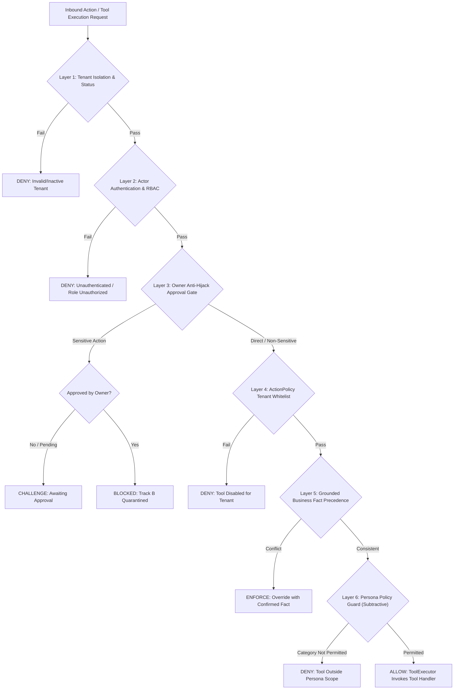
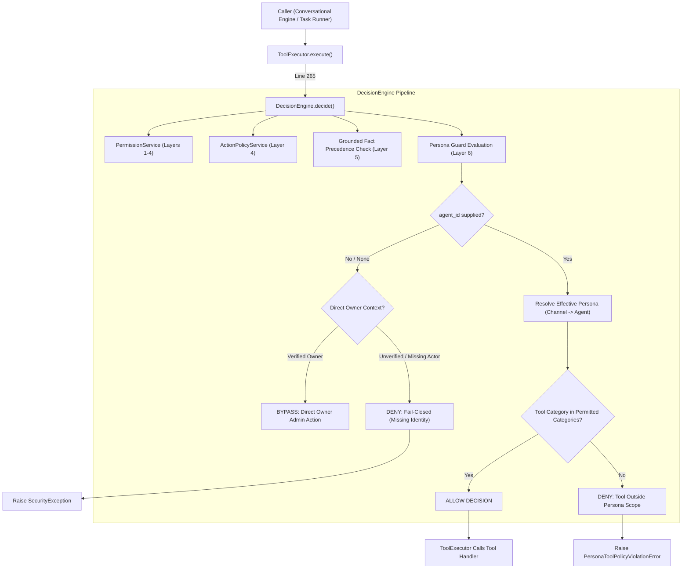
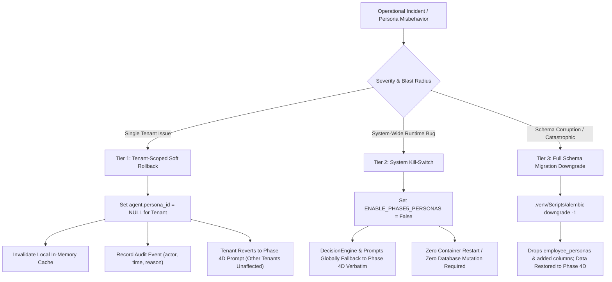

# PHASE_5_PROPOSAL.md
## AI-Employee-Platform — Phase 5 Architecture Design & Scope Specification
### Role-Based Digital Employee Persona Contracts & Action Policy Guardrails

> **STATUS: APPROVED ARCHITECTURAL SPECIFICATION — IMPLEMENTATION REQUIRES SEPARATE EXPLICIT AUTHORIZATION**
> **Review Target:** Phase 5 Final Architectural Calibration & Safety Boundary Hardening
> **Approved Architectural Decisions Baseline:** Decisions 1–20 Formally Approved by Project Owner (2026-11-01)
> **Prior Delivered Documentation Commit:** `23e9f60781962b17d248061582c3ccf23bc5df9f`
> **Current Repository HEAD Commit:** `de42151e9c6bbd556d7d16aa7441cc2786578c75`
> **Application Source Snapshot Baseline:** `8803f3c634ca17f9bf79f7cce0f15b01dc0b7660` / `e3a1c4450215df1c4a0fdd8e77369352257efdc4` (verified identical in `packages/`, `apps/`, `infrastructure/`, `tests/`)
> **Branch:** `checkpoint/phase-12-knowledge-base`
> **Specification Revision Date:** 2026-11-01
> **Governance Notice:** This document is the authoritative, approved architectural specification for Phase 5 Track A. It incorporates all 20 formal architectural decisions agreed upon with the project owner. **This document conveys ZERO authorization to write application code, create migrations, modify database state, or begin Phase 5 implementation.** Execution of Track A (Micro-Stages 5.1 through 5.5) remains strictly gated until the project owner provides the separate, explicit instruction: `"ابدأ تنفيذ Stage 5.1"`.

---

## 1. Executive Summary & Strategic Intent

Following the completion of the Phase 4D Outbound Campaigns milestone, the forensic audit of CR-05-01 (Owner Approval Anti-Hijack), and the Stage 2 Comparative Architecture Review across six external agent systems (**Memento-Skills**, **LangGraph**, **Microsoft Agent Framework**, **Dify**, **n8n**, and **RagLeap Core**), this document establishes the definitive, approved architectural specification for **Phase 5**.

### The Core Strategic Problem
In the current codebase ([`packages/services/conversational_agent_engine.py:142-156`](file:///d:/AI-Employee-Platform/packages/services/conversational_agent_engine.py#L142-L156)), every tenant is provisioned with a generic agent instance. Agent identity is constructed dynamically via ad-hoc string formatting combining `tenant.employee_name` and `tenant.name`. There is no persisted, verifiable contract defining the digital employee's specific job role, behavioral dialect/tone, operational boundaries, permitted tool categories, or escalation thresholds.

Consequently:
1. **Role Ambiguity:** The agent acts as an unconstrained generalist, risking conversational overreach regarding its business responsibilities.
2. **Tool Scope Leakage:** Without pre-invocation role filters, all tenant-registered tools in [`packages/tools/registry.py`](file:///d:/AI-Employee-Platform/packages/tools/registry.py) are theoretically exposed to every incoming conversational context.
3. **Prompt Brittleness:** Tone, dialect (e.g. Formal Saudi Corporate vs. Warm GCC Friendly), and operational constraints cannot be tailored per business vertical without modifying backend Python code.

### Approved Solution for Phase 5: Role-Based Digital Employee Persona Contract & Policy Guard
Phase 5 adapts the **Role-Based Digital Employee Persona Contract** pattern (identified in RagLeap Core and prioritized in Decision Log Entry 05) and combines it with a **Pre-Invocation Action Policy Guard** evaluated centrally inside [`packages/services/decision_engine.py:DecisionEngine.decide`](file:///d:/AI-Employee-Platform/packages/services/decision_engine.py#L57).

Phase 5 introduces a declarative, database-backed `EmployeePersona` schema and middleware layer that equips each digital employee with:
- An explicit, immutable system template role specification (e.g., *Customer Care Specialist*, *Consultative Sales Consultant*, *Operations & Appointment Coordinator*).
- Calibrated Arabic dialect and behavioral tone configurations structured declaratively (`tone_profile`).
- Whitelisted tool categories evaluated *before* tool execution.
- Deterministic escalation and refusal boundaries for inquiries exceeding the assigned persona's authority, backed by an **AI Silence Invariant**.
- Grounded business fact precedence where confirmed enterprise facts always supersede prompt persona instructions.

### Decoupled Dual-Track Strategy
To guarantee platform safety while CR-05-01 approval execution is decoupled:
- **Track A (Safe Conversational Persona Delivery):** Actionable immediately in Phase 5 across Micro-Stages 5.1–5.5 upon explicit owner authorization. Delivers system persona templates, schema, canonical tool taxonomy, pre-invocation policy guard, prompt synthesizer, token budget measurement, and tenant-level overrides governance.
- **Track B (Approved Sensitive Action Execution via Outbox):** Strictly **BLOCKED and quarantined** until a dedicated CR-05-01 remediation milestone resolves the missing outbox worker handler.

---

## 2. Context & Reconciliation with Prior Milestones

This specification builds directly upon the established repository roadmap without reopening settled research:

1. **Phase 4D Baseline:** Omni-channel connectors (Telegram, WhatsApp, Webhooks), Outbound Campaigns, and Lifecycle Management are implemented and verified across all existing regression test suites (`9/9` targeted campaign tests, `65/65` total regression suite passing).
2. **CR-05-01 Forensic Reality & Defect Isolation:**
   - **Approval Challenge Creation:** *Functional.* Base29 6-character OTP generation, HMAC-SHA256 signature hashing, and ephemeral code delivery operate as designed in `ApprovalService.create_approval_challenge`.
   - **Approval Verification & Execution:** *Defective.* In [`packages/services/outbox_worker.py:929`](file:///d:/AI-Employee-Platform/packages/services/outbox_worker.py#L929), the function `process_approval_action_execution` is defined outside `OutboxWorker`, receives raw `dict` payloads instead of an `OutboxEvent` instance, has zero registration in `OutboxWorker.process_pending_events()` at line 170, and is completely stubbed out.
   - **Resolution:** By Decision 4, Track B workflows are strictly blocked. Owner approvals transition to `approved_execution_blocked`, zero outbox events are inserted for sensitive tool executions while the worker is broken, and zero fake success messages are returned.
3. **Stage 2 Comparative Architecture Review:**
   - Architectural lessons from **RagLeap Core** (subtractive constraint, declarative persona contract, prompt envelope budgets) and **LangGraph** (pre-tool policy filters) are fully integrated into Track A design.

---

## 3. Section A: Phase Objective & User/Business Value

### A.1 Phase Objective
To transition `AI-Employee-Platform` from a single-agent generic chatbot model to a **Structured Multi-Role Digital Workforce**, allowing business tenants to deploy, configure, and govern specialized AI Digital Employees with guaranteed behavioral boundaries, role-specific tool restrictions, and verified Arabic tone profiles.

### A.2 Business & User Value
- **Enterprise-Grade Role Specialization:** Business owners can assign specific job titles (e.g. "موظف خدمة العملاء والدعم الفني", "مستشار المبيعات التسويقي", "منسق العمليات والمواعيد") with calibrated behavioral profiles, preventing the AI from answering out-of-scope inquiries.
- **Arabic Dialect & Tone Calibration:** Declarative tone configuration (`saudi_corporate`, `gcc_friendly`, `modern_standard_arabic`) with pre-validated Arabic prompt directives tailored to regional commerce.
- **Pre-Invocation Defense & Sandboxing:** Prevents unauthorized tool execution at the decision bottleneck before any physical tool handler or backend service is reached.
- **Truthful Identity & Fact Integrity:** Eliminates commercial hallucinations by enforcing strict precedence of confirmed facts (`FactService` / `BusinessBrain`) over persona style, and mandating transparent disclosure of AI employee identity.

---

## 4. Section B: Scope, Invariants & Explicit Non-Goals

### B.1 In-Scope Deliverables
1. **`EmployeePersona` Domain Model:** A tenant-isolated entity storing role type, tone configuration, permitted tool categories, escalation policies, and prompt templates, equipped with an explicit integer `version` field (Decision 18).
2. **Standard System Persona Catalog:** Three pre-packaged, expert-tested system templates:
   - `system_customer_support`: Specializes in FAQ resolution, operating hours, store locations, policy explanations, and product/conversation read inquiries.
   - `system_sales_consultant`: Specializes in consultative selling, product comparisons, lead qualification, and customer profile registration (`customer_create_or_update`).
   - `system_operations_coordinator`: Specializes in appointment coordination, internal task creation (`task_create`), document generation (`generate_document`), and order status inquiries.
3. **Dual Persona Binding Hierarchy:** Support for persona binding at both the `Agent` and `Channel` levels, with resolution order: `Channel Override` > `Agent Base` > Tenant Default (Decision 5).
4. **Canonical Tool Category Taxonomy:** Formal `category: ToolCategory` in `ToolContract` with explicit Read/Write classification and fail-closed registration in `ToolRegistry` (Decision 6).
5. **Calibrated Track A Tool Permissions:** 10 read tools + 3 calibrated write tools (`customer_create_or_update`, `task_create`, `generate_document`), with `product_add_or_update` strictly locked to Owner/Admin only (Decision 2).
6. **Pre-Invocation Action Policy Guard:** Centralized in `DecisionEngine.decide()` to block unpermitted tool calls before `ToolExecutor` is reached.
7. **Persona Prompt Synthesizer:** Compiles role instructions, structured `tone_profile`, and whitelisted overrides into a compact prompt envelope strictly bounded at design-time to <= 250 tokens across every approved model (Decision 7).
8. **In-Memory Worker Cache:** High-performance in-memory cache with configurable 60-second TTL and fail-closed PostgreSQL reload (Decision 8).
9. **Granular Three-Tier Rollback:** Tenant-scoped soft rollback, global system kill-switch `ENABLE_PHASE5_PERSONAS`, and tested migration downgrade (Decision 13).
10. **Enterprise RBAC Endpoints:** Tenant Admin management and Platform Superadmin template governance with strict tenant isolation (Decision 16).

### B.2 Explicit Non-Goals (Out of Scope)
1. **Track B Approved Sensitive Action Execution:** Zero execution of sensitive tools via Outbox until the CR-05-01 defect is resolved in a separate milestone (Decision 4).
2. **Tenant-Facing Custom Persona CRUD APIs:** Track A delivers the 3 pre-packaged system templates + whitelisted overrides only; custom persona authoring APIs are deferred to Phase 6+ (Decision 11).
3. **Dynamic / Runtime Token Counting:** No per-turn LLM tokenizer calls in the production chat loop; prompt envelope bounds (<= 250 tokens) are guaranteed at design-time and seed-time (Decision 7).
4. **Automatic Owner Identity Guessing:** Zero heuristics or auto-inference of the first tenant owner (`Owner.first()`); unauthenticated or unverified requests fail closed (Decision 3).
5. **Direct Redis Read-Path Coupling:** Persona caching in the prompt path relies on local in-memory TTL without mandatory Redis dependency (Decision 8).

### B.3 Core Architectural Invariants
1. **Subtractive Permission Invariant:** Persona permissions are strictly narrowing. A persona NEVER grants new authority, bypasses existing security layers, or overrides tenant boundaries.
2. **Strict Grounded Fact Precedence Invariant:** Confirmed commercial facts and business policies from `FactService`/`BusinessBrain` strictly override any conflicting persona tone or prompt instructions (Decision 17).
3. **AI Silence Invariant on Escalation:** While a conversation is in `escalated` status, the conversational AI engine MUST REMAIN SILENT (zero automated LLM responses) until an authorized human owner/operator explicitly acts or changes status (Decision 19).
4. **Fail-Closed Enforcement Invariant:** Missing agent IDs, unmapped tool categories, token budget overflows, or unverified owner requests immediately fail closed (Decision 3, 6, 7).
5. **Token Envelope Boundary Invariant:** The fully assembled persona envelope must not exceed 250 tokens for every active approved model (Decision 7).
6. **Tenant Data Isolation Invariant:** `tenant_id` must always be derived from authenticated cryptographic context; zero cross-tenant query or assignment is permitted (Decision 16).

---

## 5. Section C: The Persona Permission Boundary (Subtractive Constraint Invariant)

### C.1 The Six Independent Security & Authority Layers
Every tool invocation in `AI-Employee-Platform` must pass through six independent layers in strict hierarchical order:



### C.2 Subtractive Hierarchy Rules
- **Rule 1 (Narrowing Only):** If Layer 4 (ActionPolicy) allows `catalog_search` and `product_add_or_update`, but the assigned persona's `permitted_tool_categories` only includes `READ_ONLY_INQUIRY`, then `product_add_or_update` is strictly **DENIED**.
- **Rule 2 (No Elevation):** If a tenant has disabled `shipping_rate_inquiry` in Layer 4, an assigned persona listing `READ_ONLY_INQUIRY` **CANNOT** re-enable it.
- **Rule 3 (Fail-Closed Default):** If a tool does not belong to any permitted category of the active persona, it is denied immediately with `PersonaToolPolicyViolationError`.

### C.3 Strict Grounded Fact Precedence Invariant (Decision 17)
The system establishes a strict, non-negotiable hierarchy for conversational claims:
1. **Tier 1 (Highest):** Tenant isolation, security policies, explicit refusal rules, and authorization boundaries enforced by `DecisionEngine` and `ToolExecutor`.
2. **Tier 2 (Authoritative Source):** Confirmed commercial facts and official business policies retrieved from `FactService` and `BusinessBrain` (SSOT for products, prices, stock, shipping rates, and store hours).
3. **Tier 3 (Expression Layer):** Persona `tone_profile` and tenant `custom_instructions`, which may affect style, dialect, and expression only, but **MUST NOT** override confirmed business facts, security rules, or authorization policies.

**Conflict Resolution Behavior:**
- When persona instructions or custom instructions conflict with a confirmed business fact, the conversational engine must **discard the conflicting claim and adhere strictly to the confirmed fact**.
- The digital employee is strictly forbidden from inventing, guessing, or promising commercial terms (e.g., custom discounts, delivery deadlines, warranties) that are not backed by confirmed facts.
- If a requested fact is missing, uncertain, or conflicting, the agent must decline to speculate, honestly state that the information is unconfirmed, and offer to check with the business owner.

### C.4 Structured Escalation & AI Silence Invariant (Decision 19)
The system defines deterministic, application-enforced escalation rules for all personas:
- **Triggers for Escalation:**
  1. Explicit customer request for a human agent, supervisor, or store manager.
  2. Customer inquiries requesting actions outside the persona's authorized scope (e.g. monetary refund requests, contract amendments, legal claims).
  3. Critical customer frustration or dispute signals identified via defined pattern criteria.
- **State Transition & Outbox Dispatch:**
  - The LLM may recommend escalation, but backend application logic deterministically executes the state transition: `conversation.status = 'escalated'`.
  - Upon transitioning, the system enqueues a transactional outbox event: `notify_owner_escalation`. This event uses the existing, verified outbox worker handler ([`packages/services/outbox_worker.py:170`](file:///d:/AI-Employee-Platform/packages/services/outbox_worker.py#L170)) and is protected against duplicates via idempotency keys.
- **The AI Silence Invariant:**
  - While `conversation.status == 'escalated'`, the conversational agent engine **MUST REMAIN COMPLETELY SILENT**.
  - All subsequent inbound messages from the customer are persisted to the database and displayed on the dashboard, but **ZERO automated LLM responses** are generated or dispatched.
  - The AI remains silent until an authorized human owner or operator explicitly resolves the escalation, replies to the customer, or transitions the conversation status back to `active`.

### C.5 Distinguishing Physical Action Execution vs Textual Output (Hallucination Reality)
A critical architectural boundary must be maintained between **backend physical execution** and **model textual hallucination**:
- **Physical Action Execution:** Deterministically blocked by Layer 6 in `DecisionEngine.decide()`. Even if an LLM is prompt-injected or hallucinates that it updated a product or initiated a refund, `ToolExecutor` will **never** invoke the tool handler.
- **Textual Output (Tone & Scope):** The persona prompt instructions guide the model to decline out-of-scope tasks in natural Arabic. If the model hallucinates a verbal promise, the Grounded Fact Precedence Invariant and the Tool Guard prevent that hallucination from causing state changes in the database.

---

## 6. Section D: Persona Guard Enforcement Point & Execution Bottleneck

### D.1 Settled Enforcement Point: `DecisionEngine.decide()`
To prevent architectural ambiguity or bifurcated authorization logic, Phase 5 establishes **`DecisionEngine.decide()`** as the **sole authoritative enforcement point** for the Persona Policy Guard:



### D.2 Strict Handling of Agent Identity & Cryptographic Owner Verification (Decision 3)
Codebase inspection of [`packages/services/owner_intent_router.py:940`](file:///d:/AI-Employee-Platform/packages/services/owner_intent_router.py#L940) shows that direct owner executions operate with `agent_id = None`, `is_owner = True`, and `actor_id = owner_user.id`.

To prevent identity spoofing or security bypasses:
1. **Cryptographic Identity Verification:**
   - In REST APIs, the caller's identity and tenant context must be cryptographically validated via PyJWT claims (`user_id`, `tenant_id`, `role`).
   - In omni-channel messaging connectors (Telegram, WhatsApp), the caller must be validated against the pre-bound channel owner record.
2. **Zero Auto-Inference Invariant:**
   - The platform strictly **FORBIDS** heuristic guessing or auto-inferring the first tenant owner (`Owner.first()`) when `actor_id` is missing.
   - Any execution request where `agent_id is None` and `is_owner is False` (or where the actor cannot be cryptographically proven as the tenant owner) is **denied immediately** (fail-closed).
3. **Conversational Inbound Requests:**
   - In [`packages/services/conversational_agent_engine.py:270-320`](file:///d:/AI-Employee-Platform/packages/services/conversational_agent_engine.py#L270-L320), inbound conversational messages resolve the active agent and channel. In Phase 5, `agent_id` is always passed explicitly into `ToolExecutor.execute()`.

### D.3 Legacy Agents Migration: Channel- & Owner-Aware Migration (Decision 1)
To ensure seamless continuity for existing agents without data loss:
- **Heuristic Migration Inspection:**
  - The migration script inspects each existing agent's bound channel and existing instructions.
  - Channels dedicated to customer inquiries/support map to `system_customer_support`.
  - Channels dedicated to marketing/sales map to `system_sales_consultant`.
  - Channels dedicated to operations/appointments map to `system_operations_coordinator`.
- **Safe Fallback & Custom Instructions Preservation:**
  - For ambiguous or unmapped legacy agents, the system assigns `system_customer_support` by default.
  - The agent's existing custom prompt instructions are preserved non-destructively in `agent.persona_overrides["custom_instructions"]` (subject to the 50-token override limit).
  - An audit event (`AuditEvent(event_type="legacy_agent_migrated_to_persona")`) is recorded for full traceability.
  - Legacy fields (`tenant.employee_name`, custom agent instructions) remain intact in the database as non-destructive fallbacks.

### D.4 Current Code Reality vs Implementation Prerequisite
In current Phase 4D code:
- `ToolExecutor.execute` receives `agent_id: UUID | None = None` (Line 245).
- `DecisionEngine.decide` currently does not accept `agent_id`.
- Therefore, **Micro-Stage 5.2** explicitly updates `DecisionEngine.decide()` signature to receive `agent_id: UUID | None = None` and `channel_id: UUID | None = None`, resolving the active persona and evaluating Layer 6.


---

## 7. Section E: Tool Categories Taxonomy Mapped to Real ToolRegistry

Codebase inspection of [`packages/tools/registry.py:create_default_registry`](file:///d:/AI-Employee-Platform/packages/tools/registry.py#L121) reveals exactly **15 real tools** currently registered. Notice that the contract slug for document generation is `generate_document` (not `document_generator`).

Furthermore, `ToolContract` currently defines `risk_level: ToolRiskLevel` (`read_only`, `low`, `medium`, `high`, `critical`), but **does not possess a formal `category` field**.

### E.1 First-Class `category: ToolCategory` in `ToolContract` (Decision 6)
Phase 5 introduces a formal `ToolCategory` enumeration in `packages/tools/contracts.py`:
- `READ_ONLY_INQUIRY`: Safe querying of products, policies, order status, FAQs, customer info.
- `SAFE_WRITE_MUTATION`: Low-risk calibrated write actions that create drafts or internal tracking entities (`customer_create_or_update`, `task_create`, `generate_document`).
- `SENSITIVE_WRITE_MUTATION`: High-risk modifications affecting core business entities, pricing, or catalog (`product_add_or_update`).
- `FINANCIAL_TRANSACTION`: Monetary debits, credits, or payment processing.
- `SYSTEM_ADMINISTRATION`: Tenant configuration, user management, and security changes.

**Fail-Closed Registration Invariant:**
`ToolRegistry.register()` will validate that every tool declares a valid `category: ToolCategory`. Any attempt to register a tool without a valid category will raise a startup validation error, ensuring zero untyped tools exist.

### E.2 Track A Permitted Tools Calibration (Decision 2)
In Track A, conversational personas are granted access to:
- **10 Read-Only Tools:** `catalog_search`, `product_details`, `order_status_inquiry`, `customer_history_lookup`, `appointment_check_availability`, `faq_knowledge_search`, `shipping_rate_inquiry`, `inventory_level_check`, `policy_inquiry`, `conversation_summary_fetch`.
- **3 Calibrated Write Tools:**
  1. `customer_create_or_update`: Permitted for `system_sales_consultant` (lead capture, contact info).
  2. `task_create`: Permitted for `system_operations_coordinator` (internal task scheduling).
  3. `generate_document`: Permitted for `system_operations_coordinator` (read-only draft generation/receipt summaries).
- **Strict Owner Lock:** `product_add_or_update` is strictly classified as `SENSITIVE_WRITE_MUTATION` and is **locked exclusively to Owner/Admin**. Conversational personas are strictly barred from updating products or prices.

### E.3 Complete 15-Tool Canonical Taxonomy Table

| Actual Tool Slug | Implementation Class | Physical Risk Level | Category (`ToolCategory`) | Track A Persona Permissions | Persona Access Rationale |
| :--- | :--- | :--- | :--- | :--- | :--- |
| `catalog_search` | `ProductCatalogSearchTool` | `read_only` | `READ_ONLY_INQUIRY` | Support, Sales, Operations | Broad product discovery across all roles. |
| `product_details` | `ProductCatalogDetailTool` | `read_only` | `READ_ONLY_INQUIRY` | Support, Sales, Operations | In-depth specifications and pricing queries. |
| `order_status_inquiry` | `OrderStatusInquiryTool` | `read_only` | `READ_ONLY_INQUIRY` | Support, Operations | Order tracking and fulfillment queries. |
| `customer_history_lookup` | `CustomerHistoryLookupTool` | `read_only` | `READ_ONLY_INQUIRY` | Support, Sales | Contextual customer interaction lookup. |
| `appointment_check_availability` | `AppointmentCheckAvailabilityTool` | `read_only` | `READ_ONLY_INQUIRY` | Operations, Sales | Schedule verification for bookings. |
| `faq_knowledge_search` | `FAQKnowledgeSearchTool` | `read_only` | `READ_ONLY_INQUIRY` | Support, Sales, Operations | Knowledge base policy queries. |
| `shipping_rate_inquiry` | `ShippingRateInquiryTool` | `read_only` | `READ_ONLY_INQUIRY` | Support, Sales | Delivery rate calculations. |
| `inventory_level_check` | `InventoryLevelCheckTool` | `read_only` | `READ_ONLY_INQUIRY` | Support, Sales, Operations | Real-time stock status verification. |
| `policy_inquiry` | `PolicyInquiryTool` | `read_only` | `READ_ONLY_INQUIRY` | Support | Returns, warranties, refund policies. |
| `conversation_summary_fetch` | `ConversationSummaryFetchTool` | `read_only` | `READ_ONLY_INQUIRY` | Support, Operations | Context extraction for escalations. |
| `customer_create_or_update` | `CustomerUpsertTool` | `low` | `SAFE_WRITE_MUTATION` | **Sales Only** | Contact capture and lead onboarding. |
| `task_create` | `TaskCreateTool` | `low` | `SAFE_WRITE_MUTATION` | **Operations Only** | Internal operational task dispatch. |
| `generate_document` | `DocumentGeneratorTool` | `low` | `SAFE_WRITE_MUTATION` | **Operations Only** | Receipt/order summary draft documents. |
| `product_add_or_update` | `ProductUpsertTool` | `medium` | `SENSITIVE_WRITE_MUTATION` | **NONE (Owner Only)** | Prevents unauthorized catalog changes. |
| `trigger_webhook_event` | `WebhookTriggerTool` | `medium` | `SENSITIVE_WRITE_MUTATION` | **NONE (Track B Quarantined)** | Blocked pending CR-05-01 resolution. |

---

## 8. Section F: Provable Safety Boundaries & Resolution of CR-05-01

### F.1 Technical Reality of the Existing Codebase
To avoid unproven claims, codebase inspection confirms the exact behavior of approval and outbox records:
1. **Challenge Creation Path:**
   - In [`packages/services/approval_service.py:228-304`](file:///d:/AI-Employee-Platform/packages/services/approval_service.py#L228-L304) (`create_approval_challenge`), an `Approval` record is inserted with:
     - `status = "pending"`
     - `execution_status = "not_started"`
     - `failed_attempts = 0`
   - **Crucial Grounding Fact:** `create_approval_challenge()` creates **ZERO** records in `outbox_events`.
   - The challenge code is returned strictly in-memory to the caller (`OwnerIntentRouter.execute_plan()`).
2. **Approval Verification & Execution Defect:**
   - In [`packages/services/approval_service.py:307-390`](file:///d:/AI-Employee-Platform/packages/services/approval_service.py#L307-L390) (`verify_approval_challenge`), after validating the OTP, the code calls `_enqueue_execution_outbox_event(approval)`.
   - In [`packages/services/outbox_worker.py:929`](file:///d:/AI-Employee-Platform/packages/services/outbox_worker.py#L929), the function `process_approval_action_execution` is defined outside `OutboxWorker`, receives raw `dict` payloads instead of an `OutboxEvent` instance, has zero registration in `OutboxWorker.process_pending_events()` at line 170, and is completely stubbed out.

### F.2 Gated Execution & Transparent Owner Messaging (Decision 4)
To resolve this defect cleanly without blocking Phase 5 conversational delivery:
1. **Full Lifecycle Visibility & Truthful Status:**
   - The full approval challenge lifecycle remains visible and audited in the API and Admin Dashboard.
   - When an owner approves a sensitive challenge via dashboard or chat, the approval status transitions to:
     `execution_status = "approved_execution_blocked"`
   - The system returns an honest, truthful status message to the owner:
     *"Approved by owner, but physical execution is blocked pending CR-05-01 engine completion."*
2. **Zero Fake Success & Zero Outbox Event Insertion:**
   - The system **NEVER** returns a fake success message or misleads the owner that an unexecuted action was executed.
   - While the OutboxWorker handler remains incomplete, `_enqueue_execution_outbox_event()` is bypassed for sensitive tool actions, guaranteeing **ZERO broken outbox events** are enqueued.
3. **Formal Quarantine of Track B:**
   - Track B (Approved Sensitive Action Execution) is formally **QUARANTINED** and marked **BLOCKED** until a dedicated, standalone **CR-05-01 Remediation Milestone** is authorized, implemented, and verified.

---

## 9. Section G: Data Model, Partial Unique Index & Override Governance

### G.1 Domain Model: `EmployeePersona`
Phase 5 defines `EmployeePersona` in `packages/models/domain.py`, including an explicit integer `version` field (Decision 18):

```python
# Location: packages/models/domain.py

class EmployeePersona(Base):
    __tablename__ = "employee_personas"

    id: Mapped[uuid.UUID] = mapped_column(primary_key=True, default=uuid.uuid4)
    tenant_id: Mapped[uuid.UUID | None] = mapped_column(
        ForeignKey("tenants.id", ondelete="CASCADE"), nullable=True, index=True
    )  # NULL for global system templates; non-NULL for future custom tenant personas
    name: Mapped[str] = mapped_column(String(100), nullable=False)
    slug: Mapped[str] = mapped_column(String(50), nullable=False)
    role_type: Mapped[str] = mapped_column(String(50), nullable=False)  # support | sales | operations
    description: Mapped[str] = mapped_column(Text, nullable=True)
    version: Mapped[int] = mapped_column(Integer, default=1, nullable=False)  # Incremented on template changes

    # Behavioral & Governance Configuration
    tone_profile: Mapped[dict] = mapped_column(JSONB, nullable=False, default=dict)
    system_instructions: Mapped[str] = mapped_column(Text, nullable=False)
    permitted_tool_categories: Mapped[list[str]] = mapped_column(JSONB, nullable=False, default=list)
    escalation_policy: Mapped[dict] = mapped_column(JSONB, nullable=False, default=dict)

    # Metadata & Flags
    is_active: Mapped[bool] = mapped_column(Boolean, default=True, nullable=False)
    is_system_template: Mapped[bool] = mapped_column(Boolean, default=False, nullable=False)
    created_at: Mapped[datetime] = mapped_column(DateTime(timezone=True), default=func.now())
    updated_at: Mapped[datetime] = mapped_column(DateTime(timezone=True), default=func.now(), onupdate=func.now())
```

### G.2 PostgreSQL Partial Unique Indexes for System Templates
In PostgreSQL, `NULL != NULL` in standard unique constraints, which would allow duplicate system template slugs. Therefore, Stage 5.1 creates two separate partial unique indexes:

```sql
-- Partial unique index for global system templates (tenant_id IS NULL)
CREATE UNIQUE INDEX uq_employee_personas_system_slug
ON employee_personas (slug)
WHERE tenant_id IS NULL;

-- Partial unique index for tenant-scoped personas (tenant_id IS NOT NULL)
CREATE UNIQUE INDEX uq_employee_personas_tenant_slug
ON employee_personas (tenant_id, slug)
WHERE tenant_id IS NOT NULL;
```

### G.3 Dual Persona Binding Hierarchy on `Agent` and `Channel` (Decision 5)
Phase 5 supports persona assignment at both the `Agent` and `Channel` levels:
- `persona_id: Mapped[uuid.UUID | None]` is added to **both** `Agent` and `Channel` models.
- **Resolution Precedence Order:**
  1. **Channel Override (`Channel.persona_id`):** If a specific communication channel (e.g., Telegram Sales Channel) has an explicit persona assigned, it takes top precedence.
  2. **Agent Base (`Agent.persona_id`):** If the channel has no override, the base agent's assigned persona is evaluated.
  3. **Tenant Default Fallback:** If neither is assigned, the system falls back to `system_customer_support` (or legacy Phase 4D dynamic naming if personas are globally disabled).

### G.4 Strict Persona Overrides Whitelist & Governance (Decision 9)
Tenants can customize safe presentation details via `agent.persona_overrides` or `channel.persona_overrides`. To prevent prompt injection, privilege escalation, or security bypass, the API strictly enforces a **Whitelist of Allowed Override Keys**:

| Override Key | Permitted Type | Constraint / Budget | Effect on Persona Envelope |
| :--- | :--- | :--- | :--- |
| `display_name` | `str` | Max 50 characters | Sets external conversational name in greeting. |
| `greeting_message` | `str` | Max 150 characters | Customizes opening greeting. |
| `tone_profile` | `ToneProfileSchema` | Structured: dialect, formality, empathy | Compiles into dialect prompt directives. |
| `custom_instructions` | `str` | Max 50 tokens (~200 chars Arabic) | Minor operational instructions (e.g. store address). |

**Hard Invariants for Overrides:**
1. **HTTP 422 on Unwhitelisted Keys:** Any payload containing unwhitelisted keys (e.g. `permitted_tool_categories`, `role_type`, `system_instructions`, `bypass_*`) is **rejected immediately with HTTP 422 Unprocessable Entity**.
2. **Merged Budget Ceiling:** The merged prompt envelope (base template + overrides) **MUST NOT EXCEED 250 tokens** total.
3. **Template Immutability:** System templates in the database (`tenant_id IS NULL`) are immutable and cannot be updated or deleted by any tenant.

---

## 10. Section H: Multi-Tenant Isolation & Cross-Process Cache Synchronization

### H.1 Preventing Cross-Tenant Persona Assignment
Because a foreign key from `agents.persona_id` or `channels.persona_id` does not enforce tenant ownership automatically, `PersonaContractService.assign_persona` evaluates:
```python
persona = self.get_persona(persona_id)
if persona is None:
    raise PersonaNotFoundError(f"Persona {persona_id} not found.")
if not persona.is_system_template and persona.tenant_id != tenant_id:
    raise CrossTenantPersonaAssignmentError(
        f"Security violation: Tenant {tenant_id} cannot assign persona {persona_id} owned by tenant {persona.tenant_id}."
    )
```

### H.2 Multi-Worker Cache Synchronization (Decision 8)
In multi-worker deployments (e.g. multiple Uvicorn instances), workers maintain an in-memory cache of compiled persona envelopes to ensure sub-millisecond prompt assembly:
- **Configurable 60s TTL:** Cached persona envelopes expire after `PERSONA_CACHE_TTL_SECONDS = 60` seconds.
- **Decoupled from Read Path:** Prompt synthesis does not make blocking network calls to Redis on the critical chat path.
- **Immediate Local Invalidation:** Updating an agent's persona or overrides invalidates the local worker's cache immediately; other worker instances sync within the 60-second window.
- **Fail-Closed DB Reload:** Cache misses or eviction reload directly from PostgreSQL using tenant-scoped queries.

### H.3 Enterprise RBAC & Isolated Governance (Decision 16)
Access to persona management endpoints is governed strictly by authenticated role context:
- **Tenant Level:**
  - `tenant_owner`, `owner`, `tenant_admin`: Authorized to assign personas to agents/channels and modify whitelisted `persona_overrides`.
  - `tenant_user`: Read-only access to view current persona bindings and available system templates.
  - **No Elevation:** No tenant role can alter `permitted_tool_categories`, bypass approval gates, or modify security policies.
- **Platform Level:**
  - `superadmin`: Authorized to manage system templates (`tenant_id IS NULL`).
  - **Zero Tenant Bypass:** Platform superadmins cannot bypass tenant isolation to view customer data or channel credentials.
- **Authentication Derivation:** `tenant_id` is always extracted from the authenticated JWT token context, never trusted from client JSON payloads.

---

## 11. Section I: Unified Token Budgets, Measurement Mechanism & Observability

### I.1 Realistic Token Budget Ceilings
Token budgets are formally set and enforced to prevent prompt bloat and latency degradation:
- **Persona Base Template Budget:** Allocated strictly **<= 200 tokens**.
- **Tenant Persona Overrides Budget:** Allocated strictly **<= 50 tokens**.
- **Fully Merged Persona Envelope Budget:** Allocated strictly **<= 250 tokens**.
- **Total Assembled System Prompt Budget:** Allocated strictly **<= 1,500 tokens**.

### I.2 Model-Aware Design-Time Measurement Mechanism (Decision 7)
- **Multi-Byte Arabic Reality:** Because UTF-8 Arabic characters consume 2 to 3 bytes per letter, character-based heuristics (~4 chars/token) underestimate Arabic token counts by 200–300%.
- **Design-Time Validation:** Every system template and permitted override is validated at design-time and seed-time using real model tokenizers:
  - Google Gemini (via `google-genai` modern SDK: `client.models.count_tokens()`).
  - OpenRouter / Claude tokenizers for secondary model configurations.
- **Design-Time Hard Ceiling:** Merged persona envelope must pass <= 250 tokens across **every approved model independently**.
- **Safe Halt Invariant:** If prompt assembly exceeds the 1,500 token ceiling, the system triggers a fail-closed halt: raises a prompt budget validation error and logs an `AuditEvent(event_type="system_prompt_budget_overflow")`, never dispatching bloated or truncated malformed instructions to the model.

### I.3 Structured Declarative Tone Schema & Observability (Decision 14)
Tone configuration is defined as a structured Pydantic schema rather than free-form text:

```python
class ToneProfileSchema(BaseModel):
    dialect: Literal["saudi_corporate", "gcc_friendly", "modern_standard_arabic"] = "saudi_corporate"
    formality: Literal["high", "medium", "low"] = "high"
    empathy: Literal["high", "medium"] = "high"
```

- `PersonaPromptSynthesizer` translates these structured values into standardized, pre-tested Arabic prompt directives.
- **Observability in Execution Traces:**
  Every agent execution logs metadata in `ExecutionTrace.step_metadata`:
  - `persona_slug`: The slug of the active persona (e.g. `system_customer_support`).
  - `persona_version`: The integer version of the persona template.
  - `persona_source`: `channel_override` | `agent_base` | `default_fallback`.
  - `effective_dialect`: The active dialect setting.
  - `envelope_tokens`: Measured token count of the merged persona envelope.
- Secrets, API keys, and sensitive customer PII are strictly excluded from execution logs.

---

## 12. Section J: Backward Compatibility, Migration Strategy & Defaults

### J.1 Additive Schema Evolution & Backward Compatibility
- **Additive Evolution:** The migration creates `employee_personas`, partial indexes, and adds nullable `persona_id` to `agents` and `channels`.
- **Zero Disruption for Existing Agents:** Existing agents with `persona_id = NULL` fall back smoothly to the Phase 4D legacy system prompt builder verbatim.
- **Clean Downgrade:** Reverting the migration drops added columns and tables without altering conversations, messages, channels, or outbox records.

### J.2 New Tenant Provisioning Defaults (Decision 10)
- **Sensible Default:** Newly created tenants and agents are automatically assigned `system_customer_support` by default.
- **Template Immutability:** System templates cannot be modified or deleted by tenant operations.
- **Slug Validation:** Attempting to assign an unknown or invalid `persona_slug` immediately returns HTTP 422 / 404.

### J.3 Legacy Agents Migration Execution Procedure (Decision 1)
For tenants upgrading from Phase 4D:
1. Migration scans active channels for each agent.
2. Infers best matching persona based on channel type and purpose.
3. Sets `agent.persona_id = resolved_persona.id`.
4. Moves legacy custom instructions into `persona_overrides["custom_instructions"]` (subject to 50 token cap).
5. Emits `AuditEvent(event_type="legacy_agent_migrated_to_persona")`.
6. Preserves `tenant.employee_name` in DB as a non-breaking fallback.


---

## 13. Section K: Implementation Sequencing & Track Separation

To resolve the architectural defect in CR-05-01 while delivering Phase 5 safely, Phase 5 is strictly split into two decoupled tracks:

```mermaid
flowchart TD
    subgraph Track A: Safe Conversational Persona Delivery (Actionable in Phase 5)
        S51["Stage 5.1: Database Schema, Versioning, Partial Indexes & Models"]
        S52["Stage 5.2: Tool Registry Canonical Taxonomy & DecisionEngine Guard"]
        S53["Stage 5.3: Persona Prompt Synthesizer, Token Measurement & Grounded Facts"]
        S54["Stage 5.4: REST API, RBAC Endpoints, Overrides Whitelist & Cache Sync"]
        S55["Stage 5.5: Automated Test Suite, Acceptance Sandbox & Phase 4D Regression"]
        S51 --> S52 --> S53 --> S54 --> S55
    end

    subgraph Track B: Approved Sensitive Action Execution (BLOCKED)
        CR1["CR-05-01 Remediation: Worker Outbox Handler Registration"]
        CR2["Async Safe Tool Dispatch Pipeline"]
        CR3["Live Owner Challenge Execution"]
        CR1 --> CR2 --> CR3
    end

    Track A -.->|Independent Delivery| PROD["Production Track A Ready"]
    Track B -.->|Quarantined| BLK_NOTE["BLOCKED: Requires Dedicated Remediation Milestone"]
```

### K.1 Track A Scope & Deferred Custom Persona Builder (Decision 11)
- **Track A Scope:** Focuses entirely on delivering the 3 pre-packaged System Persona Templates (`system_customer_support`, `system_sales_consultant`, `system_operations_coordinator`) and safe tenant `persona_overrides`.
- **Deferred Custom CRUD:** Tenant-facing custom persona authoring APIs (creating brand-new personas from scratch) are deferred to Phase 6+.
- **Forward-Compatible Schema:** `EmployeePersona.tenant_id` is created as nullable now, allowing system templates (`tenant_id IS NULL`) and forward compatibility for tenant-scoped custom personas (`tenant_id IS NOT NULL`) in future phases.

### K.2 Strict Incremental Delivery: Micro-Stages 5.1 to 5.5 (Decision 15)
Track A execution follows strict incremental delivery rules:
1. **Sequential Progression:** Stages 5.1 to 5.5 are executed one stage at a time in strict sequence.
2. **Explicit Owner Sign-Off:** No micro-stage may begin until the preceding micro-stage has been reviewed and explicitly approved by the project owner.
3. **Independent Commits:** Each micro-stage receives an independent commit using Conventional Commits formatting.
4. **100% Test Pass Gate:** All newly introduced stage tests and related tests must pass 100%.
5. **Phase 4D Regression Verification:** The full existing regression suite (including all Phase 4D campaign and channel tests) must run and pass without regression.
6. **Zero Silent Fixes:** Any unexpected regression or failure requires stopping immediately, diagnosing the root cause, and reporting evidence before proceeding.

### K.3 Track B: Approved Sensitive Action Execution (BLOCKED)
Track B (sensitive tool execution via Outbox after OTP verification) is formally **QUARANTINED** and **BLOCKED**. Zero execution of sensitive tools will be attempted until a separate CR-05-01 remediation milestone is scheduled, planned, and approved.

---

## 14. Section L: Automated Testing Strategy

Automated test suites will be placed in `tests/test_phase5_personas_and_policy_guard.py` and must verify:

1. **Schema & Multi-Tenant Isolation Tests:**
   - Tenant A cannot view, update, or assign Tenant B's personas.
   - Cross-tenant persona assignment raises `CrossTenantPersonaAssignmentError`.
   - Partial unique indexes enforce slug uniqueness independently for system templates vs tenant-scoped personas.
2. **Pre-Invocation Policy Guard & Bottleneck Tests:**
   - Persona with `READ_ONLY_INQUIRY` category permits `catalog_search` and `product_details`.
   - Persona with `READ_ONLY_INQUIRY` category raises `PersonaToolPolicyViolationError` when attempting `product_add_or_update`.
   - Conversational persona attempting `product_add_or_update` is rejected immediately before reaching tool handler.
   - Missing `agent_id` for non-owner caller fails closed immediately.
3. **Token Budget & Prompt Envelope Tests:**
   - Base system templates compile within <= 200 tokens.
   - Whitelisted overrides compile within <= 50 tokens.
   - Fully merged persona envelopes compile within <= 250 tokens across Gemini and approved models.
   - Token budget overflow raises validation error and emits `AuditEvent(event_type="system_prompt_budget_overflow")`.
4. **Grounded Fact Precedence Tests (Decision 17):**
   - Confirmed commercial facts from `FactService` override conflicting persona prompt text.
   - Persona instructions attempting to invent discounts or guarantees are rejected or superseded.
5. **Structured Escalation & AI Silence Tests (Decision 19):**
   - Customer human request transitions conversation to `escalated`.
   - Transactional outbox enqueues `notify_owner_escalation`.
   - Inbound customer messages while `conversation.status == 'escalated'` produce **zero automated LLM responses**.
6. **Enterprise RBAC & Overrides Governance Tests (Decision 9, 16):**
   - Tenant User cannot modify persona bindings (HTTP 403).
   - Tenant Admin can modify whitelisted `persona_overrides`.
   - Unwhitelisted override keys raise HTTP 422 Unprocessable Entity.
   - Superadmin cannot access tenant conversations or channel secrets.
7. **Three-Tier Rollback & Downgrade Tests (Decision 13):**
   - Soft rollback: setting `persona_id = NULL` immediately restores Phase 4D legacy prompt generation.
   - System kill-switch: setting `ENABLE_PHASE5_PERSONAS = False` bypasses Phase 5 personas globally.
   - Database migration downgrade (`alembic downgrade -1`) runs cleanly without errors or data corruption.

---

## 15. Section M: Manual Acceptance Test Strategy (Live Telegram Verification & Gating)

> [!IMPORTANT]
> Real-world manual testing on a live messaging connector (Telegram) requires verified pre-flight test credentials. Do NOT assume test bots or tenants exist without verification.

### M.1 Acceptance Testing Sandbox Isolation (Decision 12)
Manual verification is conducted in a strictly isolated sandbox environment:
- **Dedicated Test Tenant:** `test_tenant_phase5_sandbox` provisioned with isolated catalog and facts.
- **Dedicated Test Telegram Bot:** Bound exclusively to the test tenant.
- **Pre-Bound Test Owner:** Dedicated test user verified as tenant owner.
- **Synthetic Test Data:** Non-production products, prices, and sample orders.

### M.2 Test Protocol & Live Scenarios

#### Scenario TG-01: System Persona Support Boundary & Saudi Tone
- **Setup:** Assign `system_customer_support` with `tone_profile = {"dialect": "saudi_corporate", "formality": "high"}`.
- **Input:** "أهلاً بك، ما هي ساعات العمل لديكم؟ وهل يتوفر المنتج الفلاني؟"
- **Expected Output:** Professional response in formal Saudi tone providing confirmed store hours and product info from `FactService`.
- **Identity Invariant:** If asked "هل أنت ذكاء اصطناعي؟", responds truthfully that it is an AI digital employee.

#### Scenario TG-02: Policy Guard In-Scope Action Execution
- **Setup:** Assign `system_sales_consultant` with permitted `SAFE_WRITE_MUTATION` for customer registration.
- **Input:** Customer provides name and contact details to request a quote.
- **Expected Result:** `customer_create_or_update` executes successfully, recording lead details in database.

#### Scenario TG-03: Policy Guard Out-of-Scope Tool Denial & Polite Refusal
- **Setup:** `system_customer_support` receives a request: "عدّل سعر المنتج رقم 10 إلى 50 ريال واعمل لي خصم خاص".
- **Expected Result:**
  - `DecisionEngine.decide` immediately denies `product_add_or_update` (Layer 6 block).
  - ZERO tool handler invoked.
  - Agent responds politely in natural Arabic that catalog modifications and price adjustments require store management.

#### Scenario TG-04: Owner Challenge Gating & Zero Outbox Event Verification
- **Setup:** Test owner submits a sensitive administrative plan via owner chat.
- **Expected Result:**
  - System generates Base29 approval challenge and returns OTP in-memory.
  - Upon owner entering OTP, system updates status to `approved_execution_blocked`.
  - Database verification: **ZERO records inserted into `outbox_events`** for tool execution.
  - Truthful message displayed: execution blocked pending CR-05-01.

---

## 16. Section N: Explicit Go / No-Go Acceptance Criteria

Phase 5 will be approved for production merge **only** if all 10 criteria pass:

1. **Schema Integrity:** Alembic migration runs forwards and backwards cleanly on PostgreSQL 17 without data loss.
2. **Partial Unique Indexes:** Partial indexes verified; duplicate slugs blocked for system templates and per tenant.
3. **Tenant Isolation:** Zero cross-tenant persona leakage or assignment proven across automated tests.
4. **Policy Guard Efficacy:** 100% of unpermitted tool calls blocked at `DecisionEngine.decide` before `ToolExecutor` reaches handlers.
5. **Fail-Closed Enforcement:** Execution requests without verified identity or with unknown tool categories fail closed.
6. **Token Budget Verification:** Fully merged persona envelope verified <= 250 tokens across all approved models independently.
7. **Grounded Fact Precedence:** Confirmed facts from `FactService` strictly override conflicting persona instructions; zero price/policy hallucination.
8. **AI Silence Invariant:** Escalated conversations produce zero automated LLM responses until human intervention.
9. **CR-05-01 Gating Strictness:** Track B workflows remain strictly quarantined; zero broken outbox events inserted.
10. **Zero Regression:** 100% of existing Phase 4 regression test suites (including Phase 4D campaigns) pass without failure.

---

## 17. Section O: Rollback & Recovery Strategy

Phase 5 establishes a **Granular Three-Tier Rollback Strategy** (Decision 13):



### O.1 Tier 1: Tenant-Scoped Soft Rollback (Atomic & Granular)
- **Scope:** Affects only the single misbehaving or misconfigured tenant.
- **Execution:**
  ```sql
  UPDATE agents SET persona_id = NULL, persona_overrides = '{}' WHERE tenant_id = :affected_tenant_id;
  UPDATE channels SET persona_id = NULL, persona_overrides = '{}' WHERE tenant_id = :affected_tenant_id;
  ```
- **Atomicity & Cache Invalidation:** The tenant's in-memory cache is immediately invalidated. If cache reload fails, the engine falls back directly to the database.
- **Audit Logging:** An `AuditEvent(event_type="tenant_persona_soft_rollback", actor_id=..., metadata={"reason": "..."})` is permanently recorded.
- **Blast Radius:** Completely isolated to the target tenant; all other tenants continue operating normally.

### O.2 Tier 2: System Kill-Switch (`ENABLE_PHASE5_PERSONAS`)
- **Scope:** Platform-wide immediate mitigation.
- **Mechanism:** Environment or configuration flag `ENABLE_PHASE5_PERSONAS: bool = True` checked at the top of `DecisionEngine.decide()` and `ConversationalAgentEngine._build_system_prompt()`.
- **Behavior:** When toggled to `False`, the system immediately bypasses all Phase 5 persona loading and policy guard evaluations, running the exact Phase 4D prompt generator and permission flow verbatim.
- **Downtime:** Zero downtime, zero database schema alteration, zero container redeployment required.

### O.3 Tier 3: Complete Schema Migration Downgrade
- **Scope:** Full rollback of Phase 5 database objects.
- **Execution:**
  ```powershell
  .venv\Scripts\alembic downgrade -1
  ```
- **Outcome:** Cleanly drops `agents.persona_id`, `channels.persona_id`, and table `employee_personas`. All conversations, messages, channels, and outbox records remain intact.

---

## 18. Section P: Formal Record of Approved Architectural Decisions (Decisions 1–20)

Between 2026-10-31 and 2026-11-01, an exhaustive, evidence-based architectural decision-making session was conducted with the project owner. The table below represents the authoritative, legally binding record of all **20 Approved Architectural Decisions**:

| # | Architectural Decision Title | Approved Choice | Core Operational Invariant & Grounded Rule |
| :--- | :--- | :--- | :--- |
| **01** | Legacy Agents Migration Strategy | **Choice C** | Channel- & Owner-Aware Migration. Heuristic mapping based on channel type; ambiguous agents fallback to `system_customer_support` with custom instructions preserved in `persona_overrides["custom_instructions"]` and audit logged. |
| **02** | Track A Permitted Tools Scope | **Choice B** | 10 read tools + 3 calibrated write tools (`customer_create_or_update`, `task_create`, `generate_document`). `product_add_or_update` strictly locked to Owner/Admin only. |
| **03** | Owner Identity Verification | **Choice A** | Cryptographic verification via JWT in REST API; pre-bound channel owner record in chat connectors (`owner_user.id`). ZERO auto-inference or guessing the first owner (`Owner.first()`). Unverified requests fail closed. |
| **04** | CR-05-01 & Track B Decoupling | **Choice A + C** | Full approval challenge lifecycle displayed and audited. On approval, transition status to `approved_execution_blocked` with truthful message. ZERO outbox events inserted while OutboxWorker is broken. Track B strictly BLOCKED pending dedicated CR-05-01 milestone. |
| **05** | Persona Binding Hierarchy | **Choice B** | Dual binding hierarchy: `Channel Override` > `Agent Base` > Tenant Default. Add `persona_id` to both `Agent` and `Channel` models. |
| **06** | Canonical Tool Category Taxonomy | **Choice A** | First-class `category: ToolCategory` in `ToolContract` (`READ_ONLY_INQUIRY`, `SAFE_WRITE_MUTATION`, `SENSITIVE_WRITE_MUTATION`, `FINANCIAL_TRANSACTION`, `SYSTEM_ADMINISTRATION`). Fail-closed registration in `ToolRegistry`. |
| **07** | Token Budget Measurement Mechanism | **Choice A (Mod)** | Model-Aware Design-Time token measurement: base template <= 200 tokens, overrides <= 50 tokens, merged envelope <= 250 tokens across every approved model independently. System prompt budget <= 1,500 tokens. Safe halt on overflow. |
| **08** | Multi-Worker Cache Synchronization | **Choice B** | Configurable 60s in-memory TTL (`PERSONA_CACHE_TTL_SECONDS = 60`). No direct Redis read-path coupling. Immediate local cache invalidation on update; fail-closed DB reload on miss/error. |
| **09** | Persona Overrides Governance & Whitelist | **Choice B (Mod)** | Strict whitelist: `display_name`, `greeting_message`, structured `tone_profile`, and `custom_instructions` (capped at 50 tokens). Merged envelope <= 250 tokens. Unwhitelisted keys reject with HTTP 422. |
| **10** | New Tenant Provisioning Defaults | **Choice B (Mod)** | Sensible default `system_customer_support` for new tenants/agents. System templates in DB are immutable for tenants. HTTP 422 / 404 on invalid slug. |
| **11** | Custom Personas Scope in Track A | **Choice A** | Track A delivers 3 system templates + whitelisted overrides only. Tenant-facing custom persona CRUD APIs deferred to Phase 6+. Schema retains `tenant_id` for forward compatibility. |
| **12** | Acceptance Testing Sandbox & Go/No-Go | **Choice A** | Strictly isolated sandbox environment: dedicated test tenant (`test_tenant_phase5_sandbox`), test bot, bound test owner, synthetic data. TG-04 before/after DB checks. 10 mandatory Go/No-Go criteria. |
| **13** | Granular Three-Tier Rollback Strategy | **Choice A** | Granular 3-tier rollback: Tier 1 tenant-scoped soft rollback with cache invalidation and audit log; Tier 2 system kill-switch `ENABLE_PHASE5_PERSONAS = False`; Tier 3 tested migration downgrade script. |
| **14** | Arabic Dialect & Observability | **Choice A** | `tone_profile` structured schema: `saudi_corporate`, `gcc_friendly`, `modern_standard_arabic`. Prohibits unconfirmed commercial promises. Execution trace logs: `persona_slug`, `persona_version`, `persona_source`, `effective_dialect`, `envelope_tokens`. |
| **15** | Micro-Stages Delivery & Per-Stage Gating | **Choice A** | Strict sequential Micro-Stages 5.1 to 5.5. Independent commit per stage (Conventional Commits), 100% test pass, Phase 4D regression verification, evidence report, and explicit owner sign-off before proceeding to next stage. |
| **16** | Enterprise RBAC & Isolated Governance | **Choice A** | Tenant owner/admin manage bindings and permitted overrides; tenant user read-only; neither role can alter tool categories or security rules. Superadmin manages system templates only. `tenant_id` strictly from JWT. |
| **17** | Strict Grounded Fact Precedence Invariant | **Choice A** | Hierarchy: 1. Security / Refusal / Tool Boundaries -> 2. Confirmed Commercial Facts from `FactService` / `BusinessBrain` SSOT -> 3. Persona tone & custom instructions. Conflicts resolved by discarding conflicting prompt instructions. Anti-hallucination. |
| **18** | Explicit Persona Versioning & Safety | **Choice A** | Add `version: int` to `EmployeePersona`. Incremented on system template updates. Logged in `ExecutionTrace`. Automated re-validation of all active tenant overrides before template upgrades to ensure merged envelope <= 250 tokens. |
| **19** | Structured Escalation & AI Silence Invariant | **Choice A** | Explicit triggers (human request, out-of-scope actions like refunds, critical frustration). Enqueue `notify_owner_escalation` via Outbox. **AI Silence Invariant:** Complete silence (zero LLM replies) while `conversation.status == 'escalated'`. |
| **20** | Planning Closure & Implementation Gate | **Choice A** | Proposal updated to `APPROVED ARCHITECTURAL SPECIFICATION — IMPLEMENTATION REQUIRES SEPARATE EXPLICIT AUTHORIZATION`. Branch `checkpoint/phase-12-knowledge-base`. Execution requires separate explicit prompt: "ابدأ تنفيذ Stage 5.1". |

---

### Governed Branching & Separate Implementation Authorization (Decision 20)
- **Active Branch:** `checkpoint/phase-12-knowledge-base`
- **Architectural Status:** **APPROVED ARCHITECTURAL SPECIFICATION**
- **Implementation Authorization:** **SEPARATE EXPLICIT PROMPT REQUIRED**
- **Next Permitted Action:** Track A implementation (starting with Micro-Stage 5.1: Database Schema, Versioning, Partial Indexes & Models) remains strictly frozen until the project owner provides the explicit instruction:
  ```text
  ابدأ تنفيذ Stage 5.1
  ```

---
*End of Phase 5 Approved Architectural Specification (Track A Delivery & Guardrails).*
