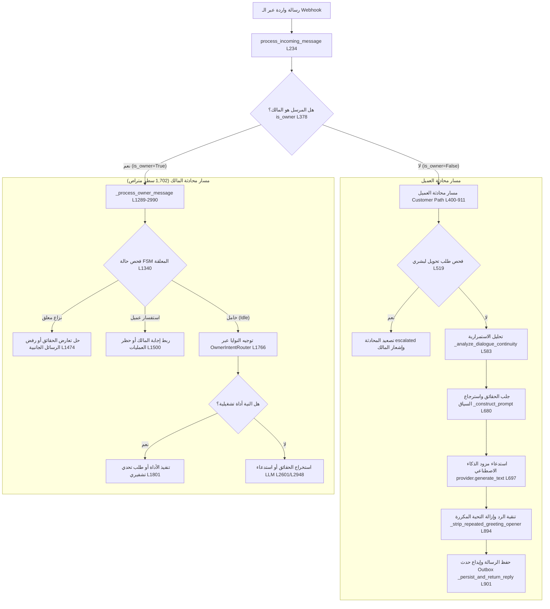

# التحليل الجنائي لمسارات محرك المحادثة الفعلي (Conversational Engine Audit)

**تاريخ التوثيق:** 2026-11-03  
**الملفات المفحوصة:**
- `packages/services/conversational_agent_engine.py` (5,290 سطراً)
- `packages/services/owner_intent_router.py` (1,081 سطراً)
- `packages/services/conversation_fsm_service.py` (443 سطراً)
- `packages/services/owner_inquiry_service.py` (1,313 سطراً)

---

## 1. نقاط الدخول ودورة حياة الرسالة (Message Ingestion & Lifecycle)

يبدأ تدفق أي رسالة واردة من قناة تيليجرام أو واتساب عند نقطة الدخول المركزية:
`ConversationalAgentEngine.process_incoming_message` ([السطور 234–911](file:///d:/AI-Employee-Platform/packages/services/conversational_agent_engine.py#L234-L911)).



---

## 2. كشف التشوهات المعمارية بالأدلة البرمجية القاطعة

### 2.1 دالة معالجة المالك المتضخمة (`_process_owner_message`)
- **الموقع:** [`packages/services/conversational_agent_engine.py:1289–2990`](file:///d:/AI-Employee-Platform/packages/services/conversational_agent_engine.py#L1289-L2990).
- **الحجم:** **1,702 سطر في دالة واحدة** تضم عشرات التفرعات المتشابكة لحل النزاعات، إدارة استفسارات العملاء، التحقق من الآلات الحاسبة، فحص التحديات التشفيرية، واستدعاءات النماذج.
- **الأثر:** أي تعديل طفيف لإصلاح سيناريو معين يتسبب فوراً في Regression غير متوقع لسيناريوهات أخرى، مما جعل الملف غير قابل للصيانة إطلاقاً.

### 2.2 تشخيص المشكلة السلوكية لرسائل التحية مثل «مساء الخير» (The Greeting Bug)
كشف التتبع البرمجي الدقيق لدالة `_analyze_dialogue_continuity` ([L4892–5019](file:///d:/AI-Employee-Platform/packages/services/conversational_agent_engine.py#L4892-L5019)) سبب الخلل الغريب عند إرسال تحية في منتصف المحادثة:
1. في الدور الثاني للمحادثة (`len(prior_agent_messages) > 0`):
   - يتم ضبط `is_new_conversation = False`.
   - يتم ضبط `has_prior_greeting = True`.
2. في السطر 5154، يقوم المحرك بحقن تعليمات صارمة في الـ System Prompt:
   ```text
   [CURRENT CONVERSATION STATE: ONGOING CONVERSATION - DO NOT GREET - START DIRECTLY WITH THE ANSWER]
   ```
3. عندما يرسل العميل مجرد تحية مثل «مساء الخير»، يستلم النموذج أمراً قاطعاً: **"لا تلقِ التحية وابدأ فوراً بالإجابة"**، ولكن لا يوجد سؤال في رسالة العميل ليجيب عليه!
4. يرتبك النموذج، فإما أن يفترض عجزاً في الإجابة ويُرجع رسالة التصعيد الافتراضية: *"هذا الاستفسار يحتاج تأكيداً من الفريق وسنعود إليك"*، أو يُرجع تحية يقوم السطر 894 بمسحها قسراً عبر دالة `_strip_repeated_greeting_opener` (السطر 5010)، مما ينتج رداً مشوهاً ومبتوراً!
- **السبب المعماري:** محاولة إدارة قواعد الحوار عبر جمل نصية قسرية في الـ Prompt بدلاً من إدارة دور الحوار عبر State Machine محكمة.

### 2.3 حظر استدعاء الأدوات في الـ System Prompt
- **الموقع:** [`packages/services/conversational_agent_engine.py:5165–5166`](file:///d:/AI-Employee-Platform/packages/services/conversational_agent_engine.py#L5165-L5166).
- **النص المصدري الصريح:**
  ```python
  "4. You CANNOT execute administrative, financial, or state-changing tools directly from conversational text. "
  "If an action requires execution, explain what will be done and let the system workflow orchestrate it.\n"
  ```
- **الحقيقة الهندسية:** الوكيل محظور صراحة ومبدئياً في التعليمات من تنفيذ أي أداة تغيير حالة، وكل استدعاء للأدوات يتم اعتراضه مسبقاً وتوجيهه عبر قواعد Regex هشة في طبقة البايثون الخارجية.

### 2.4 ثوابت وهمية لا تستخدم نهائياً (Phantom Constant)
- **الموقع:** [`packages/services/conversational_agent_engine.py:98`](file:///d:/AI-Employee-Platform/packages/services/conversational_agent_engine.py#L98).
- **الكود:** `MAX_TOOL_CALL_ITERATIONS = 3`.
- **التحقق الجنائي:** تم إجراء مسح AST شامل لكامل المستودع: **عدد الاستدعاءات = 0**. الثابت مجرد زينة برمجية غير مستخدمة في أي حلقة تكرارية.

### 2.5 الآلات الحاسبة المحقونة نصياً بالـ Regex (Hardcoded Calculators)
- **الموقع:** [`packages/services/conversational_agent_engine.py:3139–3442`](file:///d:/AI-Employee-Platform/packages/services/conversational_agent_engine.py#L3139-L3442).
- بدلاً من استخدام وكيل ذكي يقترح أدوات برمجية ديناميكية، يحتوي المحرك على 300 سطر من قوالب بايثون الثابتة التي تُحقن بنصوص Regex:
  1. `vat_calculator` (السطر 3139): ضريبة القيمة المضافة 15%.
  2. `zakat_calculator` (السطر 3170): زكاة المال 2.5%.
  3. `currency_converter` (السطر 3251): جدول أسعار صرف ثابت (`USD_SAR: 3.75`).
  4. `discount_calculator` (السطر 3275): حساب نسبة الخصم.
  5. `profit_margin_calculator` (السطر 3301): هامش الربح.
  6. `depreciation_calculator` (السطر 3328): استهلاك الأصول الخطي.
  7. `loan_installment_calculator` (السطر 3360): أقساط القروض.
  8. `end_of_service_calculator` (السطر 3392): مكافأة نهاية الخدمة بنظام العمل السعودي.

### 2.6 كود ميت لم يعد مستخدماً في الإنتاج (Dead Code)
- **الموقع:** [`packages/services/conversational_agent_engine.py:3580–3859`](file:///d:/AI-Employee-Platform/packages/services/conversational_agent_engine.py#L3580-L3859) (280 سطراً).
- دالتا `_clean_business_name` و `_extract_business_knowledge` لا تُستدعيان في أي مسار إنتاجي؛ المستدعي الوحيد لهما هو اختبار قديم (`tests/test_phase0_fixes_verification.py:229`). وفي المقابل، تحتفظ `owner_intent_router.py` بنسخة مكررة من نفس الكود في السطر 657!

### 2.7 غياب استخدام الذكاء الاصطناعي في `OwnerIntentRouter`
- **الموقع:** [`packages/services/owner_intent_router.py:157`](file:///d:/AI-Employee-Platform/packages/services/owner_intent_router.py#L157).
- تستقبل الدالة `ai_provider: AIProvider | None = None` في `__init__` وتخزنه في `self.ai_provider`.
- **التحقق الجنائي:** عبر الأسطر الـ 1,081 للملف، **عدد استخدامات `self.ai_provider` = 0**. التوجيه يتم كلياً عبر أنماط Regex وتطابق نصوص.

### 2.8 التقطيع القسري لتاريخ المحادثة (History Truncation)
- الحد الأقصى لعدد الرسائل المسترجعة مقيد بـ 8 رسائل فقط: `bounded_history_limit = max(1, min(history_limit, 8))` ([L574](file:///d:/AI-Employee-Platform/packages/services/conversational_agent_engine.py#L574)).
- بتر كل رسالة تتجاوز 350 حرفاً: `if len(content) > 350: content = content[:350] + "..."` ([L595](file:///d:/AI-Employee-Platform/packages/services/conversational_agent_engine.py#L595)).
- سقف المحادثة الإجمالي محدد بـ 2,000 حرف فقط: `if total_history_len > 2000: break` ([L604](file:///d:/AI-Employee-Platform/packages/services/conversational_agent_engine.py#L604)).
- بتر إجابات المالك والحقائق في السطور 5075 و 5082 عند 350 حرفاً أيضاً.

### 2.9 احتجاز جلسة قاعدة البيانات أثناء استدعاء الذكاء الاصطناعي (DB Connection Holding)
- في السطر 697 وفي السطر 2948، يتم استدعاء `provider.generate_text(...)` مع إبقاء جلسة قاعدة البيانات مفتوحة ومحجوزة داخل خيط المعالجة.
- **الأثر الخطر:** استدعاء النماذج الخارجية قد يستغرق من 5 إلى 30 ثانية؛ مما يؤدي إلى استنزاف مجمع اتصالات PostgreSQL (Connection Pool Exhaustion) عند تزامن 10 مستخدمين فقط، مما يسبب انهيار الخادم تحت الضغط.

---

## 3. الخلاصة المعمارية

تصميم محرك المحادثة الحالي بلغ نهايته الحتمية ولا يقبل الترقيع:
1. المنطق المتراص (5,290 سطراً) يجعل أي إضافة جديدة سبباً لأعطال غير متوقعة.
2. قواعد الحوار المفروضة بالـ Regex والـ Prompt المشوه تلغي الطبيعة الحوارية للموظف الرقمي.
3. **الحل الوحيد الموثوق:** استبدال هذا الملف بنواة محرك رسم بياني حالاتي موجه (StateGraph Engine) مستقل، يفكك هذه المعالجة إلى عقد نقية (Nodes) وحواف شرطية (Edges) ويحرر اتصال قاعدة البيانات قبل أي استدعاء خارجي.
