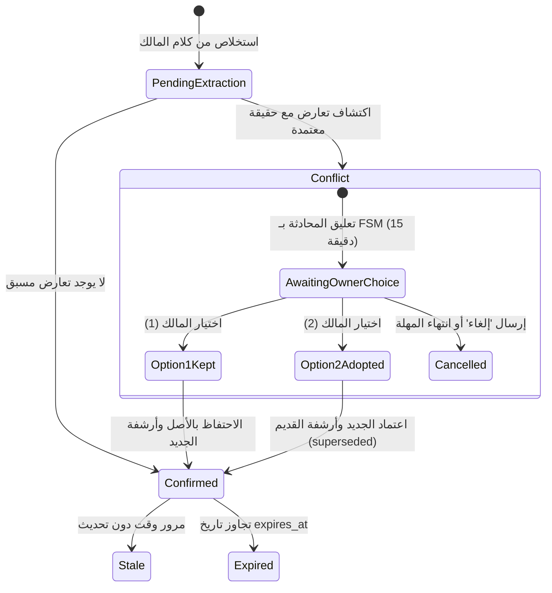

# التحليل المعماري للذاكرة والمعرفة واسترجاع الحقائق (Memory & Knowledge Systems)

**تاريخ التوثيق:** 2026-11-03  
**الخدمات المفحوصة:**
- `packages/services/fact_service.py` (1,020 سطراً)
- `packages/models/domain.py` (نماذج `Fact`, `Learning`, `LearningEvidence`, `Message`, `Conversation`)

---

## 1. التمييز المعماري بين أنواع الذاكرة في المنصة الحالية

| نوع الذاكرة | الكيان الممثل في قاعدة البيانات | الغرض التشغيلي وطبيعة التخزين | آلية الاسترجاع الحالية |
| :--- | :--- | :--- | :--- |
| **ذاكرة حقائق النشاط (Business Facts)** | جدول `facts` | معلومات دائمة معتمدة (الأسعار، ساعات العمل، الفروع، الشروط) | مطابقة كلمات مفتاحية في بايثون Regex (`re.findall`) عبر `FactService` |
| **سجل المحادثة (Conversation History)** | جدولا `conversations` و `messages` | تاريخ الحوار اللحظي والمتبادل بين العميل والموظف أو المالك | استعلام SQL مقيد بـ 8 رسائل ومبتور عند 350 حرفاً للرسالة |
| **الذاكرة التشغيلية العابرة (FSM State)** | جدول `conversation_fsm_states` أو ذاكرة الجلسة | تتبع حالات النزاع المعلقة وخيارات المالك المؤقتة (مهلة 15 دقيقة) | استعلام بمعرف المحادثة والمستأجر مع فحص الـ TTL |
| **المعرفة المكتسبة (Acquired Learnings)** | جدولا `learnings` و `learning_evidence` | أنماط سلوكية أو مقترحات مستخلصة تحتاج لمراجعة | استعلام بالجدول الأبوي `learnings` المقيد بـ `tenant_id` |

---

## 2. التحقق المصدري لآلية استرجاع الحقائق (`FactService`)

### 2.1 دحض ادعاء وجود البحث المتجهي (REFUTED pgvector Claim)
- **الادعاء السابق:** استخدام البحث المتجهي بـ Cosine Distance في `FactService`.
- **الحقيقة البرمجية في الكود الفعلي:**
  - تم فحص دالة `FactService.get_relevant_facts` ([السطور 934–981](file:///d:/AI-Employee-Platform/packages/services/fact_service.py#L934-L981)).
  - بالسطر 948، يتم جلب كافة الحقائق المؤكدة للمستأجر عبر استعلام SQL تقليدي:
    ```python
    stmt = select(Fact).where(
        Fact.tenant_id == tenant_id,
        Fact.status == "confirmed",
        Fact.superseded_by.is_(None),
        or_(Fact.expires_at.is_(None), Fact.expires_at > now),
    )
    ```
  - بالسطر 978، يتم تقييم الصلة داخل ذاكرة بايثون عبر تعبير نمطي (Regex):
    ```python
    query_words = [w.lower() for w in re.findall(r"[\w\u0621-\u064A]+", query) if len(w) > 1]
    ```
  - **النتيجة القاطعة:** لا يوجد أي استخدام لـ pgvector أو تضمين متجهي (Embeddings) أو Cosine Distance في حزمة `packages/` بالكامل.

### 2.2 هل البحث بالـ Regex مناسب لوكيل ذكاء اصطناعي طويل الأمد؟
- **الإجابة الهندسية:** **غير مناسب إطلاقاً للمستقبل.**
- **نقاط القصور الحتمية:**
  1. **غياب الفهم الدلالي (Semantic Blindness):** إذا سأل العميل: «كم ثمن القهوة؟» وكانت الحقيقة مخزنة باسم «سعر البن»، لن يجد الـ Regex أي تطابق لأن الكلمات مختلفة تماماً.
  2. **العجز أمام اللهجات والأخطاء الإملائية:** أي تباين في همزات القطع والوصل أو اختلاف اللهجات السعودية والمصرية يؤدي فوراً إلى فشل الاسترجاع.
  3. **انهيار الأداء مع الحجم (Scalability Bottleneck):** جلب مئات الحقائق إلى ذاكرة بايثون وتكرار حلقات الـ Regex على كل استعلام يرفع زمن المعالجة واستهلاك الذاكرة مع نمو أعمال المستأجر.

---

## 3. دورة حياة الحقيقة والتعامل مع التعارض والصلاحية



- **إسناد المصدر ومستوى الثقة:**
  - كل حقيقة ترتبط بـ `source_type` (مثل `owner_chat` أو `document`) و `confidence` (درجة ثقة من 0.0 إلى 1.0) و `created_by_user_id`.
- **عزل المستأجرين في الذاكرة:**
  - جميع استعلامات وتحديثات جدول `facts` مقيدة بصرامة بـ `Fact.tenant_id == tenant_id`، ولا يمكن لأي مستأجر قراءة أو تعديل حقائق مستأجر آخر.

---

## 4. شروط ومتطلبات الانتقال إلى الـ pgvector الحقيقي

لا يجوز التسرع بإضافة pgvector كترقيع عشوائي، بل يجب التخطيط للهجرة وفق المحددات التالية:
1. **المتطلبات التشغيلية والتكلفة:**
   - تفعيل إضافة `CREATE EXTENSION IF NOT EXISTS vector;` في PostgreSQL.
   - إضافة نموذج تضمين دلالي (مثل `text-embedding-3-small` أو نموذج عربي متخصص مثل `bge-m3`).
   - إضافة عمود `embedding vector(1536)` لجدول الحقائق وإنشاء فهرس `HNSW` مركب مع `tenant_id`:
     ```sql
     CREATE INDEX idx_facts_tenant_embedding ON facts USING hnsw (embedding vector_cosine_ops) WHERE tenant_id IS NOT NULL;
     ```
2. **البحث الهجين (Hybrid Search):** الجمع بين البحث النصي الكامل (Full-Text Search باللغة العربية) والبحث المتجهي، لضمان استرجاع الأرقام والأكواد الدقيقة بالتطابق الحرفي مع استيعاب المعاني بالبحث الدلالي.
