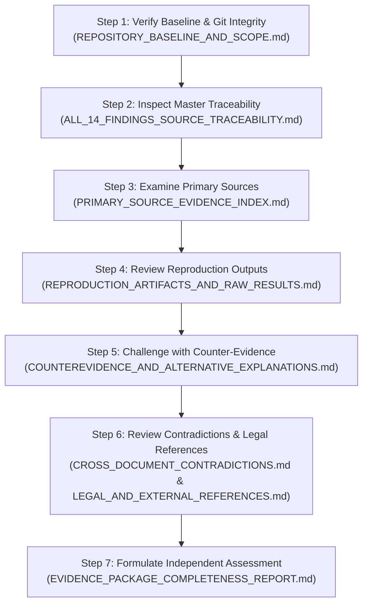

# Independent Review Reading Guide & Evidence Navigation Roadmap

**Document ID:** `INDEPENDENT_REVIEW_READING_GUIDE`  
**Package:** Second-Order Review Evidence Package  
**Audit Baseline Commit:** `1b3eb775d0c963fc18d9004ea20a2dc1255d5e46`  

---

## 1. How to Use this Evidence Package

This guide is designed for an external auditor or reviewer examining the findings of the Second-Order Adversarial Audit. It outlines the logical structure of the package, the primary documents to inspect, and the exact verification questions to ask.

---

## 2. Step-by-Step Review Navigation

---

## 3. What to Check for Each Category of Findings

### 1. Security & Tenancy Findings (F-01, F-02, F-07, F-14b):
- **Inspect:** `apps/agent/main.py:136-163` and `packages/core/crypto.py:44-46`.
- **Verify:** Does `main.py` include routers without middleware? Is `ASSOCIATED_DATA` a static global string?
- **Challenge:** Does existing explicit parameter passing mitigate the router defect in current operation? Does an attacker need database access before static AAD can be exploited?

### 2. Database & Retrieval Findings (F-03, F-04, F-05):
- **Inspect:** PostgreSQL error log in `REPRODUCTION_ARTIFACTS_AND_RAW_RESULTS.md` and `MASTER_ARCHITECTURE_BLUEPRINT.md:330`.
- **Verify:** Does PostgreSQL reject composite HNSW indexing? Is `version_id` missing from Blueprint DDL?
- **Challenge:** Does `hnsw.iterative_scan = 'relaxed_order'` prevent the claimed 99% recall collapse?

### 3. Runtime & Concurrency Findings (F-06, F-11, F-12, F-14a):
- **Inspect:** `MASTER_ARCHITECTURE_BLUEPRINT.md:161`, `PLATFORM_SELF_DEVELOPMENT_RESEARCH.md` Table 2, and `outbox_service.py:190`.
- **Verify:** Is `input_filter` a `Callable`? Is Tier 3 labeled "Automated"? Does outbox SQL order by `created_at ASC` without tenant partitioning?
- **Challenge:** Does LangGraph compile functions into the graph structure rather than state payloads?

### 4. Channels, Vision & Privacy Findings (F-08, F-09, F-10, F-13):
- **Inspect:** Meta WhatsApp v19.0 API specs, Telegram Bot API limits, and Saudi PDPL Article 18.
- **Verify:** Do inbound WhatsApp messages open the 24h window? Does a 5s window emit 240 msgs in 20m? Does soft delete retain PII in immutable logs?
- **Challenge:** Are there statutory retention exemptions under Saudi law (e.g. ZATCA tax rules) that permit retaining certain data?

---
*End of INDEPENDENT_REVIEW_READING_GUIDE.md.*
