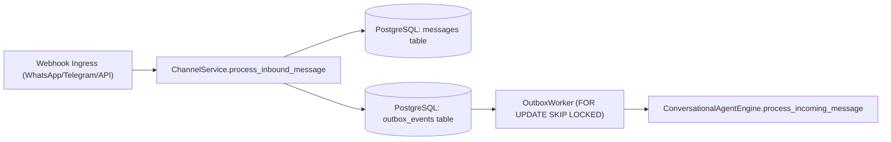

# Architectural Inventory & Current State Analysis

**Authoritative Technical Assessment — AI Employee Platform**  
**Date**: October 2026  
**Repository Working Directory**: `D:\AI-Employee-Platform`  
**Git Baseline Checkpoint**: `a3f39444e95366c876adea7ecdc82f24a8350e5b`  
**Target Milestone**: Digital Employee Autonomous Evolution  

---

## 1. Executive Summary of Current Architecture

The **AI Employee Platform** is a multi-tenant enterprise system hosting autonomous digital employees (AI Agents) that execute business workflows, interact with customers and business owners via omni-channel connectors (WhatsApp Cloud, Telegram, Email, Webhooks), execute structured domain tools, schedule campaigns, and dynamically generate and adapt agent capabilities.

While the platform possesses robust database models, strict row-level multi-tenancy, and transactional outbox guarantees, the agent orchestration layer currently exhibits a hybrid structure: an imperative sequential decision tree (`ConversationalAgentEngine` ~2,588 lines) coupled with an early-stage regex/Pydantic hybrid router (`OwnerIntentRouter` ~812 lines) and an isolated AST-sandboxed dynamic capability engine (`SelfDevelopmentEngine`).

This architecture excels at basic single-turn tool calls and deterministic approvals, but encounters fragility when processing ambiguous natural language, Arabic dialect nuances (e.g. Yemeni "اشتي", Egyptian "عايز", Saudi "ابغى"), long-running multi-turn human-in-the-loop workflows, failure attribution, and dynamic skill evolution.

---

## 2. Inbound Message & Ingestion Pipeline

### 2.1 Ingestion Flow
1. **Webhook Ingress**:
   - Inbound HTTP payloads arrive at `apps/agent/api/v1/webhooks.py`:
     - WhatsApp: `POST /api/v1/webhooks/whatsapp`
     - Telegram: `POST /api/v1/webhooks/telegram`
     - Generic Webhook: `POST /api/v1/webhooks/inbound`
   - Authentication & signature validation are performed per channel via `ChannelService.verify_webhook_signature`.

2. **Message Normalization & Deduplication**:
   - File: [`packages/services/channel_service.py`](file:///D:/AI-Employee-Platform/packages/services/channel_service.py)
   - Function: `ChannelService.process_inbound_message(tenant_id, channel_id, payload, sender_identifier)`
   - Deduplication: Computes an idempotency hash `inbound_hash = sha256(sender + payload + channel_id)` and verifies existence in the `messages` table (`Message.metadata_json["inbound_hash"]`).
   - Persists the incoming record as `Message` with `sender_type="customer"` or `sender_type="owner"`, `status="received"`.

3. **Asynchronous Outbox Dispatch**:
   - Inside the same database transaction, an `OutboxEvent` is generated with `event_type="inbound_message_received"`.
   - File: [`packages/services/outbox_worker.py`](file:///D:/AI-Employee-Platform/packages/services/outbox_worker.py)
   - The background worker executes a loop using PostgreSQL row locking:
     ```sql
     SELECT * FROM outbox_events 
     WHERE status = 'pending' 
     ORDER BY created_at ASC 
     FOR UPDATE SKIP LOCKED 
     LIMIT 50;
     ```
   - Dispatches the message to `ConversationalAgentEngine.process_incoming_message(tenant_id, message_id)`.



---

## 3. Agent Processing & Execution Engine

### 3.1 Primary Entry Point: `ConversationalAgentEngine`
- **File**: [`packages/services/conversational_agent_engine.py`](file:///D:/AI-Employee-Platform/packages/services/conversational_agent_engine.py)
- **Method**: `process_incoming_message(tenant_id: UUID, message_id: UUID)` (Lines 200–375)

#### Step-by-Step Processing Lifecycle:
1. **Tenant-Scoped Message Retrieval**:
   - Queries `Message` where `id == message_id` and `tenant_id == tenant_id`.
   - Rejection on not found (`ValueError`).
2. **Dynamic Capability Auto-Loading**:
   - Calls `self.load_tenant_active_capabilities(tenant_id)`:
     Queries `Capability` and `CapabilityVersion` where `status == "active"` and `is_enabled == True`, instantiates `DynamicCapabilityTool` inside the tenant's runtime tool registry.
3. **Execution Tracing Initialization**:
   - Calls `TracingService.start_trace(tenant_id, trigger_type="inbound_message", ...)` to produce an `ExecutionTrace` record.
4. **Loop Prevention & Idempotency**:
   - Bounces messages if `sender_type` is not in `ALLOWED_INPUT_SENDERS` (`{"customer", "user", "owner", "system"}`).
   - Checks `msg.metadata_json.get("agent_processed") is True` or verifies if `Message` where `in_reply_to_message_id == message_id` already exists.
5. **Mode Bifurcation**:
   - Evaluates:
     ```python
     is_owner = (
         (message.metadata_json or {}).get("is_owner") is True
         or message.sender_type in ("user", "owner")
     ) and (message.customer_id is None)
     ```
   - If `True`: Delegates to `_process_owner_message` (Lines 720–1350).
   - If `False`: Executes Customer Service flow (Human escalation check, ContextBuilder retrieval, AI Provider call, Outbox event generation).

---

## 4. Owner Management & Intent Routing

### 4.1 Hybrid Router Evaluation
In `_process_owner_message`, execution proceeds through a sequence of checks:
1. **OwnerIntentRouter Execution** (Lines 745–786):
   - Invokes `self.owner_intent_router.parse_intent(content, tenant_id=tenant_id, actor_id=message.sender_id)`.
   - Evaluates structured contracts for `bulk_destructive_operation` and `multi_step_workflow`.
2. **Approvals & Confirmations Interception** (Lines 788–880):
   - Regex scanning for approval keywords (`أوافق`, `موافق`, `approve`, `confirm`).
   - Disqualification regex filters out queries *about* approvals or conditions.
   - If UUID is present, confirms approval by UUID; if slug is present, confirms by slug; if bare affirmation, queries `ApprovalService.list_approvals(tenant_id, status="pending")`.
3. **Capability Gap Detection & Self-Development** (Lines 885–1040):
   - Checks for capability creation intents (`طور مهارة`, `أداة جديدة`, `عجز في المهارة`).
   - Binds pending goals into `conversation.metadata_json["pending_goal"]` and `["pending_tool_call"]`.
4. **Business Knowledge & Profile Learning** (Lines 1050–1210):
   - Scans for business declarations: company profile, products, pricing, working hours.
   - Updates `BusinessBrain` and inserts `Knowledge` entries (`category="company_profile"`, `"products"`, etc.).
5. **Dynamic Tool Execution & LLM Reasoning Fallback** (Lines 1220–1350):
   - If no fast-path is triggered, compiles history dialogue and executes via `AIProvider`.

---

## 5. Tool System & Sandboxed Self-Development

### 5.1 Tool Registry & Standard Tools
- **Files**:
  - [`packages/tools/registry.py`](file:///D:/AI-Employee-Platform/packages/tools/registry.py)
  - [`packages/tools/executor.py`](file:///D:/AI-Employee-Platform/packages/tools/executor.py)
  - [`packages/tools/business_tools.py`](file:///D:/AI-Employee-Platform/packages/tools/business_tools.py)
- **Built-in Tools**:
  - `customer_lookup`: Reads customer CRM profile by phone or external ID.
  - `knowledge_search`: Queries vector and semantic knowledge base.
  - `product_catalog_query`: Filters products and inventory.
  - `send_notification`: Enqueues an outbound channel notification via Outbox.
  - `order_create`: Creates an order requiring approval if value exceeds threshold.

### 5.2 Dynamic Self-Development Pipeline
- **Directory**: `packages/self_development/`
- **Key Modules**:
  1. `engine.py` (`SelfDevelopmentEngine`):
     - Lifecycle: Need Identification $\rightarrow$ `DevelopmentRequest` $\rightarrow$ `CapabilitySpecification` $\rightarrow$ `CapabilitySecurityVerifier` $\rightarrow$ `Capability` & `CapabilityVersion` $\rightarrow$ Approval $\rightarrow$ Dynamic Tool Activation.
  2. `verifier.py` (`CapabilitySecurityVerifier`):
     - AST whitelist analysis checking for forbidden calls (`eval`, `exec`, `open`, `__import__`, `globals`, `locals`) and forbidden attributes (`__subclasses__`, `__mro__`, `system`, `popen`).
  3. `sandbox.py` (`ExecutionSandbox`):
     - Isolated process execution with strict timeouts and output char limits.
  4. `dynamic_tool.py` (`DynamicCapabilityTool`):
     - Wraps dynamically created code as a compliant `BaseRealTool`.

---

## 6. Context Assembly & Memory Architecture

### 6.1 Context Retrieval Flow
- **Files**:
  - [`packages/context/context_builder.py`](file:///D:/AI-Employee-Platform/packages/context/context_builder.py)
  - [`packages/context/context_retriever.py`](file:///D:/AI-Employee-Platform/packages/context/context_retriever.py)
  - [`packages/memory/memory_service.py`](file:///D:/AI-Employee-Platform/packages/memory/memory_service.py)
- **Assembly Stages**:
  1. `CustomerContext`: Scopes customer details, status, contact info, total spend.
  2. `ConversationHistory`: Fetches chronological messages with sliding window (`limit=15..50`).
  3. `MemoryContext`: Retrieves episodic and entity memories matching customer/conversation.
  4. `KnowledgeContext`: Executes pgvector cosine similarity search on `knowledge.embedding` filtering strictly by `tenant_id`.
  5. `PromptConstruction`: Assembles system prompt with strict untrusted data boundaries:
     ```text
     === TENANT BUSINESS KNOWLEDGE (AUTHORITATIVE) ===
     {knowledge_snippets}
     === UNTRUSTED USER INPUT ===
     {user_message}
     ```

---

## 7. Database Models & Schema Inventory

The persistence model is implemented using SQLAlchemy 2.0 ORM with strict foreign key constraints and `tenant_id` indexing:

| Model | Table Name | Purpose & Key Fields |
|---|---|---|
| `Tenant` | `tenants` | Root tenant entity (`id`, `name`, `status`, `config_json`, `created_at`) |
| `User` | `users` | Platform users and business owners (`id`, `tenant_id`, `role`, `email`, `hashed_password`) |
| `Customer` | `customers` | End consumers (`id`, `tenant_id`, `phone`, `external_id`, `status`, `metadata_json`) |
| `Channel` | `channels` | Omni-channel integrations (`id`, `tenant_id`, `channel_type`, `credentials_encrypted`, `status`) |
| `Conversation` | `conversations` | Threaded chats (`id`, `tenant_id`, `channel_id`, `customer_id`, `metadata_json`) |
| `Message` | `messages` | Individual message records (`id`, `tenant_id`, `conversation_id`, `sender_type`, `content`, `metadata_json`) |
| `OutboxEvent` | `outbox_events` | Transactional outbox (`id`, `tenant_id`, `event_type`, `payload`, `status`, `retry_count`, `locked_at`) |
| `Approval` | `approvals` | Human-in-the-loop approvals (`id`, `tenant_id`, `action_type`, `parameters`, `status`, `requested_by`) |
| `Knowledge` | `knowledge` | RAG documents & facts (`id`, `tenant_id`, `category`, `content`, `embedding`, `metadata_json`) |
| `Capability` | `capabilities` | Registered agent skills (`id`, `tenant_id`, `slug`, `name`, `risk_level`, `status`) |
| `CapabilityVersion` | `capability_versions` | Immutable code revisions (`id`, `capability_id`, `version`, `code`, `spec_json`, `status`) |
| `DevelopmentRequest` | `development_requests` | Skill generation requests (`id`, `tenant_id`, `prompt`, `status`, `gap_description`) |
| `ExecutionTrace` | `execution_traces` | Observability root trace (`id`, `tenant_id`, `conversation_id`, `trigger_type`, `status`) |
| `ExecutionStep` | `execution_steps` | Granular trace spans (`id`, `trace_id`, `step_name`, `step_type`, `input_summary`, `output_summary`) |

---

## 8. Verified Architectural Strengths & Critical Bottlenecks

### Strengths
1. **Industrial Multi-Tenancy**: Zero cross-tenant leakage; every query in `ChannelService`, `ConversationalAgentEngine`, `ContextBuilder`, and `SelfDevelopmentEngine` filters on `tenant_id`.
2. **Transactional Outbox Delivery**: Asynchronous decoupling prevents loss of messages or outbound webhooks during external network disruptions.
3. **AST Security Verification**: Dynamic capabilities are strictly vetted against dangerous Python AST primitives before code execution.
4. **Auditing & Traceability**: Dual-tier logging via `AuditEvent` (security audit) and `ExecutionTrace`/`ExecutionStep` (latency and observability).

### Critical Bottlenecks Identified
1. **Monolithic Linear Script in Engine**: `ConversationalAgentEngine` handles routing, approvals, capability gaps, teaching, customer replies, and error recovery in one massive class (~2,588 lines), making stateful multi-step interactions brittle.
2. **Fragile State Persistence**: Multi-step workflows and pending approvals store resumption state inside JSON fields (`conversation.metadata_json["pending_goal"]`) without an event-driven state machine or transactional checkpointing.
3. **No Empirical Skill Utility Feedback**: When dynamic capabilities succeed or fail in the field, there is no historical scoring mechanism (unlike Memento's `utility.json`), leading to repeated failures on edge cases.
4. **Lack of Pre-Execution Tool Hallucination Interception**: When an LLM generates a non-existent tool name or hallucinated parameters, execution aborts with a raw error rather than offering semantic fuzzy matching (`HallucinationGuard`).
5. **Vulnerability to Dialectal Ambiguity**: Natural language owner requests with mixed intent (e.g. teaching business information while answering a separate question) can trigger false positives in regex-based intent classification.
