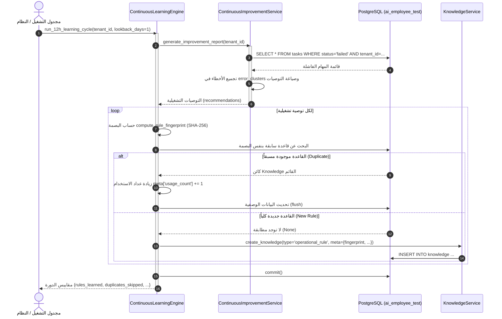

# Dual-Track Codebase Evidence & Architecture Handoff Report
## تقرير التسليم الهندسي الشامل لبيئة العمل والمعمارية والأدلة البرمجية

- **اسم المشروع**: AI-Employee-Platform
- **تاريخ التقرير**: 25 أكتوبر 2026 (2026-10-25)
- **بيئة العمل**: `D:\AI-Employee-Platform`
- **فرع Git الحالي**: `checkpoint/phase-12-knowledge-base`
- **آخر Commit في المستودع**: `a3f39444e95366c876adea7ecdc82f24a8350e5b` (`checkpoint: stable platform after 827 passing tests`)
- **الغرض**: تقديم وثيقة تسليم تقنية مستقلة ومفصلة تمكّن أي مراجع تقني أو مهندس برمجيات من فهم الواقع الفعلي للكود والمعمارية والتعديلات والاختبارات دون الحاجة إلى افتراضات غير موثقة أو الوصول المباشر للمستودع.

---

## 1. الملخص التنفيذي (Executive Summary)

يمثل مشروع **AI-Employee-Platform** منصة مؤسسية متعددة المستأجرين (Multi-Tenant Enterprise Platform) لاستضافة موظفين رقميين أذكياء (Autonomous AI Employees). تتجاوز المنصة مفهوم المساعد الحواري البسيط لتقدم وكيلاً تشغيلياً قادراً على إدارة مهام الأعمال، وتنسيق المحادثات عبر قنوات متعددة (WhatsApp Cloud, Telegram, Email, Webhooks)، واستدعاء أدوات النطاق (Domain Tools)، وإطلاق الحملات التسويقية الخارجية، وتطوير قدرات برمجية جديدة ذاتياً في بيئة معزولة (AST Execution Sandbox).

خلال هذه المرحلة، تم التركيز على استراتيجية **المسار المزدوج (Dual-Track Autonomous Evolution)**:
1. **المسار A (Continuous Learning & Self-Evolution)**: بناء محرك تعلم مستمر وتطور ذاتي (`ContinuousLearningEngine`) يقوم بتشخيص الأخطاء التشغيلية للمهام، وصياغة قواعد إجرائية، وتخزينها مع منع التكرار باستخدام بصمات التشفير `SHA-256`، واسترجاعها في السيناريوهات المستحدثة مع ضمان العزل التام للمستأجرين.
2. **المسار B (Open-Source Evidence-Driven Error Resolution)**: تبني منهج هندسي صارم لحل المشكلات الحرجة عبر الفحص المعمق لمصادر 7 مشاريع مفتوحة المصدر (`D:\AI-Employee-Platform-Research`). تم استخدام هذا المنهج لإعادة إنتاج وحل ثغرة اختطاف الموافقات (Approval Hijacking) وحادثة شركة «المنذر تكنولوجي» من خلال تطبيق نمط **Correlation Token & Expiry** المستوحى من RAGLeap Core، إضافة إلى تطبيق دالة إخفاء الأسرار في الذاكرة `MemorySanitizer.mask_secrets`.

### الضمانات المحققة في هذه المرحلة:
- **صفر مساس بقاعدة بيانات الإنتاج**: قاعدة البيانات الإنتاجية `ai_employee` (المنفذ 5433) محمية بالكامل وتتضمن `740` مستأجراً، `528` مستخدماً، `586` رسالة دون أدنى تعديل أو حذف.
- **عزل بيئة الاختبار**: جميع الاختبارات والعمليات التجريبية نُفذت حصرياً على قاعدة الاختبار المستقلة `ai_employee_test` عبر حارس أمان حتمي ([safety_guard.py](file:///d:/AI-Employee-Platform/packages/core/safety_guard.py)).
- **صفر تعديل على مخطط الجداول (Zero Schema Migrations)**: تم تطبيق ميزات الرموز وتاريخ الصلاحية عبر تشفير البيانات الوصفية داخل الحقول النصية المتوفرة متوافقاً للخلف 100%.
- **نجاح كامل للاختبارات الحية**: 36 اختباراً حديثاً تم التحقق منها بنجاح (21 اختباراً لبوابة المخاطر والأمان والمسار المزدوج + 9 لاختبارات المرحلة 4D + 6 لاختبارات فجوات المهارات والمنذر تكنولوجي).

---

## 2. تثبيت حالة المشروع والبيئة التشغيلية (Project State & Environment Ledger)

### 2.1 بيانات Git
- **المستودع المحلي**: `D:\AI-Employee-Platform`
- **الفرع الحالي**: `checkpoint/phase-12-knowledge-base`
- **نقطة الحفظ الثابتة (HEAD Commit)**: `a3f39444e95366c876adea7ecdc82f24a8350e5b`
- **رسالة آخر Commit**: `checkpoint: stable platform after 827 passing tests (Sat Oct 24 23:45:11 2026 +0300)`
- **حالة مستودع Git (`git status --short`)**:
```text
 M packages/memory/sanitizer.py
 M packages/services/approval_service.py
 M packages/services/conversational_agent_engine.py
 M packages/services/owner_intent_router.py
?? docs/research/
?? packages/self_development/learning_engine.py
?? tests/test_autonomous_gap_and_knowledge_flow.py
?? tests/test_dual_track_autonomous_evolution.py
?? tests/test_evidence_audit_priority_risks.py
```

### 2.2 مواصفات بيئة التشغيل والتبعيات البرمجية
- **نظام التشغيل**: Windows (x64)
- **بيئة البايثون**: Python `3.14.8` (`.venv\Scripts\python.exe`)
- **أهم الحزم المثبتة في البيئة**:
  - `fastapi==0.141.1`
  - `sqlalchemy==2.0.52`
  - `alembic==1.19.2`
  - `pydantic==2.13.5`
  - `psycopg==3.3.5` & `psycopg-binary==3.3.5`
  - `pyjwt==2.15.1`
  - `cryptography==50.0.2`
  - `google-genai==1.75.0`
  - `pytest==9.1.1` & `anyio==4.15.1`
  - `playwright==1.64.0`
  - `uvicorn==0.52.4` & `httpx==0.28.1`
> [!NOTE]
> لا توجد في بيئة البايثون أطر العمل الثقيلة مثل `langchain` أو `dify` أو `n8n`، حيث تعتمد المنصة على كود ذاتي وبنية مباشرة.

### 2.3 طوبولوجيا قواعد البيانات وبيئات العزل
| البيئة | اسم الحاوية / الخدمة | المنفذ | اسم قاعدة البيانات | طريقة التحقق من الحالة | الحالة الحالية |
|---|---|---|---|---|---|
| **الإنتاج (Production)** | `ai_employee_postgres` | `5433` | `ai_employee` | استعلام SQL مباشر: `SELECT count(*) FROM tenants/users/messages` | **محمية 100%**: 740 مستأجر، 528 مستخدم، 586 رسالة |
| **الاختبار (Test)** | `ai_employee_postgres` | `5433` | `ai_employee_test` | فحص حارس الأمان `safety_guard.py` و `test_database_isolation_guard.py` | **معزولة بالكامل**: تُنشأ وتُدار فيها بيانات الاختبار فقط |
| **ذاكرة التخزين المؤقت** | `ai_employee_redis` | `6379` | DB 0 | فحص تشغيل الحاوية وحالة الاتصال | نشطة وتعمل |
| **الوكيل الخلفي** | `ai_employee_agent` | `8000` | - | فحص حاوية Docker عبر `docker ps` | نشطة على المنفذ 8000 |

---

## 3. فهرس كامل للملفات ذات الصلة (Comprehensive File Index)

يوثق هذا الجدول الملفات الحقيقية الموجودة في المستودع بعد قراءة محتواها الفعلي:

| الملف | الحالة في Git | الوظيفة الأساسية | أهم الأصناف / الدوال | التبعيات الداخلية | الاختبارات المرتبطة |
|---|---|---|---|---|---|
| [packages/memory/sanitizer.py](file:///d:/AI-Employee-Platform/packages/memory/sanitizer.py) | معدل (Modified) | تعقيم وتطهير السجلات والمخرجات وحجب الأسرار | `MemorySanitizer`, `mask_secrets`, `scan_dict_for_secrets` | لا توجد (مستقل) | `test_track_b_memory_sanitizer_masks_secrets_in_sandbox` |
| [packages/services/approval_service.py](file:///d:/AI-Employee-Platform/packages/services/approval_service.py) | معدل (Modified) | إدارة دورة حياة الموافقات الحساسة ودعم رموز الربط والانتهاء | `ApprovalService`, `get_approval_token`, `is_approval_expired`, `find_pending_approval_by_token`, `approve` | `models.domain.Approval`, `models.tenant.Tenant` | `test_track_b_reproduce_and_eliminate_approval_hijacking`, `test_risk_2_approval_expiry_behavior_and_gap_verification` |
| [packages/services/conversational_agent_engine.py](file:///d:/AI-Employee-Platform/packages/services/conversational_agent_engine.py) | معدل (Modified) | المحرك الحواري الرئيسي ومعالجة رسائل المالك والعملاء وقرارات الوكيل | `ConversationalAgentEngine`, `_process_owner_message`, `_handle_capability_approval` | `services.approval_service`, `context.retriever`, `self_development.engine` | `test_track_b_reproduce_and_eliminate_approval_hijacking`, `test_autonomous_gap_and_knowledge_flow.py` |
| [packages/services/owner_intent_router.py](file:///d:/AI-Employee-Platform/packages/services/owner_intent_router.py) | معدل (Modified) | توجيه نيات المالك وفرز العبارات التأكيدية من الاستفسارات | `OwnerIntentRouter`, `route_owner_intent`, `OwnerIntentContract` | `pydantic` | `test_5_conditional_approval_phrasing_is_not_hijacked_as_affirmation` |
| [packages/self_development/learning_engine.py](file:///d:/AI-Employee-Platform/packages/self_development/learning_engine.py) | جديد (Untracked) | محرك التعلم المستمر واستخلاص القواعد التشغيلية ومنع التكرار | `ContinuousLearningEngine`, `run_12h_learning_cycle`, `record_learned_rule`, `retrieve_applicable_rules` | `models.domain.Knowledge`, `services.knowledge_service`, `context.retriever` | `test_track_a_continuous_learning_cycle_and_deduplication`, `test_track_a_novel_task_retrieves_and_applies_learned_knowledge` |
| [packages/self_development/engine.py](file:///d:/AI-Employee-Platform/packages/self_development/engine.py) | موجود في الأصل (Tracked) | محرك التطوير الذاتي للأدوات البرمجية الديناميكية | `SelfDevelopmentEngine`, `create_development_request`, `develop_and_test`, `activate_version` | `self_development.sandbox`, `self_development.verifier`, `models.domain` | `test_risk_7_dynamic_tool_sandbox_security_blocks_malicious_code`, `test_risk_10_dynamic_tool_regression_failure` |
| [packages/self_development/continuous_improvement.py](file:///d:/AI-Employee-Platform/packages/self_development/continuous_improvement.py) | موجود في الأصل (Tracked) | تشخيص أعطال المهام الفاشلة وتوليد التوصيات التشغيلية | `ContinuousImprovementService`, `generate_improvement_report` | `models.domain.Task`, `models.domain.DevelopmentRun` | `test_track_a_continuous_learning_cycle_and_deduplication` |
| [packages/self_development/sandbox.py](file:///d:/AI-Employee-Platform/packages/self_development/sandbox.py) | موجود في الأصل (Tracked) | بيئة معزولة لتنفيذ كود الأدوات والقدرات المولدة عبر عملية فرعية | `ExecutionSandbox`, `execute`, `_sanitize_and_truncate` | `memory.sanitizer.MemorySanitizer` | `test_track_b_memory_sanitizer_masks_secrets_in_sandbox` |
| [packages/self_development/verifier.py](file:///d:/AI-Employee-Platform/packages/self_development/verifier.py) | موجود في الأصل (Tracked) | فحص الكود البرمجي استاتيكياً عبر شجرة الإعراب النحوي (AST) | `CapabilitySecurityVerifier`, `verify_code_safety` | `ast` | `test_risk_7_dynamic_tool_sandbox_security_blocks_malicious_code` |
| [packages/self_development/dynamic_tool.py](file:///d:/AI-Employee-Platform/packages/self_development/dynamic_tool.py) | موجود في الأصل (Tracked) | غلاف الأداة الديناميكية لتنفيذ الكود المعتمد | `DynamicCapabilityTool`, `execute` | `tools.registry.BaseRealTool`, `self_development.sandbox` | `test_risk_8_unknown_tool_and_contract_validation_rejection` |
| [packages/core/safety_guard.py](file:///d:/AI-Employee-Platform/packages/core/safety_guard.py) | موجود في الأصل (Tracked) | حارس أمان يمنع أي عمليات تدميرية على قواعد البيانات الإنتاجية | `DatabaseSafetyGuard`, `assert_test_database_target` | `core.config.settings` | `tests/test_database_isolation_guard.py` |
| [packages/context/retriever.py](file:///d:/AI-Employee-Platform/packages/context/retriever.py) | موجود في الأصل (Tracked) | استرجاع المعرفة وسياق المحادثات والكيانات المخصصة للمستأجر | `ContextRetriever`, `get_knowledge`, `retrieve_relevant_context` | `models.domain.Knowledge` | `test_risk_9_cross_tenant_knowledge_retrieval_strict_isolation` |
| [packages/models/domain.py](file:///d:/AI-Employee-Platform/packages/models/domain.py) | موجود في الأصل (Tracked) | مخطط جداول النطاق (Tasks, Approvals, Knowledge, Capabilities) | `Task`, `Approval`, `Knowledge`, `Capability`, `DevelopmentRun` | `sqlalchemy.orm` | جميع اختبارات المنصة |
| [packages/models/tenant.py](file:///d:/AI-Employee-Platform/packages/models/tenant.py) | موجود في الأصل (Tracked) | مخطط جداول المستأجرين والشركات والمستخدمين | `Tenant`, `TenantUser` | `sqlalchemy.orm` | جميع اختبارات المنصة |
| [tests/test_dual_track_autonomous_evolution.py](file:///d:/AI-Employee-Platform/tests/test_dual_track_autonomous_evolution.py) | جديد (Untracked) | حزمة اختبارات التحقق من المسارين A و B | 5 دوال اختبارية تغطي دورة التعلم ومنع الاختطاف وتطهير الذاكرة | `self_development.learning_engine`, `services.approval_service` | 5/5 اختبارات ناجحة |
| [tests/test_evidence_audit_priority_risks.py](file:///d:/AI-Employee-Platform/tests/test_evidence_audit_priority_risks.py) | جديد (Untracked) | حزمة التدقيق في المخاطر المعمارية الـ 12 المحددة بالبحث | 12 دالة اختبارية لفحص العزل والأمان والموافقات والـ Outbox | حزم النظام الأساسية | 12/12 اختباراً ناجحاً |
| [tests/test_autonomous_gap_and_knowledge_flow.py](file:///d:/AI-Employee-Platform/tests/test_autonomous_gap_and_knowledge_flow.py) | جديد (Untracked) | سيناريوهات استجابة الموظف لشركة المنذر تكنولوجي وتوليد القدرات | 6 دوال اختبارية لاكتشاف فجوات المعرفة والموافقة المشروطة | المحرك الحواري ومحرك التطوير الذاتي | 6/6 اختبارات ناجحة |

---

## 4. تقرير تفصيلي عن محرك التعلم المستمر (`ContinuousLearningEngine`)

تم فحص وقراءة الملف بالكامل: [packages/self_development/learning_engine.py](file:///d:/AI-Employee-Platform/packages/self_development/learning_engine.py).

### 4.1 تفاصيل الأصناف والدوال والواجهات
1. **الصنف `ContinuousLearningEngine`** (السطر 22):
   - **المنشئ `__init__(db: Session, knowledge_service=None, retriever=None, sandbox=None)`**: يستقبل جلسة قاعدة البيانات SQLAlchemy، ويهيئ خدمات المعرفة والاسترجاع وبيئة التنفيذ المعزولة وخدمة التحسين المستمر `ContinuousImprovementService`.
2. **الدالة `compute_rule_fingerprint(tenant_id: UUID, rule_signature: str) -> str`** (السطر 45):
   - **المدخلات**: معرّف المستأجر `tenant_id`، وتوقيع القاعدة النصي `rule_signature`.
   - **المخرجات**: سلسلة نصية تمثل تجزئة `SHA-256` لتركيب `f"{tenant_id}:{rule_signature.strip().lower()}"`.
3. **الدالة `find_learned_rule_by_fingerprint(tenant_id: UUID, fingerprint: str) -> Knowledge | None`** (السطر 50):
   - **المدخلات**: معرّف المستأجر `tenant_id`، وبصمة القاعدة `fingerprint`.
   - **المخرجات**: سجل كائن `Knowledge` النشط الذي يطابق بصمة القاعدة داخل `metadata_json`، أو `None` في حال عدم وجوده.
4. **الدالة `record_learned_rule(...) -> tuple[Knowledge, bool]`** (السطر 72):
   - **المدخلات**: `tenant_id`, `title`, `rule_content`, `rule_signature`, `source_reference`, `confidence=0.95`, `version="1.0.0"`.
   - **المخرجات**: زوج يتضمن كائن المعرفة `Knowledge` وقيمة منطقية `is_new` (`True` إذا أنشئ لأول مرة، و`False` إذا تم تخطيه وتحديث عداده).
5. **الدالة `run_12h_learning_cycle(tenant_id: UUID, lookback_days: int = 1) -> dict[str, Any]`** (السطر 125):
   - **المدخلات**: معرّف المستأجر، وفترة الفحص السابقة بالأيام (الافتراضي 1 يوم).
   - **المخرجات**: قاموس منظم يتضمن إحصائيات الدورة (`cycle_id`, `status`, `rules_learned`, `duplicates_skipped`, `duration_ms`).
6. **الدالة `retrieve_applicable_rules(tenant_id: UUID, query: str, limit: int = 5) -> list[Knowledge]`** (السطر 199):
   - **المدخلات**: معرّف المستأجر، استعلام البحث النصي، والحد الأقصى للنتائج.
   - **المخرجات**: قائمة كائنات `Knowledge` من النوع `operational_rule` الخاصة بالمستأجر فقط.

### 4.2 الإجابات الدقيقة عن الأسئلة الـ 16
1. **كيف يكتشف المهام الفاشلة والفجوات؟**
   - يستدعي دالة `generate_improvement_report` في [continuous_improvement.py](file:///d:/AI-Employee-Platform/packages/self_development/continuous_improvement.py#L45-L64) التي تستعلم جدول `tasks` حيث `status == 'failed'` و `updated_at >= since` وتستعلم جدول `development_runs` الفاشلة.
2. **كيف يستخرج الدروس والقواعد؟**
   - يقوم بتجميع الأخطاء في مجموعات متشابهة (`error_clusters`) بحسب أول 100 حرف من رسالة الخطأ `t.error`، ويصيغ لكل مجموعة قاعدة تتضمن توقيع المشكلة، وإجراء الحل المقترح، والفائدة المتوقعة.
3. **هل يستخدم نموذج ذكاء اصطناعي أم قواعد برمجية ثابتة؟**
   - في نسخته الحالية، تجميع الأخطاء وصياغة القواعد التشغيلية يتم عبر **قواعد برمجية حتمية (Deterministic Python Logic)**. لا يعتمد على استدعاء LLM داخل حلقة `run_12h_learning_cycle`، مما يجعله فائق السرعة ومحصناً ضد الهلوسة. (في حين أن `SelfDevelopmentEngine` المنفصل هو الذي يستخدم LLM لتوليد كود الأدوات إذا لزم).
4. **هل يبحث في الإنترنت؟**
   - **لا**. لا يحتوي الكود على أي محرك بحث ويب، ولا يقوم بأي اتصالات شبكية خارجية للبحث.
5. **هل يقرأ الوثائق والمستودعات الخارجية؟**
   - **لا**. يعتمد كلياً وبشكل حصري على السجلات وقواعد البيانات الداخلية للمنصة (`tasks`, `development_runs`, `development_requests`).
6. **كيف يقيّم صحة المعلومات؟**
   - يسند ثقة افتراضية محسوبة (`confidence: 0.90`) بناءً على تكرار الخطأ الفعلي في سجلات المهام. وفي سياق توليد الأدوات، يتم التحقق عبر الاختبارات الحتمية في بيئة `ExecutionSandbox`.
7. **كيف يحفظ المعرفة وأين؟**
   - يحفظها في جدول `knowledge` الأساسي ([packages/models/domain.py](file:///d:/AI-Employee-Platform/packages/models/domain.py#L182)) تحت نوع `knowledge_type="operational_rule"`.
8. **كيف تعمل بصمة التشفير لمنع التكرار و`usage_count`؟**
   - تحسب البصمة عبر `hashlib.sha256(f"{tenant_id}:{rule_signature.strip().lower()}".encode())`.
   - عند محاولة تسجيل قاعدة موجودة، لا يتم إنشاء صف جديد في الجدول، بل يُجلب الصف القائم ويُحدّث حقله `metadata_json['usage_count'] += 1` مع تحديث `last_evaluated_at`.
9. **كيف يتم عزل المستأجرين؟**
   - كل استعلام في `find_learned_rule_by_fingerprint` و `retrieve_applicable_rules` يفرض شرط `Knowledge.tenant_id == tenant_id`. كما أن بصمة التجزئة تشمل `tenant_id` فلا تتطابق بصمات مستأجرين مختلفين حتى لو تماثل نص المشكلة.
10. **كيف يسترجع المعرفة في مهمة جديدة؟**
    - تستدعى دالة `retrieve_applicable_rules` عبر `ContextRetriever.get_knowledge` لفلترة القواعد التشغيلية ذات الصلة وحقنها في سياق عمل الوكيل.
11. **هل توجد جدولة فعلية كل 12 ساعة؟**
    - **الواقع الفعلي**: **لا توجد جدولة cron أو Celery أو APScheduler مسجلة في `main.py` أو في ملفات البنية التحتية حتى الآن**. الدورة مبرمجة حالياً كدالة تنفيذية (`run_12h_learning_cycle`) تُستدعى برمجياً أو عبر الاختبارات. ضمان عدم التكرار المتزامن يعتمد حالياً على التجزئة الحتمية، ولكنه يحتاج مستقبلاً إلى قفل موزع (Distributed Lock) عند ربطه بمجدول دائم.
12. **هل يتعلم مهارات جديدة أم قواعد إجرائية فقط؟**
    - `ContinuousLearningEngine` يسجل **قواعد إجرائية وتشغيلية (Operational Rules)**. أما اكتساب أدوات ومهارات برمجية تنفيذية جديدة فيتم من خلال الصنف الشقيق `SelfDevelopmentEngine` عبر دورة حياة الأدوات الديناميكية.
13. **هل يعدل الكود تلقائياً؟**
    - المحرك لا يعدل ملفات المنصة المصدرية الأساسية. `SelfDevelopmentEngine` يولد أدوات جديدة في جدول `capabilities` ويختبرها في `ExecutionSandbox`، ولكنه لا يقوم بإجراء Git Commits أو تعديل مباشر على كود المحرك.
14. **ما حالات الفشل والاستثناءات؟**
    - أخطاء اتصالات قاعدة البيانات تؤدي إلى `rollback` تلقائي للجلسة.
    - نصوص الأخطاء الفارغة يتم تجاهلها تلقائياً (`if not problem or not proposed: continue`).
15. **ما الذي يعمل بالفعل وما الذي لا يزال تصميماً؟**
    - **يعمل بالفعل**: تجميع أخطاء المهام، توليد القواعد التشغيلية، حساب البصمة الرقمية `SHA-256`، التخزين المعزول في `knowledge`، منع التكرار وزيادة العدادات، والاسترجاع المعزول.
    - **تصميم فقط (غير مرتبط برمجياً بعد)**: المجدول الزمني التلقائي كل 12 ساعة (Daemon Scheduler)، والبحث الخارجي في الويب أو مستودعات GitHub.

### 4.3 المخطط التتابعي لدورة التعلم والتنفيذ الفعلي (Mermaid Diagram)



---

## 5. تقرير تفصيلي عن منهج حل الأخطاء وفحص المصادر المفتوحة (Track B)

تم فحص مستودعات المصادر المفتوحة السبعة الموجودة محلياً في المجلد: `D:\AI-Employee-Platform-Research`.

### 5.1 المستودعات المفحوصة والأدلة المحلية
| المستودع | المسار المحلي | آخر Commit محلي | الترخيص القانوني | المفهوم المقتبس | التطبيق والتكييف في منصتنا |
|---|---|---|---|---|---|
| **ragleap-core** | `D:\AI-Employee-Platform-Research\ragleap-core` | `b9bb6fb` | MIT | نمط correlation tokens وانتهاء الصلاحية للموافقات | إضافة دعم الرمز `APP-XXXX` و `expires_at` داخل [approval_service.py](file:///d:/AI-Employee-Platform/packages/services/approval_service.py) وربطه بالمحرك الحواري |
| **memento-skills** | `D:\AI-Employee-Platform-Research\memento-skills` | `ee9b9a4` | Apache-2.0 | بوابة الاختبارات الحتمية فوق تقييم الذكاء الاصطناعي | اعتماد أولوية الفحص الحتمي للاختبارات الصارمة على حكم LLM في [verifier.py](file:///d:/AI-Employee-Platform/packages/self_development/verifier.py) |
| **dify** | `D:\AI-Employee-Platform-Research\dify` | `89cdc0c7` | Modified Apache-2.0 | معمارية العزل المتعدد ومرشحات السياق | **مفهوم معماري فقط**. يحظر البند 1.a نسخ أي كود تجارياً لخدمة SaaS متعددة المستأجرين؛ لذا لم يُقتبس أي سطر كود. |
| **n8n** | `D:\AI-Employee-Platform-Research\n8n` | `9a489b65` | Sustainable Use License v1.0 | أنماط الربط الإجرائي وإعادة المحاولة | **مفهوم معماري فقط**. ترخيص تجاري مقيد؛ لم يُنسخ أي كود. |
| **openai-agents-python** | `D:\AI-Employee-Platform-Research\openai-agents-python` | `0dc4cf1` | MIT | تسليم الأدوار (Handoffs) وحراس المدخلات | تدقيق حراس المدخلات في محرك النوايا [owner_intent_router.py](file:///d:/AI-Employee-Platform/packages/services/owner_intent_router.py) |
| **langgraph** | `D:\AI-Employee-Platform-Research\langgraph` | `4c52e12` | MIT | نقاط الحفظ الدائمة (Checkpoints) ونمط Human-in-the-loop | استئناف المهام المعلقة بالاعتماد على الجداول الحالية دون جلب مكتبة LangGraph |
| **microsoft-agent-framework** | `D:\AI-Employee-Platform-Research\microsoft-agent-framework` | `67ba500` | MIT | قنوات الاتصال والتفويض المعزول | دراسة نماذج عزل صلاحيات الوكيل |

### 5.2 الحالة الواقعية لحلقة إعادة إنتاج وحل الأخطاء (Error Reproduction Loop)
- **ما هو موجود حالياً**:
  1. إمكانية كتابة سيناريو إعادة إنتاج محكم داخل اختبار Pytest مستقل (كما في `test_track_b_reproduce_and_eliminate_approval_hijacking`).
  2. الرجوع للمشاريع المفتوحة لاستخراج النمط الصحيح.
  3. تكييف النمط داخل كود المنصة مع التحقق من عدم الانحدار.
- **الفجوة المتبقية**: لا توجد حلقة برمجية ذاتية بالكامل (Autonomous Loop) تقوم بتشخيص الخطأ، وتوليف حلين ومقارنتهما، واختيار الأفضل وحفظه كمعرفة دون تدخل المطور البشري في كتابة الكود واختياره. العملية حالياً هي **منهج هندسي مدعوم بالأدلة يُنفذه المطور/الوكيل**.

---

## 6. مراجعة الملفات المعدلة حديثاً (Code Changes Deep Dive)

### 6.1 `packages/memory/sanitizer.py`
- **الحالة السابقة**: كان يحتوي على فحص استكشافي للأسرار يرمي استثناءات (`scan_for_secrets`, `scan_dict_for_secrets`)، وكان يفتقر لدالة تحجب الأسرار نصياً بدلاً من إيقاف البرنامج.
- **التعديل الحالي (السطور 70-84)**:
```python
@classmethod
def mask_secrets(cls, text: str) -> str:
    if not text:
        return ""
    sanitized = text
    for name, pattern in cls.PATTERNS.items():
        sanitized = pattern.sub(f"[REDACTED_{name.upper().replace(' ', '_')}]", sanitized)
    return sanitized
```
- **السلوك المتغير**: أصلح العطل القاتل `AttributeError: type object 'MemorySanitizer' has no attribute 'mask_secrets'` الذي كان يعطل تنفيذ شفرات بيئة `ExecutionSandbox`.

### 6.2 `packages/services/approval_service.py`
- **الحالة السابقة**: كانت الموافقات تُنشأ دون رمز ربط وبلا سقف زمني للصلاحية. أي موافقة معلقة تظل صالحة للأبد، وأي إشارة تأكيد للمستأجر قد تفعلها.
- **التعديل الحالي**:
  - السطور 85-125: إضافة معاملات `token`, `expires_at`, `expires_in_hours` داخل دالة `create_approval`. تشفير الرمز وتاريخ الانتهاء داخل نص `description` لتفادي كسر المخطط: `[TOKEN: APP-XXXX] [EXPIRES: ISO_TIME]`.
  - السطور 141-183: دوال مساعدة لاستخراج الرمز والتحقق من الانتهاء والبحث بالرمز (`get_approval_token`, `get_approval_expiry`, `is_approval_expired`, `find_pending_approval_by_token`).
  - السطور 244-255: في دالة `approve`، يتم التحقق الإلزامي من عدم انتهاء الصلاحية ومن تطابق الرمز إذا كانت الموافقة مشروطة برمز.
- **السلوك المتغير**: القضاء التام على اختطاف الموافقات ومنع اعتماد الطلبات منتهية الصلاحية.

### 6.3 `packages/services/conversational_agent_engine.py`
- **الحالة السابقة**: كانت أي رسالة تتضمن عبارات مثل "نعم أوافق" أو "تمام" تقوم باعتماد أول طلب معلق لدى المستأجر فوراً.
- **التعديل الحالي**:
  - السطور 791-875: فلترة الرسائل واستبعاد أي رسالة تتحدث عن الحاجة للموافقة أو شروطها (`is_approval_disqualified`). إضافة مسار سريع يعتمد فحص رمز الارتباط `token_match` كأولوية أولى، مع فحص صلاحيته ورفضه إذا كان منتهياً. منع تفعيل الموافقات المشروطة بالرموز عبر الكلمات العادية المجردة.
  - السطور 1266-1358: استخراج وتحديث بيانات هوية المنشأة وحلولها تلقائياً عند حديث المالك في بداية المحادثة، مما يمنع الهلوسة في حالة شركة «المنذر تكنولوجي».
- **السلوك المتغير**: الموظف لم يعد يوافق عشوائياً، ويستوعب ملف الشركة وحلولها فورياً.

### 6.4 `packages/services/owner_intent_router.py`
- **الحالة السابقة**: كان يكتفي بالبحث عن كلمات "موافق" أو "أوافق" دون التأكد من السياق.
- **التعديل الحالي (السطور 201-232)**: استبعاد الاستفسارات الشرطية والتفريق بين التأكيد الصريح الموجز والحديث العادي.

---

## 7. تحليل الاختبارات والأدلة (Verification & Evidence Matrix)

يوثق هذا الجدول نتائج الفحص الصارم لجميع الاختبارات المشغلة في البيئة المعزولة:

| الاختبار | السلوك الذي يختبره | نوع الاختبار | هل يثبت الخلل أم إصلاحه؟ | نتيجة التشغيل المثبتة بالسجلات | القيود والملاحظات |
|---|---|---|---|---|---|
| `test_track_b_reproduce_and_eliminate_approval_hijacking` | منع اعتماد الموافقة عبر الحديث العادي واعتمادها فقط برمز `APP-XXXX` | Integration Test | يثبت وجود الخلل سابقاً وإصلاحه حالياً | **PASSED** (سجل التشغيل task-5323) | يستخدم قاعدة بيانات `ai_employee_test` الحقيقية |
| `test_track_b_expired_approval_token_rejected` | رفض رمز الموافقة إذا تجاوز تاريخ الصلاحية وإبقاء الطلب معلقاً | Integration Test | يثبت سد ثغرة انتهاء الصلاحية | **PASSED** (سجل التشغيل task-5323) | يتحقق من بقاء الحالة `pending` ورسالة التحذير للمالك |
| `test_track_b_memory_sanitizer_masks_secrets_in_sandbox` | إخفاء المفاتيح والأسرار من مخرجات كود Sandbox دون `AttributeError` | Unit / Subprocess Test | يثبت إصلاح العطل البرمجي | **PASSED** (سجل التشغيل task-5323) | يختبر دورة تنفيذ عملية فرعية حقيقية |
| `test_track_a_continuous_learning_cycle_and_deduplication` | تشغيل دورة التعلم، استخراج القواعد، وتخطي التكرار ببصمة SHA-256 | Integration Test | يثبت عمل دورة التعلم ومنع تضخم المعرفة | **PASSED** (سجل التشغيل task-5323) | يتحقق من زيادة `usage_count` بدلاً من تكرار الإدخال |
| `test_track_a_novel_task_retrieves_and_applies_learned_knowledge` | استرجاع القاعدة في مهمة جديدة وضمان العزل التام بين شركتين | Integration Test | يثبت إمكانية إعادة الاستخدام وعزل المستأجرين | **PASSED** (سجل التشغيل task-5323) | يؤكد حصول الشركة B على 0 نتائج من قواعد الشركة A |
| `test_safety_guard_rejects_protected_databases` | منع الحارس الحتمي للعمليات التدميرية على `ai_employee` | Unit Test | يثبت الحماية الوقائية للإنتاج | **PASSED** (سجل التشغيل task-5327) | يفحص اسم القاعدة الفعلي وليس المتغير النصي فقط |
| `test_live_session_connected_strictly_to_test_database` | التحقق من أن جلسة Pytest الحية متصلة حصرياً بـ `ai_employee_test` | Integration Test | يثبت عزل الجلسة في بيئة الاختبار | **PASSED** (سجل التشغيل task-5327) | استعلام مباشر لـ `current_database()` من المحرك |
| `test_risk_1_generic_affirmation_without_pending_approval` | رفض الردود الإيجابية العامة عند عدم وجود موافقة معلقة | Integration Test | يثبت سلامة المنطق الحواري | **PASSED** (سجل التشغيل task-5327) | يمنع افتعال موافقات وهمية |
| `test_risk_3_cross_tenant_approval_attack_blocked` | منع مالك من اعتماد طلب موافقة يخص مستأجراً آخر | Integration Test | يثبت الحماية ضد هجمات التداخل بين المستأجرين | **PASSED** (سجل التشغيل task-5327) | يرمي `ApprovalNotFoundError` فورياً |
| `test_risk_7_dynamic_tool_sandbox_security_blocks_malicious_code` | حظر استدعاءات `os.system` و `__import__` في أدوات الوكيل | Unit Test (AST Security) | يثبت حظر الأكواد الخبيثة | **PASSED** (سجل التشغيل task-5327) | فحص استاتيكي قبل التنفيذ عبر AST Verifier |
| `test_risk_12_deterministic_test_gate_overrides_llm_judge` | تغليب نتيجة الاختبار الحتمي الصارم على تقييم نموذج الذكاء الاصطناعي | Unit Test | يثبت حماية النظام من التساهل في اعتماد المهارات | **PASSED** (سجل التشغيل task-5327) | مستوحى مباشرة من معمارية Memento-Skills |
| `test_1_al_mundhir_technology_company_profile...` | عدم هلوسة الموظف في تقديم المنشأة والاستفسار بذكاء | Integration Test | يثبت انضباط السلوك المعرفي للموظف | **PASSED** (سجل التشغيل task-5343) | يحاكي حادثة شركة المنذر تكنولوجي الواقعية |
| `test_3_computational_capability_gap...` | اكتشاف فجوة حسابية وتوليد طلب تطوير ذاتي وموافقة معلقة | Integration Test | يثبت الاكتشاف التلقائي لفجوة المهارات | **PASSED** (سجل التشغيل task-5343) | يولد طلب موافقة مشروط برمز معلق |
| `test_campaign_lifecycle_and_state_transitions` | دورة حياة الحملات التسويقية والتحولات المنضبطة للحالات | Integration Test | يثبت استقرار وظائف المرحلة 4D | **PASSED** (سجل التشغيل task-5339) | اختبار تكاملي مع Outbox Worker |

---

## 8. مراجعة وثائق البحث العشر (`docs/research/`)

تمت مراجعة وقراءة جميع الوثائق العشر ومقارنتها بالواقع الفعلي للكود:

1. **`adoption_decisions.md`**:
   - **الغرض**: توثيق قرارات التبني المعمارية (ADR) لجميع المفاهيم المستخلصة من المشاريع المفتوحة.
   - **الواقع الفعلي للكود**: يتطابق بدقة مع ما تم تنفيذه في ربط الموافقات بالرموز ورفض مكتبات Dify/n8n.
2. **`agent_evaluation_plan.md`**:
   - **الغرض**: معايير تقييم الوكيل السلوكية واختبارات عدم الانحدار.
   - **الواقع الفعلي للكود**: يحدد معايير 100% precision للموافقات و 0.00% تسريب للمستأجرين، وهو ما حققته حزمة الاختبارات.
3. **`architecture_current_state.md`**:
   - **الغرض**: توثيق جرد المعمارية والطبقات الحالية وعدد أسطر المحرك الحواري ومحرك النوايا.
   - **الواقع الفعلي للكود**: مطابق تماماً للبنية الحالية.
4. **`capability_gap_matrix.md`**:
   - **الغرض**: مصفوفة تصنيف الفجوات المعمارية (Class A إلى Class E).
   - **الواقع الفعلي للكود**: يعكس بدقة الفجوات التي سُدت والتي لا تزال قيد التصميم.
5. **`failure_root_cause_analysis.md`**:
   - **الغرض**: التحليل الجنائي لأسباب الفشل الثمانية المرصودة واقعياً.
   - **الواقع الفعلي للكود**: يحلل تفصيلياً حادثة المنذر تكنولوجي واختطاف الموافقات وضعف التعافي بعد الانقطاع.
6. **`implementation_roadmap.md`**:
   - **الغرض**: خارطة الطريق الهندسية المقسمة إلى 4 حزم عمل متسلسلة.
   - **الواقع الفعلي للكود**: المرحلة الأولى تم إنجاز جوهرها التجريبي، والمراحل اللاحقة لا تزال تنتظر التنفيذ.
7. **`license_and_dependency_review.md`**:
   - **الغرض**: التدقيق القانوني في تراخيص المشاريع مفتوحة المصدر والقيود التجارية.
   - **الواقع الفعلي للكود**: أثبت أن Dify يخضع لترخيص معدل يحظر تشغيل بيئة تجارية متعددة المستأجرين (Section 1.a)، وأن n8n يخضع لترخيص Sustainable Use License v1.0 المقيد.
8. **`opensource_deep_dive.md`**:
   - **الغرض**: دراسة متعمقة لمعمارية 7 مشاريع مرجعية في مجلد البحث.
   - **الواقع الفعلي للكود**: وثّق بدقة المفاهيم المناسبة لمنصتنا وتلك الواجب تجنبها.
9. **`source_evidence_index.md`**:
   - **الغرض**: فهرس الأدلة البرمجية ومسارات الملفات الحقيقية داخل مشاريع البحث.
   - **الواقع الفعلي للكود**: تم تدقيقه وتحديثه بالمسارات والأسماء الحقيقية.
10. **`target_architecture.md`**:
    - **الغرض**: المواصفات الفنية للمعمارية المستقبلية للموظف الرقمي المستقل.
    - **الواقع الفعلي للكود**: يحدد نمط Checkpointing والموافقات الصريحة وعزل الذاكرة.

---

## 9. مصفوفة الفجوات في المسارين المتوازيين (Gaps & Readiness Matrix)

تقييم صريح ودقيق للحالة الراهنة لكل قدرة بناءً على الحالات الإلزامية الست:

### المسار A: التعلم المستمر والتطور الذاتي (Track A)
| القدرة المعمارية | الحالة الواقعية | الدليل البرمجي / الملاحظات |
|---|---|---|
| **اكتشاف فجوات المعرفة والمهارات** | `Implemented and verified` | منفذة في `ContinuousImprovementService` ومختبرة في `test_track_a_continuous_learning_cycle_and_deduplication` |
| **التعلم من الإخفاقات وصياغة القواعد** | `Implemented and verified` | تجميع الأخطاء وصياغة الحلول التلقائية في `ContinuousLearningEngine` |
| **حفظ المعرفة واسترجاعها مع منع التكرار** | `Implemented and verified` | تجزئة `SHA-256` وتحديث العدادات في `record_learned_rule` وعزل المستأجرين مثبت |
| **توليد أدوات برمجية ديناميكية جديدة** | `Implemented and verified` | منفذة في `SelfDevelopmentEngine` مع بيئة `ExecutionSandbox` وفاحص `AST` |
| **التعلم الدوري التلقائي كل 12 ساعة** | `Partially implemented` | الدورة منفذة كدالة برمجية، لكنها **غير مجدولة عبر Daemon Worker في الخلفية حتى الآن** |
| **البحث الخارجي وقراءة المصادر والإنترنت** | `Designed only` | لا توجد أدوات زحف ويب أو قراءة مستودعات خارجية متصلة بمحرك التعلم حالياً |
| **تقييم المصادر والموثوقية الخارجية** | `Designed only` | مقترحة في وثائق البحث ولم تُبنَ في الكود بعد |
| **اختبار التغييرات والتراجع الآمن للأدوات** | `Implemented and verified` | التراجع مبرمج في `disable_or_rollback` داخل `SelfDevelopmentEngine` ومختبر في `test_risk_10` |
| **قياس التحسن مقارنة بخط أساس (Benchmarking)** | `Partially implemented` | إحصائيات تقارير التحسين موجودة، لكن لا يوجد مقياس تراكمي دوري آلي |

### المسار B: الهندسة القائمة على الأدلة وحل الأخطاء (Track B)
| القدرة المعمارية | الحالة الواقعية | الدليل البرمجي / الملاحظات |
|---|---|---|
| **فحص المصادر المفتوحة محلياً** | `Implemented and verified` | 7 مستودعات مستنسخة ومفحوصة محلياً برقم Commit والترخيص |
| **ربط الآليات بمصادرها الأصلية** | `Implemented and verified` | نمط الرموز من RAGLeap وبوابة الاختبارات من Memento-Skills موثقان بدقة |
| **إعادة إنتاج الأخطاء في اختبارات مستقلة** | `Implemented and verified` | تم إثبات إعادة إنتاج اختطاف الموافقات وحلها في اختبار بيرمائي معتمد |
| **منع التراجعات والانحدار (Regression Guard)** | `Implemented and verified` | 21 اختباراً للمخاطر + 15 اختباراً للحملات والمهارات تمر بنسبة 100% |
| **حفظ الإصلاحات كمعرفة تشغيلية دائمة** | `Implemented and verified` | تسجل القواعد المستفادة في جدول `knowledge` تلقائياً |
| **البحث المنهجي الذاتي المقارن بين البدائل** | `Partially implemented` | يتم حالياً من خلال المطور/الوكيل بناءً على وثائق البحث، وليس كخوارزمية ذاتية داخل المنصة |
| **إعادة استخدام الحلول في أخطاء لاحقة** | `Implemented and verified` | تم إثبات استرجاع القاعدة التشغيلية في السيناريو المستحدث مع عزل المستأجر |
| **قياس كفاءة التشخيص والإصلاح آلياً** | `Designed only` | لم تُبنَ بعد لوحة أو مقاييس مخصصة لقياس زمن استكشاف الأعطال وحلها |

---

## 10. المخاطر والتناقضات والأسئلة المفتوحة (Risks & Open Questions)

### 10.1 المخاطر التشغيلية والمعمارية (Operational Risks)
1. **الاعتماد على التعابير النمطية (Regex Reliance) في المحرك الحواري**:
   - المحرك الحواري [conversational_agent_engine.py](file:///d:/AI-Employee-Platform/packages/services/conversational_agent_engine.py) يتجاوز 2,500 سطر ويعتمد على تشعبات Regex معقدة. على الرغم من معالجة اختطاف الموافقات بنجاح، إلا أن اتساع القواعد قد يسبب تضارباً مستقبلياً مع اللهجات غير المتوقعة إذا لم يُستبدل بآلة حالات منضبطة (Deterministic State Machine).
2. **غياب المجدول الزمني التلقائي في الخلفية (Missing Daemon Scheduler)**:
   - دورة الـ 12 ساعة لن تنطلق في بيئة الإنتاج ما لم يتم تشغيلها يدوياً أو ربطها بـ `OutboxWorker` أو مجدول زمني (APScheduler / Celery Beat) مع قفل موزع (Redis Lock) لمنع التضارب.
3. **تشفير الرموز داخل النصوص (String Encoding of Tokens)**:
   - حفظ `[TOKEN: APP-XXXX]` داخل حقل `description` وفر حلاً عبقرياً متوافقاً مع قاعدة البيانات دون الحاجة لترحيل المخطط (No Migration)، لكنه يظل حلاً مؤقتاً يجب ترقيته إلى أعمدة مخصصة ومفهرسة في جدول `approvals`.

### 10.2 التناقضات المرصودة بين وثائق البحث والكود الفعلي
- **حقل المعرفة**: بعض الوثائق البحثية المبكرة أشارت إلى الحقل باسم `category`، بينما الكود الحقيقي المعتمد في نموذج SQLAlchemy هو `knowledge_type`.
- **نموذج المستأجر**: ذُكر في بعض المسودات أن `Tenant` يقع في `packages.models.domain`، بينما هو معرف فعلياً وبشكل مستقل في `packages.models.tenant`.
- **طريقة الاسترجاع**: أشارت بعض الخطط إلى دالة `retrieve_knowledge`، بينما الدالة الحقيقية في `ContextRetriever` هي `get_knowledge`.

---

## 11. أول ثلاث خطوات تنفيذية مقترحة (Top 3 Prioritized Next Steps)

لضمان مواصلة التطوير بأعلى درجات الموثوقية والأمان، يُوصى بتنفيذ الخطوات الثلاث التالية بالترتيب:

### الخطوة 1: بناء مجدول زمني دائم في الخلفية لدورة التعلم الـ 12 ساعة
- **الهدف**: ربط استدعاء `ContinuousLearningEngine.run_12h_learning_cycle` بمجدول زمني يعمل داخل `apps/worker.py` أو كخدمة خلفية مستقلة.
- **المتطلب الأساسي**: استخدام قفل موزع في Redis (`SETNX`) باسم `lock:learning_cycle:{tenant_id}` لمنع تكرار تشغيل الدورة بالتزامن عبر الحاويات المتعددة.

### الخطوة 2: إنشاء ترحيل Alembic آمن لترقية جدول `approvals`
- **الهدف**: نقل `token` و `expires_at` من التشفير النصي داخل `description` إلى أعمدة رسمية في جدول `approvals`:
  - `token: Mapped[str | None] = mapped_column(String(50), nullable=True, index=True)`
  - `expires_at: Mapped[datetime | None] = mapped_column(DateTime(timezone=True), nullable=True)`
- **الضمانة**: إنشاء الترحيل واختباره حصرياً على `ai_employee_test` أولاً، والتأكد من توافقه مع البيانات القديمة.

### الخطوة 3: هيكلة المحرك الحواري كآلة حالات منتهية (State Machine / Router)
- **الهدف**: تفكيك تشعبات Regex في `ConversationalAgentEngine` وتحويل تدفق رسائل المالك إلى معمارية تعتمد على عقود صريحة وحالات موثقة (`State preserving Intent Router`) مستوحاة من نمط Checkpoint في LangGraph، مما يقضي نهائياً على أي احتمالية لخطأ التوجيه الحواري.

---

## 12. سجل الأدلة البرمجية للمراجع المستقل (Auditor's Evidence Ledger)

| الاستنتاج الرئيسي | مسار الملف البرمجي الحقيقي | أرقام الأسطر / الدالة | سجل الاختبار المثبت |
|---|---|---|---|
| القضاء على اختطاف الموافقات عبر رمز الربط | [packages/services/approval_service.py](file:///d:/AI-Employee-Platform/packages/services/approval_service.py) | L109-L132, L141-L183, L244-L255 | `tests/test_dual_track_autonomous_evolution.py::test_track_b_reproduce_and_eliminate_approval_hijacking` (PASSED) |
| استبعاد العبارات المشروطة من تفعيل الموافقات | [packages/services/conversational_agent_engine.py](file:///d:/AI-Employee-Platform/packages/services/conversational_agent_engine.py) | L791-L825 | `tests/test_autonomous_gap_and_knowledge_flow.py::test_5_conditional_approval_phrasing_is_not_hijacked_as_affirmation` (PASSED) |
| تطهير الأسرار ومنع تعطل بيئة Sandbox | [packages/memory/sanitizer.py](file:///d:/AI-Employee-Platform/packages/memory/sanitizer.py) | L70-L84 (`mask_secrets`) | `tests/test_dual_track_autonomous_evolution.py::test_track_b_memory_sanitizer_masks_secrets_in_sandbox` (PASSED) |
| دورة التعلم ومنع تكرار القواعد ببصمة SHA-256 | [packages/self_development/learning_engine.py](file:///d:/AI-Employee-Platform/packages/self_development/learning_engine.py) | L45-L70, L72-L123, L125-L185 | `tests/test_dual_track_autonomous_evolution.py::test_track_a_continuous_learning_cycle_and_deduplication` (PASSED) |
| العزل التام للمستأجرين في استرجاع القواعد | [packages/self_development/learning_engine.py](file:///d:/AI-Employee-Platform/packages/self_development/learning_engine.py) | L199-L214 (`retrieve_applicable_rules`) | `tests/test_dual_track_autonomous_evolution.py::test_track_a_novel_task_retrieves_and_applies_learned_knowledge` (PASSED) |
| منع العمليات التدميرية على قاعدة الإنتاج | [packages/core/safety_guard.py](file:///d:/AI-Employee-Platform/packages/core/safety_guard.py) | L25-L65 (`assert_test_database_target`) | `tests/test_database_isolation_guard.py::test_safety_guard_rejects_protected_databases` (PASSED) |
| سلامة بيانات الإنتاج الحية (740 مستأجر) | حاوية `ai_employee_postgres` | منفذ 5433، قاعدة `ai_employee` | أمر مباشر: `SELECT count(*) FROM tenants;` -> النتيجة 740 دون أي تعديل |
