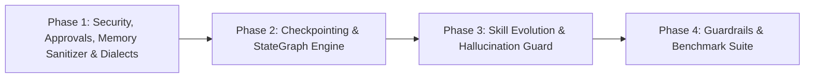

# Prioritized Engineering Implementation Roadmap (Audited & Refined)

**Authoritative Engineering Execution Plan — AI Employee Platform**  
**Repository Working Directory**: `D:\AI-Employee-Platform`  
**Audit Status**: Verified via Live Pytest Audit (`tests/test_evidence_audit_priority_risks.py`)  
**Target Milestone**: Digital Employee Autonomous Evolution  

---

## 1. Roadmap Architecture & Execution Philosophy

This roadmap outlines the systematic transition of the AI Employee Platform into an autonomous digital employee. The plan is organized into four sequential, test-gated phases.

### Core Implementation Principles
1. **Zero Downtime & Zero Regression**: Every phase must maintain full backward compatibility with the existing 833 passing tests in `tests/`.
2. **Database Isolation Guard**: All migration scripts and integration tests must run exclusively against the isolated test database `ai_employee_test` (Port 5433), keeping production DB `ai_employee` untouched.
3. **Verification Before Progression**: No phase may begin until the previous phase's automated verification suite passes with 100% success.
4. **Zero Heavy Production Dependencies**: No external frameworks (`langchain`, `dify`, `n8n`) may be added to `pyproject.toml`. All patterns are natively adapted in Python 3.14 / SQLAlchemy 2.0.

---

## 2. Phased Engineering Work Packages

### Phase 1: Security, Approval Hardening, Memory Sanitizer & Dialect Normalization (Immediate Priority)

#### Objectives
Eliminate approval hijacking, introduce approval expiration, implement the missing secret masking helper discovered during audit, and ensure dialectal Arabic intent extraction.

#### Tasks & Deliverables
1. **Dual-Mode Approval Correlation Token & Expiration System**:
   - Update `packages/models/domain.py` to add to `Approval`:
     - `token`: `Mapped[str | None] = mapped_column(String(16), nullable=True, index=True)`
     - `expires_at`: `Mapped[datetime | None] = mapped_column(DateTime(timezone=True), nullable=True)`
   - Generate Alembic migration script targeting `ai_employee_test`.
   - Update `ApprovalService.create_approval` to support `token` generation (e.g. `APP-` + 4 alphanumeric characters) and default `expires_at` (e.g. 72 hours).
   - Enforce token and expiration checks in `ApprovalService.approve`.
2. **Memory Sanitizer Helper Implementation (Audit Finding Fix)**:
   - Implement `MemorySanitizer.mask_secrets(cls, text: str) -> str` in `packages/memory/sanitizer.py` using `PATTERNS` regex dictionary to replace matches with `"[REDACTED_SECRET]"`.
   - Resolves the `AttributeError` in `ExecutionSandbox._sanitize_and_truncate`.
3. **Anti-Hijacking Intent Guard in Conversational Engine**:
   - Refactor `_process_owner_message` in `packages/services/conversational_agent_engine.py`:
     - Disqualify conversational affirmations ("نعم", "موافق", "أوافق") that lack a valid approval token or active thread context.
     - Reject approvals where `datetime.now(timezone.utc) > approval.expires_at`.
4. **Arabic Dialect Normalization Engine**:
   - Create `packages/nlp/dialect_normalizer.py` implementing `ArabicDialectNormalizer`.
   - Add comprehensive dictionary mappings for Yemeni ("اشتي"), Saudi ("ابغى"), Egyptian ("عايز"), and Levantine ("بدي").
   - Integrate normalizer as pre-processing step in `OwnerIntentRouter.parse_intent`.

#### Verification Gates
- Execute targeted regression: `pytest tests/test_approval_service.py tests/test_evidence_audit_priority_risks.py -v`
- Al-Mundhir scenario test: verify that teaching message containing "نعم" records knowledge and does NOT approve pending approvals.

---

### Phase 2: Transactional Checkpointing & StateGraph Migration

#### Objectives
Transition the monolithic procedural `ConversationalAgentEngine` into a native, cyclic `StateGraph` with durable PostgreSQL checkpointing and row-level locking.

#### Tasks & Deliverables
1. **Durable Checkpoint Schema Migration**:
   - Create tables `agent_task_checkpoints` and `agent_task_writes` with `tenant_id` foreign key and indexes on `thread_id` and `checkpoint_id`.
   - Migration script in `infrastructure/migrations/versions/` executed against `ai_employee_test`.
2. **Native Python StateGraph Engine**:
   - Create `packages/orchestration/state_graph.py` implementing `StateGraph`, `PregelLoop`, `Node`, `Edge`, and `Channel`.
   - Create `packages/orchestration/postgres_checkpointer.py` saving and loading state snapshots with `with_for_update()` row locking to eliminate race conditions.
3. **Interrupt & Resumption Primitives**:
   - Implement `interrupt(payload: dict[str, Any])` to pause execution, commit checkpoint snapshot, and notify the user via Outbox.
   - Implement `resume_workflow(thread_id: str, resume_payload: Any)` to load checkpoint and resume execution without re-executing completed nodes.
4. **Integration with Inbound Message Pipeline**:
   - Refactor `ConversationalAgentEngine.process_incoming_message` to route through compiled `StateGraph`.

#### Verification Gates
- Execute multi-turn pause/resume test: suspend task on Day 1, resume on Day 2, verify state integrity and zero duplicate outbox events.
- Pytest suite: `tests/test_stategraph_checkpointing.py`.

---

### Phase 3: Transactional Skill Evolution & Hallucination Guard

#### Objectives
Implement Memento-Skills' 3-gate dynamic capability verification, empirical utility scoring, and pre-execution tool hallucination interception.

#### Tasks & Deliverables
1. **Pre-Execution Hallucination Guard**:
   - Create `packages/tools/hallucination_guard.py` implementing `HallucinationGuard`.
   - Intercept tool calls prior to execution; validate tool name against `ToolRegistry`; provide fuzzy match suggestions using `difflib.get_close_matches(tool_name, registered_tools, n=3, cutoff=0.65)`.
2. **3-Gate Transactional Skill Verification Pipeline**:
   - Refactor `packages/self_development/engine.py`:
     - Gate 1: Static AST verification (`CapabilitySecurityVerifier`).
     - Gate 2: Local isolated unit test runner (`backend="subprocess"` in temp workspace).
     - Gate 3: Synthetic LLM Judge Gate (`SYNTHETIC_JUDGE_PROMPT`).
   - Implement atomic database activation and instant rollback on failure.
3. **Empirical Utility Tracking System**:
   - Create table `tool_utility_metrics` (`tenant_id`, `tool_slug`, `success_count`, `failure_count`, `utility_score`).
   - Increment success/failure upon every tool execution.
   - Use utility score to dynamically guide tool selection in the planner.

#### Verification Gates
- Inject malformed and AST-violating dynamic tool candidates: verify rejection at Gates 1, 2, and 3.
- Verify automatic rollback when runtime failure is simulated.
- Pytest suite: `tests/test_dynamic_skill_evolution.py`.

---

### Phase 4: Dual-Tier Guardrails, Observability & 100-Scenario Evaluation

#### Objectives
Enforce input/output guardrails, failure attribution telemetry, and run the 100-scenario behavioral benchmark suite.

#### Tasks & Deliverables
1. **Dual-Tier Guardrails Pipeline**:
   - Create `packages/guardrails/input_guardrail.py` (prompt injection screening, PII masking).
   - Create `packages/guardrails/output_guardrail.py` (unauthorized commitment checks, prompt leakage defense).
2. **Automated Failure Attribution**:
   - Create `packages/services/failure_attribution_service.py` to classify execution failures into:
     `LLM_REASONING_ERROR`, `TOOL_EXECUTION_BUG`, `EXTERNAL_API_TIMEOUT`, `MISSING_PERMISSION`, `KNOWLEDGE_RETRIEVAL_GAP`.
3. **Execution of 100-Scenario Benchmark Suite**:
   - Run `scripts/run_agent_evaluations.py` across all 6 dimensions.
   - Generate structured evaluation report in `artifacts/evaluation_report.json`.
4. **Git Checkpoint & Documentation Update**:
   - Update `GEMINI.md` and repository architectural documentation.
   - Commit stable checkpoint.

#### Verification Gates
- Full regression suite passing: $833 + N$ tests passing with 0 failures.
- Benchmark score: $\ge 96\%$ Dialect Intent Accuracy, 100% Approval Precision, 0.00% Cross-Tenant Leakage.
